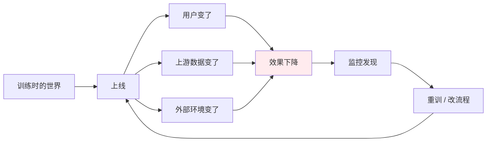
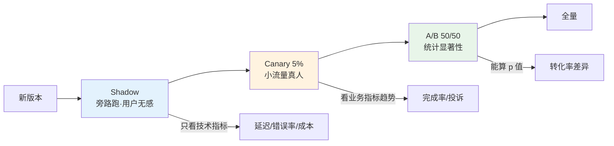
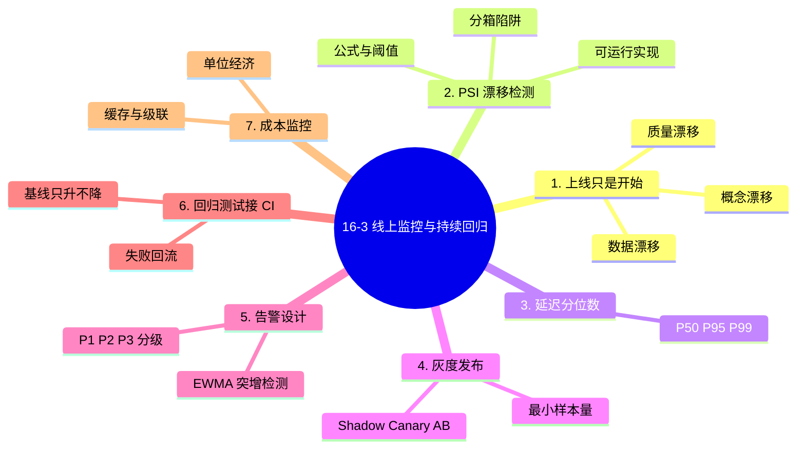

# 16-3 线上监控与持续回归

## 学习目标

- 理解模型上线后"变差"的三种机制及其时间尺度
- 会用 PSI / KL 散度检测数据漂移，并知道阈值怎么定
- 能正确读延迟分位数，理解为什么看 P95 而不是均值
- 会算灰度发布所需的最小样本量
- 能搭一套能拦住退化的回归测试

---

## 1. 上线只是开始

一个反直觉的事实：**模型不会"过期"，是数据变了**。同一个模型权重，三个月后效果可能掉 10 个点——不是它退化了，是它面对的输入换了。



三类变化，时间尺度完全不同：

| 类型 | 定义 | 例子 | 典型周期 |
|------|------|------|---------|
| **数据漂移** | 输入分布变了，规律没变 | 用户从 PC 转向手机，输入变短 | 周-月 |
| **概念漂移** | 输入到输出的映射变了 | 退款政策改了，"多久到账"的正确答案变了 | 月-季 |
| **质量漂移** | 输出质量下降但分布未必变 | 上游检索库更新导致 RAG 变差 | 随时 |

> **关键**：数据漂移能用统计检测，**概念漂移必须靠标注反馈**，质量漂移要靠端到端抽样。三者工具不同。

---
> **与离线评测的关系**：线上发现漂移后，下一步是把新样本回收进评测集重新测——评测集的三层结构与污染检测见 [16-1 模型评测体系与指标](./16-1-模型评测体系与指标.md) §7。

## 2. 漂移检测：PSI 与阈值

**PSI（Population Stability Index）** 是最通用的漂移指标，把特征分箱后比较两期占比：

$$
\text{PSI}=\sum_{i=1}^{B}\left(p_i^{\text{now}}-p_i^{\text{base}}\right)\ln\frac{p_i^{\text{now}}}{p_i^{\text{base}}}
$$

**手算**：某个"输入长度"特征分 3 箱，基线占比 50%/30%/20%，当前 30%/30%/40%。

| 箱 | 基线 p | 当前 q | (q−p)·ln(q/p) |
|---|---:|---:|---:|
| 短 | 0.5 | 0.3 | (−0.2)·ln0.6 = **+0.102** |
| 中 | 0.3 | 0.3 | 0 |
| 长 | 0.2 | 0.4 | 0.2·ln2 = **+0.139** |

$$\text{PSI}=0.102+0+0.139=\mathbf{0.241}$$

**阈值（业界通行）**：

| PSI | 判断 | 动作 |
|-----|------|------|
| < 0.1 | 稳定 | 无需处理 |
| 0.1 - 0.25 | 有变化 | 观察，准备重训 |
| > 0.25 | 显著漂移 | **触发重训 / 排查上游** |

本例 0.241 落在"有变化"区间，接近红线。

---
### 2.1 可运行的 PSI 实现

```python
import numpy as np

def psi(base, curr, bins=10, eps=1e-6):
    """base/curr: 一维数组。分箱按 base 的分位点切"""
    edges = np.quantile(base, np.linspace(0, 1, bins + 1))
    edges[0], edges[-1] = -np.inf, np.inf
    b = np.histogram(base, bins=edges)[0] / len(base)
    c = np.histogram(curr, bins=edges)[0] / len(curr)
    b, c = np.clip(b, eps, None), np.clip(c, eps, None)
    return float(np.sum((c - b) * np.log(c / b)))

rng = np.random.default_rng(0)
base = rng.normal(100, 10, 10000)
print("同分布:", round(psi(base, rng.normal(100, 10, 10000)), 4))  # 实测 0.0012
print("均值+8:", round(psi(base, rng.normal(108, 10, 10000)), 4))  # 实测 0.5952
```

**两个工程细节**：

1. **分箱要用基线的分位点**，不能各自分箱——否则分布变了但分箱也跟着变，PSI 恒为 0。
2. **空箱要加平滑**（代码里的 `eps`），否则 `ln(0)` 会炸。

---
## 3. 延迟指标：为什么必须看 P95

均值是最容易骗人的指标。

**手算**：10 次请求耗时（秒）`[0.2,0.2,0.2,0.2,0.2,0.2,0.2,0.2,0.2,3.0]`

- 均值 = 0.52 s → 看起来"半秒，还行"
- P50 = 0.2 s → 一半用户在 0.2 秒内返回，**很好**
- P95 ≈ 3.0 s → 最慢的那批用户等了 3 秒，**很糟**

一个 3 秒的慢请求把均值拉高了 2.6 倍，却掩盖了"绝大多数请求其实很快"。反过来，如果只看均值，你也不知道有 5-10% 的用户在忍受长等待。

| 指标 | 含义 | 用途 |
|------|------|------|
| P50 | 中位数，典型体验 | 对外宣称的性能 |
| **P95** | 95% 用户快于这个值 | **SLO 的主要指标** |
| P99 | 最慢的 1% | 排查长尾、超时设置 |

> **经验阈值**：对话类产品 P95 > 5s 明显影响留存；Agent 类因为多步调用，P95 到 30s 也可能可接受，但必须有进度反馈。

---
## 4. 灰度发布：样本量决定你能不能"看出来"

Shadow / Canary / A/B 的区别不只是流量比例，而是**能不能得出统计结论**。



**最小样本量怎么估**：要检测两个版本转化率相差 $\Delta$（如 32% vs 30%，Δ=2%），每组所需样本量约为

$$
n \approx \frac{16\,p(1-p)}{\Delta^2}
$$

代入 $p=0.31$、$\Delta=0.02$：

$$
n \approx \frac{16 \times 0.31 \times 0.69}{0.0004} \approx 8556
$$

**结论**：想可靠地看出 2 个百分点的提升，**每组要 8500 个样本**。如果日活只有 2000，5% 灰度要跑一个多月——这时候"灰度一周就下结论"基本是在看噪声。

---
## 5. 告警：静态阈值会骗你

只用固定阈值会遇到两个问题：白天流量高，噪声大；节假日流量低，正常波动就触发。

**EWMA（指数加权移动平均）** 是更稳的做法：它跟踪"最近的基线"，用相对变化触发。

$$
z_t=\alpha\,x_t+(1-\alpha)\,z_{t-1},\qquad \text{异常条件：}|x_t-z_{t-1}|>k\,\sigma_{t-1}
$$

```python
class EwmaDetector:
    """在线突增/突降检测，无需预设绝对阈值"""
    def __init__(self, alpha=0.2, k=3.0):
        self.alpha, self.k = alpha, k
        self.mu = None
        self.var = None

    def update(self, x):
        if self.mu is None:
            self.mu, self.var = x, 0.0
            return False
        sigma = max(self.var ** 0.5, 1e-9)
        alarm = abs(x - self.mu) > self.k * sigma
        self.var = (1 - self.alpha) * (self.var + self.alpha * (x - self.mu) ** 2)
        self.mu = self.alpha * x + (1 - self.alpha) * self.mu
        return alarm
```

**分级告警比单一阈值更实用**：

| 级别 | 条件 | 动作 |
|------|------|------|
| P3 | PSI > 0.1 或 P95 超基线 20% | 记录，次日看 |
| P2 | PSI > 0.25 或错误率 > 1% | 值班群通知 |
| P1 | 越权调用 / 敏感信息泄露 / 错误率 > 5% | **立即告警 + 可自动降级** |

---
## 6. 回归测试：把评测接进 CI

核心思想：**每次改模型、改 prompt、改检索器，都跑同一批固定题，掉分就拦住**。

```python
import json, pathlib

BASELINE = pathlib.Path("eval/baseline.json")

def run_regression(cases, evaluator, max_drop=0.02):
    """返回 (是否通过, 报告)；掉分超过 max_drop 即不通过"""
    results = {c["id"]: evaluator(c) for c in cases}
    score = sum(results.values()) / len(results)
    base = json.loads(BASELINE.read_text())["score"]
    passed = score >= base - max_drop
    return passed, {"score": score, "baseline": base,
                    "delta": round(score - base, 4),
                    "failed_cases": [k for k, v in results.items() if not v]}

def promote(new_score):
    """只有明显提升才更新基线，避免基线被噪声拉低"""
    old = json.loads(BASELINE.read_text())
    if new_score > old["score"]:
        BASELINE.write_text(json.dumps({"score": new_score}))
```

**三条工程规矩**：

1. **基线只升不降**，否则会慢慢烂掉。
2. **失败样本自动进问题库**，成为下一版边界集（见 16-1 §7）。
3. **测试集有版本号**，能回答"上次 0.82 是用哪版数据算的"。

---
## 7. 成本监控：最容易被忽略的一条线

模型服务有个特点：**成本随使用量线性增长，但收入未必**。所以必须实时看"单位经济"。

| 指标 | 算法 | 危险信号 |
|------|------|---------|
| 单次请求成本 | 总花费 / 请求数 | 环比涨 30% 以上 |
| 每用户成本 | 总花费 / 活跃用户 | 超过客单价的一定比例 |
| 缓存命中率 | 命中 token / 总输入 token | 低于 40%（长 prompt 场景） |
| 无效 token 占比 | 被截断/重试的 token / 总量 | 高于 10% |

**两个立即见效的优化**（详见 7-8 §9）：

1. **开启 prompt 缓存**：长系统提示、固定文档、代码库前缀，命中后输入成本可降到 2-10%。
2. **模型级联**：简单请求走便宜模型，只把难请求升级。

> 一个真实的反直觉：**输出 token 单价通常是输入的 3-5 倍**，所以限制"说废话"比压缩"读资料"更省钱。

---
## 本章小结

1. **模型不会过期，数据会变**。数据漂移（统计可测）、概念漂移（需标注反馈）、质量漂移（需端到端抽样）三类，工具不同。
2. **PSI 是通用漂移指标**：< 0.1 稳定、0.1-0.25 观察、> 0.25 触发重训。分箱必须用基线分位点，否则 PSI 恒为 0（代码已实测：同分布 0.0012，均值偏移 0.8σ 得 0.5952）。
3. **延迟要看 P95**：10 次请求里 1 次 3 秒，均值 0.52s 会掩盖问题，P95 才能反映长尾体验。
4. **灰度能不能看出结论，取决于样本量**：检测 2 个百分点的差异每组约需 8500 个样本，日活不够时"灰度一周"是在看噪声。
5. **告警用 EWMA 而非固定阈值**，分 P1/P2/P3 三级，越权与泄露必须立即响应。
6. **回归测试接进 CI**：基线只升不降、失败样本回流、测试集带版本号。
7. **成本要按单位经济监控**：单次成本、每用户成本、缓存命中率、无效 token 占比；缓存 + 模型级联是最快见效的两招。

---

## 知识图谱



## 参考资料

1. Yurdakul, B. (2018). *Statistical Properties of Population Stability Index*. Western Michigan University.（PSI 性质与阈值讨论）
2. Sculley, D., et al. (2015). *Hidden Technical Debt in Machine Learning Systems*. NeurIPS.
3. Gama, J., et al. (2014). *A Survey on Concept Drift Adaptation*. ACM Computing Surveys.
4. Kohavi, R., Tang, D., & Xu, Y. (2020). *Trustworthy Online Controlled Experiments*. Cambridge University Press.（A/B 样本量与显著性）
5. Roberts, S. W. (1959). *Control Chart Tests Based on Geometric Moving Averages*. Technometrics.（EWMA 原始文献）
