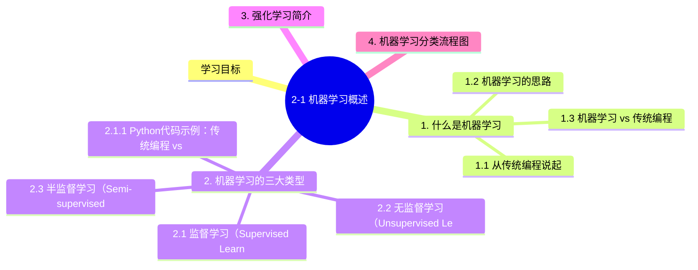

# 2-1 机器学习概述

## 学习目标

- 理解什么是机器学习，以及它与传统编程的区别
- 掌握监督学习、无监督学习、半监督学习、弱监督学习和自监督学习的定义与区别
- 了解强化学习的基本概念
- 能够用流程图说明机器学习的分类体系

---

## 1. 什么是机器学习

### 1.1 从传统编程说起

在传统编程中，我们需要**显式地编写规则**让计算机执行。比如，判断一封邮件是否为垃圾邮件，传统编程的方式是：

```
如果 邮件包含"免费""中奖""点击链接" 等词语：
    标记为垃圾邮件
否则：
    标记为正常邮件
```

这种方式的问题是：**规则需要人工设计，且难以应对复杂多变的实际情况**。现实中，垃圾邮件的特征远非几条简单规则能覆盖。

### 1.2 机器学习的思路

机器学习（Machine Learning，简称 ML）的思路截然不同：**不是我们告诉计算机规则，而是让计算机自己从数据中发现规律**。

> **机器学习的经典定义**（Tom Mitchell）：一个计算机程序在任务 T 上的性能 P，通过经验 E 获得提升，我们就说这个程序对任务 T 从经验 E 中学习了。

用上面的例子来说，机器学习的过程是：

1. **喂给计算机大量邮件数据**，每封邮件标注了"垃圾"或"正常"
2. 计算机**自动从数据中学习**哪些词语/模式倾向于出现在垃圾邮件中
3. 学习完成后，给定一封新邮件，程序能**预测**它是垃圾还是正常

这个过程更像：**教小孩学会区分猫和狗**——不是告诉他"猫有尖耳朵、狗有垂耳朵"这些精确规则，而是给他大量猫和狗的图片，让他自己总结规律。

### 1.3 机器学习 vs 传统编程

| 对比维度 | 传统编程 | 机器学习 |
|---------|---------|---------|
| 规则来源 | 人工设计编写 | 从数据中自动学习 |
| 适用场景 | 规则明确、环境稳定 | 规则难以定义、数据复杂 |
| 典型应用 | 计算器、日历 App | 图像识别、语音识别、推荐系统 |
| 人的介入 | 深 度介入 | 主要在数据和特征层面介入 |

---

## 2. 机器学习的三大类型

机器学习按照**是否有标签（Label）**可以分为几大类，我们先从最核心的两类说起。

### 2.1 监督学习（Supervised Learning）

**定义**：训练数据中每个样本都有对应的"答案"（标签），模型学习的是输入到输出的映射关系。

通俗理解：有老师指导的学习，"老师"给的训练数据包含问题和标准答案。

**两个典型任务**：

#### （1）分类（Classification）

输出是离散的类别标签。典型例子：

- 邮件分类：垃圾邮件 vs 正常邮件（二分类）
- 图像分类：猫 vs 狗 vs 鸟 vs ...（多分类）
- 信用风险：低风险、中风险、高风险（多分类）

常用算法：逻辑回归、决策树、随机森林、支持向量机（SVM）、神经网络等。

#### （2）回归（Regression）

输出是连续的数值。典型例子：

- 房价预测：给定房屋面积、位置等，预测价格（具体数值）
- 气温预测：给定今天的气象数据，预测明天的温度
- 股票价格预测：预测未来的股价

常用算法：线性回归、岭回归、决策树回归、GBDT 等。

**监督学习的工作流程**：

```
训练阶段：
  输入数据（特征） + 标签（标准答案）
        ↓
  模型学习输入→输出的映射关系
        ↓
  得到训练好的模型

预测阶段：
   输入新数据（无标签）
         ↓
   模型输出预测结果
```

### 2.1.1 Python代码示例：传统编程 vs 机器学习

```python
# ================================
# 传统编程方式：手工定义规则
# ================================

def traditional_spam_filter(email_text):
    """传统编程：手工定义垃圾邮件规则"""
    spam_keywords = ["免费", "中奖", "点击链接", "立即领取", "限时优惠"]
    
    for keyword in spam_keywords:
        if keyword in email_text:
            return "垃圾邮件"
    return "正常邮件"

# 测试传统规则
test_emails = [
    "恭喜您中奖了，点击链接领取免费奖品",  # 包含关键词
    "亲爱的用户，您的账单已生成",           # 不包含关键词
    "限时优惠，立即点击链接购买"            # 包含关键词
]

print("传统编程结果:")
for email in test_emails:
    result = traditional_spam_filter(email)
    print(f"  '{email[:20]}...' → {result}")

# ================================
# 机器学习方式：从数据中学习
# ================================
import numpy as np
from sklearn.feature_extraction.text import CountVectorizer
from sklearn.naive_bayes import MultinomialNB

# 训练数据：邮件内容 + 标签（0=正常, 1=垃圾）
train_emails = [
    "免费领取优惠券点击链接", "中奖通知立即领取", "限时优惠立即购买",
    "会议通知请准时参加", "项目进展报告", "亲爱的用户您好"
]
train_labels = [1, 1, 1, 0, 0, 0]  # 1=垃圾, 0=正常

# 特征提取：将文本转换为词频向量
vectorizer = CountVectorizer()
X_train = vectorizer.fit_transform(train_emails)

# 训练朴素贝叶斯分类器
model = MultinomialNB()
model.fit(X_train, train_labels)

# 预测新邮件
new_emails = ["免费中奖点击链接", "项目会议安排", "优惠促销限时"]
X_new = vectorizer.transform(new_emails)
predictions = model.predict(X_new)

print("\n机器学习结果:")
for email, pred in zip(new_emails, predictions):
    label = "垃圾邮件" if pred == 1 else "正常邮件"
    print(f"  '{email}' → {label} (概率: {model.predict_proba(vectorizer.transform([email]))[0][pred]:.2f})")
```

**代码说明：**
1. **传统编程**：手工定义关键词列表，遇到特定词就判断为垃圾邮件
2. **机器学习**：从训练数据中学习模式，可以识别更复杂的组合和上下文
3. **优势对比**：传统方法规则固定，难以适应新变种；机器学习方法可以自动学习更复杂的模式

### 2.2 无监督学习（Unsupervised Learning）

**定义**：训练数据没有标签，模型需要在**没有"老师"的情况下**发现数据内部的结构和规律**。

通俗理解：自己摸索规律，自己给数据分组。

**两个典型任务**：

#### （1）聚类（Clustering）

将相似的样本自动归为同一组（簇），组内相似度高，组间相似度低。

典型例子：
- 客户分群：根据消费行为将客户分成不同群体（高价值客户、潜力客户、流失风险客户等）
- 图片自动分组：将大量图片按内容相似度分成不同 album
- 文档归类：将大量新闻文章按主题自动分组

常用算法：K-Means、DBSCAN、层次聚类、吸引力传播算法等。

#### （2）降维（Dimensionality Reduction）

将高维数据压缩到低维，同时尽量保留重要信息。

典型例子：
- 可视化：将几十维的数据降到 2~3 维用于可视化
- 特征压缩：减少数据中的冗余特征，加快后续模型训练
- 去噪：去除数据中的噪声

常用算法：PCA（主成分分析）、t-SNE、自编码器（Autoencoder）等。

**降维的可视化解释**：

想象一个 3D 空间中的数据点分布在一个扁平化的碟形区域——从特定角度看，它只需要 2 个维度就能很好地描述。降维做的就是找到这个最佳观察角度。

### 2.3 半监督学习（Semi-supervised Learning）

**定义**：训练数据中**少量有标签 + 大量无标签**，模型同时利用两者进行学习。

为什么有用？因为**获取标签往往成本很高**（比如医疗影像需要专家标注），而**无标签数据容易获取**。

**典型场景**：
- 医疗影像分析：少量专家标注 + 大量未标注的扫描图
- 网络文本分类：少量人工标注的网页 + 大量未标注的网页
- 语音识别：少量转录语音 + 大量未转录的音频

**常见方法**：
- **Self-Training（自训练）**：先用有标签数据训练一个 Teacher 模型，用它给无标签数据打伪标签，再用伪标签数据训练 Student 模型
- **Co-Training**：用两个不同视角的分类器互相Teaching
- **标签传播（Label Propagation）**：基于样本间的相似性将标签扩散到无标签数据

### 2.4 弱监督学习（Weakly Supervised Learning）

**定义**：用**不完整、不准确或嘈杂的标签**数据进行学习。

这里的"弱"指的是标签质量"弱"，不是指模型能力弱。

**三种典型情况**：

| 类型 | 说明 | 举例 |
|-----|------|------|
| 不完整的监督 | 只有部分样本有标签 | 多数医疗数据的状态是"未确诊"而非明确的"阳/阴" |
| 不准确的监督 | 标签存在错误或噪声 | 图像标注中存在标注错误 |
| 粗粒度的监督 | 标签粒度比任务需求粗 | 只知道图片中有"动物"但不知道具体是什么动物 |

### 2.5 自监督学习（Self-Supervised Learning）

**定义**：在没有人工标签的情况下，让模型从数据本身设计" pretext task（代理任务）"，通过完成这些任务来学习有用的特征表示。

**核心思想**：不需要外部标签，而是**从数据中自己创造标签**。

**常见方法**：

| 方法 | 代理任务 | 学习目标 |
|-----|---------|---------|
| 对比学习（Contrastive Learning） | 拉近相似样本的距离，拉远不相似样本的距离 | 学习样本的表示向量 |
| 掩码预测（Masked Prediction） | 遮挡输入的一部分，预测被遮挡的内容 | 理解数据结构 |
| 旋转预测（Rotation Prediction） | 预测图像被旋转了多少度 | 学习物体朝向 |
| 拼图任务（Jigsaw） | 将打乱的图片块复原 | 理解空间关系 |

**为什么重要**？自监督学习让模型能在**海量无标签数据**上预训练，学到强大的通用特征，然后在下游任务上用少量标签微调（Fine-tune）。这极大地降低了数据标注成本。

典型应用：
- 大语言模型（LLM）的预训练：用大量文本做自监督学习（预测下一个词）
- 计算机视觉中的 MAE、BERT 等方法

---

## 3. 强化学习简介

**强化学习（Reinforcement Learning，简称 RL）** 与监督/无监督学习有本质区别：

| | 监督学习 | 强化学习 |
|--|---------|---------|
| 学习方式 | 从"正确答案"中学习 | 从与环境交互的**奖励/惩罚**中学习 |
| 数据形式 | 静态的"输入-输出"对 | 动态的"状态-动作-奖励"序列 |
| 决策者 | 被动接受标签 | 主动选择动作 |
| 反馈 | 立即知道对错 | 延迟知道（等整个任务结束才知好坏） |

**核心概念**：

- **智能体（Agent）**：做决策的主体（如机器人、游戏 AI）
- **环境（Environment）**：智能体所处的外部世界
- **状态（State, s）**：环境在某一时刻的状态描述
- **动作（Action, a）**：智能体可以采取的行为
- **奖励（Reward, r）**：环境反馈给智能体的信号（好/坏）
- **策略（Policy, π）**：智能体根据状态选择动作的规则

**强化学习的基本流程**：

```
智能体观察环境状态 s
    ↓
根据策略 π 选择动作 a
    ↓
动作作用于环境，环境转换到新状态 s'
    ↓
环境反馈奖励 r
    ↓
智能体更新策略
    ↓
循环
```

**典型应用**：
- 游戏 AI：AlphaGo、Atari 游戏
- 机器人控制：机械臂操作、自动驾驶
- 推荐系统：动态推荐策略优化

**与监督学习的本质区别**：强化学习中的"对错"不是立即知道的，而是通过一系列动作后的最终奖励来判断，智能体需要学会**延迟满足**——牺牲眼前的短期利益以获得更大的长期回报。

---

## 4. 机器学习分类流程图

以下流程图系统地展示了机器学习的主要分类体系：

**补充说明**：还有介于监督和无监督之间的学习范式：

```
半监督学习 ─── 少量有标签 + 大量无标签
弱监督学习 ─── 标签不完整/不准确/嘈杂
自监督学习 ─── 无标签，从数据自身设计代理任务
```

---

## 本章小结
1. **机器学习定义**：让计算机从数据中自动学习规律并改进性能，无需明确编程
2. **学习范式完整体系**：监督学习（分类/回归）、无监督学习（聚类/降维）、半监督学习、弱监督学习、自监督学习、强化学习
3. **经典算法覆盖**：线性模型、SVM、决策树、随机森林、朴素贝叶斯、KNN、神经网络
4. **核心应用场景**：计算机视觉、自然语言处理、推荐系统、语音识别
5. **与其他学科关系**：统计学、概率论、最优化理论、神经科学交叉融合

理解这些分类体系，是后续学习具体算法的基础。在实际项目中，往往**不是单一使用某种范式**，而是多种方法组合使用——比如先用自监督学习预训练一个特征提取器，再用监督学习做分类任务。


## 知识图谱



## 参考资料

- 周志华.《机器学习》（西瓜书）第 1 章
- Tom Mitchell.《Machine Learning》Chapter 1

### 机器学习奠基性论文

1. **Vapnik, V. N. (1995).** Support-vector networks. *Machine Learning*, 20(3), 273–297. — SVM 支持向量机的奠基性工作
2. **Breiman, L. (2001).** Random Forests. *Machine Learning*, 45(1), 5–32. — 随机森林的开山之作
3. **Quinlan, J. R. (1986).** Induction of Decision Trees. *Machine Learning*, 1(1), 81–106. — 决策树算法的经典文献
4. **Cortes, C., & Vapnik, V. (1995).** Support-vector networks. *Machine Learning*, 20(3), 273–297. — SVM 的另一重要版本
5. **LeCun, Y., Bottou, L., Bengio, Y., & Haffner, P. (1998).** Gradient-based learning applied to document recognition. *Proceedings of the IEEE*, 86(11), 2278–2324. — 反向传播算法的经典应用
