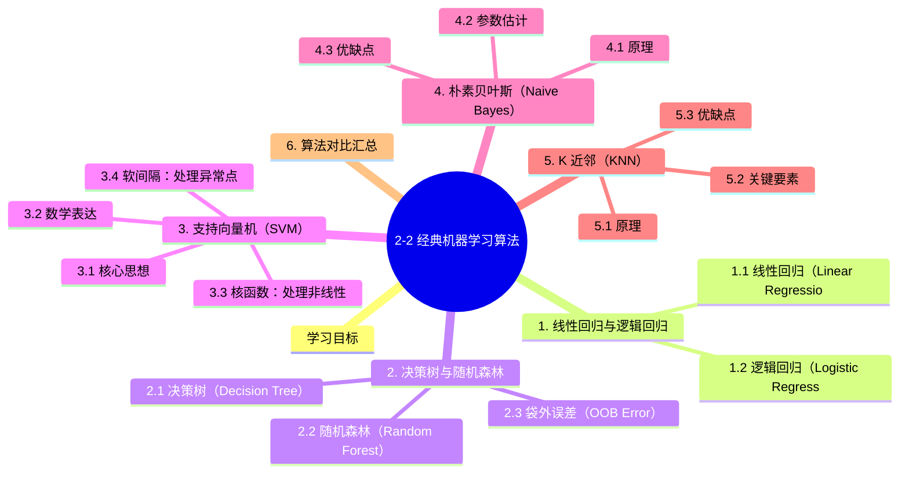

# 2-2 经典机器学习算法

## 学习目标

- 理解线性回归与逻辑回归的原理、适用场景及优缺点
- 掌握决策树与随机森林的工作机制及核心概念（信息增益、基尼系数、剪枝等）
- 了解支持向量机（SVM）的核心思想及核函数的作用
- 理解朴素贝叶斯的概率原理
- 掌握 K 近邻（KNN）算法的思想
- 能根据不同场景选择合适的算法

---

## 1. 线性回归与逻辑回归

这两个算法名字相似，但本质上**线性回归解决的是回归问题，逻辑回归解决的是分类问题**。

### 1.1 线性回归（Linear Regression）

**原理**：试图找到一条直线（或一个超平面）来拟合输入特征与连续输出之间的关系。

**数学表达**：

假设输入特征为 $\vec{x} = (x_1, x_2, ..., x_n)$，线性回归假设输出是特征的线性组合：

$$
h_\theta(\vec{x}) = \theta_0 + \theta_1 x_1 + \theta_2 x_2 + ... + \theta_n x_n = \vec{\theta}^T \vec{x}
$$

其中 $\vec{\theta}$ 是模型参数。

**如何求 $\vec{\theta}$**？最小化均方误差（MSE）：

$$
J(\vec{\theta}) = \frac{1}{m} \sum_{i=1}^{m} (h_\theta(\vec{x}^{(i)}) - y^{(i)})^2
$$

常用方法：**正规方程**（直接求解）或**梯度下降**（迭代优化）。

**适用场景**：
- 预测连续值：房价预测、气温预测、销售额预测
- 分析变量间的线性关系

**优缺点**：

| 优点 | 缺点 |
|-----|------|
| 简单直观，易于理解 | 只能处理线性关系 |
| 训练和预测速度快 | 对异常值敏感 |
| 可解释性强（系数反映特征重要性） | 特征需要预处理（归一化等） |

### 1.2 逻辑回归（Logistic Regression）

**注意**：尽管名字带"回归"，逻辑回归是**经典的二分类算法**。

**原理**：在线性回归的基础上，通过 Sigmoid 函数将线性输出映射到 [0,1] 区间，表示概率。

$$
h_\theta(\vec{x}) = \sigma(\vec{\theta}^T \vec{x}) = \frac{1}{1 + e^{-(\vec{\theta}^T \vec{x})}}
$$

**输出解释**：$h_\theta(\vec{x})$ 表示样本属于正类（通常为 $y=1$）的概率。阈值一般设为 0.5：

- 若 $h_\theta(\vec{x}) \geq 0.5$，预测为正类
- 若 $h_\theta(\vec{x}) < 0.5$，预测为负类

**损失函数**：使用对数损失（Log Loss），而非 MSE：

$$
J(\vec{\theta}) = -\frac{1}{m} \sum_{i=1}^{m} [y^{(i)} \log(h_\theta(\vec{x}^{(i)})) + (1-y^{(i)}) \log(1-h_\theta(\vec{x}^{(i)}))]
$$

**适用场景**：
- 二分类问题：垃圾邮件判断、信用风险评估、疾病诊断
- 需要输出概率的场景：疾病风险评分、客户流失概率

**优缺点**：

| 优点 | 缺点 |
|-----|------|
| 输出概率值，可解释性强 | 只能处理线性可分数据 |
| 训练预测效率高 | 对特征工程有一定依赖 |
| 易于正则化，防止过拟合 | 不适用于复杂非线性问题 |

---

## 2. 决策树与随机森林

### 2.1 决策树（Decision Tree）

**原理**：用树形结构进行决策。从根节点开始，对每个特征进行判断，逐步分裂直至叶子节点（最终决策结果）。

**三个关键问题**：

#### （1）数据如何分割？

- **离散型特征**：按属性值分裂，每个取值对应一个分支
- **连续型特征**：对数据排序后划分区间（如 $[0, 10]$、$[10, 20]$ 等），落入某区间则属于对应节点

#### （2）如何选择分裂属性？

决策树采用**贪婪算法**，选择使分裂后节点"更纯"的属性。

**纯度的衡量标准**：

**信息熵（Entropy）**：
$$
Ent(D) = - \sum_{k=1}^{|y|}{p_k \log_2 p_k}
$$
其中 $p_k$ 是类别 $k$ 的样本占比。熵越大，数据越混乱（纯度越低）。

**信息增益（Information Gain）**：分裂前后熵的变化
$$
Gain(D, a) = Ent(D) - \sum_{v=1}^{V} \frac{|D^v|}{|D|} Ent(D^v)
$$
信息增益越大，说明使用属性 $a$ 分裂效果越好。

**基尼值（Gini）**：另一种纯度指标
$$
Gini(D) = 1 - \sum_{k=1}^{|y|}{p_k^2}
$$
基尼值越大，数据越不纯。

**增益率（Gain Ratio）**：为了克服信息增益对多取值属性的偏好：
$$
Gain\_ratio(D, a) = \frac{Gain(D, a)}{IV(a)}, \quad IV(a) = -\sum_{v=1}^{V} \frac{|D^v|}{|D|} \log_2 \frac{|D^v|}{|D|}
$$

#### （3）何时停止分裂？

- 节点数据量小于阈值
- 熵或基尼值小于阈值
- 树的深度达到上限
- 所有特征已使用完毕

**剪枝（Pruning）**：防止过拟合

| 类型 | 做法 | 特点 |
|-----|------|------|
| 预剪枝（Pre-pruning） | 分裂前评估，若不能提升泛化性能则停止 | 欠拟合风险高，训练快 |
| 后剪枝（Post-pruning） | 先长成完整树，再自底向上剪枝 | 泛化性能好，训练慢 |

### 2.2 随机森林（Random Forest）

**原理**：通过集成学习的 **Bagging** 思想，将多棵决策树组合在一起进行预测。

**构建流程**：

1. **有放回随机采样**：从原始训练集中随机采样 $m$ 个样本（有放回），构建 $T$ 个子训练集
2. **随机选择特征**：每棵树的每个节点，只从所有特征中随机选择一部分来寻找最优分裂
3. 每棵树**完整成长，不剪枝**
4. 预测时：**分类**——多棵树投票，取票数最多的类别；**回归**——多棵树输出的均值

**关键机制**：

- **数据的随机性**：每棵树用不同的 bootstrap 样本训练
- **特征的随机性**：每棵树节点只看部分特征

**优缺点**：

| 优点 | 缺点 |
|-----|------|
| 不易过拟合（方差小） | 对于取值类别多的特征影响较大 |
| 可高度并行训练，速度快 | 模型复杂，解释性不如单棵决策树 |
| 可处理高维数据 | 训练时间较长（多棵树） |
| 能给出特征重要性排序 | |

### 2.3 袋外误差（OOB Error）

随机森林的每棵树都用 **bootstrap 采样**（有放回抽样）构建训练集，这意味着每次大约有 $1 - 1/e \approx 36.8\%$ 的样本**没有被抽中**。这些未被抽中的样本称为**袋外（Out-of-Bag, OOB）样本**。

> **核心思想**：每棵树都可以用自己的 OOB 样本做"免费验证"，无需额外划分验证集。

**OOB 误差的计算方法**：

1. 对每个样本 $x_i$，收集所有**未使用 $x_i$ 训练**的树（约 63% 的树，因为每棵树 bootstrap 采样约 63.2% 的样本，$x_i$ 未被抽中的概率约 36.8%，所以约 63% 的树没用到 $x_i$）
2. 让这些树对 $x_i$ 做预测，取多数投票（分类）或平均（回归）
3. 比较预测值与真实标签，统计错误率

$$\text{OOB Error} = \frac{1}{N} \sum_{i=1}^{N} \mathbb{1}[\hat{y}_i^{\text{OOB}} \neq y_i]$$

**代码示例**：

```python
from sklearn.ensemble import RandomForestClassifier

rf = RandomForestClassifier(n_estimators=500, oob_score=True, random_state=42)
rf.fit(X_train, y_train)

print(f"OOB 误差估计: {1 - rf.oob_score_:.4f}")
# 通常与 5-fold CV 结果非常接近，但计算成本为零
```

**OOB vs 交叉验证**：

| 对比项 | OOB 误差 | K-Fold CV |
|--------|----------|-----------|
| 额外计算 | 无（训练时自动获得） | 需训练 K 次 |
| 估计精度 | 接近 LOOCV | 取决于 K |
| 适用模型 | 仅 Bagging 类 | 任意模型 |
| 实际使用 | 快速验证、调参 | 最终评估 |

> **实践建议**：用 OOB 误差做快速调参（如 `n_estimators`、`max_features`），最终报告用交叉验证。

---

## 3. 支持向量机（SVM）

### 3.1 核心思想

SVM 是一种**二分类**算法，其核心思想是找到一条**间隔最大的分类超平面**将两类样本分开。

**"间隔最大"的好处**：对噪声的容忍度最强，泛化能力最好。

**支持向量**：离超平面最近的那些点，它们"支撑"着超平面的位置。

### 3.2 数学表达

假设超平面为 $w^T x + b = 0$，SVM 的目标是最大化间隔：

$$
\begin{align}
& \min_{w,b} \frac{1}{2} |w|^2 \\
& s.t. \quad y_i(w^T x_i + b) \geq 1, \quad i = 1,2,...,m
\end{align}
$$

**间隔** = 两个异类支持向量到超平面距离之和 = $\frac{2}{|w|}$

### 3.3 核函数：处理非线性

线性不可分时，SVM 通过**核函数（Kernel Function）** 将数据映射到高维空间，在高维空间中寻找线性分类超平面。

**常用核函数**：

| 核函数 | 表达式 | 特点 |
|-------|--------|------|
| 线性核 | $\kappa(x_i, x_j) = x_i^T x_j$ | 线性可分时使用 |
| 多项式核 | $\kappa(x_i, x_j) = (x_i^T x_j + c)^d$ | 需要调参 $c, d$ |
| 高斯核（RBF） | $\kappa(x_i, x_j) = \exp(-\frac{|x_i - x_j|^2}{2\sigma^2})$ | 最常用，适合各种情况 |

**核函数的价值**：在低维空间计算内积，等效于高维空间的表现，避免了直接在高维空间计算的高复杂度。

### 3.4 软间隔：处理异常点

现实数据往往不是完全线性可分的。SVM 通过引入**松弛变量（Slack Variable）$\xi_i$** 和**正则化参数 $C$**，允许部分样本不满足约束：

$$
y_i(w^T x_i + b) \geq 1 - \xi_i
$$

参数 $C$ 控制"间隔最大化"和"训练误差"之间的权衡。$C$ 越大，对误分类的惩罚越重，越接近硬间隔 SVM。

### 3.5 优缺点

| 优点 | 缺点 |
|-----|------|
| 在高维空间效果好 | 对大规模训练数据计算量大 |
| 通过核函数可处理非线性问题 | 对参数（核函数、$C$）选择敏感 |
| 过拟合风险低，泛化能力强 | 解释性弱（不像线性模型直观） |
| 只与支持向量有关，与其他样本无关 | 不适合噪声严重的数据 |

---

## 4. 朴素贝叶斯（Naive Bayes）

### 4.1 原理

基于**贝叶斯定理**的分类方法，假设**各特征之间相互独立**（这个假设在实际中往往不成立，但仍然非常有效）。

**贝叶斯定理**：
$$
P(y | \vec{x}) = \frac{P(\vec{x} | y) P(y)}{P(\vec{x})}
$$

**"朴素"之处**：假设特征之间相互独立，即

$$
P(\vec{x} | y) = P(x_1, x_2, ..., x_n | y) = \prod_{i=1}^{n} P(x_i | y)
$$

因此对于给定的输入 $\vec{x}$，各类别的后验概率为：

$$
P(y | \vec{x}) \propto P(y) \prod_{i=1}^{n} P(x_i | y)
$$

预测时，选择**后验概率最大的类别**作为输出。

### 4.2 参数估计

各概率 $P(x_i | y)$ 和 $P(y)$ 从训练数据中统计得到（极大似然估计）。

**常见变种**：

| 算法 | 特征假设 | 适用场景 |
|-----|---------|---------|
| Gaussian NB | 特征服从高斯分布 | 连续值特征 |
| Multinomial NB | 特征是词频/计数 | 文本分类（词袋模型） |
| Bernoulli NB | 特征是二元值（0/1） | 二值化文本数据 |

### 4.3 优缺点

| 优点 | 缺点 |
|-----|------|
| 计算高效，训练快 | 特征独立性假设过于理想 |
| 在文本分类等场景效果很好 | 概率估计不总是准确 |
| 有概率输出，可解释性强 | 对特征取值频率敏感 |
| 对小规模数据也有效 |  |

---

## 5. K 近邻（KNN）

### 5.1 原理

**"物以类聚，人以群分"**——给定一个未知类别的样本，找到离它最近的 $K$ 个邻居，根据这 $K$ 个邻居的类别投票决定它的类别。

**算法步骤**：

1. 确定 $K$ 值和距离度量方式（如欧式距离）
2. 找到待预测样本的 $K$ 个最近邻居
3. 根据 $K$ 个邻居的类别投票（分类）或均值（回归）

### 5.2 关键要素

**$K$ 值的选择**：
- $K$ 过小：容易受噪声影响，发生过拟合
- $K$ 过大：容易受到无关样本的影响，欠拟合

实践中常用 **交叉验证** 选择最优的 $K$。

**距离度量**：

| 度量 | 公式 | 说明 |
|-----|------|------|
| 欧式距离 | $\sqrt{\sum (x_i - y_i)^2}$ | 最常用 |
| 曼哈顿距离 | $\sum |x_i - y_i|$ | 对异常值更稳健 |
| 闵可夫斯基距离 | $(\sum |x_i - y_i|^p)^{1/p}$ | 欧式和曼哈顿的统一形式 |

### 5.3 优缺点

| 优点 | 缺点 |
|-----|------|
| 简单直观，易于理解 | 预测速度慢（需计算与所有样本的距离） |
| 无需训练（惰性学习） | 对特征尺度敏感（需归一化） |
| 对数据分布没有假设 | $K$ 值选择影响大 |
| 对异常值不敏感 | 适合低维数据，高维时"维度灾难" |

---

## 6. 算法对比汇总

| 算法 | 类型 | 任务 | 核心原理 | 关键超参数 |
|-----|------|------|---------|-----------|
| 线性回归 | 监督学习 | 回归 | 线性拟合，最小化 MSE | 学习率、正则化 |
| 逻辑回归 | 监督学习 | 二分类 | Sigmoid 映射到概率 | 正则化参数 $C$ |
| 决策树 | 监督学习 | 分类/回归 | 信息增益/基尼系数分裂 | 深度、剪枝策略 |
| 随机森林 | 监督学习（集成） | 分类/回归 | 多棵决策树 Bagging | 树数量、特征采样比例 |
| SVM | 监督学习 | 分类/回归 | 最大间隔超平面 | 核函数、$C$、$\sigma$ |
| 朴素贝叶斯 | 监督学习 | 分类 | 贝叶斯定理 + 特征独立假设 | 分布类型选择 |
| KNN | 监督学习 | 分类/回归 | 最近邻投票 | $K$ 值、距离度量 |

---

---

## 本章小结

本章介绍了机器学习领域最经典的几大算法，它们构成了现代深度学习的重要基础：

1. **线性回归与逻辑回归**：前者用于回归任务，通过最小化 MSE 拟合线性关系；后者虽名含"回归"却是经典的二分类算法，通过 Sigmoid 函数将线性输出映射为概率。两者都具有简单、可解释性强的优点。

2. **决策树与随机森林**：决策树通过信息增益、基尼系数等指标选择最优分裂属性，以树形结构进行决策；随机森林通过 Bagging 思想集成多棵决策树，有效降低过拟合风险，提升泛化能力。

3. **支持向量机（SVM）**：核心理念是找到"最大间隔"的分类超平面，通过核函数将数据映射到高维空间处理非线性问题。软间隔的引入使其能容忍噪声和异常点。

4. **朴素贝叶斯**：基于贝叶斯定理，假设特征相互独立，通过后验概率进行分类。在文本分类等场景中简单高效。

5. **K 近邻（KNN）**：一种"惰性学习"算法，通过找最近 K 个邻居投票决定类别。简单直观，但预测时计算量大，对特征尺度敏感。

---


## 知识图谱



## 参考资料

- 周志华.《机器学习》（西瓜书）第 3、4、5、6、7 章

### 经典算法原始论文

1. **SVM**: Cortes, C., & Vapnik, V. (1995). "Support-vector networks." *Machine Learning*, 20(3), 273–297.
2. **决策树 (ID3)**: Quinlan, J. R. (1986). "Induction of decision trees." *Machine Learning*, 1(1), 81–106.
3. **随机森林**: Breiman, L. (2001). "Random forests." *Machine Learning*, 45(1), 5–32.
4. **神经网络 (感知机)**: Rosenblatt, F. (1958). "The perceptron: A probabilistic model for information storage and organization in the brain." *Psychological Review*, 65(6), 386–408.
5. **反向传播**: Rumelhart, D. E., Hinton, G. E., & Williams, R. J. (1986). "Learning representations by back-propagating errors." *Nature*, 323(6088), 533–536.

