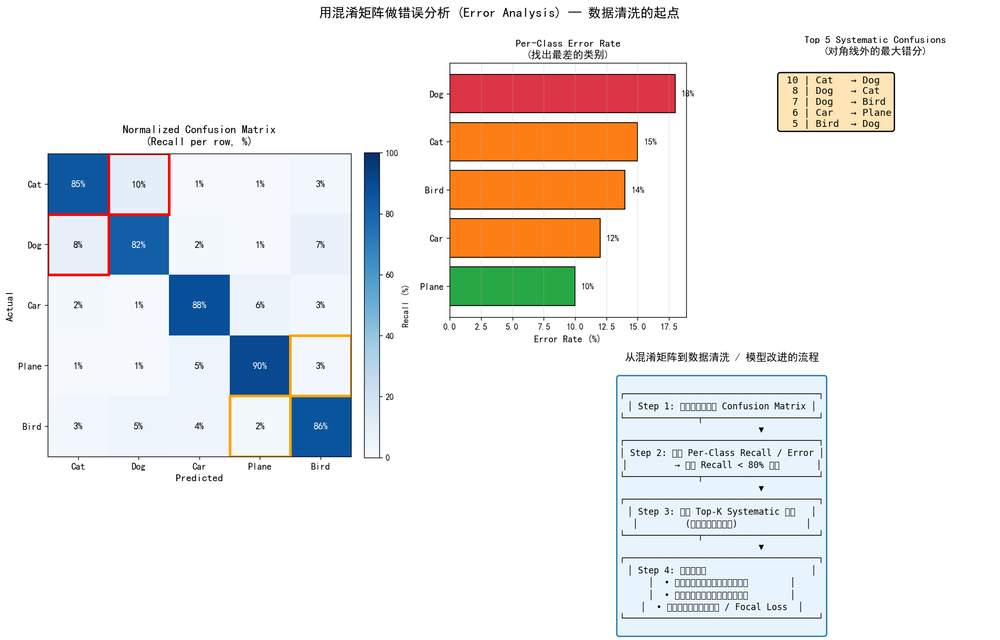
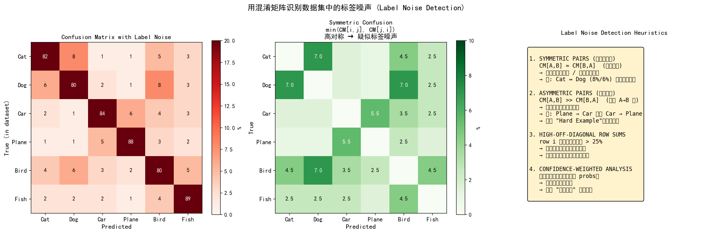
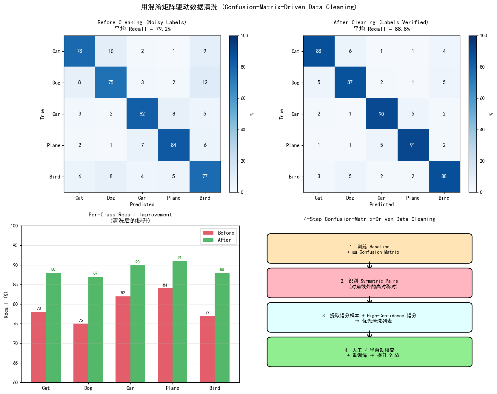
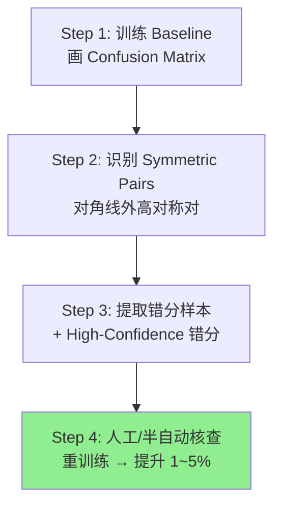
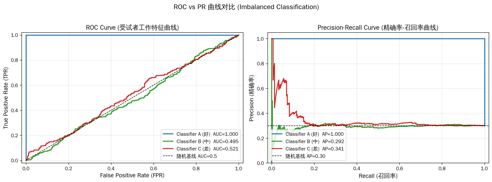
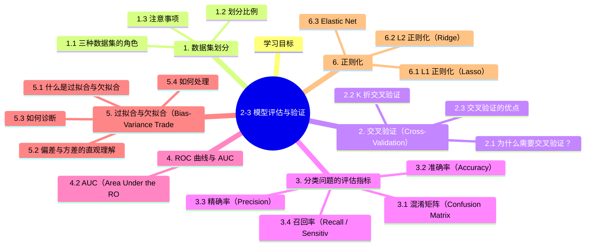

# 2-3 模型评估与验证

## 学习目标

- 理解训练集、验证集、测试集的作用与划分方法
- 掌握交叉验证的基本原理与 K 折交叉验证
- 掌握准确率、精确率、召回率、F1 分数等评估指标
- 理解 ROC 曲线与 AUC 的含义
- 理解过拟合与欠拟合的概念（Bias-Variance Tradeoff）

---

## 1. 数据集划分

机器学习模型的学习和评估，离不开对数据的合理划分。

### 1.1 三种数据集的角色

| 数据集 | 作用 | 是否参与训练 | 何时使用 |
|-------|------|-------------|---------|
| **训练集（Training Set）** | 用于模型学习参数 | ✅ 是 | 每次训练迭代 |
| **验证集（Validation Set）** | 用于调参、选模型、 early stopping | ❌ 否 | 训练过程中监控 |
| **测试集（Test Set）** | 评估模型在未见数据上的真实性能 | ❌ 否 | 最终性能报告 |

**重要原则**：测试集必须**独立且与训练集同分布**，且**仅在最后使用一次**，避免数据泄露（Data Leakage）。

### 1.2 划分比例

没有绝对正确的划分比例，取决于数据量大小和应用场景：

| 数据总量 | 建议划分比例 | 说明 |
|---------|-------------|------|
| 小数据（< 1 万） | 训练 60% / 验证 20% / 测试 20%，或用交叉验证 | 数据少时，每个样本都很宝贵 |
| 中等数据（1 万 ~ 100 万） | 训练 80% / 测试 20%，或 70/15/15 | 验证集用于调参，测试集评估泛化 |
| 大数据（> 100 万） | 训练 98% / 测试 2%，甚至更小比例 | 百万级数据足够学到规律，测试集不需要太大 |

### 1.3 注意事项

**随机划分 vs 分层抽样**：

- **随机划分**：直接随机打乱后划分，适用于数据分布均匀的场景
- **分层抽样（Stratified Sampling）**：保证训练集/验证集/测试集中各类别比例与原始数据一致，尤其适用于**类别不平衡**的数据

**时间序列数据**：

- 不能打乱划分，否则会"偷看未来数据"
- 应该按时间顺序：早期数据做训练，近期数据做测试
- 模拟真实场景中的预测场景

---

## 2. 交叉验证（Cross-Validation）

### 2.1 为什么需要交叉验证？

当数据量较小时，单独划分验证集会导致验证集太小、评估结果不稳定。交叉验证通过**多次划分、多次训练**，获得更稳定可靠的性能评估。

### 2.2 K 折交叉验证

**步骤**：

1. 将数据均匀划分为 $K$ 个互不重叠的子集
2. 每次取**其中一个子集**作为验证集，其余 $K-1$ 个子集合并作为训练集
3. 重复 $K$ 次，确保每个子集都被作为验证集用过一次
4. 对 $K$ 次评估结果取**平均**，得到最终性能估计

```
例如 5 折交叉验证：

第 1 折：训练 [折2+折3+折4+折5]，验证 [折1]
第 2 折：训练 [折1+折3+折4+折5]，验证 [折2]
第 3 折：训练 [折1+折2+折4+折5]，验证 [折3]
第 4 折：训练 [折1+折2+折3+折5]，验证 [折4]
第 5 折：训练 [折1+折2+折3+折4]，验证 [折5]
最终性能 = (结果1+结果2+结果3+结果4+结果5) / 5
```

**常用 $K$ 值**：$K = 5$ 或 $K = 10$ 最常用。$K$ 越大，评估结果越可靠，但计算成本越高。

**留一法（Leave-One-Out, LOO）**：当 $K$ 等于样本数量 $m$ 时，每次只留一个样本做验证。适用于**数据极度稀缺**的场景，但计算成本极高。

### 2.3 交叉验证的优点

- 评估结果更稳定、更有代表性
- 充分利用有限数据（每个样本都会被验证一次）
- 能发现模型在不同数据划分上的表现差异，帮助识别数据分布问题

---

## 3. 分类问题的评估指标

### 3.1 混淆矩阵（Confusion Matrix）

评估分类模型的基础工具。对于二分类问题：

|  | 预测为 Positive | 预测为 Negative |
|--|---------------|----------------|
| **实际 Positive** | TP（真阳性） | FN（假阴性） |
| **实际 Negative** | FP（假阳性） | TN（真阴性） |

**四个基本概念**：

- **TP（True Positive）**：实际正，预测正 → 预测正确 ✅
- **FN（False Negative）**：实际正，预测负 → 漏报了（假阴性）❌
- **FP（False Positive）**：实际负，预测正 → 误报了（假阳性）❌
- **TN（True Negative）**：实际负，预测负 → 预测正确 ✅

### 3.2 准确率（Accuracy）

最直觉的指标：模型预测正确的比例。

$$
Accuracy = \frac{TP + TN}{TP + TN + FP + FN} = \frac{正确预测数}{总样本数}
$$

**注意**：在**类别严重不平衡**的数据集上，准确率可能具有欺骗性。例如 99% 是负类，全部预测负类的模型准确率就是 99%，但完全没有检测出正类。

### 3.3 精确率（Precision）

预测为正的样本中，实际也为正的比例。衡量"预测为正的可信度"。

$$
Precision = \frac{TP}{TP + FP} = \frac{预测为正的样本中真正是正的}{所有预测为正的样本}
$$

**场景**：在垃圾邮件过滤中，高精确率意味着"被标记为垃圾的邮件确实都是垃圾"，不会误伤正常邮件。

### 3.4 召回率（Recall / Sensitivity）

实际为正的样本中，预测也为正的比例。衡量"找全了没有"。

$$
Recall = \frac{TP}{TP + FN} = \frac{正确预测的正类}{所有实际正类}
$$

**场景**：在癌症筛查中，高召回率意味着"不会漏掉真正的癌症患者"，即使有一些误报（FP）也可以接受。

### 3.5 精确率与召回率的矛盾

精确率和召回率往往**此消彼长**，存在矛盾：

- 若提高判断阈值（更保守地判断为正类），精确率 ↑，召回率 ↓
- 若降低判断阈值（更激进地判断为正类），召回率 ↑，精确率 ↓

这就是机器学习中经典的 **Precision-Recall Trade-off**。

**F1 分数**综合了精确率和召回率的调和平均，平衡二者：

$$
F1 = 2 \times \frac{Precision \times Recall}{Precision + Recall}
$$

**注意**：F1 是 $Precision$ 和 $Recall$ 的调和平均，调和平均比算术平均更强调两者的**极端低值**——如果其中一个很低，F1 会显著降低。

### 3.6 多分类的扩展

上述指标在多分类问题上可以**一对一**地扩展为每个类别：

- 对每个类别 $c$：将其余所有类别看作"非 $c$"，计算二分类指标
- **宏平均（Macro Average）**：先分别计算每个类别的指标，再取平均（对各类别一视同仁）
- **微平均（Micro Average）**：汇总所有类别的 TP/FP/FN/TN，再计算整体指标（受样本数多的类别影响更大）

### 3.7 指标选择指南

| 应用场景 | 关注重点 | 推荐指标 |
|---------|---------|---------|
| 疾病筛查（漏检代价高） | 不漏掉任何患者 | Recall |
| 垃圾邮件过滤（误报代价高） | 不误伤正常邮件 | Precision |
| 搜索推荐 | 平衡准确性和覆盖率 | F1 Score |
| 类别严重不平衡 | 综合评估 | ROC-AUC / PR-AUC |

### 3.8 实战：混淆矩阵驱动的数据分析与数据清洗

> **个人经验分享**：混淆矩阵不仅是"评估指标"，更是**数据分析和数据清洗的利器**。在工业项目中，用混淆矩阵做"错误分析 → 标签核查 → 数据清洗"通常能带来 1-5% 的精度提升，**而且成本极低**（只需对错误样本做人工核查）。这一节总结一个完整的实战 workflow。

#### 3.8.1 混淆矩阵的"超能力"

混淆矩阵除了能算 Precision/Recall/F1，还能**告诉你"模型哪里最差"**，这正是数据清洗的起点：

1. **错误分析（Error Analysis）**：对角线外的高值 → 模型系统性错分的类别对
2. **标签噪声检测（Label Noise Detection）**：对称错分对 → 训练标签可能错标
3. **数据漂移检测（Data Drift）**：训练/验证/测试的混淆矩阵差异 → 数据分布变化
4. **主动学习（Active Learning）**：高置信度错分样本 → 优先人工核查
5. **类别失衡分析**：行/列和差异 → 训练数据类别不均

#### 3.8.2 错误分析：从混淆矩阵找出最差类别



**核心三步**：

| 步骤 | 操作 | 产出 |
|------|------|------|
| 1. 训练 Baseline + 画 CM | `sklearn.metrics.confusion_matrix(y_true, y_pred, normalize='true')` | 归一化混淆矩阵 |
| 2. 算 Per-Class Recall | `np.diag(cm)` | 每类的 Recall 数组 |
| 3. 排序 + 找 Top-K 错分对 | 提取 `cm[i,j]` 最大的 5 个非对角线 | 重点改进类列表 |

**实战代码**：

```python
import numpy as np
import matplotlib.pyplot as plt
from sklearn.metrics import confusion_matrix

def error_analysis(y_true, y_pred, classes, top_k=5):
    """找出模型最差的类别 + 系统性错分对"""
    cm = confusion_matrix(y_true, y_pred, normalize='true') * 100
    recall = np.diag(cm)
    
    # 1. 找最差的类
    worst_classes = np.argsort(recall)
    print("最差的 3 个类（按 Recall 升序）:")
    for i in worst_classes[:3]:
        print(f"  {classes[i]}: Recall = {recall[i]:.1f}%")
    
    # 2. 找 Top-K 系统性错分（对角线外最大值）
    confusions = []
    n = len(classes)
    for i in range(n):
        for j in range(n):
            if i != j and cm[i, j] > 3:
                confusions.append((cm[i, j], i, j))
    confusions.sort(reverse=True)
    
    print(f"\nTop {top_k} 系统性错分:")
    for count, i, j in confusions[:top_k]:
        print(f"  {classes[i]} → {classes[j]}: {count:.1f}%")
    
    return cm, confusions[:top_k]

# 使用
cm, top_confusions = error_analysis(y_val, y_pred, class_names)
```

#### 3.8.3 标签噪声检测：对称错分 = 标签可能错标



**核心洞察**：

| 错分模式                          | 含义       | 行动                     |
| ----------------------------- | -------- | ---------------------- |
| **对称对 (CM[A,B] ≈ CM[B,A])**   | 两个方向都错分  | **大概率是标签噪声**或类别定义模糊    |
| **非对称对 (CM[A,B] >> CM[B,A])** | 只有 A→B 多 | 真实的类别相似性（Hard Example） |
| **整行非对角线高**                   | 该类整体被错分  | 整类标签需要核查               |
|                               |          |                        |

**规则化判断**：

```
if CM[i, j] > 阈值 AND CM[j, i] > 阈值:
    → "高对称对"：可能是标签错标，优先核查样本
elif CM[i, j] > 阈值 AND CM[j, i] < 阈值:
    → "非对称对"：可能是真实类别相似性，做数据增强
else:
    → 正常
```

**置信度加权**：

```python
# 找出"高置信度但错分"的样本 → 强烈提示标签错标
y_pred_proba = model.predict_proba(X_val)
wrong_mask = (y_pred != y_val)
high_conf_wrong = wrong_mask & (y_pred_proba.max(axis=1) > 0.95)

print(f"高置信度错分样本: {high_conf_wrong.sum()} 个")
print("→ 这些样本的标签极可能是错的")
```

#### 3.8.4 数据清洗前后的混淆矩阵对比



**4 步清洗流程**：



**完整 pipeline 代码**（可直接运行）：

```python
import numpy as np

def confusion_matrix_np(y_true, y_pred, n_classes=None, normalize=None):
    if n_classes is None:
        n_classes = max(y_true.max(), y_pred.max()) + 1
    cm = np.zeros((n_classes, n_classes), dtype=float)
    for t, p in zip(y_true, y_pred):
        cm[t, p] += 1
    if normalize == 'true':
        cm = cm / cm.sum(axis=1, keepdims=True) * 100
    return cm

def find_symmetric_pairs(cm, threshold=5):
    """找高对称对 (label noise candidates)"""
    pairs = []
    n = cm.shape[0]
    for i in range(n):
        for j in range(i + 1, n):
            sym_score = min(cm[i, j], cm[j, i])
            if sym_score > threshold:
                pairs.append((i, j, sym_score))
    return sorted(pairs, key=lambda x: -x[2])

# Step 1: 训练并得到 CM
cm = confusion_matrix_np(y_val, y_pred_before, normalize='true')

# Step 2: 找高对称对
pairs = find_symmetric_pairs(cm, threshold=5)
print(f"找到 {len(pairs)} 个高对称对（疑似标签噪声）:")
for i, j, score in pairs:
    print(f"  Class {i} <-> Class {j}: symmetric score = {score:.1f}%")

# Step 3: 提取这些类别对的所有训练样本 + 高置信度错分样本
candidate_indices = []
for i, j, _ in pairs:
    candidate_indices.extend(np.where(y_train == i)[0][:200])  # top 200
    candidate_indices.extend(np.where(y_train == j)[0][:200])

# Step 4: 人工核查 / 用 cleanlab 自动清洗
# 推荐工具: cleanlab (https://github.com/cleanlab/cleanlab)
from cleanlab.filter import find_label_issues
issues = find_label_issues(y_train, model.predict_proba(X_train))
clean_indices = np.where(~issues)[0]
X_train_clean = X_train[clean_indices]
y_train_clean = y_train[clean_indices]

# Step 5: 重训练，CM 提升
model_clean = train(X_train_clean, y_train_clean)
cm_after = confusion_matrix_np(y_val, model_clean.predict(X_val), normalize='true')
print(f"清洗后平均 Recall: {np.diag(cm_after).mean():.1f}% (+{np.diag(cm_after).mean() - np.diag(cm).mean():.1f}%)")
```

完整可运行版本见 [`assets/figures/2-3-confusion-pipeline.py`](../../assets/figures/2-3-confusion-pipeline.py)。

#### 3.8.5 训练/验证/测试集一致性检查

```python
def check_data_consistency(model, X_train, y_train, X_val, y_val, X_test, y_test, classes):
    """比较 train/val/test 的混淆矩阵分布，检测数据漂移"""
    cms = []
    for X, y, name in [(X_train, y_train, 'Train'), (X_val, y_val, 'Val'), (X_test, y_test, 'Test')]:
        y_pred = model.predict(X)
        cm = confusion_matrix_np(y, y_pred, normalize='true')
        cms.append(cm)
        print(f"\n{name} CM (Recall/类):")
        for i, c in enumerate(classes):
            print(f"  {c}: {cm[i, i]:.1f}%")
    
    # 检查 train/val/test 的 recall 分布是否一致
    train_recall = np.diag(cms[0])
    val_recall = np.diag(cms[1])
    test_recall = np.diag(cms[2])
    
    # 漂移检测：差异 > 5% 报警
    drift = np.abs(train_recall - test_recall)
    if drift.max() > 5:
        print(f"\n⚠️ 警告: 训练-测试 Recall 漂移 > 5%: {classes[drift.argmax()]} = {drift.max():.1f}%")
```

#### 3.8.6 主动学习样本选择

```python
def active_learning_selection(model, X_pool, n_select=100, strategy='high_conf_wrong'):
    """用混淆矩阵 + 置信度选择"最有价值"的样本做人工标注"""
    y_pred_proba = model.predict_proba(X_pool)
    y_pred = y_pred_proba.argmax(axis=1)
    max_proba = y_pred_proba.max(axis=1)
    
    if strategy == 'high_conf_wrong':
        # 高置信度但错分 → 强烈提示标签错误
        # 注：X_pool 已知真实标签（用于主动学习）
        # 实际是 "用模型挑出模型最不确信的样本给人工标"
        uncertainty = 1 - max_proba
        selected = np.argsort(uncertainty)[-n_select:]
    
    elif strategy == 'borderline':
        # 0.4-0.6 置信度的边界样本
        borderline = (max_proba > 0.4) & (max_proba < 0.6)
        selected = np.where(borderline)[0][:n_select]
    
    return selected
```

#### 3.8.7 类别失衡快速诊断

```python
def class_imbalance_diagnosis(y_train, classes):
    """用混淆矩阵思路看类别失衡"""
    from collections import Counter
    counts = Counter(y_train)
    total = len(y_train)
    
    print("类别分布:")
    for i, c in enumerate(classes):
        pct = counts[i] / total * 100
        flag = "⚠️ 罕见" if pct < 5 else "✓ 正常"
        print(f"  {c}: {counts[i]:5d} ({pct:5.1f}%) {flag}")
    
    # 失衡比
    max_count = max(counts.values())
    min_count = min(counts.values())
    print(f"\n失衡比 (max/min): {max_count / min_count:.1f}x")
    if max_count / min_count > 10:
        print("⚠️ 建议使用: class_weight, Focal Loss, 过采样少数类")
```

#### 3.8.8 工业级工具推荐

| 工具                      | 用途            | 安装                                    |
| ----------------------- | ------------- | ------------------------------------- |
| **cleanlab**            | 自动标签噪声检测 + 清洗 | `pip install cleanlab`                |
| **Snorkel**             | 弱监督 + 标记函数    | `pip install snorkel`                 |
| **Scale AI**            | 商业数据标注 + 清洗平台 | https://scale.com                     |
| **Label Studio**        | 开源标注工具        | `pip install label-studio`            |
| **confusion-matrix-py** | 增强版 CM 可视化    | `pip install pretty-confusion-matrix` |

#### 3.8.9 Checklist：数据清洗的 7 个步骤

```
□ 1. 训练 Baseline 模型，得到验证集 Confusion Matrix
□ 2. 计算 Per-Class Recall，找出 Recall < 80% 的类
□ 3. 提取 Top-K 系统性错分对 (A→B 高频)
□ 4. 识别 Symmetric Pairs (CM[i,j] ≈ CM[j,i]) → 标签噪声候选
□ 5. 用 cleanlab / 人工核查 清洗候选样本
□ 6. 重新训练，对比 CM: 提升的类 = 清洗成功的标志
□ 7. 在 Test Set 验证，泛化性 = 真正的胜利
```

---

## 4. ROC 曲线与 AUC

### 4.1 ROC 曲线（Receiver Operating Characteristic）

ROC 曲线描述的是**在不同阈值下**，TPR（True Positive Rate，=Recall）和 FPR（False Positive Rate）的变化关系。

$$
TPR = Recall = \frac{TP}{TP + FN}, \quad FPR = \frac{FP}{FP + TN}
$$

**如何绘制 ROC 曲线**：

1. 用模型输出的概率分数对所有样本排序
2. 从高到低依次将阈值降低（每个样本依次被"预测为正"）
3. 每降低一次，计算当前的 TPR 和 FPR，得到一个点
4. 连接所有点得到 ROC 曲线

**理想模型**：TPR=1 且 FPR=0 → ROC 曲线经过左上角（0, 1）点

**随机模型**：ROC 曲线近似对角线 $(0,0) \to (1,1)$，越接近对角线越差

### 4.2 AUC（Area Under the ROC Curve）

**定义**：ROC 曲线下方的面积，取值范围 $[0, 1]$。

**含义**：
- AUC = 1：完美模型（永不犯错）
- AUC = 0.5：随机猜测（完全无效）
- AUC = 0：完美反向模型（所有预测都反了）

**为什么 AUC 比准确率更适合**：
- **不依赖阈值**：AUC 反映的是模型在所有阈值下的整体排序能力
- **对类别不平衡更鲁棒**：不像准确率那样被多数类"稀释"
- **比较不同模型**：AUC 是一个无量纲的数值，方便不同模型间的比较

**AUC 的概率含义**：随机从正类样本和负类样本中各取一个，AUC 等于**正类样本分数高于负类样本分数的概率**。

下图对比了三个分类器在不平衡数据上的 ROC 曲线（左）与 Precision-Recall 曲线（右），直观体现 AUC 与 AP 的差异：



---

## 5. 过拟合与欠拟合（Bias-Variance Tradeoff）

### 5.1 什么是过拟合与欠拟合

**欠拟合（Underfitting / High Bias）**：
- 模型太简单，**学习能力不足**，连训练数据都没学好
- 训练误差和测试误差都高
- 表现为模型"太笨了，学不会"

**过拟合（Overfitting / High Variance）**：
- 模型太复杂，**记住了训练数据的噪声和细节**，但泛化能力差
- 训练误差低，但测试误差高（差距大）
- 表现为模型"死记硬背，不会举一反三"

### 5.2 偏差与方差的直观理解

把一个机器学习模型的误差分解为两部分：

$$
\text{总误差} = \text{Bias}^2 + \text{Variance} + \text{Irreducible Error（不可约误差）}
$$

**偏差（Bias）**：模型预测值的期望与真实值之间的差距，反映模型的**系统性错误**（欠拟合的来源）。

**方差（Variance）**：模型对不同训练集变化的敏感程度，反映模型的**稳定性**（过拟合的来源）。

**类比**：用飞镖靶子来理解：

| | 描述 | 飞镖表现 |
|--|-----|---------|
| 高偏差 + 低方差 | 模型简单但稳定 | 集中但都偏离靶心（欠拟合） |
| 低偏差 + 高方差 | 模型复杂但不稳定 | 分散但均值接近靶心（过拟合） |
| 低偏差 + 低方差 | 模型又好又稳 | 集中且都命中靶心（理想状态） |
| 高偏差 + 高方差 | 既不稳定又有系统性偏差 | 分散且偏离靶心（最差情况） |

**偏差-方差权衡（Bias-Variance Tradeoff）**：降低偏差通常会增加方差，反之亦然。机器学习调参的核心任务之一，就是找到两者的平衡点。

### 5.3 如何诊断

通过**学习曲线（Learning Curve）** 可以直观判断是过拟合还是欠拟合：

| 曲线表现 | 诊断结论 |
|---------|---------|
| 训练误差高，验证误差高，且两者接近 | 欠拟合 |
| 训练误差低，验证误差高，且差距大 | 过拟合 |
| 训练误差低，验证误差也低，且差距小 | 良好拟合 |

### 5.4 如何处理

| 问题 | 对策 |
|-----|------|
| 欠拟合（高偏差） | 增加模型复杂度（更多特征、更高次多项式、更多层神经网络）|
| 过拟合（高方差） | 增加数据量、正则化、Dropout、早停（Early Stopping）、特征选择、减少模型复杂度 |

---

## 6. 正则化

正则化是防止过拟合的核心技术，通过在损失函数中添加**惩罚项**来限制模型复杂度。

### 6.1 L1 正则化（Lasso）

在损失函数中添加参数绝对值之和的惩罚项：

$$
J_{L1}(\theta) = J(\theta) + \lambda \sum_{i} |\theta_i|
$$

**特点**：
- 会将不重要的特征系数**压缩为 0**，实现**特征选择**
- 解通常是稀疏的
- 适合特征数量多但只有少数有用的场景

### 6.2 L2 正则化（Ridge）

在损失函数中添加参数平方和的惩罚项：

$$
J_{L2}(\theta) = J(\theta) + \lambda \sum_{i} \theta_i^2
$$

**特点**：
- 将参数**压缩得很小但不为 0**
- 不会产生稀疏解
- 适合特征之间存在多重共线性的场景

### 6.3 Elastic Net

L1 和 L2 正则化的结合：

$$
J(\theta) = J(\theta) + \lambda_1 \sum_{i} |\theta_i| + \lambda_2 \sum_{i} \theta_i^2
$$

结合了两者的优点。

---

## 本章小结
1. **核心评估指标**：分类指标（Accuracy、Precision、Recall、F1-Score）、回归指标（MSE、MAE、RMSE、Huber Loss）
2. **数据集划分**：留出法、交叉验证（K-Fold、Stratified K-Fold、LOOCV）、自助法（Bootstrap）
3. **偏差-方差权衡**：模型复杂度与泛化能力的矛盾，高偏差导致欠拟合，高方差导致过拟合
4. **正则化方法**：L1正则（Lasso）、L2正则（Ridge）、Dropout、Early Stopping、Batch Normalization
5. **模型选择**：奥卡姆剃刀原理、交叉验证、网格搜索与随机搜索、超参数优化

---


## 知识图谱



## 参考资料

### 模型评估与验证论文引用
- Stone, M. (1974). Cross-Validatory Choice and Assessment of Statistical Predictions. Journal of the Royal Statistical Society.
- Kohavi, R. (1995). A Study of Cross-Validation and Bootstrap for Accuracy Estimation and Model Selection. IJCAI.
- Hastie, T., Tibshirani, R. & Friedman, J. (2009). The Elements of Statistical Learning (2nd ed.). Springer. (偏差-方差权衡)
- Breiman, L. (1996). Bagging Predictors. Machine Learning, 24(2), 123-140. (Bagging与方差)
- Geman, S., Bienenstock, E. & Doursat, R. (1992). Neural Networks and the Bias/Variance Dilemma. Neural Computation.

- 周志华.《机器学习》（西瓜书）第 2 章

