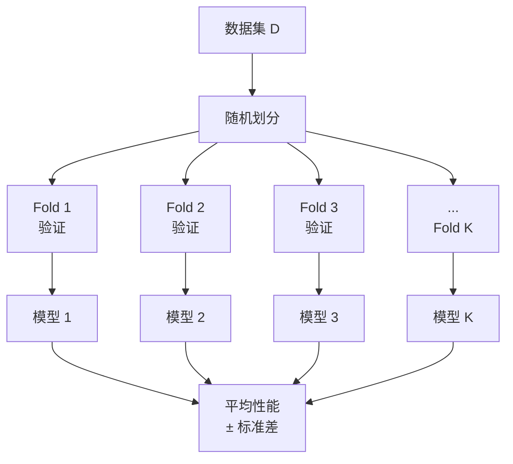
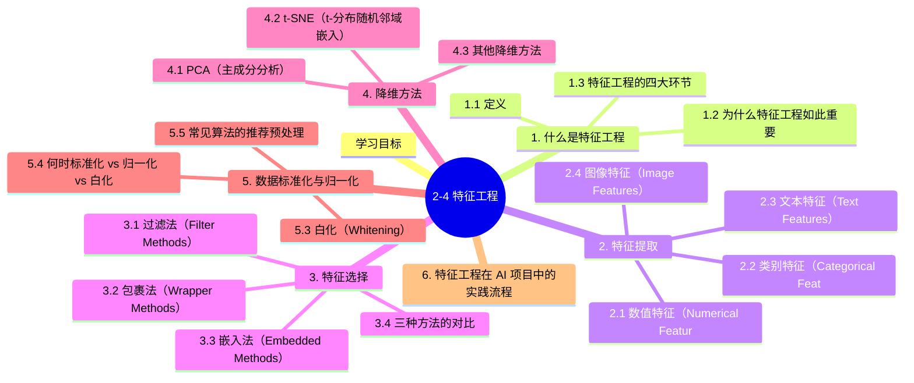

# 2-4 特征工程

## 学习目标

- 理解什么是特征工程及其在 AI 项目中的重要性
- 掌握特征提取的基本方法：数值特征、类别特征、文本特征
- 理解特征选择的三大方法：过滤法、包裹法、嵌入法
- 掌握 PCA 降维的原理与流程
- 了解 t-SNE 等非线性降维方法
- 理解数据标准化、归一化与白化的区别与作用
- 了解图像数据增强以及 VOC / COCO 标注格式（属于数据管线/标注格式，不是特征本身）的基础概念

---

## 1. 什么是特征工程

### 1.1 定义

**特征工程（Feature Engineering）**：指在机器学习项目中，通过**对原始数据进行加工、转换和筛选**，生成对模型训练更有价值的特征的过程。

> 业界有一句广泛流传的话："数据和特征决定了机器学习的上限，而模型和算法只是逼近这个上限。"

### 1.2 为什么特征工程如此重要

特征工程的重要性体现在以下几点：

1. **特征质量直接影响模型性能**：好的特征即使使用简单的模型也能取得好效果；差的特征即使使用复杂模型也难以弥补
2. **特征工程往往占据项目大部分时间**：在实际项目中，数据清洗和特征工程往往占用 60%~80% 的时间和精力
3. **降低模型训练难度**：良好的特征设计能加速模型收敛、提高泛化能力
4. **帮助模型解释**：好的特征往往具有清晰的业务含义，便于理解模型决策

### 1.3 特征工程的四大环节

```
特征工程
    ├── 特征提取（Feature Extraction）——从原始数据中生成特征
    ├── 特征选择（Feature Selection）——从众多特征中筛选最重要的
    ├── 特征变换（Feature Transformation）——对特征进行标准化、归一化等
    └── 降维（Dimension Reduction）——在保留关键信息的前提下减少维度
```

---

## 2. 特征提取

特征提取是将原始数据转换为模型可处理的数值向量的过程。不同类型的数据有不同的处理方式。

### 2.1 数值特征（Numerical Features）

数值特征是最基本的特征类型，如年龄、工资、价格等。

**常见处理方式**：

| 处理方式 | 说明 | 适用场景 |
|---------|------|---------|
| 保持原值 | 直接使用原始数值 | 数值本身已经是良好特征 |
| 分箱（Binning） | 将连续值离散化为几个区间 | 需要消除噪声、简化模型时 |
| 幂变换 | 取对数、开方等 | 处理偏态分布，使其接近正态 |
| 标准化 | 减去均值除以标准差 $(x-\mu)/\sigma$ | 使特征均值为 0，方差为 1 |
| 归一化 | 缩放到 [0,1] 区间 | 需要消除量纲影响时 |

**分箱示例**：

```
原始年龄：[18, 25, 34, 45, 52, 63, 71]
分箱后：  ["青年", "青年", "中年", "中年", "中年", "老年", "老年"]
```

分箱在树模型、规则模型和离散统计特征里仍然很常用：它能把连续噪声压缩成更稳定的区间信号，也方便做交叉特征和业务规则建模。

### 2.2 类别特征（Categorical Features）

类别特征表示离散的类型或标签，如性别、血型、城市等。

**标签编码（Label Encoding）**：

将类别映射为整数。简单直接，但会引入隐含的大小关系（"深圳"=3 > "广州"=1？不合理）。

```
原始值：["北京", "上海", "深圳", "广州"]
编码后：  [0,       1,      2,       3]
```

**独热编码（One-Hot Encoding）**：

为每个类别创建一个二进制维度，避免引入不合理的大小关系。最常用的类别特征编码方式。

```
原始值：["北京", "上海", "深圳"]
编码后：
  北京 → [1, 0, 0]
  上海 → [0, 1, 0]
  深圳 → [0, 0, 1]
```

**独热编码的注意事项**：

- 当类别数量非常大时（如城市有上万个），独热编码会生成非常高维的稀疏向量，需要配合降维或其他技巧
- 可以用**稀疏矩阵**存储以节省内存

**有序类别编码（Ordinal Encoding）**：

当类别存在自然顺序时（如"小学""初中""高中""大学"），使用有序的整数编码：

```
原始值：["小学", "初中", "高中", "大学"]
编码后：  [0,       1,       2,       3]
```

### 2.3 文本特征（Text Features）

文本是机器学习中常见的非结构化数据，将其转换为数值向量的过程即为文本特征提取。

**词袋模型（Bag of Words, BoW）**：

将文本看作一组词语的集合，统计每个词在文本中出现的频率。

```
文本1："The cat sat on the mat"
文本2："The dog ran in the garden"

构建词典：["The", "cat", "sat", "on", "the", "mat", "dog", "ran", "in", "garden"]

文本1向量：[1, 1, 1, 1, 2, 1, 0, 0, 0, 0]
文本2向量：[1, 0, 0, 0, 1, 0, 1, 1, 1, 1]
```

**TF-IDF（Term Frequency - Inverse Document Frequency）**：

在词袋模型基础上，加入**逆文档频率**权重，降低常见词的影响，提升有区分度的词的重要性。

$$
TF-IDF(t, d) = TF(t, d) \times IDF(t)
$$

其中 $TF(t,d)$ 是词 $t$ 在文档 $d$ 中出现的频率，$IDF(t) = \log \frac{N}{df(t)}$（$N$ 为总文档数，$df(t)$ 为包含词 $t$ 的文档数）。

**Word2Vec / Embedding**：

将词语映射到低维稠密向量，捕捉词语之间的语义关系（"国王"-"男人"+"女人" ≈ "女王"）。是现代 NLP 和深度学习的基础。

### 2.4 图像特征（Image Features）

- **像素值**：直接使用图像像素的 RGB 值（需要归一化到 [0,1]）
- **人工设计特征**：HOG（方向梯度直方图）、SIFT（尺度不变特征）等
- **深度学习特征**：通过预训练的 CNN（ResNet、VGG 等）提取特征向量
- **数据增强**：随机裁剪、翻转、颜色抖动、MixUp/CutMix 等常被视为图像特征工程的一部分，用来提升模型对尺度、姿态和光照变化的鲁棒性

### 2.5 图像数据增强工具（Albumentations / imgaug）

深度学习时代，**数据增强**成为提升模型泛化能力的核心手段。两个主流库：

#### Albumentations（推荐）

```python
import albumentations as A
from albumentations.pytorch import ToTensorV2

# 训练增强 Pipeline
train_transform = A.Compose([
    A.RandomResizedCrop(height=224, width=224, scale=(0.08, 1.0)),
    A.HorizontalFlip(p=0.5),
    A.ColorJitter(brightness=0.2, contrast=0.2, saturation=0.2, hue=0.1, p=0.5),
    A.OneOf([
        A.GaussianBlur(blur_limit=(3, 7)),
        A.MedianBlur(blur_limit=5),
    ], p=0.3),
    A.OneOf([
        A.GaussNoise(),
        A.ISONoise(),
    ], p=0.3),
    A.CoarseDropout(max_holes=8, max_height=20, max_width=20, p=0.3),
    A.Normalize(mean=(0.485, 0.456, 0.406), std=(0.229, 0.224, 0.225)),
    ToTensorV2(),
])

# 应用到图像 + 边界框（同时增强）
transformed = train_transform(image=image, bboxes=bboxes, class_labels=labels)
```

**优势**：
- 速度极快（基于 OpenCV）
- 支持多种任务（分类/检测/分割/关键点）
- 边界框同步增强（重要！）

#### imgaug

```python
import imgaug.augmenters as iaa

seq = iaa.Sequential([
    iaa.Fliplr(0.5),
    iaa.Affine(rotate=(-15, 15), scale=(0.8, 1.2)),
    iaa.AddToHueAndSaturation((-20, 20)),
    iaa.GaussianBlur(sigma=(0, 1.0)),
])

images_aug, bbs_aug = seq(images=images, bounding_boxes=bbs)
```

#### 常用增强策略对照表

| 增强类型 | Albumentations | 适用任务 |
|---------|----------------|----------|
| 几何变换 | `HorizontalFlip`, `Rotate`, `ShiftScaleRotate` | 通用 |
| 颜色变换 | `ColorJitter`, `HueSaturationValue`, `RandomGamma` | 分类 |
| 噪声 | `GaussNoise`, `ISONoise` | 检测/分类 |
| 模糊 | `GaussianBlur`, `MotionBlur` | 检测 |
| 遮挡 | `CoarseDropout` (Cutout) | 分类/检测 |
| Mix | `MixUp` (需自定义), `CutMix` (需自定义) | 分类 |
| 检测专用 | `Mosaic` (需自定义) | YOLO |
| 分割专用 | 同步 mask 变换 | 分割 |

### 2.6 数据标注工具 (LabelMe / labelImg / Label Studio)

> **深入阅读**：本节介绍标注**工具**，但**目标检测的标注原则**（Tight Box、遮挡、截断、Cohen's κ、预标注 SOP）详见 [11-1 §1.3 目标检测数据标注原则](../PART11-计算机视觉进阶/11-1-目标检测进阶.md#13-目标检测数据标注原则)。


标注质量决定模型上限。主流工具对比：

| 工具 | 任务 | 输出格式 | 平台 | 特点 |
|------|------|----------|------|------|
| **LabelMe** | 检测/分割 | JSON (自定义) | Web/Python | MIT 开源，灵活 |
| **labelImg** | 检测 | YOLO / VOC XML | 桌面 | 轻量，VOC/YOLO 格式 |
| **Label Studio** | 通用 (NLP/CV/音频) | 多种 | Web | 全栈，支持协同 |
| **LabelBee** | 检测/分割/关键点 | COCO/YOLO | Web | OpenMMLab 出品 |
| **CVAT** | 检测/跟踪/分割 | COCO/YOLO/CVAT | Web | Intel 出品，企业级 |
| **Roboflow** | 全流程 | 多种 | Web | SaaS，自动化辅助 |

#### LabelMe 使用示例

```python
# 标注后导出为 JSON
# labelme draw_json --label label.png labels.json

# 转换为 COCO 格式
import json
import labelme

# labelme 内置转换工具
labelme.labelme2coco(input_dir, output_file)
```

#### Label Studio 部署

```bash
# Docker 部署
docker run -it -p 8080:8080 -v $(pwd)/mydata:/label-studio/data \
    heartexlabs/label-studio:latest
# 访问 http://localhost:8080
```

**选型建议**：
- 个人研究 → LabelMe / labelImg
- 小团队 → Label Studio / CVAT
- 工业生产 → CVAT + 自动化辅助（如 SAM 预标注）

#### 2.6.1 VOC 标注格式详解

PASCAL VOC 是检测 / 分割领域最经典的标注格式之一，5 个文件夹结构清晰：

```
VOC2012/
├── JPEGImages/           # 所有图片（.jpg）
├── Annotations/          # 每张图对应的 XML 标签
├── ImageSets/            # 数据集划分（train.txt / val.txt）
├── SegmentationClass/   # 语义分割标签
└── SegmentationObject/   # 实例分割标签
```

**Annotations XML 示例**：

```xml
<annotation>
    <folder>VOC2012</folder>
    <filename>2007_000392.jpg</filename>
    <source>
        <database>The VOC2007 Database</database>
        <annotation>PASCAL VOC2007</annotation>
    </source>
    <size>
        <width>500</width>      <!-- 图像宽度 -->
        <height>332</height>    <!-- 图像高度 -->
        <depth>3</depth>        <!-- 通道数 -->
    </size>
    <segmented>1</segmented>  <!-- 是否用于分割（检测中 0/1 均可） -->
    <object>
        <name>horse</name>      <!-- 类别（VOC 20 类） -->
        <pose>Right</pose>      <!-- 拍摄角度 -->
        <truncated>0</truncated> <!-- 是否被截断（0=完整） -->
        <difficult>0</difficult> <!-- 难度标记（评估时通常忽略） -->
        <bndbox>                <!-- 边界框：对角坐标 -->
            <xmin>100</xmin>
            <ymin>96</ymin>
            <xmax>355</xmax>
            <ymax>324</ymax>
        </bndbox>
    </object>
    <object>                      <!-- 多个 object 表示多个目标 -->
        <name>person</name>
        <bndbox>
            <xmin>198</xmin> <ymin>58</ymin>
            <xmax>286</xmax> <ymax>197</ymax>
        </bndbox>
    </object>
</annotation>
```

**ImageSets 文件**（每行一个图片名，train.txt 第二列 1/-1 表示目标是否出现）：

```
# train.txt
2007_000392 -1
2007_000393  1
2007_000395  1
...

# val.txt
2007_001276  1
2007_001287  1
...
```

#### 2.6.2 COCO vs VOC 格式对比

| 维度 | VOC (XML) | COCO (JSON) |
|------|-----------|-------------|
| **格式** | 每个图一 XML | 全部图一个 JSON |
| **坐标** | `[xmin, ymin, xmax, ymax]` | `[x, y, w, h]`（左上角 + 宽高）|
| **类别** | `<name>` 字符串 | `categories` 数组（含 supercategory）|
| **分割** | 单独 PNG mask | `segmentation` 数组（多边形）|
| **关键点** | 无 | `keypoints` 字段 |
| **iscrowd** | 无 | 区分单实例 vs 群体 |
| **训练规模** | VOC 16K 图 / 20 类 | COCO 118K 图 / 80 类 |
| **适合** | 入门 / 小项目 | 工业 / 大模型 |

**COCO JSON 结构**：

```json
{
  "images": [{"id": 1, "width": 500, "height": 400, "file_name": "img1.jpg"}],
  "categories": [
    {"id": 1, "name": "cat", "supercategory": "animal"},
    {"id": 2, "name": "dog", "supercategory": "animal"}
  ],
  "annotations": [
    {
      "id": 1, "image_id": 1, "category_id": 1,
      "bbox": [50, 60, 180, 220],   // [x, y, w, h]
      "area": 39600,
      "iscrowd": 0
    }
  ]
}
```

**格式互转工具**：

```bash
# VOC → COCO
labelme2voc input_dir/ output_voc/
labelme2coco input_dir/ output_coco.json

# COCO → YOLO
from ultralytics.data.converter import convert_coco
convert_coco(labels_dir='coco/', save_dir='yolo/')

# YOLO → COCO
from ultralytics.data.converter import convert_yolo_to_coco
convert_yolo_to_coco(yolo_dir='yolo/', save_dir='coco/')
```

> **深入阅读**：检测标注原则（Tight Box/遮挡/截断/IAA/预标注）详见 [11-1 §1.3 目标检测数据标注原则](../PART11-计算机视觉进阶/11-1-目标检测进阶.md)。

### 2.7 K 折交叉验证（K-Fold Cross Validation）

K 折交叉验证是评估模型泛化能力、避免过拟合的标准方法。

**核心流程**：



**PyTorch 实现**：

```python
from sklearn.model_selection import KFold
from torch.utils.data import DataLoader, Subset

dataset = YourDataset()
kfold = KFold(n_splits=5, shuffle=True, random_state=42)

fold_results = []
for fold, (train_idx, val_idx) in enumerate(kfold.split(dataset)):
    train_subset = Subset(dataset, train_idx)
    val_subset = Subset(dataset, val_idx)
    
    train_loader = DataLoader(train_subset, batch_size=32, shuffle=True)
    val_loader = DataLoader(val_subset, batch_size=32)
    
    model = YourModel().cuda()
    # 训练 + 验证 ...
    fold_results.append(val_acc)

print(f"Mean: {np.mean(fold_results):.4f} ± {np.std(fold_results):.4f}")
```

**K 值选择**：

| K 值 | 偏差 | 方差 | 计算成本 | 适用场景 |
|------|------|------|----------|----------|
| K=2 | 高 | 高 | 低 | 极少数据 |
| **K=5** | 平衡 | 平衡 | 中 | **通用首选** |
| K=10 | 低 | 较高 | 较高 | 中等数据量 |
| K=N (LOO) | 极低 | 极高 | 极高 | 极小数据（学术） |

**分层 K 折（Stratified K-Fold）** 保持类别比例：

```python
from sklearn.model_selection import StratifiedKFold
skf = StratifiedKFold(n_splits=5, shuffle=True)
for train_idx, val_idx in skf.split(X, y):
    # ...
```

### 2.8 训练数据量估计

数据量没有万能公式，但经验法则可参考：

**Heppler 经验法则**：

$$
N \geq 10 \times k
$$

其中 $k$ 是模型参数量，$N$ 是样本数。这是**下限**，深度学习常需要更多。

**学习曲线法**：

用不同数据子集训练，观察验证误差与数据量的关系：

```python
data_sizes = [0.1, 0.25, 0.5, 0.75, 1.0]
val_scores = []
for size in data_sizes:
    subset = random.sample(dataset, int(len(dataset) * size))
    # 训练 + 评估
    val_scores.append(val_acc)

# 绘制学习曲线：横轴数据量，纵轴验证分数
# 曲线趋于平坦时，再增加数据收益小
```

**领域经验**：

| 任务 | 推荐数据量 |
|------|----------|
| 图像分类（粗粒度） | 1K-10K / 类 |
| 图像分类（细粒度） | 5K-50K / 类 |
| 目标检测 | 1K-10K 张图 |
| 语义分割 | 1K-100K 张图 |
| 实例分割 | 5K-50K 张图 |
| 异常检测 | 200-500 张正常图（典型） |
| 文本分类 | 1K-100K 文档 |

**实际项目中**：**数据质量 > 数量**。1000 张高质量标注 >> 10000 张噪声标注。

---

在检测、分割等任务里，除了像素级特征外，还要处理标注数据的组织与格式，这属于数据工程或数据管线的一部分，而不是特征提取本身：

- **VOC（Pascal VOC）**：基于 XML 的标注格式，结构简单，常用于小型数据集和教学示例
- **COCO**：基于 JSON 的标注格式，包含 `images / annotations / categories` 等字段，设计用于更复杂和大规模的数据集管理
- 实践中经常需要在 VOC 和 COCO 之间转换，因为不同训练框架、数据工具和开源模型对格式要求不同
- 如果标注格式不统一，数据加载与预处理环节会变得脆弱；在数据工程阶段统一和验证标注格式是保证训练稳定的重要步骤

### 2.9 时间序列特征

从时间戳中提取：年、月、日、星期、小时等；以及趋势特征、周期特征、差分特征等。

---

## 3. 特征选择

特征选择是从原始特征集合中**筛选出对目标变量最有预测能力的特征子集**的过程。

为什么要做特征选择？

- 去除无关或冗余特征，减少模型复杂度
- 降低维度灾难的影响
- 提高模型的可解释性
- 缩短训练和预测时间

### 3.1 过滤法（Filter Methods）

**原理**：基于特征的统计特性（如与标签的相关性）进行筛选，与模型无关，速度快但可能遗漏与模型配合良好的特征。

**常用指标**：

| 方法 | 说明 | 适用类型 |
|-----|------|---------|
| **方差过滤** | 剔除方差过小的特征（几乎所有样本取值相同） | 所有特征 |
| **相关系数** | 计算特征与标签的皮尔逊相关系数 | 数值特征 + 数值标签 |
| **卡方检验** | 检验类别特征与标签之间的独立性 | 类别特征 |
| **互信息（Mutual Information）** | 衡量两个变量之间的依赖程度 | 数值/类别特征 |
| **fisher score** | 考察特征对类别的区分能力 | 分类问题 |

**方差过滤示例**：

```python
from sklearn.feature_selection import VarianceThreshold
selector = VarianceThreshold(threshold=0.01)  # 剔除方差小于0.01的特征
X_selected = selector.fit_transform(X)
```

### 3.2 包裹法（Wrapper Methods）

**原理**：将特征选择问题看作搜索问题，用模型性能作为特征子集的评价标准，逐阶段地添加或剔除特征。

**典型方法**：**递归特征消除（Recursive Feature Elimination, RFE）**

1. 先用所有特征训练模型
2. 根据模型的特征重要性排序，剔除最不重要的特征
3. 用剩余特征重新训练，重复直到达到目标特征数

```python
from sklearn.feature_selection import RFE
from sklearn.linear_model import LogisticRegression
estimator = LogisticRegression()
rfe = RFE(estimator, n_features_to_select=10)  # 选10个特征
rfe.fit(X, y)
```

**特点**：比过滤法效果更好，但计算成本高（需要多次训练模型）。

### 3.3 嵌入法（Embedded Methods）

**原理**：在模型训练过程中自动完成特征选择，模型本身就是一个"特征选择器"。

**典型方法**：

| 方法 | 说明 | 示例模型 |
|-----|------|---------|
| **基于树模型的特征重要性** | 树分裂时计算信息增益，信息增益大的特征更重要 | 决策树、随机森林、GBDT |
| **L1 正则化** | L1 惩罚使不重要的特征系数为 0 | 线性回归、逻辑回归 |
| **L2 正则化** | L2 惩罚使特征系数趋近于 0（但不等于 0） | 线性回归、逻辑回归 |

**树模型特征重要性示例**：

```python
from sklearn.ensemble import RandomForestClassifier
model = RandomForestClassifier()
model.fit(X, y)
importances = model.feature_importances_  # 各特征重要性
```

### 3.4 三种方法的对比

| 方法 | 计算成本 | 与模型配合 | 效果 |
|-----|---------|----------|------|
| 过滤法 | 低（只看统计量） | 差（选的特征模型不一定用得好） | 一般 |
| 包裹法 | 高（需多次训练） | 最好 | 最好 |
| 嵌入法 | 中等（一次训练） | 好 | 较好且常用 |

实际项目中，**推荐先用过滤法粗筛，再用嵌入法或包裹法精筛**。

---

## 4. 降维方法

当特征维度非常高时（如文本的 TF-IDF 向量、图像像素向量），直接使用所有特征会导致**维度灾难**和**计算成本过高**。降维在尽量保留关键信息的前提下减少维度。

### 4.1 PCA（主成分分析）

PCA 是最经典和最重要的**线性降维**方法。

**核心思想**：找到数据中方差最大的方向（主成分），将数据投影到这些方向上，用少量主成分来近似描述原始数据。

**直观理解**：假设有一批数据点分布在一个扁平化的碟形区域——从某个角度看，它只需要 2 个维度就能很好地描述。PCA 做的就是找到这个最佳观察角度。

**数学原理**（基于最大投影方差）：

1. 对数据进行**中心化**（减去均值）
2. 计算**协方差矩阵** C。常见符号约定如下：若数据矩阵记为 $X\in\mathbb{R}^{d\times m}$（d 为特征维度，m 为样本数，样本为列向量），则协方差矩阵为 $C=\frac{1}{m}XX^T$（尺寸 d×d）；若 $X$ 采用 $m\times d$（样本为行向量）的表示，则 $C=\frac{1}{m}X^TX$。两者等价，求特征向量时请注意矩阵维度。
3. 求协方差矩阵的**特征值和特征向量**
4. 取前 $n'$ 个最大特征值对应的特征向量，组成投影矩阵 $W$
5. 降维后的数据：$z^{(i)} = W^T x^{(i)}$

**两种等价的推导**：
- 最大投影方差
- 最小投影距离

两者都可以证明：PCA 的主成分就是协方差矩阵 $C$ 的特征向量。

**PCA 算法流程**：

```
输入：n 维样本集 D = {x^(1), x^(2), ..., x^(m)}，要降维到的维数 n'

1. 对所有样本中心化：x^(i) = x^(i) - (1/m) * Σx^(j)
2. 计算协方差矩阵 C：若 $X\in\mathbb{R}^{d\times m}$（样本为列向量），则 $C=\frac{1}{m}XX^T$；若 $X\in\mathbb{R}^{m\times d}$（样本为行向量），则 $C=\frac{1}{m}X^TX$。
3. 对 C 进行特征值分解
4. 取最大的 n' 个特征值对应的特征向量，组成 W
5. 对每个样本：z^(i) = W^T x^(i)
6. 输出降维后的数据集 D' = {z^(1), z^(2), ..., z^(m)}
```

**如何选择 n'（主成分个数）**？两种常用方法：

1. **方差解释率阈值**：选择使得累计方差解释率达到 90%~95% 的主成分数

$$
\frac{\sum_{i=1}^{n'} \lambda_i}{\sum_{i=1}^{n} \lambda_i} \geq t
$$

2. **碎石图（Scree Plot）**：观察特征值下降曲线，选取拐点之前的主成分

**PCA 的优缺点**：

| 优点 | 缺点 |
|-----|------|
| 计算简单（仅特征值分解） | 主成分含义模糊，不如原始特征可解释 |
| 对数据压缩、去噪效果好 | 只能捕获线性关系 |
| 各主成分正交，消除共线性 | 对非线性结构无效 |

### 4.2 t-SNE（t-分布随机邻域嵌入）

PCA 是线性降维，适合线性结构的数据。对于**非线性结构**（如流形数据），需要使用非线性降维方法。

**t-SNE 的核心思想**：

- 在高维空间中，使用高斯核将点对的相似性转换为概率分布（即用条件概率 p_{j|i} 表示邻域相似度）
- 在低维空间中，用**t 分布**（尾部更厚）来缓解近邻在低维空间的重叠并表示低维相似度
- 最小化两个概率分布之间的 KL 散度（KL Divergence），使高维相似的点在低维也相近

**特点**：

- 适合**数据可视化**（通常降到 2~3 维）
- 能保留数据的**局部结构**（相似的点在低维空间中也相似）
- 计算成本高，不适合超大规模数据
- 低维结果不稳定（每次运行可能不同）

**与 PCA 的对比**：

| | PCA | t-SNE |
|--|-----|-------|
| 类型 | 线性降维 | 非线性降维 |
| 目标 | 保留全局方差 | 保留局部邻域结构 |
| 计算速度 | 快 | 慢 |
| 适用场景 | 压缩、去噪、预处理 | 可视化 |
| 可逆性 | 通常仅能近似重构（无法完美还原） | 不可逆 |

### 4.3 其他降维方法

| 方法 | 说明 |
|-----|------|
| **SVD（奇异值分解）** | 与 PCA 密切相关，常用于推荐系统和 NLP |
| **LDA（线性判别分析）** | 有监督的降维，最大化类间方差、最小化类内方差 |
| **Autoencoder（自编码器）** | 用神经网络做非线性降维，是深度学习版本的 PCA |
| **UMAP** | 比 t-SNE 更快、保留更多全局结构的非线性降维方法 |

---

## 5. 数据标准化与归一化

不同特征的取值范围可能相差巨大（如年龄 0~100 vs 年薪 0~100万），这对许多机器学习算法（如 SVM、KNN、神经网络等）有严重影响。

### 5.1 标准化（Standardization / Z-Score Normalization）

将数据处理为**均值=0，标准差=1**的分布：

$$
x' = \frac{x - \mu}{\sigma}
$$

**适用场景**：
- 对特征尺度敏感或数值稳定性要求高的模型（如线性回归、逻辑回归、SVM、KNN、神经网络等）
- 不知道数据取值范围时

**注意**：如果数据中存在异常值（outlier），标准化后数据仍然可能不服从正态分布，此时可以考虑用**RobustScaler**（基于中位数和四分位距）。

### 5.2 归一化（Normalization / Min-Max Scaling）

将数据缩放到**[0, 1]** 区间（有时也缩放到 [-1, 1]）：

$$
x' = \frac{x - x_{min}}{x_{max} - x_{min}}
$$

**适用场景**：
- 需要消除量纲影响的算法（KNN、神经网络等）
- 对数据范围有明确要求的场景

**注意**：如果测试数据超出训练数据范围，归一化可能产生超出 [0,1] 的值，需要做额外处理。

### 5.3 白化（Whitening）

白化是在标准化之后进一步减少特征之间线性相关性的变换。其目标是让特征的协方差矩阵尽可能接近单位矩阵：即使特征具有零均值、相似方差，并尽量降低不同维度之间的线性相关性，从而统一尺度并去相关。

需要强调的是，白化能去除线性相关性（decorrelation）并统一方差，但它并不保证在统计学意义上使各维度完全独立——完全的独立性比“去相关”更强，在非高斯或存在复杂非线性依赖时白化并不能实现独立性。

常见做法有两种：

- **PCA Whitening**：先做 PCA，再对主成分按特征值缩放
- **ZCA Whitening**：在去相关后再旋回原坐标系，尽量保留原始数据外观

白化适合对线性相关性非常敏感的任务或传统视觉预处理，但在现代深度学习中并不总是必要；很多场景下，标准化已经足够。

### 5.4 何时标准化 vs 归一化 vs 白化

| 方法 | 主要作用 | 常见场景 |
|-----|---------|---------|
| 标准化 | 消除均值和量纲差异 | 线性模型、SVM、神经网络 |
| 归一化 | 压缩到固定范围 | KNN、K-Means、输入范围敏感的模型 |
| 白化 | 去相关并统一尺度 | 传统视觉特征、对特征相关性敏感的任务 |

### 5.5 常见算法的推荐预处理

| 算法 | 推荐预处理方式 |
|-----|-------------|
| 线性回归、逻辑回归、SVM、神经网络 | 标准化 |
| KNN、K-Means、PCA | 标准化或归一化 |
| 决策树、随机森林、GBDT | 通常不需要（树模型对特征尺度不敏感） |
| 朴素贝叶斯 | 通常不需要（假设特征分布独立） |

---

## 6. 特征工程在 AI 项目中的实践流程

实际项目中，特征工程通常遵循以下流程：

```
1. 数据探索（EDA）
   ├── 分析数据分布、类型、缺失情况
   ├── 发现异常值、重复值
   └── 了解特征与标签的关系

2. 数据清洗
   ├── 处理缺失值（删除、均值填充、模型预测填充）
   ├── 处理异常值（截断、变换、删除）
   └── 处理重复样本

3. 特征提取
    ├── 数值特征：标准化/归一化
    ├── 类别特征：One-Hot / Label / Ordinal Encoding
    ├── 文本特征：BoW / TF-IDF / Embedding
    ├── 图像特征：像素、数据增强、预训练 CNN
    └── 时间序列特征：时间拆分、差分、滑动窗口

4. 特征选择
   ├── 过滤法（方差、相关性）
   ├── 嵌入法（树模型特征重要性）
   └── 递归特征消除（RFE）

5. 降维（如需要）
   ├── PCA（线性降维）
   └── t-SNE / UMAP（可视化降维）

6. 模型训练与评估
   ├── 交叉验证评估
   └── 调参与迭代
```

---

## 本章小结
1. **特征工程定义**：对原始数据进行清洗、转换、提取，构建模型可用的特征表示，是机器学习成功的关键
2. **特征提取方法**：数值特征（标准化/归一化/白化）、类别特征（One-Hot/Label/Ordinal Encoding）、文本特征（BoW/TF-IDF/Word2Vec/BERT）、图像特征（数据增强、标注格式）、时间序列特征（时间拆分/差分/滑动窗口）
3. **特征选择技术**：过滤法（方差、相关性）、包裹法（RFE）、嵌入法（树模型特征重要性、L1正则）
4. **降维技术**：PCA（线性投影最大化方差）、LDA（监督最大化类间间隔）、t-SNE/UMAP（非线性可视化降维）
5. **特征工程与模型选择的关系**：好的特征可以降低模型复杂度需求，GIGO原则（垃圾进，垃圾出）

---


## 知识图谱



## 参考资料

### 特征工程与降维论文引用
- Pearson, K. (1901). On Lines and Planes of Closest Fit to Systems of Points in Space. Philosophical Magazine.
- Jolliffe, I.T. (1986). Principal Component Analysis (2nd ed.). Springer. (PCA)
- Van der Maaten, L. & Hinton, G. (2008). Visualizing Data using t-SNE. Journal of Machine Learning Research. (t-SNE)
- Wold, S., Esbensen, K. & Geladi, P. (1987). Principal Component Analysis. Chemometrics and Intelligent Laboratory Systems.
- Guyon, I. & Elisseeff, A. (2003). An Introduction to Variable and Feature Selection. JMLR.

- 周志华.《机器学习》（西瓜书）第 10 章

