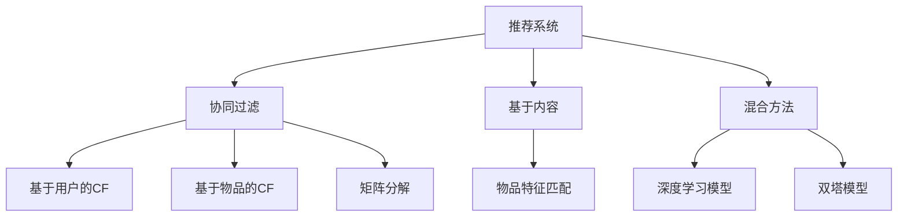
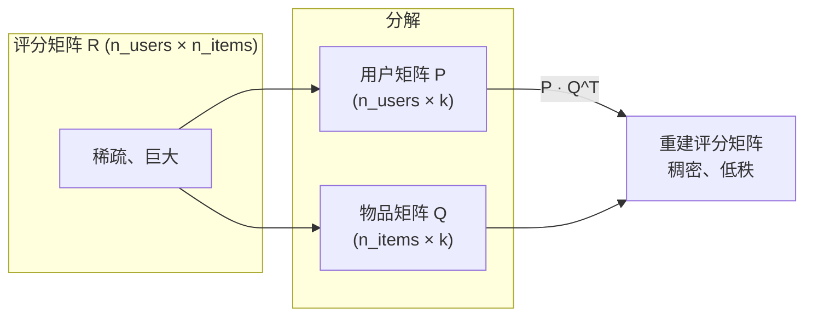
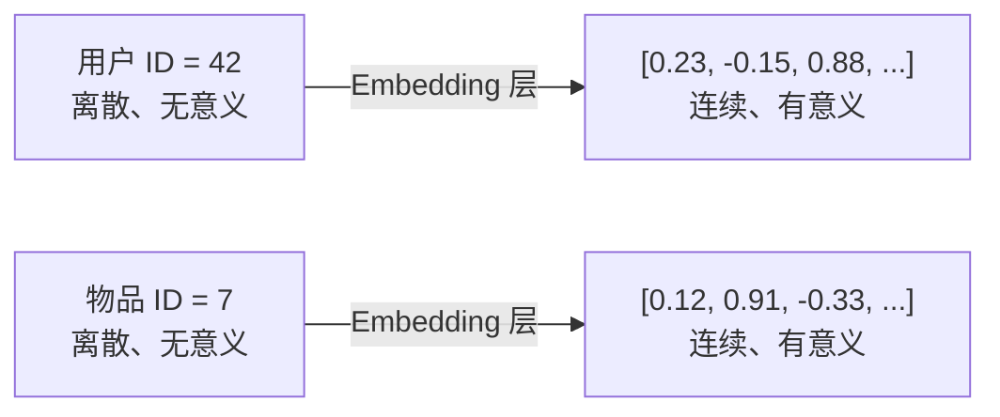
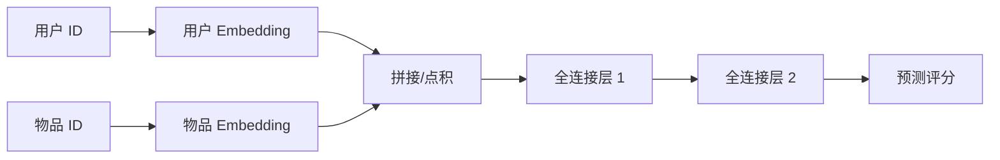
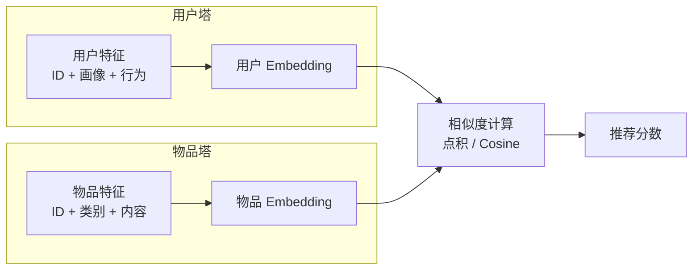
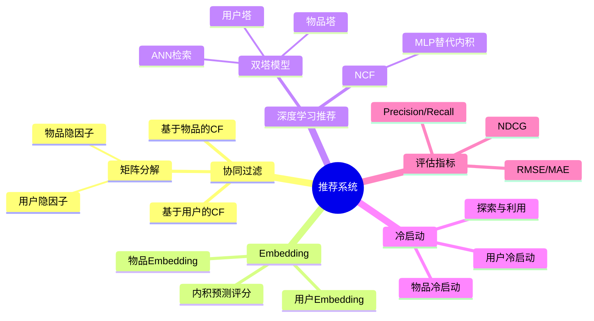

# 2-5 推荐系统与协同过滤

## 学习目标

- 理解推荐系统的核心价值和典型应用场景
- 掌握协同过滤的基本思想：基于用户、基于物品、矩阵分解
- 理解 Embedding 在推荐系统中的核心作用
- 了解深度学习时代的推荐方法（NCF、双塔模型）
- 认识冷启动问题的成因与常见解决方案
- 能够用 PyTorch 实现一个简单的矩阵分解推荐模型

---

## 1. 推荐系统概述

### 1.1 什么是推荐系统

**推荐系统（Recommender System）** 是一种信息过滤系统，它的目标是预测用户对物品的偏好，从而向用户推荐他们可能感兴趣的物品。

> **通俗理解**：推荐系统就像一位"懂你的导购员"——它不需要你明确说出想要什么，而是根据你过去的行为（看过什么、买过什么、评过几分），猜测你可能喜欢什么。

### 1.2 为什么推荐系统如此重要

| 场景 | 没有推荐系统 | 有推荐系统 |
|------|-------------|-----------|
| **电商** | 用户在海量商品中迷失 | 首页展示"猜你喜欢"，转化率提升 20-30% |
| **视频** | 用户看完一个视频后离开 | 自动播放相关视频，停留时长提升数倍 |
| **音乐** | 用户只听熟悉的歌手 | 发现新歌单，平台黏性大幅提升 |
| **新闻** | 所有人看到相同头条 | 千人千面，信息分发效率最大化 |

**核心洞察**：在信息过载的时代，**推荐系统是连接用户与内容的桥梁**。Netflix 估计其推荐系统每年创造的价值超过 **10 亿美元**；Amazon 35% 的销售额来自推荐。

### 1.3 推荐系统的分类



---

## 2. 协同过滤（Collaborative Filtering）

**协同过滤**是推荐系统中最经典、最核心的方法。它的核心假设是：**相似的用户会喜欢相似的物品**。

> **生活类比**：如果你和你的朋友都喜欢《星际穿越》和《盗梦空间》，那么你的朋友喜欢的《信条》很可能你也喜欢——这就是协同过滤的直觉。

### 2.1 用户-物品评分矩阵

协同过滤的基础是一个**评分矩阵** $R$，其中行代表用户，列代表物品，元素 $R_{ui}$ 表示用户 $u$ 对物品 $i$ 的评分：

| 用户 \ 物品 | 《星际穿越》 | 《盗梦空间》 | 《信条》 | 《沙丘》 |
|------------|------------|------------|---------|---------|
| **小明** | 5 | 5 | ? | 2 |
| **小红** | 4 | 5 | 5 | 1 |
| **小刚** | 1 | 2 | ? | 5 |

**关键挑战**：这个矩阵极其稀疏。一个电商平台可能有上亿用户和千万商品，但每个用户只交互过其中几百个。**预测那些问号（缺失值）就是推荐系统的任务**。

### 2.2 基于用户的协同过滤（User-based CF）

**思想**：找到与目标用户兴趣相似的"邻居"用户，把邻居喜欢的物品推荐给目标用户。

**步骤**：
1. 计算用户之间的相似度（常用余弦相似度或皮尔逊相关系数）
2. 找出最相似的 K 个邻居
3. 用邻居的加权评分预测目标用户对未评分物品的喜好

```python
import numpy as np
from sklearn.metrics.pairwise import cosine_similarity

# 用户-物品评分矩阵（0 表示未评分）
R = np.array([
    [5, 5, 0, 2],   # 小明
    [4, 5, 5, 1],   # 小红
    [1, 2, 0, 5],   # 小刚
])

# 计算用户相似度
user_sim = cosine_similarity(R)
print("用户相似度矩阵：")
print(user_sim)
# 小明与小红最相似（都喜欢科幻），与小刚好相反
```

**缺点**：
- 用户数量庞大时，计算相似度很慢
- 用户行为变化快，相似度需要频繁更新
- 冷启动问题：新用户没有历史行为，找不到邻居

### 2.3 基于物品的协同过滤（Item-based CF）

**思想**：找到与目标物品相似的物品，把相似物品推荐给用户。

**优势**：
- 物品数量通常远少于用户数量，计算更快
- 物品相似度比用户相似度更稳定（物品属性不会频繁变化）
- 工业界更常用（如 Amazon 早期推荐系统）

```python
# 计算物品相似度（转置矩阵）
item_sim = cosine_similarity(R.T)
print("物品相似度矩阵：")
print(item_sim)
# 《星际穿越》和《盗梦空间》相似度高（被同一批人喜欢）
```

### 2.4 矩阵分解（Matrix Factorization）

基于用户/物品的 CF 直接操作原始评分矩阵，面临稀疏性和可扩展性问题。**矩阵分解**提供了一个更优雅的解决方案。

#### 2.4.1 核心思想

将巨大的稀疏评分矩阵 $R$ 分解为两个低维稠密矩阵的乘积：

$$
R \approx P \cdot Q^T
$$

- $P$：用户隐因子矩阵，形状 $(n\_users, k)$，每行是用户的 $k$ 维Embedding
- $Q$：物品隐因子矩阵，形状 $(n\_items, k)$，每行是物品的 $k$ 维Embedding
- $k$：隐因子维度（通常 50-200）



**直观理解**：
- 每个用户被表示为一个 $k$ 维向量（如 [0.9, 0.1, 0.3, ...]），捕捉其兴趣偏好
- 每个物品被表示为一个 $k$ 维向量（如 [0.8, 0.2, 0.1, ...]），捕捉其属性特征
- 用户向量和物品向量的内积，就是预测的评分

#### 2.4.2 数学表达

预测用户 $u$ 对物品 $i$ 的评分：

$$
\hat{r}_{ui} = p_u \cdot q_i^T = \sum_{f=1}^{k} p_{uf} \cdot q_{if}
$$

**优化目标**（最小化预测误差）：

$$
\min_{P,Q} \sum_{(u,i) \in K} (r_{ui} - p_u q_i^T)^2 + \lambda(||p_u||^2 + ||q_i||^2)
$$

其中 $K$ 是已知评分的集合，$\lambda$ 是正则化系数防止过拟合。

#### 2.4.3 与 SVD 的关系

矩阵分解常被误称为 "SVD"，但严格来说：
- **SVD（奇异值分解）** 需要完整矩阵，对缺失值需填充（如填 0 或均值）
- **隐因子模型** 只优化已知评分的部分，更适用于稀疏矩阵

在推荐系统中，"矩阵分解"通常指后者。

#### 2.4.4 PyTorch 实现

```python
import torch
import torch.nn as nn

class MatrixFactorization(nn.Module):
    def __init__(self, n_users, n_items, n_factors=50):
        super().__init__()
        # 用户和物品的 Embedding 层
        self.user_emb = nn.Embedding(n_users, n_factors)
        self.item_emb = nn.Embedding(n_items, n_factors)
        
        # 初始化（小随机值）
        self.user_emb.weight.data.uniform_(0, 0.05)
        self.item_emb.weight.data.uniform_(0, 0.05)
    
    def forward(self, user_ids, item_ids):
        # 预测评分 = 用户向量 · 物品向量
        user_vec = self.user_emb(user_ids)
        item_vec = self.item_emb(item_ids)
        return (user_vec * item_vec).sum(dim=1)

# 训练示例
model = MatrixFactorization(n_users=1000, n_items=500, n_factors=50)
optimizer = torch.optim.Adam(model.parameters(), lr=1e-3)
criterion = nn.MSELoss()

# 假设有一批 (user, item, rating) 数据
# for user_ids, item_ids, ratings in dataloader:
#     preds = model(user_ids, item_ids)
#     loss = criterion(preds, ratings)
#     loss.backward()
#     optimizer.step()
```

> **代码解读**：`nn.Embedding` 就是 PyTorch 中的查找表——输入用户 ID，输出该用户的 $k$ 维隐向量。这本质上就是 fast.ai 中 `Embedding` 层的实现。

---

## 3. Embedding：推荐系统的核心表示

### 3.1 什么是 Embedding

**Embedding（嵌入）** 是将离散的 ID（用户 ID、物品 ID）映射到连续的稠密向量空间的过程。



**关键性质**：
- 相似的用户/物品在向量空间中距离相近
- 向量中的每一维可以看作是某种"隐式特征"（如电影类型偏好、导演风格等）
- Embedding 是通过数据自动学习的，不需要人工定义特征

### 3.2 Embedding 在 fast.ai 中的应用

fast.ai 的 `collab_learner` 将协同过滤简化为一行代码：

```python
from fastai.collab import *

# 加载数据：userId, movieId, rating
learn = collab_learner(dls, n_factors=50, y_range=(0, 5.5))
learn.fit_one_cycle(5, 5e-3)

# 获取电影 Embedding
movie_factors = learn.model.i_weight.weight
# 找到与某部电影最相似的电影
```

**背后的原理**：`collab_learner` 本质上就是矩阵分解——它创建用户 Embedding 和物品 Embedding，通过内积预测评分，用 MSE 损失优化。

---

## 4. 深度学习的推荐方法

### 4.1 神经协同过滤（Neural Collaborative Filtering, NCF）

**NCF**（He et al., 2017）将传统的矩阵分解扩展到神经网络：



**优势**：
- 用 MLP 替代简单的内积，能捕捉更复杂的非线性交互
- 仍然只使用用户 ID 和物品 ID，无需手工特征工程

```python
class NCF(nn.Module):
    def __init__(self, n_users, n_items, n_factors=50, hidden=[64, 32]):
        super().__init__()
        self.user_emb = nn.Embedding(n_users, n_factors)
        self.item_emb = nn.Embedding(n_items, n_factors)
        
        # MLP 层
        layers = []
        input_dim = n_factors * 2
        for h in hidden:
            layers.extend([nn.Linear(input_dim, h), nn.ReLU(), nn.Dropout(0.2)])
            input_dim = h
        layers.append(nn.Linear(input_dim, 1))
        self.mlp = nn.Sequential(*layers)
    
    def forward(self, user_ids, item_ids):
        u = self.user_emb(user_ids)
        i = self.item_emb(item_ids)
        x = torch.cat([u, i], dim=1)
        return self.mlp(x).squeeze()
```

### 4.2 双塔模型（Two-Tower Model）

**双塔模型**是工业界推荐系统的标准架构（如 YouTube、Google Play）：



**核心思想**：
- 用户塔和物品塔分别将用户/物品特征编码为固定维度的向量
- 推荐时只需要计算向量相似度，可用 ANN（近似最近邻）加速
- 支持海量候选物品的实时召回

**优势**：
- 用户 Embedding 和物品 Embedding 可独立预计算
- 物品 Embedding 可离线存入向量数据库（如 Faiss、Milvus）
- 在线推荐时只需一次向量检索，延迟极低

### 4.3 工业级推荐系统：YouTube DNN

YouTube 的推荐系统分为两个阶段：

| 阶段 | 功能 | 模型 | 候选数量 |
|------|------|------|----------|
| **召回（Candidate Generation）** | 从百万视频中筛选几百个 | 双塔模型 | 百万 → 几百 |
| **排序（Ranking）** | 对候选视频精细排序 | 深度神经网络 | 几百 → 几十 |

**召回阶段**用双塔模型快速筛选，**排序阶段**用更复杂的 DNN（考虑上百个特征）精细打分。这种"粗排 + 精排"的两阶段架构是工业界的标准做法。

---

## 5. 冷启动问题

### 5.1 什么是冷启动

**冷启动（Cold Start）** 指推荐系统面对新用户或新物品时，由于缺乏历史交互数据，无法进行有效推荐的问题。

| 类型 | 场景 | 解决方案 |
|------|------|----------|
| **用户冷启动** | 新注册用户 | 引导选择兴趣标签、基于人口统计推荐、热门内容兜底 |
| **物品冷启动** | 新上架商品 | 内容特征推荐、探索机制（给新物品一定曝光）、协同过滤的相似物品加权 |
| **系统冷启动** | 新平台上线 | 专家标注、外部数据导入、规则推荐 |

### 5.2 常见解决方案

**新用户**：
- **兴趣选择**：注册时让用户选择几个感兴趣的标签/类别
- **热门兜底**：先推荐全站热门内容，积累行为后再个性化
- **社交推荐**：利用用户的社交关系（朋友喜欢的内容）

**新物品**：
- **内容-based**：利用物品的属性特征（类别、标签、文本描述）进行推荐
- **探索与利用（Exploration & Exploitation）**：主动给新物品一定曝光机会，收集反馈
- **Bandit 算法**：如 LinUCB、Thompson Sampling，平衡探索和利用

---

## 6. 评估指标

推荐系统的评估比分类/回归更复杂，因为"好推荐"没有唯一标准。

### 6.1 预测准确度指标

| 指标 | 适用场景 | 说明 |
|------|----------|------|
| **RMSE** | 显式评分预测 | 均方根误差，越小越好 |
| **MAE** | 显式评分预测 | 平均绝对误差，对异常值更鲁棒 |

### 6.2 排序质量指标

| 指标 | 说明 | 公式直觉 |
|------|------|----------|
| **Precision@K** | 前 K 个推荐中有多少是用户喜欢的 | 精确率 |
| **Recall@K** | 用户喜欢的物品中有多少被推荐到了前 K | 召回率 |
| **NDCG@K** | 考虑排序位置的加权指标，位置越靠前权重越高 | 归一化折损累积增益 |
| **MRR** | 第一个相关推荐的倒数排名 | 平均倒数排名 |

### 6.3 生成质量指标

| 指标 | 说明 |
|------|------|
| **Coverage** | 推荐系统覆盖了多少比例的物品 |
| **Diversity** | 推荐列表中的物品是否多样化 |
| **Novelty** | 推荐了多少用户不知道的新物品 |

> **核心洞察**：工业界更关注**在线指标**（点击率、转化率、停留时长），而非离线指标（RMSE）。一个 RMSE 更低的模型不一定能带来更高的点击率。

---

## 7. 本章小结

1. **推荐系统**是信息过载时代的核心基础设施，通过预测用户偏好连接用户与内容。

2. **协同过滤**是推荐系统的基石，包括基于用户的 CF、基于物品的 CF 和矩阵分解。矩阵分解将稀疏的评分矩阵分解为用户和物品的隐因子矩阵，既解决了稀疏性又捕捉了潜在语义。

3. **Embedding** 是推荐系统的核心表示：用户 ID 和物品 ID 被映射为稠密向量，相似的用户/物品在向量空间中相近。

4. **深度学习的推荐方法**（如 NCF、双塔模型）用神经网络替代简单的内积，能捕捉更复杂的非线性交互。工业界普遍采用"召回 + 排序"的两阶段架构。

5. **冷启动**是推荐系统的核心挑战，需要结合内容特征、探索机制和兜底策略共同解决。

6. **评估指标**分为预测准确度（RMSE/MAE）、排序质量（Precision/Recall/NDCG）和生成质量（Coverage/Diversity）三类，工业界更关注在线业务指标。



---

## 参考资料

1. Koren, Y., Bell, R., & Volinsky, C. (2009). Matrix Factorization Techniques for Recommender Systems. *Computer*, 42(8), 30-37.
2. He, X., Liao, L., Zhang, H., Nie, L., Hu, X., & Chua, T. S. (2017). Neural Collaborative Filtering. *WWW*, 173-182.
3. Covington, P., Adams, J., & Sargin, E. (2016). Deep Neural Networks for YouTube Recommendations. *ACM RecSys*, 191-198.
4. Sarwar, B., Karypis, G., Konstan, J., & Riedl, J. (2001). Item-based Collaborative Filtering Recommendation Algorithms. *WWW*, 285-295.
5. fast.ai Course: Collaborative Filtering Lesson. https://course.fast.ai/
6. 王喆 (2020). 《深度学习推荐系统》. 电子工业出版社.

---
