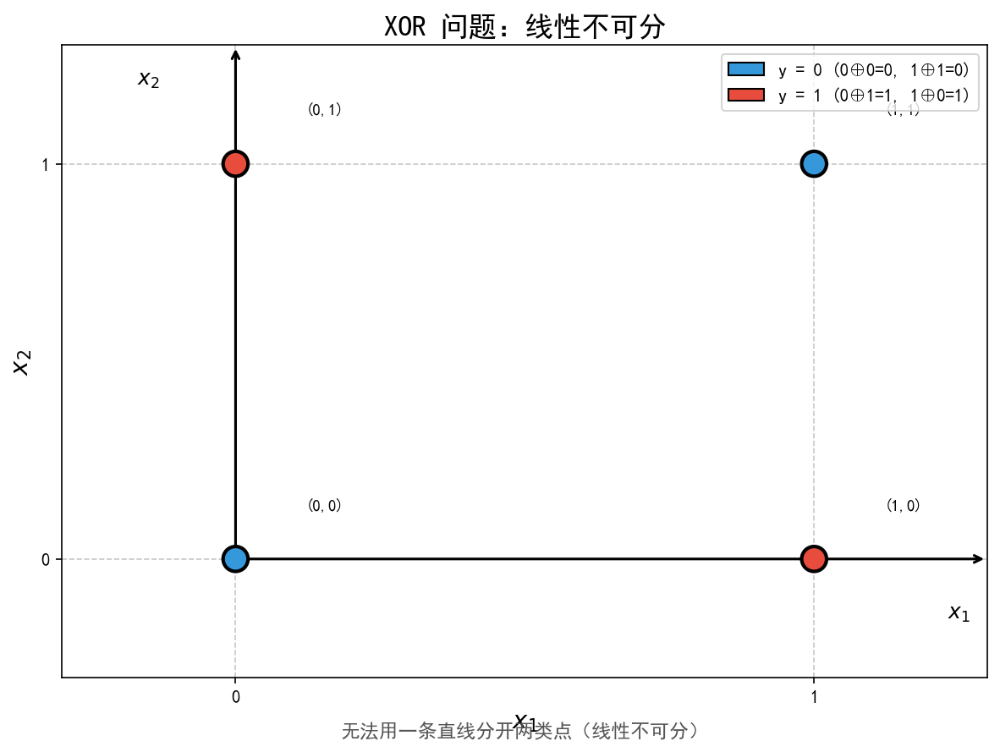
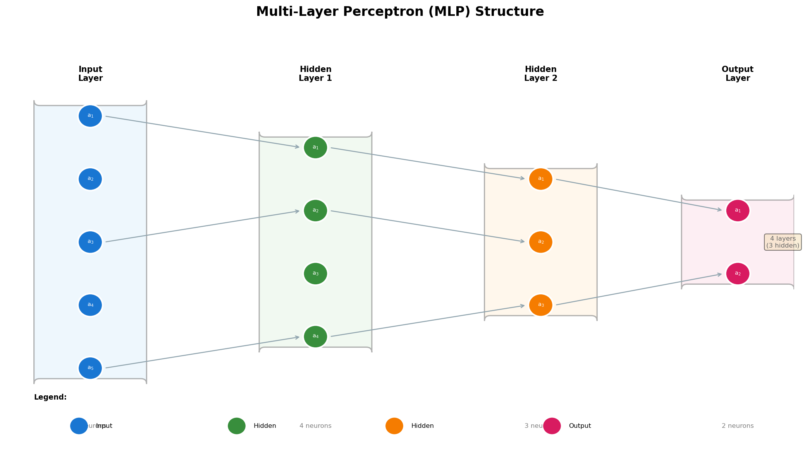
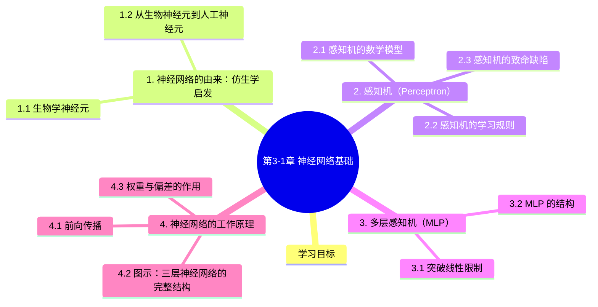

# 第3-1章 神经网络基础

## 学习目标

- 理解神经网络的生物学启发（仿生学起源）
- 掌握感知机（Perceptron）的原理与局限
- 理解多层感知机（MLP）如何解决线性不可分问题
- 掌握神经网络的基本结构：输入层、隐藏层、输出层
- 理解权重与偏差在神经网络中的作用
- 能够绘制简单的神经网络结构图

---

## 1. 神经网络的由来：仿生学启发

### 1.1 生物学神经元

大脑是我们已知的最为复杂的计算系统之一，它由约 **860 亿个神经元**（Neuron）组成。每个神经元通过突触（Synapse）与其他神经元相连，形成了一个庞大的网络。

生物神经元的工作方式大致如下：

1. **接收信号**：树突（Dendrite）接收来自其他神经元的化学信号
2. **信号整合**：细胞体（Cell Body）对输入信号进行求和
3. **阈值判断**：如果总和超过某个阈值，神经元会"激活"
4. **传递信号**：轴突（Axon）将信号传递给下一个神经元

### 1.2 从生物神经元到人工神经元

1943 年，神经生理学家 **Warren McCulloch** 和数学家 **Walter Pitts** 提出了第一个人工神经元模型——**MCP 模型**。这被视为神经网络的开端。

他们的想法很简单：用数学模型模拟生物神经元的信息处理过程。

> 💡 **关键洞察**：神经网络并不是"模仿"大脑，而是一种受生物神经系统启发的**数学抽象**。

---

## 2. 感知机（Perceptron）

### 2.1 感知机的数学模型

感知机是最简单的人工神经元模型，也是一个人监督学习的二分类模型。

对于输入向量 $\mathbf{x} = (x_1, x_2, \ldots, x_n)$，感知机的输出为：

$$
y = \text{sign}\left(\sum_{i=1}^{n} w_i x_i + b\right) = \text{sign}(\mathbf{w} \cdot \mathbf{x} + b)
$$

其中：
- $\mathbf{w} = (w_1, w_2, \ldots, w_n)$ 是**权重向量**
- $b$ 是**偏置**（bias）
- $\text{sign}(z)$ 是**激活函数**，通常取符号函数

$$
\text{sign}(z) = \begin{cases} +1 & z \geq 0 \\ -1 & z < 0 \end{cases}
$$

### 2.2 感知机的学习规则

感知机的参数通过以下规则更新：

$$
w_i \leftarrow w_i + \alpha (y_{\text{true}} - \hat{y}) x_i
$$

$$
b \leftarrow b + \alpha (y_{\text{true}} - \hat{y})
$$

其中 $\alpha$ 是学习率，$y_{\text{true}}$ 是真实标签，$\hat{y}$ 是预测值。

### 2.3 感知机的致命缺陷

**感知机只能处理线性可分问题。**

1969 年，Minsky 和 Papert 在《Perceptrons》一书中严格证明了感知机的局限性：

- 感知机**无法解决 XOR（异或）问题**
- 这导致了第一次"神经网络寒冬"

> ⚠️ **重要结论**：单层感知机本质是一个线性分类器，它**无法解决非线性问题**——无法用一条直线分开 XOR 的两类点。

---

## 3. 多层感知机（MLP）

### 3.1 突破线性限制

要解决 XOR 这类线性不可分问题，唯一的办法是**引入隐藏层**。

加入隐藏层后，MLP 可以拟合**任意复杂的非线性决策边界**。

### 3.2 MLP 的结构

一个典型的多层感知机（也叫**全连接神经网络**，FCNN）结构如下：

**术语解释**：

| 层级 | 作用 |
|------|------|
| **输入层** | 接收原始数据，不做计算，节点数 = 特征维度 |
| **隐藏层** | 提取特征和学习表示，层数和每层节点数是超参数 |
| **输出层** | 产生最终预测，节点数 = 分类数（回归为 1） |

---

## 4. 神经网络的工作原理

### 4.1 前向传播

数据从输入层流向输出层的过程叫做**前向传播（Forward Propagation）**。

对于第 $l$ 层的第 $j$ 个神经元：

$$
z_j^{(l)} = \sum_{i} w_{ji}^{(l)} a_i^{(l-1)} + b_j^{(l)}
$$

$$
a_j^{(l)} = \sigma(z_j^{(l)})
$$

其中 $\sigma$ 是激活函数，$a^{(l-1)}$ 是上一层的输出。

> 🔑 **核心公式**：每一层都是对上一层的输出做一次**线性变换 + 非线性激活**。

### 4.2 图示：三层神经网络的完整结构

网络由三层组成：输入层接收特征，隐藏层进行特征变换，输出层产生预测。每层神经元与下一层全连接。

### 4.3 权重与偏差的作用

| 参数 | 作用 | 形象理解 |
|------|------|---------|
| **权重 $w$** | 控制信号的重要程度 | "这根连线有多强？" |
| **偏差 $b$** | 控制神经元的激活阈值 | "这个神经元有多容易被激活？" |

> 💡 **直观理解**：权重决定了"谁影响谁"，偏差决定了"什么时候开始影响"。

---

## 5. 知识点总结

| 概念 | 要点 |
|------|------|
| **仿生学起源** | 神经网络受生物神经元启发，但本质是数学模型 |
| **感知机** | 最简单的人工神经元，只能处理线性可分问题 |
| **Minsky 证明** | 单层感知机无法解决 XOR，导致第一次 AI 寒冬 |
| **MLP** | 多层感知机 = 输入层 + ≥1 隐藏层 + 输出层 |
| **全连接** | 每层神经元与下一层所有神经元相连 |
| **权重/偏差** | 权重决定连接强度，偏差决定激活阈值 |

---

## 本章小结
1. **神经网络生物学启发**：神经元（细胞体/树突/轴突）→ MCP模型 → 感知机 → 多层感知机（MLP）
2. **感知机原理**：线性分类模型，$f(x) = sign(w·x + b)$，通过迭代更新最小化误分类损失
3. **感知机局限**：只能处理线性可分问题，XOR问题无法被单层感知机解决
4. **MLP结构**：输入层→隐藏层（可多层）→输出层，每层全连接，激活函数引入非线性
5. **前向传播**：输入逐层加权求和+激活函数，得到输出；反向传播计算梯度更新权重

## 知识图谱

## 参考资料

1. McCulloch, W. S., & Pitts, W. (1943). A logical calculus of the ideas immanent in nervous activity. *Bulletin of Mathematical Biophysics*, 5(4), 115-133.
2. Minsky, M., & Papert, S. (1969). *Perceptrons: An Introduction to Computational Geometry*. MIT Press.
3. Goodfellow, I., Bengio, Y., & Courville, A. (2016). *Deep Learning*. MIT Press. Chapter 1 & 6.

