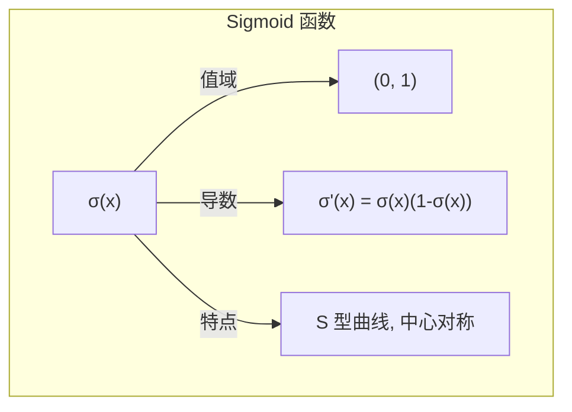
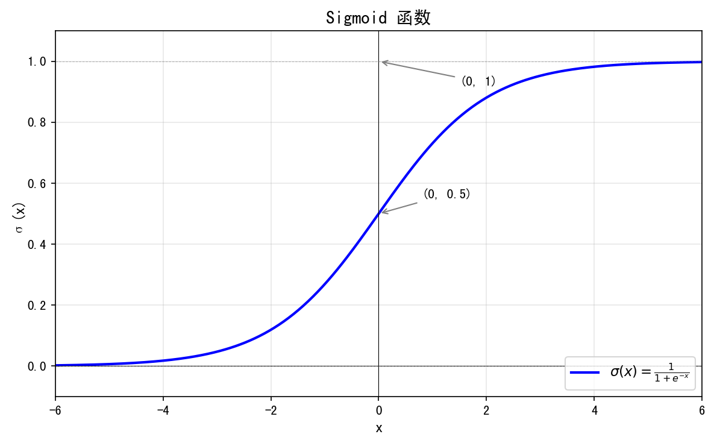
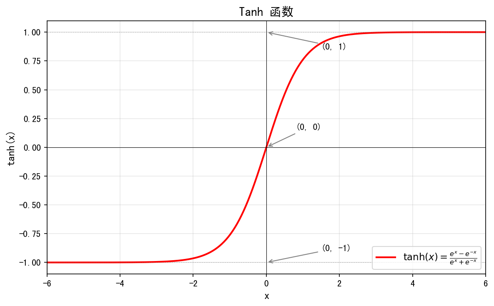
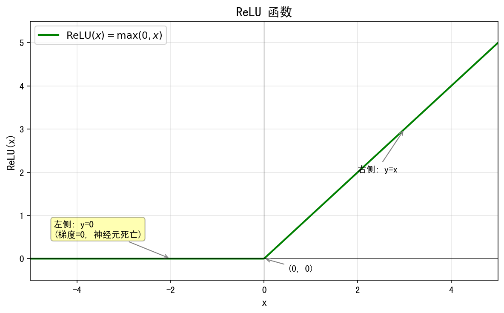
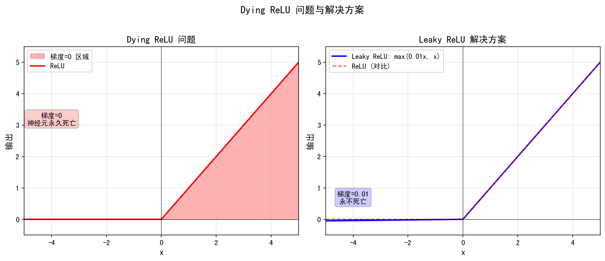
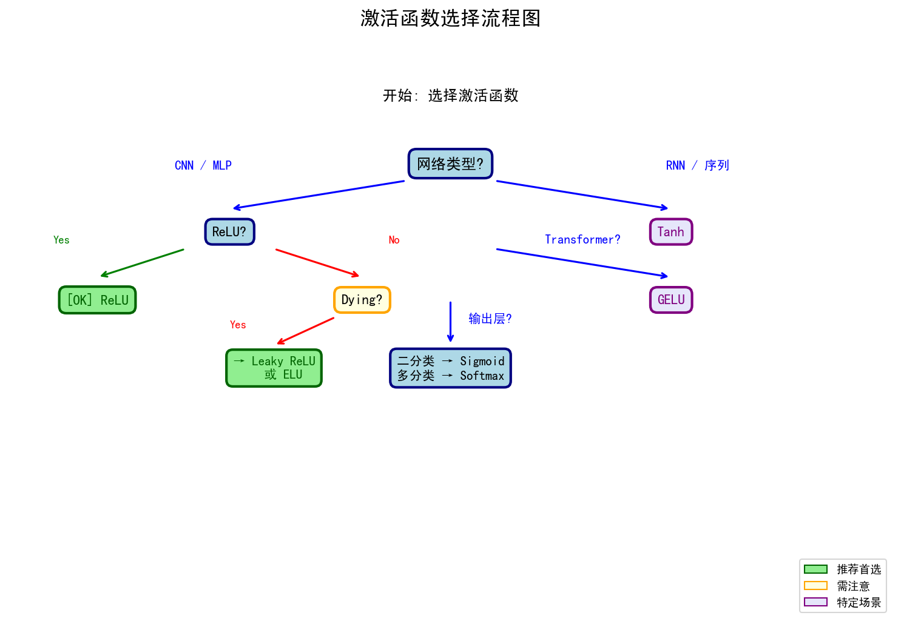
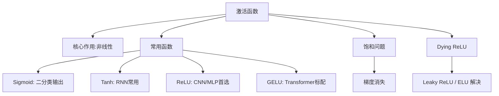
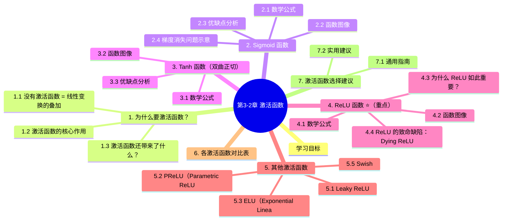

# 第3-2章 激活函数

## 学习目标

- 理解激活函数的核心作用——**引入非线性**
- 掌握常见激活函数的数学公式、图像和优缺点
- 重点掌握 **ReLU** 函数（深度学习最常用）
- 了解各激活函数的适用场景与选择建议

---

## 1. 为什么要激活函数？

### 1.1 没有激活函数 = 线性变换的叠加

如果神经网络没有激活函数，那么每一层都是简单的线性变换：

$$
\mathbf{y} = \mathbf{W}^{(2)}(\mathbf{W}^{(1)}\mathbf{x} + \mathbf{b}^{(1)}) + \mathbf{b}^{(2)}
$$

展开后：

$$
\mathbf{y} = \mathbf{W}^{(2)}\mathbf{W}^{(1)}\mathbf{x} + \mathbf{W}^{(2)}\mathbf{b}^{(1)} + \mathbf{b}^{(2)} = \mathbf{W}'\mathbf{x} + \mathbf{b}'
$$

**多层线性变换等价于一层线性变换**，网络再深也没有意义。

### 1.2 激活函数的核心作用

> 🔑 **激活函数给神经网络引入非线性，使网络能够拟合任意复杂的函数。**

```
    无激活函数：       有激活函数：
    
    x → [线性] → y    x → [线性] → [激活] → y
                        ↗  ↗  ↗
                       非线性决策边界
```

### 1.3 激活函数还带来了什么？

- **非线性表达能力**：拟合复杂模式
- **梯度流动**：梯度的传递依赖于激活函数的导数
- **稀疏激活性**：某些激活函数可以让部分神经元输出为 0，起到特征选择作用

---

## 2. Sigmoid 函数

### 2.1 数学公式

$$
\sigma(x) = \frac{1}{1 + e^{-x}}
$$

### 2.2 函数图像





### 2.3 优缺点分析

| 优点 | 缺点 |
|------|------|
| 输出在 (0,1)，适合表示概率 | **梯度消失**：导数最大值 0.25，深层网络梯度逐层衰减 |
| 物理意义清晰（神经元的"激活率"） | **计算开销大**：涉及指数运算 |
| 中心对称，有助于梯度传播 | **输出恒正**：可能导致 Zigzag 现象 |

### 2.4 梯度消失问题示意

反向传播时，梯度经过每一层都会被乘以 $\sigma'(x)$：

$$
\frac{\partial L}{\partial w^{(1)}} = \frac{\partial L}{\partial a^{(n)}} \cdot \sigma'(z^{(n)}) \cdot \sigma'(z^{(n-1)}) \cdot \cdots \cdot \sigma'(z^{(1)})
$$

由于 $\sigma'(x) \in (0, 0.25)$，深层网络的浅层梯度接近于 0 → **梯度消失**。

---

## 3. Tanh 函数（双曲正切）

### 3.1 数学公式

$$
\tanh(x) = \frac{e^x - e^{-x}}{e^x + e^{-x}} = 2\sigma(2x) - 1
$$

### 3.2 函数图像



### 3.3 优缺点分析

| 优点 | 缺点 |
|------|------|
| 输出以 0 为中心（-1, 1），**无 Zigzag 现象** | 两侧仍然存在软饱和，梯度消失问题依然存在 |
| 收敛速度通常比 Sigmoid 快 | 计算涉及指数运算，仍有计算开销 |

> 💡 **工程经验**：Tanh 在循环神经网络（RNN）中常用，在卷积神经网络（CNN）中通常用 ReLU。

---

## 4. ReLU 函数 ⭐（重点）

### 4.1 数学公式

$$
\text{ReLU}(x) = \max(0, x) = \begin{cases} x & x > 0 \\ 0 & x \leq 0 \end{cases}
$$

### 4.2 函数图像



### 4.3 为什么 ReLU 如此重要？

| 特性 | 说明 |
|------|------|
| **计算极快** | 只需一次比较运算，无需指数运算，比 Sigmoid/Tanh 快 **6～30 倍** |
| **右侧梯度不消失** | 正区间梯度恒为 1，有效缓解梯度消失 |
| **稀疏激活性** | 负区间输出为 0，形成自然断路（dead neurons） |
| **生物合理性** | 符合神经元的"稀疏激活"特性 |

### 4.4 ReLU 的致命缺陷：Dying ReLU



**解决方案**：
- 使用 **Leaky ReLU** / **PReLU**
- 使用 **ELU**
- 使用 **Adam** 等自适应优化器

---

## 5. 其他激活函数

### 5.1 Leaky ReLU

$$
f(x) = \begin{cases} x & x > 0 \\ 0.01x & x \leq 0 \end{cases}
$$

右侧梯度恒为 1，左侧有微小梯度，**解决 Dying ReLU 问题**。

### 5.2 PReLU（Parametric ReLU）

$$
f(x) = \begin{cases} x & x > 0 \\ \alpha x & x \leq 0 \end{cases}
$$

其中 $\alpha$ 是可学习的参数，而非固定值 0.01。

### 5.3 ELU（Exponential Linear Unit）

$$
f(x) = \begin{cases} x & x > 0 \\ \alpha(e^x - 1) & x \leq 0 \end{cases}
$$

| 优点 | 缺点 |
|------|------|
| 左侧软饱和，对噪声更鲁棒 | 计算涉及指数，略慢于 ReLU |

### 5.4 GELU（Gaussian Error Linear Unit）

$$
\text{GELU}(x) = x \cdot \Phi(x)
$$

其中 $\Phi(x)$ 是标准正态分布的累计分布函数（CDF）。**Transformer 架构的标准激活函数**（BERT、GPT 等均使用）。

### 5.5 Swish

$$
\text{Swish}(x) = x \cdot \sigma(\beta x)
$$

Google Brain 2017 年提出，自门控激活函数，在某些任务上优于 ReLU。

---

## 6. 各激活函数对比表

| 激活函数 | 公式 | 值域 | 梯度特性 | 计算成本 | 适用场景 |
|---------|------|------|---------|---------|---------|
| **Sigmoid** | $\frac{1}{1+e^{-x}}$ | (0, 1) | 两端饱和，梯度消失 | 指数运算 | 二分类输出层 |
| **Tanh** | $\frac{e^x-e^{-x}}{e^x+e^{-x}}$ | (-1, 1) | 两端饱和，梯度消失 | 指数运算 | RNN、序列模型 |
| **ReLU** | $\max(0,x)$ | $[0,+\infty)$ | 右侧不消失，左侧硬饱和 | 极低 | **CNN、MLP（默认首选）** |
| **Leaky ReLU** | $\max(0.01x,x)$ | $\mathbb{R}$ | 永不饱和 | 极低 | 避免 Dying ReLU |
| **ELU** | $x$ if $x>0$ else $\alpha(e^x-1)$ | $(-\alpha,+\infty)$ | 近似零中心 | 较低 | 对噪声敏感任务 |
| **GELU** | $x \cdot \Phi(x)$ | $\mathbb{R}$ | 动态衰减 | 较高 | **Transformer 系列** |
| **Swish** | $x \cdot \sigma(x)$ | $\mathbb{R}$ | 自适应 | 较高 | 搜索/NAS |

---

## 7. 激活函数选择建议

### 7.1 通用指南



### 7.2 实用建议

1. **默认选择 ReLU**——便宜、好用、效果稳定
2. **CNN 中**：ReLU > GELU ≈ Swish > Leaky ReLU
3. **Transformer**：GELU（几乎所有大模型都用）
4. **RNN**：Tanh（梯度流动更稳定）
5. **二分类输出层**：Sigmoid
6. **多分类输出层**：Softmax（即 Softmax 函数）

> ⚠️ **警告**：ReLU 前面层的 batch normalization 可以缓解其负面影响（将数据拉到正区间）。

---

## 8. 知识点总结



---

## Python代码示例：可视化激活函数及其导数

以下Python代码演示如何绘制常见的激活函数及其导数，帮助直观理解它们的数学特性：

```python
"""
激活函数可视化
==============

本代码演示常见的激活函数及其导数：
1. Sigmoid函数及其导数
2. Tanh函数及其导数  
3. ReLU函数及其导数
4. Leaky ReLU函数及其导数
5. GELU函数近似及其导数

通过可视化可以直观理解：
- 函数形状和值域范围
- 梯度（导数）变化情况
- 梯度消失/爆炸问题
"""

import numpy as np
import matplotlib.pyplot as plt

# 创建输入值范围
x = np.linspace(-5, 5, 1000)

# 1. Sigmoid函数及其导数
def sigmoid(x):
    return 1 / (1 + np.exp(-x))

def sigmoid_derivative(x):
    s = sigmoid(x)
    return s * (1 - s)

# 2. Tanh函数及其导数
def tanh(x):
    return np.tanh(x)

def tanh_derivative(x):
    return 1 - np.tanh(x)**2

# 3. ReLU函数及其导数
def relu(x):
    return np.maximum(0, x)

def relu_derivative(x):
    return np.where(x > 0, 1, 0)

# 4. Leaky ReLU函数及其导数（alpha=0.01）
def leaky_relu(x, alpha=0.01):
    return np.where(x > 0, x, alpha * x)

def leaky_relu_derivative(x, alpha=0.01):
    return np.where(x > 0, 1, alpha)

# 5. GELU函数近似及其导数（使用tanh近似）
def gelu(x):
    return 0.5 * x * (1 + np.tanh(np.sqrt(2 / np.pi) * (x + 0.044715 * x**3)))

def gelu_derivative(x):
    # GELU导数的数值近似
    return 0.5 * (1 + np.tanh(np.sqrt(2 / np.pi) * (x + 0.044715 * x**3))) + \
           0.5 * x * (1 - np.tanh(np.sqrt(2 / np.pi) * (x + 0.044715 * x**3))**2) * \
           np.sqrt(2 / np.pi) * (1 + 3 * 0.044715 * x**2)

# 创建图形
fig, axes = plt.subplots(2, 5, figsize=(20, 8))
fig.suptitle('激活函数及其导数可视化', fontsize=16, fontweight='bold')

# 激活函数列表
activations = [
    ("Sigmoid", sigmoid, sigmoid_derivative, 'red'),
    ("Tanh", tanh, tanh_derivative, 'blue'),
    ("ReLU", relu, relu_derivative, 'green'),
    ("Leaky ReLU", leaky_relu, leaky_relu_derivative, 'orange'),
    ("GELU", gelu, gelu_derivative, 'purple')
]

# 绘制每个激活函数及其导数
for i, (name, func, deriv, color) in enumerate(activations):
    # 激活函数
    y = func(x) if name != "Leaky ReLU" else func(x, 0.01)
    axes[0, i].plot(x, y, color=color, linewidth=2.5, label=name)
    axes[0, i].set_title(f'{name}函数', fontsize=12, fontweight='bold')
    axes[0, i].grid(True, alpha=0.3)
    axes[0, i].axhline(y=0, color='black', linewidth=0.5)
    axes[0, i].axvline(x=0, color='black', linewidth=0.5)
    axes[0, i].set_xlabel('输入 x')
    axes[0, i].set_ylabel('输出 f(x)')
    axes[0, i].legend()
    
    # 导数
    y_deriv = deriv(x) if name != "Leaky ReLU" else deriv(x, 0.01)
    axes[1, i].plot(x, y_deriv, color=color, linewidth=2.5, label=f'{name}导数')
    axes[1, i].set_title(f'{name}导数', fontsize=12, fontweight='bold')
    axes[1, i].grid(True, alpha=0.3)
    axes[1, i].axhline(y=0, color='black', linewidth=0.5)
    axes[1, i].axvline(x=0, color='black', linewidth=0.5)
    axes[1, i].set_xlabel('输入 x')
    axes[1, i].set_ylabel("导数 f'(x)")
    axes[1, i].legend()

plt.tight_layout()
plt.show()

# 额外分析：梯度消失问题演示
print("梯度消失问题演示：")
print("=" * 50)

# 模拟多层神经网络中Sigmoid的梯度传递
def simulate_gradient_vanishing():
    """模拟深度网络中Sigmoid激活函数的梯度消失"""
    np.random.seed(42)
    n_layers = 10  # 10层网络
    gradients = []
    
    # 随机生成每层的输入（假设为正态分布）
    layer_inputs = np.random.randn(n_layers, 1000) * 0.5
    
    # 计算每层的梯度（链式法则连乘）
    cumulative_gradient = 1.0
    for layer in range(n_layers):
        # 计算该层Sigmoid的导数平均值
        layer_grad = np.mean(sigmoid_derivative(layer_inputs[layer]))
        cumulative_gradient *= layer_grad
        gradients.append(cumulative_gradient)
        
        if layer < 5:  # 只显示前5层的结果
            print(f"第{layer+1}层后累积梯度: {cumulative_gradient:.6f}")
    
    return gradients

gradients = simulate_gradient_vanishing()

print("\n" + "=" * 50)
print("观察结果：")
print("1. Sigmoid导数最大值为0.25，多层连乘后梯度迅速衰减")
print("2. ReLU导数为0或1，不存在梯度衰减（除非输入为负）")
print("3. 这是ReLU成为深度学习首选激活函数的主要原因")

# 可视化梯度消失
plt.figure(figsize=(10, 6))
plt.plot(range(1, 11), gradients, 'o-', linewidth=2, markersize=8, color='red')
plt.title('深度网络中Sigmoid激活函数的梯度消失问题', fontsize=14, fontweight='bold')
plt.xlabel('网络层数', fontsize=12)
plt.ylabel('累积梯度（对数尺度）', fontsize=12)
plt.yscale('log')
plt.grid(True, alpha=0.3)
plt.axhline(y=0.001, color='gray', linestyle='--', label='梯度消失阈值 (0.001)')
plt.legend()
plt.show()
```

**代码说明**：
1. 第一部分绘制了5种常见激活函数及其导数的对比图
2. 第二部分演示了Sigmoid函数的梯度消失问题
3. 通过可视化可以直观理解为什么ReLU系列函数成为深度学习的主流选择

**运行环境要求**：
```bash
pip install numpy matplotlib
```

**学习建议**：
1. 运行代码观察不同激活函数的形状
2. 修改代码中的参数（如Leaky ReLU的alpha值）
3. 尝试添加其他激活函数（如ELU、Swish等）
4. 思考：为什么Transformer中使用GELU而不是ReLU？

## 本章小结

1. **激活函数的核心作用**：为神经网络引入非线性，使网络能够拟合任意复杂的函数。没有激活函数，多层网络等价于单层线性变换。

2. **常见激活函数对比**：
   - **Sigmoid**：值域 (0,1)，适合二分类输出，但存在梯度消失问题（导数最大 0.25）
   - **Tanh**：值域 (-1,1)，以 0 为中心，常用于 RNN，但仍有梯度消失问题
   - **ReLU**：深度学习首选，计算快、右侧梯度不消失，但存在 Dying ReLU 问题
   - **GELU**：Transformer 系列的标准激活函数（如 BERT、GPT）

3. **梯度消失与饱和**：Sigmoid/Tanh 在两端饱和，梯度趋近于 0；ReLU 右侧不饱和，但左侧硬饱和可能导致神经元死亡。

4. **实际选择建议**：
   - CNN/MLP 默认选 ReLU
   - Transformer 选 GELU
   - RNN 选 Tanh
   - 二分类输出层选 Sigmoid

---


## 知识图谱



## 参考资料

1. Goodfellow, I., Bengio, Y., & Courville, A. (2016). *Deep Learning*. MIT Press. Chapter 6.
2. Nair, V., & Hinton, G. E. (2010). Rectified linear units improve restricted boltzmann machines. *ICML*.
3. Hendrycks, D., & Gimpel, K. (2016). Gaussian error linear units (GELUs). *arXiv:1606.08415*.
4. Ramachandran, P., Zoph, B., & Le, Q. V. (2017). Swish: a self-gated activation function. *arXiv:1710.05941*.
