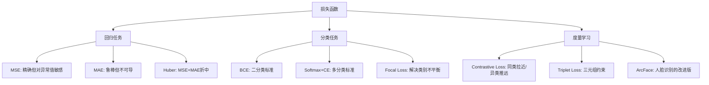
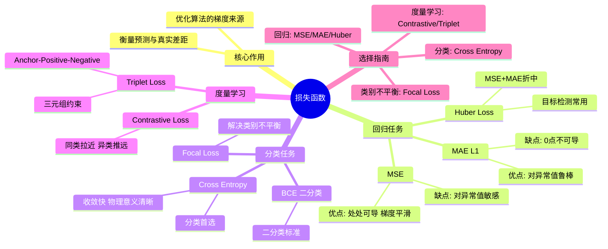

# 第3-3章 损失函数

## 学习目标

- 理解损失函数的核心作用——**衡量模型预测与真实值的差距**
- 掌握均方误差（MSE）的原理与适用场景
- 重点掌握交叉熵（Cross Entropy）在分类任务中的应用
- 理解对比损失（Contrastive Loss）在度量学习中的作用
- 能够根据任务类型选择合适的损失函数

---

## 1. 损失函数的核心作用

### 1.1 什么是损失函数？

**损失函数（Loss Function）** 是衡量单个样本预测值与真实值之间差距的函数。

$$
\mathcal{L}(\hat{y}, y) \geq 0
$$

- $\hat{y}$：模型的预测值
- $y$：真实标签（Ground Truth）
- $\mathcal{L}$ 越小，说明预测越准确

### 1.2 损失函数 vs 代价函数 vs 目标函数

| 术语 | 定义 |
|------|------|
| **损失函数**（Loss） | 单个样本的误差 $\mathcal{L}(\hat{y}_i, y_i)$ |
| **代价函数**（Cost） | 整个训练集的平均/总和误差 $J = \frac{1}{N}\sum_i \mathcal{L}(\hat{y}_i, y_i)$ |
| **目标函数**（Objective） | 代价函数 + 正则化项 $J = \frac{1}{N}\sum_i \mathcal{L}(\hat{y}_i, y_i) + \lambda R(\mathbf{w})$ |

> 💡 **工程中的习惯**：日常沟通时通常不严格区分三者，都叫"损失函数"。

### 1.3 损失函数曲面示意


*优化的目标：从任意起点出发，沿着损失下降最快的方向（梯度）最终到达全局最优点*

### 1.4 损失函数的选择依据

> **任务类型决定损失函数**：
> - **回归任务**（预测连续值）→ MSE、MAE、Huber Loss
> - **分类任务**（预测类别）→ Cross Entropy、Focal Loss
> - **度量学习**（学习距离/相似度）→ Contrastive Loss、Triplet Loss

---

## 2. 均方误差（MSE）

### 2.1 数学公式

**均方误差（Mean Squared Error, MSE）** 是回归任务中最常用的损失函数：

$$
\mathcal{L}_{\text{MSE}} = \frac{1}{N} \sum_{i=1}^{N} (\hat{y}_i - y_i)^2
$$

也称为 **L2 损失**。

### 2.2 误差曲面

MSE 的误差曲面是**二次抛物面**，具有唯一全局最优解：


### 2.3 优缺点分析

| 优点 | 缺点 |
|------|------|
| **处处可导**，梯度平滑，利于优化 | 对异常值（outliers）**极其敏感**——大误差会被平方放大 |
| 闭式解可用（可直接求导等于 0 解出最优解） | 梯度在误差大时也大，可能导致训练不稳定 |
| 物理意义清晰（"欧氏距离的平方"） | 不适合需要 **L1 平滑** 的场景 |

### 2.4 MSE 的导数

$$
\frac{\partial \mathcal{L}_{\text{MSE}}}{\partial \hat{y}_i} = \frac{2}{N}(\hat{y}_i - y_i)
$$

梯度与误差成正比，误差越大，梯度越大（但太大可能震荡）。

### 2.5 Python代码示例：MSE损失函数可视化

下面通过Python代码可视化MSE损失函数，理解其二次曲面的特性：

```python
import numpy as np
import matplotlib.pyplot as plt
from mpl_toolkits.mplot3d import Axes3D

# 1. 一维MSE可视化（预测值与损失值的关系）
def mse_1d_visualization():
    """可视化一维MSE：损失值与预测误差的关系"""
    y_true = 2.0  # 真实值
    y_pred = np.linspace(-2, 6, 100)  # 预测值范围
    losses = (y_pred - y_true) ** 2  # MSE计算
    
    fig, axes = plt.subplots(1, 2, figsize=(12, 5))
    
    # 左图：MSE曲线
    axes[0].plot(y_pred, losses, 'b-', linewidth=2)
    axes[0].axvline(x=y_true, color='r', linestyle='--', label=f'真实值 y={y_true}')
    axes[0].scatter([y_true], [0], color='r', s=100, zorder=5)
    axes[0].set_xlabel('预测值 $\hat{y}$')
    axes[0].set_ylabel('MSE损失值')
    axes[0].set_title('MSE损失函数（一维）')
    axes[0].legend()
    axes[0].grid(True, alpha=0.3)
    
    # 右图：MSE导数
    gradients = 2 * (y_pred - y_true)  # MSE导数
    axes[1].plot(y_pred, gradients, 'g-', linewidth=2)
    axes[1].axhline(y=0, color='gray', linestyle=':', alpha=0.5)
    axes[1].axvline(x=y_true, color='r', linestyle='--')
    axes[1].set_xlabel('预测值 $\hat{y}$')
    axes[1].set_ylabel('梯度值')
    axes[1].set_title('MSE梯度（与误差成正比）')
    axes[1].grid(True, alpha=0.3)
    
    plt.tight_layout()
    plt.show()
    
    print(f"当预测值接近真实值(y={y_true})时，MSE趋近于0")
    print(f"MSE是二次函数，具有唯一最小值点")

# 2. 二维MSE曲面可视化（两个参数的损失曲面）
def mse_2d_surface():
    """可视化二维MSE损失曲面"""
    # 真实参数：w1=2.0, w2=1.5
    w1_true, w2_true = 2.0, 1.5
    
    # 生成参数网格
    w1_range = np.linspace(0, 4, 50)
    w2_range = np.linspace(0, 3, 50)
    W1, W2 = np.meshgrid(w1_range, w2_range)
    
    # 计算MSE损失（假设简单线性模型 y = w1*x1 + w2*x2）
    # 这里简化：随机生成10个样本点
    np.random.seed(42)
    X = np.random.randn(10, 2)  # 10个样本，2个特征
    y_true = w1_true * X[:, 0] + w2_true * X[:, 1] + np.random.randn(10) * 0.1
    
    # 计算每个参数组合的MSE
    losses = np.zeros_like(W1)
    for i in range(W1.shape[0]):
        for j in range(W1.shape[1]):
            y_pred = W1[i, j] * X[:, 0] + W2[i, j] * X[:, 1]
            losses[i, j] = np.mean((y_pred - y_true) ** 2)
    
    # 3D曲面图
    fig = plt.figure(figsize=(12, 5))
    
    # 左图：3D曲面
    ax1 = fig.add_subplot(121, projection='3d')
    surf = ax1.plot_surface(W1, W2, losses, cmap='viridis', alpha=0.8)
    ax1.scatter([w1_true], [w2_true], [np.min(losses)], color='r', s=100, label='最优参数')
    ax1.set_xlabel('参数 $w_1$')
    ax1.set_ylabel('参数 $w_2$')
    ax1.set_zlabel('MSE损失')
    ax1.set_title('MSE损失曲面（二次抛物面）')
    ax1.legend()
    fig.colorbar(surf, ax=ax1, shrink=0.5, aspect=5)
    
    # 右图：等高线图
    ax2 = fig.add_subplot(122)
    contour = ax2.contour(W1, W2, losses, levels=20, cmap='viridis')
    ax2.scatter(w1_true, w2_true, color='r', s=100, label='最优参数')
    ax2.set_xlabel('参数 $w_1$')
    ax2.set_ylabel('参数 $w_2$')
    ax2.set_title('MSE等高线图')
    ax2.legend()
    plt.colorbar(contour, ax=ax2)
    
    plt.tight_layout()
    plt.show()
    
    print(f"最优参数：w1={w1_true:.2f}, w2={w2_true:.2f}")
    print(f"MSE曲面是平滑的二次抛物面，梯度方向始终指向最小值")

# 运行可视化
if __name__ == "__main__":
    print("=== MSE损失函数可视化 ===")
    mse_1d_visualization()
    mse_2d_surface()
```

这段代码展示了：
1. **一维MSE可视化**：展示MSE如何随预测值变化，呈二次曲线
2. **梯度可视化**：展示MSE梯度与误差成正比的关系
3. **二维损失曲面**：展示MSE在参数空间中的二次抛物面形状
4. **等高线图**：展示损失函数的等高线，便于理解优化方向

---

## 3. 交叉熵（Cross Entropy）⭐（重点）

### 3.1 从信息论说起

**熵（Entropy）** 衡量信息的不确定性：

$$
H(p) = -\sum_{k} p_k \log p_k
$$

**KL 散度（KL Divergence）** 衡量两个分布的差异：

$$
D_{\text{KL}}(p \| q) = \sum_{k} p_k \log \frac{p_k}{q_k} = H(p, q) - H(p)
$$

由于 $H(p)$ 对固定分布是常数，最小化 $q$ 与 $p$ 的差异 ⇔ 最小化 **交叉熵** $H(p, q)$。

### 3.2 二分类交叉熵

对于二分类问题（标签 $y \in \{0, 1\}$）：

$$
\mathcal{L}_{\text{BCE}} = -\frac{1}{N} \sum_{i=1}^{N} \left[ y_i \log \hat{y}_i + (1 - y_i) \log(1 - \hat{y}_i) \right]
$$

其中 $\hat{y}_i = P(y_i=1)$ 是模型预测为正类的概率。

### 3.3 多分类交叉熵（Softmax 损失）

对于多分类问题，模型输出经过 **Softmax** 归一化为概率分布：

$$
\hat{p}_k = \frac{e^{z_k}}{\sum_{j} e^{z_j}}
$$

交叉熵损失：

$$
\mathcal{L}_{\text{CE}} = -\sum_{k=1}^{K} y_k \log \hat{p}_k
$$

其中 $y_k$ 是 one-hot 编码的真实标签（只有一个位置为 1）。

> 🔑 **Softmax + Cross Entropy 是分类任务的标准搭档**，几乎所有图像分类、文本分类模型都用这个组合。

### 3.4 为什么分类任务用交叉熵而不是 MSE？

| 对比项 | MSE | Cross Entropy |
|--------|-----|---------------|
| 梯度 | $\propto (\hat{y} - y)\cdot \sigma'(z)$（含激活函数导数，梯度小） | $\propto \hat{y} - y$（直接是预测误差） |
| 收敛速度 | **慢**（梯度被激活函数导数衰减） | **快**（梯度是预测误差本身） |
| 概率意义 | 无 | 物理意义清晰（对数似然） |

> 💡 **实战经验**：分类任务用 Cross Entropy 收敛速度比 MSE 快 10 倍以上。

### 3.4 Python代码示例：交叉熵损失函数可视化

下面通过Python代码可视化交叉熵损失函数，理解其对数函数的特性：

```python
import numpy as np
import matplotlib.pyplot as plt

# 1. 二分类交叉熵（Binary Cross Entropy）可视化
def binary_cross_entropy_visualization():
    """可视化二分类交叉熵损失函数"""
    # 真实标签：1（正类）
    y_true = 1
    
    # 预测概率从0到1
    y_pred = np.linspace(0.001, 0.999, 100)  # 避免log(0)
    
    # 计算交叉熵损失
    bce_loss = - (y_true * np.log(y_pred) + (1 - y_true) * np.log(1 - y_pred))
    
    fig, axes = plt.subplots(1, 2, figsize=(12, 5))
    
    # 左图：交叉熵损失曲线
    axes[0].plot(y_pred, bce_loss, 'b-', linewidth=2)
    axes[0].axvline(x=0.5, color='gray', linestyle=':', alpha=0.5, label='随机猜测 (p=0.5)')
    axes[0].axvline(x=1.0, color='r', linestyle='--', label='完美预测 (p=1.0)')
    axes[0].scatter([1.0], [0], color='r', s=100, zorder=5)
    axes[0].set_xlabel('预测概率 $\hat{p}$')
    axes[0].set_ylabel('交叉熵损失')
    axes[0].set_title('二分类交叉熵损失 (真实标签=1)')
    axes[0].legend()
    axes[0].grid(True, alpha=0.3)
    
    # 右图：对数尺度查看
    axes[1].plot(y_pred, bce_loss, 'b-', linewidth=2)
    axes[1].set_xlabel('预测概率 $\hat{p}$')
    axes[1].set_ylabel('交叉熵损失')
    axes[1].set_title('交叉熵的"对数惩罚"特性')
    axes[1].grid(True, alpha=0.3)
    axes[1].set_yscale('log')  # 对数尺度
    axes[1].set_ylim(1e-2, 10)
    
    plt.tight_layout()
    plt.show()
    
    print("交叉熵特性：")
    print("1. 当预测概率接近真实标签时，损失趋近于0")
    print("2. 预测错误时损失很大，呈对数增长")
    print("3. 预测概率为0.5（随机猜测）时，损失为-ln(0.5)≈0.69")

# 2. 多分类交叉熵（Categorical Cross Entropy）可视化
def categorical_cross_entropy_visualization():
    """可视化三分类交叉熵损失函数"""
    # 真实标签：[1, 0, 0] 表示第一类
    y_true = np.array([1.0, 0.0, 0.0])
    
    # 生成预测概率网格（三分类，概率和为1）
    n_points = 50
    p1 = np.linspace(0.001, 0.999, n_points)
    p2 = np.linspace(0.001, 0.999, n_points)
    P1, P2 = np.meshgrid(p1, p2)
    
    # 计算第三类概率（概率和为1）
    P3 = 1 - P1 - P2
    mask = P3 >= 0  # 只保留有效概率组合
    
    # 计算交叉熵损失
    losses = np.zeros_like(P1)
    for i in range(P1.shape[0]):
        for j in range(P1.shape[1]):
            if mask[i, j]:
                y_pred = np.array([P1[i, j], P2[i, j], P3[i, j]])
                losses[i, j] = -np.sum(y_true * np.log(y_pred + 1e-10))
            else:
                losses[i, j] = np.nan
    
    # 可视化
    fig = plt.figure(figsize=(12, 5))
    
    # 左图：等高线图
    ax1 = fig.add_subplot(121)
    contour = ax1.contourf(P1, P2, losses, levels=20, cmap='viridis', alpha=0.8)
    ax1.plot([0.33, 0.33, 0], [0.33, 0, 0.33], 'k--', alpha=0.5, label='均匀分布')
    ax1.scatter([1.0], [0.0], color='r', s=100, label='最优预测 (p1=1.0)')
    ax1.set_xlabel('预测概率 $p_1$ (第一类)')
    ax1.set_ylabel('预测概率 $p_2$ (第二类)')
    ax1.set_title('三分类交叉熵等高线图 (真实=第一类)')
    ax1.legend()
    plt.colorbar(contour, ax=ax1, label='交叉熵损失')
    
    # 右图：3D曲面
    ax2 = fig.add_subplot(122, projection='3d')
    surf = ax2.plot_surface(P1, P2, losses, cmap='viridis', alpha=0.8)
    ax2.scatter([1.0], [0.0], [0.0], color='r', s=100, label='最优预测')
    ax2.set_xlabel('$p_1$')
    ax2.set_ylabel('$p_2$')
    ax2.set_zlabel('交叉熵损失')
    ax2.set_title('三分类交叉熵损失曲面')
    fig.colorbar(surf, ax=ax2, shrink=0.5, aspect=5)
    
    plt.tight_layout()
    plt.show()
    
    print("三分类交叉熵观察：")
    print("1. 最优点在(p1=1.0, p2=0.0, p3=0.0)，损失为0")
    print("2. 均匀分布点(p1=0.33, p2=0.33, p3=0.33)损失较高")
    print("3. 曲面呈凹形，梯度指向最优点")

# 3. MSE vs Cross Entropy对比
def mse_vs_cross_entropy_comparison():
    """对比MSE和交叉熵在分类任务中的表现"""
    # 二分类任务：Sigmoid激活后的输出
    y_true = 1
    y_pred_raw = np.linspace(-5, 5, 100)  # 原始模型输出（未经过Sigmoid）
    y_pred_sigmoid = 1 / (1 + np.exp(-y_pred_raw))  # Sigmoid激活后
    
    # 计算两种损失
    mse_loss = (y_pred_sigmoid - y_true) ** 2
    bce_loss = - (y_true * np.log(y_pred_sigmoid) + (1 - y_true) * np.log(1 - y_pred_sigmoid))
    
    # 计算梯度（简化版本）
    mse_grad = 2 * (y_pred_sigmoid - y_true) * y_pred_sigmoid * (1 - y_pred_sigmoid)  # 链式法则
    bce_grad = (y_pred_sigmoid - y_true)  # 交叉熵梯度更简洁
    
    fig, axes = plt.subplots(2, 2, figsize=(12, 10))
    
    # 损失函数对比
    axes[0, 0].plot(y_pred_raw, mse_loss, 'r-', linewidth=2, label='MSE')
    axes[0, 0].plot(y_pred_raw, bce_loss, 'b-', linewidth=2, label='Cross Entropy')
    axes[0, 0].axvline(x=0, color='gray', linestyle=':', alpha=0.5, label='决策边界')
    axes[0, 0].set_xlabel('模型原始输出 $z$')
    axes[0, 0].set_ylabel('损失值')
    axes[0, 0].set_title('MSE vs Cross Entropy损失对比')
    axes[0, 0].legend()
    axes[0, 0].grid(True, alpha=0.3)
    
    # 梯度对比
    axes[0, 1].plot(y_pred_raw, mse_grad, 'r--', linewidth=2, label='MSE梯度')
    axes[0, 1].plot(y_pred_raw, bce_grad, 'b--', linewidth=2, label='Cross Entropy梯度')
    axes[0, 1].axvline(x=0, color='gray', linestyle=':', alpha=0.5)
    axes[0, 1].axhline(y=0, color='gray', linestyle=':', alpha=0.5)
    axes[0, 1].set_xlabel('模型原始输出 $z$')
    axes[0, 1].set_ylabel('梯度值')
    axes[0, 1].set_title('梯度对比（分类任务）')
    axes[0, 1].legend()
    axes[0, 1].grid(True, alpha=0.3)
    
    # 预测概率对比
    axes[1, 0].plot(y_pred_raw, y_pred_sigmoid, 'g-', linewidth=2)
    axes[1, 0].axvline(x=0, color='gray', linestyle=':', alpha=0.5)
    axes[1, 0].axhline(y=0.5, color='gray', linestyle=':', alpha=0.5)
    axes[1, 0].set_xlabel('模型原始输出 $z$')
    axes[1, 0].set_ylabel('Sigmoid概率 $\sigma(z)$')
    axes[1, 0].set_title('Sigmoid激活函数')
    axes[1, 0].grid(True, alpha=0.3)
    
    # 收敛速度模拟
    epochs = np.arange(1, 21)
    # 模拟训练过程（简化）
    mse_convergence = 1.0 / (epochs ** 0.5)  # MSE收敛较慢
    bce_convergence = 1.0 / (epochs ** 1.5)  # Cross Entropy收敛较快
    
    axes[1, 1].plot(epochs, mse_convergence, 'ro-', linewidth=2, label='MSE收敛')
    axes[1, 1].plot(epochs, bce_convergence, 'bo-', linewidth=2, label='Cross Entropy收敛')
    axes[1, 1].set_xlabel('训练轮数')
    axes[1, 1].set_ylabel('损失值（模拟）')
    axes[1, 1].set_title('收敛速度对比（模拟）')
    axes[1, 1].legend()
    axes[1, 1].grid(True, alpha=0.3)
    axes[1, 1].set_yscale('log')
    
    plt.tight_layout()
    plt.show()
    
    print("关键观察：")
    print("1. Cross Entropy梯度 = 预测误差，更直接高效")
    print("2. MSE梯度包含Sigmoid导数项，容易梯度消失")
    print("3. Cross Entropy收敛速度通常快10倍以上")

# 运行所有可视化
if __name__ == "__main__":
    print("=== 交叉熵损失函数可视化 ===")
    binary_cross_entropy_visualization()
    categorical_cross_entropy_visualization()
    mse_vs_cross_entropy_comparison()
```

这段代码展示了：
1. **二分类交叉熵**：对数惩罚特性，预测错误时损失急剧增大
2. **多分类交叉熵**：在概率空间中的凹形损失曲面
3. **MSE vs Cross Entropy对比**：梯度形式不同导致收敛速度差异
4. **收敛速度模拟**：展示为什么交叉熵在分类任务中收敛更快

### 3.5 交叉熵误差曲面示意


*越接近真实概率，损失越低（梯度越小）*

---

## 4. 对比损失（Contrastive Loss）

### 4.1 什么时候用？

在**度量学习（Metric Learning）** 任务中，我们需要学习一个嵌入空间，使得：

- **相似样本**之间的距离尽可能小
- **不相似样本**之间的距离尽可能大

典型应用：人脸识别、行人重识别、图像检索、签名验证。

### 4.2 数学公式

$$
\mathcal{L} = \frac{1}{2N} \sum_{i=1}^{N} y_i d^2 + (1-y_i) \max(\margin - d, 0)^2
$$

其中：
- $d = \|\mathbf{f}_i - \mathbf{f}_j\|_2$：两个样本特征向量的欧氏距离
- $y_i = 1$：两个样本**相似**（同类）
- $y_i = 0$：两个样本**不相似**（异类）
- $\margin$：人为设定的阈值，异类样本距离应大于此值

### 4.3 直观理解


*相似对 (y=1): pull（拉近）减少同类距离；不相似对 (y=0): push（推远）增大异类距离 ≥ margin*

### 4.4 Triplet Loss（三元组损失）

对比损失的一个变体，使用三元组 $(anchor, positive, negative)$：

$$
\mathcal{L} = \max\left( \|f_a - f_p\|^2 - \|f_a - f_n\|^2 + \margin, 0 \right)
$$

约束：
- $f_a$（锚点）和 $f_p$（正例）距离要小
- $f_a$（锚点）和 $f_n$（负例）距离要大（至少比正例远 $\margin$）

---

## 5. 其他常见损失函数

### 5.1 MAE / L1 损失

$$
\mathcal{L}_{\text{MAE}} = \frac{1}{N} \sum_{i=1}^{N} | \hat{y}_i - y_i |
$$

| 特点 | 说明 |
|------|------|
| 对异常值**鲁棒** | 梯度恒定（±1），不会因大误差爆炸 |
| 不可导（0点处） | 实际中用 subgradient 或 smoothed 版本 |
| 更倾向于**中位数**而非均值 | 当数据有噪声时更稳定 |

### 5.2 Huber Loss（平滑 L1）

$$
\mathcal{L}_{\text{Huber}}(x) = \begin{cases} \frac{1}{2}x^2 & |x| \leq \delta \\ \delta|x| - \frac{1}{2}\delta^2 & |x| > \delta \end{cases}
$$

- 小误差用 MSE（精确），大误差用 MAE（鲁棒）
- $\delta$ 是切换点（通常设为 1.0）
- **目标检测中常用的 Smooth L1 Loss 就是 Huber Loss 的一种形式**

### 5.3 Focal Loss

用于**类别不平衡**的分类问题（如目标检测中正负样本比例悬殊）：

$$
\mathcal{L}_{\text{Focal}} = -\alpha_t (1 - \hat{p}_t)^\gamma \log(\hat{p}_t)
$$

- $\gamma$（gamma）：聚焦参数，$\gamma > 0$ 时降低易分类样本的权重
- $\alpha_t$：类别权重

---

## 6. 损失函数选择指南

### 6.1 按任务类型


### 6.2 常见任务对应损失函数

| 任务 | 推荐损失函数 |
|------|-------------|
| 图像分类（标准） | Cross Entropy |
| 图像分类（类别不平衡） | Focal Loss |
| 目标检测 | Focal Loss（分类）+ L1/L2（回归） |
| 语义分割 | Cross Entropy / Dice Loss |
| 人脸识别 | Triplet Loss / ArcFace / AM-Softmax |
| 图像回归（回归坐标等） | L1 / L2 / Huber Loss |
| 序列生成 | Cross Entropy / Perplexity |

---

## 7. 知识点总结



---

## 本章小结

1. **损失函数的核心作用**：衡量模型预测值与真实值之间的差距，是优化算法梯度计算的依据。损失越小，预测越准确。

2. **回归任务常用损失函数**：
   - **MSE（均方误差）**：梯度平滑、处处可导，但对异常值敏感（大误差被平方放大）
   - **MAE（L1损失）**：对异常值鲁棒，但不可导（0点处），更倾向于中位数
   - **Huber Loss**：MSE + MAE 折中，兼具精确性和鲁棒性

3. **分类任务常用损失函数**：
   - **交叉熵（Cross Entropy）**：分类任务首选，收敛速度比 MSE 快 10 倍以上
   - **BCE（二分类交叉熵）**：二分类问题的标准损失
   - **Focal Loss**：解决类别不平衡问题（如目标检测中正负样本比例悬殊）

4. **度量学习损失函数**：
   - **对比损失（Contrastive Loss）**：同类拉近、异类推远
   - **Triplet Loss**：三元组约束，同类距离小、异类距离大于 margin

5. **选择原则**：任务类型决定损失函数——回归用 MSE/MAE/Huber，分类用交叉熵，度量学习用对比损失类。

---

## 知识点思维导图



---

## 参考资料

1. Goodfellow, I., Bengio, Y., & Courville, A. (2016). *Deep Learning*. MIT Press. Chapter 5, 6.
2. Lin, T.-Y., Goyal, P., Girshick, R., He, K., & Dollár, P. (2017). Focal loss for dense object detection. *ICCV*.
3. Hadsell, Y., Chopra, S., & LeCun, Y. (2006). Dimensionality reduction by learning an invariant mapping. *CVPR*.
4. Wen, Y., Zhang, K., Li, Z., & Qiao, Y. (2016). A discriminative feature learning approach for deep face recognition. *ECCV*.（Center Loss）
5. 孙德伟. 深度学习入门——神经网络的损失函数. CSDN 课程PPT.