# 第3-3章 损失函数

## 学习目标

- 理解损失函数的核心作用——**衡量模型预测与真实值的差距**
- 掌握均方误差（MSE）的原理与适用场景
- 重点掌握交叉熵（Cross Entropy）在分类任务中的应用
- 理解对比损失（Contrastive Loss）在度量学习中的作用
- 能够根据任务类型选择合适的损失函数

---

## 1. 损失函数的核心作用

### 1.1 什么是损失函数？

**损失函数（Loss Function）** 是衡量单个样本预测值与真实值之间差距的函数。

$$
\mathcal{L}(\hat{y}, y) \geq 0
$$

- $\hat{y}$：模型的预测值
- $y$：真实标签（Ground Truth）
- $\mathcal{L}$ 越小，说明预测越准确

### 1.2 损失函数 vs 代价函数 vs 目标函数

| 术语 | 定义 |
|------|------|
| **损失函数**（Loss） | 单个样本的误差 $\mathcal{L}(\hat{y}_i, y_i)$ |
| **代价函数**（Cost） | 整个训练集的平均/总和误差 $J = \frac{1}{N}\sum_i \mathcal{L}(\hat{y}_i, y_i)$ |
| **目标函数**（Objective） | 代价函数 + 正则化项 $J = \frac{1}{N}\sum_i \mathcal{L}(\hat{y}_i, y_i) + \lambda R(\mathbf{w})$ |

> 💡 **工程中的习惯**：日常沟通时通常不严格区分三者，都叫"损失函数"。

### 1.3 损失函数曲面示意

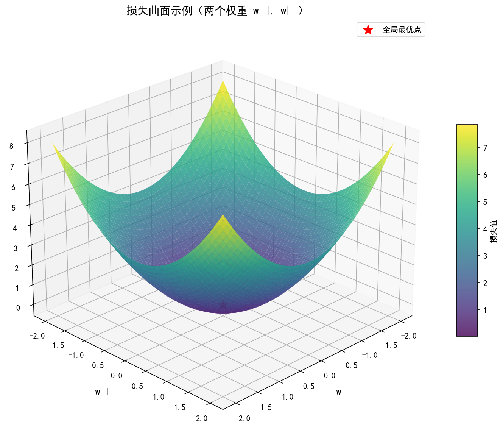

*优化的目标：从任意起点出发，沿着损失下降最快的方向（梯度）最终到达全局最优点*

### 1.4 损失函数的选择依据

> **任务类型决定损失函数**：
> - **回归任务**（预测连续值）→ MSE、MAE、Huber Loss
> - **分类任务**（预测类别）→ Cross Entropy、Focal Loss
> - **度量学习**（学习距离/相似度）→ Contrastive Loss、Triplet Loss

---

## 2. 均方误差（MSE）

### 2.1 数学公式

**均方误差（Mean Squared Error, MSE）** 是回归任务中最常用的损失函数：

$$
\mathcal{L}_{\text{MSE}} = \frac{1}{N} \sum_{i=1}^{N} (\hat{y}_i - y_i)^2
$$

也称为 **L2 损失**。

### 2.2 误差曲面

MSE 的误差曲面是**二次抛物面**，具有唯一全局最优解：

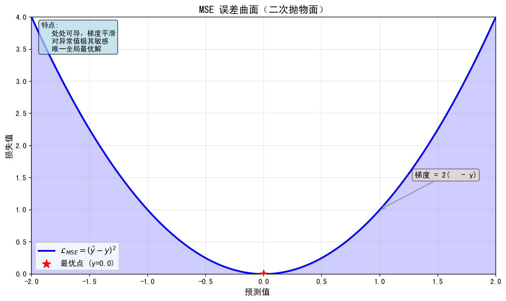

### 2.3 优缺点分析

| 优点 | 缺点 |
|------|------|
| **处处可导**，梯度平滑，利于优化 | 对异常值（outliers）**极其敏感**——大误差会被平方放大 |
| 闭式解可用（可直接求导等于 0 解出最优解） | 梯度在误差大时也大，可能导致训练不稳定 |
| 物理意义清晰（"欧氏距离的平方"） | 不适合需要 **L1 平滑** 的场景 |

### 2.4 MSE 的导数

$$
\frac{\partial \mathcal{L}_{\text{MSE}}}{\partial \hat{y}_i} = \frac{2}{N}(\hat{y}_i - y_i)
$$

梯度与误差成正比，误差越大，梯度越大（但太大可能震荡）。

### 2.5 Python代码示例：MSE损失函数可视化

下面通过Python代码可视化MSE损失函数，理解其二次曲面的特性：

下面通过 Python 代码演示 MSE 损失函数的可视化效果：

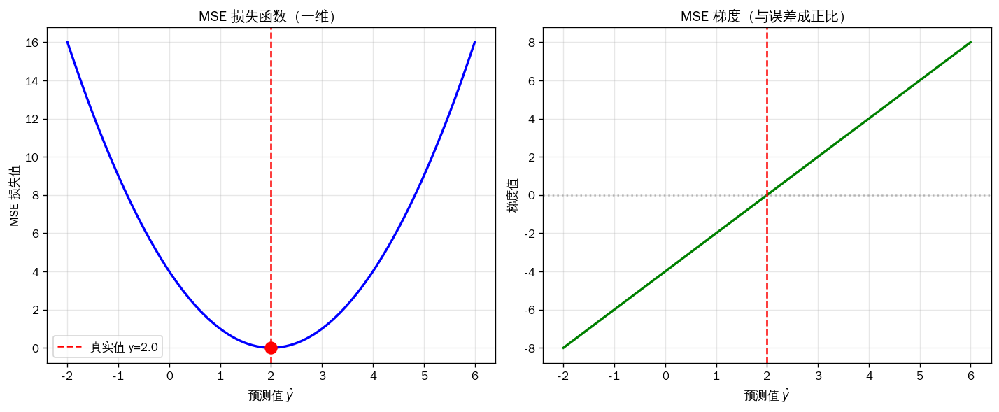

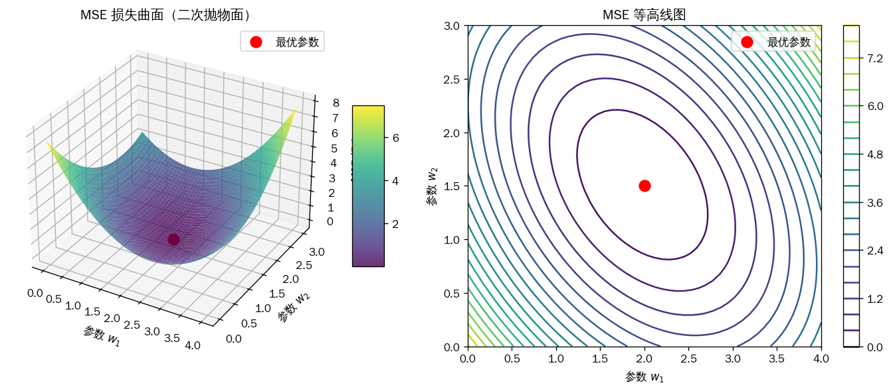

> 绘图代码：[`assets/figures/3-3-mse-visualization.py`](../../assets/figures/3-3-mse-visualization.py)

这段代码展示了：
1. **一维MSE可视化**：展示MSE如何随预测值变化，呈二次曲线
2. **梯度可视化**：展示MSE梯度与误差成正比的关系
3. **二维损失曲面**：展示MSE在参数空间中的二次抛物面形状
4. **等高线图**：展示损失函数的等高线，便于理解优化方向

---

## 3. 交叉熵（Cross Entropy）⭐（重点）

### 3.1 从信息论说起

**熵（Entropy）** 衡量信息的不确定性：

$$
H(p) = -\sum_{k} p_k \log p_k
$$

**KL 散度（KL Divergence）** 衡量两个分布的差异：

$$
D_{\text{KL}}(p \| q) = \sum_{k} p_k \log \frac{p_k}{q_k} = H(p, q) - H(p)
$$

由于 $H(p)$ 对固定分布是常数，最小化 $q$ 与 $p$ 的差异 ⇔ 最小化 **交叉熵** $H(p, q)$。

### 3.2 二分类交叉熵

对于二分类问题（标签 $y \in \{0, 1\}$）：

$$
\mathcal{L}_{\text{BCE}} = -\frac{1}{N} \sum_{i=1}^{N} \left[ y_i \log \hat{y}_i + (1 - y_i) \log(1 - \hat{y}_i) \right]
$$

其中 $\hat{y}_i = P(y_i=1)$ 是模型预测为正类的概率。

### 3.3 多分类交叉熵（Softmax 损失）

对于多分类问题，模型输出经过 **Softmax** 归一化为概率分布：

$$
\hat{p}_k = \frac{e^{z_k}}{\sum_{j} e^{z_j}}
$$

交叉熵损失：

$$
\mathcal{L}_{\text{CE}} = -\sum_{k=1}^{K} y_k \log \hat{p}_k
$$

其中 $y_k$ 是 one-hot 编码的真实标签（只有一个位置为 1）。

> 🔑 **Softmax + Cross Entropy 是分类任务的标准搭档**，几乎所有图像分类、文本分类模型都用这个组合。

### 3.4 为什么分类任务用交叉熵而不是 MSE？

| 对比项 | MSE | Cross Entropy |
|--------|-----|---------------|
| 梯度 | $\propto (\hat{y} - y)\cdot \sigma'(z)$（含激活函数导数，梯度小） | $\propto \hat{y} - y$（直接是预测误差） |
| 收敛速度 | **慢**（梯度被激活函数导数衰减） | **快**（梯度是预测误差本身） |
| 概率意义 | 无 | 物理意义清晰（对数似然） |

> 💡 **实战经验**：分类任务用 Cross Entropy 收敛速度比 MSE 快 10 倍以上。

### 3.4 Python代码示例：交叉熵损失函数可视化

下面通过Python代码可视化交叉熵损失函数，理解其对数函数的特性：

下面通过 Python 代码演示交叉熵损失函数的可视化效果：

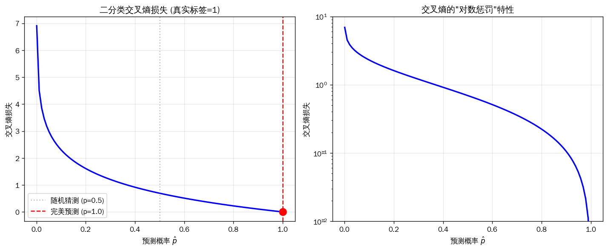

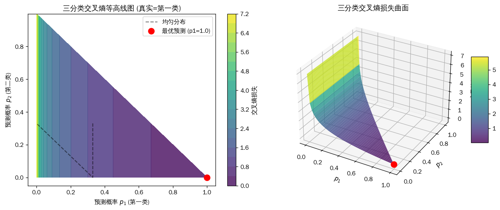

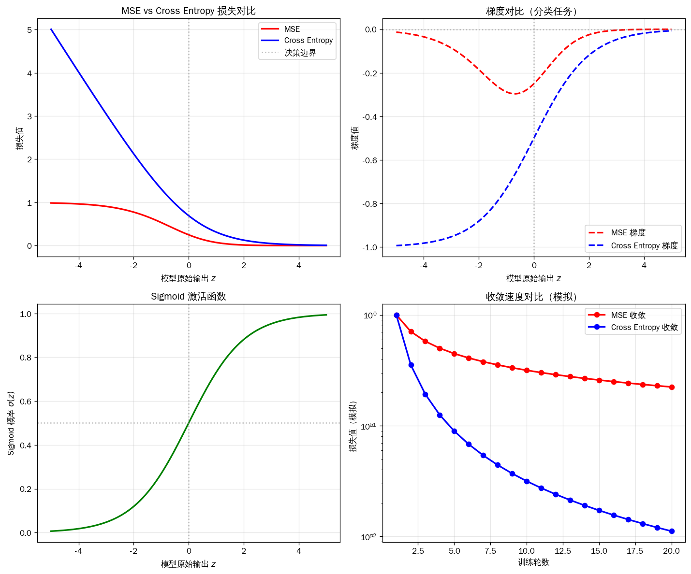

> 绘图代码：[`assets/figures/3-3-cross-entropy-visualization.py`](../../assets/figures/3-3-cross-entropy-visualization.py)

这段代码展示了：
1. **二分类交叉熵**：对数惩罚特性，预测错误时损失急剧增大
2. **多分类交叉熵**：在概率空间中的凹形损失曲面
3. **MSE vs Cross Entropy对比**：梯度形式不同导致收敛速度差异
4. **收敛速度模拟**：展示为什么交叉熵在分类任务中收敛更快

### 3.5 交叉熵误差曲面示意

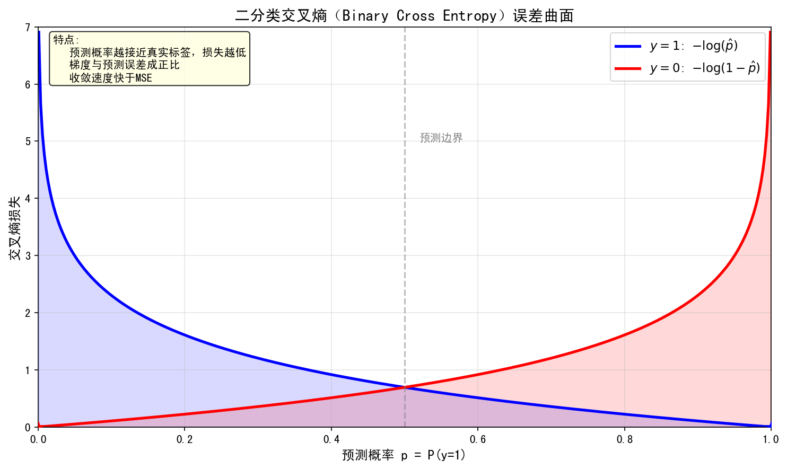

*越接近真实概率，损失越低（梯度越小）*

### 3.6 交叉熵的直观解释 + 信息论视角

> **核心问题**：为什么交叉熵是分类任务的"天然"损失函数？它的**几何意义**、**信息论意义**、**梯度性质**分别是什么？

#### 3.6.1 信息论视角：交叉熵 = 信息量 + 熵

**信息量**（惊讶度）：$I(x) = -\log_2 p(x)$（概率越小，惊讶度越大）

**熵**（信息量期望）：$H(p) = -\sum_x p(x) \log_2 p(x)$（分布的不确定性）

**交叉熵**（用一个分布 q 编码另一个分布 p 所需的平均比特数）：

$$
H(p, q) = -\sum_x p(x) \log_2 q(x)
$$

**核心结论**：
- **真实分布是 p，预测分布是 q**
- 交叉熵 = **"用 q 编码 p 所需的平均比特数"**
- **当 p == q 时，H(p,q) 取最小值 H(p)**（即熵）
- 优化交叉熵 = 让 q 接近 p

#### 3.6.2 几何意义

| 损失函数 | 衡量什么 | 几何解释 |
|----------|----------|----------|
| **MSE** | 预测值与真实值的**欧氏距离** | 距离平方 |
| **交叉熵** | 预测分布与真实分布的**KL 散度** | 信息论距离 |
| **Hinge** | 预测与边界的距离 | 间隔距离 |

**关键洞察**：
- MSE 用于**连续值**（回归）
- 交叉熵用于**概率分布**（分类）—— 因为它直接衡量"两个分布的差异"

#### 3.6.3 梯度性质：为什么交叉熵 + softmax 是黄金组合

**softmax + 交叉熵的梯度**（PyTorch 自动算）：

$$
\frac{\partial L}{\partial z_i} = p_i - y_i
$$

其中 $p_i$ 是 softmax 输出，$y_i$ 是 one-hot 标签。

**这意味着什么？**
- **梯度 = 预测概率 - 真实概率**
- 预测越错（如 $p_i=0.01$ 而 $y_i=1$），梯度越大
- **预测越对（如 $p_i=0.99$），梯度自然变小**（避免震荡）
- 这就是为什么 softmax + 交叉熵**数值稳定 + 收敛快**

**对比**：softmax + MSE 梯度 $\frac{\partial L}{\partial z_i} = p_i(1-p_i)(p_i - y_i)$，**当 $p_i \approx 0$ 时梯度极小**（梯度消失！）

#### 3.6.4 交叉熵在二分类 vs 多分类

**二分类**（2 类）：
$$
L = -\frac{1}{N} \sum_i [y_i \log p_i + (1-y_i) \log(1-p_i)]
$$

**多分类**（C 类，one-hot）：
$$
L = -\frac{1}{N} \sum_i \sum_{c=1}^C y_{i,c} \log p_{i,c}
$$

**多标签**（每个类独立 sigmoid）：
$$
L = -\frac{1}{N} \sum_i \sum_{c=1}^C [y_{i,c} \log p_{i,c} + (1-y_{i,c}) \log(1-p_{i,c})]
$$

#### 3.6.5 Label Smoothing：交叉熵的"防过拟合"变体

**核心思想**：把硬标签 [0, 1, 0] 变成软标签 [ε, 1-2ε, ε]（ε=0.1）

```python
# PyTorch 自带 Label Smoothing
criterion = nn.CrossEntropyLoss(label_smoothing=0.1)
```

**效果**：
- 防止模型过度自信（max prob 不再趋近 1.0）
- 提升泛化（+0.3-0.5% Acc）
- **蒸馏的简化版**（让学生学"软化"的目标）

#### 3.6.6 Focal Loss：交叉熵的"类别不平衡"变体

**核心公式**：
$$
L_{\text{Focal}} = -\alpha (1 - p_t)^\gamma \log p_t
$$

- $p_t$：真实类别的预测概率
- $\gamma$：focusing 参数（默认 2）
- $\alpha$：类别权重（默认 0.25）

**作用**：
- 当 $p_t$ 接近 1（易样本）→ $(1-p_t)^\gamma$ 极小 → 损失接近 0
- 当 $p_t$ 接近 0（难样本）→ $(1-p_t)^\gamma$ 接近 1 → 损失保留
- **自动聚焦"难分类"样本**，解决类别不均

**适用**：检测（RetinaNet）、长尾分布、不平衡数据

---

## 4. 对比损失（Contrastive Loss）

### 4.1 什么时候用？

在**度量学习（Metric Learning）** 任务中，我们需要学习一个嵌入空间，使得：

- **相似样本**之间的距离尽可能小
- **不相似样本**之间的距离尽可能大

典型应用：人脸识别、行人重识别、图像检索、签名验证。

### 4.2 数学公式

$$
\mathcal{L} = \frac{1}{2N} \sum_{i=1}^{N} y_i d^2 + (1-y_i) \max(\margin - d, 0)^2
$$

其中：
- $d = \|\mathbf{f}_i - \mathbf{f}_j\|_2$：两个样本特征向量的欧氏距离
- $y_i = 1$：两个样本**相似**（同类）
- $y_i = 0$：两个样本**不相似**（异类）
- $\margin$：人为设定的阈值，异类样本距离应大于此值

### 4.3 直观理解

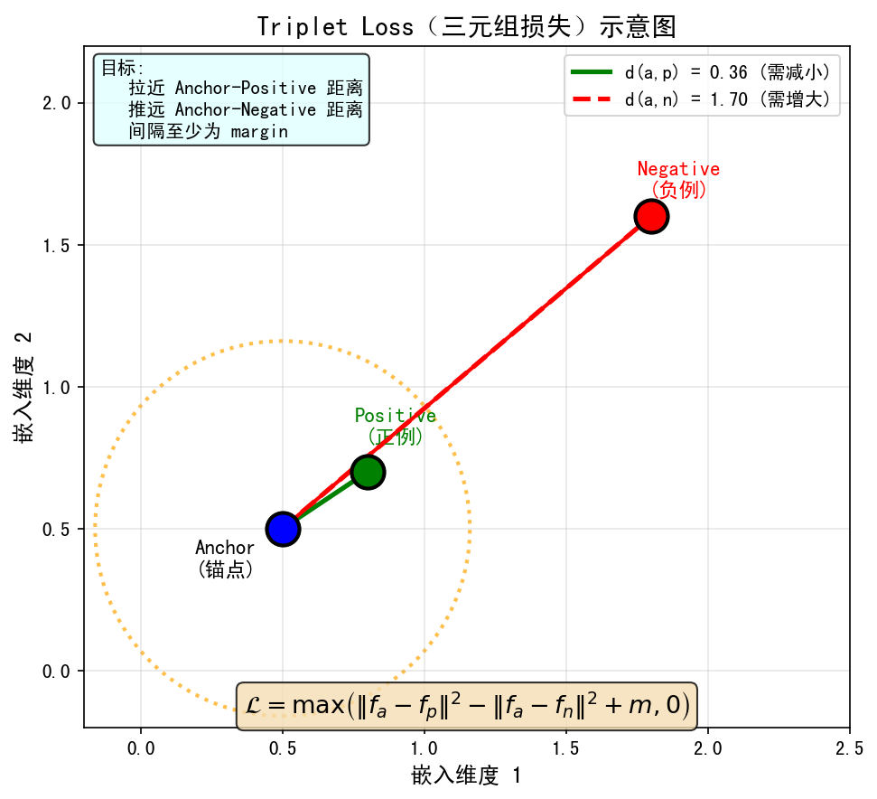

*相似对 (y=1): pull（拉近）减少同类距离；不相似对 (y=0): push（推远）增大异类距离 ≥ margin*

### 4.4 Triplet Loss（三元组损失）

对比损失的一个变体，使用三元组 $(anchor, positive, negative)$：

$$
\mathcal{L} = \max\left( \|f_a - f_p\|^2 - \|f_a - f_n\|^2 + \margin, 0 \right)
$$

约束：
- $f_a$（锚点）和 $f_p$（正例）距离要小
- $f_a$（锚点）和 $f_n$（负例）距离要大（至少比正例远 $\margin$）

---

## 5. 其他常见损失函数

### 5.1 MAE / L1 损失

$$
\mathcal{L}_{\text{MAE}} = \frac{1}{N} \sum_{i=1}^{N} | \hat{y}_i - y_i |
$$

| 特点 | 说明 |
|------|------|
| 对异常值**鲁棒** | 梯度恒定（±1），不会因大误差爆炸 |
| 不可导（0点处） | 实际中用 subgradient 或 smoothed 版本 |
| 更倾向于**中位数**而非均值 | 当数据有噪声时更稳定 |

### 5.2 Huber Loss（平滑 L1）

$$
\mathcal{L}_{\text{Huber}}(x) = \begin{cases} \frac{1}{2}x^2 & |x| \leq \delta \\ \delta|x| - \frac{1}{2}\delta^2 & |x| > \delta \end{cases}
$$

- 小误差用 MSE（精确），大误差用 MAE（鲁棒）
- $\delta$ 是切换点（通常设为 1.0）
- **目标检测中常用的 Smooth L1 Loss 就是 Huber Loss 的一种形式**

### 5.3 Focal Loss

用于**类别不平衡**的分类问题（如目标检测中正负样本比例悬殊）：

$$
\mathcal{L}_{\text{Focal}} = -\alpha_t (1 - \hat{p}_t)^\gamma \log(\hat{p}_t)
$$

- $\gamma$（gamma）：聚焦参数，$\gamma > 0$ 时降低易分类样本的权重
- $\alpha_t$：类别权重

---

## 6. 损失函数选择指南

### 6.1 按任务类型

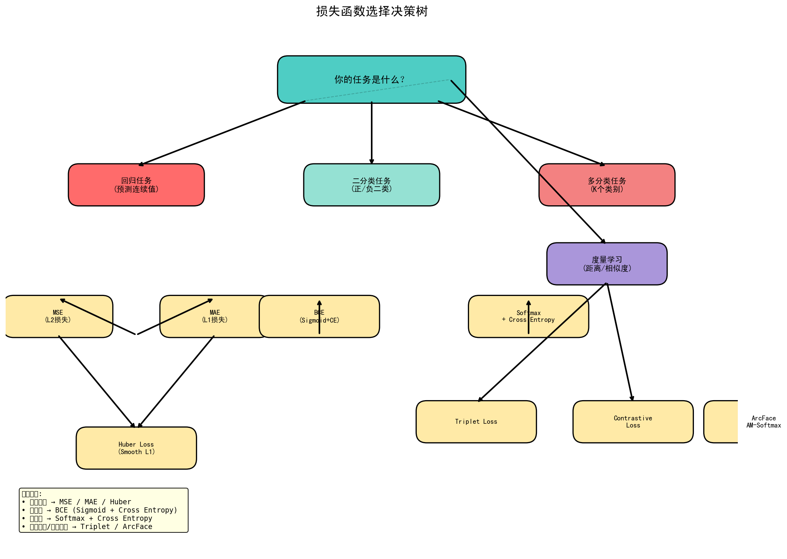

### 6.2 常见任务对应损失函数

| 任务 | 推荐损失函数 |
|------|-------------|
| 图像分类（标准） | Cross Entropy |
| 图像分类（类别不平衡） | Focal Loss |
| 目标检测 | Focal Loss（分类）+ L1/L2（回归） |
| 语义分割 | Cross Entropy / Dice Loss |
| 人脸识别 | Triplet Loss / ArcFace / AM-Softmax |
| 图像回归（回归坐标等） | L1 / L2 / Huber Loss |
| 序列生成 | Cross Entropy / Perplexity |

---

## 7. 知识点总结

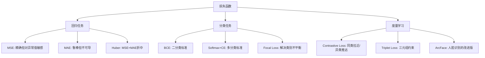

---

## 本章小结

1. **损失函数的核心作用**：衡量模型预测值与真实值之间的差距，是优化算法梯度计算的依据。损失越小，预测越准确。

2. **回归任务常用损失函数**：
   - **MSE（均方误差）**：梯度平滑、处处可导，但对异常值敏感（大误差被平方放大）
   - **MAE（L1损失）**：对异常值鲁棒，但不可导（0点处），更倾向于中位数
   - **Huber Loss**：MSE + MAE 折中，兼具精确性和鲁棒性

3. **分类任务常用损失函数**：
   - **交叉熵（Cross Entropy）**：分类任务首选，收敛速度比 MSE 快 10 倍以上
   - **BCE（二分类交叉熵）**：二分类问题的标准损失
   - **Focal Loss**：解决类别不平衡问题（如目标检测中正负样本比例悬殊）

4. **度量学习损失函数**：
   - **对比损失（Contrastive Loss）**：同类拉近、异类推远
   - **Triplet Loss**：三元组约束，同类距离小、异类距离大于 margin

5. **选择原则**：任务类型决定损失函数——回归用 MSE/MAE/Huber，分类用交叉熵，度量学习用对比损失类。

---


## 知识图谱

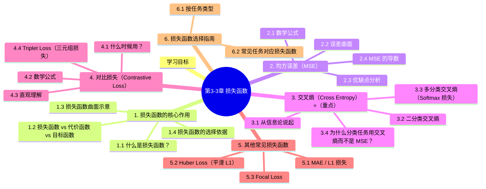

## 参考资料

1. Goodfellow, I., Bengio, Y., & Courville, A. (2016). *Deep Learning*. MIT Press. Chapter 5, 6.
2. Lin, T.-Y., Goyal, P., Girshick, R., He, K., & Dollár, P. (2017). Focal loss for dense object detection. *ICCV*.
3. Hadsell, Y., Chopra, S., & LeCun, Y. (2006). Dimensionality reduction by learning an invariant mapping. *CVPR*.
4. Wen, Y., Zhang, K., Li, Z., & Qiao, Y. (2016). A discriminative feature learning approach for deep face recognition. *ECCV*.（Center Loss）
