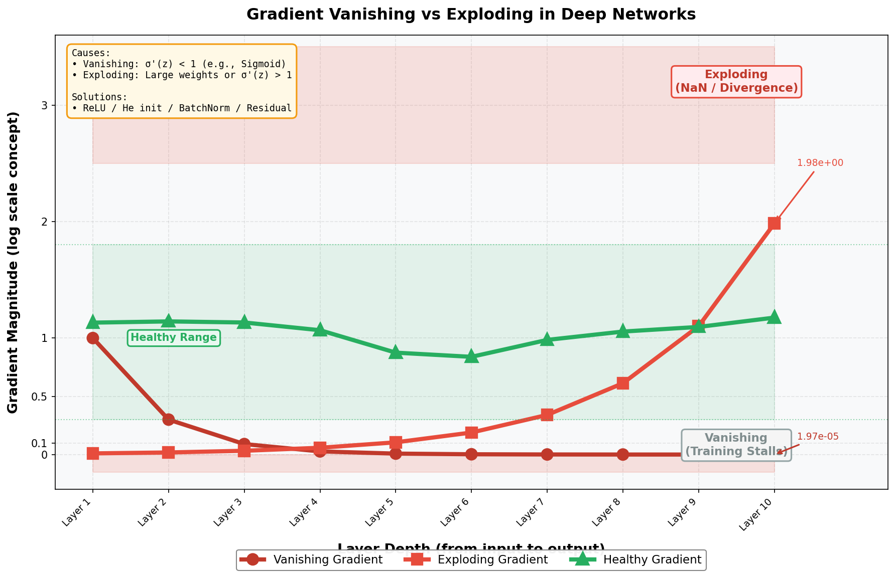
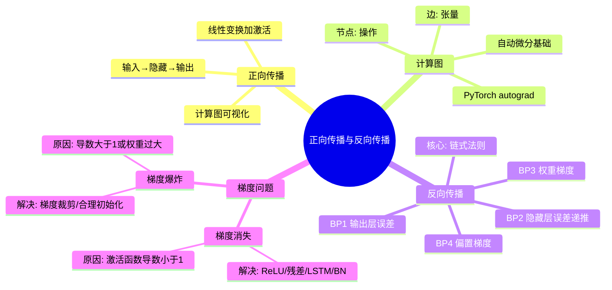

# 第3-4章 正向传播与反向传播

## 学习目标

- 理解正向传播（Forward Propagation）的工作流程
- 掌握计算图（Computational Graph）的概念与构建方法
- 理解反向传播（Back Propagation）的核心思想
- 熟练掌握链式法则在反向传播中的应用
- 通过简单示例亲手推导前向与后向计算过程
- 理解梯度消失与梯度爆炸的成因与应对方法

---

## 1. 正向传播（Forward Propagation）

### 1.1 什么是正向传播？

**正向传播**是神经网络运行的第一步：把输入数据 $\mathbf{x}$ 从输入层传入，经过层层线性变换和非线性激活，最终从输出层产出预测值 $\hat{\mathbf{y}}$ 的过程。

### 1.2 单层神经元的计算

对于第 $l$ 层的第 $j$ 个神经元：

$$
z_j^{(l)} = \sum_{i=1}^{n^{(l-1)}} w_{ji}^{(l)} a_i^{(l-1)} + b_j^{(l)}
$$

$$
a_j^{(l)} = \sigma(z_j^{(l)})
$$

其中：
- $w_{ji}^{(l)}$：第 $l-1$ 层第 $i$ 个神经元到第 $l$ 层第 $j$ 个神经元的权重
- $b_j^{(l)}$：偏置
- $\sigma$：激活函数
- $a^{(l)}$：第 $l$ 层的输出（同时也是第 $l+1$ 层的输入）

**向量化表示**（矩阵形式）：

$$
\mathbf{z}^{(l)} = \mathbf{W}^{(l)} \mathbf{a}^{(l-1)} + \mathbf{b}^{(l)}
$$

$$
\mathbf{a}^{(l)} = \sigma(\mathbf{z}^{(l)})
$$

### 1.3 三层神经网络的完整前向传播示例

```
    网络结构：输入2 → 隐藏3 → 输出2
    
    输入：x = [x₁, x₂]ᵀ
    隐藏层激活函数：ReLU
    输出层激活函数：Softmax（多分类）
    
    第1步：z⁽¹⁾ = W⁽¹⁾x + b⁽¹⁾
    
    W⁽¹⁾ ∈ ℝ³ˣ², b⁽¹⁾ ∈ ℝ³
    
    z⁽¹⁾ = [z₁⁽¹⁾, z₂⁽¹⁾, z₃⁽¹⁾]ᵀ
    
    第2步：a⁽¹⁾ = ReLU(z⁽¹⁾)
    
    第3步：z⁽²⁾ = W⁽²⁾a⁽¹⁾ + b⁽²⁾
    
    W⁽²⁾ ∈ ℝ²ˣ³, b⁽²⁾ ∈ ℝ²
    
    第4步：ŷ = softmax(z⁽²⁾)
```

---

## 2. 计算图（Computational Graph）

### 2.1 什么是计算图？

**计算图**是用节点（operations）和边（tensors）表示数学表达式的有向无环图（DAG）。它是理解反向传播的利器。

### 2.2 为什么需要计算图？

| 优点 | 说明 |
|------|------|
| **求导自动化** | 沿着图的反方向应用链式法则，即可自动求导 |
| **理解梯度流动** | 直观看到每个节点对最终损失的贡献 |
| **支持自动微分** | PyTorch、TensorFlow 的核心机制 |
| **并行优化** | 图可以分析依赖关系，实现计算并行化 |

### 2.3 PyTorch 的动态计算图示意

```python
import torch

x = torch.tensor(2.0, requires_grad=True)
w = torch.tensor(3.0, requires_grad=True)
b = torch.tensor(1.0, requires_grad=True)

y = w * x + b          # 前向
loss = (y - 5) ** 2    # 损失

loss.backward()         # 反向传播（自动求导）
# x.grad, w.grad, b.grad 自动计算
```

> 💡 **PyTorch 的 `autograd` 机制**就是基于计算图实现的。每执行一步操作，PyTorch 会自动构建一个记录所有操作的图，`backward()` 时按图反向求导。

---

## 3. 反向传播（Back Propagation）

### 3.1 核心思想

反向传播（**Backpropagation**，简称 **BP**）是训练神经网络的核心算法。它的核心思想是：

> 从输出层开始，逐层向输入层方向**计算损失函数对每个参数的梯度**，然后用梯度下降法更新参数。

### 3.2 链式法则（Chain Rule）

链式法则是反向传播的数学基础。

**一元情况**：

$$
\frac{d}{dx} f(g(x)) = f'(g(x)) \cdot g'(x)
$$

**多元情况**：

$$
\frac{\partial L}{\partial w} = \frac{\partial L}{\partial a} \cdot \frac{\partial a}{\partial z} \cdot \frac{\partial z}{\partial w}
$$

### 3.3 定义中间变量

为便于推导，定义：

$$
\delta_j^{(l)} = \frac{\partial \mathcal{L}}{\partial z_j^{(l)}}
$$

这称为第 $l$ 层第 $j$ 个神经元的**误差**（error），它表示"这个神经元的输入 $z$ 对最终损失有多大的影响"。

### 3.4 反向传播四大公式

#### BP1：输出层误差

$$
\delta_j^{(L)} = \frac{\partial \mathcal{L}}{\partial a_j^{(L)}} \cdot \sigma'(z_j^{(L)})
$$

向量形式：

$$
\boldsymbol{\delta}^{(L)} = \nabla_{\mathbf{a}} \mathcal{L} \odot \sigma'(\mathbf{z}^{(L)})
$$

其中 $\odot$ 是 Hadamard 乘积（逐元素乘法）。

#### BP2：隐藏层误差（从后向前传递）

$$
\delta_j^{(l)} = \sum_{k} w_{kj}^{(l+1)} \delta_k^{(l+1)} \cdot \sigma'(z_j^{(l)})
$$

向量形式：

$$
\boldsymbol{\delta}^{(l)} = (\mathbf{W}^{(l+1)})^\top \boldsymbol{\delta}^{(l+1)} \odot \sigma'(\mathbf{z}^{(l)})
$$

> 🔑 **物理意义**：第 $l$ 层的误差等于第 $l+1$ 层误差的加权和（沿权重方向反传），再乘以当前层激活函数的导数。

#### BP3：损失对权重的梯度

$$
\frac{\partial \mathcal{L}}{\partial w_{ji}^{(l)}} = \delta_j^{(l)} a_i^{(l-1)}
$$

#### BP4：损失对偏置的梯度

$$
\frac{\partial \mathcal{L}}{\partial b_j^{(l)}} = \delta_j^{(l)}
$$

---

## 4. 手把手推导：两层神经网络 BP

### 4.1 网络结构

```
    输入：x₁, x₂（2维）
    隐藏层：2个神经元（激活：ReLU）
    输出层：1个神经元（激活：Sigmoid，用于二分类）
    损失：BCE（Binary Cross Entropy）
```

### 4.2 前向传播

**第1层（隐藏层）**：

$$
z_1^{(1)} = w_{11}^{(1)} x_1 + w_{12}^{(1)} x_2 + b_1^{(1)}
$$

$$
z_2^{(1)} = w_{21}^{(1)} x_1 + w_{22}^{(1)} x_2 + b_2^{(1)}
$$

$$
a_1^{(1)} = \text{ReLU}(z_1^{(1)}), \quad a_2^{(1)} = \text{ReLU}(z_2^{(1)})
$$

**第2层（输出层）**：

$$
z^{(2)} = w_1^{(2)} a_1^{(1)} + w_2^{(2)} a_2^{(1)} + b^{(2)}
$$

$$
\hat{y} = \sigma(z^{(2)}) = \frac{1}{1+e^{-z^{(2)}}}
$$

### 4.3 反向传播

**输出层误差（BP1）**：

假设使用 BCE 损失 $\mathcal{L} = -[y\log\hat{y} + (1-y)\log(1-\hat{y})]$：

$$
\delta^{(2)} = \frac{\partial \mathcal{L}}{\partial z^{(2)}} = \hat{y} - y
$$

**第1层误差（BP2）**：

$$
\delta_i^{(1)} = w_i^{(2)} \delta^{(2)} \cdot \text{ReLU}'(z_i^{(1)}) \quad (i=1,2)
$$

其中 $\text{ReLU}'(z) = 1$ if $z > 0$ else $0$。

**权重梯度（BP3）**：

$$
\frac{\partial \mathcal{L}}{\partial w_i^{(2)}} = \delta^{(2)} \cdot a_i^{(1)}
$$

$$
\frac{\partial \mathcal{L}}{\partial w_{ij}^{(1)}} = \delta_j^{(1)} \cdot x_i
$$

**参数更新（学习率 $\alpha$）**：

$$
w_i^{(2)} \leftarrow w_i^{(2)} - \alpha \cdot \delta^{(2)} \cdot a_i^{(1)}
$$

---

## 5. 梯度消失与梯度爆炸

### 5.1 梯度消失（Vanishing Gradient）

**成因**：在反向传播中，梯度逐层乘以激活函数的导数。

$$
\frac{\partial \mathcal{L}}{\partial w^{(1)}} = \frac{\partial \mathcal{L}}{\partial a^{(n)}} \cdot \sigma'(z^{(n)}) \cdot \sigma'(z^{(n-1)}) \cdot \cdots \cdot \sigma'(z^{(1)})
$$

如果 $\sigma'(z) < 1$（如 Sigmoid 的 $\sigma'(x) \in (0, 0.25)$），深层网络的浅层梯度会指数级衰减，趋近于 0。

**后果**：
- 浅层权重几乎不更新
- 网络训练停滞
- 深网络效果反而不如浅网络

**应对方法**：

| 方法 | 说明 |
|------|------|
| ReLU 激活函数 | 右侧梯度恒为 1，不消失 |
| Batch Normalization | 将数据拉到正区间，间接缓解 |
| 残差连接（ResNet） | 梯度可以直接跳过层（恒等映射） |
| LSTM / GRU | 门控机制直接传递梯度 |
| 预训练 + 微调 | 先在大数据上训练好浅层，再微调深层 |

### 5.2 梯度爆炸（Exploding Gradient）

**成因**：如果 $\sigma'(z) > 1$ 或权重初始化过大，梯度在反传过程中指数级增大。

**后果**：
- 参数更新过大，loss 爆炸（变成 NaN）
- 网络完全无法收敛

**应对方法**：

| 方法 | 说明 |
|------|------|
| 梯度裁剪（Gradient Clipping） | $\mathbf{g} \leftarrow \mathbf{g} / \max(\|\mathbf{g}\|, \text{threshold})$ |
| 合理的权重初始化 | He/Xavier 初始化 |
| 学习率衰减 | 避免大步更新 |
| Batch Normalization | 限制激活值的方差 |

### 5.3 梯度消失/爆炸可视化



---

## Python 代码示例：正向传播与反向传播可视化

以下代码演示了正向传播、反向传播以及梯度消失/爆炸现象的数值模拟：

```python
import numpy as np
import matplotlib.pyplot as plt
from matplotlib import cm
from mpl_toolkits.mplot3d import Axes3D

# 1. 前向传播示例：一个简单的三层神经网络
def forward_propagation_example():
    """演示正向传播计算流程"""
    print("=" * 60)
    print("1. 正向传播示例：三层神经网络计算")
    print("=" * 60)
    
    # 初始化参数
    np.random.seed(42)
    X = np.array([[0.1, 0.2], [0.3, 0.4]])  # 2个样本，2个特征
    W1 = np.random.randn(2, 3) * 0.1  # 输入层->隐藏层权重
    b1 = np.random.randn(1, 3) * 0.1
    W2 = np.random.randn(3, 1) * 0.1  # 隐藏层->输出层权重
    b2 = np.random.randn(1, 1) * 0.1
    
    print(f"输入 X: shape={X.shape}")
    print(f"权重 W1: shape={W1.shape}")
    print(f"偏置 b1: shape={b1.shape}")
    print(f"权重 W2: shape={W2.shape}")
    print(f"偏置 b2: shape={b2.shape}")
    
    # 正向传播（第1层：输入层->隐藏层）
    Z1 = np.dot(X, W1) + b1
    A1 = 1 / (1 + np.exp(-Z1))  # Sigmoid激活
    
    # 正向传播（第2层：隐藏层->输出层）
    Z2 = np.dot(A1, W2) + b2
    A2 = 1 / (1 + np.exp(-Z2))  # Sigmoid激活
    
    print(f"\n隐藏层输入 Z1: shape={Z1.shape}")
    print(f"隐藏层输出 A1: shape={A1.shape}")
    print(f"输出层输入 Z2: shape={Z2.shape}")
    print(f"最终输出 A2: shape={A2.shape}")
    print(f"\n样本1预测值: {A2[0, 0]:.4f}")
    print(f"样本2预测值: {A2[1, 0]:.4f}")
    
    return X, W1, b1, W2, b2, A2

# 2. 反向传播梯度计算
def backward_propagation_example(X, W1, b1, W2, b2, A2):
    """演示反向传播梯度计算流程"""
    print("\n" + "=" * 60)
    print("2. 反向传播示例：梯度计算")
    print("=" * 60)
    
    # 假设真实标签
    y = np.array([[0], [1]])  # 样本1标签=0，样本2标签=1
    
    # 损失函数：均方误差
    loss = 0.5 * np.mean((A2 - y) ** 2)
    print(f"初始损失值: {loss:.6f}")
    
    # 反向传播：输出层->隐藏层
    # 输出层误差
    dA2 = A2 - y  # ∂L/∂A2
    dZ2 = dA2 * A2 * (1 - A2)  # Sigmoid导数: A2*(1-A2)
    
    # 输出层参数梯度
    dW2 = np.dot(A1.T, dZ2) / len(X)
    db2 = np.sum(dZ2, axis=0, keepdims=True) / len(X)
    
    # 隐藏层误差
    dA1 = np.dot(dZ2, W2.T)
    dZ1 = dA1 * A1 * (1 - A1)  # Sigmoid导数
    
    # 隐藏层参数梯度
    dW1 = np.dot(X.T, dZ1) / len(X)
    db1 = np.sum(dZ1, axis=0, keepdims=True) / len(X)
    
    print(f"\n梯度形状检查：")
    print(f"dW1 (W1梯度): shape={dW1.shape}, 范数={np.linalg.norm(dW1):.6f}")
    print(f"db1 (b1梯度): shape={db1.shape}, 范数={np.linalg.norm(db1):.6f}")
    print(f"dW2 (W2梯度): shape={dW2.shape}, 范数={np.linalg.norm(dW2):.6f}")
    print(f"db2 (b2梯度): shape={db2.shape}, 范数={np.linalg.norm(db2):.6f}")
    
    # 参数更新（梯度下降）
    learning_rate = 0.1
    W1_updated = W1 - learning_rate * dW1
    W2_updated = W2 - learning_rate * dW2
    b1_updated = b1 - learning_rate * db1
    b2_updated = b2 - learning_rate * db2
    
    print(f"\n参数更新（学习率={learning_rate}）：")
    print(f"W1更新前后变化: {np.linalg.norm(W1_updated - W1):.6f}")
    print(f"W2更新前后变化: {np.linalg.norm(W2_updated - W2):.6f}")

# 3. 梯度消失/爆炸现象可视化
def visualize_gradient_vanishing_explosion():
    """可视化梯度消失和梯度爆炸现象"""
    print("\n" + "=" * 60)
    print("3. 梯度消失/爆炸现象可视化")
    print("=" * 60)
    
    np.random.seed(42)
    n_layers = 20  # 网络层数
    gradient_norms = []
    
    # 模拟不同权重初始化方法
    init_methods = ['标准正态分布', '过小权重', '过大权重']
    init_scales = [1.0, 0.1, 10.0]
    
    plt.figure(figsize=(12, 8))
    
    for method, scale in zip(init_methods, init_scales):
        # 初始化权重（模拟深层网络）
        weights = []
        for i in range(n_layers):
            # 每层权重矩阵
            if i == 0:
                W = np.random.randn(10, 10) * scale / np.sqrt(10)  # He初始化考虑
            else:
                W = np.random.randn(10, 10) * scale / np.sqrt(10)
            weights.append(W)
        
        # 模拟梯度反向传播（链式法则）
        # 假设初始梯度为1（输出层误差）
        gradient = np.ones((10, 10))
        norms = []
        
        for i in reversed(range(n_layers)):
            # 每层梯度 = 上一层梯度 × 权重转置 × 激活函数导数
            # 这里简化模拟：假设激活函数导数在[0.1, 0.5]范围内（如Sigmoid）
            activation_derivative = 0.25  # Sigmoid最大导数为0.25
            gradient = np.dot(gradient, weights[i].T) * activation_derivative
            gradient_norm = np.linalg.norm(gradient)
            norms.append(gradient_norm)
        
        # 反向记录（从输出层到输入层）
        norms = list(reversed(norms))
        layers = list(range(1, n_layers + 1))
        
        plt.subplot(2, 2, 1)
        plt.plot(layers, norms, 'o-', label=method, linewidth=2)
    
    plt.subplot(2, 2, 1)
    plt.xlabel('网络层数（从输入层到输出层）', fontsize=12)
    plt.ylabel('梯度范数（对数坐标）', fontsize=12)
    plt.title('梯度消失/爆炸现象（不同权重初始化）', fontsize=14, fontweight='bold')
    plt.yscale('log')
    plt.grid(True, alpha=0.3)
    plt.legend()
    
    # 4. 激活函数导数对比
    plt.subplot(2, 2, 2)
    x = np.linspace(-5, 5, 1000)
    
    # Sigmoid及其导数
    sigmoid = 1 / (1 + np.exp(-x))
    sigmoid_derivative = sigmoid * (1 - sigmoid)
    
    # ReLU及其导数
    relu = np.maximum(0, x)
    relu_derivative = (x > 0).astype(float)
    
    # Tanh及其导数
    tanh = np.tanh(x)
    tanh_derivative = 1 - tanh**2
    
    plt.plot(x, sigmoid_derivative, 'b-', label='Sigmoid导数', linewidth=2)
    plt.plot(x, relu_derivative, 'r-', label='ReLU导数', linewidth=2)
    plt.plot(x, tanh_derivative, 'g-', label='Tanh导数', linewidth=2)
    
    plt.xlabel('输入值', fontsize=12)
    plt.ylabel('导数值', fontsize=12)
    plt.title('不同激活函数的导数对比', fontsize=14, fontweight='bold')
    plt.grid(True, alpha=0.3)
    plt.legend()
    plt.axhline(y=1, color='k', linestyle='--', alpha=0.3)
    plt.axhline(y=0.25, color='k', linestyle='--', alpha=0.3, label='Sigmoid最大导数=0.25')
    plt.legend()
    
    # 5. 链式法则可视化示例
    plt.subplot(2, 2, 3)
    
    # 简单的计算图：y = sin(x^2)
    x_vals = np.linspace(-2, 2, 400)
    u = x_vals**2  # 中间变量
    y = np.sin(u)  # 最终输出
    
    # 计算导数：dy/dx = cos(u) * 2x = cos(x^2) * 2x
    dy_du = np.cos(u)  # ∂y/∂u
    du_dx = 2 * x_vals  # ∂u/∂x
    dy_dx = dy_du * du_dx  # ∂y/∂x = ∂y/∂u * ∂u/∂x
    
    plt.plot(x_vals, y, 'b-', label='y = sin(x²)', linewidth=2)
    plt.plot(x_vals, dy_dx, 'r-', label='dy/dx = cos(x²)·2x', linewidth=2)
    
    plt.xlabel('x', fontsize=12)
    plt.ylabel('y / dy/dx', fontsize=12)
    plt.title('链式法则示例：y = sin(x²)', fontsize=14, fontweight='bold')
    plt.grid(True, alpha=0.3)
    plt.legend()
    
    # 6. 梯度流动热力图（多层网络）
    plt.subplot(2, 2, 4)
    
    # 模拟一个5层网络的梯度流动
    np.random.seed(42)
    n_layers = 5
    gradient_flow = np.zeros((n_layers, 10))
    
    for layer in range(n_layers):
        # 模拟梯度大小（指数衰减-梯度消失）
        if layer == 0:
            gradient_flow[layer, :] = 1.0
        else:
            decay_factor = 0.5  # 每层衰减50%
            gradient_flow[layer, :] = gradient_flow[layer-1, :] * decay_factor
    
    im = plt.imshow(gradient_flow, cmap='viridis', aspect='auto')
    plt.colorbar(im, label='梯度强度')
    plt.xlabel('神经元索引', fontsize=12)
    plt.ylabel('网络层数（从输入到输出）', fontsize=12)
    plt.title('梯度流动热力图（模拟梯度消失）', fontsize=14, fontweight='bold')
    plt.yticks(range(n_layers), [f'L{i+1}' for i in range(n_layers)])
    
    plt.tight_layout()
    plt.show()
    
    print("\n关键观察：")
    print("1. 权重过小(0.1) → 梯度指数衰减（梯度消失）")
    print("2. 权重过大(10.0) → 梯度指数增长（梯度爆炸）")
    print("3. Sigmoid导数最大0.25，20层网络梯度衰减至(0.25)^20 ≈ 9×10⁻¹³")
    print("4. ReLU导数为0或1，缓解梯度消失问题")
    print("5. 链式法则：梯度 = 各层导数乘积 → 深层网络易出现梯度问题")

# 执行所有示例
if __name__ == "__main__":
    # 运行前向传播示例
    X, W1, b1, W2, b2, A2 = forward_propagation_example()
    
    # 运行反向传播示例（需要前向传播的中间结果A1）
    # 注意：这里需要A1，我们在代码中假设A1已计算
    global A1  # 声明为全局变量供反向传播使用
    A1 = 1 / (1 + np.exp(-np.dot(X, W1) + b1))  # 计算A1
    
    backward_propagation_example(X, W1, b1, W2, b2, A2)
    
    # 可视化梯度消失/爆炸现象
    visualize_gradient_vanishing_explosion()
```

### 代码功能说明

1. **正向传播示例**：
   - 实现一个三层神经网络（输入层2维→隐藏层3维→输出层1维）
   - 展示从输入到输出的完整计算流程
   - 使用Sigmoid激活函数

2. **反向传播示例**：
   - 基于链式法则计算损失函数对所有权重和偏置的梯度
   - 展示梯度下降参数更新过程
   - 验证梯度形状和大小

3. **梯度消失/爆炸可视化**：
   - 比较不同权重初始化方法对梯度传播的影响
   - 展示Sigmoid、ReLU、Tanh激活函数的导数对比
   - 链式法则的具体示例：y = sin(x²)
   - 梯度流动热力图模拟深层网络中的梯度传播

4. **关键教学点**：
   - 理解链式法则在反向传播中的应用
   - 认识梯度消失（权重过小/激活函数导数<1）和梯度爆炸（权重过大）
   - 了解ReLU等激活函数缓解梯度消失的原理
   - 掌握合理的权重初始化方法的重要性

运行此代码将生成4个子图，直观展示正向传播、反向传播的关键概念，以及梯度消失/爆炸现象的形成机制。

---

## 本章小结

1. **正向传播**：将输入数据从输入层传入，经层层线性变换和非线性激活，最终产出预测值的过程。是神经网络推理（ inference）的核心步骤。

2. **计算图**：用节点（operations）和边（tensors）表示数学表达式的有向无环图，是理解反向传播和自动微分的利器。PyTorch 的 `autograd` 机制即基于此实现。

3. **反向传播（BP）**：从输出层向输入层方向逐层计算损失函数对每个参数的梯度。核心数学工具是链式法则。四大公式：
   - BP1：输出层误差
   - BP2：隐藏层误差递推
   - BP3：权重梯度
   - BP4：偏置梯度

4. **梯度消失**：深层网络中，梯度逐层乘以激活函数导数，若导数小于 1（如 Sigmoid 的 max 0.25），梯度指数衰减。解决方案：ReLU、残差连接、LSTM/GRU、Batch Normalization。

5. **梯度爆炸**：若激活函数导数或权重初始化过大，梯度指数增大。解决方案：梯度裁剪、合理的权重初始化（He/Xavier）、学习率衰减。

---

## 知识点思维导图



---

## 参考资料

1. Rumelhart, D. E., Hinton, G. E., & Williams, R. J. (1986). Learning representations by back-propagating errors. *Nature*, 323(6088), 533-536.
2. Goodfellow, I., Bengio, Y., & Courville, A. (2016). *Deep Learning*. MIT Press. Chapter 6.
3. 孙德伟. 全连接神经网络——反向传播. CSDN 课程PPT.
4. 李沐. 《动手学深度学习》. 第4章. [D2L.ai](https://d2l.ai/)