# 3-5 优化算法

---

## 学习目标

- 理解梯度下降、随机梯度下降（SGD）、Mini-batch GD 的原理与差异
- 掌握 Momentum、AdaGrad、RMSProp、Adam、AdamW 的核心思想
- 理解为什么 Adam 收敛快、AdamW 更适合现代大模型训练
- 掌握学习率衰减、Warmup、OneCycleLR 等常见学习率策略
- 能结合任务特点选择合适的优化器

---

## 1. 为什么深度学习需要优化算法

训练神经网络，本质上是在参数空间中寻找一组最优参数 $\theta$，使损失函数 $\mathcal{L}(\theta)$ 尽可能小：

$$
\theta^* = \arg\min_{\theta} \mathcal{L}(\theta)
$$

如果只知道“往梯度反方向走”这个原则，我们还远远不够。因为深度学习训练通常具有以下特点：

- 参数量巨大，无法手工调每个参数的更新幅度
- 损失曲面往往非凸，存在鞍点、狭长谷地与平台区
- mini-batch 训练带来噪声，更新方向会不断波动
- 不同参数的梯度尺度差异很大，统一学习率不一定合适

因此，优化算法的任务不只是“下降”，而是要在**收敛速度、稳定性、泛化能力、显存/算力成本**之间取得平衡。

> Sebastian Ruder 在综述 *An Overview of Gradient Descent Optimization Algorithms*（arXiv:1609.04747）中，对这条演化脉络做了系统梳理：从 GD/SGD，到动量法，再到 AdaGrad、RMSProp、Adam 等自适应优化器。写教程时，这篇综述很适合作为“全局路线图”参考。

### 1.1 损失曲面的"地貌"：为什么不能直接 GD？

实际深度学习的损失曲面远比理论"凸函数"复杂。下面这张示意图把几种典型地形画到一张图里：

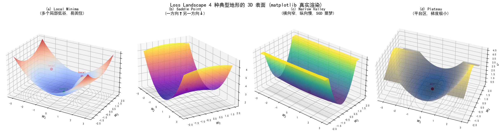

> 📊 完整代码：[`assets/figures/3-5-loss-landscape-3d.py`](../../assets/figures/3-5-loss-landscape-3d.py) — 3D surface 渲染，4 种典型地形用不同视角展示。
>
> 也有 2D 等高线版本：[`3-5-loss-landscape.py`](../../assets/figures/3-5-loss-landscape.py)

**上图想传达的关键点**：

| 地形特征 | 危险 | 应对手段 |
|----------|------|----------|
| **局部极小值** | 梯度=0，GD/SGD 困住 | 动量法、随机噪声跳出 |
| **鞍点**（高维更常见） | 伪"训练完成" | SGD 的随机性、第二阶信息 |
| **狭长谷地** | 横向震荡、纵向慢 | 动量法、自适应学习率 |
| **平台区** | 训练看似停滞 | 耐心 + warmup + warmup 后略大学习率 |

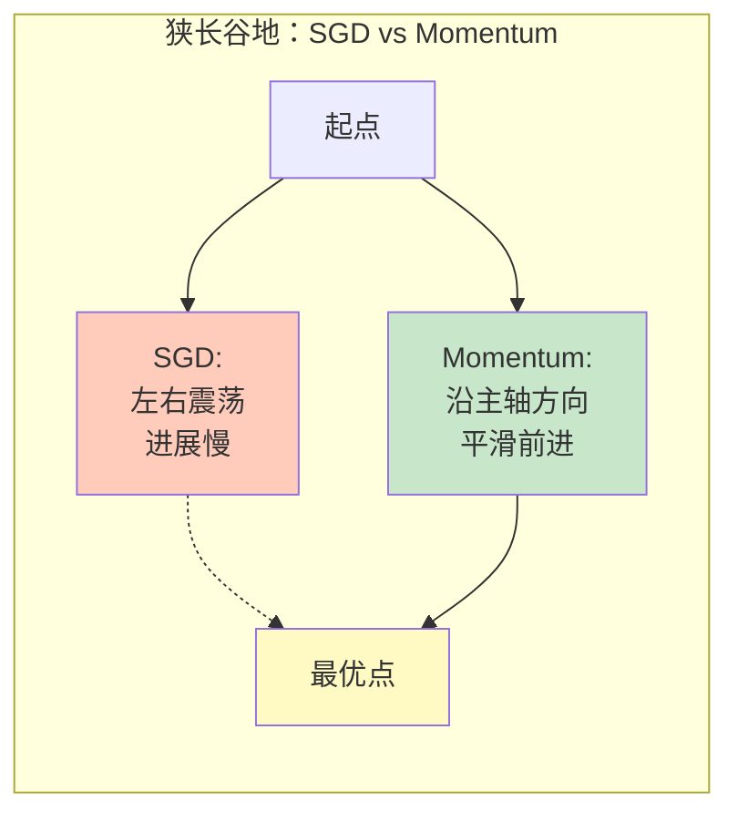

### 1.2 优化算法的 4 大目标

优秀优化器（Adam/AdamW）的最大价值是**对超参不那么敏感**——这是工业界偏爱它们的核心原因。

## 2. 梯度下降三种基本形式

### 2.1 批量梯度下降（Gradient Descent, GD）

每次迭代都使用**整个训练集**计算梯度：

$$
\theta \leftarrow \theta - \eta \cdot \nabla_\theta \mathcal{L}(\theta)
$$

其中，$\eta$ 是学习率（learning rate）。

**优点：**

- 梯度方向稳定
- 对凸问题理论分析较清晰

**缺点：**

- 每次更新都要扫描全量数据，计算成本高
- 在大规模数据集上几乎不可用

### 2.2 随机梯度下降（SGD）

每次只随机取一个样本更新参数：

$$
\theta \leftarrow \theta - \eta \cdot \nabla_\theta \mathcal{L}_i(\theta)
$$

**优点：**

- 单步更新快
- 噪声有时能帮助模型跳出局部极小值或狭窄区域

**缺点：**

- 梯度方差大，更新轨迹抖动明显
- 收敛过程不稳定

### 2.3 Mini-batch GD

实际深度学习中最常见的是折中方案：每次用一个 batch 估计梯度：

$$
\theta \leftarrow \theta - \eta \cdot \frac{1}{|B|} \sum_{i \in B} \nabla_\theta \mathcal{L}_i(\theta)
$$

它兼顾了：

- **并行计算效率**：适合 GPU
- **梯度稳定性**：比单样本 SGD 噪声更小
- **吞吐量**：远快于全量 GD

因此，今天人们口头上说的“SGD训练”，大多数时候实际上指的是 **mini-batch SGD**。

### 2.4 三种梯度下降的轨迹对比

下面这张图把 GD、SGD、Mini-batch GD 的更新轨迹放到一起——这是为什么实践中几乎都用 Mini-batch 的最直观解释：

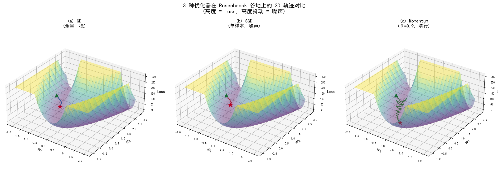

> 📊 完整代码：[`assets/figures/3-5-trajectories-3d.py`](../../assets/figures/3-5-trajectories-3d.py) — 3D 表面上的轨迹，高度 = Loss
>
> 也有 2D 等高线版本：[`3-5-gd-sgd-minibatch-trajectories.py`](../../assets/figures/3-5-gd-sgd-minibatch-trajectories.py)

| 方法 | 每步用数据 | 单步速度 | 收敛稳定性 | 并行度 |
|------|-----------|----------|-----------|--------|
| **GD** | 全量 | 慢 | 极稳 | 浪费 GPU |
| **SGD** | 1 个 | 极快 | **极不稳定** | 浪费 GPU |
| **Mini-batch** | 32-4096 | 快 | 稳定 | **充分利用 GPU** |

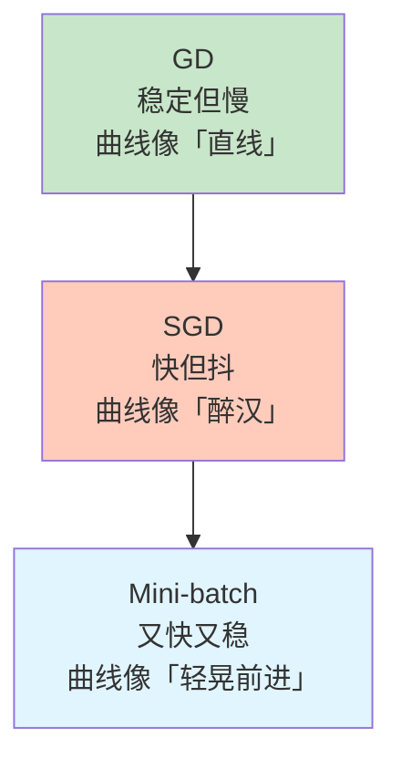

## 3. 动量法：让优化“别来回横跳”

### 3.1 Momentum

普通 SGD 在狭长谷地里容易左右震荡、前进缓慢。Momentum 的想法是：不仅看当前梯度，还保留过去一段时间的“速度”。

$$
v_t = \beta v_{t-1} - \eta g_t
$$

$$
\theta_t = \theta_{t-1} + v_t
$$

其中：

- $g_t$ 表示当前梯度
- $v_t$ 表示累计速度
- $\beta$ 通常取 `0.9`

**直觉：**

- 梯度长期一致的方向会被不断放大
- 高频震荡方向会被平滑掉

#### Momentum 解决了什么？——一个"狭长谷地"的直觉图

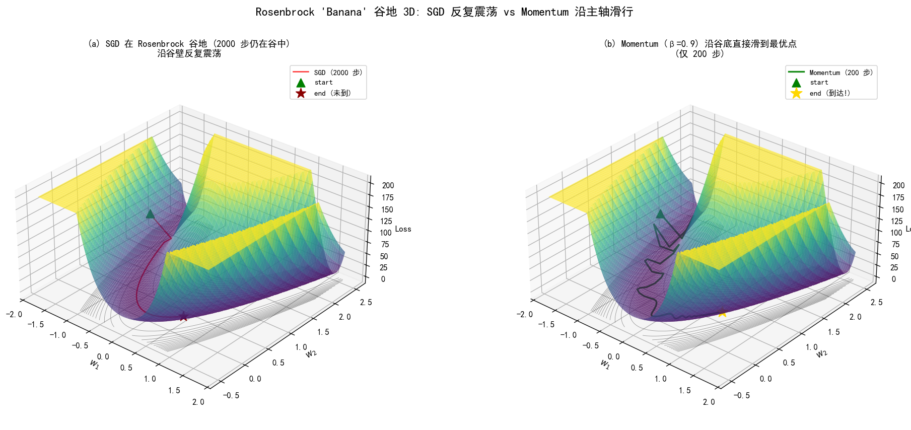

> 📊 完整代码：[`assets/figures/3-5-ravine-3d.py`](../../assets/figures/3-5-ravine-3d.py) — 3D 表面上的真实轨迹，高度 = Loss
>
> 也有 2D 等高线版本：[`3-5-ravine-sgd-vs-momentum.py`](../../assets/figures/3-5-ravine-sgd-vs-momentum.py) — **关键数据**：SGD 2000 步仍未到，Momentum 仅 200 步就到

> 实际在 Rosenbrock 函数（经典狭长谷地）上的对比图见下面 §3.1 的 matplotlib 可视化。

#### 数学直觉：把多个梯度"加权求和"

动量本质上等价于**对过去所有梯度做指数加权求和**：

$$
v_t = -\eta \sum_{\tau=0}^{t} \beta^{t-\tau} g_\tau
$$

| 过去 τ 步的梯度 | 权重 |
|----------------|------|
| 当前步 $g_t$ | $1$ |
| 上一步 $g_{t-1}$ | $\beta = 0.9$ |
| 上上步 $g_{t-2}$ | $\beta^2 = 0.81$ |
| ... | ... |
| $\infty$ 步前 | 接近 $0$ |

这意味着：**当前的更新方向 ≈ 过去 $\frac{1}{1-\beta} \approx 10$ 步梯度的加权平均**。

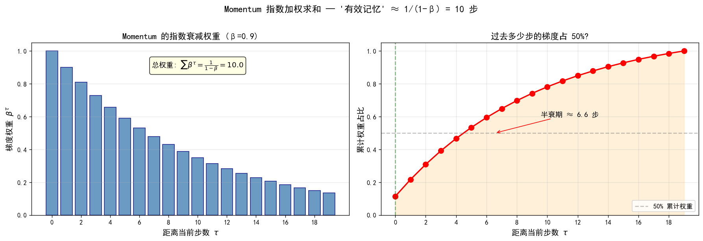

> 📊 完整代码：[`assets/figures/3-5-momentum-weights.py`](../../assets/figures/3-5-momentum-weights.py)

### 3.2 Nesterov Momentum

Nesterov Accelerated Gradient（NAG）是在动量基础上的"先看一步再修正"。

它先沿已有速度预测未来位置，再在该位置计算梯度，因此通常比普通 Momentum 更灵敏。

实践中，可以把它看作 Momentum 的增强版；在经典 CNN 时代，`SGD + Momentum/Nesterov` 是非常常见的组合。

#### Nesterov vs 普通 Momentum：先看一步 vs 边走边看

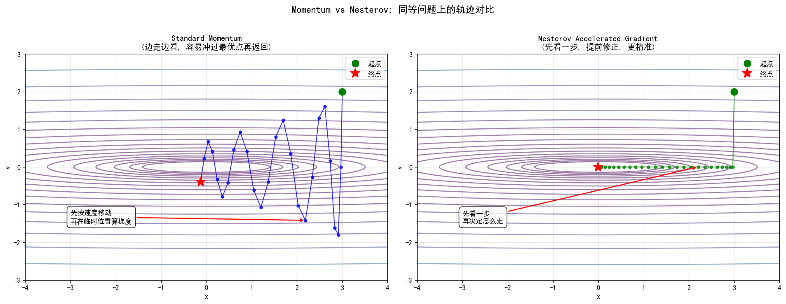

> 📊 完整代码：[`assets/figures/3-5-nesterov-vs-momentum.py`](../../assets/figures/3-5-nesterov-vs-momentum.py)

**几何对比**：

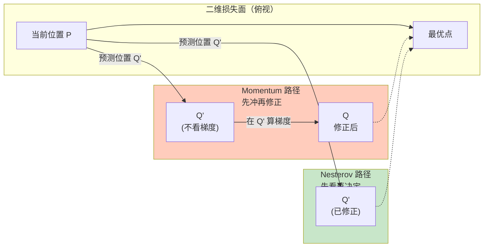

> Nesterov 相当于"先**抬头看**前方的路，再决定怎么走"，比普通 Momentum 更"聪明"。

## 4. 自适应学习率优化器

统一学习率有一个明显问题：不同参数的重要性与梯度尺度不同。如果每个参数都用同一个步长，就可能出现"有的走太大，有的走太小"。

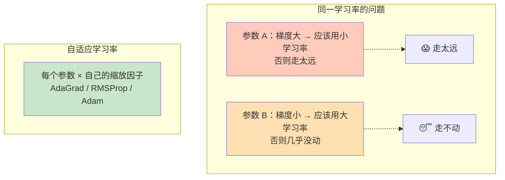

**核心思想**：每个参数 $\theta_i$ 拥有**自己的学习率** $\eta_i$，由其历史梯度决定。

### 4.1 AdaGrad

AdaGrad（Duchi et al., 2011）会对历史梯度平方做累积：

$$
G_t = G_{t-1} + g_t^2
$$

$$
\theta_t = \theta_{t-1} - \frac{\eta}{\sqrt{G_t + \epsilon}} g_t
$$

**效果：**

- 经常更新的参数，学习率会逐渐变小
- 稀疏特征对应参数，仍能保留较大学习率

**优点：**

- 对稀疏特征问题效果好

**缺点：**

- 学习率会不断衰减，后期可能小到几乎不再更新

#### AdaGrad 的核心机制：每个参数独立累积梯度

```mermaid
graph LR
        Gt["G_t = G_{t-1} + g_t²<br/>累积梯度平方"]
        Sqrt["$\\sqrt{G_t + \\epsilon}$"]
        Sqrt --> Div["$\\eta / \\sqrt{G_t + \\epsilon}$<br/>自适应学习率"]
    end
    
    subgraph 效果["实际效果"]
        Frequent["频繁更新参数<br/>G_t 大 → 学习率小"] --> Safe["稳"]
        Rare["稀疏参数<br/>G_t 小 → 学习率大"] --> Quick["快"]
    end
    
    style Gt fill:#fff9c4
    style Safe fill:#c8e6c9
    style Quick fill:#c8e6c9
```

**致命问题**：

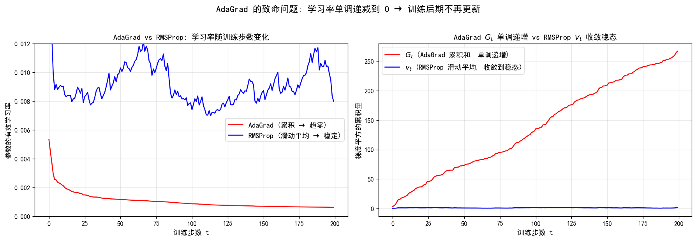

> 📊 完整代码：[`assets/figures/3-5-adagrad-decay.py`](../../assets/figures/3-5-adagrad-decay.py)

$G_t$ 单调递增 → 学习率单调递减 → **训练后期几乎不更新**。

### 4.2 RMSProp

RMSProp（Tieleman & Hinton, 2012）针对 AdaGrad 的问题做了改进：不累积全部历史，而是只保留梯度平方的指数滑动平均：

$$
v_t = \rho v_{t-1} + (1-\rho) g_t^2
$$

$$
\theta_t = \theta_{t-1} - \frac{\eta}{\sqrt{v_t + \epsilon}} g_t
$$

这样能避免学习率过早衰减到几乎为零，因此在 RNN 等训练不稳定的任务中很常见。

#### RMSProp 解决了什么：滑动平均 vs 累积

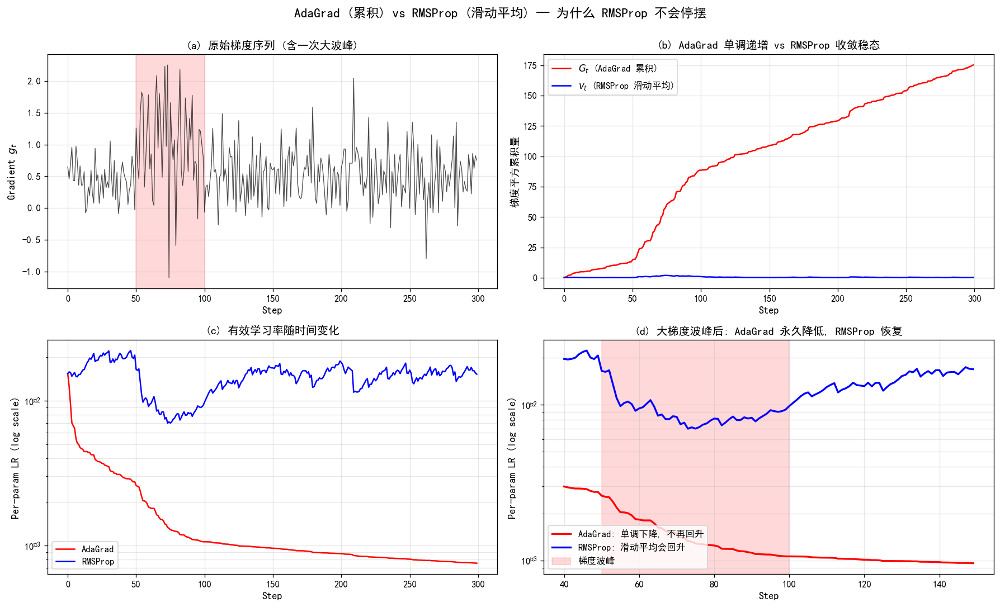

> 📊 完整代码：[`assets/figures/3-5-rmsprop-vs-adagrad.py`](../../assets/figures/3-5-rmsprop-vs-adagrad.py)

| 维度 | AdaGrad | RMSProp |
|------|---------|---------|
| 累积方式 | **全部历史求和** | **指数滑动平均** |
| 学习率趋势 | 单调递减到 0 | **稳定在合理范围** |
| 适合长期训练 | ❌ 后期停摆 | ✅ 持续有效 |
| 适合 RNN | ❌ 容易停 | ✅ |

### 4.3 Adam

Adam（Kingma & Ba, 2014/2015）把两类思想合并起来：

- **Momentum**：保留梯度一阶矩（均值）
- **RMSProp**：保留梯度二阶矩（平方均值）

核心公式：

$$
m_t = \beta_1 m_{t-1} + (1-\beta_1) g_t
$$

$$
v_t = \beta_2 v_{t-1} + (1-\beta_2) g_t^2
$$

再做偏差校正：

$$
\hat{m}_t = \frac{m_t}{1-\beta_1^t}, \qquad
\hat{v}_t = \frac{v_t}{1-\beta_2^t}
$$

最终更新：

$$
\theta_t = \theta_{t-1} - \eta \frac{\hat{m}_t}{\sqrt{\hat{v}_t} + \epsilon}
$$

Adam 的默认超参数非常经典：

- `lr = 1e-3`
- `β1 = 0.9`
- `β2 = 0.999`
- `ε = 1e-8`

**为什么 Adam 这么流行？**

- 开箱即用，调参相对省心
- 早期下降速度通常很快
- 对梯度尺度差异大、训练噪声大的任务较鲁棒

**但要注意：**

- Adam 的训练 loss 降得快，不代表泛化一定最好
- 后续研究发现，自适应优化器在一些任务上的泛化性能可能不如 `SGD + Momentum`

#### Adam 的一图流：Momentum + RMSProp 的结合

```mermaid
graph TB
        M["$m_t = \\\\beta_1 m_{t-1} + (1-\\\\beta_1) g_t$<br/>梯度的指数滑动平均<br/>'动量'"]
    end
    
        V["$v_t = \\\\beta_2 v_{t-1} + (1-\\\\beta_2) g_t^2$<br/>梯度平方的指数滑动平均<br/>'自适应尺度'"]
    end
    
        Vc["$\\hat{v}_t = v_t / (1-\\beta_2^t)$<br/>修早期偏低"]
    end
    
        Final["\θ_t \← \θ_{t-1} - \η \\m̂_t/\√(\v)_t̂ + \ε<br/>'动量' / '尺度' = 方向 + 步长"]
        Final["$\\theta_t \\leftarrow \\theta_{t-1} - \\eta \\frac{\\hat{m}_t}{\\sqrt{\\hat{v}_t} + \\epsilon}$<br/>'动量' / '尺度' = 方向 + 步长"]
    end
    
    M --> Mc --> Final
    V --> Vc --> Final
    
    style M fill:#fff9c4
    style V fill:#e1f5fe
    style Final fill:#c8e6c9
```

> 实测对比图见下面 5.4 节（matplotlib 训练损失曲线）。

#### Adam 的"信号/噪声"视角

```mermaid
    Sig["$\\hat{m}_t$<br/>信号（方向）"] --> Step["步长方向"]
    Noise["$\\sqrt{\\hat{v}_t}$<br/>噪声尺度（步长）"] --> Step
    Step --> Update["每参数的自适应步长"]
    
    style Sig fill:#c8e6c9
    style Noise fill:#fff9c4
    style Update fill:#e1f5fe
```

#### Adam 的更新轨迹

```mermaid
graph LR
        A1["起点"] -->|快速| A2["沿 $\\hat{m}$ 方向"]
        A2 --> A3["到达最优点<br/>(比 SGD 快)"]
    end
    
    subgraph 复杂地形["Adam 在复杂问题上的轨迹"]
        B1["起点"] -->|动量 + 自适应| B2["绕过局部极小"]
        B2 -->|自适应缩放| B3["稳定收敛"]
    end
    
    style A3 fill:#c8e6c9
    style B3 fill:#c8e6c9
```

### 4.4 AdamW

AdamW（Loshchilov & Hutter, 2017/2019）解决了 Adam 里的一个关键问题：

> 在 Adam 中，直接把 L2 正则写进损失函数，并不等价于真正的权重衰减（weight decay）。

AdamW 将**权重衰减**与**梯度更新**解耦，因此在现代实践中更常作为 Adam 的默认替代品，尤其是在 Transformer、BERT、GPT 等模型训练中。

#### Adam vs AdamW：权重衰减的处理方式对比

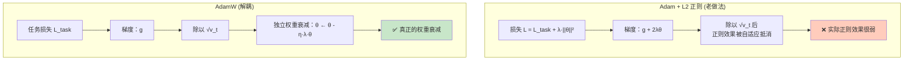

#### AdamW 的一行核心公式

$$
\theta_t = \underbrace{\theta_{t-1} - \eta \frac{\hat{m}_t}{\sqrt{\hat{v}_t} + \epsilon}}_{\text{Adam 的梯度更新}} \underbrace{- \eta \lambda \theta_{t-1}}_{\text{独立的权重衰减}}
$$

可以简单记住：

- **Adam**：经典、自适应、收敛快
- **AdamW**：更符合现代大模型训练习惯，通常优先选它

## 5. 如何选择优化器

一个实用的经验表：

| 场景 | 常见选择 |
|------|----------|
| 经典视觉任务、追求强泛化 | SGD + Momentum |
| 快速实验、原型验证 | Adam |
| Transformer / LLM / 大模型微调 | AdamW |
| 稀疏特征场景 | AdaGrad |
| 梯度噪声较强或非平稳目标 | RMSProp / Adam |

不要把"哪个优化器最好"理解成静态结论。更合理的说法是：

- 优化器决定了**参数怎么走**
- 学习率策略决定了**每一步走多大**
- 数据规模、模型结构、正则化方式共同决定最终效果

### 5.1 优化器选择决策树

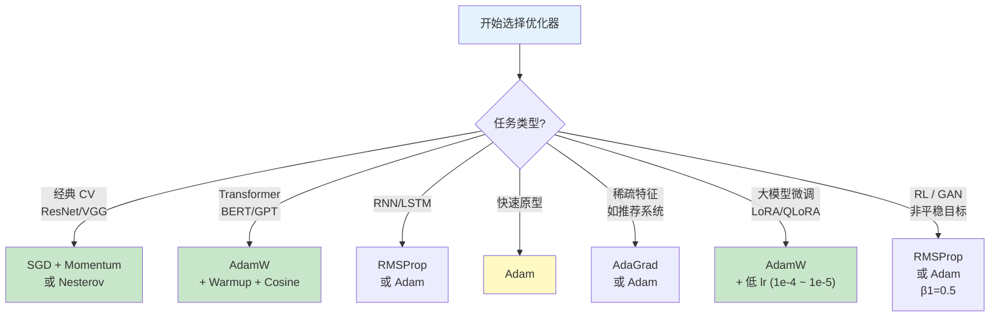

### 5.2 优化器家族谱系图

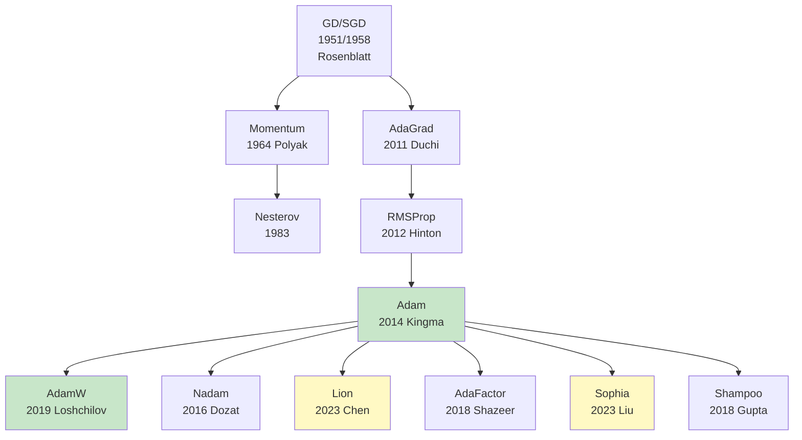

### 5.3 优化器能力雷达图（对比）

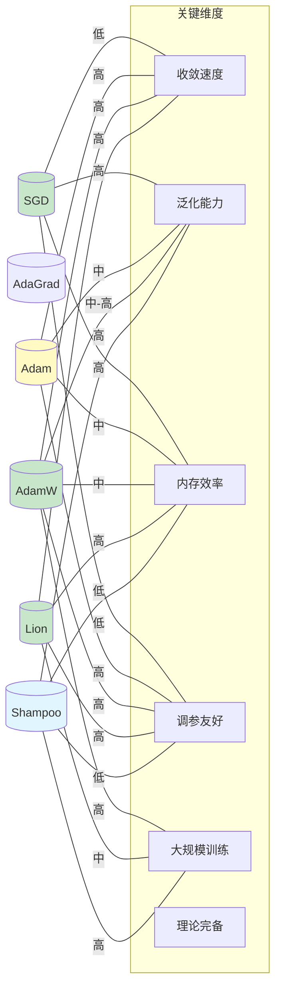

### 5.4 训练损失曲线对比（典型表现）

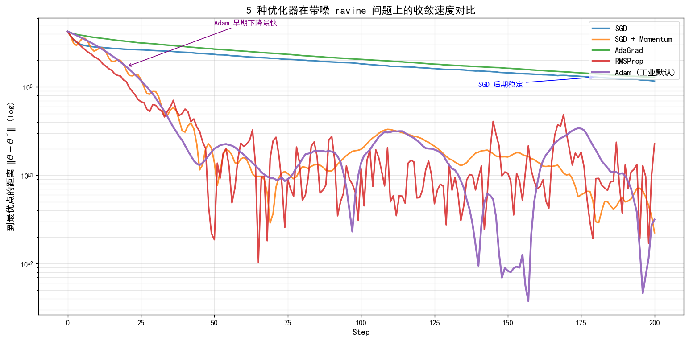

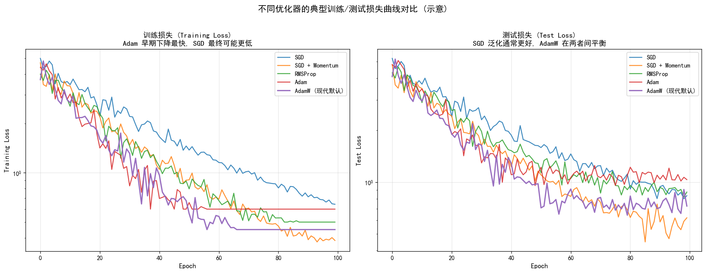

> 📊 完整代码：[`assets/figures/3-5-optimizer-convergence.py`](../../assets/figures/3-5-optimizer-convergence.py)、[`assets/figures/3-5-optimizer-loss-curves.py`](../../assets/figures/3-5-optimizer-loss-curves.py)
>
> **核心结论**：Adam 早期收敛快，但 SGD 最终 loss 往往更低。

### 5.5 SGD 优化器变体大全：围剿 SGD 的十几招

> **本节核心**：学术界为了"打败 SGD"（达到更快收敛 + 更好泛化）提出了 12+ 种变体。本节给出**一张决策表** + **关键公式** + **PyTorch 代码** + **选型决策**。

### 5.5.1 12 种优化器家族图谱

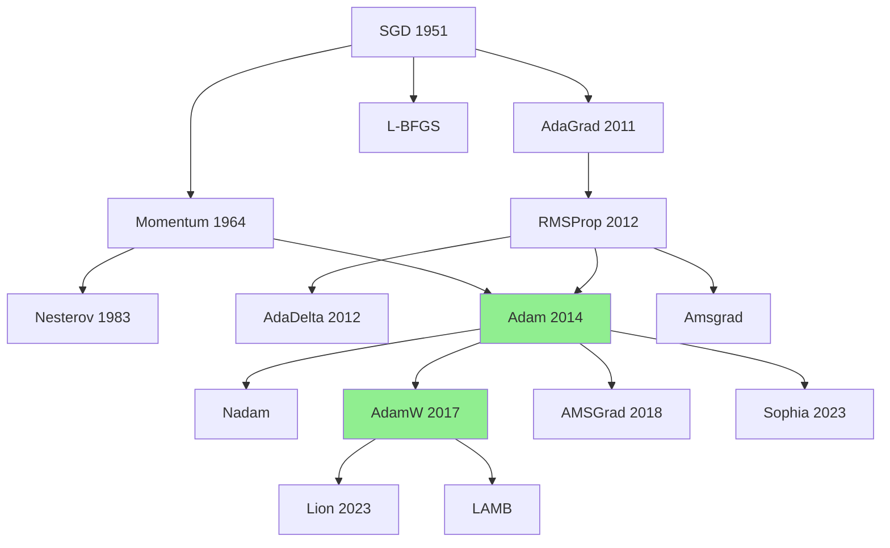

### 5.5.2 12 种优化器核心公式与对比

| 优化器 | 关键公式 | 核心思想 | 适用 |
|--------|----------|----------|------|
| **SGD** | $\theta_{t+1} = \theta_t - \eta g_t$ | 纯梯度下降 | 基线 |
| **Momentum** | $v_t = \beta v_{t-1} + g_t$; $\theta = \theta - \eta v_t$ | 累积动量加速 | ⭐ 图像任务 |
| **Nesterov** | $v_t = \beta v_{t-1} + g(\theta - \eta\beta v_{t-1})$ | "先看一步"再算梯度 | RNN |
| **AdaGrad** | $\theta_i = \theta_i - \frac{\eta}{\sqrt{\sum g_i^2 + \epsilon}} g_i$ | 自适应 LR（稀疏特征友好）| NLP 早期 |
| **RMSProp** | 用 EMA 替代累计平方和 | 解决 AdaGrad 早停 | RNN |
| **AdaDelta** | RMSProp + 自适应 Δ | 无需设 LR | 理论优雅，实践少 |
| **Adam** | 同时维护 1 阶 + 2 阶动量 | Momentum + RMSProp | ⭐ **默认** |
| **Nadam** | Adam + Nesterov | 比 Adam 快 | RNN |
| **AMSGrad** | 修正 Adam 不收敛 | 理论保证收敛 | 理论价值 |
| **AdamW** | Adam + 修正的权重衰减 | **解耦权重衰减** | ⭐⭐ **Transformer/LLM** |
| **Lion** | 符号函数做动量更新 | 内存减半 | ⭐ LLM |
| **Sophia** | 2 阶 Hessian 估计 | 收敛快 2× | 大模型 |

### 5.5.3 Adam vs AdamW：关键区别

**Adam 的 L2 正则化是错的**（这是 AdamW 论文的核心发现）：

| 维度 | Adam | AdamW |
|------|------|-------|
| L2 实现 | 加到 loss → 与梯度耦合 | **直接衰减权重**（解耦）|
| 训练 transformer | 退化 | **稳定** |
| 实际效果 | 泛化差 | +0.3-1% Acc |

**公式对比**：
- **Adam**（L2 加到 loss）：$L' = L + \lambda \|\theta\|^2$ → 梯度为 $g + \lambda\theta$（但被自适应 LR 除掉了，**L2 失效**）
- **AdamW**（直接衰减权重）：$\theta_{t+1} = \theta_t - \eta(\frac{m_t}{\sqrt{v_t}} + \lambda\theta_t)$（**L2 真正生效**）

### 5.5.4 Lion（Google 2023）：LLM 新趋势

**核心思想**：用符号函数（sign）替代 Adam 的 1 阶动量：

$$
\text{update}_t = \text{sign}(\beta_1 m_{t-1} + (1-\beta_1) g_t)
$$

$$
\theta_{t+1} = \theta_t - \eta(\text{update}_t + \lambda \theta_t)
$$

**Lion 优势**：
- **只存 1 个动量**（不是 2 个）→ 显存减半
- 同等 batch size 下内存使用比 AdamW 少 30-50%
- **大模型表现更好**（BLOOM、Llama-2 微调使用）

### 5.5.5 12 种优化器 PyTorch 实现

```python
import torch.optim as optim

# 1. SGD
opt = optim.SGD(model.parameters(), lr=0.01, momentum=0.9, weight_decay=1e-4)

# 2. SGD with Nesterov
opt = optim.SGD(model.parameters(), lr=0.01, momentum=0.9, nesterov=True)

# 3. AdaGrad
opt = optim.Adagrad(model.parameters(), lr=0.01, lr_decay=0, weight_decay=0)

# 4. RMSprop
opt = optim.RMSprop(model.parameters(), lr=0.01, alpha=0.9, weight_decay=0)

# 5. AdaDelta
opt = optim.Adadelta(model.parameters(), lr=1.0, rho=0.9)

# 6. Adam
opt = optim.Adam(model.parameters(), lr=1e-3, betas=(0.9, 0.999), weight_decay=0)

# 7. AdamW (推荐!)
opt = optim.AdamW(model.parameters(), lr=1e-3, betas=(0.9, 0.999), weight_decay=0.01)

# 8. NAdam
opt = optim.NAdam(model.parameters(), lr=2e-3, betas=(0.9, 0.999))

# 9. AMSGrad
opt = optim.Adam(model.parameters(), lr=1e-3, amsgrad=True)

# 10. Lion (需要 pip install lion-pytorch)
from lion_pytorch import Lion
opt = Lion(model.parameters(), lr=1e-4, weight_decay=1e-2)

# 11. Sophia
from sophia_optimizer import Sophia
opt = Sophia(model.parameters(), lr=2e-4, betas=(0.965, 0.99), rho=0.04)

# 12. LAMB (大 batch 训练)
from torch_optimizer import LAMB
opt = LAMB(model.parameters(), lr=1e-3, weight_decay=1e-2)
```

### 5.5.6 决策树：选哪个优化器？

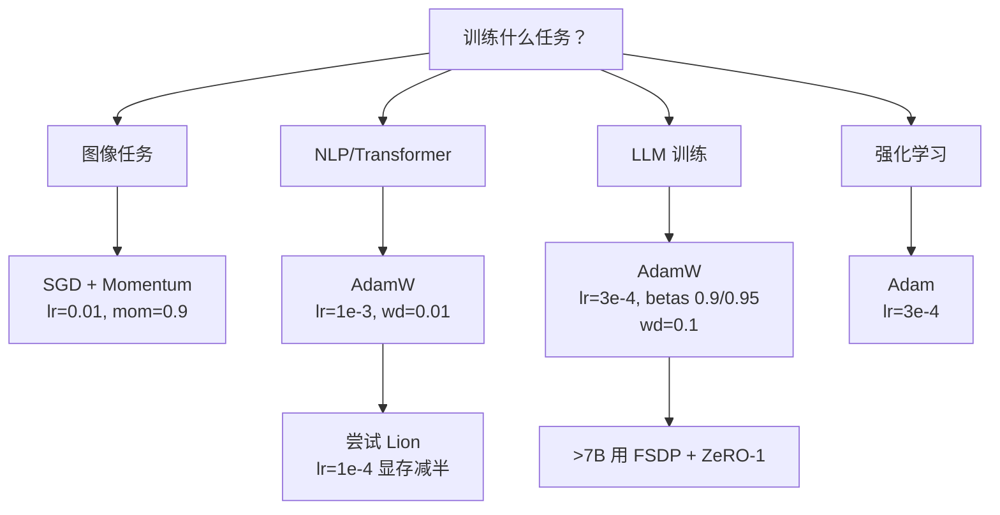

### 5.5.7 9 大工业选型建议

| 场景 | 推荐 | LR | WD | 备注 |
|------|------|----|----|------|
| **ResNet-50 图像分类** | SGD+Momentum | 0.1 | 1e-4 | ImageNet 标准 |
| **Transformer 预训练** | AdamW | 1e-3 | 0.01 | 1 epoch warmup |
| **LLM 7B 预训练** | AdamW | 3e-4 | 0.1 | betas=(0.9, 0.95) |
| **LLM 7B 微调 (LoRA)** | AdamW | 2e-4 | 0.0 | LoRA 不需要 WD |
| **LLM 训练 (显存紧)** | Lion | 1e-4 | 1e-2 | 内存减半 |
| **YOLO 检测** | SGD | 1e-2 | 5e-4 | ultralytics 默认 |
| **Stable Diffusion** | AdamW | 1e-5 | 1e-2 | 极小 LR |
| **GAN** | Adam | 2e-4 | 0 | 两网络分别优化 |
| **强化学习 (PPO)** | Adam | 3e-4 | 0 | on-policy |

### 5.5.8 实战 Checklist

```
□ 1. 默认从 AdamW 开始（lr=1e-3, wd=0.01）
□ 2. 图像任务考虑 SGD+Momentum（更好的泛化）
□ 3. 大模型考虑 Lion（省内存）
□ 4. 配 CosineAnnealing + Warmup
□ 5. 监控 grad norm（爆炸 → clip）
□ 6. 不要混用 lr 调度与优化器逻辑
```

### 5.5.9 关键经验

> **经验 1**：优化器选 SGD vs Adam 不是非此即彼，**很多 SOTA 都是 AdamW + 大 batch + 强 augmentation 训练到收敛**。
> 
> **经验 2**：**AdamW 的 weight_decay 一定要和 lr 一起调**。wd=0.1 通常配 lr=1e-4；wd=0.01 配 lr=1e-3。
> 
> **经验 3**：新任务先用 AdamW 快速实验 → 调到合适 LR 后可尝试 SGD（可能 +0.5% 泛化）。
> 
> **经验 4**：**不要迷信 Lion / Sophia**——除非内存真的紧，否则 AdamW 已经够用。
> 
> **经验 5**：优化器之外的**学习率调度**、**正则化**、**数据增强**往往比优化器本身更影响最终效果。

---

## 6. 学习率策略：优化器之外的另一半

优化器很重要，但训练是否顺利，很多时候同样取决于学习率调度（scheduler）。

### 6.1 5 大学习率策略全貌

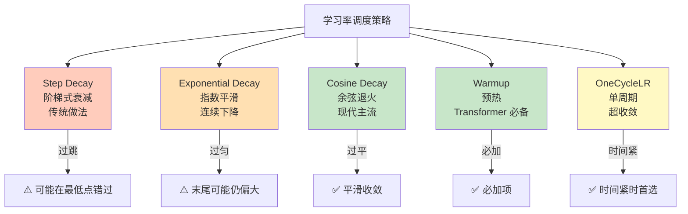

### 6.2 Step Decay

每隔固定 epoch，把学习率乘上一个衰减系数：

$$
\eta_t = \eta_0 \cdot \gamma^{\lfloor t / s \rfloor}
$$

优点是简单直接；缺点是衰减点不够平滑。

### 6.3 Exponential Decay

每轮都按固定比例衰减：

$$
\eta_t = \eta_0 \cdot \gamma^t
$$

相比 Step Decay 更平滑，但需要调好衰减速度。

### 6.4 Cosine Decay

余弦退火常见于现代训练流程：

$$
\eta_t = \eta_{\min} + \frac{1}{2}(\eta_{\max}-\eta_{\min})\left(1 + \cos\frac{\pi t}{T}\right)
$$

优点：

- 前期学习率较大，探索能力强
- 后期平滑收敛
- 在视觉与大模型训练中都很常见

### 6.5 Warmup

Warmup 是指：训练刚开始时，不直接使用目标学习率，而是从很小的值逐步升上去。

它尤其适合：

- Transformer
- 大 batch 训练
- 使用 AdamW 的大模型训练

原因在于：训练初期参数尚未稳定，若学习率太大，容易导致 loss 波动甚至发散。

### 6.6 OneCycleLR

OneCycle 策略先升高学习率，再快速下降，在某些任务中可实现"超收敛（super-convergence）"。

它的核心思想是：

- 前期大步探索
- 中后期快速收敛

适合训练轮数相对可控、实验效率要求高的场景。

### 6.7 5 大学习率策略的曲线对比

下面这张 ASCII 示意图把 5 种调度放在一起对比（横轴是训练轮次 epoch，纵轴是学习率）：

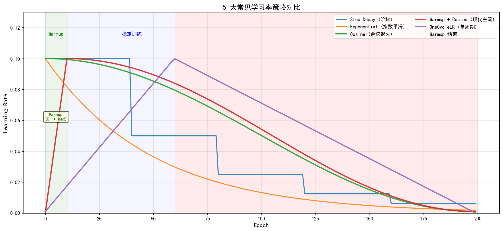

> 📊 完整代码：[`assets/figures/3-5-lr-schedules.py`](../../assets/figures/3-5-lr-schedules.py)

### 6.8 Warmup 的必要性

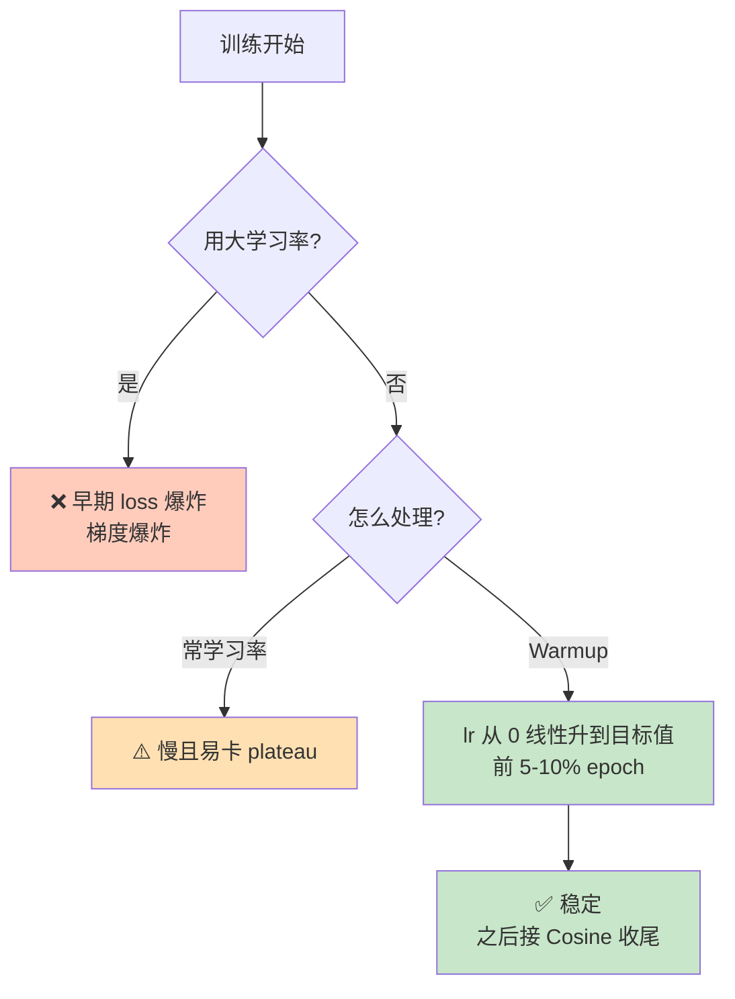

**Warmup 数学表达**（以线性 warmup + cosine decay 为例）：

$$
\eta_t = \begin{cases}
\eta_{\max} \cdot \frac{t}{T_{\text{warmup}}} & t < T_{\text{warmup}} \\[6pt]
\eta_{\min} + \frac{1}{2}(\eta_{\max} - \eta_{\min}) \left(1 + \cos \frac{\pi (t - T_{\text{warmup}})}{T - T_{\text{warmup}}} \right) & t \geq T_{\text{warmup}}
\end{cases}
$$

### 6.9 现代训练流程：Warmup + Cosine Decay 完整图

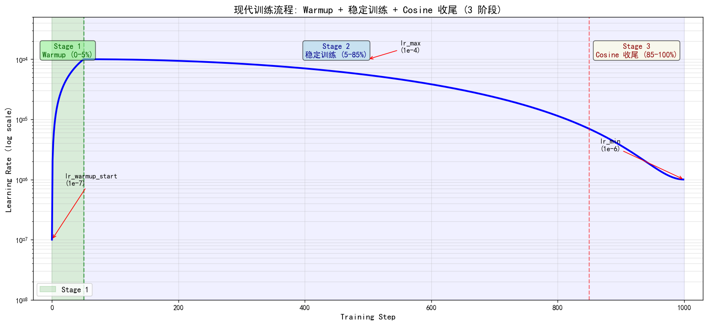

> 📊 完整代码：[`assets/figures/3-5-warmup-cosine-3stage.py`](../../assets/figures/3-5-warmup-cosine-3stage.py)

### 6.10 学习率选择速查表

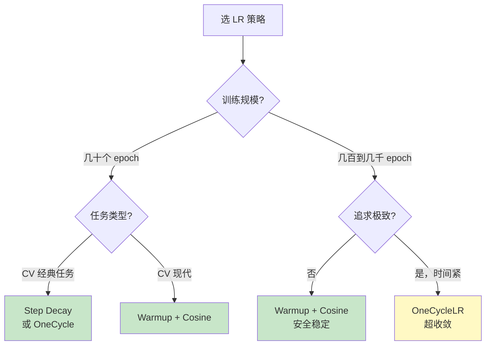

## 7. 一个直观代码示例
## 本章小结
1. **基本更新方式**：GD、SGD、Mini-batch GD 构成了深度学习优化的基础框架。
2. **动量法**：Momentum/Nesterov 能减少震荡、提升沿主方向的收敛速度。
3. **自适应优化器**：AdaGrad、RMSProp、Adam 通过历史梯度信息动态调整步长，其中 Adam 最常用。
4. **AdamW 的意义**：AdamW 通过解耦权重衰减，成为现代 Transformer 训练的常见默认选择。
5. **学习率策略同样关键**：Warmup、Cosine Decay、OneCycleLR 往往会显著影响训练稳定性和最终效果。

### 8.1 全章知识图谱（强化版）

### 8.2 一张图总结：优化算法的演化路径

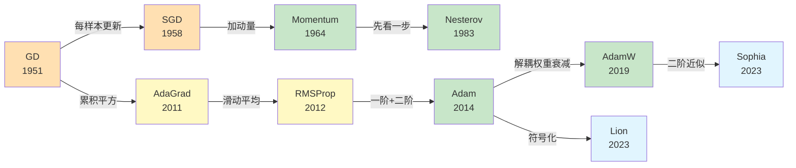

## 参考资料
1. **SGD & Momentum** — Sutskever et al., *On the importance of initialization and momentum in deep learning* (ICML 2013)
2. **AdaGrad** — Duchi et al., *Adaptive Subgradient Methods for Online Learning and Stochastic Optimization* (JMLR 2011)
3. **RMSProp** — Tieleman & Hinton, *Lecture 6.5 — RMSProp* (Coursera 2012)
4. **Adam** — Kingma & Ba, *Adam: A Method for Stochastic Optimization* (ICLR 2015, arXiv:1412.6980)
5. **Optimization Algorithms Overview** — Ruder, *An Overview of Gradient Descent Optimization Algorithms* (arXiv:1609.04747)
6. **AdamW** — Loshchilov & Hutter, *Decoupled Weight Decay Regularization* (ICLR 2019, arXiv:1711.05101)
7. **OneCycleLR / Super-Convergence** — Smith, *Super-Convergence: Very Fast Training of Neural Networks Using Large Learning Rates* (2018)
8. **Goodfellow et al.**, *Deep Learning* (MIT Press, 2016) — Chapter 8

---

## 附录 A：本章绘图代码索引

本章共 12 张图，所有绘图代码均保存在 `assets/figures/3-5-*.py` 中，可独立运行重新生成 PNG。

| 图表 | 主题 | 代码文件 |
|------|------|----------|
| 1 | 损失曲面 4 种地形 | [`assets/figures/3-5-loss-landscape.py`](../../assets/figures/3-5-loss-landscape.py) |
| 2 | GD / SGD / Mini-batch 轨迹对比 | [`assets/figures/3-5-gd-sgd-minibatch-trajectories.py`](../../assets/figures/3-5-gd-sgd-minibatch-trajectories.py) |
| 3 | Rosenbrock 谷地：SGD vs Momentum | [`assets/figures/3-5-ravine-sgd-vs-momentum.py`](../../assets/figures/3-5-ravine-sgd-vs-momentum.py) |
| 4 | Nesterov vs Standard Momentum | [`assets/figures/3-5-nesterov-vs-momentum.py`](../../assets/figures/3-5-nesterov-vs-momentum.py) |
| 5 | Momentum 指数衰减权重 | [`assets/figures/3-5-momentum-weights.py`](../../assets/figures/3-5-momentum-weights.py) |
| 6 | AdaGrad 学习率单调衰减 | [`assets/figures/3-5-adagrad-decay.py`](../../assets/figures/3-5-adagrad-decay.py) |
| 7 | AdaGrad vs RMSProp 累积 vs 滑动 | [`assets/figures/3-5-rmsprop-vs-adagrad.py`](../../assets/figures/3-5-rmsprop-vs-adagrad.py) |
| 8 | Adam 更新分解 (方向 × 步长) | [`assets/figures/3-5-adam-decomposition.py`](../../assets/figures/3-5-adam-decomposition.py) |
| 9 | 5 优化器收敛速度 | [`assets/figures/3-5-optimizer-convergence.py`](../../assets/figures/3-5-optimizer-convergence.py) |
| 10 | 训练/测试损失曲线对比 | [`assets/figures/3-5-optimizer-loss-curves.py`](../../assets/figures/3-5-optimizer-loss-curves.py) |
| 11 | 5 大学习率策略 | [`assets/figures/3-5-lr-schedules.py`](../../assets/figures/3-5-lr-schedules.py) |
| 12 | Warmup + Cosine 3 阶段 | [`assets/figures/3-5-warmup-cosine-3stage.py`](../../assets/figures/3-5-warmup-cosine-3stage.py) |

> 重新生成所有图：
> ```bash
> for f in assets/figures/3-5-*.py; do
>     /home/david/.local/share/mamba/envs/ultralytics/bin/python3 "$f"
> done
> ```

**绘图原则**：本章用 mermaid 的图都是**逻辑/流程**（决策树、家族谱系、思维导图），用 matplotlib 的图都是**数学/曲线/轨迹**（损失曲面、轨迹对比、训练曲线）。两类工具各司其职。

## 知识图谱

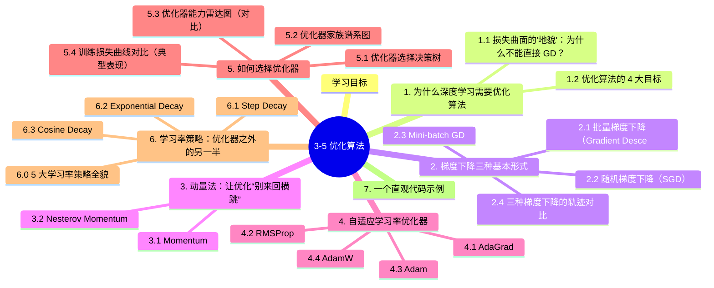
