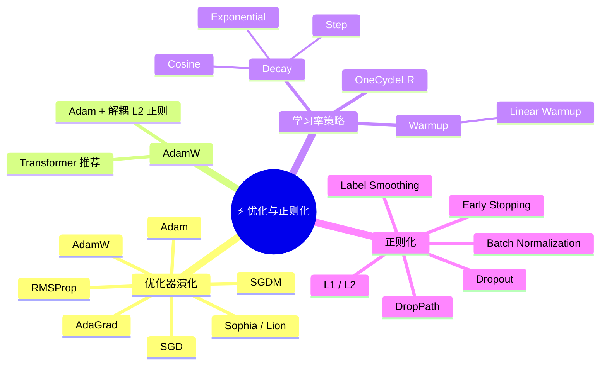
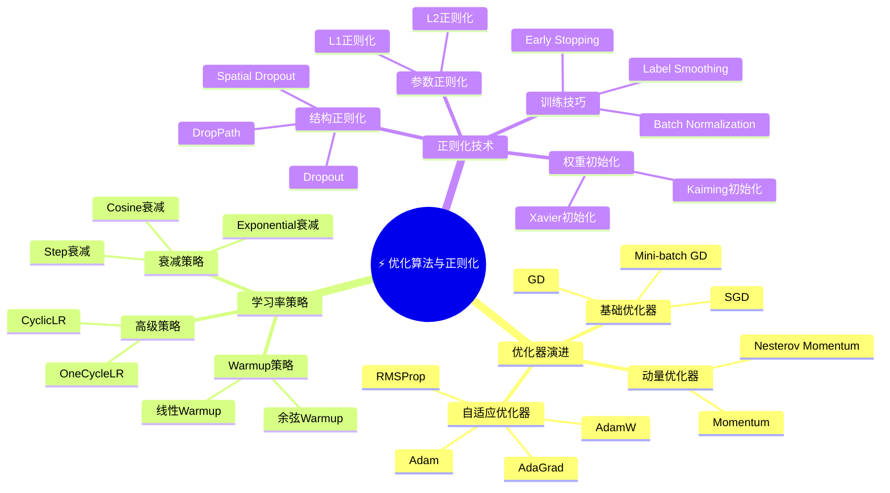

# 3-5 优化算法与正则化

---

## 学习目标

- 理解梯度下降、随机梯度下降（SGD）、Mini-batch GD 的原理与差异
- 掌握动量（Momentum）、自适应学习率（AdaGrad、RMSProp、Adam、AdamW）等进阶优化器
- 掌握学习率衰减、Warmup、OneCycleLR 等学习率策略
- 理解 Dropout、Batch Normalization、L1/L2 正则化、Early Stopping 等正则化方法的作用与适用场景

---

## 1. 优化器基础

神经网络的训练，本质上是找到一组参数 $\theta$，使得损失函数 $\mathcal{L}(\theta)$ 最小：

$$
\theta^* = \arg\min_{\theta} \mathcal{L}(\theta)
$$

优化器（Optimizer）就是完成这个"搜索"过程的算法。

### 1.1 梯度下降（Gradient Descent, GD）

最基本的优化器。每次更新沿着梯度相反方向迈步：

$$
\theta \leftarrow \theta - \eta \cdot \nabla_\theta \mathcal{L}(\theta)
$$

其中 $\eta$ 为学习率（learning rate）。

**优点**：对凸函数一定能收敛到全局最优。
**缺点**：每次迭代需要计算整个数据集的梯度，非常慢。

### 1.2 随机梯度下降（SGD）

不使用全部数据，而是随机选一个样本计算梯度：

$$
\theta \leftarrow \theta - \eta \cdot \nabla_\theta \mathcal{L}_i(\theta)
$$

**优点**：每次迭代快，能跳出局部最优。
**缺点**：梯度有噪声，收敛不稳定。

### 1.3 Mini-batch GD

折中方案，每次用一小批（batch）样本计算梯度：

$$
\theta \leftarrow \theta - \eta \cdot \frac{1}{|B|} \sum_{i \in B} \nabla_\theta \mathcal{L}_i(\theta)
$$

这是深度学习最常用的方案，兼顾速度和稳定性。



```python
import numpy as np
import matplotlib.pyplot as plt
from matplotlib import cm
from mpl_toolkits.mplot3d import Axes3D

# ======================================
# 1. 不同优化算法的收敛轨迹对比
# ======================================

# 定义损失函数（Rosenbrock函数，常用于优化算法测试）
def rosenbrock(x, y):
    return (1 - x)**2 + 100 * (y - x**2)**2

# 梯度计算
def rosenbrock_grad(x, y):
    gx = -2 * (1 - x) - 400 * x * (y - x**2)
    gy = 200 * (y - x**2)
    return np.array([gx, gy])

# 优化算法实现
def gradient_descent(grad_func, start_point, lr=0.001, n_iter=100):
    """标准梯度下降"""
    point = start_point.copy()
    trajectory = [point.copy()]
    
    for _ in range(n_iter):
        grad = grad_func(point[0], point[1])
        point -= lr * grad
        trajectory.append(point.copy())
    
    return np.array(trajectory)

def momentum_gd(grad_func, start_point, lr=0.001, beta=0.9, n_iter=100):
    """带动量的梯度下降"""
    point = start_point.copy()
    velocity = np.zeros_like(point)
    trajectory = [point.copy()]
    
    for _ in range(n_iter):
        grad = grad_func(point[0], point[1])
        velocity = beta * velocity - lr * grad
        point += velocity
        trajectory.append(point.copy())
    
    return np.array(trajectory)

def adam_optimizer(grad_func, start_point, lr=0.01, beta1=0.9, beta2=0.999, eps=1e-8, n_iter=100):
    """Adam优化器"""
    point = start_point.copy()
    m = np.zeros_like(point)  # 一阶矩估计
    v = np.zeros_like(point)  # 二阶矩估计
    trajectory = [point.copy()]
    
    for t in range(1, n_iter + 1):
        grad = grad_func(point[0], point[1])
        
        # 更新一阶矩和二阶矩
        m = beta1 * m + (1 - beta1) * grad
        v = beta2 * v + (1 - beta2) * (grad ** 2)
        
        # 偏差校正
        m_hat = m / (1 - beta1 ** t)
        v_hat = v / (1 - beta2 ** t)
        
        # 参数更新
        point -= lr * m_hat / (np.sqrt(v_hat) + eps)
        trajectory.append(point.copy())
    
    return np.array(trajectory)

# 设置初始点
start_point = np.array([-1.5, 1.5])

# 运行不同优化算法
gd_traj = gradient_descent(rosenbrock_grad, start_point, lr=0.0005, n_iter=200)
momentum_traj = momentum_gd(rosenbrock_grad, start_point, lr=0.0005, beta=0.9, n_iter=200)
adam_traj = adam_optimizer(rosenbrock_grad, start_point, lr=0.01, n_iter=200)

# 绘制优化轨迹对比图
fig, axes = plt.subplots(1, 3, figsize=(18, 5))

# 创建网格用于绘制等高线
x = np.linspace(-2, 2, 100)
y = np.linspace(-1, 3, 100)
X, Y = np.meshgrid(x, y)
Z = rosenbrock(X, Y)

# 绘制等高线
levels = np.logspace(-1, 3, 20)

for ax, traj, title in zip(axes, [gd_traj, momentum_traj, adam_traj], 
                          ['标准梯度下降 (GD)', '带动量梯度下降 (Momentum)', 'Adam优化器']):
    ax.contour(X, Y, Z, levels=levels, cmap='viridis', alpha=0.5)
    ax.plot(traj[:, 0], traj[:, 1], 'ro-', markersize=3, linewidth=1.5, label='优化轨迹')
    ax.plot(traj[0, 0], traj[0, 1], 'go', markersize=8, label='起点')
    ax.plot(traj[-1, 0], traj[-1, 1], 'bo', markersize=8, label='终点')
    ax.set_xlabel('x')
    ax.set_ylabel('y')
    ax.set_title(title)
    ax.legend()
    ax.grid(True, alpha=0.3)

plt.tight_layout()
plt.show()

# ======================================
# 2. 学习率衰减策略对比
# ======================================

plt.figure(figsize=(12, 5))

# 不同衰减策略
epochs = 200

# Step衰减
def step_lr(initial_lr, step_size=50, gamma=0.5):
    lr = []
    for epoch in range(epochs):
        current_lr = initial_lr * (gamma ** (epoch // step_size))
        lr.append(current_lr)
    return lr

# Cosine衰减  
def cosine_lr(initial_lr, T_max=epochs):
    lr = []
    for epoch in range(epochs):
        current_lr = 0.5 * initial_lr * (1 + np.cos(np.pi * epoch / T_max))
        lr.append(current_lr)
    return lr

# Exponential衰减
def exp_lr(initial_lr, gamma=0.99):
    lr = []
    for epoch in range(epochs):
        current_lr = initial_lr * (gamma ** epoch)
        lr.append(current_lr)
    return lr

# OneCycleLR策略（PyTorch风格）
def onecycle_lr(initial_lr, max_lr=0.1, pct_start=0.3):
    lr = []
    total_steps = epochs
    steps_up = int(total_steps * pct_start)
    steps_down = total_steps - steps_up
    
    # 上升阶段
    for step in range(steps_up):
        current_lr = initial_lr + (max_lr - initial_lr) * (step / steps_up)
        lr.append(current_lr)
    
    # 下降阶段
    for step in range(steps_down):
        current_lr = max_lr - (max_lr - initial_lr/100) * (step / steps_down)
        lr.append(current_lr)
    
    return lr

# 绘制不同学习率策略
plt.subplot(1, 2, 1)
plt.plot(step_lr(0.1), label='Step衰减 (每50轮×0.5)', linewidth=2)
plt.plot(cosine_lr(0.1), label='Cosine衰减', linewidth=2)
plt.plot(exp_lr(0.1), label='Exponential衰减 (γ=0.99)', linewidth=2)
plt.plot(onecycle_lr(0.01, max_lr=0.1), label='OneCycleLR策略', linewidth=2)
plt.xlabel('训练轮次 (Epoch)')
plt.ylabel('学习率')
plt.title('不同学习率衰减策略对比')
plt.legend()
plt.grid(True, alpha=0.3)

# ======================================
# 3. 正则化效果可视化
# ======================================

# L1/L2正则化对比
np.random.seed(42)
n_samples = 100
X = np.random.randn(n_samples, 20)
true_coef = np.zeros(20)
true_coef[:5] = [1.5, -1.2, 0.8, -0.5, 0.3]  # 只有前5个特征有效
y = X @ true_coef + np.random.randn(n_samples) * 0.1

# L1正则化 (Lasso) 和 L2正则化 (Ridge) 效果
from sklearn.linear_model import Lasso, Ridge

l1_model = Lasso(alpha=0.1, max_iter=10000)
l2_model = Ridge(alpha=0.1)

l1_model.fit(X, y)
l2_model.fit(X, y)

plt.subplot(1, 2, 2)
plt.stem(range(20), true_coef, linefmt='b-', markerfmt='bo', basefmt=' ', label='真实系数')
plt.stem(range(20), l1_model.coef_, linefmt='r--', markerfmt='rx', basefmt=' ', label='L1正则化 (Lasso)')
plt.stem(range(20), l2_model.coef_, linefmt='g:', markerfmt='gs', basefmt=' ', label='L2正则化 (Ridge)')
plt.xlabel('特征索引')
plt.ylabel('系数值')
plt.title('L1 vs L2 正则化效果对比\n(L1产生稀疏解，L2缩小系数)')
plt.legend()
plt.grid(True, alpha=0.3)

plt.tight_layout()
plt.show()

# ======================================
# 4. Dropout效果模拟
# ======================================

def simulate_dropout(n_neurons=100, dropout_rate=0.5, n_trials=3):
    """模拟Dropout对神经元激活的影响"""
    np.random.seed(42)
    
    fig, axes = plt.subplots(1, n_trials + 1, figsize=(4*(n_trials+1), 4))
    
    # 原始激活（无Dropout）
    activations = np.random.randn(n_neurons) * 2 + 1  # 正态分布激活
    axes[0].hist(activations, bins=20, edgecolor='black', alpha=0.7)
    axes[0].set_xlabel('激活值')
    axes[0].set_ylabel('神经元数量')
    axes[0].set_title(f'无Dropout\n均值: {activations.mean():.2f}, 方差: {activations.var():.2f}')
    axes[0].axvline(activations.mean(), color='red', linestyle='--', label='均值')
    
    # 有Dropout的激活
    for i in range(n_trials):
        # 应用Dropout
        dropout_mask = (np.random.rand(n_neurons) > dropout_rate).astype(float)
        dropped_activations = activations * dropout_mask / (1 - dropout_rate)  # 缩放
        
        axes[i+1].hist(dropped_activations, bins=20, edgecolor='black', alpha=0.7)
        axes[i+1].set_xlabel('激活值')
        axes[i+1].set_ylabel('神经元数量')
        active_neurons = np.sum(dropout_mask)
        axes[i+1].set_title(f'Dropout (p={dropout_rate})\n激活神经元: {active_neurons}/{n_neurons}')
        axes[i+1].axvline(dropped_activations.mean(), color='red', linestyle='--', label='均值')
    
    plt.suptitle(f'Dropout效果模拟 (Dropout率={dropout_rate})', fontsize=14)
    plt.tight_layout()
    plt.show()
    
    print(f"Dropout说明：在训练时，以概率 {dropout_rate} 随机丢弃神经元，测试时所有神经元激活但权重缩放 {1/(1-dropout_rate):.2f} 倍")
    print(f"作用：1) 防止过拟合 2) 提供模型集成效果 3) 增强鲁棒性")

# 运行Dropout模拟
simulate_dropout()

print("\n" + "="*80)
print("代码总结：")
print("="*80)
print("1. 优化算法对比：展示了GD、Momentum、Adam在Rosenbrock函数上的收敛轨迹")
print("2. 学习率策略：对比了Step、Cosine、Exponential衰减和OneCycleLR策略")
print("3. 正则化效果：L1产生稀疏解（特征选择），L2缩小系数（防止过拟合）")
print("4. Dropout模拟：可视化Dropout如何随机丢弃神经元防止过拟合")
print("="*80)
```

---
  
## 2. 本章小结

1. **梯度下降演变**：从批量GD → SGD → Mini-batch GD，再到SGDM、AdaGrad、RMSProp、Adam等自适应优化器，逐步解决了收敛速度、噪声和适应性等问题
2. **AdamW重要性**：作为当前Transformer模型的标准优化器，AdamW通过解耦权重衰减解决了Adam中L2正则化与自适应学习率冲突的问题
3. **学习率策略**：包括衰减策略（Step/Cosine/Exponential）、Warmup和OneCycleLR，其中Warmup对Transformer训练至关重要，OneCycleLR可实现超收敛
4. **正则化方法**：包括参数正则化（L1/L2）、Dropout/DropPath、Label Smoothing、Early Stopping和Batch Normalization，每种方法针对不同的过拟合问题
5. **BN的作用**：不仅加速训练，还通过减少内部协变量偏移改善了模型稳定性，已成为深度网络的标准组件

## 3. 知识点思维导图



---
 
## 4. 参考资料

1. **SGD & Momentum** — Sutskever et al., *"On the importance of initialization and momentum in deep learning"* (ICML 2013)
2. **AdaGrad** — Duchi et al., *"Adaptive Subgradient Methods for Online Learning and Stochastic Optimization"* (JMLR 2011)
3. **RMSProp** — Tieleman & Hinton, *"Lecture 6.5 — RMSProp"* (Coursera 2012)
4. **Adam** — Kingma & Ba, *"Adam: A Method for Stochastic Optimization"* (ICLR 2015)
5. **AdamW** — Loshchilov & Hutter, *"Decoupled Weight Decay Regularization"* (ICLR 2019)
6. **Batch Normalization** — Ioffe & Szegedy, *"Batch Normalization: Accelerating Deep Network Training by Reducing Internal Covariate Shift"* (ICML 2015)
7. **Dropout** — Srivastava et al., *"Dropout: A Simple Way to Prevent Neural Networks from Overfitting"* (JMLR 2014)
8. **OneCycleLR** — Smith, *"Super-Convergence: Very Fast Training of Neural Networks Using Large Learning Rates"* (LRN 2018)
9. **Goodfellow et al.**, *Deep Learning* (MIT Press, 2016) — Chapter 7 & 8
10. **He et al.**, *"Delving Deep into Rectifiers: Surpassing Human-Level Performance on ImageNet Classification"* (ICCV 2015) — Kaiming Initialization 相关