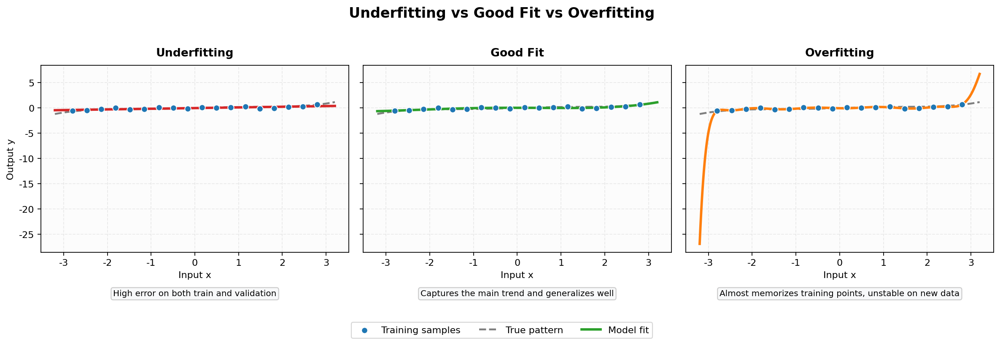
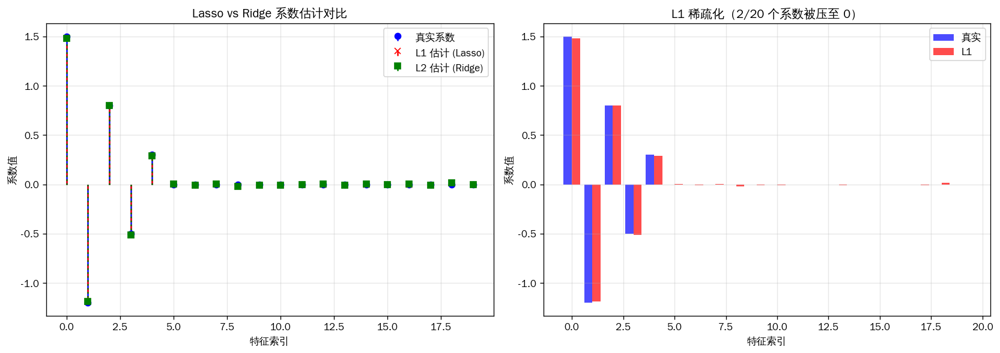
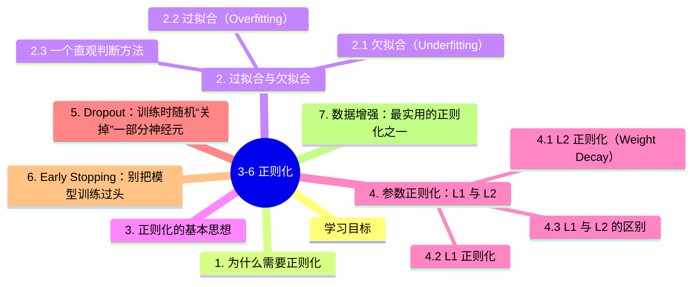

# 3-6 正则化

---

## 学习目标

- 理解过拟合（overfitting）与欠拟合（underfitting）的区别
- 理解正则化的目标是提升泛化能力，而不是单纯降低训练误差
- 掌握 L1/L2 正则化、Dropout、Early Stopping、数据增强等常见方法
- 理解 Batch Normalization 与正则化之间的关系
- 能根据训练/验证曲线判断模型是否需要更强或更弱的正则化

---

## 1. 为什么需要正则化

深度学习模型通常拥有很强的拟合能力。拟合能力强当然是好事，但它也意味着模型不仅能学到数据中的真实规律，还可能把噪声、偶然模式甚至数据集偏差一起“记住”。

这就引出了一个核心目标：

> 我们不只希望模型在训练集上表现好，更希望它在没见过的新样本上也表现好。

这种“在新数据上也能工作”的能力，叫做**泛化能力（generalization）**。而正则化（regularization）的核心任务，就是提升泛化能力、抑制过拟合。

## 2. 过拟合与欠拟合

### 2.1 欠拟合（Underfitting）

欠拟合指的是：模型太简单，或者训练不充分，以至于连训练集中的主要规律都没学好。

典型表现：

- 训练误差高
- 验证误差也高
- 训练和验证都学不好

常见原因：

- 模型容量太小
- 特征表达能力不足
- 训练轮数不够
- 学习率设置不合适

### 2.2 过拟合（Overfitting）

过拟合指的是：模型在训练集上表现非常好，但在验证集/测试集上表现明显变差。

典型表现：

- 训练误差很低
- 验证误差明显更高
- 模型“记住”了训练集细节，却没有学到足够通用的规律

常见原因：

- 模型参数太多、容量过强
- 数据量不足
- 数据噪声较大
- 缺少正则化手段

### 2.3 一个直观判断方法

| 现象 | 可能问题 |
|------|----------|
| 训练误差高，验证误差也高 | 欠拟合 |
| 训练误差低，验证误差高 | 过拟合 |
| 训练误差和验证误差都较低且接近 | 拟合较合适 |

可以把它想象成射箭：

- **欠拟合**：箭射得到处都是，靶心也没打中
- **过拟合**：箭在训练靶上非常集中，但换个靶子就偏得厉害
- **泛化好**：不只在一个靶子上射得准，换新靶也依然稳定

下图用一个简单的一维回归例子，把这三种状态画得更直观：

读图时可以重点观察：

- 左图：模型太简单，连总体趋势都没有抓住
- 中图：曲线复杂度合适，能够较好贴合真实规律
- 右图：曲线几乎穿过所有训练点，但出现了不必要的剧烈波动，这就是过拟合的典型特征

## 3. 正则化的基本思想

正则化并不是某一个单独技巧，而是一类思想：

- **限制模型复杂度**
- **降低对训练集细节的依赖**
- **让模型学到更稳健、更可迁移的特征**

从效果上看，它往往是在做一个权衡：

- 训练集表现可能略差一点
- 但验证集/测试集表现更稳定

所以，正则化的核心不是“让训练 loss 最低”，而是“让泛化更好”。

## 4. 参数正则化：L1 与 L2

### 4.1 L2 正则化（Weight Decay）

L2 正则化会在损失函数中加入权重平方和惩罚项：

$$
\mathcal{L}_{total} = \mathcal{L}_{data} + \lambda \sum_i w_i^2
$$

其作用是：

- 惩罚过大的权重
- 让模型参数更平滑
- 降低模型对某些单独参数的过度依赖

在深度学习实践里，L2 正则化常直接体现为 **weight decay**。

### 4.2 L1 正则化

L1 正则化加入的是权重绝对值之和：

$$
\mathcal{L}_{total} = \mathcal{L}_{data} + \lambda \sum_i |w_i|
$$

其特点是：

- 倾向于把一部分权重压到 0
- 容易得到稀疏解
- 在“特征选择”意味较强的任务中更常见

### 4.3 L1 与 L2 的区别

| 方法 | 主要效果 |
|------|----------|
| L1 | 促进稀疏，部分参数可变成 0 |
| L2 | 普遍缩小参数，但通常不直接变成 0 |

在现代深度学习中，**L2 / weight decay** 的使用远比 L1 更普遍。

## 5. Dropout：训练时随机“关掉”一部分神经元

Dropout 的核心思想是：

> 在训练阶段，以一定概率随机屏蔽部分神经元，让网络不能过度依赖某几个固定特征。

如果 Dropout rate 为 $p$，则一个神经元会以概率 $p$ 被置零。

**它为什么有效？**

- 减少神经元之间的共适应（co-adaptation）
- 逼迫网络学习更分散、更鲁棒的特征表示
- 在效果上有点像“很多个子网络做集成”

**实践注意：**

- 训练时开启，推理时关闭
- 常见 rate 在 `0.1 ~ 0.5`
- 太大可能导致欠拟合
- 在 BN 很强、数据增强很强的架构里，Dropout 不一定要很大

## 6. Early Stopping：别把模型训练过头

一个很常见的现象是：

- 训练 loss 继续下降
- 但验证 loss 在某个时间点后开始上升

这通常说明模型开始过拟合。Early Stopping 的做法就是：

- 监控验证集指标
- 如果若干轮（patience）没有提升，就停止训练

它的优点是：

- 简单有效
- 不需要改模型结构
- 常作为训练流程中的“安全阀”

## 7. 数据增强：最实用的正则化之一

数据增强（Data Augmentation）不是直接约束参数，而是通过构造更多“合理变化”的训练样本，逼迫模型学到更稳定的模式。

图像任务中常见增强包括：

- 随机裁剪（Random Crop）
- 随机翻转（Flip）
- 旋转、缩放、颜色抖动
- MixUp、CutMix 等更强增强方法

为什么它经常很有效？

- 它直接增加了训练样本的多样性
- 它能减少模型对某些固定像素模式的依赖
- 在很多视觉任务中，数据增强往往比单纯增大正则项更有效

## 8. Batch Normalization 与正则化的关系

Batch Normalization（BN）最初提出的主要目标，是让训练更稳定、允许更大的学习率，而不是专门作为正则化方法。

但在实践中，BN 往往也会带来**一定的正则化效果**，原因包括：

- 每个 mini-batch 的均值和方差都带有随机性
- 这种随机性会让训练带一点“噪声”
- 噪声有时会抑制模型对训练集细节的过度记忆

所以更准确的说法是：

- **BN 首先是训练稳定化手段**
- **其次可能带来轻微正则化收益**

它不能完全替代 Dropout、L2、数据增强，但常能和它们一起使用。

## 9. 一个正则化效果示例

下面的代码用线性模型对比 L1/L2 正则化，再简单模拟 Dropout 的效果。

> 完整绘图代码（手写实现 Lasso/Ridge，不依赖 sklearn）：[`assets/figures/3-6-regularization-effects.py`](../../assets/figures/3-6-regularization-effects.py)

## 10. 实践中的常见组合

很多训练流程中，正则化不是“单选题”，而是组合拳：

- `AdamW + weight decay`
- `数据增强 + Early Stopping`
- `BatchNorm + 适度 Dropout`

一个常见经验是：

1. 如果训练和验证都差，优先考虑是不是**欠拟合**
2. 如果训练很好但验证差，优先考虑是不是**过拟合**
3. 先从最稳妥的方法入手：
   - 数据增强
   - weight decay
   - Early Stopping
4. 再视情况增加 Dropout、减小模型规模或增加数据量

## 本章小结
1. **过拟合**：训练集表现很好，但新数据表现变差；**欠拟合**：训练集和验证集都学不好。
2. **正则化的目标**：不是单纯降低训练误差，而是提升泛化能力。
3. **L1/L2 正则化**：L1 偏向稀疏，L2/weight decay 更常用于深度学习。
4. **Dropout**：通过随机失活降低神经元共适应，缓解过拟合。
5. **Early Stopping 与数据增强**：都是非常常用、且通常很有效的正则化手段。
6. **BN 的角色**：主要是稳定训练，但也常带来一定正则化收益。

## 13. 参考资料

1. **Underfitting / Overfitting** — *Dive into Deep Learning*, “Underfitting and Overfitting”
2. **Regularization Theory** — Goodfellow et al., *Deep Learning* (MIT Press, 2016) — Chapter 7
3. **L2 Regularization** — Google Machine Learning Crash Course, “Regularization for Simplicity”
4. **Dropout** — Srivastava et al., *Dropout: A Simple Way to Prevent Neural Networks from Overfitting* (JMLR 2014)
5. **Batch Normalization** — Ioffe & Szegedy, *Batch Normalization: Accelerating Deep Network Training by Reducing Internal Covariate Shift* (ICML 2015)
6. **BatchNorm as Regularization-Adjacent** — Santurkar et al., *How Does Batch Normalization Help Optimization?* (NeurIPS 2018)
7. **Data Augmentation** — TensorFlow Tutorials, “Data augmentation”

## 知识图谱

