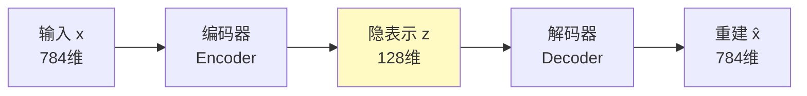
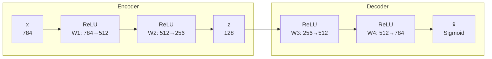
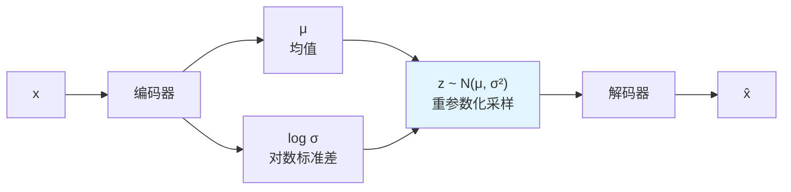
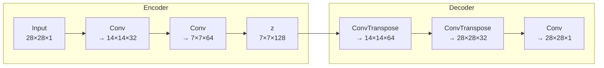
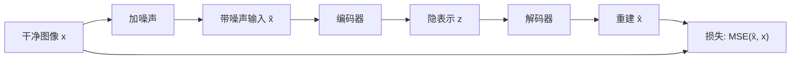
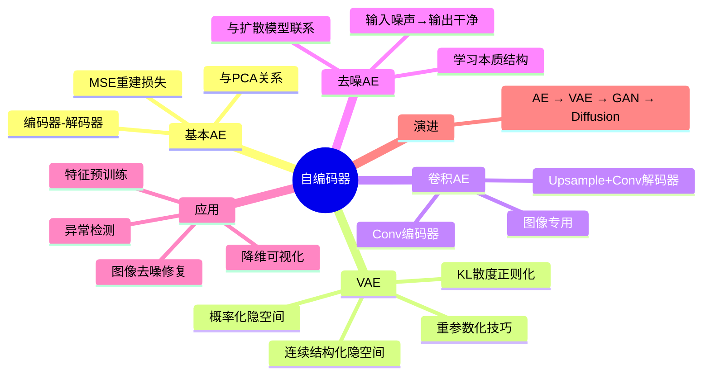

# 3-7 自编码器

## 学习目标

- 理解自编码器的基本结构：编码器-解码器框架与瓶颈层（Bottleneck）
- 掌握基本自编码器（AE）的原理、训练目标与与 PCA 的关系
- 理解变分自编码器（VAE）与 AE 的本质区别（KL 散度、重参数化技巧）
- 掌握卷积自编码器和去噪自编码器的结构与用途
- 了解自编码器在降维、去噪、异常检测和特征预训练中的应用
- 能够用 PyTorch 实现一个简单的卷积去噪自编码器

---

## 1. 自编码器概述

### 1.1 什么是自编码器

**自编码器（Autoencoder, AE）** 是一种无监督的神经网络，它的目标是学会将输入数据压缩成一个低维表示（编码），然后再从这个低维表示中重建出原始输入（解码）。

> **通俗理解**：自编码器就像一个"压缩-解压"软件。编码器把一张图片压缩成一个短向量（如 128 个数字），解码器再从这个短向量还原出原图。如果还原效果很好，说明这个短向量确实抓住了图片的核心信息。



### 1.2 核心思想：压缩即学习

自编码器的核心洞察来自于信息论：**如果网络能用少量信息重建完整输入，说明它学会了数据的关键特征**。

- 编码器 $f_\theta$：$x \rightarrow z$，将高维输入映射到低维隐空间
- 解码器 $g_\phi$：$z \rightarrow \hat{x}$，从隐空间重建输入
- 目标：$\hat{x} \approx x$

---

## 2. 基本自编码器（Autoencoder, AE）

### 2.1 网络结构

一个最简单的全连接自编码器：



**关键设计**：隐层维度（ Bottleneck ）必须小于输入维度，强制网络学习压缩表示。如果隐层和输入维度相同，网络可能直接复制输入，什么也学不到。

### 2.2 损失函数：重建损失

自编码器的训练目标是最小化输入与重建输出之间的差异：

$$
\mathcal{L}(\theta, \phi) = \frac{1}{N} \sum_{i=1}^{N} ||x_i - g_\phi(f_\theta(x_i))||^2
$$

对于图像数据，通常使用 **MSE（均方误差）** 或 **二元交叉熵（BCE）**（当像素值归一化到 [0,1] 时）。

```python
import torch
import torch.nn as nn

class Autoencoder(nn.Module):
    def __init__(self, input_dim=784, latent_dim=128):
        super().__init__()
        # 编码器：784 → 512 → 256 → 128
        self.encoder = nn.Sequential(
            nn.Linear(input_dim, 512),
            nn.ReLU(),
            nn.Linear(512, 256),
            nn.ReLU(),
            nn.Linear(256, latent_dim),
            nn.ReLU()
        )
        # 解码器：128 → 256 → 512 → 784
        self.decoder = nn.Sequential(
            nn.Linear(latent_dim, 256),
            nn.ReLU(),
            nn.Linear(256, 512),
            nn.ReLU(),
            nn.Linear(512, input_dim),
            nn.Sigmoid()  # 输出归一化到 [0,1]
        )
    
    def forward(self, x):
        z = self.encoder(x)
        x_recon = self.decoder(z)
        return x_recon, z

# 训练
model = Autoencoder()
criterion = nn.MSELoss()
optimizer = torch.optim.Adam(model.parameters(), lr=1e-3)

# for x in dataloader:
#     x_recon, z = model(x.view(x.size(0), -1))
#     loss = criterion(x_recon, x.view(x.size(0), -1))
#     loss.backward()
#     optimizer.step()
```

### 2.3 自编码器与 PCA 的关系

**PCA（主成分分析）** 是一种经典的线性降维方法。有趣的是：

> **如果自编码器的编码器和解码器都只有一层（线性激活，无偏置），那么它学到的隐表示等价于 PCA 的主成分**。

| 维度 | PCA | 自编码器 |
|------|-----|----------|
| 线性/非线性 | 纯线性 | 可非线性（ReLU 等） |
| 激活函数 | 无 | 可配置 |
| 层数 | 单层 | 可多层 |
| 表达能力 | 有限 | 更强（深度非线性） |

**深层自编码器** 用多层非线性变换，能捕捉 PCA 无法发现的复杂流形结构。

---

## 3. 变分自编码器（VAE）：从确定性到概率性

当前教程在 8-3 章（文生图与视频生成）和 1-4 章（信息论基础）中已有 VAE 的详细讲解。这里从自编码器的视角做衔接性回顾。

### 3.1 AE 的局限性

基本自编码器有一个根本问题：**隐空间（latent space）是不连续的、无结构的**。

- 两个训练样本的隐向量 $z_1$ 和 $z_2$ 之间可能没有任何有意义的样本
- 在隐空间中随机采样一个点，解码器可能输出毫无意义的噪声
- 这使得 AE **不适合生成新数据**

### 3.2 VAE 的核心改进

**变分自编码器（Variational Autoencoder, VAE）** 将隐表示从"确定性的点"变成"概率分布"：



**关键区别**：
1. 编码器输出两个向量：均值 $\mu$ 和对数方差 $\log \sigma^2$
2. 隐变量 $z$ 从分布 $\mathcal{N}(\mu, \sigma^2)$ 中采样得到
3. 损失函数 = **重建损失 + KL 散度**（见 1-4 信息论基础和 8-3 VAE 详解）

### 3.3 为什么 VAE 适合生成

由于 KL 散度正则化的约束，VAE 的隐空间具有以下优良性质：
- **连续性**：隐空间中相近的点解码出相似的样本
- **完备性**：隐空间中任意一点都能解码出合理的样本
- **结构性**：不同维度往往对应不同的语义特征（可解释性）

这正是 Stable Diffusion 中 VAE 能作为"图像压缩器"的核心原因——它的隐空间是结构化的、可操作的。

---

## 4. 卷积自编码器（Convolutional Autoencoder）

### 4.1 为什么用卷积

对于图像数据，全连接层参数量巨大且忽略空间结构。**卷积自编码器**用卷积层做编码器，用转置卷积（或上采样+卷积）做解码器：



### 4.2 转置卷积 vs 上采样

| 方法 | 说明 | 特点 |
|------|------|------|
| **ConvTranspose2d** | 卷积的"逆操作" | 可学习，但可能产生棋盘伪影 |
| **Upsample + Conv** | 先插值放大再用卷积 | 更稳定，工业界更常用 |

```python
class ConvAutoencoder(nn.Module):
    def __init__(self):
        super().__init__()
        # 编码器
        self.encoder = nn.Sequential(
            nn.Conv2d(1, 32, 3, stride=2, padding=1),  # 28→14
            nn.ReLU(),
            nn.Conv2d(32, 64, 3, stride=2, padding=1), # 14→7
            nn.ReLU(),
            nn.Conv2d(64, 128, 3, stride=2, padding=1), # 7→4
            nn.ReLU()
        )
        # 解码器（使用 Upsample + Conv 避免棋盘伪影）
        self.decoder = nn.Sequential(
            nn.Upsample(scale_factor=2, mode='nearest'),  # 4→8
            nn.Conv2d(128, 64, 3, padding=1),
            nn.ReLU(),
            nn.Upsample(scale_factor=2, mode='nearest'),  # 8→16
            nn.Conv2d(64, 32, 3, padding=1),
            nn.ReLU(),
            nn.Upsample(scale_factor=2, mode='nearest'),  # 16→32
            nn.Conv2d(32, 1, 3, padding=1),
            nn.Sigmoid()
        )
    
    def forward(self, x):
        z = self.encoder(x)
        x_recon = self.decoder(z)
        return x_recon
```

---

## 5. 去噪自编码器（Denoising Autoencoder）

### 5.1 核心思想

**去噪自编码器** 的训练方式很特别：
1. 给输入数据加噪声（如高斯噪声、随机遮挡像素）
2. 让自编码器从带噪声的输入重建出**干净**的原始输入



**关键洞察**：网络被迫学习数据的本质结构（"信号"），忽略随机噪声。这比直接重建输入更困难，但也学到了更鲁棒的特征表示。

### 5.2 与扩散模型的关系

去噪自编码器与扩散模型（DDPM）有深刻的联系：

| 维度 | 去噪自编码器 | 扩散模型（DDPM） |
|------|-------------|-----------------|
| 噪声强度 | 固定（如 σ=0.1） | 从弱到强多尺度 |
| 去噪步数 | 一步 | 多步迭代（T=1000） |
| 训练目标 | 重建干净图像 | 预测每一步的噪声 |
| 隐空间 | 确定性 bottleneck | 渐进式马尔可夫链 |

> **联系**：扩散模型可以看作**多尺度、渐进式的去噪自编码器**。两者都学习从噪声中恢复信号，只是扩散模型把过程分解为多个时间步（详见 8-2 扩散模型）。

### 5.3 PyTorch 实战：MNIST 去噪自编码器

```python
import torch
import torch.nn as nn

class DenoisingAutoencoder(nn.Module):
    def __init__(self):
        super().__init__()
        self.encoder = nn.Sequential(
            nn.Conv2d(1, 32, 3, padding=1),
            nn.ReLU(),
            nn.MaxPool2d(2, 2),  # 28→14
            nn.Conv2d(32, 64, 3, padding=1),
            nn.ReLU(),
            nn.MaxPool2d(2, 2)   # 14→7
        )
        self.decoder = nn.Sequential(
            nn.ConvTranspose2d(64, 64, 3, stride=2, padding=1, output_padding=1),  # 7→14
            nn.ReLU(),
            nn.ConvTranspose2d(64, 32, 3, stride=2, padding=1, output_padding=1),  # 14→28
            nn.ReLU(),
            nn.Conv2d(32, 1, 3, padding=1),
            nn.Sigmoid()
        )
    
    def forward(self, x):
        z = self.encoder(x)
        return self.decoder(z)

# 训练循环
def add_noise(images, noise_factor=0.5):
    """添加高斯噪声"""
    noisy = images + noise_factor * torch.randn_like(images)
    return torch.clamp(noisy, 0., 1.)

model = DenoisingAutoencoder()
criterion = nn.MSELoss()
optimizer = torch.optim.Adam(model.parameters(), lr=1e-3)

# for images, _ in dataloader:
#     noisy_images = add_noise(images)
#     outputs = model(noisy_images)
#     loss = criterion(outputs, images)  # 注意：目标是干净图像！
#     optimizer.zero_grad()
#     loss.backward()
#     optimizer.step()
```

---

> **继续往下读**：VAE 的「潜空间」到了扩散模型那里成了核心组件——Stable Diffusion 就是在 VAE 压出来的潜空间里做扩散，见 [8-2 扩散模型 Diffusion](../PART8-生成式AI/8-2-扩散模型Diffusion.md)。

## 6. 自编码器的应用

### 6.1 降维与可视化

自编码器的隐向量可作为数据的低维表示，用于可视化：
- 将高维数据（如图像、文本）压缩到 2D/3D
- 用 t-SNE/UMAP 进一步降维后绘制散点图
- 观察数据聚类结构

### 6.2 图像去噪与修复

- **去噪**：如 5.3 节的 MNIST 去噪示例
- **修复（Inpainting）**：遮挡图像的一部分，让自编码器重建缺失区域
- **超分辨率**：将低分辨率图像编码，解码为高分辨率图像（详见 11-3 图像超分辨率）

### 6.3 异常检测

自编码器在异常检测中非常有效（详见 11-8 异常检测与工业缺陷）：
- 用**正常数据**训练自编码器
- 正常样本的重建误差小
- 异常样本的重建误差大（因为训练时没见过）
- 用重建误差作为异常分数

```python
def detect_anomaly(model, x, threshold=0.05):
    """基于重建误差的异常检测"""
    x_recon, _ = model(x)
    mse = torch.mean((x - x_recon) ** 2, dim=(1,2,3))
    return mse > threshold  # True = 异常
```

### 6.4 特征预训练

自编码器的编码器可作为下游任务的**预训练特征提取器**：
1. 用无标签数据训练自编码器
2. 冻结编码器，在其后接一个分类头
3. 用少量标签数据微调

这在**半监督学习**和**医学图像**领域特别有用——无标签数据充足，但标注数据昂贵。

---

## 7. 自编码器的局限性

| 局限 | 说明 | 解决方案 |
|------|------|----------|
| **生成能力弱** | 隐空间不连续，随机采样可能输出噪声 | VAE（概率化隐空间） |
| **重建模糊** | MSE 损失倾向于输出"平均"结果 | GAN（对抗损失） |
| **隐空间无结构** | 不同维度没有明确语义 | VAE 的 KL 正则化、β-VAE |
| **对复杂分布建模困难** | 单峰高斯假设限制表达能力 | 流模型、扩散模型 |

> **演进路线**：自编码器 → VAE（结构化隐空间） → GAN（清晰生成） → 扩散模型（高质量、可控生成）。自编码器是所有这些生成模型的基础思想。

---

## 本章小结
1. **自编码器**通过编码器-解码器结构学习数据的压缩表示，核心思想是"压缩即学习"。

2. **基本 AE** 用重建损失（MSE/BCE）训练，与 PCA 有理论联系，但通过非线性激活和深度结构具有更强的表达能力。

3. **VAE** 将隐表示概率化（均值+方差），通过 KL 散度正则化使隐空间连续、结构化，从而具备生成能力。这是 Stable Diffusion 中 VAE 组件的理论基础。

4. **卷积自编码器**用卷积层处理图像数据，解码器常用 Upsample+Conv 避免棋盘伪影。

5. **去噪自编码器**从带噪声输入重建干净数据，被迫学习数据的本质结构。它与扩散模型有深刻联系——扩散模型是多尺度渐进式的去噪自编码器。

6. **应用场景**：降维可视化、图像去噪/修复、异常检测、特征预训练。

7. **局限性**：基本 AE 生成能力弱、重建模糊，这催生了 VAE、GAN 和扩散模型等更强大的生成方法。


## 知识图谱



---

## 参考资料

1. Hinton, G. E., & Salakhutdinov, R. R. (2006). Reducing the Dimensionality of Data with Neural Networks. *Science*, 313(5786), 504-507.
2. Kingma, D. P., & Welling, M. (2014). Auto-Encoding Variational Bayes. *ICLR*.
3. Vincent, P., Larochelle, H., Bengio, Y., & Manzagol, P. A. (2008). Extracting and Composing Robust Features with Denoising Autoencoders. *ICML*, 1096-1103.
4. fast.ai Course: Autoencoders Lesson. https://course.fast.ai/
5. 当前教程 1-4 信息论基础（KL 散度详解）
6. 当前教程 8-3 文生图与视频生成（VAE 在 Stable Diffusion 中的作用）
7. 当前教程 11-8 异常检测与工业缺陷（基于 AE 的异常检测方法）

---
