# 第4-1章 CNN 原理

## 学习目标

- 理解为什么全连接网络处理图像时参数过多的问题
- 掌握卷积层的基本概念：卷积核、卷积操作、步幅、填充
- 理解感受野（Receptive Field）的概念及其随着层数增加而扩大的规律
- 掌握通道（Channel）的概念，理解多通道卷积的实现
- 能够用图示说明卷积操作的过程

---

## 1. 为什么需要 CNN？

### 1.1 全连接网络处理图像的问题

在传统全连接神经网络中，如果要处理一张 224×224 的彩色图片：

- 输入层节点数：224 × 224 × 3 = 150,528 个
- 假设第一个隐藏层有 1000 个节点
- 仅这一层的权重参数就高达：150,528 × 1000 ≈ 1.5 亿个

**参数过多会带来三大问题：**

1. **过拟合**：参数太多，模型容易记住训练样本而不是学习泛化规律
2. **计算量大**：训练和推理都需要大量浮点运算，硬件要求高
3. **难以捕捉空间结构**：全连接层把每个像素平等对待，丢失了图像的空间局部性

### 1.2 图像的局部相关性

图像有一个重要特性：**空间相关性**。一个像素的数值与它周围的像素高度相关，而与远处的像素关系较弱。

这意味着：
- 我们不需要一次性看到整张图才能理解局部特征
- 通过"局部感受野"就能提取有用的特征（如边缘、纹理）
- 逐层组合局部特征，最终能表达全局信息

> **核心思想**：用少量参数学习局部特征，然后逐层组合，这就是 CNN 的起点。

---

## 2. 卷积层详解

### 2.1 什么是卷积核（Filter / Kernel）

卷积核是一个小的权重矩阵，常见尺寸有 3×3、5×5、7×7 等。

以 3×3 卷积核为例：
```
卷积核:
[ -1   0   1 ]
[ -1   0   1 ]
[ -1   0   1 ]
```

这个卷积核的作用是**检测垂直边缘**（左边暗、右边亮的交界线）。

### 2.2 卷积操作过程

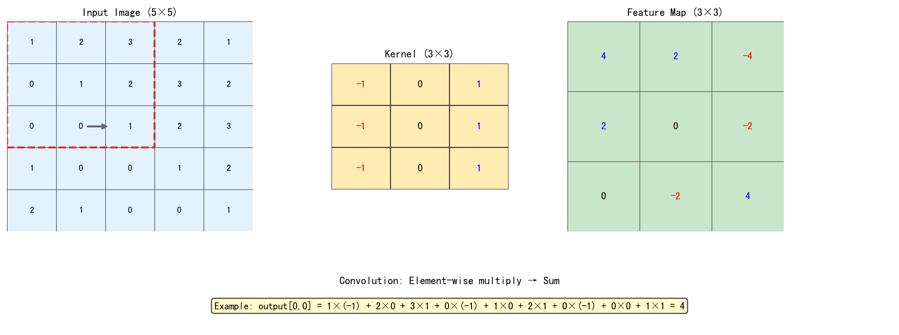

**卷积计算过程**（逐元素相乘后求和）：

```
位置 (0,0) 的输出 = 
  1×(-1) + 2×0 + 3×1
+ 0×(-1) + 1×0 + 2×1
+ 0×(-1) + 0×0 + 1×1
= (-1) + 0 + 3 + 0 + 0 + 2 + 0 + 0 + 1 = 4
```

卷积核在输入图像上**从左到右、从上到下"滑动"**，每滑动一次就计算一个输出值。

### 2.3 卷积可视化图示

```
卷积核滑动过程 (stride=1, padding=0)

输入图像 (6×6)              卷积核 (3×3)            输出 (4×4)

[ a b c d e f ]             
[ g h i j k l ]              [ w0 w1 w2 ]
[ m n o p q r ]        ★     [ w3 w4 w5 ]      →     [ r0 r1 r2 r3 ]
[ s t u v w x ]              [ w6 w7 w8 ]              [ r4 r5 r6 r7 ]
[ y z A B C D ]                                       [ r8 r9 r10 r11 ]
[ E F G H I J ]                                       [ r12 r13 r14 r15 ]

卷积核每次覆盖3×3区域
↓→ 滑动步长(stride)=1
```

### 2.4 步幅（Stride）

Stride 是卷积核每次移动的像素数量：

- **Stride = 1**：每次移动 1 个像素，输出尺寸较大
- **Stride = 2**：每次移动 2 个像素，输出尺寸约为输入的一半

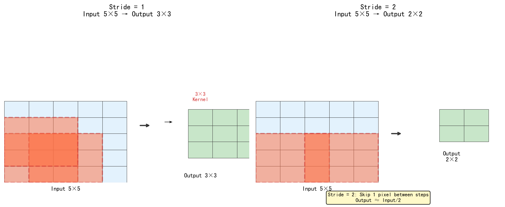

### 2.5 填充（Padding）

在输入图像边缘补一圈 0，叫 zero-padding。常见模式：

| 模式 | 说明 | 作用 |
|------|------|------|
| **Valid** | 不填充，输出比输入小 | 简单，但边缘信息丢失 |
| **Same** | 填充使输出与输入尺寸相同 | 保留边缘信息，计算量更大 |

```
Same模式 padding=1:

输入 (5×5) 周围补0:
[ 0  0  0  0  0  0  0 ]
[ 0  1  2  3  2  1  0 ]
[ 0  0  1  2  3  2  0 ]
[ 0  1  0  0  1  2  0 ]
[ 0  2  1  0  0  1  0 ]
[ 0  1  0  0  1  2  0 ]
[ 0  0  0  0  0  0  0 ]
          ↓ 7×7 padded input
     用 3×3 卷积核滑动，输出仍为 5×5
```

### 2.6 输出尺寸计算公式

```
输出尺寸 = floor((输入尺寸 - 卷积核尺寸 + 2×padding) / stride) + 1

例：输入 32×32，卷积核 5×5，padding=2，stride=1
输出 = floor((32 - 5 + 2×2) / 1) + 1 = 32×32 （Same模式）
```

---

## 3. 感受野（Receptive Field）

### 3.1 什么是感受野

感受野是指输出特征图上的一个像素点，对应输入图像中的区域大小。

- 第一层卷积：输出一个像素 → 对应输入图像 3×3 区域（如果卷积核是 3×3）
- 第二层卷积：输出一个像素 → 对应输入图像 5×5 区域（透过两层卷积）
- 第三层卷积：输出一个像素 → 对应输入图像 7×7 区域

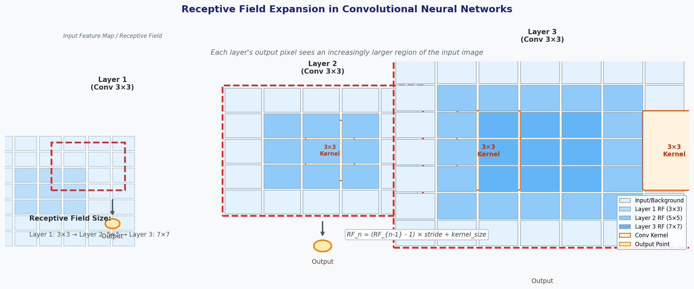

**图示说明**：三层 3×3 卷积核堆叠后，感受野从 3×3 → 5×5 → 7×7 逐层扩大。

**逐层递推公式**：

```
Layer N 的感受野 = (Layer N-1 的感受野 - 1) × stride + 卷积核尺寸

例：Layer1 kernel=3, stride=1 → RF=3
    Layer2 kernel=3, stride=1 → RF = (3-1)×1 + 3 = 5
    Layer3 kernel=3, stride=1 → RF = (5-1)×1 + 3 = 7
```

### 3.2 感受野的意义

- **浅层**感受野小，提取细节特征（边缘、纹理、颜色斑块）
- **深层**感受野大，看到更全局的信息（物体整体、结构）
- 逐层堆叠让网络能学习从局部到整体的层次化表达

---

## 4. 通道（Channel）

### 4.1 为什么需要多通道

彩色图像有 R、G、B 三个通道。卷积操作需要针对每个通道独立进行，然后叠加。

```
RGB 三通道输入:

Red 通道:    [ 255  128  ... ]   卷积核 R: [ -1  0  1 ]
Green 通道:  [ 100   64  ... ] × 卷积核 G: [ -1  0  1 ] → 各通道结果相加
Blue 通道:   [  50   32  ... ]   卷积核 B: [ -1  0  1 ]

三通道结果累加 → 单一输出特征图
```

### 4.2 多通道卷积的数学表达

```
输入：H × W × C_in（C_in 个通道）
卷积核：K × K × C_in × C_out（C_out 个卷积核）
输出：H' × W' × C_out

每个输出通道 c_out 由所有输入通道加权求和得到：
output[h',w',c_out] = Σ( channel × 卷积核_所有通道 ) + bias
```

### 4.3 通道数量的层级变化

```
输入图像: 224×224×3 (RGB)

Conv1:  64 个 3×3 卷积核  → 输出 224×224×64
Conv2:  64 个 3×3 卷积核  → 输出 224×224×64
Pool1:  2×2 stride=2       → 输出 112×112×64
Conv3:  128 个 3×3 卷积核 → 输出 112×112×128
...
特征图通道数逐层增加（学到的特征越来越丰富）
```

### 4.4 通道的物理意义

不同通道通常学习到不同的特征类型：
- 某些通道对边缘敏感
- 某些通道对颜色敏感
- 某些通道对纹理敏感
- 深层通道对更抽象的概念（如"猫耳朵"）敏感

> 通过可视化，我们发现 CNN 就像一个"特征检测器流水线"，从底层特征逐步组合成高层语义。

---

## 5. 总结

```
┌─────────────────────────────────────────────────────┐
│                    CNN 核心原理                     │
├─────────────────────────────────────────────────────┤
│ 局部感受野: 每次只看一小块区域，而不是整张图          │
│ 参数共享: 同一个卷积核在整张图上滑动，大幅减少参数     │
│ 多通道:   RGB → 特征图数量按需增加                  │
│ 层次化:   浅层学边缘/纹理，深层学整体语义            │
└─────────────────────────────────────────────────────┘
```

| 概念 | 说明 |
|------|------|
| 卷积核（Kernel） | 小型权重矩阵，滑动提取特征 |
| 步幅（Stride） | 卷积核每次移动的像素数 |
| 填充（Padding） | 在边缘补0，控制输出尺寸 |
| 感受野（Receptive Field） | 输出像素对应的输入区域范围 |
|| 通道（Channel） | 特征图的深度维度 |
|| 特征图（Feature Map） | 卷积操作的输出结果 |

---

## 6. 卷积层如何"看见"特征：分层抽象全过程

> **本节核心**：CNN 的卷积层**到底是怎么提取特征的**？为什么浅层学到边缘，深层学到语义？这个分层抽象过程是 CNN 强大能力的根源。

### 6.1 直观理解：滤波器是"特征探测器"

每个卷积核（滤波器）就像一个**专门检测某种模式的"眼睛"**：

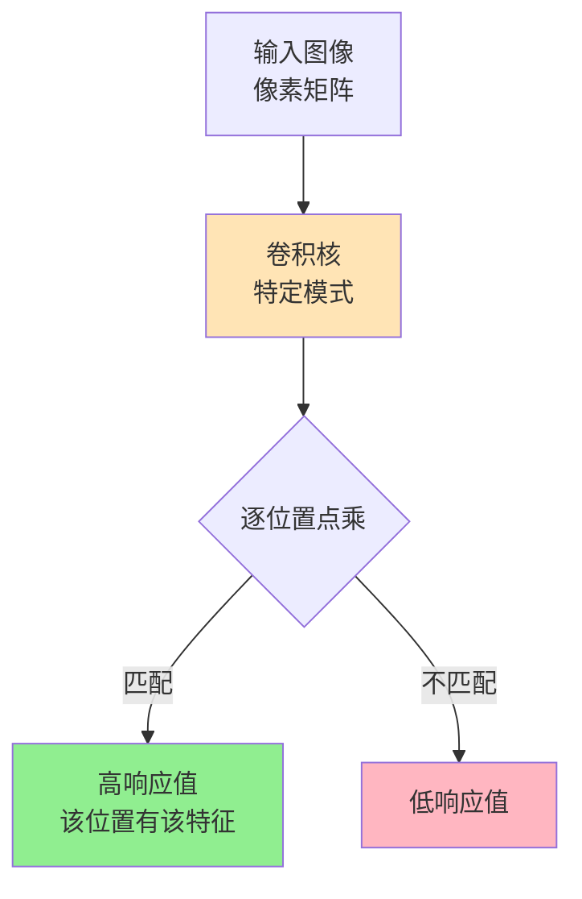

**示例**（3×3 垂直边缘检测核）：

$$
\begin{bmatrix}
-1 & 0 & 1 \\
-2 & 0 & 2 \\
-1 & 0 & 1
\end{bmatrix}
$$

把这个核"贴在"图像上**逐位置点乘求和**：
- 该位置**有垂直边缘** → 输出值大（≈ 正数）
- 该位置**没有边缘** → 输出值 ≈ 0
- 该位置**有水平边缘** → 输出值小（≈ 0）

**类比**：卷积核就像一个**模板匹配器**——把模板在图像上滑动，匹配度高的地方响应大。

### 6.2 实际计算示例（RGB 3 通道）

**输入**（3×3×3 像素，RGB 3 通道）：

```python
# 输入图像的 3 个颜色通道（每个 3×3）
R = [[1, 1, 1], [0, 1, 0], [0, 2, 2]]  # 红色通道
G = [[2, 2, 1], [1, 0, 0], [0, 1, 1]]  # 绿色通道
B = [[0, 0, 1], [0, 1, 0], [1, 0, 0]]  # 蓝色通道

# 3 个 3×3 卷积核（每个对应一个通道）
K_R = [[-1, 1, 0], [-1, 0, 0], [-1, 1, 0]]
K_G = [[1, 0, 0], [0, 1, 0], [0, 0, 1]]
K_B = [[-1, -1, -1], [2, 1, 0], [1, 2, -1]]
```

**计算**（中心位置卷积）：

$$
\begin{aligned}
\text{W}_R &= 1 \cdot (-1) + 1 \cdot 1 + 1 \cdot 0 + 0 \cdot (-1) + 1 \cdot 0 + 2 \cdot 0 + 0 \cdot (-1) + 2 \cdot 0 + 2 \cdot 0 = 1 \\
\text{W}_G &= 2 \cdot 1 + 1 \cdot 0 + 0 \cdot 0 + 0 \cdot 0 + 1 \cdot 1 + 0 \cdot 0 + 0 \cdot 0 + 1 \cdot 0 + 1 \cdot 1 = 5 \\
\text{W}_B &= 1 \cdot (-1) + 0 \cdot (-1) + 1 \cdot (-1) + 0 \cdot 2 + 1 \cdot 1 + 0 \cdot 0 + 1 \cdot 1 + 0 \cdot 2 + 0 \cdot (-1) = -1 \\
\text{Output} &= W_R + W_G + W_B + \text{bias} = 1 + 5 + (-1) + 0 = 5
\end{aligned}
$$

> **关键洞察**：**3 个通道的卷积结果相加 = RGB 三个颜色特征分量的叠加**。这与"红绿蓝叠加成完整图像"是同构的。

### 6.3 特征分层抽象：CNN 的"视觉认知"

CNN 的卷积层学习到的是**从具体到抽象**的层级特征：

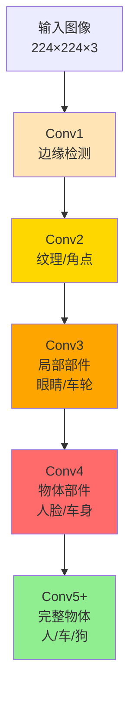

| 层 | 特征类型 | 例子 | 感受野 |
|----|----------|------|--------|
| **Conv1** | 边缘 | 水平线、垂直线、斜线、对角线 | 3-5 px |
| **Conv2** | 纹理/角点 | 圆形、矩形、网格、条纹 | 10-15 px |
| **Conv3** | 局部部件 | 眼睛、鼻子、轮子、鸟嘴 | 30-50 px |
| **Conv4** | 物体部件 | 人脸、车身、动物腿 | 100-200 px |
| **Conv5+** | 完整物体 | 完整的人/车/狗 | 200+ px |

> **关键洞察**：**每一层 CNN 都是上一层特征的"组合"**。第 3 层的"眼睛"由第 2 层的"曲线 + 圆形"组成，第 4 层的"人脸"由第 3 层的"眼睛+鼻子+嘴巴"组成。这种**组合性**是 CNN 理解复杂模式的根本。

### 6.4 数学上：CNN 在做什么？

CNN 的卷积操作可以写成矩阵乘法的形式（**im2col**）：

$$
\text{output} = X_{\text{col}} \cdot W_{\text{row}}^T + b
$$

其中 $X_{\text{col}}$ 是将输入"展开"为矩阵（每行是一个感受野），$W_{\text{row}}$ 是卷积核展开为行向量。

**但卷积 vs 全连接的本质区别**：
- **全连接**：每个输出单元连接所有输入单元 → 参数量巨大
- **卷积**：每个输出单元只连接局部区域 + **权重共享**（同一个卷积核扫遍整张图） → 参数量小 + 平移不变性

### 6.5 实战：可视化中间层激活

```python
import torch
import torch.nn as nn
import matplotlib.pyplot as plt

model = torch.hub.load('pytorch/vision:v0.10.0', 'resnet18', pretrained=True)

# 注册 hook 提取中间层激活
activations = {}
def get_activation(name):
    def hook(model, input, output):
        activations[name] = output.detach()
    return hook

for name, layer in model.named_modules():
    if isinstance(layer, nn.Conv2d):
        layer.register_forward_hook(get_activation(name))

# 前向传播
x = torch.randn(1, 3, 224, 224)
_ = model(x)

# 可视化 conv1 的输出（64 个 3×3 滤波器）
conv1_out = activations['conv1']  # [1, 64, 112, 112]
fig, axes = plt.subplots(8, 8, figsize=(12, 12))
for i, ax in enumerate(axes.flat):
    ax.imshow(conv1_out[0, i].cpu(), cmap='gray')
    ax.axis('off')
plt.suptitle('ResNet-18 conv1 层 64 个滤波器对随机图像的响应')
plt.tight_layout()
```

**观察**：
- 浅层（conv1）：每个滤波器响应不同的**边缘 / 颜色斑块**
- 中层（conv3-4）：响应开始呈现**纹理、形状、模式**
- 深层（conv5+）：响应是**抽象的语义图**，肉眼难懂但分类器能识别

> **结论**：**CNN 不是"黑箱"**——你可以可视化每一层到底学到了什么。常用工具：torchvision.utils.make_grid, captum, tf-keras-vis。

### 6.6 卷积核权重从哪里来？

**卷积核的权重不是人工设计的**（除了最早期 Sobel/Prewitt 等），而是通过**反向传播 + 梯度下降**学习出来的：

$$
\frac{\partial L}{\partial w_{ij}} = \sum_{x,y} \frac{\partial L}{\partial \text{output}_{x,y}} \cdot \frac{\partial \text{output}_{x,y}}{\partial w_{ij}}
$$

训练过程中：
- **初始化**：随机（如 Kaiming / Xavier）
- **前向传播**：卷积 → 激活 → 池化 → 全连接 → 输出
- **计算损失**：与真实标签对比
- **反向传播**：从损失往回算每个权重的梯度
- **更新权重**：$w \leftarrow w - \eta \cdot \frac{\partial L}{\partial w}$

经过千万次迭代，卷积核的权重会"涌现"出有意义的模式（边缘、纹理、形状）。这是**深度学习的核心奇迹**——简单的优化算法 + 大量数据 + 大容量模型 → 自动学到有用的特征。

### 6.7 关键经验

> **经验 1**：**不要把卷积看作"卷积数学"**——它是**模式匹配器**，每个滤波器都是"某类特征的探测器"。
> 
> **经验 2**：**浅层学边缘、深层学语义**——这是 CNN 几乎所有架构的共同特征（VGG, ResNet, ConvNeXt 都有这个特性）。
> 
> **经验 3**：**可视化是理解 CNN 的最佳工具**——t-SNE 降维 + 卷积核可视化 + 特征图激活图。
> 
> **经验 4**：**卷积核的可解释性有限**——浅层能解释（边缘/纹理），深层就难以解释（"猫的某个抽象特征"）。这正是"深度学习黑箱"的核心难点。

---

## 7. 三大特征提取器全景对比：RNN vs CNN vs Transformer

> **核心问题**：处理序列/图像/通用数据时，**为什么用不同的网络**？这三种架构各自的**核心假设**和**归纳偏置**（inductive bias）是什么？

### 7.1 三大架构的归纳偏置对比

| 维度 | RNN | CNN | Transformer |
|------|-----|-----|-------------|
| **核心偏置** | 序列顺序 | 局部 + 平移不变 | 全局注意力 |
| **归纳假设** | 时间近邻相关 | 空间近邻相关 | 任意位置可相关 |
| **感受野** | 顺序累积 | 局部→全局（深）| 一步到位（全注意力）|
| **参数共享** | 时间步共享 | 空间位置共享 | 无（但位置编码）|
| **计算复杂度** | $O(n)$ 串行 | $O(k^2 \cdot n)$ | $O(n^2)$ 自注意力 |
| **并行度** | ❌ 串行 | ✓ 卷积并行 | ✓ 自注意力并行 |
| **长程依赖** | ❌ 容易遗忘 | ❌ 需深网络 | ✓ 直接建模 |
| **数据需求** | 中 | 中 | 大 |
| **代表模型** | LSTM / GRU | ResNet / ConvNeXt | GPT / BERT / ViT |

### 7.2 三种数据类型的最佳架构

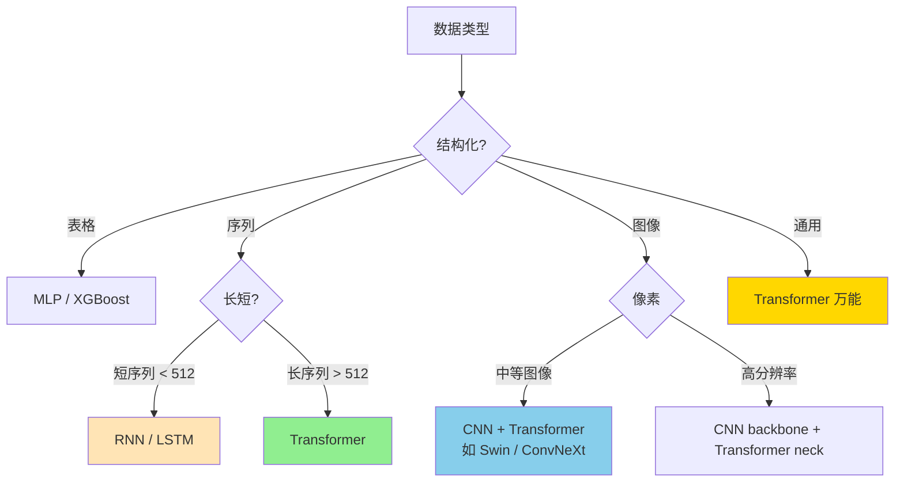

### 7.3 RNN：序列的"记忆机器"

**核心思想**：隐藏状态 $h_t$ 累积历史信息

$$
h_t = f(W \cdot [h_{t-1}, x_t] + b)
$$

**优点**：
- 处理变长序列
- 理论上可记忆任意长度
- 参数量小（权重共享）

**缺点**：
- **串行计算**（无法并行，训练慢）
- **长程遗忘**（梯度消失 / 爆炸）
- LSTM / GRU 缓解但没根治

**适用**：短序列（< 500）、流式数据、边缘部署（计算资源有限）

### 7.4 CNN：空间的"局部感知机"

**核心思想**：局部感受野 + 权重共享 + 池化

$$
\text{out}[i, j] = \sum_{u, v} W[u, v] \cdot x[i+u, j+v]
$$

**优点**：
- **参数共享** → 参数量小
- **平移不变性** → 数据效率高
- **并行计算** → 训练快
- **强归纳偏置** → 小数据也能学好

**缺点**：
- **感受野有限**（需深网络才能看全图）
- **长程依赖建模弱**（相比 Transformer）
- **固定输入尺寸**（部分架构）

**适用**：图像、音频频谱、视频帧

### 7.5 Transformer：全注意力的"全局建模器"

**核心思想**：每个位置直接关注所有位置

$$
\text{Attention}(Q, K, V) = \text{softmax}\left(\frac{QK^T}{\sqrt{d_k}}\right) V
$$

**优点**：
- **全局感受野**（一步到位）
- **完美并行**（无递归）
- **长程依赖**直接建模
- **通用性强**（NLP / CV / 多模态通吃）

**缺点**：
- **二次复杂度** $O(n^2)$（长序列爆显存）
- **数据需求大**（无强偏置）
- **位置信息需额外编码**

**适用**：NLP（BERT/GPT）、Vision（ViT/Swin）、多模态（CLIP/LLaVA）

### 7.6 三大架构计算复杂度对比

| 序列长度 $n$ | RNN | CNN (kernel k) | Transformer (Self-Attn) |
|-------------|-----|---------------|------------------------|
| $n = 64$ | $O(n \cdot d^2)$ | $O(k \cdot n \cdot d^2)$ | $O(n^2 \cdot d)$ |
| $n = 512$ | 同上 | 同上 | $O(n^2 \cdot d)$ |
| $n = 4096$ | 同上（仍 O(n)）| 同上 | $O(n^2 \cdot d)$ ← 爆显存 |

> **关键洞察**：**Transformer 的 $O(n^2)$ 是双刃剑**——能建模长程依赖，但序列长度受限。**稀疏注意力**（Longformer/BigBird）、**线性注意力**（Performer/Linformer）是解决方案。

### 7.7 三大架构混搭：现代最佳实践

现代 SOTA 模型**几乎都是混合架构**：

| 模型 | 任务 | 架构组合 |
|------|------|----------|
| **Swin Transformer** | 视觉 | 局部窗口注意力（CNN 思想）+ 滑动窗口 |
| **ConvNeXt** | 视觉 | Transformer 现代化训练技巧 + 纯 CNN |
| **CoAtNet** | 视觉 | CNN 早期层 + Transformer 后期层 |
| **DETR** | 检测 | CNN backbone + Transformer 编解码 |
| **ViLT** | 多模态 | Transformer 全局（无 CNN）|
| **GPT-4V** | 多模态 | ViT 视觉 + GPT 语言 |

> **结论**：**没有"最好"的架构，只有"最合适"的架构**。CNN 的"局部归纳偏置"在数据有限时更强；Transformer 的"全局注意力"在大数据时更强；混合架构（如 Swin）是当前最佳平衡。

### 7.8 选型决策

| 你的场景 | 推荐 | 原因 |
|----------|------|------|
| 图像（数据有限 < 10K）| **CNN**（ResNet-50）| 归纳偏置强，样本效率高 |
| 图像（数据充足 > 100K）| **Transformer**（ViT / Swin）| 大数据下性能天花板高 |
| NLP（短文本 < 512 token）| **Transformer**（BERT）| 行业标准 |
| NLP（长文本 > 4K）| **稀疏注意力 Transformer**（Longformer）| 解决 $O(n^2)$ |
| 语音 / 音乐 | **CNN + RNN 混合** | 时频局部 + 序列建模 |
| 多模态 | **Transformer 统一架构** | CLIP / Flamingo 范式 |
| 边缘部署 / 实时 | **CNN**（MobileNet）| 参数量小、推理快 |
| 通用 LLM | **Transformer Decoder**（GPT）| 唯一能 scale 的架构 |

> **核心经验**：**RNN 几乎被 Transformer 取代**（除流式 / 边缘场景），**CNN 仍统治视觉**（高效 + 强偏置），**Transformer 是 NLP 和多模态的"大一统"**。

---

## 8. 快速上手：声明式数据加载实战

> **背景**：了解 CNN 原理之后，下一步就是"如何用代码加载数据并训练一个 CNN"。传统数据加载需手动写循环、处理拆分、做 batch——而**声明式 API** 让你只"声明你要什么"，框架去处理"怎么做"。

### 8.1 传统方式 vs 声明式

| 维度 | 传统（手动） | 声明式（现代） |
|------|-------------|--------------|
| 数据拆分 | 手动 `np.split` | 传一个 `valid_pct` 参数 |
| 变换管道 | 多个 `for` 循环 | `transforms.Compose` / 链式 |
| Batch 组装 | 手动 `stack` | `DataLoader(batch_size=...)` |
| 标注加载 | 手动解析 CSV/XML | `ImageFolder` 按目录结构自动标注 |

### 8.2 PyTorch 声明式数据加载（torchvision）

PyTorch 的 `torchvision.datasets` 提供了**声明式风格**的数据加载——你只需指定目录和变换，框架处理拆分、打乱、多进程加载：

```python
import torchvision.transforms as T
from torchvision.datasets import ImageFolder
from torch.utils.data import DataLoader

# 1. 声明变换管道（只声明"做什么"，不写循环）
transform = T.Compose([
    T.Resize((224, 224)),          # 统一尺寸
    T.RandomHorizontalFlip(p=0.5), # 训练增强
    T.ColorJitter(brightness=0.2), # 色彩抖动
    T.ToTensor(),                  # PIL → Tensor [C,H,W]
    T.Normalize(mean=[0.485, 0.456, 0.406],  # ImageNet 标准化
                 std=[0.229, 0.224, 0.225]),
])

# 2. 声明数据集（ImageFolder 按目录结构自动标注）
train_data = ImageFolder("data/train", transform=transform)
val_data   = ImageFolder("data/val",   transform=transform)

# 3. 声明 DataLoader（自动 batch + shuffle + 多进程）
train_loader = DataLoader(train_data, batch_size=32, shuffle=True,
                          num_workers=4, pin_memory=True)
val_loader   = DataLoader(val_data,   batch_size=32, shuffle=False)

# 4. 训练循环中直接使用
for images, labels in train_loader:
    # images.shape → [32, 3, 224, 224]（batch, channel, H, W）
    # labels.shape → [32]（每个样本的类别索引）
    ...
```

**为什么这叫"声明式"？** 你不需要写「对每张图片做 resize → 随机翻转 → 转 tensor → 标准化」，你只需要声明一个 `transform` 列表。框架对你透明地执行。

### 8.3 fastai DataBlock：更极致的声明式

[fastai](https://docs.fast.ai) 的 `DataBlock` 将数据加载进一步简化——你甚至不需要写 `DataLoader`：

```python
from fastai.vision.all import *

# 一行声明：数据在哪、如何拆分、如何变换
dblock = DataBlock(
    blocks=(ImageBlock, CategoryBlock),    # 输入=图像，输出=类别
    get_items=get_image_files,              # 自动递归找图
    splitter=RandomSplitter(valid_pct=0.2), # 随机拆分 80/20
    get_y=parent_label,                     # 从父目录名获取标签
    item_tfms=Resize(224),                  # 每张图统一尺寸
    batch_tfms=aug_transforms(),            # batch 级增强（翻转、旋转等）
)

# → 自动生成 DataLoaders
dls = dblock.dataloaders("data/")

# 查看一个 batch
dls.show_batch()
```

**DataBlock 的核心理念**：你声明**数据类型**（ImageBlock / CategoryBlock）、**数据源**（文件路径）、**拆分策略**（RandomSplitter）、**变换**（item_tfms + batch_tfms），剩下的 batch 组装、打乱、多进程加载全部由框架自动完成。

### 8.4 声明式数据加载的核心优势

| 优势 | 说明 |
|------|------|
| **代码量减少 70%** | 声明式 vs 手写循环：5 行 vs 30+ 行 |
| **可组合** | `transforms.Compose` 任意增删变换 |
| **多进程透明** | `num_workers` 自动并行加载，无需手动管理线程 |
| **统一接口** | 不论图像 / 文本 / 表格，`DataLoader` 都返回 `(inputs, targets)` |
| **可复现** | 传 `seed=42` 即可固定打乱顺序 |

> **经验法则**：如果你的数据加载代码超过 20 行，说明你在做框架应该做的事。用声明式 API 替代手写循环。

---

## 本章小结

1. **为什么需要 CNN**：全连接网络处理大图像时参数过多（224×224×3 输入到 1000 隐层有约 1.5 亿参数），易过拟合、计算量大、丢失空间结构信息。图像具有空间局部相关性，CNN 通过局部感受野和参数共享有效解决这些问题。

2. **卷积层核心概念**：
   - **卷积核（Kernel）**：小的权重矩阵（如 3×3），在输入图像上滑动提取局部特征
   - **步幅（Stride）**：卷积核每次移动的像素数，影响输出尺寸
   - **填充（Padding）**：边缘补 0，控制输出尺寸、保留边缘信息
   - **输出尺寸公式**：⌊(输入尺寸 - 卷积核尺寸 + 2×padding) / stride⌋ + 1

3. **感受野（Receptive Field）**：输出特征图像素对应输入图像的区域范围。逐层递增：3×3 卷积堆叠 3 层可达 7×7 感受野。浅层提取边缘纹理，深层提取整体语义。

4. **通道（Channel）**：特征图的深度维度。RGB 三通道输入经卷积后输出多通道特征图，通道数逐层增加（学到的特征越来越丰富）。

```python
import numpy as np

def manual_convolution(image, kernel, stride=1, padding=0):
    """
    手动实现 2D 卷积操作（教学用，展示卷积的本质）
    """
    if padding > 0:
        image_padded = np.pad(image, ((padding, padding), (padding, padding)), mode='constant')
    else:
        image_padded = image

    h_in, w_in = image_padded.shape
    h_kernel, w_kernel = kernel.shape
    h_out = (h_in - h_kernel) // stride + 1
    w_out = (w_in - w_kernel) // stride + 1

    output = np.zeros((h_out, w_out))
    for i in range(0, h_out):
        for j in range(0, w_out):
            i_start = i * stride
            j_start = j * stride
            image_patch = image_padded[i_start:i_start+h_kernel, j_start:j_start+w_kernel]
            output[i, j] = np.sum(image_patch * kernel)

    return output
```

### 不同卷积核的效果

下图为 7 种经典卷积核（边缘检测、模糊、锐化、Sobel 等）在 8×8 简单图像上的效果对比：

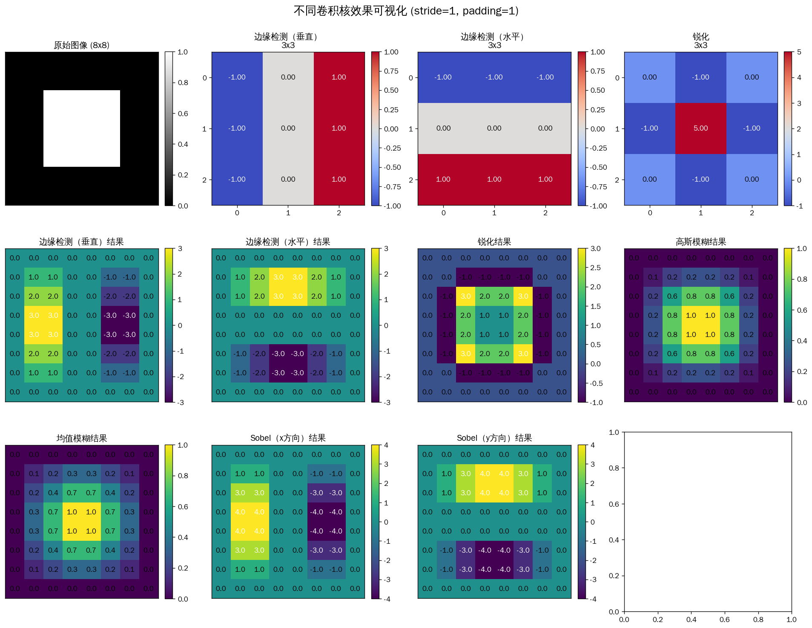

> 绘图代码：[`assets/figures/4-1-cnn-kernels.py`](../../assets/figures/4-1-cnn-kernels.py)

### 步幅（Stride）和填充（Padding）的影响

下图为 5×5 输入图像在不同 stride / padding 组合下的输出尺寸变化（核心公式：$H_{out} = \lfloor\frac{H_{in} + 2 \cdot padding - H_{kernel}}{stride}\rfloor + 1$）：

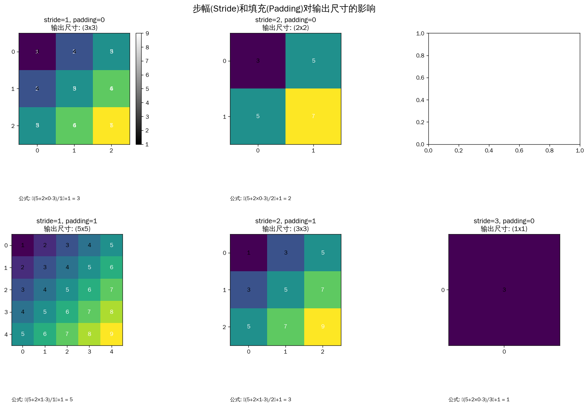

> 绘图代码：[`assets/figures/4-1-stride-padding.py`](../../assets/figures/4-1-stride-padding.py)

### 感受野（Receptive Field）随层数扩大

感受野公式 $RF_l = 1 + \sum_{i=0}^{l-1}(k-1) \cdot s^i$，其中 $k$ 是卷积核大小、$s$ 是步幅。下图展示 kernel_size=3 时，3 层卷积后感受野从 1×1 扩大到 7×7：

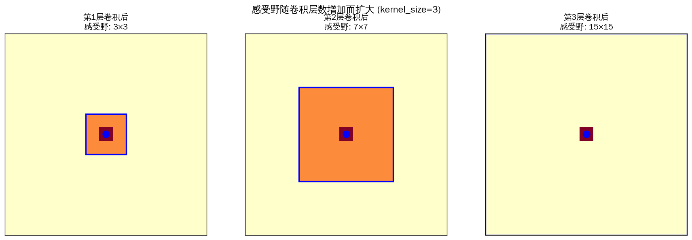

> 绘图代码：[`assets/figures/4-1-receptive-field.py`](../../assets/figures/4-1-receptive-field.py)

### 多通道卷积（RGB → 多输出通道）

每个输出通道都有 $C_{in}$ 个卷积核（对应每个输入通道），最终将各通道的卷积结果相加：

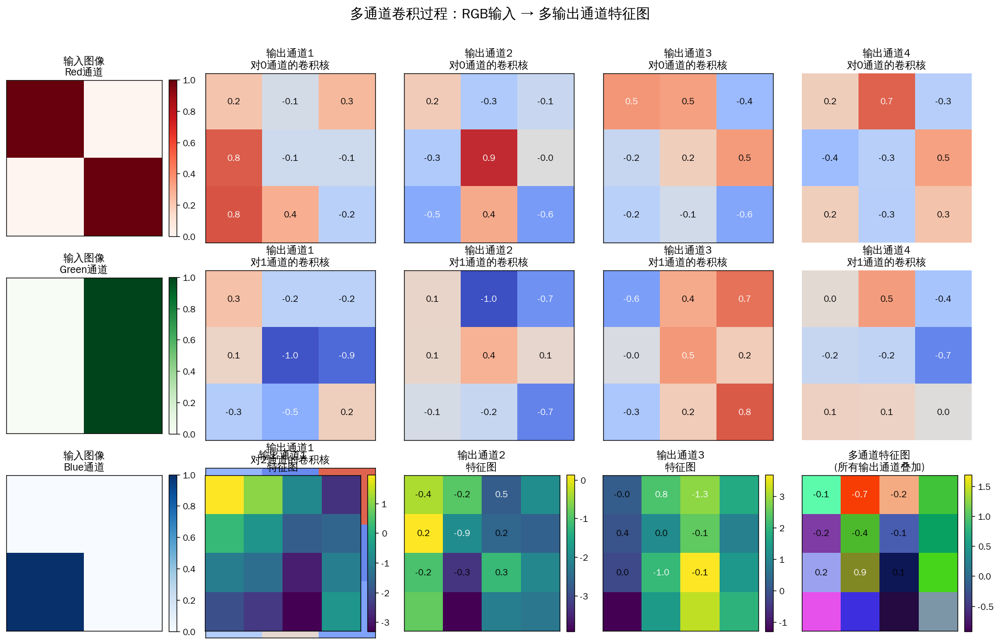

> 绘图代码：[`assets/figures/4-1-multi-channel.py`](../../assets/figures/4-1-multi-channel.py)

### 实际图像上的卷积效果

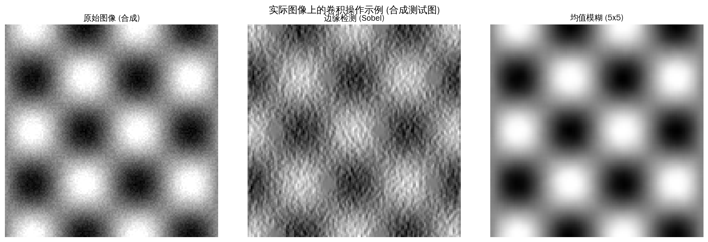

> 绘图代码：[`assets/figures/4-1-real-image.py`](../../assets/figures/4-1-real-image.py)

---


## 知识图谱

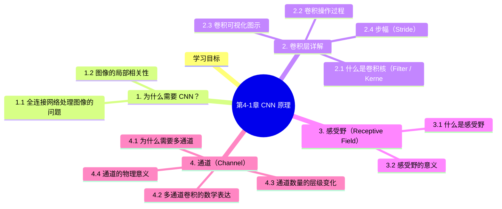

## 参考资料

1. LeCun, Y. et al. (1989). *Backpropagation Applied to Handwritten Zip Code Recognition*
2. LeCun, Y. et al. (1998). *Gradient-Based Learning Applied to Document Recognition*
3. Krizhevsky, A. et al. (2012). *ImageNet Classification with Deep Convolutional Neural Networks* (AlexNet)
4. Hubel, D. & Wiesel, D. (1968). *Receptive Fields and Functional Architecture of Monkey Striate Cortex*
5. Simonyan, K. & Zisserman, A. (2015). *Very Deep Convolutional Networks for Large-Scale Image Recognition* (VGGNet)