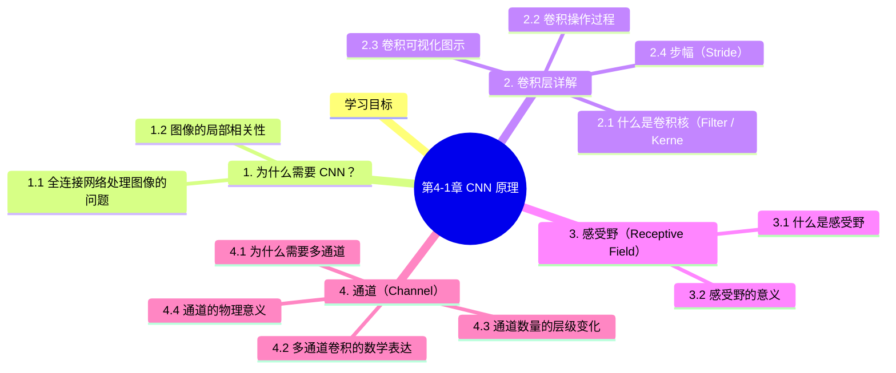

# 第4-1章 CNN 原理

## 学习目标

- 理解为什么全连接网络处理图像时参数过多的问题
- 掌握卷积层的基本概念：卷积核、卷积操作、步幅、填充
- 理解感受野（Receptive Field）的概念及其随着层数增加而扩大的规律
- 掌握通道（Channel）的概念，理解多通道卷积的实现
- 能够用图示说明卷积操作的过程

---

## 1. 为什么需要 CNN？

### 1.1 全连接网络处理图像的问题

在传统全连接神经网络中，如果要处理一张 224×224 的彩色图片：

- 输入层节点数：224 × 224 × 3 = 150,528 个
- 假设第一个隐藏层有 1000 个节点
- 仅这一层的权重参数就高达：150,528 × 1000 ≈ 1.5 亿个

**参数过多会带来三大问题：**

1. **过拟合**：参数太多，模型容易记住训练样本而不是学习泛化规律
2. **计算量大**：训练和推理都需要大量浮点运算，硬件要求高
3. **难以捕捉空间结构**：全连接层把每个像素平等对待，丢失了图像的空间局部性

### 1.2 图像的局部相关性

图像有一个重要特性：**空间相关性**。一个像素的数值与它周围的像素高度相关，而与远处的像素关系较弱。

这意味着：
- 我们不需要一次性看到整张图才能理解局部特征
- 通过"局部感受野"就能提取有用的特征（如边缘、纹理）
- 逐层组合局部特征，最终能表达全局信息

> **核心思想**：用少量参数学习局部特征，然后逐层组合，这就是 CNN 的起点。

---

## 2. 卷积层详解

### 2.1 什么是卷积核（Filter / Kernel）

卷积核是一个小的权重矩阵，常见尺寸有 3×3、5×5、7×7 等。

以 3×3 卷积核为例：
```
卷积核:
[ -1   0   1 ]
[ -1   0   1 ]
[ -1   0   1 ]
```

这个卷积核的作用是**检测垂直边缘**（左边暗、右边亮的交界线）。

### 2.2 卷积操作过程


**卷积计算过程**（逐元素相乘后求和）：

```
位置 (0,0) 的输出 = 
  1×(-1) + 2×0 + 3×1
+ 0×(-1) + 1×0 + 2×1
+ 0×(-1) + 0×0 + 1×1
= (-1) + 0 + 3 + 0 + 0 + 2 + 0 + 0 + 1 = 4
```

卷积核在输入图像上**从左到右、从上到下"滑动"**，每滑动一次就计算一个输出值。

### 2.3 卷积可视化图示

```
卷积核滑动过程 (stride=1, padding=0)

输入图像 (6×6)              卷积核 (3×3)            输出 (4×4)

[ a b c d e f ]             
[ g h i j k l ]              [ w0 w1 w2 ]
[ m n o p q r ]        ★     [ w3 w4 w5 ]      →     [ r0 r1 r2 r3 ]
[ s t u v w x ]              [ w6 w7 w8 ]              [ r4 r5 r6 r7 ]
[ y z A B C D ]                                       [ r8 r9 r10 r11 ]
[ E F G H I J ]                                       [ r12 r13 r14 r15 ]

卷积核每次覆盖3×3区域
↓→ 滑动步长(stride)=1
```

### 2.4 步幅（Stride）

Stride 是卷积核每次移动的像素数量：

- **Stride = 1**：每次移动 1 个像素，输出尺寸较大
- **Stride = 2**：每次移动 2 个像素，输出尺寸约为输入的一半


### 2.5 填充（Padding）

在输入图像边缘补一圈 0，叫 zero-padding。常见模式：

| 模式 | 说明 | 作用 |
|------|------|------|
| **Valid** | 不填充，输出比输入小 | 简单，但边缘信息丢失 |
| **Same** | 填充使输出与输入尺寸相同 | 保留边缘信息，计算量更大 |

```
Same模式 padding=1:

输入 (5×5) 周围补0:
[ 0  0  0  0  0  0  0 ]
[ 0  1  2  3  2  1  0 ]
[ 0  0  1  2  3  2  0 ]
[ 0  1  0  0  1  2  0 ]
[ 0  2  1  0  0  1  0 ]
[ 0  1  0  0  1  2  0 ]
[ 0  0  0  0  0  0  0 ]
          ↓ 7×7 padded input
     用 3×3 卷积核滑动，输出仍为 5×5
```

### 2.6 输出尺寸计算公式

```
输出尺寸 = floor((输入尺寸 - 卷积核尺寸 + 2×padding) / stride) + 1

例：输入 32×32，卷积核 5×5，padding=2，stride=1
输出 = floor((32 - 5 + 2×2) / 1) + 1 = 32×32 （Same模式）
```

---

## 3. 感受野（Receptive Field）

### 3.1 什么是感受野

感受野是指输出特征图上的一个像素点，对应输入图像中的区域大小。

- 第一层卷积：输出一个像素 → 对应输入图像 3×3 区域（如果卷积核是 3×3）
- 第二层卷积：输出一个像素 → 对应输入图像 5×5 区域（透过两层卷积）
- 第三层卷积：输出一个像素 → 对应输入图像 7×7 区域


**图示说明**：三层 3×3 卷积核堆叠后，感受野从 3×3 → 5×5 → 7×7 逐层扩大。

**逐层递推公式**：

```
Layer N 的感受野 = (Layer N-1 的感受野 - 1) × stride + 卷积核尺寸

例：Layer1 kernel=3, stride=1 → RF=3
    Layer2 kernel=3, stride=1 → RF = (3-1)×1 + 3 = 5
    Layer3 kernel=3, stride=1 → RF = (5-1)×1 + 3 = 7
```

### 3.2 感受野的意义

- **浅层**感受野小，提取细节特征（边缘、纹理、颜色斑块）
- **深层**感受野大，看到更全局的信息（物体整体、结构）
- 逐层堆叠让网络能学习从局部到整体的层次化表达

---

## 4. 通道（Channel）

### 4.1 为什么需要多通道

彩色图像有 R、G、B 三个通道。卷积操作需要针对每个通道独立进行，然后叠加。

```
RGB 三通道输入:

Red 通道:    [ 255  128  ... ]   卷积核 R: [ -1  0  1 ]
Green 通道:  [ 100   64  ... ] × 卷积核 G: [ -1  0  1 ] → 各通道结果相加
Blue 通道:   [  50   32  ... ]   卷积核 B: [ -1  0  1 ]

三通道结果累加 → 单一输出特征图
```

### 4.2 多通道卷积的数学表达

```
输入：H × W × C_in（C_in 个通道）
卷积核：K × K × C_in × C_out（C_out 个卷积核）
输出：H' × W' × C_out

每个输出通道 c_out 由所有输入通道加权求和得到：
output[h',w',c_out] = Σ( channel × 卷积核_所有通道 ) + bias
```

### 4.3 通道数量的层级变化

```
输入图像: 224×224×3 (RGB)

Conv1:  64 个 3×3 卷积核  → 输出 224×224×64
Conv2:  64 个 3×3 卷积核  → 输出 224×224×64
Pool1:  2×2 stride=2       → 输出 112×112×64
Conv3:  128 个 3×3 卷积核 → 输出 112×112×128
...
特征图通道数逐层增加（学到的特征越来越丰富）
```

### 4.4 通道的物理意义

不同通道通常学习到不同的特征类型：
- 某些通道对边缘敏感
- 某些通道对颜色敏感
- 某些通道对纹理敏感
- 深层通道对更抽象的概念（如"猫耳朵"）敏感

> 通过可视化，我们发现 CNN 就像一个"特征检测器流水线"，从底层特征逐步组合成高层语义。

---

## 5. 总结

```
┌─────────────────────────────────────────────────────┐
│                    CNN 核心原理                     │
├─────────────────────────────────────────────────────┤
│ 局部感受野: 每次只看一小块区域，而不是整张图          │
│ 参数共享: 同一个卷积核在整张图上滑动，大幅减少参数     │
│ 多通道:   RGB → 特征图数量按需增加                  │
│ 层次化:   浅层学边缘/纹理，深层学整体语义            │
└─────────────────────────────────────────────────────┘
```

| 概念 | 说明 |
|------|------|
| 卷积核（Kernel） | 小型权重矩阵，滑动提取特征 |
| 步幅（Stride） | 卷积核每次移动的像素数 |
| 填充（Padding） | 在边缘补0，控制输出尺寸 |
| 感受野（Receptive Field） | 输出像素对应的输入区域范围 |
|| 通道（Channel） | 特征图的深度维度 |
|| 特征图（Feature Map） | 卷积操作的输出结果 |

---

## 本章小结

1. **为什么需要 CNN**：全连接网络处理大图像时参数过多（224×224×3 输入到 1000 隐层有约 1.5 亿参数），易过拟合、计算量大、丢失空间结构信息。图像具有空间局部相关性，CNN 通过局部感受野和参数共享有效解决这些问题。

2. **卷积层核心概念**：
   - **卷积核（Kernel）**：小的权重矩阵（如 3×3），在输入图像上滑动提取局部特征
   - **步幅（Stride）**：卷积核每次移动的像素数，影响输出尺寸
   - **填充（Padding）**：边缘补 0，控制输出尺寸、保留边缘信息
   - **输出尺寸公式**：⌊(输入尺寸 - 卷积核尺寸 + 2×padding) / stride⌋ + 1

3. **感受野（Receptive Field）**：输出特征图像素对应输入图像的区域范围。逐层递增：3×3 卷积堆叠 3 层可达 7×7 感受野。浅层提取边缘纹理，深层提取整体语义。

4. **通道（Channel）**：特征图的深度维度。RGB 三通道输入经卷积后输出多通道特征图，通道数逐层增加（学到的特征越来越丰富）。

```python
import numpy as np

def manual_convolution(image, kernel, stride=1, padding=0):
    """
    手动实现 2D 卷积操作（教学用，展示卷积的本质）
    """
    if padding > 0:
        image_padded = np.pad(image, ((padding, padding), (padding, padding)), mode='constant')
    else:
        image_padded = image

    h_in, w_in = image_padded.shape
    h_kernel, w_kernel = kernel.shape
    h_out = (h_in - h_kernel) // stride + 1
    w_out = (w_in - w_kernel) // stride + 1

    output = np.zeros((h_out, w_out))
    for i in range(0, h_out):
        for j in range(0, w_out):
            i_start = i * stride
            j_start = j * stride
            image_patch = image_padded[i_start:i_start+h_kernel, j_start:j_start+w_kernel]
            output[i, j] = np.sum(image_patch * kernel)

    return output
```

### 不同卷积核的效果

下图为 7 种经典卷积核（边缘检测、模糊、锐化、Sobel 等）在 8×8 简单图像上的效果对比：


> 绘图代码：[`assets/figures/4-1-cnn-kernels.py`](../../assets/figures/4-1-cnn-kernels.py)

### 步幅（Stride）和填充（Padding）的影响

下图为 5×5 输入图像在不同 stride / padding 组合下的输出尺寸变化（核心公式：$H_{out} = \lfloor\frac{H_{in} + 2 \cdot padding - H_{kernel}}{stride}\rfloor + 1$）：


> 绘图代码：[`assets/figures/4-1-stride-padding.py`](../../assets/figures/4-1-stride-padding.py)

### 感受野（Receptive Field）随层数扩大

感受野公式 $RF_l = 1 + \sum_{i=0}^{l-1}(k-1) \cdot s^i$，其中 $k$ 是卷积核大小、$s$ 是步幅。下图展示 kernel_size=3 时，3 层卷积后感受野从 1×1 扩大到 7×7：


> 绘图代码：[`assets/figures/4-1-receptive-field.py`](../../assets/figures/4-1-receptive-field.py)

### 多通道卷积（RGB → 多输出通道）

每个输出通道都有 $C_{in}$ 个卷积核（对应每个输入通道），最终将各通道的卷积结果相加：


> 绘图代码：[`assets/figures/4-1-multi-channel.py`](../../assets/figures/4-1-multi-channel.py)

### 实际图像上的卷积效果


> 绘图代码：[`assets/figures/4-1-real-image.py`](../../assets/figures/4-1-real-image.py)

---


## 知识图谱



## 参考资料

1. LeCun, Y. et al. (1989). *Backpropagation Applied to Handwritten Zip Code Recognition*
2. LeCun, Y. et al. (1998). *Gradient-Based Learning Applied to Document Recognition*
3. Krizhevsky, A. et al. (2012). *ImageNet Classification with Deep Convolutional Neural Networks* (AlexNet)
4. Hubel, D. & Wiesel, D. (1968). *Receptive Fields and Functional Architecture of Monkey Striate Cortex*
5. Simonyan, K. & Zisserman, A. (2015). *Very Deep Convolutional Networks for Large-Scale Image Recognition* (VGGNet)