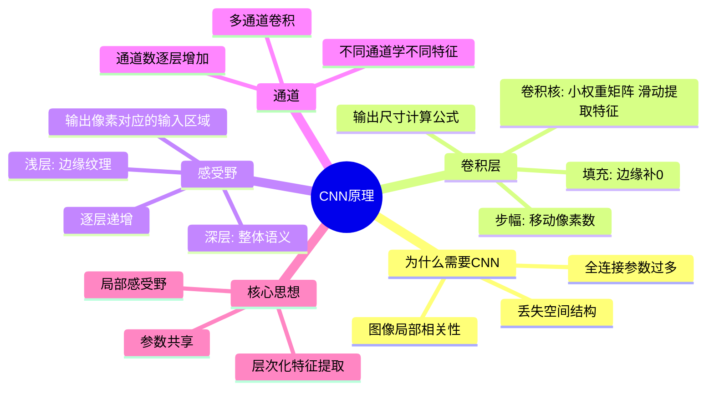

# 第4-1章 CNN 原理

## 学习目标

- 理解为什么全连接网络处理图像时参数过多的问题
- 掌握卷积层的基本概念：卷积核、卷积操作、步幅、填充
- 理解感受野（Receptive Field）的概念及其随着层数增加而扩大的规律
- 掌握通道（Channel）的概念，理解多通道卷积的实现
- 能够用图示说明卷积操作的过程

---

## 1. 为什么需要 CNN？

### 1.1 全连接网络处理图像的问题

在传统全连接神经网络中，如果要处理一张 224×224 的彩色图片：

- 输入层节点数：224 × 224 × 3 = 150,528 个
- 假设第一个隐藏层有 1000 个节点
- 仅这一层的权重参数就高达：150,528 × 1000 ≈ 1.5 亿个

**参数过多会带来三大问题：**

1. **过拟合**：参数太多，模型容易记住训练样本而不是学习泛化规律
2. **计算量大**：训练和推理都需要大量浮点运算，硬件要求高
3. **难以捕捉空间结构**：全连接层把每个像素平等对待，丢失了图像的空间局部性

### 1.2 图像的局部相关性

图像有一个重要特性：**空间相关性**。一个像素的数值与它周围的像素高度相关，而与远处的像素关系较弱。

这意味着：
- 我们不需要一次性看到整张图才能理解局部特征
- 通过"局部感受野"就能提取有用的特征（如边缘、纹理）
- 逐层组合局部特征，最终能表达全局信息

> **核心思想**：用少量参数学习局部特征，然后逐层组合，这就是 CNN 的起点。

---

## 2. 卷积层详解

### 2.1 什么是卷积核（Filter / Kernel）

卷积核是一个小的权重矩阵，常见尺寸有 3×3、5×5、7×7 等。

以 3×3 卷积核为例：
```
卷积核:
[ -1   0   1 ]
[ -1   0   1 ]
[ -1   0   1 ]
```

这个卷积核的作用是**检测垂直边缘**（左边暗、右边亮的交界线）。

### 2.2 卷积操作过程


**卷积计算过程**（逐元素相乘后求和）：

```
位置 (0,0) 的输出 = 
  1×(-1) + 2×0 + 3×1
+ 0×(-1) + 1×0 + 2×1
+ 0×(-1) + 0×0 + 1×1
= (-1) + 0 + 3 + 0 + 0 + 2 + 0 + 0 + 1 = 4
```

卷积核在输入图像上**从左到右、从上到下"滑动"**，每滑动一次就计算一个输出值。

### 2.3 卷积可视化图示

```
卷积核滑动过程 (stride=1, padding=0)

输入图像 (6×6)              卷积核 (3×3)            输出 (4×4)

[ a b c d e f ]             
[ g h i j k l ]              [ w0 w1 w2 ]
[ m n o p q r ]        ★     [ w3 w4 w5 ]      →     [ r0 r1 r2 r3 ]
[ s t u v w x ]              [ w6 w7 w8 ]              [ r4 r5 r6 r7 ]
[ y z A B C D ]                                       [ r8 r9 r10 r11 ]
[ E F G H I J ]                                       [ r12 r13 r14 r15 ]

卷积核每次覆盖3×3区域
↓→ 滑动步长(stride)=1
```

### 2.4 步幅（Stride）

Stride 是卷积核每次移动的像素数量：

- **Stride = 1**：每次移动 1 个像素，输出尺寸较大
- **Stride = 2**：每次移动 2 个像素，输出尺寸约为输入的一半


### 2.5 填充（Padding）

在输入图像边缘补一圈 0，叫 zero-padding。常见模式：

| 模式 | 说明 | 作用 |
|------|------|------|
| **Valid** | 不填充，输出比输入小 | 简单，但边缘信息丢失 |
| **Same** | 填充使输出与输入尺寸相同 | 保留边缘信息，计算量更大 |

```
Same模式 padding=1:

输入 (5×5) 周围补0:
[ 0  0  0  0  0  0  0 ]
[ 0  1  2  3  2  1  0 ]
[ 0  0  1  2  3  2  0 ]
[ 0  1  0  0  1  2  0 ]
[ 0  2  1  0  0  1  0 ]
[ 0  1  0  0  1  2  0 ]
[ 0  0  0  0  0  0  0 ]
          ↓ 7×7 padded input
     用 3×3 卷积核滑动，输出仍为 5×5
```

### 2.6 输出尺寸计算公式

```
输出尺寸 = floor((输入尺寸 - 卷积核尺寸 + 2×padding) / stride) + 1

例：输入 32×32，卷积核 5×5，padding=2，stride=1
输出 = floor((32 - 5 + 2×2) / 1) + 1 = 32×32 （Same模式）
```

---

## 3. 感受野（Receptive Field）

### 3.1 什么是感受野

感受野是指输出特征图上的一个像素点，对应输入图像中的区域大小。

- 第一层卷积：输出一个像素 → 对应输入图像 3×3 区域（如果卷积核是 3×3）
- 第二层卷积：输出一个像素 → 对应输入图像 5×5 区域（透过两层卷积）
- 第三层卷积：输出一个像素 → 对应输入图像 7×7 区域


**图示说明**：三层 3×3 卷积核堆叠后，感受野从 3×3 → 5×5 → 7×7 逐层扩大。

**逐层递推公式**：

```
Layer N 的感受野 = (Layer N-1 的感受野 - 1) × stride + 卷积核尺寸

例：Layer1 kernel=3, stride=1 → RF=3
    Layer2 kernel=3, stride=1 → RF = (3-1)×1 + 3 = 5
    Layer3 kernel=3, stride=1 → RF = (5-1)×1 + 3 = 7
```

### 3.2 感受野的意义

- **浅层**感受野小，提取细节特征（边缘、纹理、颜色斑块）
- **深层**感受野大，看到更全局的信息（物体整体、结构）
- 逐层堆叠让网络能学习从局部到整体的层次化表达

---

## 4. 通道（Channel）

### 4.1 为什么需要多通道

彩色图像有 R、G、B 三个通道。卷积操作需要针对每个通道独立进行，然后叠加。

```
RGB 三通道输入:

Red 通道:    [ 255  128  ... ]   卷积核 R: [ -1  0  1 ]
Green 通道:  [ 100   64  ... ] × 卷积核 G: [ -1  0  1 ] → 各通道结果相加
Blue 通道:   [  50   32  ... ]   卷积核 B: [ -1  0  1 ]

三通道结果累加 → 单一输出特征图
```

### 4.2 多通道卷积的数学表达

```
输入：H × W × C_in（C_in 个通道）
卷积核：K × K × C_in × C_out（C_out 个卷积核）
输出：H' × W' × C_out

每个输出通道 c_out 由所有输入通道加权求和得到：
output[h',w',c_out] = Σ( channel × 卷积核_所有通道 ) + bias
```

### 4.3 通道数量的层级变化

```
输入图像: 224×224×3 (RGB)

Conv1:  64 个 3×3 卷积核  → 输出 224×224×64
Conv2:  64 个 3×3 卷积核  → 输出 224×224×64
Pool1:  2×2 stride=2       → 输出 112×112×64
Conv3:  128 个 3×3 卷积核 → 输出 112×112×128
...
特征图通道数逐层增加（学到的特征越来越丰富）
```

### 4.4 通道的物理意义

不同通道通常学习到不同的特征类型：
- 某些通道对边缘敏感
- 某些通道对颜色敏感
- 某些通道对纹理敏感
- 深层通道对更抽象的概念（如"猫耳朵"）敏感

> 通过可视化，我们发现 CNN 就像一个"特征检测器流水线"，从底层特征逐步组合成高层语义。

---

## 5. 总结

```
┌─────────────────────────────────────────────────────┐
│                    CNN 核心原理                     │
├─────────────────────────────────────────────────────┤
│ 局部感受野: 每次只看一小块区域，而不是整张图          │
│ 参数共享: 同一个卷积核在整张图上滑动，大幅减少参数     │
│ 多通道:   RGB → 特征图数量按需增加                  │
│ 层次化:   浅层学边缘/纹理，深层学整体语义            │
└─────────────────────────────────────────────────────┘
```

| 概念 | 说明 |
|------|------|
| 卷积核（Kernel） | 小型权重矩阵，滑动提取特征 |
| 步幅（Stride） | 卷积核每次移动的像素数 |
| 填充（Padding） | 在边缘补0，控制输出尺寸 |
| 感受野（Receptive Field） | 输出像素对应的输入区域范围 |
|| 通道（Channel） | 特征图的深度维度 |
|| 特征图（Feature Map） | 卷积操作的输出结果 |

---

## 本章小结

1. **为什么需要 CNN**：全连接网络处理大图像时参数过多（224×224×3 输入到 1000 隐层有约 1.5 亿参数），易过拟合、计算量大、丢失空间结构信息。图像具有空间局部相关性，CNN 通过局部感受野和参数共享有效解决这些问题。

2. **卷积层核心概念**：
   - **卷积核（Kernel）**：小的权重矩阵（如 3×3），在输入图像上滑动提取局部特征
   - **步幅（Stride）**：卷积核每次移动的像素数，影响输出尺寸
   - **填充（Padding）**：边缘补 0，控制输出尺寸、保留边缘信息
   - **输出尺寸公式**：⌊(输入尺寸 - 卷积核尺寸 + 2×padding) / stride⌋ + 1

3. **感受野（Receptive Field）**：输出特征图像素对应输入图像的区域范围。逐层递增：3×3 卷积堆叠 3 层可达 7×7 感受野。浅层提取边缘纹理，深层提取整体语义。

4. **通道（Channel）**：特征图的深度维度。RGB 三通道输入经卷积后输出多通道特征图，通道数逐层增加（学到的特征越来越丰富）。

```python
import numpy as np
import matplotlib.pyplot as plt
import matplotlib.patches as patches
from matplotlib import colors
from scipy import ndimage
from skimage import data, color, io

# ======================================
# 1. 卷积操作可视化（手工实现卷积）
# ======================================

def manual_convolution(image, kernel, stride=1, padding=0):
    """
    手动实现卷积操作
    """
    # 添加填充
    if padding > 0:
        image_padded = np.pad(image, ((padding, padding), (padding, padding)), mode='constant')
    else:
        image_padded = image
    
    # 计算输出尺寸
    h_in, w_in = image_padded.shape
    h_kernel, w_kernel = kernel.shape
    h_out = (h_in - h_kernel) // stride + 1
    w_out = (w_in - w_kernel) // stride + 1
    
    # 执行卷积
    output = np.zeros((h_out, w_out))
    
    for i in range(0, h_out):
        for j in range(0, w_out):
            # 获取图像块
            i_start = i * stride
            i_end = i_start + h_kernel
            j_start = j * stride
            j_end = j_start + w_kernel
            
            image_patch = image_padded[i_start:i_end, j_start:j_end]
            
            # 计算点积
            output[i, j] = np.sum(image_patch * kernel)
    
    return output

# 创建示例图像（简单的黑白条带）
np.random.seed(42)
example_image = np.zeros((8, 8))
example_image[2:6, 2:6] = 1  # 中间一个4x4方块

# 创建不同的卷积核
kernels = {
    '边缘检测（垂直）': np.array([[-1, 0, 1],
                                 [-1, 0, 1],
                                 [-1, 0, 1]]),
    '边缘检测（水平）': np.array([[-1, -1, -1],
                                 [0, 0, 0],
                                 [1, 1, 1]]),
    '锐化': np.array([[0, -1, 0],
                      [-1, 5, -1],
                      [0, -1, 0]]),
    '高斯模糊': np.array([[1, 2, 1],
                         [2, 4, 2],
                         [1, 2, 1]]) / 16,
    '均值模糊': np.ones((3, 3)) / 9,
    'Sobel（x方向）': np.array([[-1, 0, 1],
                               [-2, 0, 2],
                               [-1, 0, 1]]),
    'Sobel（y方向）': np.array([[-1, -2, -1],
                               [0, 0, 0],
                               [1, 2, 1]])
}

# 可视化不同卷积核的效果
fig, axes = plt.subplots(3, 4, figsize=(16, 12))

# 原始图像
ax = axes[0, 0]
im = ax.imshow(example_image, cmap='gray', vmin=0, vmax=1)
ax.set_title('原始图像 (8x8)')
ax.set_xticks([])
ax.set_yticks([])
plt.colorbar(im, ax=ax, fraction=0.046, pad=0.04)

# 卷积核显示
for idx, (kernel_name, kernel) in enumerate(list(kernels.items())[:3]):
    ax = axes[0, idx+1]
    im = ax.imshow(kernel, cmap='coolwarm')
    ax.set_title(f'{kernel_name}\n{kernel.shape[0]}x{kernel.shape[1]}')
    ax.set_xticks(range(kernel.shape[1]))
    ax.set_yticks(range(kernel.shape[0]))
    plt.colorbar(im, ax=ax, fraction=0.046, pad=0.04)
    
    # 在单元格中显示数值
    for i in range(kernel.shape[0]):
        for j in range(kernel.shape[1]):
            ax.text(j, i, f'{kernel[i, j]:.2f}', ha='center', va='center', 
                   color='white' if abs(kernel[i, j]) > 0.5 else 'black')

# 卷积结果
for idx, (kernel_name, kernel) in enumerate(kernels.items()):
    row = 1 + idx // 4
    col = idx % 4
    
    result = manual_convolution(example_image, kernel, stride=1, padding=1)
    
    ax = axes[row, col]
    im = ax.imshow(result, cmap='viridis')
    ax.set_title(f'{kernel_name}结果')
    ax.set_xticks([])
    ax.set_yticks([])
    plt.colorbar(im, ax=ax, fraction=0.046, pad=0.04)
    
    # 显示数值
    for i in range(result.shape[0]):
        for j in range(result.shape[1]):
            ax.text(j, i, f'{result[i, j]:.1f}', ha='center', va='center', 
                   color='white' if abs(result[i, j]) > 2 else 'black')

plt.tight_layout()
plt.suptitle('不同卷积核效果可视化 (stride=1, padding=1)', fontsize=16, y=1.02)
plt.show()

# ======================================
# 2. 步幅（Stride）和填充（Padding）效果对比
# ======================================

# 创建更复杂的测试图像
test_image = np.array([
    [1, 2, 3, 4, 5],
    [2, 3, 4, 5, 6],
    [3, 4, 5, 6, 7],
    [4, 5, 6, 7, 8],
    [5, 6, 7, 8, 9]
])

kernel_identity = np.array([[0, 0, 0],
                            [0, 1, 0],
                            [0, 0, 0]])

fig, axes = plt.subplots(2, 3, figsize=(15, 10))

# 原始图像
ax = axes[0, 0]
im = ax.imshow(test_image, cmap='gray')
ax.set_title('原始图像 (5x5)')
ax.set_xticks(range(5))
ax.set_yticks(range(5))
plt.colorbar(im, ax=ax, fraction=0.046, pad=0.04)
for i in range(5):
    for j in range(5):
        ax.text(j, i, str(test_image[i, j]), ha='center', va='center', color='white')

# 不同stride和padding组合
configs = [
    {'stride': 1, 'padding': 0, 'title': 'stride=1, padding=0\n输出尺寸: (3x3)'},
    {'stride': 2, 'padding': 0, 'title': 'stride=2, padding=0\n输出尺寸: (2x2)'},
    {'stride': 1, 'padding': 1, 'title': 'stride=1, padding=1\n输出尺寸: (5x5)'},
    {'stride': 2, 'padding': 1, 'title': 'stride=2, padding=1\n输出尺寸: (3x3)'},
    {'stride': 3, 'padding': 2, 'title': 'stride=3, padding=2\n输出尺寸: (3x3)'}
]

for idx, config in enumerate(configs):
    row = 1 + idx // 3
    col = idx % 3
    
    # 计算输出尺寸
    h_in, w_in = test_image.shape
    h_kernel, w_kernel = kernel_identity.shape
    padding = config['padding']
    stride = config['stride']
    
    h_out = (h_in + 2*padding - h_kernel) // stride + 1
    w_out = (w_in + 2*padding - w_kernel) // stride + 1
    
    result = manual_convolution(test_image, kernel_identity, 
                               stride=stride, padding=padding)
    
    ax = axes[row, col]
    im = ax.imshow(result, cmap='viridis')
    ax.set_title(config['title'])
    ax.set_xticks(range(w_out))
    ax.set_yticks(range(h_out))
    
    # 显示数值
    for i in range(h_out):
        for j in range(w_out):
            ax.text(j, i, f'{result[i, j]:.0f}', ha='center', va='center', 
                   color='white' if result[i, j] > 4 else 'black')
    
    # 显示公式
    ax.text(0, -0.5, f'公式: ⌊({h_in}+2×{padding}-{h_kernel})/{stride}⌋+1 = {h_out}', 
            transform=ax.transAxes, fontsize=9)

plt.tight_layout()
plt.suptitle('步幅(Stride)和填充(Padding)对输出尺寸的影响', fontsize=16, y=1.02)
plt.show()

# ======================================
# 3. 感受野（Receptive Field）可视化
# ======================================

def visualize_receptive_field(num_layers=3, kernel_size=3):
    """
    可视化感受野随层数增加而扩大
    """
    fig, axes = plt.subplots(1, num_layers, figsize=(15, 5))
    
    # 输入图像（表示原始像素）
    input_size = 15
    input_image = np.zeros((input_size, input_size))
    input_image[input_size//2, input_size//2] = 1  # 中心一个激活点
    
    # 绘制每一层的感受野
    current_rf = 1  # 初始感受野大小
    
    for layer in range(num_layers):
        # 计算当前层的感受野
        current_rf = current_rf + (kernel_size - 1) * (2 ** layer)
        
        # 创建感受野可视化
        rf_visualization = np.zeros((input_size, input_size))
        center = input_size // 2
        half_rf = current_rf // 2
        
        # 标记感受野区域
        start_row = max(0, center - half_rf)
        end_row = min(input_size, center + half_rf + 1)
        start_col = max(0, center - half_rf)
        end_col = min(input_size, center + half_rf + 1)
        
        rf_visualization[start_row:end_row, start_col:end_col] = 0.5
        
        # 标记中心激活点
        rf_visualization[center, center] = 1
        
        ax = axes[layer]
        im = ax.imshow(rf_visualization, cmap='YlOrRd')
        ax.set_title(f'第{layer+1}层卷积后\n感受野: {current_rf}×{current_rf}')
        ax.set_xticks([])
        ax.set_yticks([])
        
        # 添加感受野边界框
        rect = patches.Rectangle((start_col-0.5, start_row-0.5), 
                                end_col-start_col, end_row-start_row,
                                linewidth=2, edgecolor='blue', facecolor='none')
        ax.add_patch(rect)
        
        # 添加中心点标记
        ax.plot(center, center, 'bo', markersize=10)
    
    plt.suptitle(f'感受野随卷积层数增加而扩大 (kernel_size={kernel_size})', fontsize=14)
    plt.tight_layout()
    plt.show()
    
    print(f"\n感受野计算公式: RF_{num_layers} = 1 + ∑_{i=0}^{num_layers-1} (kernel_size - 1) × 2^i")
    print(f"当kernel_size={kernel_size}, 层数={num_layers}时:")
    for layer in range(num_layers):
        rf = 1 + sum([(kernel_size - 1) * (2 ** i) for i in range(layer + 1)])
        print(f"  第{layer+1}层感受野: {rf}×{rf}")

# 运行感受野可视化
visualize_receptive_field(num_layers=3, kernel_size=3)

# ======================================
# 4. 多通道卷积可视化
# ======================================

def visualize_multi_channel_convolution():
    """
    可视化多通道卷积（RGB图像）
    """
    # 创建简单的RGB图像 (3通道)
    height, width = 6, 6
    rgb_image = np.zeros((height, width, 3))
    
    # R通道：左上角红色
    rgb_image[:height//2, :width//2, 0] = 1
    
    # G通道：右上角绿色
    rgb_image[:height//2, width//2:, 1] = 1
    
    # B通道：左下角蓝色
    rgb_image[height//2:, :width//2, 2] = 1
    
    # 混合区域：右下角黄色 (R+G)
    rgb_image[height//2:, width//2:, 0] = 1
    rgb_image[height//2:, width//2:, 1] = 1
    
    # 创建多通道卷积核
    # 每个输出通道有3个卷积核（对应输入RGB通道）
    num_output_channels = 4
    kernel_size = 3
    
    # 随机初始化卷积核
    kernels = np.random.randn(num_output_channels, 3, kernel_size, kernel_size) * 0.5
    
    # 可视化
    fig, axes = plt.subplots(3, num_output_channels + 1, figsize=(16, 10))
    
    # 显示输入RGB图像
    for c in range(3):
        ax = axes[c, 0]
        channel_name = ['Red通道', 'Green通道', 'Blue通道'][c]
        im = ax.imshow(rgb_image[:, :, c], cmap='Reds' if c == 0 else 'Greens' if c == 1 else 'Blues')
        ax.set_title(f'输入图像\n{channel_name}')
        ax.set_xticks([])
        ax.set_yticks([])
        plt.colorbar(im, ax=ax, fraction=0.046, pad=0.04)
    
    # 显示每个输出通道的卷积核和结果
    for output_channel in range(num_output_channels):
        # 计算该输出通道的结果
        channel_result = np.zeros((height - kernel_size + 1, width - kernel_size + 1))
        
        for input_channel in range(3):
            # 对每个输入通道应用对应的卷积核
            kernel = kernels[output_channel, input_channel, :, :]
            channel_slice = rgb_image[:, :, input_channel]
            conv_result = manual_convolution(channel_slice, kernel, stride=1, padding=0)
            channel_result += conv_result
        
        # 显示该输出通道的卷积核
        for c in range(3):
            ax = axes[c, output_channel + 1]
            kernel = kernels[output_channel, c, :, :]
            im = ax.imshow(kernel, cmap='coolwarm', vmin=-1, vmax=1)
            ax.set_title(f'输出通道{output_channel+1}\n对{c}通道的卷积核')
            ax.set_xticks([])
            ax.set_yticks([])
            
            # 显示卷积核数值
            for i in range(kernel_size):
                for j in range(kernel_size):
                    ax.text(j, i, f'{kernel[i, j]:.1f}', ha='center', va='center', 
                           color='white' if abs(kernel[i, j]) > 0.5 else 'black')
        
        # 显示该输出通道的结果（在最后一行）
        if output_channel == 0:
            ax_result = plt.subplot2grid((3, num_output_channels + 1), (2, output_channel + 1), colspan=1)
        else:
            ax_result = axes[2, output_channel + 1]
        
        im_result = ax_result.imshow(channel_result, cmap='viridis')
        ax_result.set_title(f'输出通道{output_channel+1}\n特征图')
        ax_result.set_xticks([])
        ax_result.set_yticks([])
        plt.colorbar(im_result, ax=ax_result, fraction=0.046, pad=0.04)
    
    # 设置最后一列的第一个和第二个子图为空
    axes[0, -1].axis('off')
    axes[1, -1].axis('off')
    
    # 在最后一列显示所有输出通道的叠加
    ax_final = axes[2, -1]
    # 创建模拟的多通道特征图（简单叠加）
    final_visualization = np.zeros((height - kernel_size + 1, width - kernel_size + 1, 3))
    # 为了演示，简单分配颜色
    final_visualization[:, :, 0] = np.random.rand(height - kernel_size + 1, width - kernel_size + 1)
    final_visualization[:, :, 1] = np.random.rand(height - kernel_size + 1, width - kernel_size + 1)
    final_visualization[:, :, 2] = np.random.rand(height - kernel_size + 1, width - kernel_size + 1)
    
    ax_final.imshow(final_visualization)
    ax_final.set_title('多通道特征图\n(所有输出通道叠加)')
    ax_final.set_xticks([])
    ax_final.set_yticks([])
    
    plt.suptitle('多通道卷积过程：RGB输入 → 多输出通道特征图', fontsize=16, y=1.02)
    plt.tight_layout()
    plt.show()
    
    print("\n多通道卷积说明：")
    print("1. 输入图像：3通道（RGB）")
    print(f"2. 每个输出通道有3个卷积核（对应输入通道）")
    print(f"3. 总卷积核数量：{num_output_channels}输出通道 × 3输入通道 = {num_output_channels*3}")
    print(f"4. 输出特征图：{num_output_channels}通道，每个通道是3个输入通道卷积结果的加权和")

# 运行多通道卷积可视化
visualize_multi_channel_convolution()

# ======================================
# 5. 实际图像卷积示例
# ======================================

# 使用scikit-image的示例图像
try:
    camera_image = data.camera()
    
    # 定义卷积核
    edge_kernel = np.array([[1, 0, -1],
                            [2, 0, -2],
                            [1, 0, -1]])
    
    blur_kernel = np.ones((5, 5)) / 25
    
    # 应用卷积
    edge_result = ndimage.convolve(camera_image, edge_kernel)
    blur_result = ndimage.convolve(camera_image, blur_kernel)
    
    fig, axes = plt.subplots(1, 3, figsize=(15, 5))
    
    axes[0].imshow(camera_image, cmap='gray')
    axes[0].set_title('原始图像')
    axes[0].axis('off')
    
    axes[1].imshow(edge_result, cmap='gray')
    axes[1].set_title('边缘检测 (Sobel)')
    axes[1].axis('off')
    
    axes[2].imshow(blur_result, cmap='gray')
    axes[2].set_title('均值模糊 (5x5)')
    axes[2].axis('off')
    
    plt.suptitle('实际图像上的卷积操作示例', fontsize=14)
    plt.tight_layout()
    plt.show()
    
except Exception as e:
    print(f"实际图像加载失败: {e}")
    print("跳过实际图像示例...")

print("\n" + "="*80)
print("CNN卷积原理代码总结：")
print("="*80)
print("1. 卷积操作：手工实现了卷积函数，展示了不同卷积核（边缘检测、模糊、锐化）的效果")
print("2. 步幅与填充：对比了不同stride和padding组合对输出尺寸的影响")
print("3. 感受野：可视化感受野随卷积层数增加而扩大的过程")
print("4. 多通道卷积：模拟了RGB图像的多通道卷积过程")
print("5. 实际应用：在真实图像上应用卷积操作")
print("="*80)
print("关键概念回顾：")
print("- 卷积核：小权重矩阵，滑动提取局部特征")
print("- 步幅(Stride)：卷积核移动的像素数，影响输出尺寸和计算量")
print("- 填充(Padding)：边缘补零，控制输出尺寸，保留边缘信息")
print("- 感受野：输出特征图像素对应的输入图像区域，随层数增加而扩大")
print("- 通道：特征图的深度维度，卷积核数量随通道增加")
print("="*80)
```

---

## 知识点思维导图



---

## 参考资料

1. LeCun, Y. et al. (1989). *Backpropagation Applied to Handwritten Zip Code Recognition*
2. LeCun, Y. et al. (1998). *Gradient-Based Learning Applied to Document Recognition*
3. Krizhevsky, A. et al. (2012). *ImageNet Classification with Deep Convolutional Neural Networks* (AlexNet)
4. Hubel, D. & Wiesel, D. (1968). *Receptive Fields and Functional Architecture of Monkey Striate Cortex*
5. Simonyan, K. & Zisserman, A. (2015). *Very Deep Convolutional Networks for Large-Scale Image Recognition* (VGGNet)