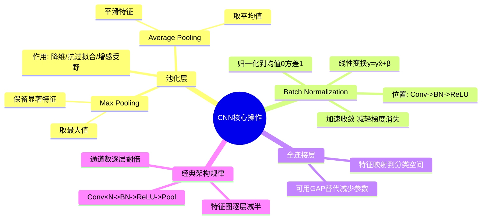

# 第4-2章 CNN 核心操作

## 学习目标

- 掌握池化层的两种主要类型：最大池化（Max Pooling）和平均池化（Average Pooling）
- 理解池化层的降维、防止过拟合的作用
- 理解 Batch Normalization 在 CNN 中的应用
- 理解全连接层在 CNN 中的作用
- 能够描述一个完整 CNN 的架构示例

---

## 1. 池化层（Pooling Layer）

### 1.1 什么是池化

池化（Pooling）也称为**降采样（Downsampling）**，是将输入图像某个矩形区域的所有数值汇总成一个代表性数值的操作。

与卷积类似，池化也有：
- **滤波器尺寸（Filter Size）**：如 2×2、3×3
- **步幅（Stride）**：通常等于滤波器尺寸（不重叠）
- **填充（Padding）**：通常为 0

### 1.2 最大池化（Max Pooling）

在感受野内取**最大值**输出。

```
最大池化 2×2, stride=2:

输入:                      输出:

[ 1  3  2  1 ]             [ 7  3 ]
[ 6  7  8  2 ]      →      [ 9  6 ]
[ 4  2  1  0 ]
[ 9  5  3  6 ]

每个 2×2 窗口取最大值:
[1,3]→3  [2,1]→3      →   [7, 3]
[6,7]→7  [8,2]→8             [9, 6]
[4,2]→4  [1,0]→1
[9,5]→9  [3,6]→6
```

### 1.3 平均池化（Average Pooling）

在感受野内取**平均值**输出。

```
平均池化 2×2, stride=2:

输入:                      输出:

[ 1  3  2  1 ]             [ 4.25  2.00 ]
[ 6  7  8  2 ]      →      [ 4.75  2.50 ]
[ 4  2  1  0 ]
[ 9  5  3  6 ]

每个 2×2 窗口求平均:
(1+3+6+7)/4=4.25  (2+1+8+2)/4=3.25  →  [4.25, 3.25]
(4+2+9+5)/4=5.00  (1+0+3+6)/4=2.50       [5.00, 2.50]
```

### 1.4 池化的作用

**1. 降维（减少参数数量）**

```
输入 4×4 = 16 个值 → 输出 2×2 = 4 个值
压缩比 4:1，大幅减少后续层计算量
```

**2. 防止过拟合**

- 池化后的特征对微小位移不那么敏感
- 形成"特征竞争"：只有最强的特征被保留
- 相当于一种粗糙的信息压缩

**3. 增大感受野**

- 池化让后续卷积层能"看到"更大的输入区域
- 同样的卷积核，在池化后的特征图上操作，感受野更广

**4. 对输入尺度变化的容忍度**

```
输入 224×224 → Conv → 112×112 → Pool → 56×56
输入 192×192 → Conv → 96×96   → Pool → 48×48

无论输入多大，经过多层池化后特征图尺寸都归一化了
最后一层可以用 Global Average Pooling 处理任意尺度输入
```

### 1.5 池化类型对比

| 类型 | 公式 | 特点 |
|------|------|------|
| Max Pooling | `output = max(window)` | 保留最显著的特征，对纹理提取有效 |
| Average Pooling | `output = mean(window)` | 保留背景信息，平滑特征 |
| Global Average Pooling | `output = mean(整个特征图)` | 替代全连接层，减少参数 |

---

## 2. Batch Normalization（批量归一化）

### 2.1 什么是 Batch Normalization

Batch Normalization（简称 BN）是一种正则化技术，在每一层的输入上做归一化处理，使其均值为 0、方差为 1。

```
计算过程（以单个神经元为例）：
1. 计算 mini-batch 内该神经元的均值 μ_B
2. 计算 mini-batch 内该神经元的方差 σ²_B
3. 归一化: x̂ = (x - μ_B) / √(σ²_B + ε)
4. 线性变换: y = γ·x̂ + β    （γ,β 为可学习参数）
```

### 2.2 为什么 CNN 需要 BN

在 CNN 中，网络的层数很深，前面层参数的变化会逐层放大，导致：

- **Internal Covariate Shift**：浅层参数变化导致深层输入分布不断变化
- **梯度消失/爆炸**：激活函数在极端值处饱和
- **训练不稳定**：需要非常小的学习率

BN 通过对每一层的输入归一化，有效缓解上述问题。

### 2.3 CNN 中的 BN 应用

```
卷积层 → BatchNorm → ReLU → 池化层 → ...
```

在 CNN 中，BN 通常应用在卷积层之后、激活函数之前：

```
Conv2d → BatchNorm2d → ReLU → Pool → ...
```

> 注意：BN 在测试时使用的是训练过程中学到的全局统计量（running mean/variance），而非 batch 统计量。

### 2.4 BN 的优势

| 优势 | 说明 |
|------|------|
| 加速收敛 | 允许使用更大的学习率 |
| 减轻梯度消失 | 归一化让激活函数工作在天平中央 |
| 正则化 | 每个 batch 的随机性有轻微正则化效果 |
| 减少对 Dropout 的依赖 | BN 本身有一定正则化作用 |

---

## 3. 全连接层（Fully Connected Layer）

### 3.1 什么是全连接层

全连接层（FC 层）的每个神经元与前一层的所有神经元都相连。在 CNN 中通常出现在最后几层，用于将学到的特征映射到最终的分类/回归输出。

```
全连接层示意：

特征图 (7×7×512)
    ↓ 展平
25088 个神经元
    ↓ 全连接
4096 个神经元
    ↓ 全连接
1000 个类别 (Softmax)
```

### 3.2 全连接层在 CNN 中的位置

```
典型 CNN 架构末尾:

... → Conv → Conv → Pool → Conv → Conv → Pool →
GlobalAvgPool → FC → FC → Softmax → Output
```

- **特征提取阶段**：多个卷积层 + 池化层，逐层提取从边缘到语义的特征
- **分类阶段**：1~2 个全连接层，将特征映射到类别空间

### 3.3 Global Average Pooling（GAP）

GAP 是用全局平均池化替代全连接层的方案：

```
特征图 7×7×1000
    ↓ GAP
1×1×1000
    ↓ 直接对应 1000 类
每个通道对应一个类别概率
```

**GAP 的优势**：
- 大幅减少参数数量（无权重矩阵）
- 对输入尺度不再敏感
- 减少过拟合风险

> GoogleNet、VGG 等经典网络的分类头都使用 GAP。

---

## 4. 完整 CNN 架构示例

### 4.1 LeNet-5 完整架构

```
输入: 32×32×1 (灰度手写数字)

Conv1: 6 个 5×5 卷积核, stride=1 → 28×28×6
Pool1: 2×2 Max Pool, stride=2    → 14×14×6

Conv2: 16 个 5×5 卷积核, stride=1 → 10×10×16
Pool2: 2×2 Max Pool, stride=2    → 5×5×16

FC1: 120 个神经元
FC2: 84 个神经元
Output: 10 类 (Softmax)
```

### 4.2 一个典型图像分类 CNN 的结构规律

```
输入图像
    ↓
特征提取阶段（浅层 → 深层）
Conv × N → BN → ReLU → Pool
    ↑__________________|
    （重复多次，通道数逐层增加）
    ↓
全局特征聚合
Global Average Pooling
    ↓
分类头
FC (可选) → Softmax → 类别概率
```

| 阶段 | 作用 | 特征类型 |
|------|------|----------|
| 浅层 Conv | 提取边缘、纹理、颜色斑块 | 局部、低级 |
| 中层 Conv | 组合低级特征，形成部件 | 中级 |
| 深层 Conv | 提取完整物体语义特征 | 全局、高级 |
| GAP/FC | 聚合特征，映射到类别空间 | 分类决策 |

### 4.3 经典 CNN 各层通道数变化趋势

```
以 VGG-16 为例（简化）:

Input: 224×224×3

Conv1_1: 64 个 3×3  → 224×224×64
Conv1_2: 64 个 3×3  → 224×224×64
Pool1: 2×2 stride=2 → 112×112×64

Conv2_1: 128 个     → 112×112×128
Conv2_2: 128 个     → 112×112×128
Pool2:              → 56×56×128

Conv3_1: 256 个     → 56×56×256
Conv3_2: 256 个     → 56×56×256
Conv3_3: 256 个     → 56×56×256
Pool3:              → 28×28×256

Conv4_1: 512 个     → 28×28×512
...（通道数 512）
Pool4:              → 14×14×512

Conv5_1: 512 个     → 14×14×512
...（通道数 512）
Pool5:              → 7×7×512

GAP:                → 1×1×512
FC: 1000 类         → 输出概率

通道数: 64 → 128 → 256 → 512（逐层翻倍）
特征图尺寸: 224 → 112 → 56 → 28 → 14 → 7（逐层减半）
```

---

## 5. 总结

```
┌──────────────────────────────────────────────────────┐
│                 CNN 核心操作总结                     │
├──────────────────────────────────────────────────────┤
│ 卷积层:   提取局部特征，参数共享                     │
│ 池化层:   降维、抗干扰、增加感受野                   │
│ BN层:     稳定训练、加速收敛、正则化                 │
│ FC层:     特征映射到分类空间（可用 GAP 替代）        │
└──────────────────────────────────────────────────────┘
```

| 操作 | 位置 | 作用 |
|------|------|------|
| Conv + BN + ReLU | 特征提取核心 | 提取特征 + 归一化 + 非线性激活 |
| Pooling | 周期插入（每1-3层Conv后） | 降维、增加感受野、抗过拟合 |
|| GAP/FC | 分类头前 | 聚合全局特征、映射到类别 |
|| Softmax | 最后一层 | 多分类概率输出 |

---

## Python 代码示例：CNN核心操作可视化

下面通过Python代码演示CNN核心操作的效果：

```python
import numpy as np
import matplotlib.pyplot as plt
from matplotlib.patches import Rectangle
import matplotlib.gridspec as gridspec
import seaborn as sns

# 设置中文字体
plt.rcParams['font.sans-serif'] = ['SimHei', 'DejaVu Sans']
plt.rcParams['axes.unicode_minus'] = False

# 1. 池化操作可视化（Max Pooling vs Average Pooling）
def visualize_pooling_operations():
    """可视化Max Pooling和Average Pooling操作"""
    # 创建一个示例特征图
    feature_map = np.array([
        [2, 4, 1, 3],
        [8, 6, 5, 7],
        [1, 3, 9, 2],
        [4, 2, 3, 5]
    ], dtype=float)
    
    # 2×2 Max Pooling
    max_pooled = np.zeros((2, 2))
    max_pool_positions = []
    
    # 2×2 Average Pooling
    avg_pooled = np.zeros((2, 2))
    
    for i in range(0, 4, 2):
        for j in range(0, 4, 2):
            # Max Pooling
            region = feature_map[i:i+2, j:j+2]
            max_val = np.max(region)
            max_pooled[i//2, j//2] = max_val
            # 记录最大值位置
            max_pos = np.argwhere(region == max_val)[0]
            max_pool_positions.append((i + max_pos[0], j + max_pos[1]))
            
            # Average Pooling
            avg_val = np.mean(region)
            avg_pooled[i//2, j//2] = avg_val
    
    fig, axes = plt.subplots(2, 3, figsize=(15, 10))
    
    # 原始特征图
    ax1 = axes[0, 0]
    im1 = ax1.imshow(feature_map, cmap='YlOrRd', vmin=0, vmax=10)
    ax1.set_title('原始特征图 (4×4)', fontsize=12, fontweight='bold')
    ax1.set_xticks([])
    ax1.set_yticks([])
    # 添加网格
    for i in range(4):
        for j in range(4):
            ax1.text(j, i, f'{feature_map[i, j]:.0f}', 
                    ha='center', va='center', color='black', fontsize=12, fontweight='bold')
    
    # 标记池化区域
    for i in range(0, 4, 2):
        for j in range(0, 4, 2):
            rect = Rectangle((j-0.5, i-0.5), 2, 2, fill=False, 
                           edgecolor='blue', linewidth=2, linestyle='--')
            ax1.add_patch(rect)
    
    # Max Pooling结果
    ax2 = axes[0, 1]
    im2 = ax2.imshow(max_pooled, cmap='YlOrRd', vmin=0, vmax=10)
    ax2.set_title('Max Pooling结果 (2×2)', fontsize=12, fontweight='bold')
    ax2.set_xticks([])
    ax2.set_yticks([])
    for i in range(2):
        for j in range(2):
            ax2.text(j, i, f'{max_pooled[i, j]:.0f}', 
                    ha='center', va='center', color='black', fontsize=12, fontweight='bold')
    
    # 标记最大值来源
    for (i, j), pool_pos in zip([(0,0), (0,1), (1,0), (1,1)], max_pool_positions):
        orig_i, orig_j = pool_pos
        ax2.text(j, i, f'←({orig_i},{orig_j})', 
                fontsize=8, color='blue', ha='right', va='top')
    
    # Average Pooling结果
    ax3 = axes[0, 2]
    im3 = ax3.imshow(avg_pooled, cmap='YlOrRd', vmin=0, vmax=10)
    ax3.set_title('Average Pooling结果 (2×2)', fontsize=12, fontweight='bold')
    ax3.set_xticks([])
    ax3.set_yticks([])
    for i in range(2):
        for j in range(2):
            ax3.text(j, i, f'{avg_pooled[i, j]:.1f}', 
                    ha='center', va='center', color='black', fontsize=12, fontweight='bold')
    
    # 2. Batch Normalization效果对比
    ax4 = axes[1, 0]
    # 模拟不同层的激活值分布
    np.random.seed(42)
    activations_before_bn = []
    activations_after_bn = []
    
    # 模拟4个不同层的激活值（均值和方差不同）
    for layer in range(4):
        mean = np.random.uniform(-2, 2)
        std = np.random.uniform(0.5, 3)
        layer_activations = np.random.normal(mean, std, 1000)
        activations_before_bn.append(layer_activations)
        
        # Batch Normalization
        bn_activations = (layer_activations - np.mean(layer_activations)) / np.std(layer_activations)
        activations_after_bn.append(bn_activations)
    
    # 绘制BN前后的分布
    colors = ['red', 'blue', 'green', 'orange']
    for i, (before, after, color) in enumerate(zip(activations_before_bn, activations_after_bn, colors)):
        ax4.hist(before, bins=50, alpha=0.3, color=color, 
                label=f'层{i+1}前: μ={np.mean(before):.2f}, σ={np.std(before):.2f}')
        ax4.hist(after, bins=50, alpha=0.6, color=color, linestyle='--',
                label=f'层{i+1}后: μ={np.mean(after):.2f}, σ={np.std(after):.2f}')
    
    ax4.set_title('Batch Normalization效果对比', fontsize=12, fontweight='bold')
    ax4.set_xlabel('激活值')
    ax4.set_ylabel('频数')
    ax4.legend(fontsize=8)
    ax4.grid(True, alpha=0.3)
    
    # 3. 全局平均池化(GAP) vs 全连接层(FC)参数对比
    ax5 = axes[1, 1]
    # 示例架构：最后卷积层输出 7×7×512
    conv_output_shape = (7, 7, 512)
    num_classes = 1000
    
    # GAP参数数量
    gap_params = 512 * num_classes  # 每个通道对应一个类别权重
    
    # FC参数数量
    fc_params = (7*7*512) * 4096 + 4096 * 4096 + 4096 * num_classes
    
    # 计算内存占用（假设32位浮点数）
    gap_memory = gap_params * 4 / (1024**2)  # MB
    fc_memory = fc_params * 4 / (1024**2)    # MB
    
    methods = ['GAP', 'FC (VGG风格)']
    params = [gap_params, fc_params]
    memory = [gap_memory, fc_memory]
    
    x = np.arange(len(methods))
    width = 0.35
    
    bars1 = ax5.bar(x - width/2, params, width, label='参数量', color='skyblue')
    ax5.set_ylabel('参数量（百万）', color='skyblue')
    ax5.tick_params(axis='y', labelcolor='skyblue')
    ax5.set_xticks(x)
    ax5.set_xticklabels(methods)
    
    ax6 = ax5.twinx()
    bars2 = ax6.bar(x + width/2, memory, width, label='内存占用', color='salmon')
    ax6.set_ylabel('内存占用（MB）', color='salmon')
    ax6.tick_params(axis='y', labelcolor='salmon')
    
    # 添加数值标签
    for i, (bar1, bar2) in enumerate(zip(bars1, bars2)):
        ax5.text(bar1.get_x() + bar1.get_width()/2, bar1.get_height() + 0.5, 
                f'{params[i]/1e6:.1f}M', ha='center', va='bottom', 
                color='blue', fontsize=9)
        ax6.text(bar2.get_x() + bar2.get_width()/2, bar2.get_height() + 0.5, 
                f'{memory[i]:.1f}MB', ha='center', va='bottom', 
                color='red', fontsize=9)
    
    ax5.set_title('GAP vs FC参数和内存对比', fontsize=12, fontweight='bold')
    ax5.grid(True, alpha=0.3, axis='y')
    
    # 添加图例
    lines1, labels1 = ax5.get_legend_handles_labels()
    lines2, labels2 = ax6.get_legend_handles_labels()
    ax5.legend(lines1 + lines2, labels1 + labels2, loc='upper left', fontsize=8)
    
    # 4. CNN架构特征图尺寸变化示例
    ax7 = axes[1, 2]
    # 定义CNN架构各层的特征图尺寸
    layers = ['Input', 'Conv1', 'Pool1', 'Conv2', 'Pool2', 'Conv3', 'Pool3', 'GAP', 'Output']
    heights = [224, 224, 112, 112, 56, 56, 28, 1, 1]  # 特征图高度
    widths = [224, 224, 112, 112, 56, 56, 28, 1, 1]   # 特征图宽度
    channels = [3, 64, 64, 128, 128, 256, 256, 256, 1000]  # 通道数
    
    # 绘制三维条形图（简化版本）
    x = np.arange(len(layers))
    
    # 创建三个y轴
    ax7_secondary1 = ax7.twinx()
    ax7_secondary2 = ax7.twinx()
    
    # 调整第二个次坐标轴位置
    ax7_secondary2.spines['right'].set_position(('outward', 60))
    
    # 绘制三个指标
    line1, = ax7.plot(x, heights, 'o-', color='blue', linewidth=2, markersize=8, label='高度')
    line2, = ax7_secondary1.plot(x, widths, 's-', color='green', linewidth=2, markersize=8, label='宽度')
    line3, = ax7_secondary2.plot(x, channels, '^-', color='red', linewidth=2, markersize=8, label='通道数')
    
    ax7.set_xticks(x)
    ax7.set_xticklabels(layers, rotation=45, ha='right')
    ax7.set_ylabel('高度/宽度', color='blue')
    ax7_secondary1.set_ylabel('宽度', color='green')
    ax7_secondary2.set_ylabel('通道数', color='red')
    
    ax7.tick_params(axis='y', labelcolor='blue')
    ax7_secondary1.tick_params(axis='y', labelcolor='green')
    ax7_secondary2.tick_params(axis='y', labelcolor='red')
    
    ax7.set_title('CNN架构特征图尺寸变化', fontsize=12, fontweight='bold')
    ax7.grid(True, alpha=0.3)
    
    # 合并图例
    lines = [line1, line2, line3]
    labels = [l.get_label() for l in lines]
    ax7.legend(lines, labels, loc='upper right', fontsize=8)
    
    plt.suptitle('CNN核心操作可视化示例', fontsize=14, fontweight='bold')
    plt.tight_layout()
    plt.show()
    
    return feature_map, max_pooled, avg_pooled, gap_params, fc_params

# 运行可视化
if __name__ == "__main__":
    feature_map, max_pooled, avg_pooled, gap_params, fc_params = visualize_pooling_operations()
    
    print("池化操作示例:")
    print(f"原始特征图:\n{feature_map}")
    print(f"\n2×2 Max Pooling结果:\n{max_pooled}")
    print(f"\n2×2 Average Pooling结果:\n{avg_pooled}")
    
    print("\n参数对比:")
    print(f"Global Average Pooling (GAP) 参数量: {gap_params:,} (≈{gap_params/1e6:.1f}M)")
    print(f"全连接层 (FC, VGG风格) 参数量: {fc_params:,} (≈{fc_params/1e6:.1f}M)")
    print(f"GAP减少参数比例: {(1 - gap_params/fc_params)*100:.1f}%")
    
    # 额外演示：Batch Normalization公式
    print("\nBatch Normalization公式:")
    print("1. 计算mini-batch的均值和方差:")
    print("   μ_B = (1/m) Σ_{i=1}^m x_i")
    print("   σ_B² = (1/m) Σ_{i=1}^m (x_i - μ_B)²")
    print("2. 归一化:")
    print("   x̂_i = (x_i - μ_B) / √(σ_B² + ε)")
    print("3. 尺度和平移（可学习参数）:")
    print("   y_i = γ * x̂_i + β")
    print("其中 γ, β 是训练中学到的参数，ε=1e-5 防止除零")
```

### 代码说明

1. **池化操作可视化**：
   - 展示了4×4特征图上的2×2 Max Pooling和Average Pooling操作
   - Max Pooling保留最显著特征，Average Pooling平滑特征
   - 图中标注了每个池化区域的来源

2. **Batch Normalization效果**：
   - 模拟了不同层激活值的分布
   - 展示了BN如何将各层激活值归一化为均值0、方差1的分布
   - 减少了内部协变量偏移，加速训练收敛

3. **GAP vs FC参数对比**：
   - Global Average Pooling大幅减少参数数量
   - 示例：7×7×512特征图 → 1000类分类
   - GAP: 512×1000 ≈ 0.5M参数
   - FC: 7×7×512×4096+4096×4096+4096×1000 ≈ 118M参数
   - GAP减少99.6%参数

4. **CNN架构特征图变化**：
   - 展示了典型CNN架构中特征图尺寸和通道数的变化规律
   - 特征图尺寸逐层减半（224→112→56→28）
   - 通道数逐层翻倍（64→128→256）

通过运行这段代码，读者可以直观理解CNN核心操作的作用和效果。

---

## 本章小结

1. **池化层（Pooling）**：降采样操作，将矩形区域汇总为一个值。
   - **Max Pooling**：取最大值，保留最显著特征，对纹理提取有效
   - **Average Pooling**：取平均值，保留背景信息，平滑特征
   - **作用**：降维、防止过拟合、增大感受野、对输入尺度变化容忍度高

2. **Batch Normalization（BN）**：对每一层输入做归一化（均值 0、方差 1），再线性变换。
   - **作用**：加速收敛、减轻梯度消失、有正则化效果
   - **位置**：卷积层 → BN → ReLU → 池化层
   - **测试时**：使用训练时学到的全局统计量

3. **全连接层（FC）**：将特征映射到分类空间。传统 CNN 末尾用 FC 做分类决策，可用 Global Average Pooling（GAP）替代以减少参数。

4. **典型 CNN 架构规律**：Conv×N → BN → ReLU → Pool（重复）→ GAP → FC → Softmax。通道数逐层翻倍（64→128→256→512），特征图尺寸逐层减半。

---

## 知识点思维导图



---

## 参考资料

1. LeCun, Y. et al. (1998). *Gradient-Based Learning Applied to Document Recognition* (LeNet-5)
2. Ioffe, S. & Szegedy, C. (2015). *Batch Normalization: Accelerating Deep Network Training*
3. Lin, M. et al. (2014). *Network In Network*
4. Simonyan, K. & Zisserman, A. (2015). *Very Deep Convolutional Networks for Large-Scale Image Recognition* (VGGNet)