# 第4-3章 经典 CNN 架构

## 学习目标

- 了解 LeNet-5 的结构和它在手写数字识别中的历史地位
- 理解 AlexNet 的突破性贡献：ImageNet 竞赛和深度学习复兴
- 掌握 VGGNet 的核心设计思想：3×3 卷积核的堆叠
- 了解 GoogLeNet 的 Inception 模块设计
- 理解 ResNet 的残差连接（Residual Connection）及其为什么有效（重点）
- 了解 DenseNet、SE-Net 的创新点
- 能够描述 CNN 架构的演进时间线

---

## 1. LeNet-5（1998）—— 手写数字识别的经典

### 1.1 网络结构

LeNet-5 是由 Yann LeCun 等人提出的，是 CNN 的奠基之作，用于手写数字识别（MNIST 数据集）。

```
LeNet-5 架构:

输入: 32×32×1 灰度图像
    ↓
Conv1: 6 个 5×5 卷积核, padding=0, stride=1 → 28×28×6
    ↓
Pool1: 2×2 最大池化, stride=2 → 14×14×6
    ↓
Conv2: 16 个 5×5 卷积核, padding=0, stride=1 → 10×10×16
    ↓
Pool2: 2×2 最大池化, stride=2 → 5×5×16
    ↓
FC1: 120 个神经元 (全连接)
    ↓
FC2: 84 个神经元 (全连接)
    ↓
Output: 10 类 (Softmax)

可学习参数: 约 6 万个
```

### 1.2 设计特点

| 设计 | 说明 |
|------|------|
| 卷积 + 池化交替 | 特征提取 → 降维 → 再提取 |
| 局部连接 | 减少参数 |
| 权重共享 | 同一个卷积核在整张图上滑动 |
| Tanh 激活函数 | 当时 ReLU 还未被广泛使用 |
| MF 连接表 | Conv2 不全连接，保持轻量化 |

### 1.3 历史意义

- 首次用 CNN 解决实际问题（邮编识别）
- 证明了"局部感受野 + 权重共享 + 降采样"的有效性
- 为后来的 AlexNet 奠定了基础

---

## 2. AlexNet（2012）—— 深度学习复兴的里程碑

### 2.1 背景与突破

2012 年，Alex Krizhevsky 等人在 ImageNet 图像分类竞赛中以显著优势夺冠（Top-5 准确率 84.7%，第二名仅 73.8%），震惊了计算机视觉界。

这是深度学习在学术界和工业界大规模应用的转折点。

### 2.2 网络结构

```
AlexNet 架构（双 GPU 并行）:

输入: 224×224×3 RGB 图像
    ↓
Conv1: 96 个 11×11 卷积核, stride=4, padding=0 → 55×55×96
    ↓
MaxPool1: 3×3, stride=2 → 27×27×96
    ↓
Norm1: Local Response Normalization
    ↓
Conv2: 256 个 5×5 卷积核, padding=2 → 27×27×256
    ↓
MaxPool2: 3×3, stride=2 → 13×13×256
    ↓
Norm2: Local Response Normalization
    ↓
Conv3: 384 个 3×3 卷积核, padding=1 → 13×13×384
Conv4: 384 个 3×3 卷积核, padding=1 → 13×13×384
Conv5: 256 个 3×3 卷积核, padding=1 → 13×13×256
    ↓
MaxPool3: 3×3, stride=2 → 6×6×256
    ↓
FC6: 4096 神经元 + ReLU + Dropout
FC7: 4096 神经元 + ReLU + Dropout
FC8: 1000 类 (Softmax)

可学习参数: 约 6000 万个
训练时间: 5-6 天（双 GPU）
```

### 2.3 关键创新

| 创新 | 说明 |
|------|------|
| **ReLU 激活函数** | 比 Tanh/Sigmoid 快很多梯度下降收敛 |
| **多 GPU 并行** | 双 GPU 训练，显存分割 |
| **LRN（局部响应归一化）** | 模拟生物神经元的侧抑制现象 |
| **Overlapping Pooling** | 池化窗口重叠，比不重叠有更好的泛化效果 |
| **Dropout** | 防止过拟合，训练时随机丢弃神经元 |
| **Data Augmentation** | 随机裁剪、水平翻转、颜色抖动 |

### 2.4 历史意义

- 开启了深度学习在计算机视觉的全面应用时代
- 证明了深层 CNN 在大规模图像分类任务中的有效性
- 推动了后续 VGG、GoogLeNet、ResNet 等一系列更深网络的涌现

---

## 3. VGGNet（2014）—— 3×3 卷积核的堆叠哲学

### 3.1 核心思想

VGGNet（Visual Geometry Group）由 Simonyan 和 Zisserman 提出，其核心设计思想是：

> **用多个 3×3 卷积核堆叠代替大卷积核**

- 两个 3×3 卷积核叠加 = 1 个 5×5 的感受野
- 三个 3×3 卷积核叠加 = 1 个 7×7 的感受野

```
感受野对比:
两个 3×3 叠加 → 感受野 = 5×5
三个 3×3 叠加 → 感受野 = 7×7

参数数量对比:
5×5 卷积: 25 个参数
两个 3×3: 9 + 9 = 18 个参数（更少）

非线性激活:
5×5 卷积: 1 次 ReLU
两个 3×3: 2 次 ReLU（更多非线性变换）
```

### 3.2 VGG-16 结构详解

```
VGG-16 架构:

输入: 224×224×3

# Block 1
Conv3-64:   3×3, 64个 → 224×224×64
Conv3-64:   3×3, 64个 → 224×224×64
Pool1:      2×2 MaxPool → 112×112×64

# Block 2
Conv3-128:  3×3, 128个 → 112×112×128
Conv3-128:  3×3, 128个 → 112×112×128
Pool2:      2×2 MaxPool → 56×56×128

# Block 3
Conv3-256:  3×3, 256个 → 56×56×256
Conv3-256:  3×3, 256个 → 56×56×256
Conv3-256:  3×3, 256个 → 56×56×256
Pool3:      2×2 MaxPool → 28×28×256

# Block 4
Conv3-512:  3×3, 512个 → 28×28×512
Conv3-512:  3×3, 512个 → 28×28×512
Conv3-512:  3×3, 512个 → 28×28×512
Pool4:      2×2 MaxPool → 14×14×512

# Block 5
Conv3-512:  3×3, 512个 → 14×14×512
Conv3-512:  3×3, 512个 → 14×14×512
Conv3-512:  3×3, 512个 → 14×14×512
Pool5:      2×2 MaxPool → 7×7×512

FC: 4096 神经元 + ReLU + Dropout
FC: 4096 神经元 + ReLU + Dropout
Output: 1000 类 (Softmax)

可学习参数: 约 1.38 亿个
```

### 3.3 设计原则

| 原则 | 说明 |
|------|------|
| 统一的卷积核尺寸 | 所有卷积都是 3×3，便于编程和优化 |
| 逐步翻倍通道数 | 64 → 128 → 256 → 512，特征越来越丰富 |
| 固定池化尺寸 | 都是 2×2，stride=2，每层尺寸减半 |
| 结构规整 | 模块化设计，易于理解和改进 |

### 3.4 VGG 的贡献

- 证明了**网络深度**对模型性能的重要性
- 确立了"小卷积核多层堆叠"的标准范式
- 至今仍是很多任务的基准 backbone

---

## 4. GoogLeNet（2014）—— Inception 模块

### 4.1 核心思想

GoogLeNet（Inception V1）由 Google 研究团队提出，核心创新是**Inception 模块**——在同一层中并行使用多种尺度的卷积核，同时捕获不同粒度的特征。

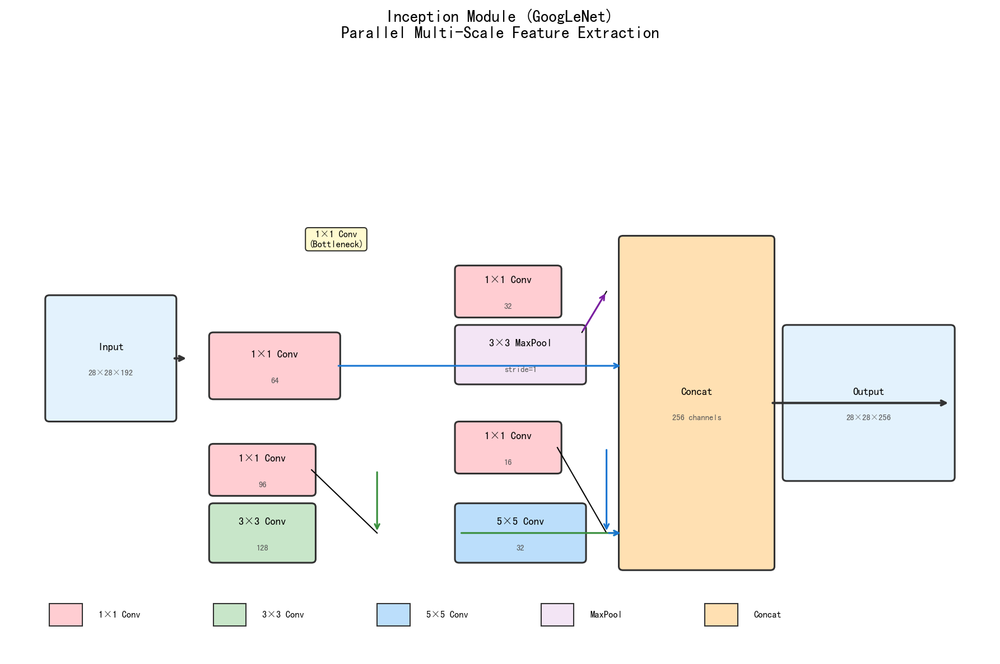

### 4.2 1×1 卷积核的作用

Inception 模块中大量使用 1×1 卷积核，起到两个关键作用：

**1. 降维（Dimension Reduction）**

```
不采用 1×1:
输入: 192 通道 → 5×5 Conv → 输出 256 通道
参数量: 192 × 5 × 5 × 256 = 123 万

采用 1×1 先压缩:
输入: 192 通道 → 1×1 Conv(96) → 3×3 Conv(256)
参数量: 192×1×1×96 + 96×3×3×256 = 1.8万 + 22万 = 24万
减少约 5 倍参数
```

**2. 增加非线性**

- 1×1 卷积后接 ReLU，相当于额外的非线性变换
- 可以在不损失特征的前提下减少计算量

### 4.3 GoogLeNet 结构概览

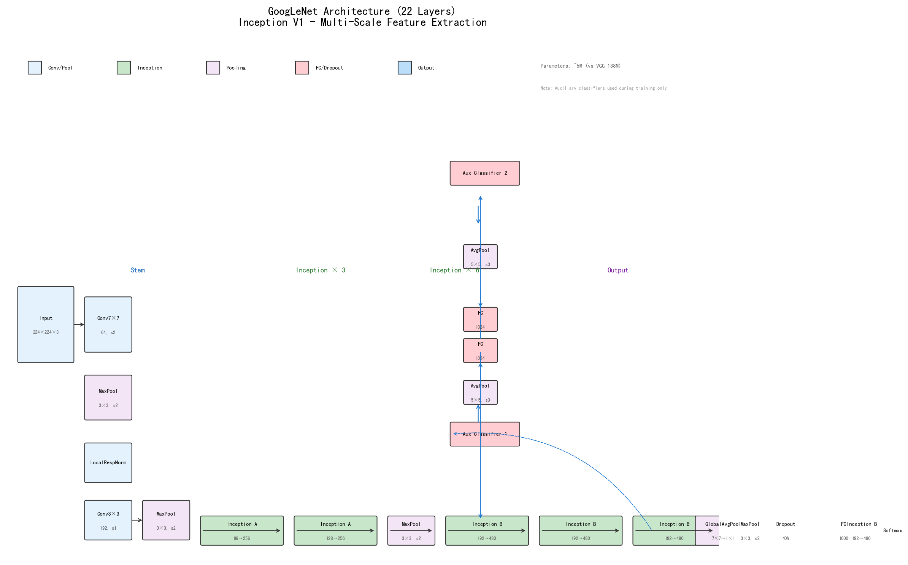

### 4.4 辅助分类器

GoogLeNet 在中间层额外增加了两个辅助分类器（Auxiliary Classifier）：
- 训练时提供额外的梯度信号，帮助深层网络收敛
- 推理时不使用

---

## 5. ResNet（2015）—— 残差连接 ⭐（重点）

### 5.1 问题的提出：网络越深不一定越好

VGG 发现网络深度对性能很重要，但简单地堆叠更多层会导致**退化问题**（Degradation）：

```
20层网络  vs  56层网络（都是同样的结构）

训练误差:  20层 < 56层 （越深越差！）
测试误差:  20层 < 56层

不是过拟合，而是优化困难
```

理论上，深网络至少应该能训练到和浅网络一样的水平（把后面的层设为恒等映射），但实际上随机初始化的权重很难让网络学到恒等映射。

### 5.2 残差连接（Residual Connection）解决方案

ResNet 的核心解决思路是：**让网络学习"残差"而不是直接学习"映射"**

```
普通网络（正常映射）:
输入 x → Conv → BN → ReLU → 输出 H(x)

ResNet（残差映射）:
输入 x → Conv → BN → ReLU → 输出 F(x)
     └─────────────────────→ + (shortcut)
                               ↓
                         输出 H(x) = F(x) + x
```

**核心公式**：
```
H(x) = F(x) + x

其中:
- x: 恒等映射（shortcut / skip connection）
- F(x): 网络需要学习的残差
- H(x): 最终输出
```

### 5.3 ResNet 残差块结构图

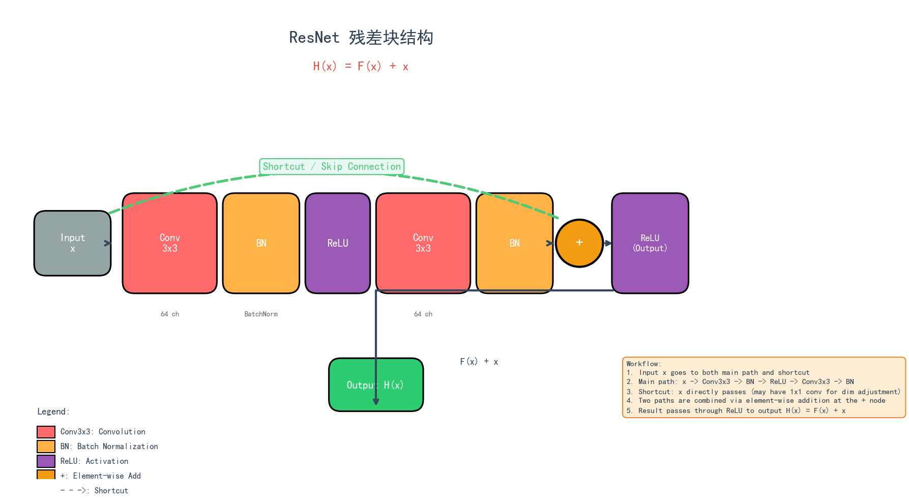

### 5.4 为什么残差连接有效？

| 原因 | 解释 |
|------|------|
| **恒等映射容易学习** | 如果 F(x)=0，则 H(x)=x（直接是恒等映射） |
| **梯度直接传递** |  shortcut 让梯度直接从深层传回浅层，缓解梯度消失 |
| **特征复用** | 浅层特征直接被深层使用，不需要重新学习 |
| **网络易于优化** | 网络只需学习"如何修正"而非"从头学习" |

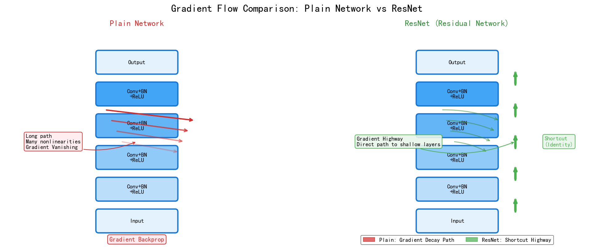

### 5.5 ResNet 网络结构

```
ResNet-50 架构（50 层）:

输入: 224×224×3
    ↓
Conv1: 7×7, 64, stride=2 → 112×112×64
MaxPool: 3×3, stride=2 → 56×56×64
    ↓
Stage 1: 3 个 BasicBlock, 64 通道 → 56×56×64
Stage 2: 4 个 BasicBlock, 128 通道 → 28×28×128
Stage 3: 6 个 BasicBlock, 256 通道 → 14×14×256
Stage 4: 3 个 BasicBlock, 512 通道 → 7×7×512
    ↓
Global Average Pooling → 1×1×512
    ↓
FC → 1000 类

ResNet-101: 在 Stage 3/4 加深
ResNet-152: 更深（152 层）
```

### 5.6 ResNet 的成就

- 2015 年 ImageNet 分类冠军（Top-5 准确率 96.4%）
- 是第一个网络深度超过 100 层的图像分类网络
- 残差连接成为后续几乎所有深度网络的标准组件（VGGNet+ResNet、DenseNet 等都采用）

---

## 6. 其他经典架构简介

### 6.1 DenseNet（2017）—— 密集连接

核心思想：每一层都接收所有前面层的特征图作为输入。

```
Dense Block 内连接:

Layer 1: x0 → Conv → x1
          ↘
Layer 2: x0+x1 → Conv → x2
          ↘↘
Layer 3: x0+x1+x2 → Conv → x3
          ↘↘↘
...
```

**与 ResNet 的区别**：
- ResNet: 逐元素相加（Additive）
- DenseNet: 通道维度拼接（Concatenative）

### 6.2 SE-Net（2017）—— 通道注意力

核心思想：让网络"关注"重要的通道，抑制不重要的通道。

```
Squeeze-and-Excitation 模块:

特征图 H×W×C
    ↓
Squeeze: 全局平均池化 → 1×1×C（每个通道的全局信息）
    ↓
Excitation: FC → ReLU → FC → Sigmoid → 1×1×C（通道权重）
    ↓
Scale: 原特征图 × 通道权重（重新校准通道）
```

---

## 7. 现代轻量化与高效架构

### 7.1 MobileNet 系列

MobileNet 是 Google 专为**移动端和嵌入式设备**设计的轻量化网络。

#### MobileNetV1（2017）：深度可分离卷积

**核心思想**：用**深度可分离卷积**（Depthwise Separable Convolution）替代标准卷积。

```
标准卷积: 1 个 3x3×C_in×C_out 卷积核
          FLOPs = H × W × C_in × C_out × 9

深度可分离卷积 = Depthwise + Pointwise
  Depthwise: C_in 个 3x3×1 卷积核（每个通道独立卷积）
              FLOPs = H × W × C_in × 9
  Pointwise: C_out 个 1x1×C_in 卷积核（通道融合）
              FLOPs = H × W × C_in × C_out
  总计: H × W × C_in × (9 + C_out)
```

**压缩比**：

$$
\frac{\text{DSC}}{\text{Standard}} = \frac{1}{C_{out}} + \frac{1}{9} \approx \frac{1}{8} \sim \frac{1}{9}
$$

**性能**：MobileNetV1 相比 AlexNet，参数减少 ~50×，精度略低。

#### MobileNetV2（2018）：Inverted Residuals

**核心创新**：

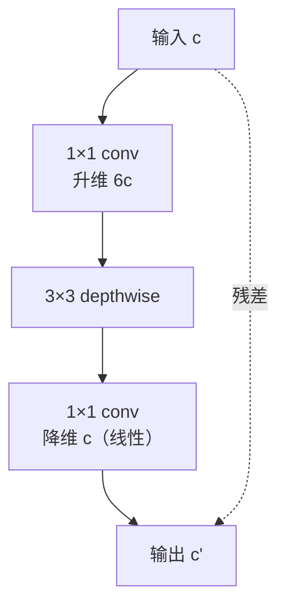

**关键设计**：
1. **Inverted Bottleneck**：先升维再做 depthwise（与 ResNet 相反）
2. **Linear Bottleneck**：最后 1×1 卷积不加 ReLU（避免破坏低维信息）
3. **Skip connection**：当 stride=1 且输入输出维度匹配时使用

```python
class InvertedResidual(nn.Module):
    def __init__(self, in_c, out_c, stride, expand_ratio=6):
        super().__init__()
        hidden_c = in_c * expand_ratio
        self.use_residual = (stride == 1) and (in_c == out_c)
        
        layers = []
        if expand_ratio != 1:
            layers.append(nn.Conv2d(in_c, hidden_c, 1, bias=False))
            layers.append(nn.BatchNorm2d(hidden_c))
            layers.append(nn.ReLU6(inplace=True))
        layers.extend([
            nn.Conv2d(hidden_c, hidden_c, 3, stride, 1, groups=hidden_c, bias=False),
            nn.BatchNorm2d(hidden_c),
            nn.ReLU6(inplace=True),
            nn.Conv2d(hidden_c, out_c, 1, bias=False),
            nn.BatchNorm2d(out_c),
        ])
        self.conv = nn.Sequential(*layers)
    
    def forward(self, x):
        if self.use_residual:
            return x + self.conv(x)
        return self.conv(x)
```

**ReLU6** 的使用：限制激活值最大为 6，配合 INT8 量化。

#### MobileNetV3（2019）：NAS + 优化

**两大改进**：

1. **神经架构搜索（NAS）**：用平台感知的 NAS 搜索最优结构
2. **h-swish 激活**：hard swish，比 swish 计算量小

```python
# h-swish
class HardSwish(nn.Module):
    def forward(self, x):
        return x * F.relu6(x + 3) / 6
```

**MobileNetV3 Block**：

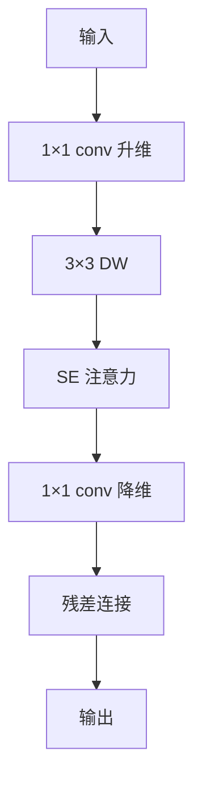

**MobileNetV3-Large**：ImageNet 75.2%，FLOPs 219M，参数 5.4M。
**MobileNetV3-Small**：ImageNet 67.5%，FLOPs 66M，参数 2.5M。

### 7.2 ShuffleNet 系列

**核心思想**：用**通道混洗**让分组卷积的输出能在不同组间流动。


**Channel Shuffle** 操作：

```python
def channel_shuffle(x, groups):
    """(B, C, H, W) → (B, C, H, W) 通道混洗"""
    b, c, h, w = x.size()
    x = x.view(b, groups, c // groups, h, w)  # 分组
    x = x.permute(0, 2, 1, 3, 4).contiguous()  # 维度重排
    x = x.view(b, c, h, w)
    return x
```

**ShuffleNetV2** 提出高效设计准则（详见 4-5 章）：

1. 等通道宽度（避免分支）
2. 减少分组卷积
3. 减少网络碎片
4. 减少逐元素操作

### 7.3 RepVGG：训练-推理分离架构

**核心思想**：训练时用多分支（ResNet-style），推理时**等价转换为单分支**（VGG-style），获得极致推理速度。

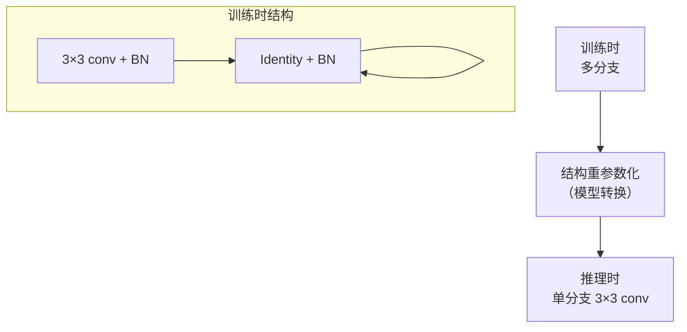

**结构重参数化步骤**：

1. **BN 吸收到 Conv 权重**：
   $$W_{fused} = W_{conv} \cdot \frac{\gamma}{\sqrt{\sigma^2 + \epsilon}}$$
   $$b_{fused} = \beta - \mu \cdot \frac{\gamma}{\sqrt{\sigma^2 + \epsilon}} + b_{conv}$$

2. **1×1 conv 零填充为 3×3**（周围一圈零）

3. **三个 3×3 conv 直接相加**（变成一个 3×3 conv）

**性能（ImageNet）**：

| 模型 | Top-1 | 推理速度 (1080Ti) |
|------|-------|-------------------|
| ResNet-50 | 76.1% | 142 FPS |
| **RepVGG-A0** | 72.4% | **2400 FPS** |
| RepVGG-B1g4 | 78.3% | 1000 FPS |
| RepVGG-B3 | 80.6% | 525 FPS |

**速度优势**：相同精度下，RepVGG 比 ResNet-50 快 5-10 倍。

**适用**：GPU/服务器端推理（不适合移动端）。

### 7.4 DenseNet：密集连接（详细）

DenseNet 通过**特征复用**让网络参数效率极高。

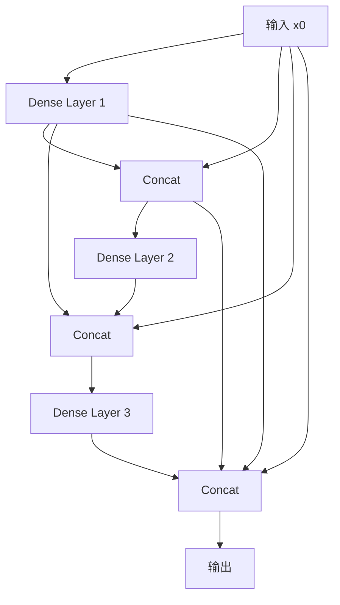

**公式**：第 $l$ 层的输入 = 所有前层特征拼接

$$
x_l = H_l([x_0, x_1, ..., x_{l-1}])
$$

**优势**：
- 缓解梯度消失（每层都直接连接输入）
- 特征复用，参数效率高
- 隐式深度监督

**缺点**：
- 训练时显存消耗大（中间特征全要保存）
- 推理时通过 Concat 操作较多

**DenseNet-121**：ImageNet Top-1 75.0%，参数仅 8M（vs ResNet-50 25M）。

### 7.5 GhostNet：廉价特征生成

**核心思想**：用**廉价操作**生成更多"冗余"特征。

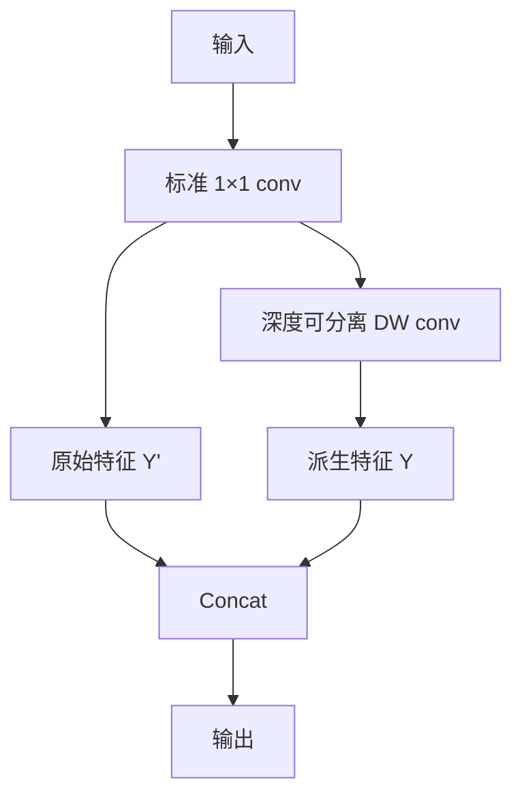

**优势**：用更少计算生成更多特征，理论压缩比 2-5×。

### 7.6 CNN 架构选型速查

| 任务场景 | 推荐架构 | 理由 |
|---------|----------|------|
| 通用分类（服务器） | ResNet-50 / ConvNeXt | 经典、生态成熟 |
| 移动端/边缘 | MobileNetV3 / ShuffleNetV2 | 极致轻量 |
| GPU 实时推理 | RepVGG | 速度 SOTA |
| 跨域迁移 | ImageNet 预训练 ResNet | 鲁棒 |
| 特征复用敏感 | DenseNet | 参数效率高 |
| ReID 任务 | OSNet | 多尺度 |
| 大规模预训练 | ConvNeXt-V2 / Swin | 性能强 |

---

### 7.7 三大经典 CNN 对比：ResNet50 vs MobileNetV2 vs Inception-ResNet-V2

> **本节核心**：这是工业部署选型时最常被比较的"三大经典"。理解它们的**设计哲学差异**和**性能权衡**比知道参数数字更重要。

### 三大架构的核心设计哲学

| 架构 | 年份 | 核心思想 | 关键创新 |
|------|------|----------|----------|
| **ResNet50** | 2015 | **残差连接**解决深度网络退化 | $H(x) = F(x) + x$ |
| **MobileNetV2** | 2018 | **倒残差 + 深度可分离卷积**实现极致轻量 | 先升维→DWConv→降维（与 ResNet 相反）|
| **Inception-ResNet-V2** | 2016 | **Inception 多尺度 + ResNet 残差**融合 | 多分支卷积 + 残差 |

### 7.5.1 ResNet50：残差连接的工业标准

**核心**：当网络很深时，**直接学习 $H(x)$ 困难**，改为学习残差 $F(x) = H(x) - x$，再求和 $F(x) + x$。

**Bottleneck Block**（ResNet50 用 3 层）：
```
输入 (256ch)
    ↓
1×1 Conv (256→64)   ← 降维
    ↓
3×3 Conv (64→64)    ← 主卷积
    ↓
1×1 Conv (64→256)   ← 升维
    ↓
+ 残差连接
    ↓
输出 (256ch)
```

**参数量分析**：
- 不用 bottleneck：3×3×256×256 × 3 = 1.77M 参数
- 用 bottleneck：1×1×256×64 + 3×3×64×64 + 1×1×64×256 = 69K 参数
- **节省 25× 参数**

### 7.5.2 MobileNetV2：轻量化的极致

**核心洞察**：ResNet 的 bottleneck 是"**降维→卷积→升维**"（中间窄两头宽），但 MobileNetV2 论文认为**降维后做非线性激活会丢失信息**。MobileNetV2 改为"**升维→卷积→降维**"（中间宽两头窄），中间**线性激活**（不 ReLU）。

**Inverted Residual + Linear Bottleneck**：

```
输入 (24ch, 低维)
    ↓
1×1 Conv (24→144)   ← 升维 6×
    ↓
3×3 DWConv (144ch)  ← Depthwise 卷积（极轻量）
    ↓
1×1 Conv (144→24)   ← 降维（线性，无 ReLU！）
    ↓
+ 残差连接
    ↓
输出 (24ch)
```

**Depthwise Separable Convolution**（MobileNet 系列核心）：

```python
# 标准卷积
standard = nn.Conv2d(in_ch, out_ch, 3, padding=1)  # 参数量: in×out×9
# 深度可分离卷积（拆成两步）
depthwise = nn.Conv2d(in_ch, in_ch, 3, padding=1, groups=in_ch)  # 参数量: in×9
pointwise = nn.Conv2d(in_ch, out_ch, 1)  # 参数量: in×out
# 参数量: in×9 + in×out （vs 标准 in×out×9，省 ~9×）
```

**MobileNetV2 vs ResNet50**：
- **参数减少 9×**（3.4M vs 25.6M）
- **FLOPs 减少 6×**（300M vs 4.1B）
- **精度只降 0.5-1%**（72.0% vs 76.1% on ImageNet）

### 7.5.3 Inception-ResNet-V2：双剑合璧

**核心思想**：Inception 的多尺度特征提取 + ResNet 的残差连接。

**Inception-A Block**（含残差）：
```
输入
    ↓
1×1 Conv
    ↓
├─ 1×1 Conv → 3×3 Conv
├─ 1×1 Conv → 3×3 Conv → 3×3 Conv  
└─ 1×1 AvgPool → 1×1 Conv
    ↓
Concat (通道合并)
    ↓
+ 残差
    ↓
输出
```

**Inception-ResNet-V2 的"魔法"**：
- Inception 多分支让网络**自己学"用哪个尺度"**（1×1 vs 3×3 vs 5×5）
- ResNet 残差让**训练 100+ 层的网络不崩溃**
- 组合效果：ImageNet Top-5 95.5%（vs ResNet-50 的 92.9%）

### 7.5.4 三大架构实测对比

| 指标 | ResNet-50 | MobileNetV2 (1.0) | Inception-ResNet-V2 |
|------|-----------|-------------------|-------------------|
| **参数量** | 25.6 M | 3.4 M | 55.8 M |
| **FLOPs** | 4.1 B | 0.30 B | 13.2 B |
| **Top-1 Acc (ImageNet)** | 76.1% | 72.0% | 80.3% |
| **Top-5 Acc (ImageNet)** | 92.9% | 91.0% | 95.5% |
| **CPU 推理 (ms)** | 87 | **18** | 145 |
| **GPU 推理 (ms)** | 8 | **3** | 22 |
| **内存 (MB)** | 102 | 14 | 215 |
| **适合场景** | 服务器精度优先 | 移动端实时 | 精度极致 |

### 7.5.5 5 大选型决策

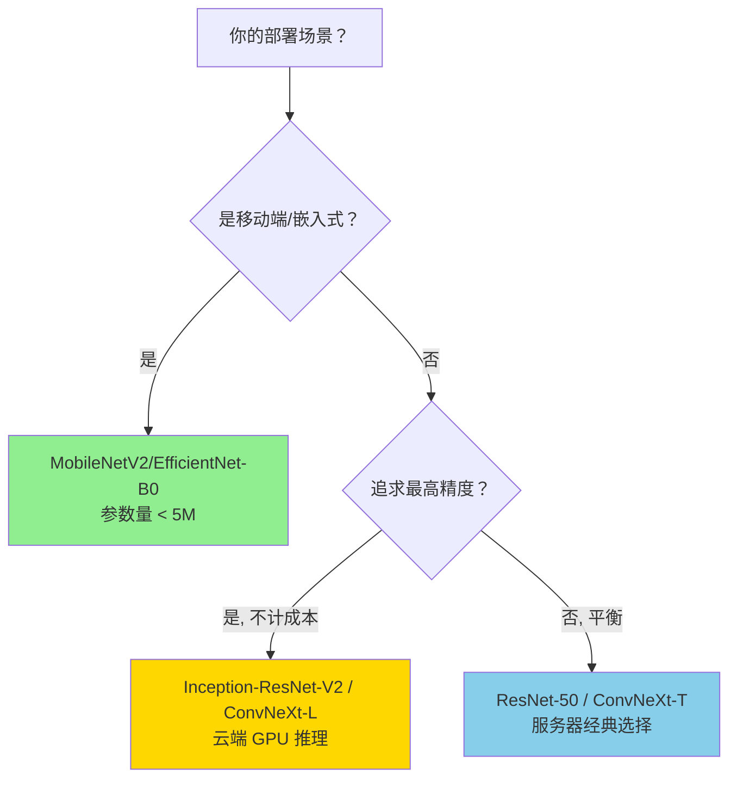

### 7.5.6 工业级实战建议

| 任务 | 首选 | 备选 |
|------|------|------|
| **移动端分类 (Android/iOS)** | MobileNetV2 | EfficientNet-B0 |
| **Jetson 边缘部署** | ResNet-50 / EfficientNet | MobileNetV2 |
| **服务器高精度** | ConvNeXt-Large | Inception-ResNet-V2 |
| **检测 backbone** | ResNet-50 + FPN | Swin-T + FPN |
| **分割 backbone** | ResNet-101 (dilated) | HRNet-W48 |
| **GAN 生成器** | ResNet-style | - |

### 7.5.7 关键经验

> **经验 1**：**没有"最好"的架构，只有"最适合"的架构**。MobileNetV2 在服务器上跑精度不如 ResNet-50，但内存只有 1/7。
> 
> **经验 2**：**深度可分离卷积（DWConv）是边缘部署的"金标准"**——MobileNet / EfficientNet / GhostNet 都用。
> 
> **经验 3**：**残差连接是"训练深度网络"的必要条件**。没有残差，100+ 层网络训练必然退化。
> 
> **经验 4**：**Inception 的多尺度思想 → 后续的 SPP / ASPP / FPN 都是这一思想**。
> 
> **经验 5**：**ResNet50 仍然是工业"安全选择"**——生态最成熟、FPN 标配、TensorRT 优化完善。

---

## 8. CNN 架构演进时间线

```
┌────────────────────────────────────────────────────────────────────────┐
│                     CNN 架构演进时间线                                  │
├────────────────────────────────────────────────────────────────────────┤
│                                                                        │
│  1998  ────────────────►  2012  ────────────────►  2014      2015  ►  │
│  LeNet-5                    AlexNet                    VGG    ResNet   │
│  (5层)                     (8层)                    (16层)  (152层)  │
│  手写数字                   ImageNet冠军              小卷积核 残差连接 │
│                                                                        │
│                        ┌─────────────────────────────────┐            │
│                        │     深度学习复兴                 │            │
│                        │  深层CNN + ReLU + Dropout       │            │
│                        └─────────────────────────────────┘            │
│                                                                        │
│  2014                 2016            2017           2018+           │
│  GoogLeNet           Inception V4     SE-Net         轻量化           │
│  Inception模块        ResNet结合      通道注意力      MobileNet      │
│  多尺度并行           深度残差        特征重标定      EfficientNet   │
│                                                                        │
└────────────────────────────────────────────────────────────────────────┘
```

| 年份    | 架构           | 关键创新                | Top-1 准确率 (ImageNet) |
| ----- | ------------ | ------------------- | -------------------- |
| 1998  | LeNet-5      | Conv+Pool+FC 基础结构   | ~88%（MNIST）          |
| 2012  | AlexNet      | ReLU、GPU 训练、Dropout | 62.5%                |
| 2014  | VGG-16       | 3×3 卷积核堆叠、深网络       | 71.9%                |
| 2014  | GoogLeNet    | Inception 模块、多尺度    | 67.4%（单模型）           |
| 2015  | ResNet-152   | 残差连接、152 层          | 77.2%                |
| 2017  | DenseNet     | 密集连接、特征复用           | 79.1%                |
| 2017  | SE-ResNet    | 通道注意力机制             | 78.4%                |
| 2020+ | EfficientNet | 复合缩放、AutoML         | 85.0%+               |
| 2022  | ConvNeXt     | 吸收 Transformer 设计理念 | 87.8%                |

---

## 9. 总结

| 架构 | 深度 | 核心贡献 |
|------|------|----------|
| LeNet-5 | 5 层 | CNN 奠基，局部+权重共享 |
| AlexNet | 8 层 | 深度学习复兴，ReLU+GPU |
| VGGNet | 16/19 层 | 3×3 小核堆叠哲学 |
| GoogLeNet | 22 层 | Inception 多尺度并行 |
| ResNet | 50-152 层 | ⭐ 残差连接突破深度瓶颈 |
| DenseNet | 100+ 层 | 密集连接、特征复用 |
| SE-Net | 变体 | 通道注意力机制 |

**演进规律**：
- 深度越来越深（从 5 层到 152 层）
- 卷积核越来越小（11→5→3）
- 连接越来越复杂（普通→残差→密集）
- 注意力机制被引入（SE、CBAM）

---

## Python 代码示例：经典CNN架构可视化

下面通过Python代码演示经典CNN架构的结构和参数对比：

### 经典 CNN 架构演进全景

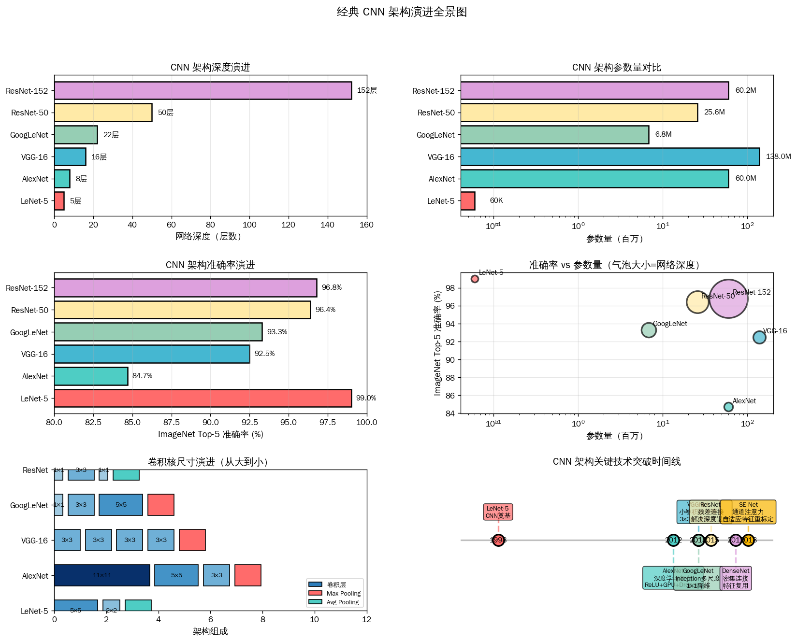

> 绘图代码：[`assets/figures/4-3-cnn-architectures-evolution.py`](../../assets/figures/4-3-cnn-architectures-evolution.py)

### ResNet 如何解决深度网络退化

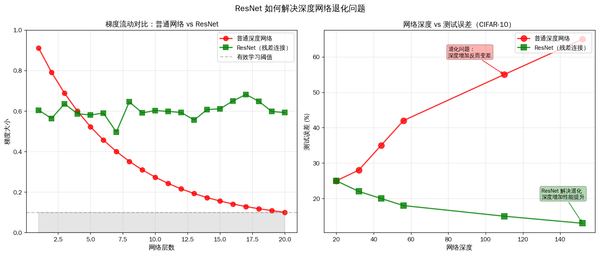

> 绘图代码：[`assets/figures/4-3-cnn-architectures-evolution.py`](../../assets/figures/4-3-cnn-architectures-evolution.py)

### 代码说明

1. **网络深度演进图**：
   - 展示了从LeNet-5(5层)到ResNet-152(152层)的深度演进
   - 体现深度学习"越深越好"的发展趋势

2. **参数量对比**：
   - VGG-16参数量最大(138M)，主要因为全连接层
   - GoogLeNet通过Inception和1×1降维，仅6.8M参数却达到92.5%准确率
   - 体现架构设计对效率的影响

3. **准确率演进**：
   - ImageNet Top-5准确率从84.7%(AlexNet)提升到96.8%(ResNet-152)
   - 12年提升12个百分点，体现深度学习进步

4. **准确率vs参数量散点图**：
   - 气泡大小代表网络深度
   - 展示GoogLeNet和ResNet在效率和性能上的平衡

5. **卷积核尺寸演进**：
   - 直观展示从LeNet-5的大卷积核(5×5)到VGG的小卷积核堆叠(3×3)
   - 说明小卷积核的优势：参数少、非线性更多、感受野相同

6. **ResNet解决退化问题**：
   - 左图：普通网络梯度随深度消失，ResNet保持梯度稳定
   - 右图：普通网络深度增加误差上升（退化），ResNet深度增加误差下降
   - 证明残差连接H(x) = F(x) + x的有效性

通过运行这段代码，读者可以直观理解CNN架构的演进历程和设计哲学。

---

## 本章小结

1. **LeNet-5（1998）**：CNN 奠基之作，用于手写数字识别。5 层结构（Conv+Pool+FC），证明了局部感受野+权重共享+降采样的有效性。

2. **AlexNet（2012）**：ImageNet 竞赛冠军，开启深度学习复兴。关键创新：ReLU 激活函数、GPU 并行训练、Dropout、LRN、Data Augmentation。

3. **VGGNet（2014）**：用多个 3×3 小卷积核堆叠代替大卷积核（如两个 3×3=5×5 感受野），确立"小卷积核多层堆叠"的标准范式。

4. **GoogLeNet（2014）**：Inception 模块在同一层并行多尺度卷积核，1×1 卷积核降维减少参数，引入辅助分类器帮助训练。

5. **ResNet（2015）⭐（重点）**：残差连接 H(x) = F(x) + x 让网络学习残差而非直接学习映射，有效解决深度网络退化问题，使网络深度可达 152 层。残差连接成为后续几乎所有深度网络的标准组件。

6. **演进规律**：深度越来越深（5→152层），卷积核越来越小（11→3），连接越来越复杂（普通→残差→密集），注意力机制被引入。

---


## 知识图谱

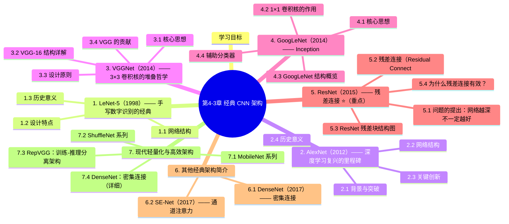

## 参考资料

1. LeCun, Y. et al. (1998). *Gradient-Based Learning Applied to Document Recognition* (LeNet-5)
2. Krizhevsky, A. et al. (2012). *ImageNet Classification with Deep Convolutional Neural Networks* (AlexNet)
3. Simonyan, K. & Zisserman, A. (2015). *Very Deep Convolutional Networks for Large-Scale Image Recognition* (VGGNet)
4. Szegedy, C. et al. (2015). *Going Deeper with Convolutions* (GoogLeNet)
5. He, K. et al. (2016). *Deep Residual Learning for Image Recognition* (ResNet)
6. Huang, G. et al. (2017). *Densely Connected Convolutional Networks* (DenseNet)
7. Hu, J. et al. (2018). *Squeeze-and-Excitation Networks* (SE-Net)