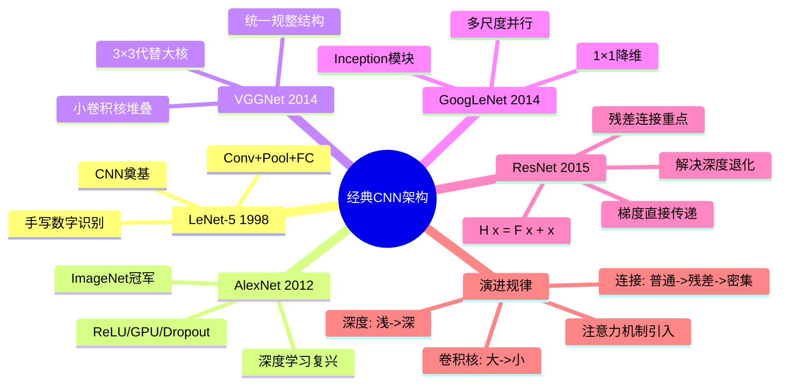

# 第4-3章 经典 CNN 架构

## 学习目标

- 了解 LeNet-5 的结构和它在手写数字识别中的历史地位
- 理解 AlexNet 的突破性贡献：ImageNet 竞赛和深度学习复兴
- 掌握 VGGNet 的核心设计思想：3×3 卷积核的堆叠
- 了解 GoogLeNet 的 Inception 模块设计
- 理解 ResNet 的残差连接（Residual Connection）及其为什么有效（重点）
- 了解 DenseNet、SE-Net 的创新点
- 能够描述 CNN 架构的演进时间线

---

## 1. LeNet-5（1998）—— 手写数字识别的经典

### 1.1 网络结构

LeNet-5 是由 Yann LeCun 等人提出的，是 CNN 的奠基之作，用于手写数字识别（MNIST 数据集）。

```
LeNet-5 架构:

输入: 32×32×1 灰度图像
    ↓
Conv1: 6 个 5×5 卷积核, padding=0, stride=1 → 28×28×6
    ↓
Pool1: 2×2 最大池化, stride=2 → 14×14×6
    ↓
Conv2: 16 个 5×5 卷积核, padding=0, stride=1 → 10×10×16
    ↓
Pool2: 2×2 最大池化, stride=2 → 5×5×16
    ↓
FC1: 120 个神经元 (全连接)
    ↓
FC2: 84 个神经元 (全连接)
    ↓
Output: 10 类 (Softmax)

可学习参数: 约 6 万个
```

### 1.2 设计特点

| 设计 | 说明 |
|------|------|
| 卷积 + 池化交替 | 特征提取 → 降维 → 再提取 |
| 局部连接 | 减少参数 |
| 权重共享 | 同一个卷积核在整张图上滑动 |
| Tanh 激活函数 | 当时 ReLU 还未被广泛使用 |
| MF 连接表 | Conv2 不全连接，保持轻量化 |

### 1.3 历史意义

- 首次用 CNN 解决实际问题（邮编识别）
- 证明了"局部感受野 + 权重共享 + 降采样"的有效性
- 为后来的 AlexNet 奠定了基础

---

## 2. AlexNet（2012）—— 深度学习复兴的里程碑

### 2.1 背景与突破

2012 年，Alex Krizhevsky 等人在 ImageNet 图像分类竞赛中以显著优势夺冠（Top-5 准确率 84.7%，第二名仅 73.8%），震惊了计算机视觉界。

这是深度学习在学术界和工业界大规模应用的转折点。

### 2.2 网络结构

```
AlexNet 架构（双 GPU 并行）:

输入: 224×224×3 RGB 图像
    ↓
Conv1: 96 个 11×11 卷积核, stride=4, padding=0 → 55×55×96
    ↓
MaxPool1: 3×3, stride=2 → 27×27×96
    ↓
Norm1: Local Response Normalization
    ↓
Conv2: 256 个 5×5 卷积核, padding=2 → 27×27×256
    ↓
MaxPool2: 3×3, stride=2 → 13×13×256
    ↓
Norm2: Local Response Normalization
    ↓
Conv3: 384 个 3×3 卷积核, padding=1 → 13×13×384
Conv4: 384 个 3×3 卷积核, padding=1 → 13×13×384
Conv5: 256 个 3×3 卷积核, padding=1 → 13×13×256
    ↓
MaxPool3: 3×3, stride=2 → 6×6×256
    ↓
FC6: 4096 神经元 + ReLU + Dropout
FC7: 4096 神经元 + ReLU + Dropout
FC8: 1000 类 (Softmax)

可学习参数: 约 6000 万个
训练时间: 5-6 天（双 GPU）
```

### 2.3 关键创新

| 创新 | 说明 |
|------|------|
| **ReLU 激活函数** | 比 Tanh/Sigmoid 快很多梯度下降收敛 |
| **多 GPU 并行** | 双 GPU 训练，显存分割 |
| **LRN（局部响应归一化）** | 模拟生物神经元的侧抑制现象 |
| **Overlapping Pooling** | 池化窗口重叠，比不重叠有更好的泛化效果 |
| **Dropout** | 防止过拟合，训练时随机丢弃神经元 |
| **Data Augmentation** | 随机裁剪、水平翻转、颜色抖动 |

### 2.4 历史意义

- 开启了深度学习在计算机视觉的全面应用时代
- 证明了深层 CNN 在大规模图像分类任务中的有效性
- 推动了后续 VGG、GoogLeNet、ResNet 等一系列更深网络的涌现

---

## 3. VGGNet（2014）—— 3×3 卷积核的堆叠哲学

### 3.1 核心思想

VGGNet（Visual Geometry Group）由 Simonyan 和 Zisserman 提出，其核心设计思想是：

> **用多个 3×3 卷积核堆叠代替大卷积核**

- 两个 3×3 卷积核叠加 = 1 个 5×5 的感受野
- 三个 3×3 卷积核叠加 = 1 个 7×7 的感受野

```
感受野对比:
两个 3×3 叠加 → 感受野 = 5×5
三个 3×3 叠加 → 感受野 = 7×7

参数数量对比:
5×5 卷积: 25 个参数
两个 3×3: 9 + 9 = 18 个参数（更少）

非线性激活:
5×5 卷积: 1 次 ReLU
两个 3×3: 2 次 ReLU（更多非线性变换）
```

### 3.2 VGG-16 结构详解

```
VGG-16 架构:

输入: 224×224×3

# Block 1
Conv3-64:   3×3, 64个 → 224×224×64
Conv3-64:   3×3, 64个 → 224×224×64
Pool1:      2×2 MaxPool → 112×112×64

# Block 2
Conv3-128:  3×3, 128个 → 112×112×128
Conv3-128:  3×3, 128个 → 112×112×128
Pool2:      2×2 MaxPool → 56×56×128

# Block 3
Conv3-256:  3×3, 256个 → 56×56×256
Conv3-256:  3×3, 256个 → 56×56×256
Conv3-256:  3×3, 256个 → 56×56×256
Pool3:      2×2 MaxPool → 28×28×256

# Block 4
Conv3-512:  3×3, 512个 → 28×28×512
Conv3-512:  3×3, 512个 → 28×28×512
Conv3-512:  3×3, 512个 → 28×28×512
Pool4:      2×2 MaxPool → 14×14×512

# Block 5
Conv3-512:  3×3, 512个 → 14×14×512
Conv3-512:  3×3, 512个 → 14×14×512
Conv3-512:  3×3, 512个 → 14×14×512
Pool5:      2×2 MaxPool → 7×7×512

FC: 4096 神经元 + ReLU + Dropout
FC: 4096 神经元 + ReLU + Dropout
Output: 1000 类 (Softmax)

可学习参数: 约 1.38 亿个
```

### 3.3 设计原则

| 原则 | 说明 |
|------|------|
| 统一的卷积核尺寸 | 所有卷积都是 3×3，便于编程和优化 |
| 逐步翻倍通道数 | 64 → 128 → 256 → 512，特征越来越丰富 |
| 固定池化尺寸 | 都是 2×2，stride=2，每层尺寸减半 |
| 结构规整 | 模块化设计，易于理解和改进 |

### 3.4 VGG 的贡献

- 证明了**网络深度**对模型性能的重要性
- 确立了"小卷积核多层堆叠"的标准范式
- 至今仍是很多任务的基准 backbone

---

## 4. GoogLeNet（2014）—— Inception 模块

### 4.1 核心思想

GoogLeNet（Inception V1）由 Google 研究团队提出，核心创新是**Inception 模块**——在同一层中并行使用多种尺度的卷积核，同时捕获不同粒度的特征。


### 4.2 1×1 卷积核的作用

Inception 模块中大量使用 1×1 卷积核，起到两个关键作用：

**1. 降维（Dimension Reduction）**

```
不采用 1×1:
输入: 192 通道 → 5×5 Conv → 输出 256 通道
参数量: 192 × 5 × 5 × 256 = 123 万

采用 1×1 先压缩:
输入: 192 通道 → 1×1 Conv(96) → 3×3 Conv(256)
参数量: 192×1×1×96 + 96×3×3×256 = 1.8万 + 22万 = 24万
减少约 5 倍参数
```

**2. 增加非线性**

- 1×1 卷积后接 ReLU，相当于额外的非线性变换
- 可以在不损失特征的前提下减少计算量

### 4.3 GoogLeNet 结构概览


### 4.4 辅助分类器

GoogLeNet 在中间层额外增加了两个辅助分类器（Auxiliary Classifier）：
- 训练时提供额外的梯度信号，帮助深层网络收敛
- 推理时不使用

---

## 5. ResNet（2015）—— 残差连接 ⭐（重点）

### 5.1 问题的提出：网络越深不一定越好

VGG 发现网络深度对性能很重要，但简单地堆叠更多层会导致**退化问题**（Degradation）：

```
20层网络  vs  56层网络（都是同样的结构）

训练误差:  20层 < 56层 （越深越差！）
测试误差:  20层 < 56层

不是过拟合，而是优化困难
```

理论上，深网络至少应该能训练到和浅网络一样的水平（把后面的层设为恒等映射），但实际上随机初始化的权重很难让网络学到恒等映射。

### 5.2 残差连接（Residual Connection）解决方案

ResNet 的核心解决思路是：**让网络学习"残差"而不是直接学习"映射"**

```
普通网络（正常映射）:
输入 x → Conv → BN → ReLU → 输出 H(x)

ResNet（残差映射）:
输入 x → Conv → BN → ReLU → 输出 F(x)
     └─────────────────────→ + (shortcut)
                               ↓
                         输出 H(x) = F(x) + x
```

**核心公式**：
```
H(x) = F(x) + x

其中:
- x: 恒等映射（shortcut / skip connection）
- F(x): 网络需要学习的残差
- H(x): 最终输出
```

### 5.3 ResNet 残差块结构图


### 5.4 为什么残差连接有效？

| 原因 | 解释 |
|------|------|
| **恒等映射容易学习** | 如果 F(x)=0，则 H(x)=x（直接是恒等映射） |
| **梯度直接传递** |  shortcut 让梯度直接从深层传回浅层，缓解梯度消失 |
| **特征复用** | 浅层特征直接被深层使用，不需要重新学习 |
| **网络易于优化** | 网络只需学习"如何修正"而非"从头学习" |


### 5.5 ResNet 网络结构

```
ResNet-50 架构（50 层）:

输入: 224×224×3
    ↓
Conv1: 7×7, 64, stride=2 → 112×112×64
MaxPool: 3×3, stride=2 → 56×56×64
    ↓
Stage 1: 3 个 BasicBlock, 64 通道 → 56×56×64
Stage 2: 4 个 BasicBlock, 128 通道 → 28×28×128
Stage 3: 6 个 BasicBlock, 256 通道 → 14×14×256
Stage 4: 3 个 BasicBlock, 512 通道 → 7×7×512
    ↓
Global Average Pooling → 1×1×512
    ↓
FC → 1000 类

ResNet-101: 在 Stage 3/4 加深
ResNet-152: 更深（152 层）
```

### 5.6 ResNet 的成就

- 2015 年 ImageNet 分类冠军（Top-5 准确率 96.4%）
- 是第一个网络深度超过 100 层的图像分类网络
- 残差连接成为后续几乎所有深度网络的标准组件（VGGNet+ResNet、DenseNet 等都采用）

---

## 6. 其他经典架构简介

### 6.1 DenseNet（2017）—— 密集连接

核心思想：每一层都接收所有前面层的特征图作为输入。

```
Dense Block 内连接:

Layer 1: x0 → Conv → x1
          ↘
Layer 2: x0+x1 → Conv → x2
          ↘↘
Layer 3: x0+x1+x2 → Conv → x3
          ↘↘↘
...
```

**与 ResNet 的区别**：
- ResNet: 逐元素相加（Additive）
- DenseNet: 通道维度拼接（Concatenative）

### 6.2 SE-Net（2017）—— 通道注意力

核心思想：让网络"关注"重要的通道，抑制不重要的通道。

```
Squeeze-and-Excitation 模块:

特征图 H×W×C
    ↓
Squeeze: 全局平均池化 → 1×1×C（每个通道的全局信息）
    ↓
Excitation: FC → ReLU → FC → Sigmoid → 1×1×C（通道权重）
    ↓
Scale: 原特征图 × 通道权重（重新校准通道）
```

---

## 7. CNN 架构演进时间线

```
┌────────────────────────────────────────────────────────────────────────┐
│                     CNN 架构演进时间线                                  │
├────────────────────────────────────────────────────────────────────────┤
│                                                                        │
│  1998  ────────────────►  2012  ────────────────►  2014      2015  ►  │
│  LeNet-5                    AlexNet                    VGG    ResNet   │
│  (5层)                     (8层)                    (16层)  (152层)  │
│  手写数字                   ImageNet冠军              小卷积核 残差连接 │
│                                                                        │
│                        ┌─────────────────────────────────┐            │
│                        │     深度学习复兴                 │            │
│                        │  深层CNN + ReLU + Dropout       │            │
│                        └─────────────────────────────────┘            │
│                                                                        │
│  2014                 2016            2017           2018+           │
│  GoogLeNet           Inception V4     SE-Net         轻量化           │
│  Inception模块        ResNet结合      通道注意力      MobileNet      │
│  多尺度并行           深度残差        特征重标定      EfficientNet   │
│                                                                        │
└────────────────────────────────────────────────────────────────────────┘
```

| 年份 | 架构 | 关键创新 | Top-1 准确率 (ImageNet) |
|------|------|----------|----------------------|
| 1998 | LeNet-5 | Conv+Pool+FC 基础结构 | ~88%（MNIST） |
| 2012 | AlexNet | ReLU、GPU 训练、Dropout | 62.5% |
| 2014 | VGG-16 | 3×3 卷积核堆叠、深网络 | 71.9% |
| 2014 | GoogLeNet | Inception 模块、多尺度 | 67.4%（单模型） |
| 2015 | ResNet-152 | 残差连接、152 层 | 77.2% |
| 2017 | DenseNet | 密集连接、特征复用 | 79.1% |
| 2017 | SE-ResNet | 通道注意力机制 | 78.4% |
| 2020+ | EfficientNet | 复合缩放、AutoML | 85.0%+ |
| 2022 | ConvNeXt | 吸收 Transformer 设计理念 | 87.8% |

---

## 8. 总结

| 架构 | 深度 | 核心贡献 |
|------|------|----------|
| LeNet-5 | 5 层 | CNN 奠基，局部+权重共享 |
| AlexNet | 8 层 | 深度学习复兴，ReLU+GPU |
| VGGNet | 16/19 层 | 3×3 小核堆叠哲学 |
| GoogLeNet | 22 层 | Inception 多尺度并行 |
| ResNet | 50-152 层 | ⭐ 残差连接突破深度瓶颈 |
| DenseNet | 100+ 层 | 密集连接、特征复用 |
| SE-Net | 变体 | 通道注意力机制 |

**演进规律**：
- 深度越来越深（从 5 层到 152 层）
- 卷积核越来越小（11→5→3）
- 连接越来越复杂（普通→残差→密集）
- 注意力机制被引入（SE、CBAM）

---

## Python 代码示例：经典CNN架构可视化

下面通过Python代码演示经典CNN架构的结构和参数对比：

```python
import numpy as np
import matplotlib.pyplot as plt
import matplotlib.patches as mpatches
from matplotlib.patches import FancyBboxPatch, Rectangle
import matplotlib.gridspec as gridspec

# 设置中文字体
plt.rcParams['font.sans-serif'] = ['SimHei', 'DejaVu Sans']
plt.rcParams['axes.unicode_minus'] = False

def visualize_cnn_architectures():
    """可视化经典CNN架构的演进"""
    
    # 1. CNN架构演进时间线
    fig = plt.figure(figsize=(16, 12))
    gs = gridspec.GridSpec(3, 2, figure=fig, hspace=0.4, wspace=0.3)
    
    # 数据：经典CNN架构信息
    architectures = [
        {'name': 'LeNet-5', 'year': 1998, 'layers': 5, 'params': 0.06, 'acc': 99.0, 'color': '#FF6B6B'},
        {'name': 'AlexNet', 'year': 2012, 'layers': 8, 'params': 60, 'acc': 84.7, 'color': '#4ECDC4'},
        {'name': 'VGG-16', 'year': 2014, 'layers': 16, 'params': 138, 'acc': 92.5, 'color': '#45B7D1'},
        {'name': 'GoogLeNet', 'year': 2014, 'layers': 22, 'params': 6.8, 'acc': 93.3, 'color': '#96CEB4'},
        {'name': 'ResNet-50', 'year': 2015, 'layers': 50, 'params': 25.6, 'acc': 96.4, 'color': '#FFEAA7'},
        {'name': 'ResNet-152', 'year': 2015, 'layers': 152, 'params': 60.2, 'acc': 96.8, 'color': '#DDA0DD'}
    ]
    
    names = [a['name'] for a in architectures]
    years = [a['year'] for a in architectures]
    layers = [a['layers'] for a in architectures]
    params = [a['params'] for a in architectures]
    accs = [a['acc'] for a in architectures]
    colors = [a['color'] for a in architectures]
    
    # 1. 网络深度演进
    ax1 = fig.add_subplot(gs[0, 0])
    bars1 = ax1.barh(names, layers, color=colors, edgecolor='black', linewidth=1.5)
    ax1.set_xlabel('网络深度（层数）', fontsize=11, fontweight='bold')
    ax1.set_title('CNN架构深度演进', fontsize=12, fontweight='bold')
    ax1.set_xlim(0, 160)
    for i, (bar, layer) in enumerate(zip(bars1, layers)):
        ax1.text(layer + 3, bar.get_y() + bar.get_height()/2, 
                f'{layer}层', va='center', fontsize=9, fontweight='bold')
    ax1.grid(axis='x', alpha=0.3)
    
    # 2. 参数量对比
    ax2 = fig.add_subplot(gs[0, 1])
    bars2 = ax2.barh(names, params, color=colors, edgecolor='black', linewidth=1.5)
    ax2.set_xlabel('参数量（百万）', fontsize=11, fontweight='bold')
    ax2.set_title('CNN架构参数量对比', fontsize=12, fontweight='bold')
    ax2.set_xscale('log')
    for i, (bar, param) in enumerate(zip(bars2, params)):
        if param >= 1:
            ax2.text(param * 1.2, bar.get_y() + bar.get_height()/2, 
                    f'{param:.1f}M', va='center', fontsize=9, fontweight='bold')
        else:
            ax2.text(param * 1.5, bar.get_y() + bar.get_height()/2, 
                    f'{param*1000:.0f}K', va='center', fontsize=9, fontweight='bold')
    ax2.grid(axis='x', alpha=0.3)
    
    # 3. ImageNet准确率演进
    ax3 = fig.add_subplot(gs[1, 0])
    bars3 = ax3.barh(names, accs, color=colors, edgecolor='black', linewidth=1.5)
    ax3.set_xlabel('ImageNet Top-5 准确率 (%)', fontsize=11, fontweight='bold')
    ax3.set_title('CNN架构准确率演进', fontsize=12, fontweight='bold')
    ax3.set_xlim(80, 100)
    for i, (bar, acc) in enumerate(zip(bars3, accs)):
        ax3.text(acc + 0.3, bar.get_y() + bar.get_height()/2, 
                f'{acc}%', va='center', fontsize=9, fontweight='bold')
    ax3.grid(axis='x', alpha=0.3)
    
    # 4. 准确率 vs 参数量散点图
    ax4 = fig.add_subplot(gs[1, 1])
    for i, arch in enumerate(architectures):
        ax4.scatter(arch['params'], arch['acc'], s=arch['layers']*15, 
                   c=arch['color'], edgecolors='black', linewidth=2, 
                   label=arch['name'], alpha=0.7)
        ax4.annotate(arch['name'], (arch['params'], arch['acc']), 
                    xytext=(5, 5), textcoords='offset points', 
                    fontsize=9, fontweight='bold')
    ax4.set_xlabel('参数量（百万）', fontsize=11, fontweight='bold')
    ax4.set_ylabel('ImageNet Top-5 准确率 (%)', fontsize=11, fontweight='bold')
    ax4.set_title('准确率 vs 参数量（气泡大小=网络深度）', fontsize=12, fontweight='bold')
    ax4.grid(True, alpha=0.3)
    ax4.set_xscale('log')
    
    # 5. 卷积核尺寸演进
    ax5 = fig.add_subplot(gs[2, 0])
    kernel_evolution = [
        ('LeNet-5', [5, 2, 'avg']),
        ('AlexNet', [11, 5, 3, 'max']),
        ('VGG-16', [3, 3, 3, 3, 'max']),
        ('GoogLeNet', [1, 3, 5, 'max']),
        ('ResNet', [1, 3, 1, 'avg'])
    ]
    
    y_pos = np.arange(len(kernel_evolution))
    for i, (name, kernels) in enumerate(kernel_evolution):
        x_pos = 0
        for j, k in enumerate(kernels):
            if k == 'max':
                color = '#FF6B6B'
                label = 'MaxPool'
                width = 1
            elif k == 'avg':
                color = '#4ECDC4'
                label = 'AvgPool'
                width = 1
            else:
                color = plt.cm.Blues(0.3 + 0.7 * (k / 11))
                label = f'{k}×{k} Conv'
                width = k / 3
            
            rect = Rectangle((x_pos, i-0.3), width, 0.6, 
                           facecolor=color, edgecolor='black', linewidth=1)
            ax5.add_patch(rect)
            if isinstance(k, int):
                ax5.text(x_pos + width/2, i, f'{k}×{k}', 
                        ha='center', va='center', fontsize=8, fontweight='bold')
            x_pos += width + 0.2
    
    ax5.set_yticks(y_pos)
    ax5.set_yticklabels([name for name, _ in kernel_evolution])
    ax5.set_xlabel('架构组成', fontsize=11, fontweight='bold')
    ax5.set_title('卷积核尺寸演进（从大到小）', fontsize=12, fontweight='bold')
    ax5.set_xlim(0, 12)
    
    # 添加图例
    legend_elements = [
        mpatches.Patch(facecolor=plt.cm.Blues(0.7), edgecolor='black', label='卷积层'),
        mpatches.Patch(facecolor='#FF6B6B', edgecolor='black', label='Max Pooling'),
        mpatches.Patch(facecolor='#4ECDC4', edgecolor='black', label='Avg Pooling')
    ]
    ax5.legend(handles=legend_elements, loc='lower right', fontsize=8)
    
    # 6. 关键技术突破时间线
    ax6 = fig.add_subplot(gs[2, 1])
    ax6.axis('off')
    
    milestones = [
        (1998, 'LeNet-5', 'CNN奠基', '#FF6B6B'),
        (2012, 'AlexNet', '深度学习复兴\nReLU+GPU+Dropout', '#4ECDC4'),
        (2014, 'VGGNet', '小卷积核堆叠\n3×3标准范式', '#45B7D1'),
        (2014, 'GoogLeNet', 'Inception多尺度\n1×1降维', '#96CEB4'),
        (2015, 'ResNet', '残差连接⭐\n解决深度退化', '#FFEAA7'),
        (2017, 'DenseNet', '密集连接\n特征复用', '#DDA0DD'),
        (2018, 'SE-Net', '通道注意力\n自适应特征重标定', '#F8B500')
    ]
    
    # 绘制时间线
    ax6.axhline(y=0.5, color='gray', linestyle='-', linewidth=2, alpha=0.5)
    
    for i, (year, name, desc, color) in enumerate(milestones):
        y_offset = 0.7 if i % 2 == 0 else 0.3
        
        # 年份标记
        ax6.scatter(year, 0.5, s=200, c=color, edgecolors='black', linewidth=2, zorder=5)
        ax6.text(year, 0.5, str(year), ha='center', va='center', 
                fontsize=9, fontweight='bold', zorder=6)
        
        # 连接线
        ax6.plot([year, year], [0.5, y_offset], color=color, linewidth=2, linestyle='--', alpha=0.7)
        
        # 名称和描述
        ax6.text(year, y_offset, f'{name}\n{desc}', ha='center', va='center' if i % 2 == 0 else 'top',
                fontsize=8, bbox=dict(boxstyle='round,pad=0.3', facecolor=color, alpha=0.7))
    
    ax6.set_xlim(1995, 2020)
    ax6.set_ylim(0, 1)
    ax6.set_title('CNN架构关键技术突破时间线', fontsize=12, fontweight='bold')
    
    plt.suptitle('经典CNN架构演进全景图', fontsize=14, fontweight='bold')
    plt.tight_layout()
    plt.show()
    
    return architectures

def compare_resnet_vs_plain():
    """对比ResNet与普通网络的梯度流动"""
    fig, axes = plt.subplots(1, 2, figsize=(14, 6))
    
    # 模拟梯度流动
    layers = np.arange(1, 21)
    
    # 普通网络：梯度逐渐消失
    plain_gradients = np.exp(-layers * 0.15) + 0.05
    
    # ResNet：残差连接保持梯度
    resnet_gradients = np.ones_like(layers) * 0.6 + np.random.normal(0, 0.05, len(layers))
    resnet_gradients = np.clip(resnet_gradients, 0.4, 0.8)
    
    # 左图：梯度大小对比
    ax1 = axes[0]
    ax1.plot(layers, plain_gradients, 'o-', color='red', linewidth=2, 
            markersize=8, label='普通深度网络', alpha=0.8)
    ax1.plot(layers, resnet_gradients, 's-', color='green', linewidth=2, 
            markersize=8, label='ResNet（残差连接）', alpha=0.8)
    ax1.axhline(y=0.1, color='gray', linestyle='--', alpha=0.5, label='有效学习阈值')
    ax1.fill_between(layers, 0, 0.1, alpha=0.2, color='gray')
    
    ax1.set_xlabel('网络层数', fontsize=11, fontweight='bold')
    ax1.set_ylabel('梯度大小', fontsize=11, fontweight='bold')
    ax1.set_title('梯度流动对比：普通网络 vs ResNet', fontsize=12, fontweight='bold')
    ax1.legend(fontsize=10, loc='upper right')
    ax1.grid(True, alpha=0.3)
    ax1.set_ylim(0, 1)
    
    # 右图：训练误差随深度变化
    ax2 = axes[1]
    depths = [20, 32, 44, 56, 110, 152]
    
    # 普通网络：深度增加反而误差上升（退化问题）
    plain_errors = [25, 28, 35, 42, 55, 65]
    
    # ResNet：深度增加误差持续下降
    resnet_errors = [25, 22, 20, 18, 15, 13]
    
    ax2.plot(depths, plain_errors, 'o-', color='red', linewidth=2, 
            markersize=10, label='普通深度网络', alpha=0.8)
    ax2.plot(depths, resnet_errors, 's-', color='green', linewidth=2, 
            markersize=10, label='ResNet（残差连接）', alpha=0.8)
    
    ax2.set_xlabel('网络深度', fontsize=11, fontweight='bold')
    ax2.set_ylabel('测试误差 (%)', fontsize=11, fontweight='bold')
    ax2.set_title('网络深度 vs 测试误差（CIFAR-10）', fontsize=12, fontweight='bold')
    ax2.legend(fontsize=10, loc='upper right')
    ax2.grid(True, alpha=0.3)
    
    # 添加注释
    ax2.annotate('退化问题：\n深度增加反而变差', xy=(110, 55), xytext=(80, 60),
                fontsize=9, bbox=dict(boxstyle='round', facecolor='red', alpha=0.3),
                arrowprops=dict(arrowstyle='->', color='red'))
    ax2.annotate('ResNet解决退化\n深度增加性能提升', xy=(152, 13), xytext=(130, 20),
                fontsize=9, bbox=dict(boxstyle='round', facecolor='green', alpha=0.3),
                arrowprops=dict(arrowstyle='->', color='green'))
    
    plt.suptitle('ResNet如何解决深度网络退化问题', fontsize=14, fontweight='bold')
    plt.tight_layout()
    plt.show()

# 运行可视化
if __name__ == "__main__":
    architectures = visualize_cnn_architectures()
    compare_resnet_vs_plain()
    
    print("\n经典CNN架构关键数据对比:")
    print("-" * 70)
    print(f"{'架构':<12} {'年份':<8} {'深度':<8} {'参数量':<12} {'准确率':<10}")
    print("-" * 70)
    for arch in architectures:
        params_str = f"{arch['params']:.1f}M" if arch['params'] >= 1 else f"{arch['params']*1000:.0f}K"
        print(f"{arch['name']:<12} {arch['year']:<8} {arch['layers']:<8} {params_str:<12} {arch['acc']:<10}")
    print("-" * 70)
    
    print("\n架构演进核心规律:")
    print("1. 深度: LeNet-5(5层) → AlexNet(8层) → VGG(16-19层) → ResNet(50-152层)")
    print("2. 卷积核: 大(11×11) → 中(5×5) → 小(3×3) → 微型(1×1)")
    print("3. 连接方式: 普通连接 → 残差连接(ResNet) → 密集连接(DenseNet)")
    print("4. 效率: GoogLeNet用Inception减少参数(6.8M)，ResNet用残差增加深度")
```

### 代码说明

1. **网络深度演进图**：
   - 展示了从LeNet-5(5层)到ResNet-152(152层)的深度演进
   - 体现深度学习"越深越好"的发展趋势

2. **参数量对比**：
   - VGG-16参数量最大(138M)，主要因为全连接层
   - GoogLeNet通过Inception和1×1降维，仅6.8M参数却达到92.5%准确率
   - 体现架构设计对效率的影响

3. **准确率演进**：
   - ImageNet Top-5准确率从84.7%(AlexNet)提升到96.8%(ResNet-152)
   - 12年提升12个百分点，体现深度学习进步

4. **准确率vs参数量散点图**：
   - 气泡大小代表网络深度
   - 展示GoogLeNet和ResNet在效率和性能上的平衡

5. **卷积核尺寸演进**：
   - 直观展示从LeNet-5的大卷积核(5×5)到VGG的小卷积核堆叠(3×3)
   - 说明小卷积核的优势：参数少、非线性更多、感受野相同

6. **ResNet解决退化问题**：
   - 左图：普通网络梯度随深度消失，ResNet保持梯度稳定
   - 右图：普通网络深度增加误差上升（退化），ResNet深度增加误差下降
   - 证明残差连接H(x) = F(x) + x的有效性

通过运行这段代码，读者可以直观理解CNN架构的演进历程和设计哲学。

---

## 本章小结

1. **LeNet-5（1998）**：CNN 奠基之作，用于手写数字识别。5 层结构（Conv+Pool+FC），证明了局部感受野+权重共享+降采样的有效性。

2. **AlexNet（2012）**：ImageNet 竞赛冠军，开启深度学习复兴。关键创新：ReLU 激活函数、GPU 并行训练、Dropout、LRN、Data Augmentation。

3. **VGGNet（2014）**：用多个 3×3 小卷积核堆叠代替大卷积核（如两个 3×3=5×5 感受野），确立"小卷积核多层堆叠"的标准范式。

4. **GoogLeNet（2014）**：Inception 模块在同一层并行多尺度卷积核，1×1 卷积核降维减少参数，引入辅助分类器帮助训练。

5. **ResNet（2015）⭐（重点）**：残差连接 H(x) = F(x) + x 让网络学习残差而非直接学习映射，有效解决深度网络退化问题，使网络深度可达 152 层。残差连接成为后续几乎所有深度网络的标准组件。

6. **演进规律**：深度越来越深（5→152层），卷积核越来越小（11→3），连接越来越复杂（普通→残差→密集），注意力机制被引入。

---

## 知识点思维导图



---

## 参考资料

1. LeCun, Y. et al. (1998). *Gradient-Based Learning Applied to Document Recognition* (LeNet-5)
2. Krizhevsky, A. et al. (2012). *ImageNet Classification with Deep Convolutional Neural Networks* (AlexNet)
3. Simonyan, K. & Zisserman, A. (2015). *Very Deep Convolutional Networks for Large-Scale Image Recognition* (VGGNet)
4. Szegedy, C. et al. (2015). *Going Deeper with Convolutions* (GoogLeNet)
5. He, K. et al. (2016). *Deep Residual Learning for Image Recognition* (ResNet)
6. Huang, G. et al. (2017). *Densely Connected Convolutional Networks* (DenseNet)
7. Hu, J. et al. (2018). *Squeeze-and-Excitation Networks* (SE-Net)