# 第4-4章 CNN 应用

## 学习目标

- 理解 CNN 在图像分类任务中的应用，包括 ImageNet 竞赛的推动
- 了解目标检测的两阶段（R-CNN）和单阶段（YOLO）方法
- 了解语义分割的经典方法：FCN、U-Net、DeepLab
- 掌握迁移学习的概念和用预训练模型微调的方法
- 了解常用预训练模型库（torchvision、timm）

---

## 1. 图像分类（Image Classification）

### 1.1 ImageNet 与 CNN 的互相推动

ImageNet 是计算机视觉领域最大的图像分类数据集之一，包含 1000 个类别、约 140 万张标注图像。

ImageNet 竞赛（ILSVRC）是 CNN 发展的核心推动力：

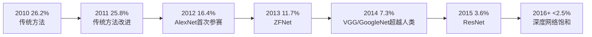


> 人类在 ImageNet 上的分类错误率约为 5.1%，2014 年 CNN 首次超越人类！

### 1.2 图像分类的评价指标

| 指标 | 说明 |
|------|------|
| Top-1 准确率 | 预测概率最高的那一类正确 |
| Top-5 准确率 | 预测概率前 5 名中有正确类别 |
| 参数量 | 模型大小，影响内存和推理速度 |
| FLOPs | 浮点运算次数，衡量计算复杂度 |
| FPS | 每秒处理帧数，实时性指标 |

### 1.3 图像分类的典型流程

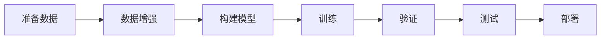

---

## 2. 目标检测（Object Detection）

### 2.1 什么是目标检测

目标检测不仅要识别图像中的物体类别，还要**定位**物体位置（用边界框 Bounding Box 表示）。

**输出**：
- 类别标签（Class Label）
- 置信度分数（Confidence Score）
- 边界框坐标（Bounding Box: x, y, width, height）

### 2.2 两阶段检测器：R-CNN 系列

R-CNN 系列是"两阶段"检测器的代表：

**流程**：
1. **阶段1（区域提议）**：从图像中找出可能包含物体的候选区域（Region Proposal）
2. **阶段2（分类与回归）**：对每个候选区域进行分类和边界框精调

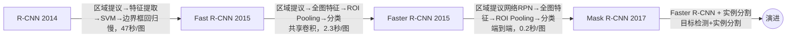

### 2.3 单阶段检测器：YOLO 系列

YOLO（You Only Look Once）是"单阶段"检测器的代表，直接从图像预测物体位置和类别。

**核心思想**：将检测任务视为单一的回归问题，在一次前向传播中同时预测所有边界框和类别概率。

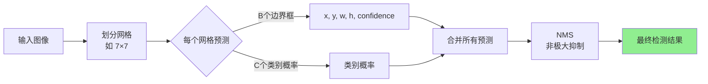


**YOLO 版本演进**：

| 版本 | 年份 | 主要改进 |
|------|------|----------|
| YOLOv1 | 2016 | 首次单阶段检测，简单但对小物体效果差 |
| YOLOv2 | 2017 | 引入 Anchor Box、BN、Passthrough |
| YOLOv3 | 2018 | 多尺度预测（FPN）、Darknet-53 |
| YOLOv4 | 2020 | CSPDarknet、Mish、CIoU Loss |
| YOLOv5 | 2021 | 自动化调参、部署友好 |
| YOLOv7 | 2022 | 高效模型架构、E-ELAN |
| YOLOv8 | 2023 | 任务对齐、Anchor-free |
| YOLOv9 | 2024 | GELAN、PGI（Programmable Gradient Information） |

### 2.4 两阶段 vs 单阶段对比

| 对比维度 | 两阶段（R-CNN系列） | 单阶段（YOLO系列） |
|----------|---------------------|-------------------|
| 检测速度 | 较慢（1-10 FPS） | 快（30-150 FPS） |
| 检测精度 | 较高（尤其是小物体） | 稍低，但近年已接近 |
| 适用场景 | 对精度要求高、离线处理 | 实时性要求高 |
| 经典模型 | Faster R-CNN、Mask R-CNN | YOLOv5-v9、SSD |

---

## 3. 语义分割（Semantic Segmentation）

### 3.1 什么是语义分割

语义分割是对图像中每个像素进行类别预测，不区分同类物体的不同实例。

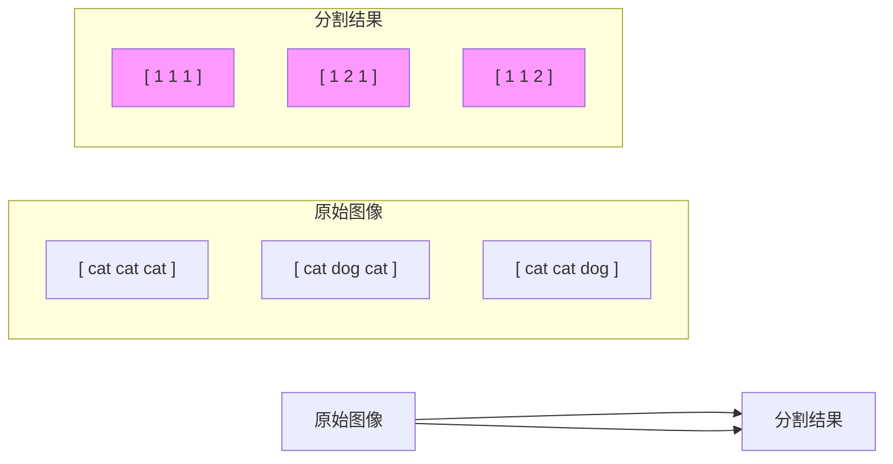

### 3.2 FCN（Fully Convolutional Network）—— 语义分割的开端

FCN 将传统 CNN 的全连接层替换为卷积层，实现像素级预测。

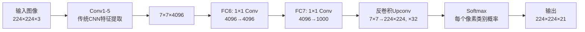

**关键创新**：
- 全连接层改为 1×1 卷积
- 引入转置卷积（反卷积）进行上采样
- Skip Connection 融合浅层细节信息

### 3.3 U-Net（2015）—— 医学图像分割

U-Net 采用了编码器-解码器结构，并添加了跳跃连接来保留空间信息。

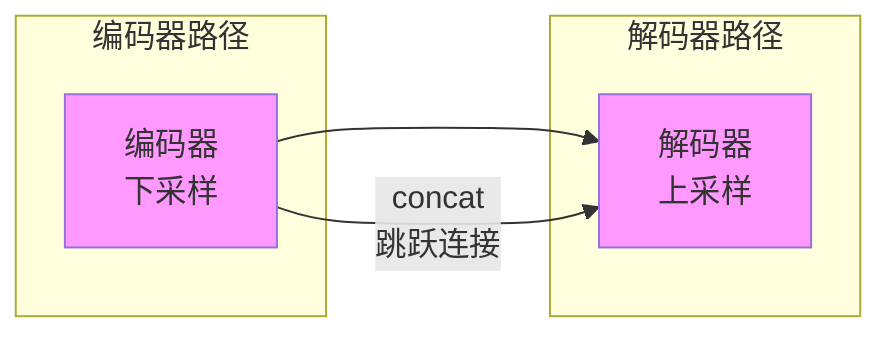


**U-Net 特点**：
- 编码器路径捕获上下文信息（全局）
- 解码器路径精确定位（空间）
- 跳跃连接保留细节，防止信息丢失
- 广泛应用于医学影像、卫星图像分割

### 3.4 DeepLab 系列

DeepLab 提出了几个重要技术：

| 技术 | 说明 |
|------|------|
| 空洞卷积（Dilated/Atrous Conv） | 扩大感受野，不损失分辨率 |
| ASPP（Atrous Spatial Pyramid Pooling） | 多尺度空洞卷积捕获多尺度信息 |
| CRF（条件随机场） | 后处理，精细化边界 |

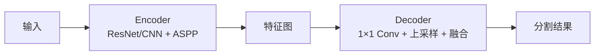

---

## 4. 迁移学习（Transfer Learning）

### 4.1 什么是迁移学习

迁移学习是将在一个任务（源任务）上学到的知识，迁移到另一个相关任务（目标任务）的过程。

**为什么 CNN 迁移学习有效？**

- 浅层卷积核学习的是通用特征（边缘、纹理、颜色）
- 这些特征对各种图像任务都有用
- 不需要从零开始训练整个网络

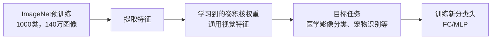

### 4.2 迁移学习的策略

| 策略 | 说明 | 适用场景 |
|------|------|----------|
| **特征提取（Feature Extraction）** | 冻结预训练 backbone，只训练新分类头 | 数据量少、类别相似 |
| **微调（Fine-tuning）** | 解冻部分层，较小学习率训练 | 数据量中等 |
| **端到端训练（Full Training）** | 从头训练整个网络（随机初始化） | 数据量大 |

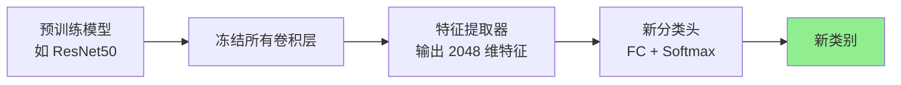

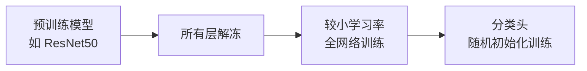

### 4.3 迁移学习注意事项

| 注意事项 | 说明 |
|----------|------|
| 数据集相似度 | 源任务与目标任务越相似，迁移效果越好 |
| 学习率调整 | 微调时用较小的学习率（预训练部分的 1/10） |
| 冻结策略 | 数据少时冻结更多层，数据多时可全微调 |
| 预处理一致 | 输入图像的预处理要与预训练时一致 |

---

## 5. 常用预训练模型库

### 5.1 torchvision（PyTorch 官方）

```python
import torchvision.models as models

# 加载预训练模型
resnet = models.resnet50(weights='IMAGENET1K_V1')
vgg = models.vgg16(weights='IMAGENET1K_V1')

# 特征提取（冻结参数）
for param in resnet.parameters():
    param.requires_grad = False

# 修改分类头
resnet.fc = nn.Linear(2048, your_num_classes)
```

### 5.2 timm（PyTorch Image Models）

```python
import timm

# 列表可用模型
models = timm.list_models(pretrained=True)

# 加载模型
model = timm.create_model('efficientnet_b3', pretrained=True)
# 获取特征
model = timm.create_model('efficientnet_b3', pretrained=True, num_classes=0)
```

### 5.3 常用模型对比

| 模型 | 参数量 | Top-1 准确率 | 推理速度 |
|------|--------|--------------|----------|
| ResNet-50 | 25M | 76.1% | 快 |
| EfficientNet-B3 | 12M | 81.6% | 中等 |
| ConvNeXt-Small | 50M | 83.1% | 中等 |
| ViT-B/16 | 86M | 79.7% | 较快（Transformer） |
| Swin-T | 28M | 81.3% | 较快 |

---

## 6. CNN 应用总结

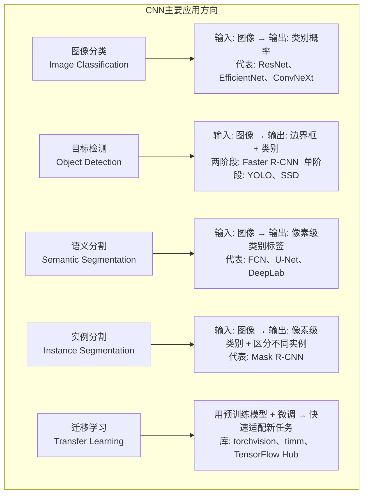

### CNN 应用的关键能力

| 能力 | 说明 |
|------|------|
| 特征提取 | 从底层纹理到高层语义的层次化表达 |
|| 空间感知 | 保留图像的空间结构信息 |
|| 权值共享 | 同一个卷积核检测不同位置的同类特征 |
|| 平移不变 | 对物体位置变化不敏感 |

---

## 本章小结

1. **图像分类**：CNN 的核心应用之一。ImageNet 竞赛推动 CNN 发展——2012 年 AlexNet 首次参赛，2014 年 CNN 超越人类（错误率 5.1%）。常用评价指标：Top-1/Top-5 准确率、参数量、FLOPs、FPS。

2. **目标检测**：识别物体类别并定位（边界框）。两阶段检测器（R-CNN 系列）精度高但慢；单阶段检测器（YOLO 系列）速度快但精度稍低。YOLO 将检测视为单次回归问题，直接预测边界框和类别概率。

3. **语义分割**：像素级分类。FCN 将全连接层改为卷积层引入反卷积上采样；U-Net 采用编码器-解码器结构+跳跃连接保留空间信息；DeepLab 引入空洞卷积扩大感受野。

4. **迁移学习**：用预训练模型（ImageNet 预训练的 ResNet、VGG 等）作为特征提取器或微调，可大幅减少目标任务所需的训练数据和计算资源。策略：特征提取（冻结 backbone）、微调（解冻部分层）、端到端训练。

---

## 知识点思维导图

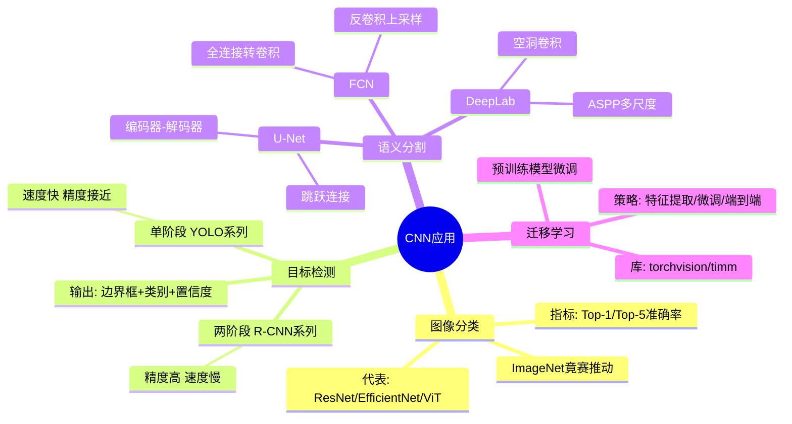

---

## 参考资料

1. Russakovsky, O. et al. (2015). *ImageNet Large Scale Visual Recognition Challenge*
2. Girshick, R. et al. (2014). *Rich Feature Hierarchies for Accurate Object Detection and Semantic Segmentation* (R-CNN)
3. Ren, S. et al. (2017). *Faster R-CNN: Towards Real-Time Object Detection with Region Proposal Networks* (Faster R-CNN)
4. Redmon, J. et al. (2016). *You Only Look Once: Unified, Real-Time Object Detection* (YOLOv1)
5. Long, J. et al. (2015). *Fully Convolutional Networks for Semantic Segmentation* (FCN)
6. Ronneberger, O. et al. (2015). *U-Net: Convolutional Networks for Biomedical Image Segmentation*
7. He, K. et al. (2017). *Mask R-CNN*
8. Chen, L.C. et al. (2018). *Encoder-Decoder with Atrous Separable Convolution for Semantic Image Segmentation* (DeepLabV3+)