# 第4-4章 CNN 应用全景：四大经典任务

## 学习目标

- **理解** 视觉四大经典任务（分类、目标检测、语义分割、实例分割）的层次关系与核心差异
- **掌握** 图像分类的训练技巧、数据增强、评价指标与数据集
- **理解** 目标检测两阶段/单阶段/Anchor-Free/Transformer 四条技术路线的演进
- **掌握** 语义分割 FCN/U-Net/DeepLab/PSPNet 的设计哲学与分割损失函数
- **理解** 实例分割与语义分割的本质差异（区分同类的不同实例）
- **掌握** CNN 骨干 → 视觉任务的选型决策
- **了解** 迁移学习策略与 OpenMMLab / torchvision / timm 三大预训练生态

---

## 0. 四大任务总览

视觉理解任务可以按"输出粒度"由粗到细组织成四个层次，每一层都建立在前一层的特征提取能力之上，但又引入了新的结构设计（检测需要定位、分割需要像素级解码、实例分割需要实例区分）。

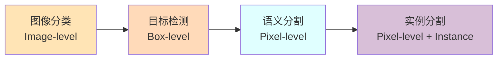

### 0.1 任务层次与输出差异

| 任务 | 输入 | 输出 | 核心挑战 | 输出粒度 |
|------|------|------|----------|----------|
| **图像分类** (Classification) | 1 张图像 | 1 个类别标签 + 概率 | 类内方差、类间相似 | 图像级（1 个） |
| **目标检测** (Detection) | 1 张图像 | N 个 (类别, 边界框) | 多尺度、密集预测、定位精度 | 区域级（N 个） |
| **语义分割** (Semantic Segmentation) | 1 张图像 | H×W 类别图 | 像素分类、上下文建模、边界精细 | 像素级（H×W） |
| **实例分割** (Instance Segmentation) | 1 张图像 | N 个 (类别, 像素掩码) | 区分同类不同实例 | 实例像素级 |

> **关键差异**：分类输出 1 个标签、检测输出 N 个框、语义分割输出 1 张全像素类别图（不区分同类实例）、实例分割输出 N 个像素掩码（区分同类实例）。

### 0.2 四类任务对比一览

| 维度 | 图像分类 | 目标检测 | 语义分割 | 实例分割 |
|------|----------|----------|----------|----------|
| **代表模型** | ResNet、EfficientNet、ConvNeXt | Faster R-CNN、YOLOv8、DETR | FCN、U-Net、DeepLab、SegFormer | Mask R-CNN、YOLACT、Mask2Former |
| **经典数据集** | ImageNet (1.28M) | COCO (118K)、VOC (16K) | VOC (2.5K)、Cityscapes (5K)、ADE20K (20K) | COCO (instances) |
| **主评价指标** | Top-1 / Top-5 Acc | mAP@[.5:.95]、AP50、AP75 | mIoU、Pixel Acc、Dice | Mask mAP、Mask AP50 |
| **主损失** | Cross-Entropy | Classification + Box Regression (Focal + IoU 系列) | Cross-Entropy / Dice / Focal | Detection Loss + Mask BCE |
| **推理速度** | 极快 (亚毫秒~10ms) | 中 (10-50ms) | 中 (10-100ms) | 慢 (50-200ms) |
| **典型应用** | 图像检索、内容审核 | 自动驾驶感知、安防、工业质检 | 医学影像、卫星遥感、辅助驾驶 | 机器人抓取、视频编辑、AR |

### 0.3 视觉任务演进时间线

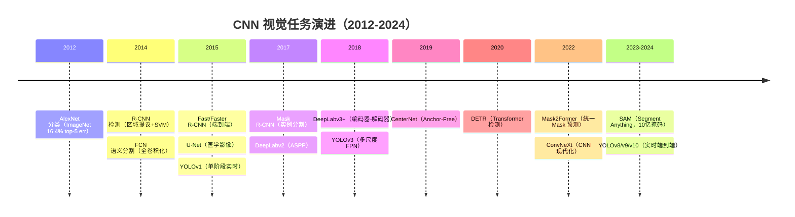

> 演进规律：① **从粗到细**（分类 → 检测 → 分割 → 实例分割）；② **从两阶段到单阶段**（精度换速度）；③ **从 CNN 到 Transformer**（DETR/Mask2Former）；④ **从专用模型到统一范式**（Mask2Former 同时解决语义/实例/全景分割）。

---

## 1. 图像分类（Image Classification）

### 1.1 ImageNet 与 CNN 的互相推动

ImageNet 是计算机视觉领域最大的图像分类数据集之一，包含 1000 个类别、约 140 万张标注图像。ImageNet 竞赛（ILSVRC）是 CNN 发展的核心推动力：

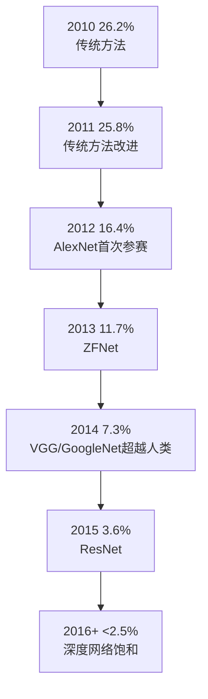

> 人类在 ImageNet 上的分类错误率约为 5.1%，2014 年 CNN 首次超越人类！

### 1.2 图像分类的评价指标

| 指标 | 说明 | 典型值（ImageNet） |
|------|------|--------------------|
| Top-1 准确率 | 预测概率最高的那一类正确 | ResNet-50: 76.1% / EfficientNet-B3: 81.6% |
| Top-5 准确率 | 预测概率前 5 名中有正确类别 | ResNet-50: 92.9% / ConvNeXt-S: 93.3% |
| 参数量 | 模型大小，影响内存和推理速度 | ResNet-50: 25M / ConvNeXt-S: 50M |
| FLOPs | 浮点运算次数，衡量计算复杂度 | ResNet-50: 4.1B / Swin-T: 4.5B |
| FPS | 每秒处理帧数，实时性指标 | 取决于硬件 |

### 1.3 经典分类数据集

| 数据集 | 类别数 | 图像数 | 特点 | 适用场景 |
|--------|--------|--------|------|----------|
| **MNIST** | 10 | 70K | 28×28 灰度手写数字 | 入门教学 |
| **CIFAR-10/100** | 10/100 | 60K | 32×32 彩色小图 | 快速实验 |
| **ImageNet-1K** | 1000 | 1.28M | 224×224，标准竞赛 | 预训练 + 大规模分类 |
| **ImageNet-21K** | 21841 | 14M | 类别更多 | 大规模预训练 |
| **iNaturalist** | >5000 | 2.7M | 细粒度生物分类 | 细粒度识别 |
| **Places365** | 365 | 1.8M | 场景分类 | 场景理解 |

### 1.4 图像分类的典型流程

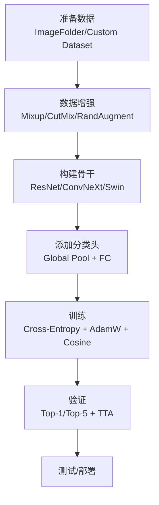

### 1.5 分类训练技巧与调优

训练一个高性能的图像分类器，**架构只占 50% 成功率**，另外 50% 来自训练技巧。

#### 1.5.1 数据增强

| 技巧 | 说明 | 收益 |
|------|------|------|
| **Mixup** | 两张图按比例线性混合 | 提升泛化、抗噪声 |
| **CutMix** | 一张图的矩形区域替换另一张 | 提升定位能力、避免背景偏置 |
| **RandAugment / AutoAugment** | 自动搜索的随机增强策略 | 免手工调参 +1~2% 准确率 |
| **RandomErasing / Cutout** | 随机遮挡矩形区域 | 提升遮挡鲁棒性 |
| **Cutmix + Mixup 组合** | 工业界常用，ImageNet +1.5% | 默认开启 |

> **Random Erasing 详解**：Random Erasing（Zhong et al., 2020）是 Cutout 的改进版。它不是固定遮挡一个矩形区域，而是**随机选择图像中的一个矩形区域，将其像素替换为随机值或均值**。与 Cutout 的固定位置不同，Random Erasing 的遮挡位置、大小、长宽比都是随机的。在 timm 中通过 `re_prob=0.25` 启用（见上方代码）。工业实践表明，Random Erasing 对 ImageNet 分类可提升 **0.5~1.0%** 的 Top-1 准确率，且与 Mixup/CutMix 兼容。

#### 1.5.2 正则化与优化

| 技巧 | 说明 | 典型值 |
|------|------|--------|
| **Label Smoothing** | 软化硬标签 (0,1) → (ε, 1-ε) | ε=0.1 |
| **Dropout / DropPath** | 随机失活 | 0.1~0.3 / 0.1~0.5 |
| **Weight Decay** | L2 正则 | 1e-4 ~ 5e-5 |
| **EMA** | 指数移动平均权重 | decay=0.9998 |
| **Warmup + Cosine LR** | 学习率调度 | 5 epochs warmup |
| **SAM（Sharpness-Aware Minimization）** | 寻找平坦极小值 | +0.5~1% 准确率 |

#### 1.5.3 训练流程示例（PyTorch + timm）

```python
import timm, torch
from timm.data import create_transform

# 1. 加载预训练模型
model = timm.create_model('convnext_small.fb_in22k_ft_in1k', pretrained=True, num_classes=1000)

# 2. 数据增强（含 RandAugment + Mixup + CutMix 在 timm 内部实现）
transform = create_transform(input_size=224, is_training=True,
                              auto_augment='rand-m9-mstd0.5-inc1',
                              re_prob=0.25, re_mode='pixel',
                              color_jitter=0.4, interpolation='bicubic')

# 3. 优化器：AdamW + 5 epoch warmup + Cosine
optimizer = torch.optim.AdamW(model.parameters(), lr=1e-3, weight_decay=0.05)
scheduler = torch.optim.lr_scheduler.CosineAnnealingLR(optimizer, T_max=300)
```

### 1.6 经典分类 CNN 架构（详见 4-3 / 4-5）

| 时期 | 代表架构 | 关键创新 | 详见 |
|------|----------|----------|------|
| 经典 (1998-2015) | LeNet-5 → AlexNet → VGG → GoogLeNet → ResNet | 深度、3×3 卷积、残差 | 4-3 经典CNN架构 |
| 轻量化 (2017-2019) | MobileNet / ShuffleNet / GhostNet | 深度可分离、通道混洗 | 4-5 现代CNN骨干综述 |
| 现代化 (2020-2022) | EfficientNet / ConvNeXt / Swin | 复合缩放、Transformer 借鉴 | 4-5 现代CNN骨干综述 |
| Transformer 时代 | ViT / Swin / ConvNeXt v2 | 全注意力或纯 Conv 现代化 | 4-5 §9 CNN vs Transformer |

> **选型建议**：服务器精度优先 → ConvNeXt / EfficientNet-V2；边缘实时 → MobileNetV3 / ShuffleNetV2；学术前沿 → ConvNeXt v2 / Swin V2。

---

## 2. 目标检测（Object Detection）

### 2.1 什么是目标检测

目标检测不仅要识别图像中的物体类别，还要**定位**物体位置（用边界框 Bounding Box 表示）。

**输出**：
- 类别标签（Class Label）
- 置信度分数（Confidence Score）
- 边界框坐标（Bounding Box: x, y, width, height）

### 2.2 评价指标：mAP 与 AP 系列

| 指标 | 说明 | 计算 |
|------|------|------|
| **IoU** | 预测框与真实框的交并比 | `area(P∩G) / area(P∪G)` |
| **Precision / Recall** | 精确率 / 召回率 | TP/(TP+FP) / TP/(TP+FN) |
| **AP@0.5 (AP50)** | IoU 阈值 0.5 时的 PR 曲线下面积 | VOC 风格 |
| **AP@0.75 (AP75)** | IoU 阈值 0.75 时（更严格） | 衡量定位精度 |
| **mAP@[.5:.95]** | IoU 阈值 0.5~0.95 步长 0.05 的平均 AP | COCO 主指标 |
| **AP_small / medium / large** | 按目标面积分桶的 AP | 衡量尺度鲁棒性 |

> **COCO 风格 mAP** 比 VOC AP50 更严格，已成为工业界事实标准。YOLOv8 在 COCO val2017 上 mAP@.5:.95 ≈ 53.9%。

### 2.3 经典检测数据集

| 数据集 | 类别数 | 图像数 | 实例数 | 特点 |
|--------|--------|--------|--------|------|
| **PASCAL VOC 07+12** | 20 | 16K | 40K | 入门级，AP50 主流 |
| **MS COCO 2017** | 80 | 118K | 860K | 类别多样、密集场景、小物体多 |
| **Objects365** | 365 | 600K | 10M | 中文场景，大规模预训练 |
| **Open Images v7** | 600 | 1.7M | 14M | 最大公开检测数据集 |
| **LVIS** | 1203 | 120K | 1.4M | 长尾分布（小样本类别） |
| **DOTA** | 15 | 2800 | 188K | 旋转框，遥感图像 |

### 2.4 四条技术路线

目标检测在过去十年发展出**四条主要技术路线**，各有适用场景：

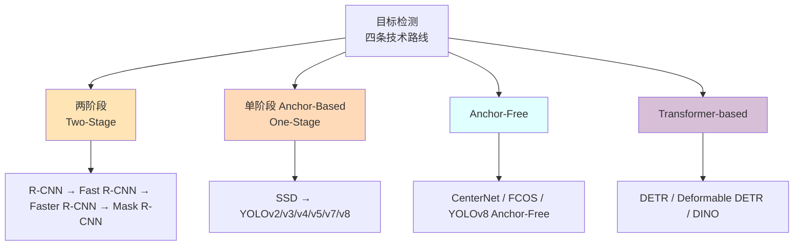

#### 2.4.1 两阶段检测器：R-CNN 系列

R-CNN 系列是"两阶段"检测器的代表：

**流程**：
1. **阶段1（区域提议）**：从图像中找出可能包含物体的候选区域（Region Proposal）
2. **阶段2（分类与回归）**：对每个候选区域进行分类和边界框精调

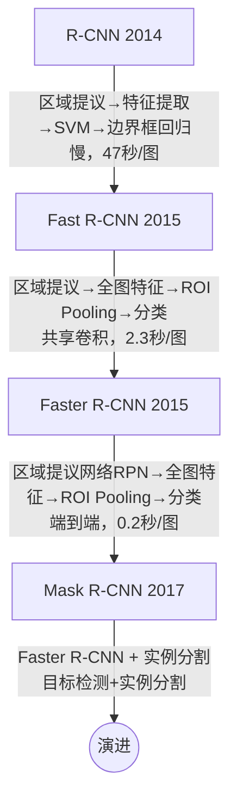

> **关键创新**：Faster R-CNN 引入 **RPN（Region Proposal Network）**，把区域提议从外部算法（Selective Search）变为可学习的网络，实现真正的端到端训练。

#### 2.4.2 单阶段检测器：YOLO 系列

YOLO（You Only Look Once）是"单阶段"检测器的代表，直接从图像预测物体位置和类别。

**核心思想**：将检测任务视为单一的回归问题，在一次前向传播中同时预测所有边界框和类别概率。

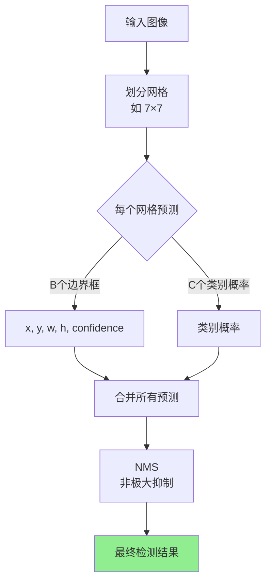

**YOLO 版本演进**：

| 版本 | 年份 | 主要改进 |
|------|------|----------|
| YOLOv1 | 2016 | 首次单阶段检测，简单但对小物体效果差 |
| YOLOv2 | 2017 | 引入 Anchor Box、BN、Passthrough |
| YOLOv3 | 2018 | 多尺度预测（FPN）、Darknet-53 |
| YOLOv4 | 2020 | CSPDarknet、Mish、CIoU Loss |
| YOLOv5 | 2021 | 自动化调参、部署友好 |
| YOLOv7 | 2022 | 高效模型架构、E-ELAN |
| YOLOv8 | 2023 | 任务对齐、Anchor-free |
| YOLOv9 | 2024 | GELAN、PGI（Programmable Gradient Information） |
| YOLOv10 | 2024 | 真端到端（无 NMS） |
| YOLOv11 | 2024 | C3k2 + C2PSA，更小更快 |

#### 2.4.3 Anchor-Free 检测器

Anchor-Free 范式绕开手工设计 anchor 的痛点，更灵活：

| 方法 | 思想 | 关键点 |
|------|------|--------|
| **CenterNet** | 关键点估计（中心点 + 宽高） | 极简，Heatmap + offset |
| **FCOS** | 像素级预测（每点到边界距离） | FPN 多尺度 + centerness |
| **YOLOX** | 解耦头 + Anchor-Free + 强增广 | YOLO 系列的 Anchor-Free 实践 |
| **YOLOv8** | 任务对齐分配器 (TAL) | 工业界默认 Anchor-Free |

> **核心优势**：超参数少（无需 anchor scale/ratio 调参）、泛化好（对极端长宽比友好）、GT 不需要 IoU 匹配。

#### 2.4.4 Transformer-based 检测器（DETR）

**DETR**（2020）将检测视为集合预测问题，用 Transformer 一次输出 N 个目标：


**演进**：DETR → Deformable DETR（2021）→ DINO（2022）→ DINO v2/v3（2023-2024），收敛速度提升 10× 以上。优势：真端到端（无 NMS、无 anchor），架构统一；劣势：训练慢、对小物体仍弱于 YOLO。

### 2.5 两阶段 vs 单阶段 vs Anchor-Free vs DETR 对比

| 对比维度 | 两阶段 (Faster R-CNN) | 单阶段 (YOLO) | Anchor-Free (CenterNet) | DETR |
|----------|----------------------|---------------|------------------------|------|
| 检测速度 | 慢 (1-10 FPS) | 快 (30-150 FPS) | 中 (30-80 FPS) | 慢 (10-20 FPS) |
| 检测精度 | 高 (尤其小物体) | 近年已接近 | 接近 YOLO | 接近 Faster R-CNN |
| 后处理 | NMS | NMS | NMS（轻量） | 无 NMS |
| 训练收敛 | 快 | 快 | 快 | 慢（需 500 epoch） |
| 适用场景 | 离线高精度 | 实时视频 | 灵活多尺度 | 学术前沿 |

### 2.6 任务特定损失函数

目标检测是**多任务学习**，损失函数由三部分组成：

```python
L_total = λ₁ · L_cls + λ₂ · L_box + λ₃ · L_obj  # YOLO 风格
L_total = L_cls + L_box                              # Faster R-CNN
```

| 损失 | 适用 | 说明 |
|------|------|------|
| **Cross-Entropy / Focal Loss** | 分类 | Focal Loss (γ=2) 解决正负样本不均 |
| **L1 / Smooth-L1** | 边界框回归 | 抗 outlier，但与 IoU 脱节 |
| **IoU Loss** | 边界框回归 | 2016，与评价指标对齐 |
| **GIoU Loss** | 边界框回归 | 解决非重叠梯度消失 |
| **DIoU / CIoU Loss** | 边界框回归 | 加入中心点距离 + 长宽比，YOLOv4/5 默认 |
| **SIoU / WIoU** | 边界框回归 | 最新变体，2023-2024 |

> **Focal Loss**（RetinaNet, 2017）：在 CE 基础上加 `(1-pt)^γ`，让易分样本权重降低，专治**正负样本不均**（单阶段检测的通病）。

### 2.7 选型决策

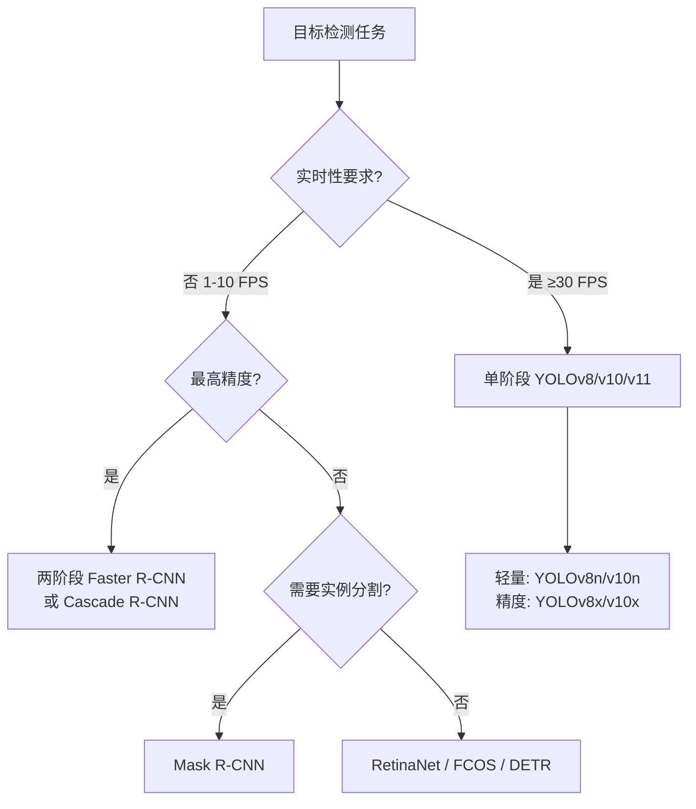

> **深入阅读**：本章仅做系统介绍，**两阶段/单阶段/Anchor-Free 详细演进、IoU 系列损失、YOLOv4 Tricks、PP-YOLO、YOLT、遮挡处理** 等进阶内容详见 [11-1 目标检测进阶](../PART11-计算机视觉进阶/11-1-目标检测进阶.md)。

---

## 3. 语义分割（Semantic Segmentation）

### 3.1 什么是语义分割

语义分割是对图像中每个像素进行类别预测，**不区分同类物体的不同实例**（猫 1、狗 1、猫 2 都标记为不同类别，但"两只猫"都标为 "cat"）。

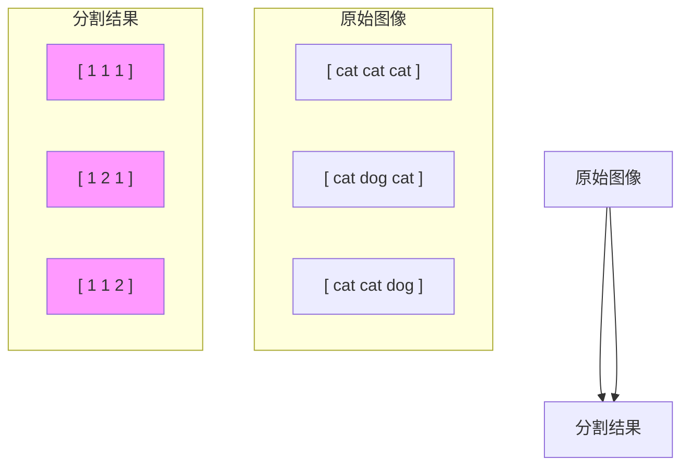

> **实例 vs 语义**：上图中 3 只猫在语义分割里全部标为 "1"（cat 类），但在实例分割里 3 只猫会被标记为 "1-1"、"1-2"、"1-3" 三个独立实例。

### 3.2 评价指标：mIoU / Pixel Accuracy / Dice

| 指标 | 公式 | 范围 | 说明 |
|------|------|------|------|
| **Pixel Accuracy (PA)** | Σn_ii / Σn_ij | [0, 1] | 简单但被大类别主导 |
| **Mean Pixel Accuracy (mPA)** | (1/C) Σ n_ii / (Σ_j n_ij) | [0, 1] | 按类别平均 |
| **IoU（单类）** | TP / (TP+FP+FN) | [0, 1] | 单类交并比 |
| **mIoU（主指标）** | (1/C) Σ IoU_c | [0, 1] | 语义分割事实标准 |
| **Dice / F1** | 2·TP / (2·TP+FP+FN) | [0, 1] | 医学影像常用 |

> **mIoU** 是 PASCAL VOC / Cityscapes / ADE20K 的官方指标。FCN 在 VOC2012 上 mIoU=62.7%，DeepLabV3+ 达到 89.0%。

### 3.3 经典分割数据集

| 数据集 | 类别数 | 图像数 | 分辨率 | 应用领域 |
|--------|--------|--------|--------|----------|
| **PASCAL VOC 2012** | 21 | 2.9K | 500×375 | 通用分割入门 |
| **PASCAL VOC aug（SBD）** | 21 | 10.5K | - | VOC + SBD 边界标注 |
| **Cityscapes** | 19 | 5K | 2048×1024 | 城市驾驶场景 |
| **ADE20K** | 150 | 20K+ | - | 通用场景理解 |
| **COCO-Stuff** | 172 | 118K | - | 密集场景标注 |
| **CamVid** | 11 | 701 | 960×720 | 道路驾驶 |
| **ISIC / BraTS** | 2-3 | 2K~30K | 医学影像 | 病灶/肿瘤分割 |
| **LoveDA** | 7 | 5.9K | 遥感 | 遥感土地覆盖 |

### 3.4 FCN（Fully Convolutional Network）—— 语义分割的开端

FCN 将传统 CNN 的全连接层替换为卷积层，实现像素级预测。

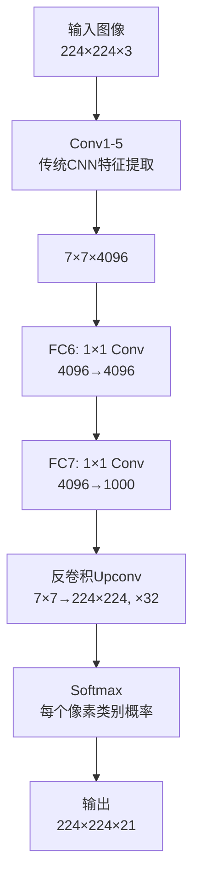

**关键创新**：
- 全连接层改为 1×1 卷积（"全卷积化"）
- 引入转置卷积（反卷积）进行上采样，把 7×7 还原回 224×224
- Skip Connection 融合浅层细节信息（FCN-8s 比 FCN-32s 提升 ~4 mIoU）

> **意义**：FCN 是"图像级分类 → 像素级预测"的范式转换点，后续所有分割网络都基于这一思想。

### 3.5 U-Net（2015）—— 医学图像分割的统治者

U-Net 采用了**编码器-解码器结构**，并添加了**跳跃连接**来保留空间信息。

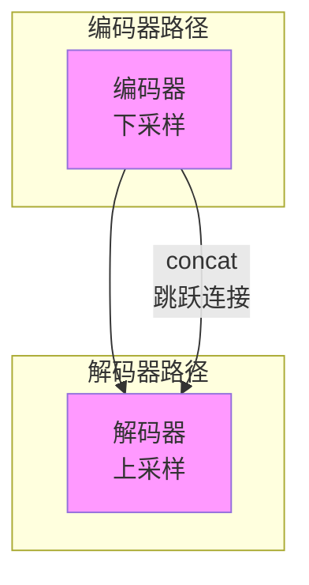

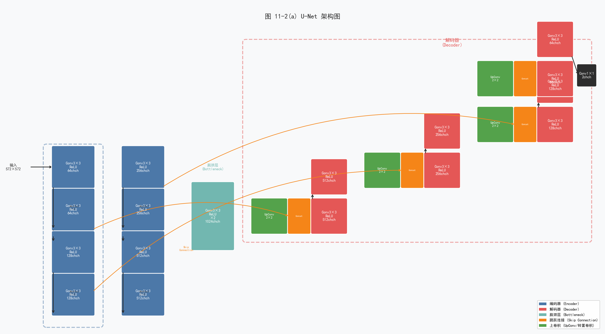

**U-Net 特点**：
- **编码器路径**捕获上下文信息（全局语义）
- **解码器路径**精确定位（空间细节）
- **跳跃连接**在每个尺度拼接编码器特征图，保留细节，防止信息丢失
- 广泛应用于医学影像、卫星图像分割
- **变体**：Attention U-Net、U-Net++、TransUNet、Swin-UNet

### 3.6 DeepLab 系列

DeepLab 提出了几个重要技术：

| 技术 | 说明 |
|------|------|
| **空洞卷积（Dilated/Atrous Conv）** | 扩大感受野，不损失分辨率 |
| **ASPP（Atrous Spatial Pyramid Pooling）** | 多尺度空洞卷积捕获多尺度信息 |
| **CRF（条件随机场）** | 后处理，精细化边界（v1/v2 引入，v3+ 弃用） |

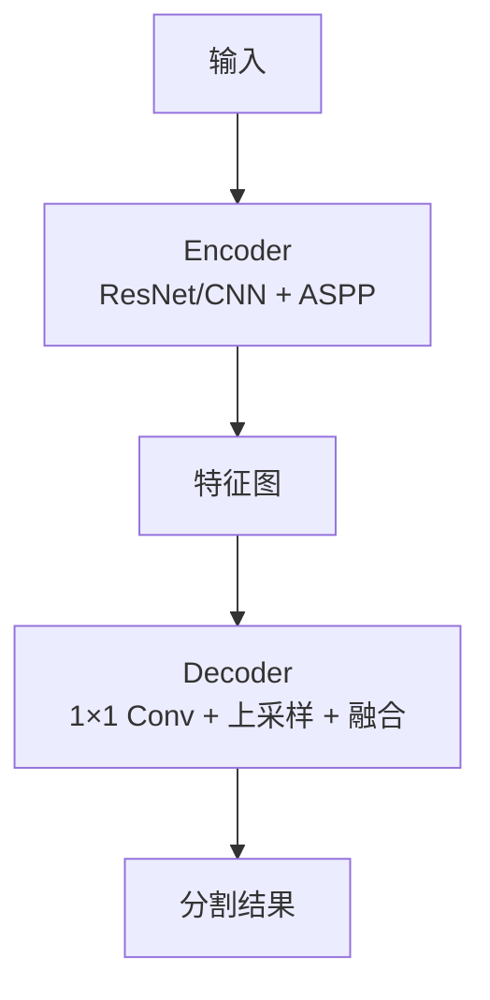

**DeepLab 演进**：

| 版本 | 年份 | 关键改进 |
|------|------|----------|
| DeepLab v1 | 2014 | 空洞卷积 + CRF |
| DeepLab v2 | 2017 | ASPP（多尺度空洞） |
| DeepLab v3 | 2017 | ASPP 改进 + 去掉 CRF |
| DeepLab v3+ | 2018 | 编码器-解码器结构，引入 Xception / MobileNet backbone |

### 3.7 其他经典架构

| 架构              | 年份   | 关键创新                       | 适用场景       |
| --------------- | ---- | -------------------------- | ---------- |
| **SegNet**      | 2017 | 编码器池化索引用于解码器上采样            | 轻量、嵌入式     |
| **PSPNet**      | 2017 | PPM（金字塔池化模块）多尺度上下文         | 复杂场景       |
| **RefineNet**   | 2017 | 多分辨率融合 + 残差校正              | 高分辨率分割     |
| **HRNet**       | 2019 | 保持高分辨率表征贯穿全网络              | 人体姿态、关键点   |
| **OCRNet**      | 2020 | 目标上下文表示，增强像素-区域关系          | 场景分割       |
| **SegFormer**   | 2021 | 轻量 Transformer 编码器 + 简单解码器 | 高效分割       |
| **Mask2Former** | 2022 | 统一 Mask 分类范式               | 语义/实例/全景通用 |

### 3.8 任务特定损失函数

| 损失 | 公式核心 | 适用场景 |
|------|----------|----------|
| **Pixel Cross-Entropy** | -Σy·log(p) | 通用 |
| **Weighted CE** | 加权 CE，处理类别不均 | 类别严重不均 |
| **Focal Loss** | -α(1-p)^γ·log(p) | 前景背景不均 |
| **Dice Loss** | 1 − 2·‖P∩G‖/(‖P‖+‖G‖) | 医学影像、小目标 |
| **Lovász Loss** | Lovász 扩展的 IoU 代理 | mIoU 直接优化 |
| **Boundary Loss** | 基于距离的边界损失 | 精细边界 |
| **OHEM** | 在线难样本挖掘 | 难例挖掘 |

> **实战配方**：Cross-Entropy + Dice Loss 组合是工业界最常见配方（CE 稳定训练 + Dice 抗不平衡）。

### 3.9 选型决策

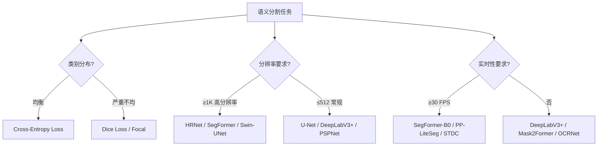

> **深入阅读**：本章仅做系统介绍，**SegNet、GCN、BCNet、全景分割、Mask2Former、SAM、损失函数扩展、MMSegmentation 实战** 等进阶内容详见 [11-2 语义分割与实例分割](../PART11-计算机视觉进阶/11-2-语义分割与实例分割.md)。

---

## 4. 实例分割（Instance Segmentation）

### 4.1 什么是实例分割

实例分割是"目标检测 + 语义分割"的合体：

- 定位：每个目标一个边界框（像检测）
- 分割：每个目标一个像素级掩码（像语义分割）
- **关键差异**：必须**区分同类物体的不同实例**（猫 1 vs 猫 2）

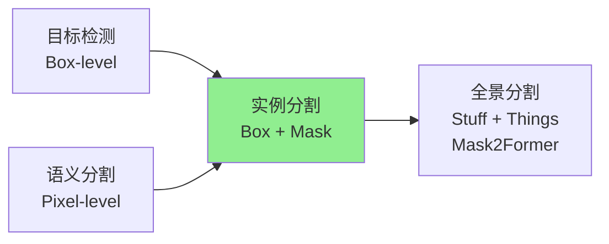

### 4.2 与语义分割的本质差异

| 维度 | 语义分割 | 实例分割 |
|------|----------|----------|
| 目标 | 每像素的语义类别 | 每个实例的类别 + 像素掩码 |
| 同类不同实例 | 不区分 | 区分 |
| 输出 | 1 张 H×W 类别图 | N 个 H×W 二值掩码 + 类别 + 框 |
| 评价 | mIoU | Mask mAP（COCO 风格） |
| 经典方法 | FCN、U-Net、DeepLab | Mask R-CNN、YOLACT、Mask2Former |
| 典型应用 | 道路场景解析 | 机器人抓取、视频编辑、AR |

### 4.3 经典方法：Mask R-CNN（2017）

Mask R-CNN 是**两阶段实例分割**的代表作，Faster R-CNN + 分割分支：

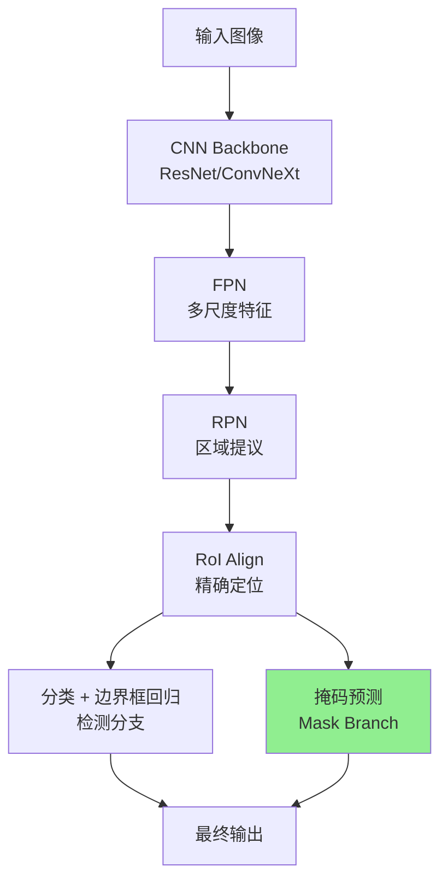

**关键创新**：
- **RoIAlign**：用双线性插值替代 RoIPool 的量化取整，保留精确空间信息
- **Mask Branch**：对每个 RoI 输出 K 个 (H×H) 二值掩码（K=类别数）
- 三个并行损失：`L = L_cls + L_box + L_mask`

**性能**：COCO test-dev 上 Mask AP = 37.1%（ResNet-101-FPN 骨干）。

### 4.4 单阶段实例分割

为了追求实时性，单阶段实例分割发展出两条路径：

| 方法 | 思想 | 速度 (FPS) | 精度 (Mask AP) |
|------|------|------------|----------------|
| **YOLACT** | 掩码 = 原型掩码 × 系数线性组合 | 33 | 29.8 |
| **SOLO / SOLOv2** | 按位置类别直接预测掩码 | 31 | 37.8 |
| **CenterMask** | Anchor-Free + SAG-Mask | 30+ | 34.5 |
| **PointRend** | 迭代细化掩码边界 | - | +2~4 AP |
| **Mask2Former** | 统一 Mask 分类（DETR 范式） | 8~12 | 50+（Swin-L） |

> **趋势**：Mask2Former 2022 年起横扫全景/实例/语义分割三任务，单一架构通吃。

### 4.5 评价指标：Mask mAP

实例分割沿用 COCO 检测的 mAP 框架，但对**掩码**计算 IoU 而非框：

| 指标 | 说明 |
|------|------|
| **Mask AP@[.5:.95]** | 主指标，掩码 IoU 在 .5~.95 间的平均 AP |
| **Mask AP50 / AP75** | 单一阈值下的掩码 AP |
| **Mask AP_S/M/L** | 按目标面积分桶 |

> **Mask R-CNN** 在 COCO test-dev 上 Mask AP = 37.1%；**Mask2Former (Swin-L)** 达到 50+ Mask AP。

### 4.6 选型决策

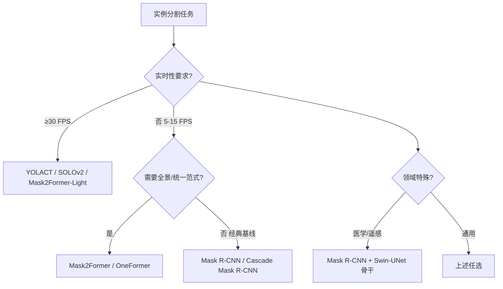

> **深入阅读**：**Mask R-CNN、RoI Align、Panoptic Segmentation、BCNet 双图层、Mask2Former、OneFormer、SAM** 等进阶内容详见 [11-2 语义分割与实例分割](../PART11-计算机视觉进阶/11-2-语义分割与实例分割.md)。

---

## 5. CNN 骨干与任务映射

四大视觉任务**共享一个骨干**（特征提取器），只在"头"上做任务特定的改造。选择骨干时需要考虑精度、速度、显存、部署目标。

### 5.1 任务对骨干的需求差异

| 任务 | 骨干关键能力 | 空间分辨率 | 推荐骨干 |
|------|--------------|------------|----------|
| 分类 | 强语义、池化鲁棒 | 7×7 即可 | ResNet-50 / ConvNeXt-S / EfficientNet-B3 |
| 目标检测 | 多尺度特征 + 强语义 | 多尺度 FPN | ResNet-50+FPN / Swin-T+FPN / ConvNeXt-T+FPN |
| 语义分割 | 高分辨率细节 + 大感受野 | 输出 1/4 或 1/8 | ResNet-101+Dilated / HRNet / Swin-T+U-Net |
| 实例分割 | 检测 + 分割的复合需求 | 多尺度 | 同检测 + RoI 头 |

### 5.2 选型决策表

| 部署目标 | 骨干推荐 | 输入尺寸 | 任务 |
|----------|----------|----------|------|
| **云端服务器**（精度优先） | ConvNeXt-Large / Swin-L | 384²~512² | 分类 / 检测 / 分割 |
| **工作站**（平衡） | ResNet-50 / ConvNeXt-T | 224²~640² | 通用 |
| **边缘 GPU (Jetson)** | EfficientNet-B0/B3 / MobileNetV3 | 224²~416² | 分类 / 检测 |
| **移动端 / 嵌入式** | MobileNetV3-Small / ShuffleNetV2 | 224²~320² | 分类 / 轻量检测 |
| **CPU** | EfficientNet-B0 / MobileNetV2 (量化) | 224² | 分类 |

> **深入阅读**：经典架构（LeNet→ResNet）详见 [4-3 经典CNN架构](./4-3-经典CNN架构.md)；现代骨干（ResNeXt→ConvNeXt v2）详见 [4-5 现代CNN骨干综述](./4-5-现代CNN骨干综述.md)；注意力插件（SE/CBAM/CA/SK）详见 [4-6 注意力机制全景](./4-6-注意力机制全景.md)。

### 5.3 骨干与任务映射图

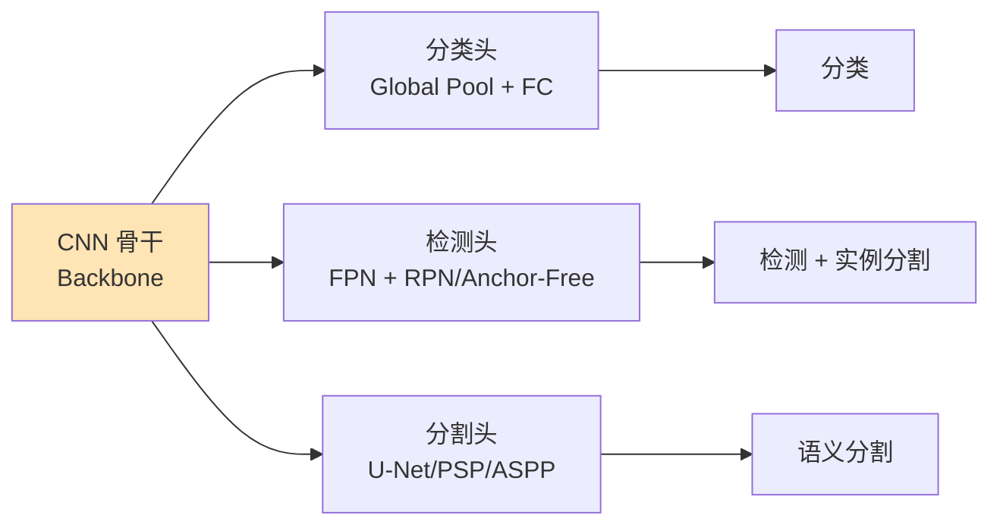

### 5.4 特征金字塔网络 FPN（Feature Pyramid Network, CVPR 2017）

> **历史背景**：FPN 由 Tsung-Yi Lin 等人在 2017 年提出，比 ResNet 晚一年（ResNet 2015）。FPN 的核心洞察是"**不同尺度的目标需要不同层次的特征**"——浅层特征富含空间细节（适合小目标），深层特征富含语义信息（适合大目标）。FPN 用极低的额外成本（仅几层 1×1 + 3×3 卷积）就把单尺度骨干升级为多尺度特征金字塔，一举成为后续所有检测/分割模型的标配。

#### 5.4.1 多尺度检测的演进

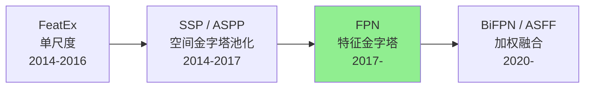

**多尺度方案的三个时代**：

| 阶段 | 方法 | 思想 | 缺点 |
|------|------|------|------|
| **图像金字塔** | Multi-scale testing | 把原图 resize 到多个尺度分别送入 CNN | 慢 N 倍；不可端到端训练 |
| **特征金字塔（金字塔特征层次）** | SSD (2016) | 直接用 backbone 不同 stage 的输出 | 浅层特征语义弱，检测小物体差 |
| **特征金字塔网络 FPN (2017)** | FPN | 自顶向下 + 横向连接融合多尺度 | 增加少量参数和计算 |
| **加权融合** | BiFPN (2020), ASFF (2019) | 学习融合权重 / 空间自适应 | 模型更复杂 |

#### 5.4.2 FPN 核心结构

FPN 由两条路径 + 一个融合组成：

```mermaid
flowchart TD
    subgraph bottomup[Bottom-up Pathway (骨干前向)]
        C2[C2<br>stride 1/4<br>256ch] --> C3[C3<br>stride 1/8<br>512ch]
        C3 --> C4[C4<br>stride 1/16<br>1024ch]
        C4 --> C5[C5<br>stride 1/32<br>2048ch]
    end
    
    subgraph lateral[1×1 Lateral Convs (通道对齐到 256)]
        L2[L2] 
        L3[L3]
        L4[L4]
        L5[L5]
    end
    
    C2 --> L2
    C3 --> L3
    C4 --> L4
    C5 --> L5
    
    subgraph topdown[Top-down Pathway (2× Upsample + Add)]
        P5_out[P5<br>256ch] --> P4_temp[P4_temp]
        P4_temp --> P3_temp[P3_temp]
        P3_temp --> P2_temp[P2_temp]
    end
    
    L5 --> P5_out
    P5_out -->|"2× Nearest Upsample"| P4_temp
    L4 --> P4_temp
    P4_temp -->|"2× Nearest Upsample"| P3_temp
    L3 --> P3_temp
    P3_temp -->|"2× Nearest Upsample"| P2_temp
    L2 --> P2_temp
    
    P2_temp --> P2[3×3 Conv → P2]
    P3_temp --> P3[3×3 Conv → P3]
    P4_temp --> P4[3×3 Conv → P4]
    P5_out --> P5[3×3 Conv → P5]
    
    P2 --> D2[检测/分割头]
    P3 --> D3[检测/分割头]
    P4 --> D4[检测/分割头]
    P5 --> D5[检测/分割头]
    
    style P5_out fill:#FFE4B5
    style D2 fill:#90EE90
    style D3 fill:#90EE90
    style D4 fill:#90EE90
    style D5 fill:#90EE90
```

**FPN 三大核心操作**：

1. **1×1 横向卷积（Lateral Conv）**：把不同 stage 的特征图（C2-C5）通道数统一降到 256，使后续融合可比。
2. **2× 最近邻上采样（Top-down Upsample）**：把深层特征（如 1/32 分辨率）放大 2 倍，与浅层特征尺寸对齐。
3. **逐元素相加（Element-wise Add）+ 3×3 卷积**：把上采样后的深层特征与同尺度的横向特征相加（融合语义 + 细节），再用 3×3 卷积平滑混叠。

> **为什么用最近邻上采样而不是转置卷积？** 因为 FPN 只放大 2 倍，简单的最近邻 + 后接 3×3 卷积已经够用，转置卷积反而引入可学习参数和棋盘格伪影。

#### 5.4.3 直观对比：Image Pyramid vs FPN

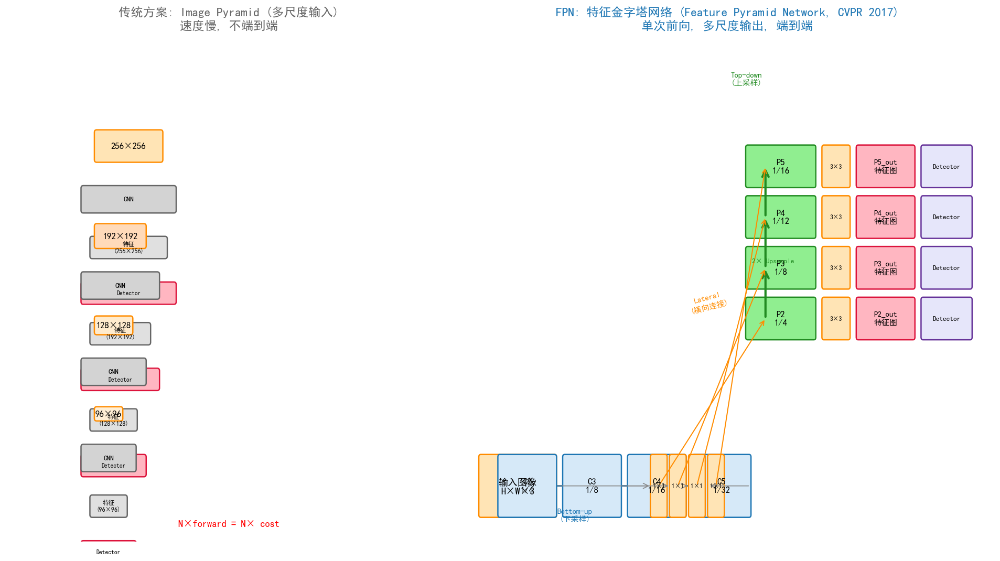

| 维度 | Image Pyramid | FPN |
|------|---------------|-----|
| **推理成本** | N 次前向（N=尺度数，通常 4） | 1 次前向 |
| **内存占用** | N 倍 | 约 1.2 倍（多几层 1×1 + 3×3 卷积） |
| **端到端可训练** | ✗（多尺度是预处理） | ✓ |
| **小目标检测 AP** | 提升有限 | 显著提升（Faster R-CNN w/ FPN: COCO AP 提升 ~5 点） |
| **典型应用** | 传统 DPM、SNIP | 所有现代检测/分割模型 |

#### 5.4.4 FPN 多尺度特征可视化

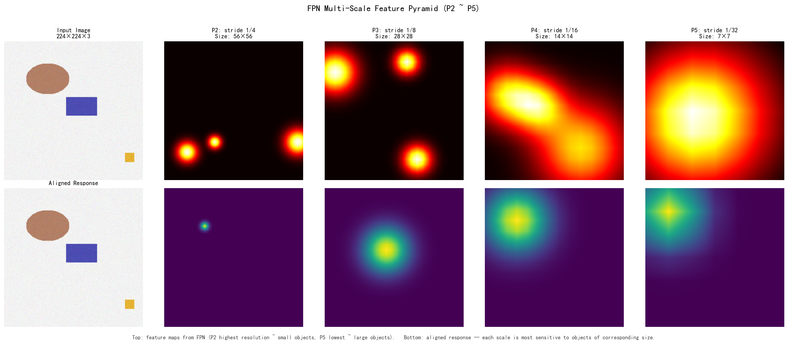

> **图示说明**：P2（stride 1/4）分辨率最高，捕捉小目标（鸟）；P5（stride 1/32）分辨率最低，捕捉大目标（象）。所有尺度的特征图通道数都是 256，可直接送入检测/分割头。

#### 5.4.5 PyTorch 极简实现

```python
import torch
import torch.nn as nn
import torch.nn.functional as F

class FPN(nn.Module):
    """FPN: 输入 [C2, C3, C4, C5], 输出 [P2, P3, P4, P5]"""
    def __init__(self, in_channels=(256, 512, 1024, 2048), out_channels=256):
        super().__init__()
        self.lateral = nn.ModuleList(
            nn.Conv2d(c, out_channels, 1) for c in in_channels
        )
        self.smooth = nn.ModuleList(
            nn.Conv2d(out_channels, out_channels, 3, padding=1) for _ in in_channels
        )

    def forward(self, features):
        # 1×1 lateral
        lat = [l(f) for l, f in zip(self.lateral, features)]
        # Top-down
        out = [None] * len(lat)
        out[-1] = lat[-1]
        for i in range(len(lat) - 2, -1, -1):
            out[i] = lat[i] + F.interpolate(out[i+1], scale_factor=2, mode='nearest')
        # 3×3 smooth
        return [s(o) for s, o in zip(self.smooth, out)]

# 使用示例（ResNet-50 backbone）
import torchvision.models as tvm
backbone = tvm.resnet50(weights='IMAGENET1K_V1')
# 取 layer1..layer4 的输出作为 C2..C5
```

完整可运行示例见 [`assets/figures/fpn_pytorch.py`](../../assets/figures/fpn_pytorch.py)。

#### 5.4.6 FPN 在四大任务中的应用

| 任务 | FPN 角色 | 典型配置 |
|------|----------|----------|
| **目标检测** | 多尺度特征融合 | Faster R-CNN + FPN（P2-P6），COCO AP +5~8 |
| **实例分割** | Mask R-CNN 的多尺度 backbone | P2-P5 + RoIAlign，Mask AP +3 |
| **语义分割** | Panoptic FPN 的多尺度融合 | P2-P5 + 语义头 + 实例头 |
| **关键点检测** | 多尺度人体姿态 | HRNet 也使用类似 FPN 思想 |
| **小目标检测** | 显著提升小目标 AP | SNIP/SNIPER 仍使用 FPN 提取 |

> **FPN 已成为现代视觉系统的"颈部（Neck）"标准组件**。YOLOv3/v4/v5/v7/v8/DETR 等所有主流检测器都使用 FPN 或其变体（PANet、BiFPN、ASFF）。

### 5.5 FPN 家族演进：从 FPN 到 BiFPN

FPN 提出后，学术界围绕"如何更好地融合多尺度特征"展开了一系列工作：


| 方法 | 年份 | 关键改进 | 代表模型 | COCO AP |
|------|------|----------|----------|---------|
| **FPN** | 2017 | Top-down + Lateral | Faster R-CNN+FPN | 36.2 |
| **PANet** | 2018 | FPN + 额外 Bottom-up 路径 | Mask R-CNN+PANet | 42.0 (+5.8) |
| **NAS-FPN** | 2019 | 神经架构搜索跨尺度连接 | RetinaNet+NAS-FPN | 45.4 |
| **BiFPN** | 2020 | 双向 + 加权融合 + 多层堆叠 | EfficientDet-D4 | 49.2 |
| **ASFF** | 2019 | 空间自适应特征融合 | YOLOv3+ASFF | 43.9 |
| **Recursive-FPN** | 2019 | 递归融合 | RetinaNet+Recursive | 41.3 |
| **AugFPN** | 2020 | 多层级特征增强 | RetinaNet+AugFPN | 42.4 |
| **CB-FPN** | 2023 | 内容感知的 BiFPN | YOLOv8+CB-FPN | - |

**四代演进的关键洞察**：

1. **FPN (2017)**：单向 Top-down，融合 1 次，参数最少
2. **PANet (2018)**：再加一条 Bottom-up 路径，融合 2 次（更强的双向信息流）
3. **NAS-FPN (2019)**：用 NAS 自动发现不规则跨尺度连接
4. **BiFPN (2020)**：每层多个 BiFPN 模块堆叠，每节点学习融合权重 w₁, w₂, w₃

> **BiFPN 加权融合公式**：
> 
> $$P_i^{\text{out}} = \text{Conv}\left(\frac{w_1 \cdot P_i^{\text{in}} + w_2 \cdot \text{Resize}(P_{i+1}^{\text{in}})}{w_1 + w_2 + \epsilon}\right)$$
> 
> 其中 $w_1, w_2$ 是可学习权重（用 ReLU 保证非负），$\epsilon=0.0001$ 防止除零。

> **工业实践**：YOLOv5/v7/v8 用 **PANet**（轻量高效），EfficientDet 用 **BiFPN**（精度更高但参数多），DETR 不用 FPN（依赖 Transformer 全局注意力）。

---

## 6. 迁移学习（Transfer Learning）

### 6.1 什么是迁移学习

迁移学习是将在一个任务（源任务）上学到的知识，迁移到另一个相关任务（目标任务）的过程。

**为什么 CNN 迁移学习有效？**

- 浅层卷积核学习的是通用特征（边缘、纹理、颜色）
- 这些特征对各种图像任务都有用
- 不需要从零开始训练整个网络

```mermaid
flowchart TD
    A[ImageNet预训练<br>1000类，140万图像] --> B[提取特征]
    B --> C[学习到的卷积核权重<br>通用视觉特征]
    C --> D[目标任务<br>医学影像分类、宠物识别等]
    D --> E[训练新分类头<br>FC/MLP]
```

### 6.2 迁移学习的策略

| 策略 | 说明 | 适用场景 |
|------|------|----------|
| **特征提取（Feature Extraction）** | 冻结预训练 backbone，只训练新分类头 | 数据量少（<1K）、类别相似 |
| **微调（Fine-tuning）** | 解冻部分层，较小学习率训练 | 数据量中等（1K-100K） |
| **端到端训练（Full Training）** | 从头训练整个网络（随机初始化） | 数据量大（>100K） |

```mermaid
flowchart TD
    A[预训练模型<br>如 ResNet50] --> B[冻结所有卷积层]
    B --> C[特征提取器<br>输出 2048 维特征]
    C --> D[新分类头<br>FC + Softmax]
    D --> E[新类别]
    
    style E fill:#90EE90
```

```mermaid
flowchart LR
    A[预训练模型<br>如 ResNet50] --> B[所有层解冻]
    B --> C[较小学习率<br>全网络训练]
    C --> D[分类头<br>随机初始化训练]
```

### 6.3 迁移学习注意事项

| 注意事项 | 说明 |
|----------|------|
| 数据集相似度 | 源任务与目标任务越相似，迁移效果越好（自然图像 ↔ 自然图像，医学 ↔ 医学） |
| 学习率调整 | 微调时用较小的学习率（预训练部分的 1/10） |
| 冻结策略 | 数据少时冻结更多层，数据多时可全微调 |
| 预处理一致 | 输入图像的预处理要与预训练时一致（ImageNet 均值/方差） |
| 域差异大 | 医学/卫星/工业图像建议在 ImageNet 预训练后**再在领域数据上预训练** |

---

## 7. 常用预训练模型库

### 7.1 torchvision（PyTorch 官方）

```python
import torchvision.models as models

# 加载预训练模型
resnet = models.resnet50(weights='IMAGENET1K_V1')
vgg = models.vgg16(weights='IMAGENET1K_V1')

# 特征提取（冻结参数）
for param in resnet.parameters():
    param.requires_grad = False

# 修改分类头
resnet.fc = nn.Linear(2048, your_num_classes)
```

### 7.2 timm（PyTorch Image Models）

```python
import timm

# 列表可用模型
models = timm.list_models('convnext*', pretrained=True)

# 加载模型（含训练配置 / 数据增强工厂）
model = timm.create_model('efficientnet_b3', pretrained=True)
# 特征提取
model = timm.create_model('efficientnet_b3', pretrained=True, num_classes=0)
```

**timm 优势**：
- 1000+ 模型（最新 SOTA 即时同步）
- 内置训练配方（增广、优化器、调度器）
- 支持分类 / 检测 / 分割的统一接口

### 7.3 OpenMMLab 生态（检测 / 分割首选）

```bash
# MMClassification（分类）
pip install mmcls

# MMDetection（检测 / 实例分割）
pip install mmdet

# MMSegmentation（语义分割）
pip install mmseg
```

| 库 | 任务 | 模型数 | 特点 |
|----|------|--------|------|
| **MMClassification** | 分类 | 100+ | 复现精度高 |
| **MMDetection** | 检测 / 实例分割 | 400+ | YOLOv8/Faster/Mask/DETR 全覆盖 |
| **MMSegmentation** | 语义分割 | 100+ | U-Net/DeepLab/SegFormer/Mask2Former |
| **MMDetection3D** | 3D 检测 | 60+ | 点云 / 多模态 |
| **MMOCR** | OCR | 30+ | 文字检测 + 识别 |
| **MMPose** | 姿态估计 | 50+ | 关键点检测 |
| **MMDeploy** | 部署 | - | ONNX/TensorRT/OpenVINO 多后端 |

> **深入阅读**：OpenMMLab 生态 + MMDeploy 多后端部署详见 [10-6 OpenMMLab 生态与 MMDeploy 部署](../PART10-训练优化与部署/10-6-OpenMMLab生态与MMDeploy部署.md)。

### 7.4 常用模型对比

| 模型 | 参数量 | Top-1 准确率 | 推理速度 | 适用场景 |
|------|--------|--------------|----------|----------|
| ResNet-50 | 25M | 76.1% | 快 | 通用基线 |
| ResNet-101 | 45M | 77.4% | 中 | 更高精度 |
| EfficientNet-B3 | 12M | 81.6% | 中 | 精度/参数比最优 |
| ConvNeXt-Small | 50M | 83.1% | 中 | 现代化 CNN 首选 |
| ViT-B/16 | 86M | 79.7% | 较快（Transformer） | 大数据预训练 |
| Swin-T | 28M | 81.3% | 较快 | 通用任务 |
| MobileNetV3-Large | 5.4M | 75.2% | 极快 | 移动端 |

---

## 8. CNN 应用实战工具链

### 8.1 训练工具链

| 任务 | 推荐框架 | 理由 |
|------|----------|------|
| 分类 | timm + torchmetrics | 最新 SOTA 即时同步 |
| 检测 / 实例分割 | MMDetection | 400+ 模型，工业级 |
| 语义分割 | MMSegmentation | 100+ 模型，复现精度高 |
| 自定义轻量 | PyTorch Lightning | 灵活的工程化训练 |

### 8.2 部署工具链

| 场景 | 推荐方案 | 详见 |
|------|----------|------|
| CPU 通用 | ONNX Runtime | 10-4 模型部署实战 |
| GPU 服务器 | TensorRT | 10-4 |
| 边缘 (Jetson) | TensorRT / DeepStream | 10-7 边缘部署与 Jetson 实战 |
| 移动端 | TFLite / NCNN / MNN | 10-4 |
| 多后端统一 | OpenMMLab MMDeploy | 10-6 OpenMMLab 生态 |

### 8.3 可解释性

| 工具 | 说明 | 详见 |
|------|------|------|
| **Grad-CAM** | 类别激活图，可视化 CNN 决策区域 | 11-3 图像生成与编辑 |
| **Attention 可视化** | 注意力权重热力图 | 4-6 注意力机制全景 |

---

## 本章小结

1. **四类视觉任务**按粒度由粗到细：图像分类（图像级）→ 目标检测（区域级）→ 语义分割（像素级，不分实例）→ 实例分割（像素级 + 区分实例）。CNN 在这四类任务上都是 2012 年以来的核心方法，2014 年起在 ImageNet 超越人类水平。

2. **图像分类** 是其他任务的基石，训练技巧（Mixup、CutMix、RandAugment、Label Smoothing、EMA、SAM）配合现代骨干（ConvNeXt、EfficientNet）能在 ImageNet 上达到 85%+ Top-1。

3. **目标检测**有四条技术路线：① 两阶段（R-CNN 系列，精度优先）② 单阶段 Anchor-Based（YOLO 系列，实时）③ Anchor-Free（CenterNet/FCOS/YOLOv8，灵活）④ Transformer-based（DETR 系列，真端到端）。主评价指标是 COCO 风格的 mAP@[.5:.95]。

4. **语义分割**经历了 FCN（全卷积化）→ U-Net（编码器-解码器 + 跳跃连接）→ DeepLab（空洞卷积 + ASPP）→ Transformer 时代（SegFormer / Mask2Former）的演进。主评价指标是 mIoU。损失函数常用 Cross-Entropy + Dice 组合。

5. **实例分割**是检测 + 分割的复合任务，Mask R-CNN（两阶段）和 YOLACT/SOLOv2（单阶段）是经典代表，Mask2Former 用统一 Mask 分类范式横扫三任务。主评价指标是 Mask mAP。

5. **FPN 特征金字塔网络（详见 §5.4 / §5.5）**：现代视觉系统的"颈部"标配。FPN 用 Bottom-up + Top-down + Lateral 三步把单尺度骨干升级为多尺度特征金字塔，Faster R-CNN + FPN 在 COCO 上 AP 提升 5-8 点。FPN 家族四代演进：FPN(2017) → PANet(2018) → NAS-FPN(2019) → BiFPN(2020)，YOLOv5-v8 用 PANet，EfficientDet 用 BiFPN。

6. **CNN 骨干选择**需综合任务需求（分类/检测/分割）、部署目标（云端/边缘/移动）、精度与速度权衡。ConvNeXt、ResNet、MobileNet 是各自场景的主流选择。详见 [4-3 经典CNN架构](./4-3-经典CNN架构.md) 和 [4-5 现代CNN骨干综述](./4-5-现代CNN骨干综述.md)。

7. **预训练 + 迁移学习**是工业标配。ImageNet 预训练骨干 + 自定义分类头，可以用 1K 张图训练出高质量分类器。OpenMMLab（MMDetection / MMSegmentation）和 torchvision / timm 是三大主流生态。

8. **深度阅读路径**：分类技巧 → 4-3 经典架构 → 4-5 现代骨干 → 4-6 注意力插件 → **11-1 目标检测进阶**（检测深入）→ **11-2 语义分割与实例分割**（分割深入）→ 10-6 OpenMMLab 实战。

---

## 知识图谱

```mermaid
mindmap
  root((第4-4章 CNN 应用全景))
    0. 四大任务总览
      0.1 任务层次与输出差异
      0.2 四类任务对比一览
      0.3 视觉任务演进时间线
    1. 图像分类
      1.1 ImageNet 与 CNN 互相推动
      1.2 评价指标
        Top-1/Top-5
        参数量/FLOPs
      1.3 经典数据集
        ImageNet
        CIFAR
        iNaturalist
      1.4 训练流程
      1.5 训练技巧
        Mixup/CutMix
        RandAugment
        Label Smoothing
        EMA
      1.6 经典分类 CNN 架构
    2. 目标检测
      2.1 任务定义
      2.2 评价指标
        mAP@[.5:.95]
        AP50/AP75
      2.3 经典数据集
        COCO
        VOC
        Objects365
      2.4 四条技术路线
        两阶段 R-CNN
        单阶段 YOLO
        Anchor-Free
        Transformer DETR
      2.5 损失函数
        Focal Loss
        IoU/CIoU
      2.6 选型决策
    3. 语义分割
      3.1 任务定义
      3.2 评价指标
        mIoU
        Pixel Accuracy
        Dice
      3.3 经典数据集
        VOC
        Cityscapes
        ADE20K
      3.4 FCN
      3.5 U-Net
      3.6 DeepLab 系列
      3.7 其他架构
        PSPNet
        HRNet
        SegFormer
      3.8 损失函数
        Cross-Entropy
        Dice Loss
        Focal Loss
    4. 实例分割
      4.1 任务定义
      4.2 与语义分割的差异
      4.3 Mask R-CNN
      4.4 单阶段方法
        YOLACT
        SOLOv2
        Mask2Former
      4.5 Mask mAP
    5. CNN 骨干与任务映射
      5.1 任务对骨干的需求
      5.2 选型决策表
      5.3 骨干与任务映射
      5.4 FPN 特征金字塔
        Bottom-up
        Top-down
        Lateral
        P2-P5 多尺度
      5.5 FPN 家族演进
        FPN 2017
        PANet 2018
        NAS-FPN 2019
        BiFPN 2020
    6. 迁移学习
      6.1 概念
      6.2 策略
        特征提取
        微调
        端到端
      6.3 注意事项
    7. 预训练模型库
      7.1 torchvision
      7.2 timm
      7.3 OpenMMLab
        MMDetection
        MMSegmentation
      7.4 常用模型对比
    8. CNN 应用实战工具链
      8.1 训练工具链
      8.2 部署工具链
      8.3 可解释性
```

---

## 参考资料

### 图像分类

1. Russakovsky, O. et al. (2015). *ImageNet Large Scale Visual Recognition Challenge*. IJCV.
2. He, K. et al. (2016). *Deep Residual Learning for Image Recognition*. CVPR. (ResNet)
3. Tan, M. & Le, Q. (2019). *EfficientNet: Rethinking Model Scaling for Convolutional Neural Networks*. ICML.
4. Liu, Z. et al. (2022). *A ConvNet for the 2020s*. CVPR. (ConvNeXt)
5. Zhang, H. et al. (2018). *mixup: Beyond Empirical Risk Minimization*. ICLR.
6. Yun, S. et al. (2019). *CutMix: Regularization Strategy to Train Strong Classifiers with Localizable Features*. ICCV.
7. Cubuk, E. et al. (2020). *RandAugment: Practical Automated Data Augmentation with a Reduced Search Space*. CVPR.
8. Foret, P. et al. (2021). *Sharpness-Aware Minimization for Efficiently Improving Generalization*. ICLR. (SAM)

### 目标检测

9. Girshick, R. et al. (2014). *Rich Feature Hierarchies for Accurate Object Detection and Semantic Segmentation*. CVPR. (R-CNN)
10. Ren, S. et al. (2017). *Faster R-CNN: Towards Real-Time Object Detection with Region Proposal Networks*. TPAMI.
11. Redmon, J. et al. (2016). *You Only Look Once: Unified, Real-Time Object Detection*. CVPR. (YOLOv1)
12. Lin, T. et al. (2017). *Focal Loss for Dense Object Detection*. ICCV. (RetinaNet)
13. Zhou, X. et al. (2019). *Objects as Points*. (CenterNet)
14. Tian, Z. et al. (2019). *FCOS: Fully Convolutional One-Stage Object Detection*. ICCV.
15. Carion, N. et al. (2020). *End-to-End Object Detection with Transformers*. ECCV. (DETR)
16. Jocher, G. et al. (2023). *Ultralytics YOLOv8*. GitHub.

### 语义分割

17. Long, J. et al. (2015). *Fully Convolutional Networks for Semantic Segmentation*. CVPR. (FCN)
18. Ronneberger, O. et al. (2015). *U-Net: Convolutional Networks for Biomedical Image Segmentation*. MICCAI.
19. Chen, L.C. et al. (2018). *Encoder-Decoder with Atrous Separable Convolution for Semantic Image Segmentation*. ECCV. (DeepLabV3+)
20. Zhao, H. et al. (2017). *Pyramid Scene Parsing Network*. CVPR. (PSPNet)
21. Sun, K. et al. (2019). *Deep High-Resolution Representation Learning for Visual Recognition*. TPAMI. (HRNet)
22. Milletari, F. et al. (2016). *V-Net: Fully Convolutional Neural Networks for Volumetric Medical Image Segmentation*. 3DV. (Dice Loss)

### 实例分割

23. He, K. et al. (2017). *Mask R-CNN*. ICCV.
24. Bolya, D. et al. (2019). *YOLACT: Real-time Instance Segmentation*. ICCV.
25. Wang, X. et al. (2020). *SOLO: Segmenting Objects by Locations*. ECCV.
26. Cheng, B. et al. (2022). *Masked-attention Mask Transformer for Universal Image Segmentation*. CVPR. (Mask2Former)
27. Kirillov, A. et al. (2023). *Segment Anything*. ICCV. (SAM)

### 特征金字塔 FPN（详见 §5.4 / §5.5）

32. Lin, T.Y. et al. (2017). *Feature Pyramid Networks for Object Detection*. CVPR. (FPN)
33. Liu, S. et al. (2018). *Path Aggregation Network for Instance Segmentation*. CVPR. (PANet)
34. Ghiasi, G. et al. (2019). *NAS-FPN: Learning Scalable Feature Pyramid Architecture for Object Detection*. CVPR.
35. Tan, M. et al. (2020). *EfficientDet: Scalable and Efficient Object Detection*. CVPR. (BiFPN)
36. Wang, J. et al. (2020). *ASFF: Learning Spatial Fusion for Single-Shot Object Detection*. (ASFF)
37. Wang, X. et al. (2022). *CARAFE: Content-Aware ReAssembly of FEatures*. ICLR. (FPN 上采样改进)

### 数据集

28. Lin, T. et al. (2014). *Microsoft COCO: Common Objects in Context*. ECCV.
29. Everingham, M. et al. (2010). *The PASCAL Visual Object Classes (VOC) Challenge*. IJCV.
30. Cordts, M. et al. (2016). *The Cityscapes Dataset for Semantic Urban Scene Understanding*. CVPR.
31. Zhou, B. et al. (2017). *Scene Parsing through ADE20K Dataset*. CVPR.
