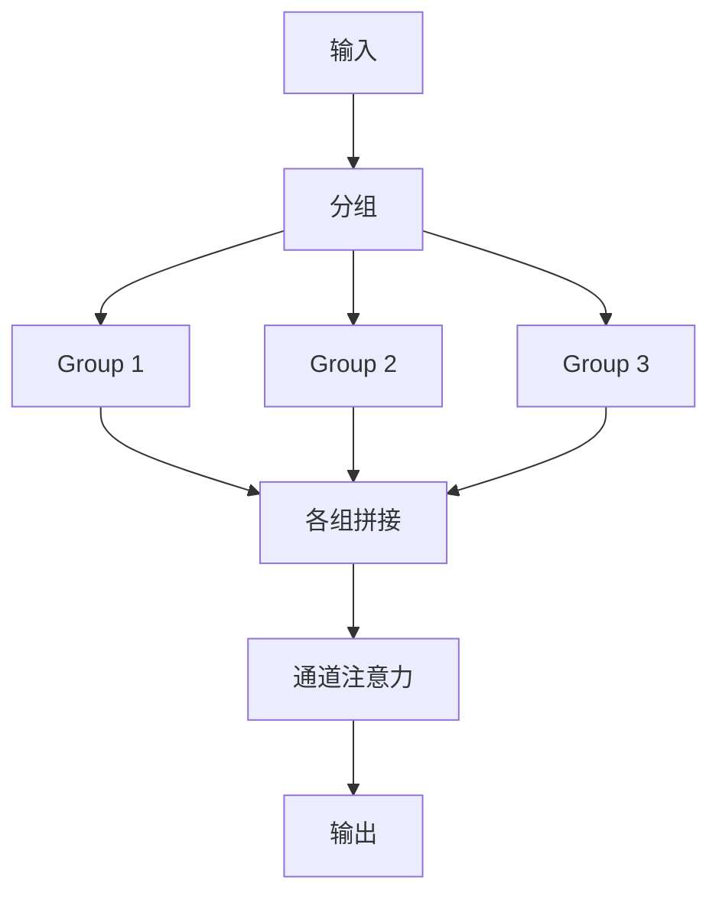
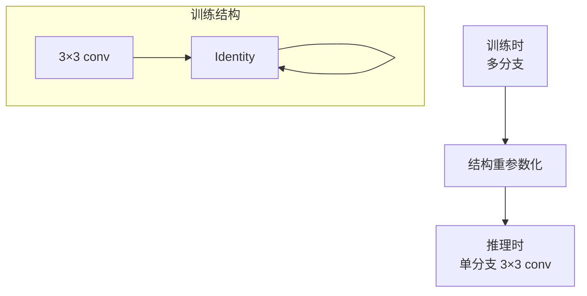
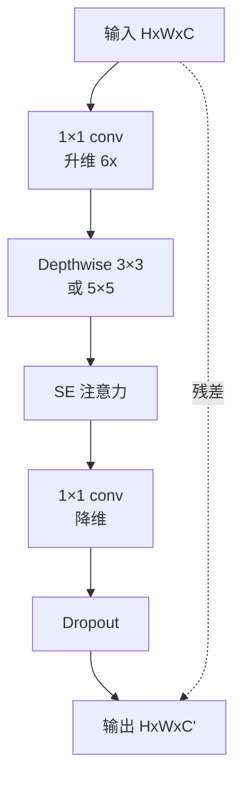
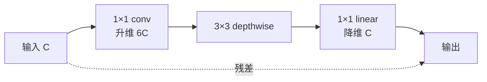
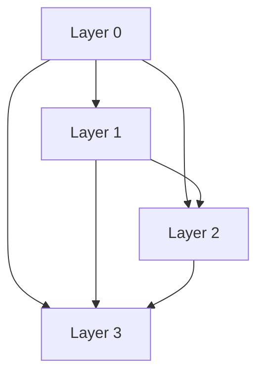
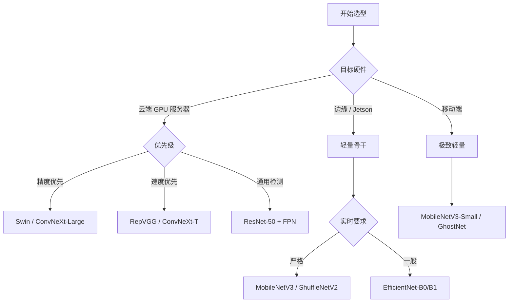
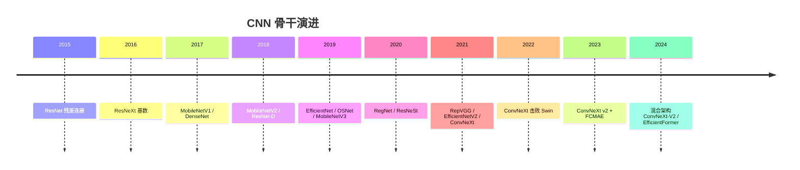
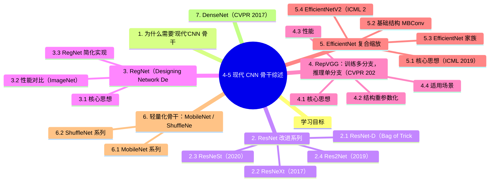

# 4-5 现代 CNN 骨干综述

## 学习目标

- 了解 2020 年以后主流 CNN 骨干网络的设计哲学
- 掌握 ResNet-D、RegNet、RepVGG、EfficientNet、ConvNeXt 等代表模型
- 理解轻量化骨干（MobileNet V1-V3、ShuffleNet、OSNet）的设计原则
- 能够在不同部署场景下选择合适的骨干
- 了解 CNN 骨干的演进趋势与 Transformer 骨干的对比

---

## 1. 为什么需要"现代"CNN 骨干

2015 年 ResNet 引领了"残差连接"范式，2017 年 MobileNet 引领了"轻量化"范式，2019 年 EfficientNet 引领了"复合缩放"范式。2020 年以后，骨干网络研究继续向三个方向推进：

1. **精度极致**：在 ImageNet 上追求更高 Top-1
2. **推理极致**：在边缘设备追求更低延迟
3. **多任务通用**：跨任务/跨域的通用特征

---

## 2. ResNet 改进系列

### 2.1 ResNet-D（Bag of Tricks, 2018）

简单的工程改进，让 ResNet 性能再上一层：

| 改进点 | 描述 |
|--------|------|
| **Deep Stem** | 用 3 个 3×3 conv 替代 7×7 |
| **AvgPool Downsample** | ResNet-B 用 1×1 conv 降采样，改用 3×3 avg pool + 1×1 conv |
| **Stride-2 Conv** | 在残差 block 的 3×3 conv 而不是第一个 1×1 conv 用 stride 2 |
| **Zero-init Last BN** | 最后一个 BN 初始化为 0，让残差块恒等 |

**效果**：ResNet-50 从 76.1% 提升到 79.0%（+2.9%），零额外计算量。

### 2.2 ResNeXt（2017）

**核心思想**：用**分组卷积 + 等价变换**增加"基数"（cardinality），比加深/加宽更高效。

```python
# ResNeXt Block: 32 个分组，每个分组 4 维
# 与 ResNet 参数量相当但精度更高
class ResNeXtBlock(nn.Module):
    def __init__(self, in_c, out_c, stride=1, cardinality=32, base_width=4):
        D = int(out_c * (base_width / 64)) * cardinality
        self.conv_reduce = nn.Conv2d(in_c, D, 1, bias=False)
        self.bn_reduce = nn.BatchNorm2d(D)
        self.conv = nn.Conv2d(D, D, 3, stride=stride, padding=1, groups=cardinality, bias=False)
        self.bn = nn.BatchNorm2d(D)
        self.conv_expand = nn.Conv2d(D, out_c, 1, bias=False)
        self.bn_expand = nn.BatchNorm2d(out_c)
```

**核心概念**：cardinality（基数）= 分组数，比 depth 和 width 更重要的"第三维"。

**ImageNet Top-1**：ResNet-50 (76.1) → ResNeXt-50 (77.4) → ResNeXt-101 (78.7)

### 2.3 ResNeSt（2020）

**Split-Attention Block**：在 ResNeXt 基础上加入"通道注意力"，每个分支内做 attention。



**ImageNet Top-1**：ResNeSt-50 (80.6%)，比 SE-ResNeXt-50 (78.9) 显著提升。

### 2.4 Res2Net（2019）

**多尺度特征融合**：在残差 block 内部用**层级化残差**增强感受野。

```
输入 → 1×1 conv → 切分为 4 块
    块 1: 直接用
    块 2: 块 1 → 3×3 conv
    块 3: 块 2 → 3×3 conv
    块 4: 块 3 → 3×3 conv
    拼接 → 1×1 conv
```

---

## 3. RegNet（Designing Network Design Spaces, CVPR 2020）

**RegNet** 与之前的"设计一个网络"不同，它**设计一个网络设计空间**，通过搜索找最优模型族。

### 3.1 核心思想


**关键参数**：
- **深度（d）**：每个 stage 的 block 数
- **宽度（w）**：每个 stage 的通道数
- **瓶颈比（b）**：1×1 conv 压缩比
- **组宽（g）**：分组卷积的 width

**核心发现**：
- 量化、共享参数化的设计空间更易搜索
- 最优模型的 **scaling pattern** 是线性的（不像 EfficientNet 的复合）
- 相同 FLOPs 下，RegNet 全面超越 EfficientNet

### 3.2 性能对比（ImageNet）

| 模型 | Top-1 | FLOPs |
|------|-------|-------|
| RegNetX-3.2GF | 78.5% | 3.2G |
| RegNetX-12GF | 80.4% | 12G |
| EfficientNet-B3 | 79.7% | 4.8G |
| EfficientNet-B5 | 83.3% | 19G |

**关键洞见**：在低 FLOPs 区间，RegNet 比 EfficientNet 精度更高。

### 3.3 RegNet 简化实现

```python
# 每个 stage 共享相同的 block 结构
def regnet_block(in_c, out_c, stride, group_width):
    bottleneck_channels = out_c // 2  # 瓶颈比 0.5
    groups = bottleneck_channels // group_width
    
    return nn.Sequential(
        nn.Conv2d(in_c, bottleneck_channels, 1, bias=False),
        nn.BatchNorm2d(bottleneck_channels),
        nn.ReLU(inplace=True),
        nn.Conv2d(bottleneck_channels, bottleneck_channels, 3, stride, 1, groups=groups, bias=False),
        nn.BatchNorm2d(bottleneck_channels),
        nn.ReLU(inplace=True),
        nn.Conv2d(bottleneck_channels, out_c, 1, bias=False),
        nn.BatchNorm2d(out_c),
    )
```

---

## 4. RepVGG：训练多分支，推理单分支（CVPR 2021）

### 4.1 核心思想

**训练时**：用多分支（ResNet-style）保证梯度流动
**推理时**：等价转换为单分支（VGG-style）享受速度



### 4.2 结构重参数化

**关键操作**（以 3×3 conv + 1×1 conv + BN + Identity 为例）：

1. **BN 吸收到 Conv**：BN 的 (γ, β) 与 Conv 的权重合并
2. **1×1 conv 零填充为 3×3**：在周围补零
3. **三个 3×3 conv 直接相加**：得到一个等价的 3×3 conv

```python
def fuse_bn(conv, bn):
    """将 BN 层吸收到 Conv 的权重中"""
    w = conv.weight
    if conv.bias is None:
        b = torch.zeros(conv.out_channels)
    else:
        b = conv.bias
    
    bn_mean = bn.running_mean
    bn_var = bn.running_var
    bn_eps = bn.eps
    bn_weight = bn.weight
    bn_bias = bn.bias
    
    factor = bn_weight / torch.sqrt(bn_var + bn_eps)
    fused_w = w * factor.reshape(-1, 1, 1, 1)
    fused_b = (b - bn_mean) * factor + bn_bias
    
    return fused_w, fused_b

# 多分支融合示例（伪代码）
fused_3x3 = identity_padded_to_3x3  # identity → 3x3 (零填充)
fused_3x3 += 1x1_padded_to_3x3      # 1x1 → 3x3 (零填充)
fused_3x3 += main_3x3                # 主分支
fused_bias = main_bias + branch1_bias + branch2_bias
```

### 4.3 性能

| 模型 | Top-1 | 推理速度 (1080Ti) |
|------|-------|-------------------|
| ResNet-50 | 76.1% | 142 FPS |
| **RepVGG-A0** | 72.4% | **2400 FPS** |
| RepVGG-B1g4 | 78.3% | 1000 FPS |
| RepVGG-B3 | 80.6% | 525 FPS |

**速度优势**：同精度下，RepVGG 比 ResNet-50 快 5-10 倍！

### 4.4 适用场景

- ✅ GPU/服务器端推理
- ❌ 移动端（仍建议 MobileNet）
- ✅ 工业级目标检测骨干

---

## 5. EfficientNet 复合缩放

### 5.1 核心思想（ICML 2019）

传统模型缩放只调整一个维度（深度、宽度、分辨率），EfficientNet 提出**复合缩放**，平衡三者。

$$
\text{depth} = \alpha^\phi, \quad \text{width} = \beta^\phi, \quad \text{resolution} = \gamma^\phi
$$

$$
\alpha \cdot \beta^2 \cdot \gamma^2 \approx 2
$$

其中 $\alpha, \beta, \gamma$ 是通过网格搜索得到的固定系数，$\phi$ 是用户指定的缩放因子。

### 5.2 基础结构 MBConv

EfficientNet 的基础块是**移动倒置瓶颈卷积**（Mobile Inverted Bottleneck Conv, MBConv）：



**关键组件**：
- **Depthwise Separable Conv**：降低计算量
- **SE (Squeeze-Excitation) 注意力**：通道权重
- **Swish 激活**：相比 ReLU 更平滑

### 5.3 EfficientNet 家族

| 模型 | Top-1 | FLOPs | 参数量 |
|------|-------|-------|--------|
| EfficientNet-B0 | 77.3% | 0.39G | 5.3M |
| EfficientNet-B1 | 79.2% | 0.70G | 7.8M |
| EfficientNet-B3 | 81.7% | 1.8G | 12M |
| EfficientNet-B5 | 83.7% | 9.9G | 30M |
| EfficientNet-B7 | 84.3% | 37G | 66M |

### 5.4 EfficientNetV2（ICML 2021）

**改进点**：
1. 引入 **Fused-MBConv**（将 1×1 + 3×3 depthwise 合并为单个 3×3 conv）
2. **渐进式学习**：训练时逐步增加图像尺寸
3. **更小的扩张比**


**性能**：训练速度比 V1 快 5-10 倍，参数更少。

---

## 6. 轻量化骨干：MobileNet / ShuffleNet / OSNet

### 6.1 MobileNet 系列

#### MobileNetV1（2017）：深度可分离卷积的开山之作

```python
# 标准卷积
def standard_conv(x, w):  # 参数量: C_in × C_out × K × K
    return F.conv2d(x, w, padding=1)

# 深度可分离卷积 = Depthwise + Pointwise
def depthwise_separable_conv(x, w_dw, w_pw):  # 参数量: C_in × K × K + C_in × C_out
    out = F.conv2d(x, w_dw, padding=1, groups=x.size(1))  # Depthwise
    out = F.conv2d(out, w_pw)  # Pointwise
    return out
```

**计算量压缩比**：

$$
\frac{\text{DSC}}{\text{Standard}} = \frac{1}{C_{out}} + \frac{1}{K^2}
$$

K=3 时约压缩 8-9 倍。

#### MobileNetV2（2018）：Inverted Residuals

**核心思想**：升维 → Depthwise → 降维（与 ResNet 相反）



**关键**：最后的 1×1 conv 用 **Linear**（无激活），避免破坏低维空间。

#### MobileNetV3（2019）：神经架构搜索

**改进**：
- **NAS（神经架构搜索）** 自动设计网络
- **h-swish 激活**（hard swish）：相比 swish 计算量更小
- **SE 注意力**整合
- 优化的 block 结构

```python
# h-swish
class HardSwish(nn.Module):
    def forward(self, x):
        return x * F.relu6(x + 3) / 6
```

**性能**：

| 模型 | Top-1 | FLOPs | 参数量 |
|------|-------|-------|--------|
| MobileNetV1 | 70.6% | 569M | 4.2M |
| MobileNetV2 | 72.0% | 300M | 3.4M |
| **MobileNetV3-Small** | 67.5% | 66M | 2.5M |
| **MobileNetV3-Large** | 75.2% | 219M | 5.4M |

### 6.2 ShuffleNet 系列

**核心思想**：用**通道混洗（Channel Shuffle）**让分组卷积的输出在不同组间流动。


**ShuffleNet V2** 提出四条高效设计准则：
1. 等通道宽度（避免分支）
2. 最小化分组卷积
3. 减少网络碎片（分支数）
4. 减少逐元素操作（ReLU、Add）

### 6.3 OSNet（Omni-Scale Network, ICCV 2019）

**专为目标重识别（ReID）设计**：用**多尺度特征流**生成全尺度特征。

```python
# Lite 3x3 + Lite 5x5 并行 + 聚合
class OSBlock(nn.Module):
    def __init__(self, in_c, out_c):
        self.conv1x1 = nn.Conv2d(in_c, out_c//4, 1)
        self.conv3x3 = nn.Conv2d(out_c//4, out_c//4, 3, padding=1, groups=out_c//4)
        self.conv5x5 = nn.Sequential(
            nn.Conv2d(out_c//4, out_c//4, 3, padding=1, groups=out_c//4),
            nn.Conv2d(out_c//4, out_c//4, 3, padding=1, groups=out_c//4),
        )
        # 特征聚合 + 通道注意力
```

---

## 7. DenseNet（CVPR 2017）

**核心思想**：**密集连接**，每一层都接收前面所有层的输出。



**优点**：
- 特征复用，参数效率高
- 缓解梯度消失
- 每层都能直接访问原始输入和所有中间特征

**缺点**：
- 训练时显存消耗大（需要保存所有中间特征）
- 推理时通过 concat 操作较多

**DenseNet-121**：ImageNet Top-1 75.0%，参数量仅 8M。

---

## 8. ConvNeXt（CVPR 2022）：CNN 的现代化

### 8.1 核心思想

ConvNeXt 通过"现代化"设计让纯 CNN 性能**接近甚至超越 Swin Transformer**。

### 8.2 关键现代化改造

| 改造项 | 原 ResNet | ConvNeXt |
|--------|-----------|----------|
| **Patchify Stem** | 7×7 stride-2 conv | 4×4 stride-4 conv（patch 化）|
| **Depthwise Conv** | 标准 3×3 | 7×7 depthwise（更大感受野）|
| **Inverted Bottleneck** | 1×1 → 3×3 → 1×1 | 1×1 升 → 7×7 DW → 1×1 降（倒置瓶颈）|
| **激活函数** | ReLU | GELU |
| **归一化** | BN | LayerNorm |
| **下采样** | stride-2 conv | 2×2 stride-2 conv + LN |
| **Stage Ratio** | (3, 4, 6, 3) | (3, 3, 9, 3) |
| **小 Kernel** | 3×3 | 7×7 depthwise |

### 8.3 性能对比

| 模型 | Top-1 | FLOPs |
|------|-------|-------|
| ResNet-50 | 78.5% | 4.1G |
| ConvNeXt-T | **82.1%** | 4.5G |
| ResNet-200 | 79.5% | 15G |
| ConvNeXt-B | 83.8% | 15.4G |
| Swin-T | 81.3% | 4.5G |
| Swin-B | 83.5% | 15.4G |

**关键意义**：**纯 CNN 可以做到与 Transformer 相当甚至更好**，在工业部署中仍是首选（因为成熟、跨平台支持好）。

### 8.4 ConvNeXt v2（2023）

加入 **FCMAE（Fully Convolutional Masked Autoencoder）** 自监督预训练 + **GRN（Global Response Normalization）**，进一步提升。

---

## 9. CNN vs Transformer 骨干

### 9.1 对比

| 维度 | CNN | Transformer |
|------|-----|-------------|
| **归纳偏置** | 强（局部性、平移等变性）| 弱（数据驱动）|
| **数据需求** | 较少即可学好 | 需要大规模数据 |
| **小数据集** | 优势明显 | 容易过拟合 |
| **大模型/大模型量** | 收益递减 | 持续收益（Scaling Law）|
| **推理速度** | 优化成熟 | 注意力 O(n²) |
| **跨域迁移** | 一般 | 强 |
| **可解释性** | 局部明确 | 全局但难解释 |

### 9.2 当前共识

- **小数据 + 工业部署**：CNN 仍是首选
- **大数据 + 大模型**：Transformer 占优（Swin、ViT）
- **混合架构**：CoAtNet、ConvNeXt 越来越流行

### 9.3 混合架构

**CoAtNet**（ICML 2021）：用卷积做浅层 + Transformer 做深层，融合两者优势。

**EfficientFormer**（NeurIPS 2022）：设计 MobileViT-like 的轻量化混合架构。

---

## 10. 骨干网络选型决策树



### 10.1 各场景推荐

| 场景 | 推荐骨干 | 理由 |
|------|----------|------|
| 工业目标检测 | ResNet-50/101 + FPN | 生态成熟 |
| 边缘实时检测 | MobileNetV3 + FPN | 轻量 |
| 高精度分类 | ConvNeXt-B/L | 接近 Transformer |
| 移动端分类 | MobileNetV3-Small | 极致轻量 |
| GPU 实时推理 | RepVGG-B1g4 | 极快 |
| 跨域迁移 (医学等) | ImageNet 预训练 ResNet | 数据少时鲁棒 |
| 大规模预训练 | Swin-L / ViT-L | Scaling Law |
| ReID | OSNet | 多尺度 |

---

## 11. 实战：迁移学习加载预训练骨干

```python
import torchvision.models as models

# 加载 ImageNet 预训练权重
resnet50 = models.resnet50(weights=models.ResNet50_Weights.IMAGENET1K_V2)
convnext_tiny = models.convnext_tiny(weights=models.ConvNeXt_Tiny_Weights.IMAGENET1K_V1)
efficientnet_b0 = models.efficientnet_b0(weights=models.EfficientNet_B0_Weights.IMAGENET1K_V1)
mobilenet_v3 = models.mobilenet_v3_large(weights=models.MobileNet_V3_Large_Weights.IMAGENET1K_V2)

# 1. 直接推理
from torchvision import transforms
preprocess = transforms.Compose([
    transforms.Resize(256),
    transforms.CenterCrop(224),
    transforms.ToTensor(),
    transforms.Normalize(mean=[0.485, 0.456, 0.406], std=[0.229, 0.224, 0.225]),
])

# 2. 替换分类头（迁移到自定义数据集）
import torch.nn as nn
num_classes = 10
resnet50.fc = nn.Linear(resnet50.fc.in_features, num_classes)

# 3. 冻结骨干，仅训练分类头
for p in resnet50.parameters():
    p.requires_grad = False
for p in resnet50.fc.parameters():
    p.requires_grad = True

# 4. 差异化学习率（骨干小学习率 + 分类头大学习率）
optimizer = torch.optim.Adam([
    {'params': resnet50.backbone.parameters(), 'lr': 1e-4},
    {'params': resnet50.fc.parameters(), 'lr': 1e-3},
])
```

---

## 12. 总结与展望

### 12.1 演进时间线



### 12.2 核心趋势

1. **结构重参数化**：RepVGG、VGG-style 推理
2. **设计空间搜索**：RegNet、EfficientNet
3. **轻量化 + 高精度兼顾**：MobileNetV3、EfficientNet
4. **CNN 现代化**：ConvNeXt 借鉴 Transformer 设计
5. **自监督 + 大模型**：FCMAE、DINO

### 12.3 选型速查

| 目标 | 推荐 |
|------|------|
| **最高精度** | ConvNeXt-XL / Swin-L |
| **最快 GPU 推理** | RepVGG |
| **最强轻量** | MobileNetV3-Small |
| **ReID 专用** | OSNet |
| **跨域迁移** | ImageNet 预训练 ResNet/ConvNeXt |
| **大规模预训练** | ConvNeXt-V2 + FCMAE |

---

## 本章小结

本章系统梳理了现代 CNN 骨干网络：

1. **ResNet 改进系列**：ResNet-D、ResNeXt、ResNeSt、Res2Net 通过简单但有效的工程改进持续提升性能
2. **RegNet** 突破性地提出"设计空间"概念，通过搜索发现网络族
3. **RepVGG** 用结构重参数化让训练多分支、推理单分支成为现实，GPU 推理速度大幅领先
4. **EfficientNet** 用复合缩放原则统一深度/宽度/分辨率，并配合 MBConv 取得 SOTA
5. **MobileNet / ShuffleNet / OSNet** 等轻量骨干为边缘部署而生
6. **ConvNeXt** 用现代化改造让纯 CNN 性能比肩 Transformer
7. **CNN vs Transformer**：在工业落地中 CNN 仍是首选，大模型场景 Transformer 占优
8. **选型决策**：根据硬件、精度、速度需求综合选择，必要时用迁移学习

---


## 知识图谱



## 参考资料

1. He K, et al. Deep Residual Learning for Image Recognition. CVPR 2016. (ResNet)
2. Xie S, et al. Aggregated Residual Transformations for Deep Neural Networks. CVPR 2017. (ResNeXt)
3. Howard A, et al. MobileNets: Efficient Convolutional Neural Networks for Mobile Vision Applications. arXiv 2017.
4. Sandler M, et al. MobileNetV2: Inverted Residuals and Linear Bottlenecks. CVPR 2018.
5. Howard A, et al. Searching for MobileNetV3. ICCV 2019.
6. Tan M, Le Q. EfficientNet: Rethinking Model Scaling for Convolutional Neural Networks. ICML 2019.
7. Tan M, Le Q. EfficientNetV2: Smaller Models and Faster Training. ICML 2021.
8. Radosavovic I, et al. Designing Network Design Spaces. CVPR 2020. (RegNet)
9. Ding X, et al. RepVGG: Making VGG-style ConvNets Great Again. CVPR 2021.
10. Liu Z, et al. A ConvNet for the 2020s. CVPR 2022. (ConvNeXt)
11. Woo S, et al. ConvNeXt V2: Co-designing and Scaling ConvNets with Masked Autoencoders. 2023.
12. Zhang X, et al. ShuffleNet: An Extremely Efficient Convolutional Neural Network for Mobile Devices. CVPR 2018.
13. Ma N, et al. ShuffleNet V2: Practical Guidelines for Efficient CNN Architecture Design. ECCV 2018.
14. Zhou K, et al. Omni-Scale Feature Learning for Person Re-Identification. ICCV 2019. (OSNet)
15. Huang G, et al. Densely Connected Convolutional Networks. CVPR 2017. (DenseNet)
16. Han K, et al. GhostNet: More Features from Cheap Operations. CVPR 2020.

