# 4-6 注意力机制全景 (CV Backbone & Plug-in)

## 学习目标

- 理解注意力机制在视觉任务中的核心价值
- 掌握通道注意力（SE、ECA、SRM）、空间注意力（CAM、SimAM）、混合注意力（CBAM、CA、SK）的原理
- 了解即插即用注意力模块的工程实践
- 能够在已有骨干上插入注意力模块
- 了解注意力与 Transformer 的关系

---

## 1. 为什么需要注意力

### 1.1 传统 CNN 的局限

标准 CNN 卷积核**感受野有限**（3×3、5×5），且每个滤波器**对所有通道一视同仁**。这导致：

**注意力机制**让网络"动态地"决定**关注哪里**和**关注哪些通道**。

### 1.2 注意力机制的三大流派

---

## 2. 通道注意力：让网络知道"看什么"

### 2.1 SE-Net（Squeeze-and-Excitation, CVPR 2018）

**核心思想**：显式建模通道间的依赖关系。

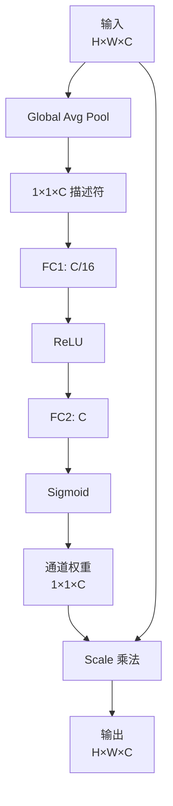

**SE Block 关键步骤**：

1. **Squeeze**：全局平均池化，得到 $1 \times 1 \times C$ 通道描述符
2. **Excitation**：两层 FC + ReLU + Sigmoid，学习通道权重
3. **Scale**：用通道权重对输入特征加权

**PyTorch 实现**：

```python
import torch
import torch.nn as nn

class SEBlock(nn.Module):
    def __init__(self, channel, reduction=16):
        super().__init__()
        self.avg_pool = nn.AdaptiveAvgPool2d(1)
        self.fc = nn.Sequential(
            nn.Linear(channel, channel // reduction, bias=False),
            nn.ReLU(inplace=True),
            nn.Linear(channel // reduction, channel, bias=False),
            nn.Sigmoid()
        )
    
    def forward(self, x):
        b, c, _, _ = x.size()
        y = self.avg_pool(x).view(b, c)
        y = self.fc(y).view(b, c, 1, 1)
        return x * y.expand_as(x)
```

**性能**：SE-ResNet-50 在 ImageNet 上 +1% Top-1，几乎无计算开销。

### 2.2 ECA-Net（Efficient Channel Attention, CVPR 2020）

**问题**：SE-Net 用两层 FC 引入了**维度缩减**（$C \to C/16 \to C$），破坏通道间的直接对应，且 FC 增加参数。

**ECA 改进**：用 **1D 卷积** 替代 FC，更轻量且更有效。

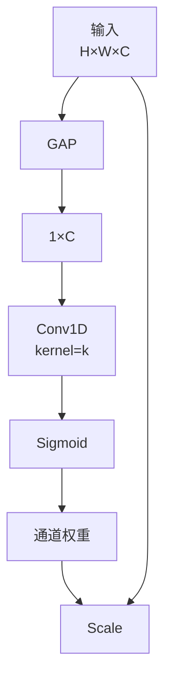

**关键**：卷积核大小 $k$ 自适应：

$$
k = \left| \frac{\log_2(C)}{\gamma} + \frac{b}{\gamma} \right|_{odd}
$$

其中 $\gamma=2, b=1$ 是超参（保证 $k$ 为奇数）。

**PyTorch 实现**：

```python
class ECABlock(nn.Module):
    def __init__(self, channel, gamma=2, b=1):
        super().__init__()
        # 自适应卷积核大小
        k = int(abs((torch.log2(torch.tensor(channel)) / gamma) + b / gamma))
        k = k if k % 2 else k + 1  # 奇数
        self.avg_pool = nn.AdaptiveAvgPool2d(1)
        self.conv1d = nn.Conv1d(1, 1, kernel_size=k, padding=k // 2, bias=False)
        self.sigmoid = nn.Sigmoid()
    
    def forward(self, x):
        b, c, _, _ = x.size()
        y = self.avg_pool(x)  # (B, C, 1, 1)
        y = y.squeeze(-1).transpose(1, 2)  # (B, 1, C)
        y = self.conv1d(y)  # (B, 1, C)
        y = self.sigmoid(y).transpose(1, 2).unsqueeze(-1)  # (B, C, 1, 1)
        return x * y.expand_as(x)
```

**对比 SE**：
- 参数：ECA 减少 ~50%
- 性能：略优于 SE

### 2.3 SRM（Style-based Recalibration Module, CVPR 2019）

用**风格统计量**（mean + std）做通道注意力。

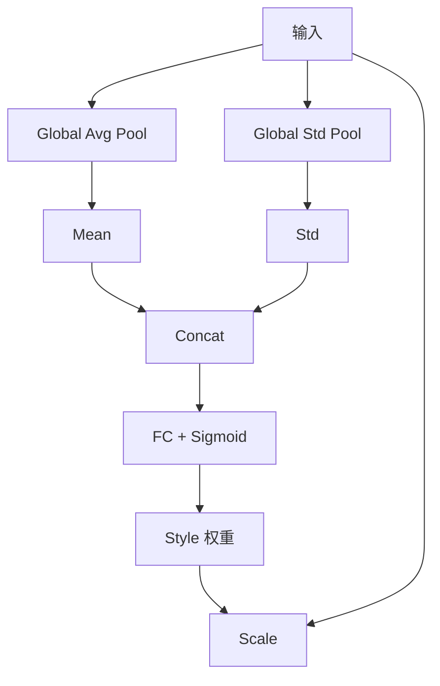

**优势**：同时考虑一阶和二阶统计量，更鲁棒。

---

## 3. 空间注意力：让网络知道"看哪里"

### 3.1 CAM / Grad-CAM（详见 11-3）

CAM 是**可解释性**方法，但也可以作为**空间注意力**。详见 11-3 章节。

### 3.2 SimAM（SimAM：无参数 3D 注意力 NeurIPS 2021）

**问题**：现有注意力模块要么引入参数（CBAM、SE），要么用 1D/2D 权重。

**SimAM 创新**：用**神经科学能量函数**推导**3D 注意力**（同时考虑通道和空间），**零参数**。

**能量函数**：

$$
e_t(w_t, b_t, y, x_i) = \frac{1}{M-1} \sum_{i=1}^{M-1} (-1 - w_t x_i + b_t)^2 + (1 - w_t t + b_t)^2 + \lambda w_t^2
$$

最小化能量 → 找出每个神经元 $t$ 与其他神经元的关系，输出注意力权重：

$$
\text{attention} = \text{Sigmoid}\left(\frac{1}{E}\right)
$$

**PyTorch 实现**：

```python
class SimAM(nn.Module):
    def __init__(self, lambda_=1e-4):
        super().__init__()
        self.lambda_ = lambda_
    
    def forward(self, x):
        # x: (B, C, H, W)
        b, c, h, w = x.size()
        n = w * h - 1
        
        # 1. 计算 (x - μ)²
        x_mean = x.mean(dim=[2, 3], keepdim=True)
        x_minus_mu_sq = (x - x_mean) ** 2
        
        # 2. 1 / (4 * (σ² + λ)) + 0.5
        d = (x_minus_mu_sq.sum(dim=[2, 3], keepdim=True) / n) + self.lambda_
        d = 1.0 / (4 * d) + 0.5
        
        # 3. Sigmoid 归一化
        return x * torch.sigmoid(d)
```

**优势**：
- **零参数**
- 3D 注意力（同时关注通道+空间）
- 性能与 CBAM 相当

---

## 4. 混合注意力：通道 + 空间

### 4.1 CBAM（Convolutional Block Attention Module, ECCV 2018）

**结构**：先通道注意力，再空间注意力，串联。

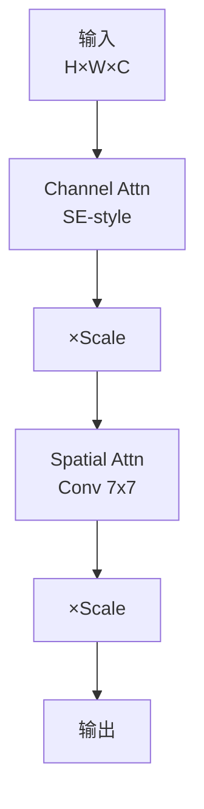

**通道注意力分支**（与 SE 类似但用 MaxPool + AvgPool 并联）：

```python
class ChannelAttention(nn.Module):
    def __init__(self, channel, reduction=16):
        super().__init__()
        self.mlp = nn.Sequential(
            nn.Conv2d(channel, channel // reduction, 1, bias=False),
            nn.ReLU(),
            nn.Conv2d(channel // reduction, channel, 1, bias=False)
        )
    
    def forward(self, x):
        avg_out = self.mlp(F.adaptive_avg_pool2d(x, 1))
        max_out = self.mlp(F.adaptive_max_pool2d(x, 1))
        scale = torch.sigmoid(avg_out + max_out)
        return x * scale
```

**空间注意力分支**：

```python
class SpatialAttention(nn.Module):
    def __init__(self, kernel_size=7):
        super().__init__()
        self.conv = nn.Conv2d(2, 1, kernel_size, padding=kernel_size//2, bias=False)
    
    def forward(self, x):
        avg_out = x.mean(dim=1, keepdim=True)
        max_out = x.max(dim=1, keepdim=True)[0]
        scale = torch.sigmoid(self.conv(torch.cat([avg_out, max_out], dim=1)))
        return x * scale

class CBAM(nn.Module):
    def __init__(self, channel, reduction=16, kernel_size=7):
        super().__init__()
        self.ca = ChannelAttention(channel, reduction)
        self.sa = SpatialAttention(kernel_size)
    
    def forward(self, x):
        return self.sa(self.ca(x))
```

**性能**：CBAM-ResNet-50 在 ImageNet 比 baseline +1.4% Top-1。

### 4.2 Coordinate Attention（CA, CVPR 2021）

**问题**：CBAM 的空间注意力只关注"哪里重要"，但忽略了**位置信息**（长距离依赖）。

**CA 创新**：把空间注意力分解为两个 1D 注意力：
- **水平方向**注意力
- **垂直方向**注意力

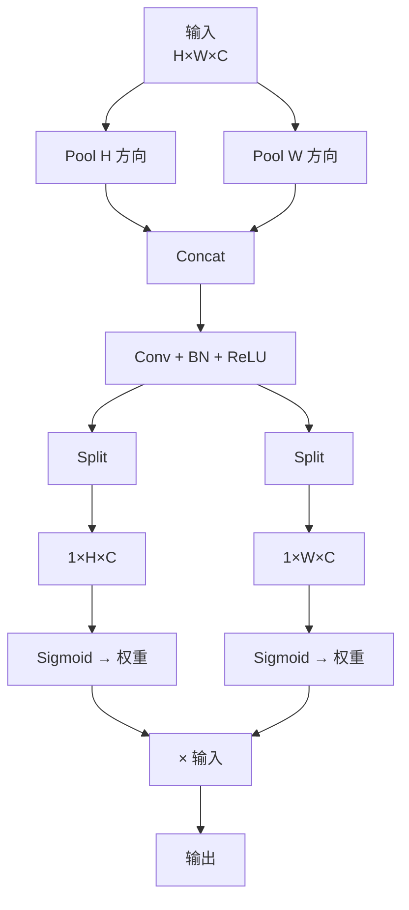

**PyTorch 实现**：

```python
class CoordAttention(nn.Module):
    def __init__(self, channel, reduction=32):
        super().__init__()
        self.pool_h = nn.AdaptiveAvgPool2d((None, 1))   # (B, C, H, 1)
        self.pool_w = nn.AdaptiveAvgPool2d((1, None))   # (B, C, 1, W)
        self.conv1 = nn.Conv2d(channel, channel // reduction, 1, bias=False)
        self.bn1 = nn.BatchNorm2d(channel // reduction)
        self.act = nn.ReLU(inplace=True)
        self.conv_h = nn.Conv2d(channel // reduction, channel, 1, bias=False)
        self.conv_w = nn.Conv2d(channel // reduction, channel, 1, bias=False)
    
    def forward(self, x):
        b, c, h, w = x.size()
        x_h = self.pool_h(x)  # (B, C, H, 1)
        x_w = self.pool_w(x).permute(0, 1, 3, 2)  # (B, C, W, 1)
        y = torch.cat([x_h, x_w], dim=2)  # (B, C, H+W, 1)
        y = self.act(self.bn1(self.conv1(y)))
        x_h, x_w = torch.split(y, [h, w], dim=2)
        a_h = torch.sigmoid(self.conv_h(x_h))  # (B, C, H, 1)
        a_w = torch.sigmoid(self.conv_w(x_w).permute(0, 1, 3, 2))  # (B, C, 1, W)
        return x * a_h * a_w
```

**优势**：
- 捕获**长距离空间依赖**（而 CBAM 只能局部）
- 轻量（参数和计算量都很少）
- 即插即用

### 4.3 SK-Net（Selective Kernel, CVPR 2019）

**核心思想**：用**多尺度卷积核** + **选择机制**自适应调整感受野。

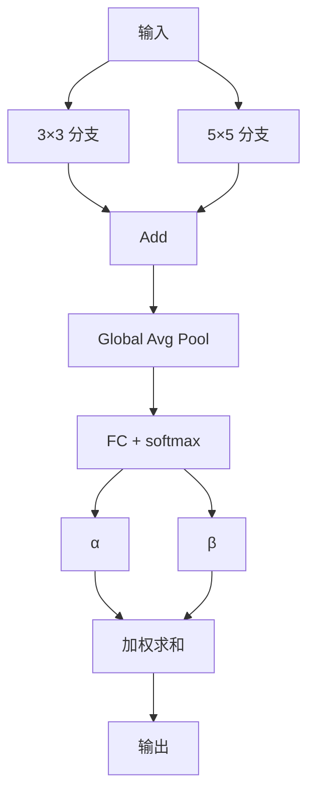

**特点**：
- 每个神经元有**自适应**的感受野大小
- 比 SE-Net 多 1 个尺度分支
- 性能略优于 SE

---

## 5. 自注意力机制：Non-Local 和变体

### 5.1 Non-Local Neural Networks（CVPR 2018）

借鉴 NLP 中的自注意力，让特征图的**每个位置**都能看到**所有其他位置**：

$$
y_i = \frac{1}{C(x)} \sum_{\forall j} f(x_i, x_j) g(x_j)
$$

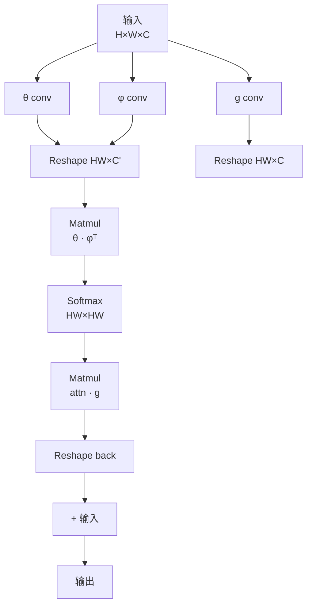

**问题**：计算量 $O(H^2 W^2)$，高分辨率图像吃不消。

### 5.2 变体优化

| 方法 | 思路 | 复杂度 |
|------|------|--------|
| Non-Local | 完整自注意力 | $O(H^2 W^2)$ |
| Criss-Cross | 十字交叉路径 | $O(HW \sqrt{HW})$ |
| GC-Net | 全局上下文简化 | $O(HW \cdot C)$ |
| **Swin Transformer** | 窗口内局部注意力 | $O(HW \cdot k^2)$ |

### 5.3 与 Transformer 的关系

**自注意力 = 视觉 Transformer 的核心组件**。事实上：
- ViT / Swin = 纯自注意力堆叠
- 各种 CV 注意力模块 = 简化版的自注意力

**演进关系**：

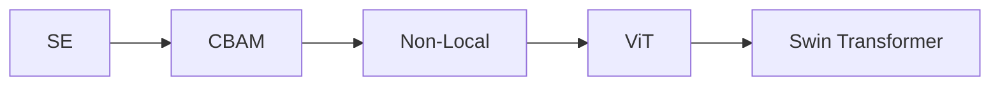

---

## 6. 注意力模块选择指南

### 6.1 即插即用场景

| 场景 | 推荐模块 | 理由 |
|------|----------|------|
| 通道选择性重要 | SE / ECA | 经典稳妥 |
| 极致轻量 | SimAM | 零参数 |
| 同时关注通道+空间 | CBAM | 经典通用 |
| 长距离空间依赖 | Coordinate Attention | MobileNet 友好 |
| 像素级任务（分割） | Non-Local / Swin | 全局建模 |
| 检测/分割 | Coordinate Attention | 轻量且长距离 |
| 分类 | SE / ECA / SimAM | 工业首选 |

### 6.2 性能 vs 计算量对比

| 模块 | 参数量 | FLOPs | ImageNet 增益 |
|------|--------|-------|---------------|
| 基准 | 0 | 0 | 76.1% |
| **SE** | 中 | 低 | +1.0% |
| **CBAM** | 中 | 中 | +1.4% |
| **ECA** | 极低 | 极低 | +0.9% |
| **SimAM** | 0 | 极低 | +0.8% |
| **CA** | 低 | 低 | +1.2% |
| **SK** | 中 | 中 | +0.8% |
| **Non-Local** | 高 | 极高 | +1.7% |

### 6.3 实战：在 ResNet 末尾插入注意力

```python
import torchvision.models as models
from attention_modules import SEBlock, ECABlock, CBAM, CoordAttention

# 加载 ResNet-50
resnet = models.resnet50(weights=models.ResNet50_Weights.IMAGENET1K_V2)

# 在每个 bottleneck 后插入 ECA（轻量首选）
for module in resnet.layer4:
    original = module.conv3  # 最后一个 conv
    in_channels = original.out_channels
    module.eca = ECABlock(in_channels)
    
    # 在 forward 中插入
    def forward_hook(self, x):
        out = super(type(self), self).forward(x)  # 调用原始 forward
        return self.eca(out)
    import types
    module.forward = types.MethodType(forward_hook, module)

# 或者更简单地：在 ResNet 末尾插入
class ResNetWithAttention(nn.Module):
    def __init__(self, attention='ca'):
        super().__init__()
        self.backbone = models.resnet50(weights=models.ResNet50_Weights.IMAGENET1K_V2)
        self.attention = {
            'se': SEBlock(2048),
            'eca': ECABlock(2048),
            'cbam': CBAM(2048),
            'ca': CoordAttention(2048)
        }[attention]
        self.fc = nn.Linear(2048, 1000)
    
    def forward(self, x):
        x = self.backbone.conv1(x)
        x = self.backbone.bn1(x)
        x = self.backbone.relu(x)
        x = self.backbone.maxpool(x)
        x = self.backbone.layer1(x)
        x = self.backbone.layer2(x)
        x = self.backbone.layer3(x)
        x = self.backbone.layer4(x)
        x = self.attention(x)  # 在最后一层后插入
        x = self.backbone.avgpool(x).flatten(1)
        return self.fc(x)
```

### 6.4 训练技巧

1. **不要堆叠过多**：1-2 个注意力模块足够
2. **位置很重要**：通常放在 block 末尾（输出特征前）
3. **与 BN 配合**：注意力之前先做 BN
4. **学习率要小**：注意力参数敏感

---

## 7. 注意力与 Transformer 的融合

### 7.1 混合架构

很多现代模型同时使用 CNN + 注意力 + Transformer：

| 模型 | 架构 |
|------|------|
| **CoAtNet** | CNN (浅层) + Transformer (深层) |
| **BoTNet** | ResNet + 全局自注意力 |
| **CvT** | CNN token 化 + Transformer |
| **EfficientFormer** | MobileViT-style 混合 |
| **CMT** | CNN Patch + Transformer + 局部注意力 |

### 7.2 视觉注意力前沿

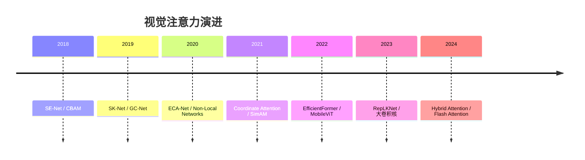

---

## 8. 应用案例

### 8.1 注意力在 YOLOv5/v8 中的应用

YOLOv5/v8 默认在骨干中使用：

- **YOLOv5**：C3 模块 + SE（可选）
- **YOLOv8**：C2f 模块 + 默认无外部注意力
- **改进版**：可插入 CBAM、CA、SimAM

```python
# 在 YOLOv8 的 yaml 配置中添加注意力
backbone:
  - [-1, 1, Conv, [64, 6, 2, 2]]  # 0-P1/2
  - [-1, 1, Conv, [128, 3, 2]]  # 1-P2/4
  - [-1, 3, C2f, [128, True]]
  - [-1, 1, Conv, [256, 3, 2]]  # 3-P3/8
  - [-1, 6, C2f, [256, True]]
  - [-1, 1, Conv, [512, 3, 2]]  # 5-P4/16
  - [-1, 6, C2f, [512, True]]
  - [-1, 1, Conv, [1024, 3, 2]]  # 7-P5/32
  - [-1, 3, C2f, [1024, True]]
  - [-1, 1, SPPF, [1024, 5]]  # 9
  - [-1, 1, CBAM, [1024, 7]]  # ← 插入 CBAM 注意力
```

### 8.2 注意力在 U-Net 分割中

```python
# Attention U-Net：在 skip connection 中加注意力门
class AttentionGate(nn.Module):
    def __init__(self, gate_channel, in_channel, inter_channel):
        super().__init__()
        self.W_g = nn.Conv2d(gate_channel, inter_channel, 1)
        self.W_x = nn.Conv2d(in_channel, inter_channel, 1)
        self.psi = nn.Conv2d(inter_channel, 1, 1)
        self.relu = nn.ReLU(inplace=True)
        self.sigmoid = nn.Sigmoid()
    
    def forward(self, g, x):
        g1 = self.W_g(g)
        x1 = self.W_x(x)
        psi = self.relu(g1 + x1)
        psi = self.sigmoid(self.psi(psi))
        return x * psi
```

### 8.3 注意力在 GAN 中的应用

- **SAGAN**：Self-Attention GAN
- **BigGAN**：用注意力增强全局一致性

---

## 9. 实战建议

### 9.1 调试注意力模块的步骤

1. **先 baseline**：不加注意力，训到收敛
2. **加最轻量模块**（ECA 或 SimAM）
3. **观察指标**：精度 vs 计算量 trade-off
4. **再升级**：根据瓶颈选择更强的（CA、CBAM）
5. **可视化**：用 Grad-CAM 确认是否学到了"关注重点"

### 9.2 常见误区

| 误区 | 真相 |
|------|------|
| 注意力越多越好 | 1-2 个足够 |
| 注意力能解决一切 | 数据质量更重要 |
| 加了注意力一定提升 | 不一定，需验证 |
| 注意力参数越多越好 | 轻量模块往往更优 |
| 注意力是 Transformer | 是 Transformer 的一种简化 |

---

## 10. 总结与选型

### 10.1 一句话总结

| 模块 | 一句话 |
|------|--------|
| **SE** | 全局平均池化 + 两层 FC，学通道权重 |
| **ECA** | SE 的轻量版，用 1D conv |
| **CBAM** | SE + 空间注意力串联 |
| **CA** | 空间注意力拆分为 H/W 方向，捕获长距离 |
| **SimAM** | 零参数 3D 注意力，能量函数推导 |
| **SK** | 多尺度卷积核 + 自适应选择 |
| **Non-Local** | 完整自注意力，全局建模 |

### 10.2 选型决策树

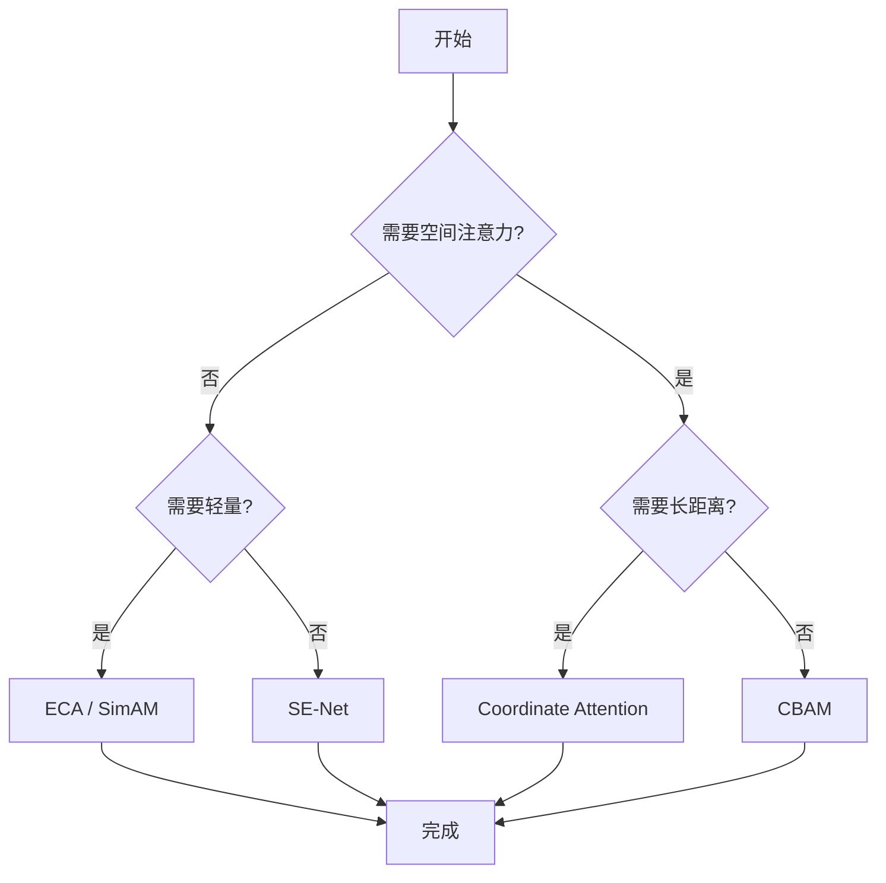

---

## 本章小结

本章系统讲解了视觉注意力机制的全景：

1. **通道注意力**（SE、ECA、SRM）让网络知道"看哪些特征"
2. **空间注意力**（CAM、SimAM）让网络知道"看哪些位置"
3. **混合注意力**（CBAM、CA、SK）综合通道+空间
4. **自注意力**（Non-Local、Transformer）提供全局建模能力
5. **SimAM** 是 2021 年的新星，**零参数** + 3D 注意力
6. **CA (Coordinate Attention)** 在轻量化和长距离依赖间取得平衡
7. **注意力与 Transformer 关系**：自注意力是 Transformer 核心，CV 注意力是简化版
8. **实战选型**：根据精度、计算量、任务类型综合选择

---


## 知识图谱

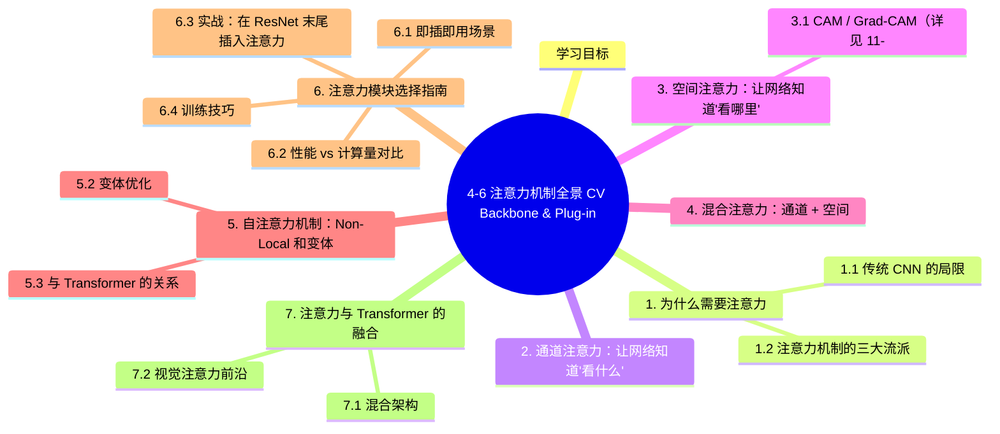

## 参考资料

1. Hu J, et al. Squeeze-and-Excitation Networks. CVPR 2018.
2. Wang Q, et al. ECA-Net: Efficient Channel Attention for Deep Convolutional Neural Networks. CVPR 2020.
3. Woo S, et al. CBAM: Convolutional Block Attention Module. ECCV 2018.
4. Hou Q, et al. Coordinate Attention for Efficient Mobile Network Design. CVPR 2021.
5. Yang L, et al. SimAM: A Simple, Parameter-Free Attention Module for Convolutional Neural Networks. ICML 2021.
6. Li X, et al. Selective Kernel Networks. CVPR 2019.
7. Wang X, et al. Non-Local Neural Networks. CVPR 2018.
8. Cao Y, et al. GCNet: Non-local Networks Meet Squeeze-Excitation Networks and Beyond. ICCV 2019.
9. Huang Z, et al. CCNet: Criss-Cross Attention for Semantic Segmentation. ICCV 2019.
10. Lee H, et al. SRM: A Style-based Recalibration Module for Convolutional Neural Networks. CVPR 2019.

