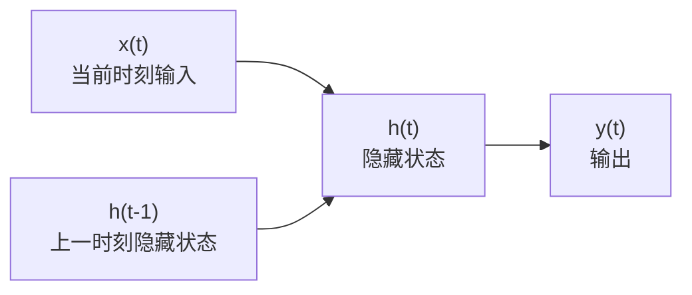
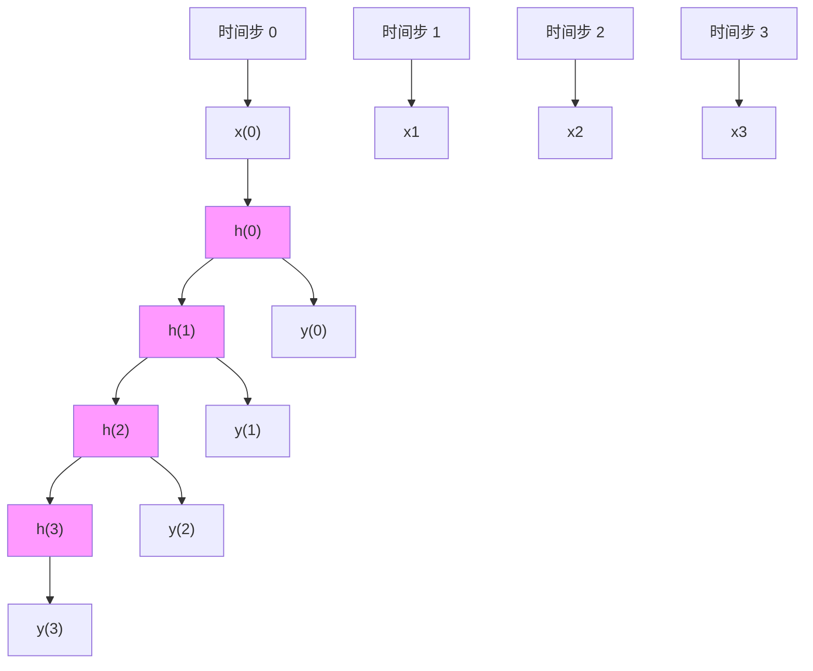
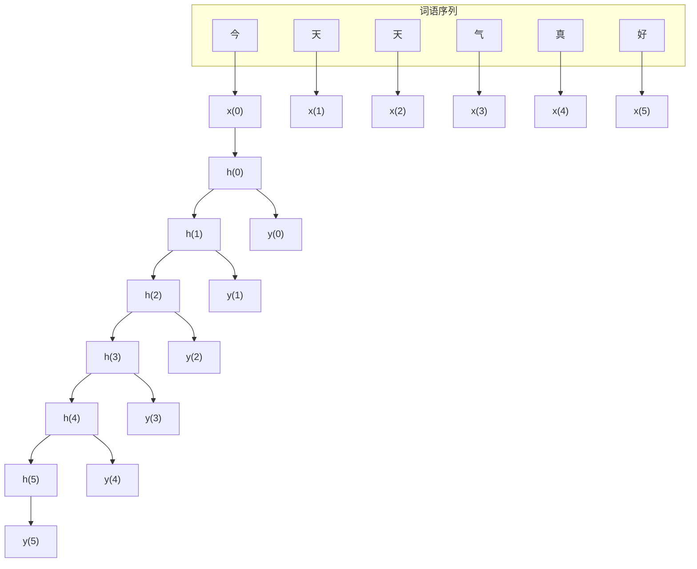
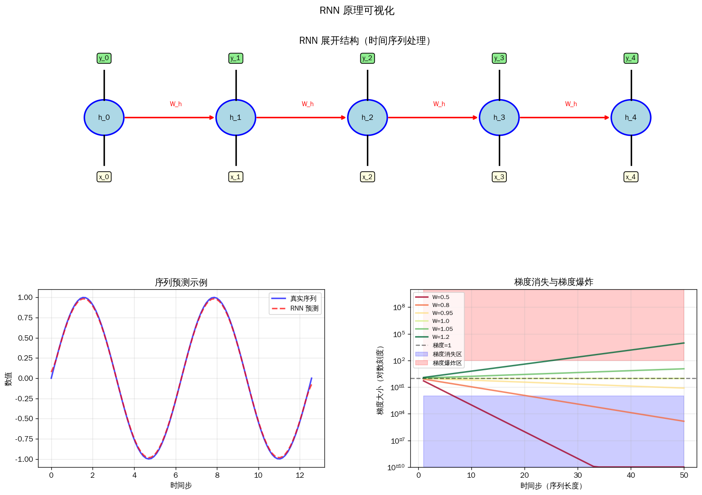
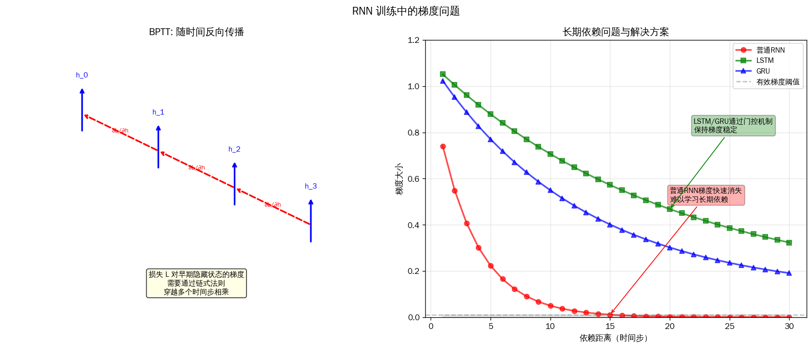
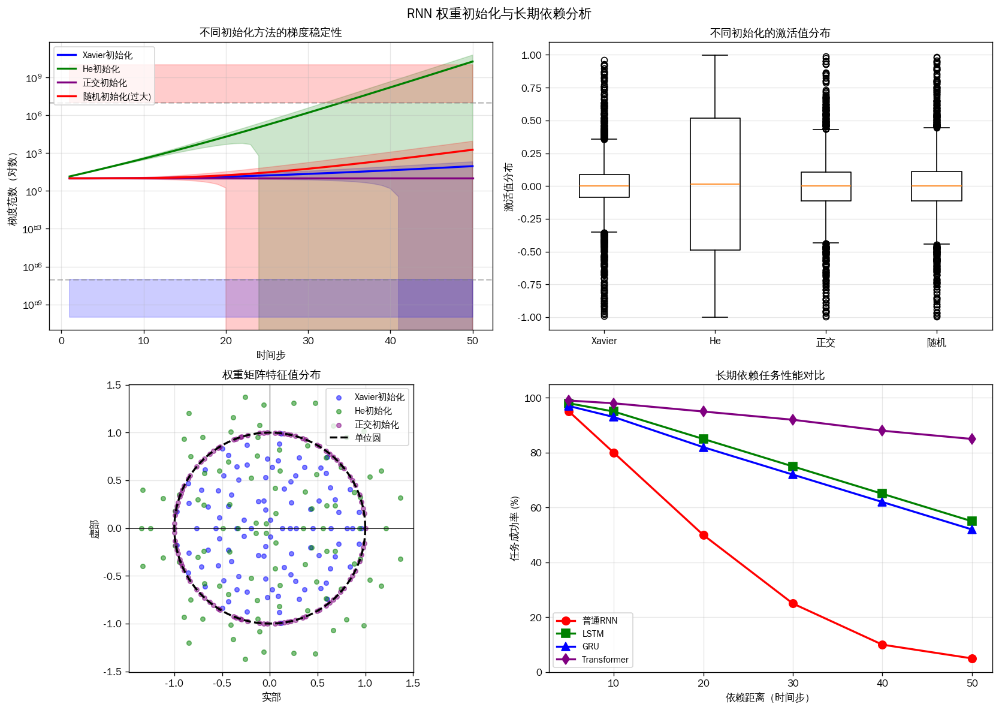
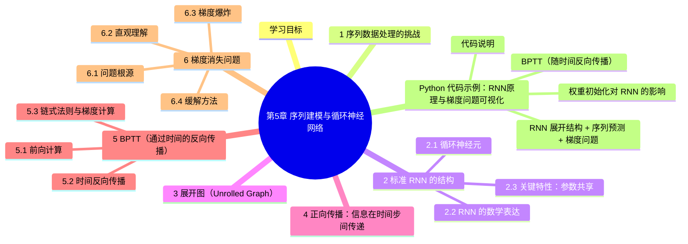

# 第5章 序列建模与循环神经网络

> 本章我们将学习用于处理序列数据的循环神经网络（RNN）及其变体，并了解序列到序列（Seq2Seq）模型的基本原理。
>
> 序列数据是自然界最常见的数据形式之一——文本、语音、时间序列等，都具有鲜明的顺序特征。循环神经网络正是为这类数据量身打造的深度学习架构。

---

# 5-1 RNN 原理

## 学习目标

- 理解序列数据处理的挑战
- 掌握标准 RNN 的网络结构与循环神经元的工作原理
- 理解 RNN 的正向传播过程（时间步传递）
- 通过展开图（Unrolled Graph）理解 RNN 的计算图
- 理解 BPTT（通过时间的反向传播）算法
- 认识 RNN 中的梯度消失问题及其影响

---

## 1 序列数据处理的挑战

在深度学习应用中，我们遇到的数据并非总是静态独立的。现实世界中大量数据具有**时序性**，即数据的顺序本身携带着重要信息：

| 序列数据类型 | 示例 |
|---|---|
| 文本 | "今天天气很好" → 词语顺序决定语义 |
| 语音 | 音频波形 → 时间连续的信号 |
| 时间序列 | 股票价格、传感器读数 |
| 视频 | 图像帧的时序组合 |

处理序列数据面临三个核心挑战：

1. **变长问题**：不同输入/输出的长度可能不同，无法使用固定尺寸的网络
2. **位置信息**：输入文本中不同位置的相同词语，含义相同但位置不同
3. **长期依赖**：某些重要信息可能出现在序列的开头，但需要保留到最后

传统的前馈神经网络（如全连接网络、卷积神经网络）很难有效解决这些问题，因为它们的架构假设输入之间相互独立，没有考虑顺序关系。

---

## 2 标准 RNN 的结构

### 2.1 循环神经元

RNN（Recurrent Neural Network，循环神经网络）的核心思想是**让网络具有记忆能力**。它通过引入循环连接，使得信息可以在时间步之间传递。

一个基本的 RNN 神经元（也称为"循环神经元"）的结构如下：




在每个时间步 $t$，循环神经元：
- 接收当前时刻的输入 $x^{(t)}$
- 接收上一时刻的隐藏状态 $h^{(t-1)}$
- 输出当前时刻的隐藏状态 $h^{(t)}$（同时传递给下一时刻）

### 2.2 RNN 的数学表达

标准 RNN 的计算公式如下：

$$h^{(t)} = \tanh(W_{xh} \cdot x^{(t)} + W_{hh} \cdot h^{(t-1)} + b_h)$$

$$y^{(t)} = W_{hy} \cdot h^{(t)} + b_y$$

其中：
- $x^{(t)}$：时刻 $t$ 的输入向量
- $h^{(t)}$：时刻 $t$ 的隐藏状态（也称为"记忆"）
- $y^{(t)}$：时刻 $t$ 的输出
- $W_{xh}$：输入到隐藏的权重矩阵
- $W_{hh}$：隐藏到隐藏（循环）的权重矩阵
- $W_{hy}$：隐藏到输出的权重矩阵
- $\tanh$：激活函数（常用，也可用 ReLU）

### 2.3 关键特性：参数共享

值得注意的是，在 RNN 的所有时间步中，**权重矩阵 $W_{xh}$、$W_{hh}$、$W_{hy}$ 是共享的**。这意味着无论输入序列有多长，模型参数始终只有一套。

这种设计带来两个好处：
1. **模型规模不随序列长度增长**：避免参数爆炸
2. **每个时间步的运算逻辑相同**：可以处理任意长度的序列

---

## 3 展开图（Unrolled Graph）

RNN 的循环结构可以展开成一个链式图，每个时间步对应图中一个节点：




展开图清楚地展示了信息沿时间轴传递的过程：
- $h^{(0)}$ 通常初始化为 0 向量（或学习得到的初始状态）
- 每个时间步 $t$ 根据 $x^{(t)}$ 和 $h^{(t-1)}$ 计算 $h^{(t)}$
- 最终输出可以从每个时间步产生（如序列标注），或仅从最后时刻提取（如文本分类）

---

## 4 正向传播：信息在时间步间传递

以句子 "今天天气真好" 为例，RNN 处理文本的过程：



- $x^{(0)}$ 对应"今"的词向量
- $h^{(0)}$ 由 $x^{(0)}$ 计算得到（初始无上一时刻信息）
- $h^{(1)}$ 由 $x^{(1)}$（"天"）和 $h^{(0)}$ 共同计算，包含了"今天"的信息
- 依此类推，后续时间步能够"记住"之前词语的信息


---

## 5 BPTT（通过时间的反向传播）

RNN 的训练同样使用反向传播算法，但由于时间维度的存在，这种反向传播被称为 **BPTT（Backpropagation Through Time，通过时间的反向传播）**。

### 5.1 前向计算

假设我们有一个损失函数 $\mathcal{L}$，衡量模型输出与真实目标之间的误差。每个时间步都可能产生一个损失 $L^{(t)}$，总损失为：

$$\mathcal{L} = \sum_{t=0}^{T} L^{(t)}$$

### 5.2 时间反向传播

BPTT 的核心思想是：将 RNN 的展开图视为一个普通的前馈网络，然后沿时间轴反向求导。

以 $W_{hh}$ 的梯度为例（假设从最后一个时间步 $T$ 反向传播到 $t=0$）：

$$\frac{\partial \mathcal{L}}{\partial W_{hh}} = \sum_{t=0}^{T} \frac{\partial L^{(t)}}{\partial W_{hh}}$$

每一项 $\frac{\partial L^{(t)}}{\partial W_{hh}}$ 需要从 $t$ 时刻一路回传到初始时刻，涉及路径：

$$h^{(t)} \to h^{(t-1)} \to h^{(t-2)} \to \cdots \to h^{(0)}$$

### 5.3 链式法则与梯度计算

根据 RNN 的计算公式：

$$h^{(t)} = \tanh(W_{xh}x^{(t)} + W_{hh}h^{(t-1)} + b_h)$$

对 $W_{hh}$ 求偏导时，链式法则展开为：

$$\frac{\partial h^{(t)}}{\partial W_{hh}} = \frac{\partial h^{(t)}}{\partial h^{(t-1)}} \cdot \frac{\partial h^{(t-1)}}{\partial W_{hh}} + \frac{\partial h^{(t)}}{\partial W_{hh}} \Big|_{\text{direct}}$$

其中：

$$\frac{\partial h^{(t)}}{\partial h^{(t-1)}} = \text{diag}\left(\tanh' \cdot (W_{hh})\right)$$

这是一个对角矩阵，元素值在 $(0, 1)$ 之间。

---

## 6 梯度消失问题

### 6.1 问题根源

在 BPTT 中，梯度需要沿时间轴回传很远。假设从 $t=20$ 时刻的损失回传到 $t=0$，需要经过 20 次链式乘法：

$$\frac{\partial h^{(20)}}{\partial h^{(0)}} = \prod_{i=1}^{20} \frac{\partial h^{(i)}}{\partial h^{(i-1)}}$$

由于 $\frac{\partial h^{(i)}}{\partial h^{(i-1)}}$ 的元素值通常小于 1（因为激活函数 $\tanh$ 的导数在 $(0,1)$ 范围内），连乘的结果会导致梯度**指数级衰减**，趋近于 0。

这意味着：
- 早期时间步的梯度信号几乎消失
- 模型难以学习长期依赖关系
- 早期信息对最终输出的影响微乎其微

### 6.2 直观理解

回到"今天天气真好"的例子。如果 RNN 学到了"天气"和"好"之间的情感关联（正向），那么这个信息需要从第 3 个时间步（第 3 个词"气"）一直保留到第 6 个时间步（"好"）。但由于梯度消失，模型实际上很难建立这种跨越 3 个时间步的依赖。

### 6.3 梯度爆炸

与梯度消失相反，当连乘的因子大于 1 时，梯度会指数级增大，造成**梯度爆炸**，导致训练不稳定（权重剧烈振荡或 NaN）。

### 6.4 缓解方法

| 方法 | 说明 |
|---|---|
| 梯度裁剪（Gradient Clipping） | 当梯度超过阈值时，将其缩放到合理范围 |
| 使用 ReLU 激活函数 | ReLU 的导数为 0 或 1，缓解连乘衰减 |
| 短期记忆场景 | 对于需要短期依赖的任务，标准 RNN 仍可工作 |
| 更好的架构（LSTM/GRU） | 引入门控机制显式解决长期依赖 |

标准 RNN 的这些问题，促使研究者设计出了 **LSTM（长短期记忆网络）** 和 **GRU（门控循环单元）** 等改进架构，它们通过引入门控机制有效地缓解了梯度消失/爆炸问题，我们将在下一章详细介绍。

---

## 7 小结

本章我们介绍了循环神经网络（RNN）的基本原理：

| 概念 | 要点 |
|---|---|
| **序列数据** | 文本、语音、时间序列等，数据顺序本身携带信息 |
| **循环神经元** | 维护隐藏状态，在时间步间传递信息 |
| **参数共享** | 所有时间步使用相同的权重矩阵 |
| **展开图** | 将循环结构展开为链式，清晰展示信息流动 |
| **BPTT** | 通过时间的反向传播，用于训练 RNN |
| **梯度消失** | 沿时间轴连乘导致梯度衰减，难以学习长期依赖 |

标准 RNN 虽然概念简单，但它为序列建模奠定了基础。后续的 LSTM、GRU 等变体都在这个框架上进行了改进，解决了标准 RNN 的核心缺陷。

---

## 本章小结

1. **序列数据的挑战**：变长问题（不同输入/输出长度不同）、位置信息（词语位置影响含义）、长期依赖（早期信息需要保留到最后）。传统前馈网络难以有效处理。

2. **RNN 核心思想**：引入循环连接使网络具有记忆能力，通过隐藏状态在时间步之间传递信息。参数在所有时间步共享，使模型规模不随序列长度增长。

3. **正向传播**：沿时间步从输入层向输出层顺序计算，每个时间步综合当前输入和上一隐藏状态产生新隐藏状态。

4. **BPTT（通过时间的反向传播）**：沿时间轴反向求导，将 RNN 展开图视为前馈网络进行梯度计算。

5. **梯度消失/爆炸**：沿时间轴链式连乘导致梯度指数级衰减（消失）或增大（爆炸）。标准 RNN 难以学习长期依赖，LSTM/GRU 通过门控机制解决。

---

## Python 代码示例：RNN原理与梯度问题可视化

下面通过Python代码演示RNN的前向传播、梯度流动以及梯度消失/爆炸问题：

```python
import numpy as np

def simple_rnn_forward(X, Wx, Wh, b, h0=None):
    """
    简化的 RNN 前向传播
    X: 输入序列 (seq_len, input_dim)
    Wx: 输入权重 (input_dim, hidden_dim)
    Wh: 隐藏层权重 (hidden_dim, hidden_dim)
    b: 偏置 (hidden_dim,)
    h0: 初始隐藏状态 (hidden_dim,)
    """
    seq_len, input_dim = X.shape
    hidden_dim = Wx.shape[1]

    if h0 is None:
        h0 = np.zeros(hidden_dim)

    h_states = np.zeros((seq_len, hidden_dim))
    h = h0

    for t in range(seq_len):
        # h_t = tanh(X_t @ Wx + h_{t-1} @ Wh + b)
        h = np.tanh(X[t] @ Wx + h @ Wh + b)
        h_states[t] = h

    return h_states

# 演示：3 时间步的正弦序列
if __name__ == "__main__":
    seq_len, input_dim, hidden_dim = 5, 1, 4
    X = np.sin(np.linspace(0, 2*np.pi, seq_len)).reshape(seq_len, input_dim)
    Wx = np.random.randn(input_dim, hidden_dim) * 0.1
    Wh = np.random.randn(hidden_dim, hidden_dim) * 0.1
    b = np.zeros(hidden_dim)

    h_states = simple_rnn_forward(X, Wx, Wh, b)
    print("输入序列 shape:", X.shape)
    print("隐藏状态序列 shape:", h_states.shape)
    print("最终隐藏状态 h_T:", h_states[-1])
    print("\nRNN 核心公式：h_t = tanh(X_t @ W_x + h_{t-1} @ W_h + b)")
    print("特点：参数 W_x, W_h, b 在所有时间步共享")
```

### RNN 展开结构 + 序列预测 + 梯度问题



> 绘图代码：[`assets/figures/5-1-rnn-visualization.py`](../../assets/figures/5-1-rnn-visualization.py)

### BPTT（随时间反向传播）



### 权重初始化对 RNN 的影响



**关键概念总结**：
1. **RNN** 通过循环连接处理序列数据，参数共享 across time
2. **BPTT** 通过时间反向传播，梯度需穿越多个时间步
3. **梯度消失**：长期依赖难以学习（梯度呈指数衰减）
4. **梯度爆炸**：训练不稳定（梯度呈指数增长）
5. **解决方案**：
   - LSTM/GRU：门控机制控制信息流
   - 梯度裁剪：防止梯度爆炸
   - 正交初始化：保持梯度稳定
   - Attention 机制：直接访问历史信息

### 代码说明

1. **RNN展开结构可视化**：
   - 展示了RNN如何在不同时间步之间传递隐藏状态
   - 每个时间步接收输入x_t，更新隐藏状态h_t，产生输出y_t
   - 权重W_h在所有时间步共享

2. **序列预测示例**：
   - 使用正弦波演示序列建模任务
   - 展示RNN如何学习序列的模式进行预测

3. **梯度消失与爆炸可视化**：
   - 展示不同权重值(W<1, W=1, W>1)下梯度的变化
   - W<1导致梯度消失（蓝色区域），W>1导致梯度爆炸（红色区域）
   - 只有W接近1时梯度才能稳定传播

4. **BPTT可视化**：
   - 展示损失梯度如何从最后一个时间步反向传播到第一个时间步
   - 说明为什么早期时间步的梯度难以更新（需要穿越多个乘法运算）

5. **长期依赖问题**：
   - 对比普通RNN、LSTM、GRU在不同依赖距离下的性能
   - 展示LSTM/GRU如何通过门控机制缓解梯度消失

6. **权重初始化影响**：
   - 比较Xavier、He、正交初始化对梯度稳定性的影响
   - 展示特征值分布与梯度爆炸/消失的关系
   - 长期依赖任务成功率对比

通过运行这段代码，读者可以深入理解RNN的工作原理、训练难点以及解决方案。

---


## 知识图谱



## 参考资料
/dl2017/html/lesson5-week1.html

