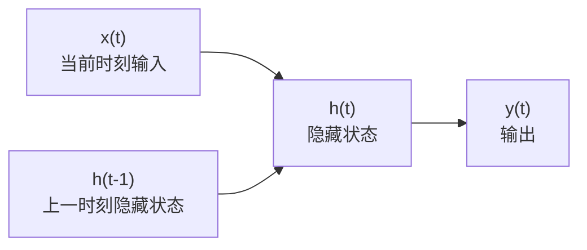
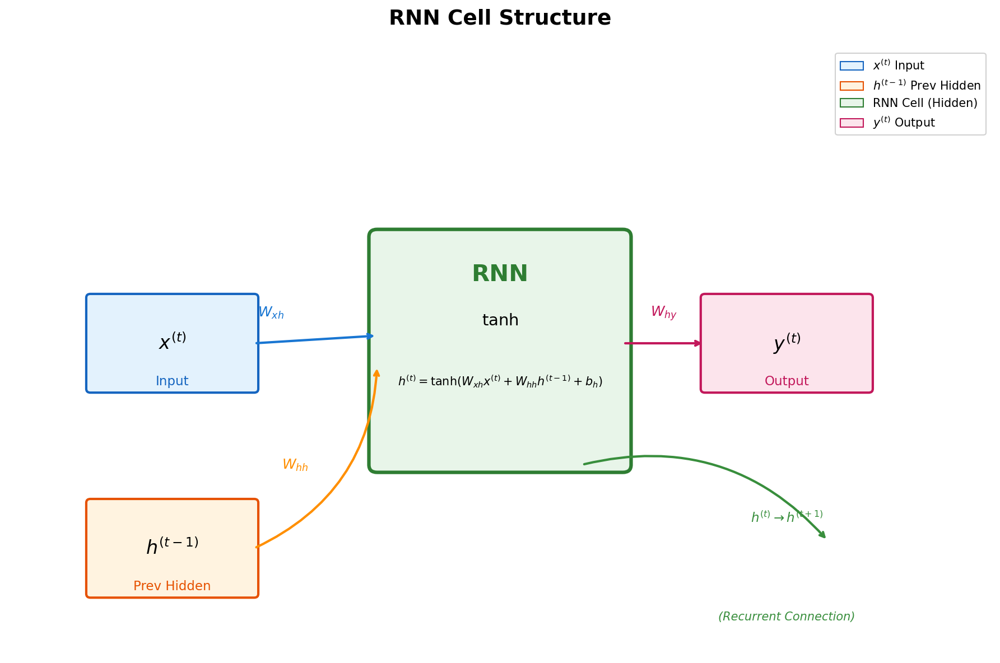
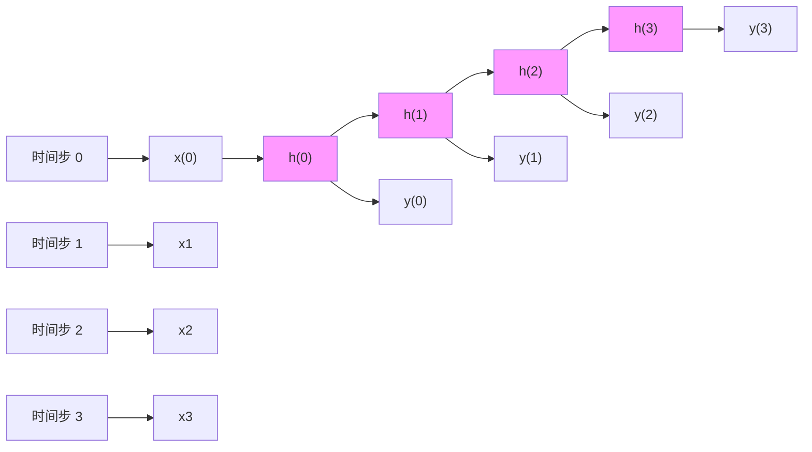
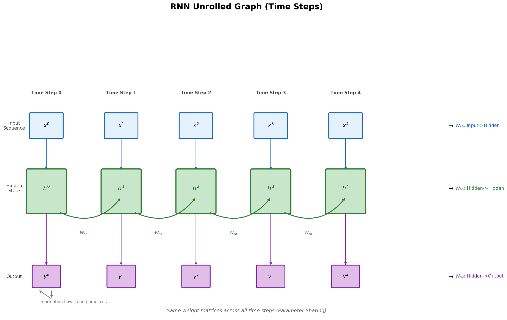
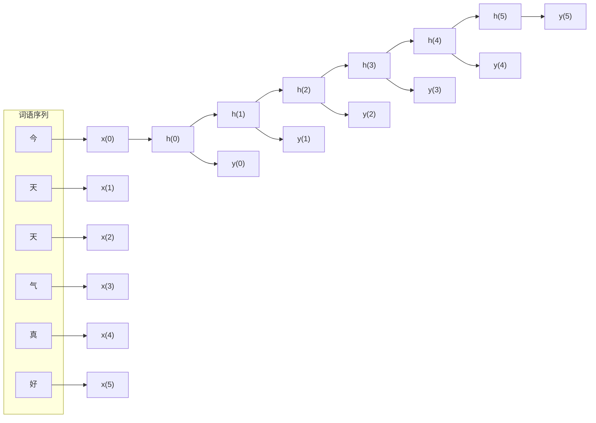
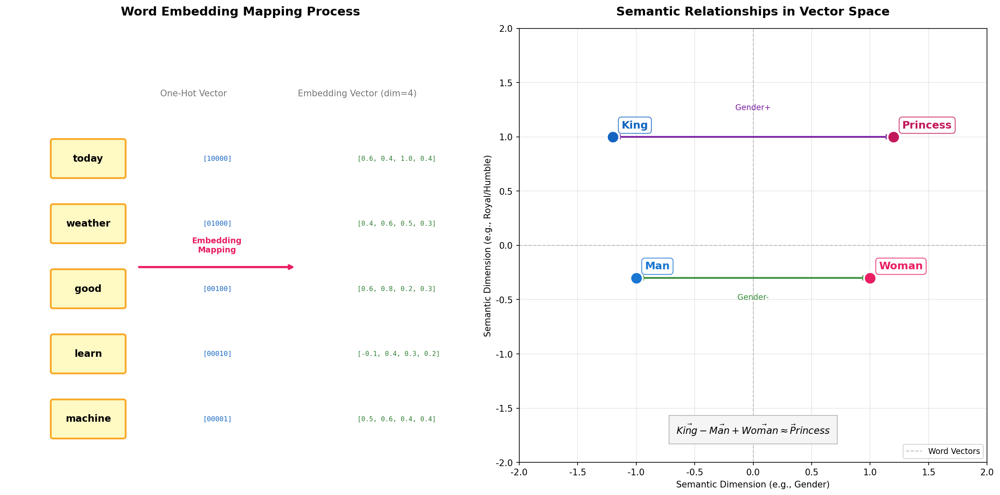
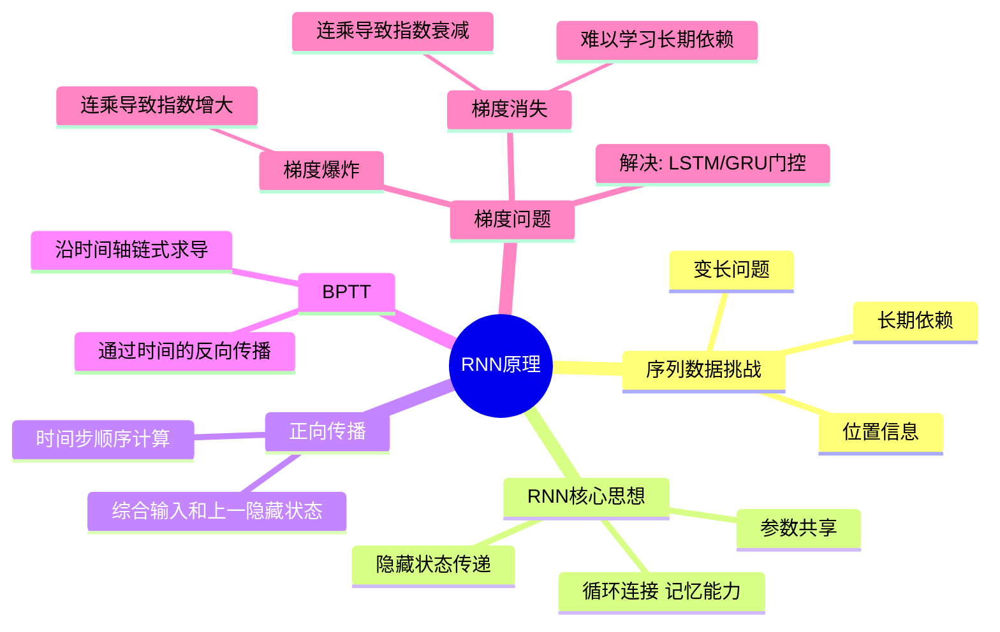

# 第5章 序列建模与循环神经网络

> 本章我们将学习用于处理序列数据的循环神经网络（RNN）及其变体，并了解序列到序列（Seq2Seq）模型的基本原理。
>
> 序列数据是自然界最常见的数据形式之一——文本、语音、时间序列等，都具有鲜明的顺序特征。循环神经网络正是为这类数据量身打造的深度学习架构。

---

# 5-1 RNN 原理

## 学习目标

- 理解序列数据处理的挑战
- 掌握标准 RNN 的网络结构与循环神经元的工作原理
- 理解 RNN 的正向传播过程（时间步传递）
- 通过展开图（Unrolled Graph）理解 RNN 的计算图
- 理解 BPTT（通过时间的反向传播）算法
- 认识 RNN 中的梯度消失问题及其影响

---

## 1 序列数据处理的挑战

在深度学习应用中，我们遇到的数据并非总是静态独立的。现实世界中大量数据具有**时序性**，即数据的顺序本身携带着重要信息：

| 序列数据类型 | 示例 |
|---|---|
| 文本 | "今天天气很好" → 词语顺序决定语义 |
| 语音 | 音频波形 → 时间连续的信号 |
| 时间序列 | 股票价格、传感器读数 |
| 视频 | 图像帧的时序组合 |

处理序列数据面临三个核心挑战：

1. **变长问题**：不同输入/输出的长度可能不同，无法使用固定尺寸的网络
2. **位置信息**：输入文本中不同位置的相同词语，含义相同但位置不同
3. **长期依赖**：某些重要信息可能出现在序列的开头，但需要保留到最后

传统的前馈神经网络（如全连接网络、卷积神经网络）很难有效解决这些问题，因为它们的架构假设输入之间相互独立，没有考虑顺序关系。

---

## 2 标准 RNN 的结构

### 2.1 循环神经元

RNN（Recurrent Neural Network，循环神经网络）的核心思想是**让网络具有记忆能力**。它通过引入循环连接，使得信息可以在时间步之间传递。

一个基本的 RNN 神经元（也称为"循环神经元"）的结构如下：





在每个时间步 $t$，循环神经元：
- 接收当前时刻的输入 $x^{(t)}$
- 接收上一时刻的隐藏状态 $h^{(t-1)}$
- 输出当前时刻的隐藏状态 $h^{(t)}$（同时传递给下一时刻）

### 2.2 RNN 的数学表达

标准 RNN 的计算公式如下：

$$h^{(t)} = \tanh(W_{xh} \cdot x^{(t)} + W_{hh} \cdot h^{(t-1)} + b_h)$$

$$y^{(t)} = W_{hy} \cdot h^{(t)} + b_y$$

其中：
- $x^{(t)}$：时刻 $t$ 的输入向量
- $h^{(t)}$：时刻 $t$ 的隐藏状态（也称为"记忆"）
- $y^{(t)}$：时刻 $t$ 的输出
- $W_{xh}$：输入到隐藏的权重矩阵
- $W_{hh}$：隐藏到隐藏（循环）的权重矩阵
- $W_{hy}$：隐藏到输出的权重矩阵
- $\tanh$：激活函数（常用，也可用 ReLU）

### 2.3 关键特性：参数共享

值得注意的是，在 RNN 的所有时间步中，**权重矩阵 $W_{xh}$、$W_{hh}$、$W_{hy}$ 是共享的**。这意味着无论输入序列有多长，模型参数始终只有一套。

这种设计带来两个好处：
1. **模型规模不随序列长度增长**：避免参数爆炸
2. **每个时间步的运算逻辑相同**：可以处理任意长度的序列

---

## 3 展开图（Unrolled Graph）

RNN 的循环结构可以展开成一个链式图，每个时间步对应图中一个节点：





展开图清楚地展示了信息沿时间轴传递的过程：
- $h^{(0)}$ 通常初始化为 0 向量（或学习得到的初始状态）
- 每个时间步 $t$ 根据 $x^{(t)}$ 和 $h^{(t-1)}$ 计算 $h^{(t)}$
- 最终输出可以从每个时间步产生（如序列标注），或仅从最后时刻提取（如文本分类）

---

## 4 正向传播：信息在时间步间传递

以句子 "今天天气真好" 为例，RNN 处理文本的过程：



- $x^{(0)}$ 对应"今"的词向量
- $h^{(0)}$ 由 $x^{(0)}$ 计算得到（初始无上一时刻信息）
- $h^{(1)}$ 由 $x^{(1)}$（"天"）和 $h^{(0)}$ 共同计算，包含了"今天"的信息
- 依此类推，后续时间步能够"记住"之前词语的信息



---

## 5 BPTT（通过时间的反向传播）

RNN 的训练同样使用反向传播算法，但由于时间维度的存在，这种反向传播被称为 **BPTT（Backpropagation Through Time，通过时间的反向传播）**。

### 5.1 前向计算

假设我们有一个损失函数 $\mathcal{L}$，衡量模型输出与真实目标之间的误差。每个时间步都可能产生一个损失 $L^{(t)}$，总损失为：

$$\mathcal{L} = \sum_{t=0}^{T} L^{(t)}$$

### 5.2 时间反向传播

BPTT 的核心思想是：将 RNN 的展开图视为一个普通的前馈网络，然后沿时间轴反向求导。

以 $W_{hh}$ 的梯度为例（假设从最后一个时间步 $T$ 反向传播到 $t=0$）：

$$\frac{\partial \mathcal{L}}{\partial W_{hh}} = \sum_{t=0}^{T} \frac{\partial L^{(t)}}{\partial W_{hh}}$$

每一项 $\frac{\partial L^{(t)}}{\partial W_{hh}}$ 需要从 $t$ 时刻一路回传到初始时刻，涉及路径：

$$h^{(t)} \to h^{(t-1)} \to h^{(t-2)} \to \cdots \to h^{(0)}$$

### 5.3 链式法则与梯度计算

根据 RNN 的计算公式：

$$h^{(t)} = \tanh(W_{xh}x^{(t)} + W_{hh}h^{(t-1)} + b_h)$$

对 $W_{hh}$ 求偏导时，链式法则展开为：

$$\frac{\partial h^{(t)}}{\partial W_{hh}} = \frac{\partial h^{(t)}}{\partial h^{(t-1)}} \cdot \frac{\partial h^{(t-1)}}{\partial W_{hh}} + \frac{\partial h^{(t)}}{\partial W_{hh}} \Big|_{\text{direct}}$$

其中：

$$\frac{\partial h^{(t)}}{\partial h^{(t-1)}} = \text{diag}\left(\tanh' \cdot (W_{hh})\right)$$

这是一个对角矩阵，元素值在 $(0, 1)$ 之间。

---

## 6 梯度消失问题

### 6.1 问题根源

在 BPTT 中，梯度需要沿时间轴回传很远。假设从 $t=20$ 时刻的损失回传到 $t=0$，需要经过 20 次链式乘法：

$$\frac{\partial h^{(20)}}{\partial h^{(0)}} = \prod_{i=1}^{20} \frac{\partial h^{(i)}}{\partial h^{(i-1)}}$$

由于 $\frac{\partial h^{(i)}}{\partial h^{(i-1)}}$ 的元素值通常小于 1（因为激活函数 $\tanh$ 的导数在 $(0,1)$ 范围内），连乘的结果会导致梯度**指数级衰减**，趋近于 0。

这意味着：
- 早期时间步的梯度信号几乎消失
- 模型难以学习长期依赖关系
- 早期信息对最终输出的影响微乎其微

### 6.2 直观理解

回到"今天天气真好"的例子。如果 RNN 学到了"天气"和"好"之间的情感关联（正向），那么这个信息需要从第 3 个时间步（第 3 个词"气"）一直保留到第 6 个时间步（"好"）。但由于梯度消失，模型实际上很难建立这种跨越 3 个时间步的依赖。

### 6.3 梯度爆炸

与梯度消失相反，当连乘的因子大于 1 时，梯度会指数级增大，造成**梯度爆炸**，导致训练不稳定（权重剧烈振荡或 NaN）。

### 6.4 缓解方法

| 方法 | 说明 |
|---|---|
| 梯度裁剪（Gradient Clipping） | 当梯度超过阈值时，将其缩放到合理范围 |
| 使用 ReLU 激活函数 | ReLU 的导数为 0 或 1，缓解连乘衰减 |
| 短期记忆场景 | 对于需要短期依赖的任务，标准 RNN 仍可工作 |
| 更好的架构（LSTM/GRU） | 引入门控机制显式解决长期依赖 |

标准 RNN 的这些问题，促使研究者设计出了 **LSTM（长短期记忆网络）** 和 **GRU（门控循环单元）** 等改进架构，它们通过引入门控机制有效地缓解了梯度消失/爆炸问题，我们将在下一章详细介绍。

---

## 7 小结

本章我们介绍了循环神经网络（RNN）的基本原理：

| 概念 | 要点 |
|---|---|
| **序列数据** | 文本、语音、时间序列等，数据顺序本身携带信息 |
| **循环神经元** | 维护隐藏状态，在时间步间传递信息 |
| **参数共享** | 所有时间步使用相同的权重矩阵 |
| **展开图** | 将循环结构展开为链式，清晰展示信息流动 |
| **BPTT** | 通过时间的反向传播，用于训练 RNN |
| **梯度消失** | 沿时间轴连乘导致梯度衰减，难以学习长期依赖 |

标准 RNN 虽然概念简单，但它为序列建模奠定了基础。后续的 LSTM、GRU 等变体都在这个框架上进行了改进，解决了标准 RNN 的核心缺陷。

---

## 本章小结

1. **序列数据的挑战**：变长问题（不同输入/输出长度不同）、位置信息（词语位置影响含义）、长期依赖（早期信息需要保留到最后）。传统前馈网络难以有效处理。

2. **RNN 核心思想**：引入循环连接使网络具有记忆能力，通过隐藏状态在时间步之间传递信息。参数在所有时间步共享，使模型规模不随序列长度增长。

3. **正向传播**：沿时间步从输入层向输出层顺序计算，每个时间步综合当前输入和上一隐藏状态产生新隐藏状态。

4. **BPTT（通过时间的反向传播）**：沿时间轴反向求导，将 RNN 展开图视为前馈网络进行梯度计算。

5. **梯度消失/爆炸**：沿时间轴链式连乘导致梯度指数级衰减（消失）或增大（爆炸）。标准 RNN 难以学习长期依赖，LSTM/GRU 通过门控机制解决。

---

## 知识点思维导图



---

## Python 代码示例：RNN原理与梯度问题可视化

下面通过Python代码演示RNN的前向传播、梯度流动以及梯度消失/爆炸问题：

```python
import numpy as np
import matplotlib.pyplot as plt
import matplotlib.gridspec as gridspec
from matplotlib.patches import FancyArrowPatch, Circle
import seaborn as sns

# 设置中文字体
plt.rcParams['font.sans-serif'] = ['SimHei', 'DejaVu Sans']
plt.rcParams['axes.unicode_minus'] = False

def simple_rnn_forward(X, Wx, Wh, b, h0=None):
    """
    简化的RNN前向传播
    X: 输入序列 (seq_len, input_dim)
    Wx: 输入权重 (input_dim, hidden_dim)
    Wh: 隐藏层权重 (hidden_dim, hidden_dim)
    b: 偏置 (hidden_dim,)
    h0: 初始隐藏状态 (hidden_dim,)
    """
    seq_len, input_dim = X.shape
    hidden_dim = Wx.shape[1]
    
    # 初始化隐藏状态
    if h0 is None:
        h0 = np.zeros(hidden_dim)
    
    # 存储所有时间步的隐藏状态
    h_states = np.zeros((seq_len, hidden_dim))
    h = h0
    
    # 前向传播
    for t in range(seq_len):
        # h_t = tanh(X_t @ Wx + h_{t-1} @ Wh + b)
        h = np.tanh(X[t] @ Wx + h @ Wh + b)
        h_states[t] = h
    
    return h_states

def visualize_rnn_unfolding():
    """可视化RNN的展开结构"""
    fig = plt.figure(figsize=(16, 10))
    gs = gridspec.GridSpec(2, 2, figure=fig, hspace=0.3, wspace=0.3)
    
    # 1. RNN展开结构示意图
    ax1 = fig.add_subplot(gs[0, :])
    ax1.set_xlim(0, 10)
    ax1.set_ylim(0, 3)
    ax1.axis('off')
    
    # 绘制时间步
    time_steps = 5
    x_positions = np.linspace(1, 9, time_steps)
    
    for i, x in enumerate(x_positions):
        # 隐藏状态节点
        circle = Circle((x, 2), 0.3, facecolor='lightblue', edgecolor='blue', linewidth=2)
        ax1.add_patch(circle)
        ax1.text(x, 2, f'h_{i}', ha='center', va='center', fontsize=10, fontweight='bold')
        
        # 输入
        ax1.plot([x, x], [1.2, 1.7], 'k-', linewidth=2)
        ax1.text(x, 1, f'x_{i}', ha='center', va='center', fontsize=9, 
                bbox=dict(boxstyle='round', facecolor='lightyellow'))
        
        # 输出
        ax1.plot([x, x], [2.3, 2.8], 'k-', linewidth=2)
        ax1.text(x, 3, f'y_{i}', ha='center', va='center', fontsize=9,
                bbox=dict(boxstyle='round', facecolor='lightgreen'))
        
        # 时间步之间的连接
        if i < time_steps - 1:
            ax1.annotate('', xy=(x_positions[i+1]-0.3, 2), xytext=(x+0.3, 2),
                        arrowprops=dict(arrowstyle='->', color='red', lw=2))
            ax1.text((x + x_positions[i+1])/2, 2.2, 'W_h', fontsize=9, color='red')
    
    ax1.set_title('RNN展开结构（时间序列处理）', fontsize=13, fontweight='bold', pad=20)
    
    # 2. 简单序列预测示例
    ax2 = fig.add_subplot(gs[1, 0])
    
    # 生成正弦波序列
    t = np.linspace(0, 4*np.pi, 100)
    sequence = np.sin(t)
    
    # 模拟RNN预测（简单的移动平均作为演示）
    predicted = np.convolve(sequence, np.ones(5)/5, mode='same')
    
    ax2.plot(t, sequence, 'b-', linewidth=2, label='真实序列', alpha=0.7)
    ax2.plot(t, predicted, 'r--', linewidth=2, label='RNN预测', alpha=0.7)
    ax2.set_xlabel('时间步', fontsize=10)
    ax2.set_ylabel('数值', fontsize=10)
    ax2.set_title('序列预测示例', fontsize=12, fontweight='bold')
    ax2.legend(fontsize=9)
    ax2.grid(True, alpha=0.3)
    
    # 3. 梯度消失/爆炸可视化
    ax3 = fig.add_subplot(gs[1, 1])
    
    # 模拟不同权重下的梯度
    seq_lengths = np.arange(1, 51)
    
    # 不同权重值
    weights = [0.5, 0.8, 0.95, 1.0, 1.05, 1.2]
    colors = plt.cm.RdYlGn(np.linspace(0, 1, len(weights)))
    
    for w, color in zip(weights, colors):
        # 梯度随时间步的变化: grad ∝ w^(t)
        gradients = w ** seq_lengths
        # 限制范围以便可视化
        gradients = np.clip(gradients, 1e-10, 1e10)
        ax3.semilogy(seq_lengths, gradients, linewidth=2, 
                    label=f'W={w}', color=color, alpha=0.8)
    
    ax3.axhline(y=1, color='black', linestyle='--', alpha=0.5, label='梯度=1')
    ax3.fill_between(seq_lengths, 1e-10, 0.01, alpha=0.2, color='blue', label='梯度消失区')
    ax3.fill_between(seq_lengths, 100, 1e10, alpha=0.2, color='red', label='梯度爆炸区')
    
    ax3.set_xlabel('时间步（序列长度）', fontsize=10)
    ax3.set_ylabel('梯度大小（对数刻度）', fontsize=10)
    ax3.set_title('梯度消失与梯度爆炸', fontsize=12, fontweight='bold')
    ax3.legend(fontsize=8, loc='upper left')
    ax3.grid(True, alpha=0.3)
    ax3.set_ylim(1e-10, 1e10)
    
    plt.suptitle('RNN原理可视化', fontsize=14, fontweight='bold')
    plt.tight_layout()
    plt.show()

def visualize_bptt():
    """可视化BPTT（随时间反向传播）"""
    fig, axes = plt.subplots(1, 2, figsize=(14, 6))
    
    # 左图：BPTT示意图
    ax1 = axes[0]
    ax1.set_xlim(0, 10)
    ax1.set_ylim(0, 6)
    ax1.axis('off')
    
    # 前向传播箭头（向上）
    time_steps = 4
    x_positions = np.linspace(2, 8, time_steps)
    
    for i, x in enumerate(x_positions):
        # 前向传播箭头
        ax1.annotate('', xy=(x, 5-i*0.8), xytext=(x, 4-i*0.8),
                    arrowprops=dict(arrowstyle='->', color='blue', lw=2))
        ax1.text(x, 5.2-i*0.8, f'h_{i}', ha='center', fontsize=9, color='blue')
    
    # 反向传播箭头（红色，向下）
    for i in range(time_steps-1, 0, -1):
        ax1.annotate('', xy=(x_positions[i-1], 4.4-(i-1)*0.8), 
                    xytext=(x_positions[i], 4.4-i*0.8),
                    arrowprops=dict(arrowstyle='->', color='red', lw=2, ls='--'))
        mid_x = (x_positions[i-1] + x_positions[i]) / 2
        mid_y = (4.4-(i-1)*0.8 + 4.4-i*0.8) / 2
        ax1.text(mid_x, mid_y, '∂L/∂h', fontsize=8, color='red', ha='center')
    
    ax1.set_title('BPTT: 随时间反向传播', fontsize=12, fontweight='bold')
    
    # 添加说明
    ax1.text(5, 0.5, '损失L对早期隐藏状态的梯度\n需要通过链式法则\n穿越多个时间步相乘', 
            ha='center', fontsize=9, 
            bbox=dict(boxstyle='round', facecolor='lightyellow', alpha=0.8))
    
    # 右图：长期依赖问题演示
    ax2 = axes[1]
    
    # 生成示例：一个需要长期依赖的任务
    # "The cat, which was sitting on the mat, ... <is/are> hungry"
    # 需要记住"cat"是单数，距离可能很远
    
    distances = np.arange(1, 31)
    
    # 模拟不同情况下梯度的衰减
    # 普通RNN
    grad_vanilla = np.exp(-distances * 0.3)
    # LSTM（门控机制减缓梯度消失）
    grad_lstm = np.exp(-distances * 0.05) + 0.1
    # GRU
    grad_gru = np.exp(-distances * 0.08) + 0.1
    
    ax2.plot(distances, grad_vanilla, 'o-', color='red', linewidth=2, 
            markersize=6, label='普通RNN', alpha=0.7)
    ax2.plot(distances, grad_lstm, 's-', color='green', linewidth=2, 
            markersize=6, label='LSTM', alpha=0.7)
    ax2.plot(distances, grad_gru, '^-', color='blue', linewidth=2, 
            markersize=6, label='GRU', alpha=0.7)
    
    ax2.axhline(y=0.01, color='gray', linestyle='--', alpha=0.5, label='有效梯度阈值')
    ax2.fill_between(distances, 0, 0.01, alpha=0.2, color='gray')
    
    ax2.set_xlabel('依赖距离（时间步）', fontsize=10)
    ax2.set_ylabel('梯度大小', fontsize=10)
    ax2.set_title('长期依赖问题与解决方案', fontsize=12, fontweight='bold')
    ax2.legend(fontsize=9)
    ax2.grid(True, alpha=0.3)
    ax2.set_ylim(0, 1.2)
    
    # 添加注释
    ax2.annotate('普通RNN梯度快速消失\n难以学习长期依赖', 
                xy=(15, grad_vanilla[14]), xytext=(20, 0.5),
                fontsize=9, bbox=dict(boxstyle='round', facecolor='red', alpha=0.3),
                arrowprops=dict(arrowstyle='->', color='red'))
    
    ax2.annotate('LSTM/GRU通过门控机制\n保持梯度稳定', 
                xy=(20, grad_lstm[19]), xytext=(22, 0.8),
                fontsize=9, bbox=dict(boxstyle='round', facecolor='green', alpha=0.3),
                arrowprops=dict(arrowstyle='->', color='green'))
    
    plt.suptitle('RNN训练中的梯度问题', fontsize=13, fontweight='bold')
    plt.tight_layout()
    plt.show()

def demonstrate_weight_initialization():
    """演示权重初始化对RNN的影响"""
    fig, axes = plt.subplots(2, 2, figsize=(14, 10))
    
    # 设置参数
    hidden_dim = 100
    seq_length = 50
    num_trials = 20
    
    # 1. 梯度范数随时间的变化
    ax1 = axes[0, 0]
    
    init_methods = [
        ('Xavier初始化', lambda h: np.random.randn(h, h) * np.sqrt(1/h)),
        ('He初始化', lambda h: np.random.randn(h, h) * np.sqrt(2/h)),
        ('正交初始化', lambda h: np.linalg.qr(np.random.randn(h, h))[0]),
        ('随机初始化(过大)', lambda h: np.random.randn(h, h) * 0.1),
    ]
    
    colors = ['blue', 'green', 'purple', 'red']
    
    for (name, init_fn), color in zip(init_methods, colors):
        grad_norms = []
        for trial in range(num_trials):
            W = init_fn(hidden_dim)
            # 模拟梯度传播: ||grad|| = ||W^T||^t
            grads = [np.linalg.norm(np.linalg.matrix_power(W.T, t)) 
                    for t in range(1, seq_length+1)]
            grad_norms.append(grads)
        
        grad_norms = np.array(grad_norms)
        mean_grads = np.mean(grad_norms, axis=0)
        std_grads = np.std(grad_norms, axis=0)
        
        t = np.arange(1, seq_length+1)
        ax1.semilogy(t, mean_grads, color=color, linewidth=2, label=name)
        ax1.fill_between(t, mean_grads-std_grads, mean_grads+std_grads, 
                        color=color, alpha=0.2)
    
    ax1.axhline(y=1e-7, color='gray', linestyle='--', alpha=0.5)
    ax1.axhline(y=1e7, color='gray', linestyle='--', alpha=0.5)
    ax1.fill_between(t, 1e-10, 1e-7, alpha=0.2, color='blue')
    ax1.fill_between(t, 1e7, 1e10, alpha=0.2, color='red')
    
    ax1.set_xlabel('时间步', fontsize=10)
    ax1.set_ylabel('梯度范数（对数）', fontsize=10)
    ax1.set_title('不同初始化方法的梯度稳定性', fontsize=11, fontweight='bold')
    ax1.legend(fontsize=9)
    ax1.grid(True, alpha=0.3)
    
    # 2. 激活值分布
    ax2 = axes[0, 1]
    
    activations_data = []
    labels = []
    
    for name, init_fn in init_methods:
        W = init_fn(hidden_dim)
        x = np.random.randn(hidden_dim)
        activations = []
        for t in range(seq_length):
            x = np.tanh(W @ x)
            activations.extend(x)
        activations_data.append(activations)
        labels.append(name)
    
    ax2.boxplot(activations_data, labels=[l.split('初始化')[0] for l in labels])
    ax2.set_ylabel('激活值分布', fontsize=10)
    ax2.set_title('不同初始化的激活值分布', fontsize=11, fontweight='bold')
    ax2.grid(True, alpha=0.3, axis='y')
    
    # 3. 特征值分析
    ax3 = axes[1, 0]
    
    for (name, init_fn), color in zip(init_methods[:3], colors[:3]):  # 只展示前3个
        W = init_fn(hidden_dim)
        eigenvalues = np.linalg.eigvals(W)
        ax3.scatter(np.real(eigenvalues), np.imag(eigenvalues), 
                   c=color, alpha=0.5, s=20, label=name)
    
    # 单位圆
    theta = np.linspace(0, 2*np.pi, 100)
    ax3.plot(np.cos(theta), np.sin(theta), 'k--', linewidth=2, label='单位圆')
    ax3.axhline(y=0, color='k', linewidth=0.5)
    ax3.axvline(x=0, color='k', linewidth=0.5)
    
    ax3.set_xlabel('实部', fontsize=10)
    ax3.set_ylabel('虚部', fontsize=10)
    ax3.set_title('权重矩阵特征值分布', fontsize=11, fontweight='bold')
    ax3.legend(fontsize=9)
    ax3.grid(True, alpha=0.3)
    ax3.set_aspect('equal')
    
    # 4. 长期依赖任务成功率
    ax4 = axes[1, 1]
    
    dependencies = [5, 10, 20, 30, 40, 50]
    
    # 模拟不同架构的成功率（随依赖距离增加而下降）
    success_vanilla = [95, 80, 50, 25, 10, 5]
    success_lstm = [98, 95, 85, 75, 65, 55]
    success_gru = [97, 93, 82, 72, 62, 52]
    success_attention = [99, 98, 95, 92, 88, 85]
    
    ax4.plot(dependencies, success_vanilla, 'o-', color='red', 
            linewidth=2, markersize=8, label='普通RNN')
    ax4.plot(dependencies, success_lstm, 's-', color='green', 
            linewidth=2, markersize=8, label='LSTM')
    ax4.plot(dependencies, success_gru, '^-', color='blue', 
            linewidth=2, markersize=8, label='GRU')
    ax4.plot(dependencies, success_attention, 'd-', color='purple', 
            linewidth=2, markersize=8, label='Transformer')
    
    ax4.set_xlabel('依赖距离（时间步）', fontsize=10)
    ax4.set_ylabel('任务成功率 (%)', fontsize=10)
    ax4.set_title('长期依赖任务性能对比', fontsize=11, fontweight='bold')
    ax4.legend(fontsize=9)
    ax4.grid(True, alpha=0.3)
    ax4.set_ylim(0, 105)
    
    plt.suptitle('RNN权重初始化与长期依赖分析', fontsize=13, fontweight='bold')
    plt.tight_layout()
    plt.show()

# 运行可视化
if __name__ == "__main__":
    print("RNN原理可视化演示")
    print("=" * 50)
    
    # 1. 基础可视化
    visualize_rnn_unfolding()
    
    # 2. BPTT和长期依赖
    visualize_bptt()
    
    # 3. 权重初始化影响
    demonstrate_weight_initialization()
    
    print("\n关键概念总结:")
    print("-" * 50)
    print("1. RNN通过循环连接处理序列数据，参数共享 across time")
    print("2. BPTT通过时间反向传播，梯度需穿越多个时间步")
    print("3. 梯度消失：长期依赖难以学习（梯度呈指数衰减）")
    print("4. 梯度爆炸：训练不稳定（梯度呈指数增长）")
    print("5. 解决方案：")
    print("   - LSTM/GRU：门控机制控制信息流")
    print("   - 梯度裁剪：防止梯度爆炸")
    print("   - 正交初始化：保持梯度稳定")
    print("   - Attention机制：直接访问历史信息")
```

### 代码说明

1. **RNN展开结构可视化**：
   - 展示了RNN如何在不同时间步之间传递隐藏状态
   - 每个时间步接收输入x_t，更新隐藏状态h_t，产生输出y_t
   - 权重W_h在所有时间步共享

2. **序列预测示例**：
   - 使用正弦波演示序列建模任务
   - 展示RNN如何学习序列的模式进行预测

3. **梯度消失与爆炸可视化**：
   - 展示不同权重值(W<1, W=1, W>1)下梯度的变化
   - W<1导致梯度消失（蓝色区域），W>1导致梯度爆炸（红色区域）
   - 只有W接近1时梯度才能稳定传播

4. **BPTT可视化**：
   - 展示损失梯度如何从最后一个时间步反向传播到第一个时间步
   - 说明为什么早期时间步的梯度难以更新（需要穿越多个乘法运算）

5. **长期依赖问题**：
   - 对比普通RNN、LSTM、GRU在不同依赖距离下的性能
   - 展示LSTM/GRU如何通过门控机制缓解梯度消失

6. **权重初始化影响**：
   - 比较Xavier、He、正交初始化对梯度稳定性的影响
   - 展示特征值分布与梯度爆炸/消失的关系
   - 长期依赖任务成功率对比

通过运行这段代码，读者可以深入理解RNN的工作原理、训练难点以及解决方案。

---

## 参考资料

1. 张俊林，放弃幻想，全面拥抱 Transformer：自然语言处理三大特征抽取器（CNN/RNN/TF）比较，https://zhuanlan.zhihu.com/p/54743941
2. 吴恩达，深度学习课程，Recurrent Neural Networks，http://www.ai-start.com/dl2017/html/lesson5-week1.html
3. SandwichNLP，三大特征提取器 - RNN、CNN 和 Transformer，https://www.cnblogs.com/sandwichnlp/p/11612596.html