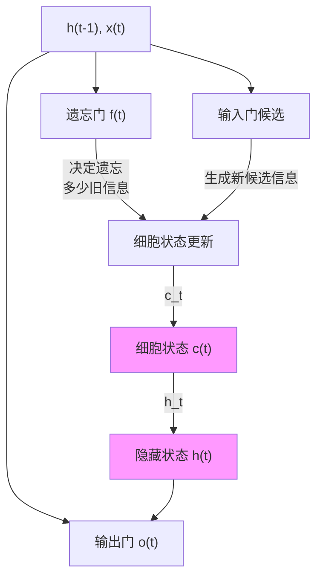
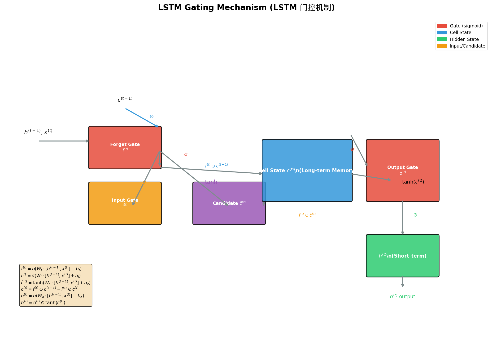
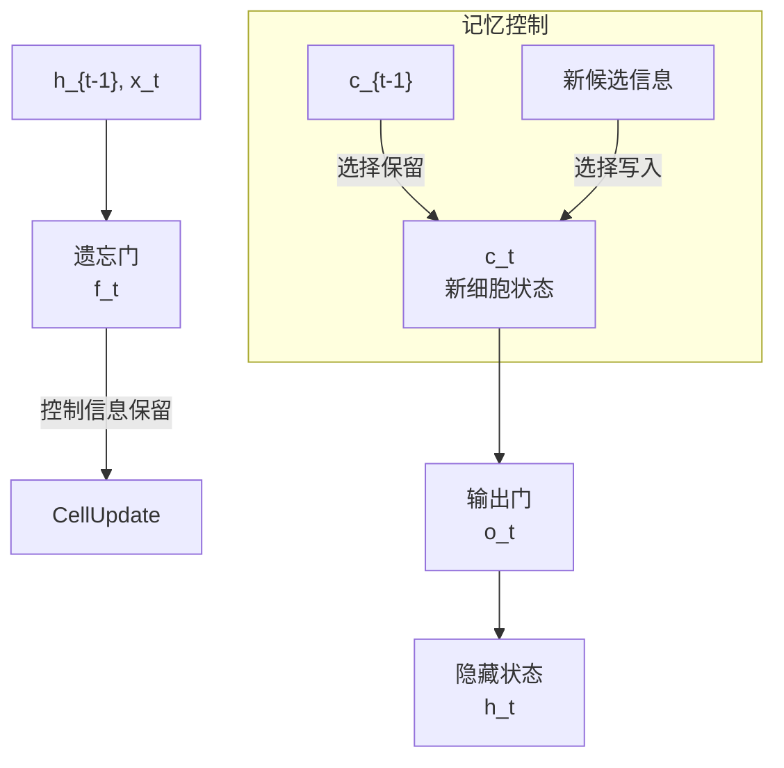
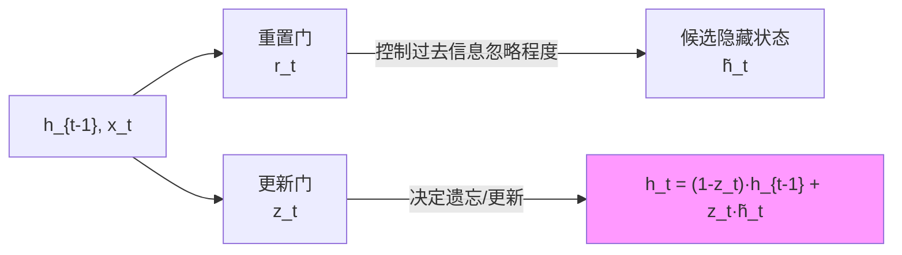
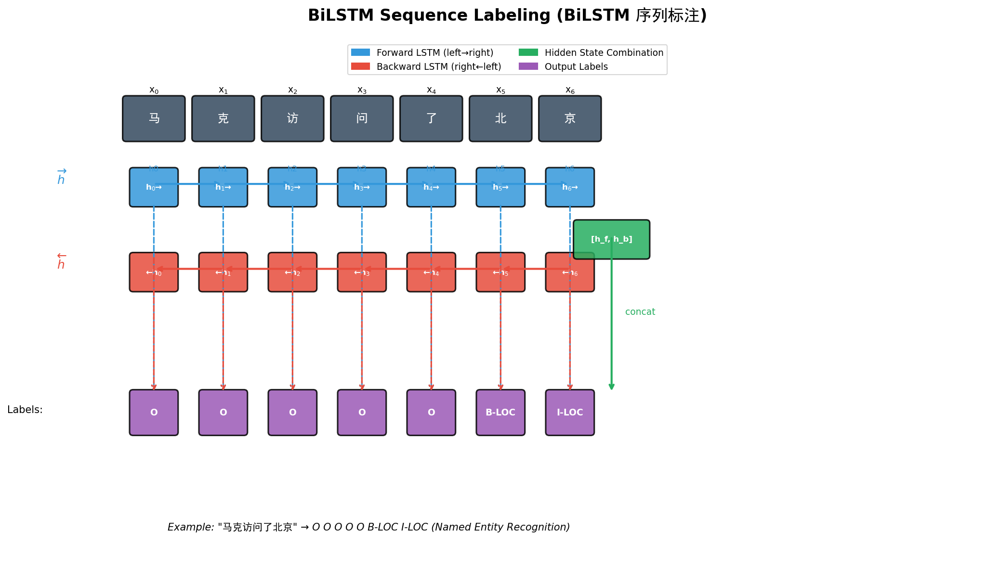
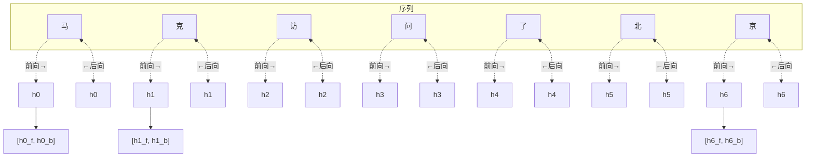
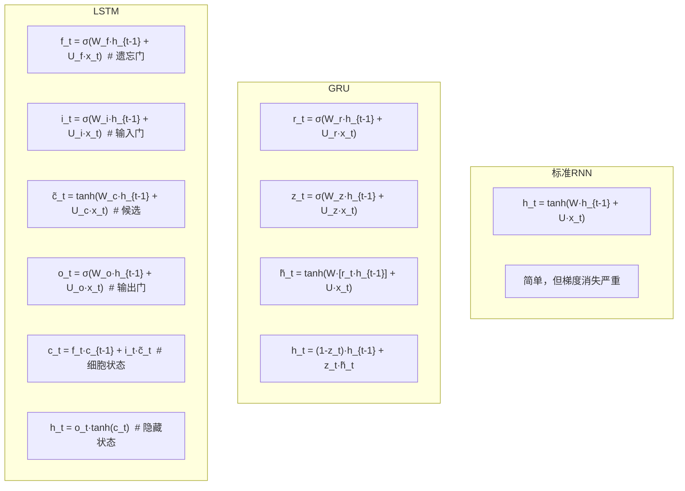
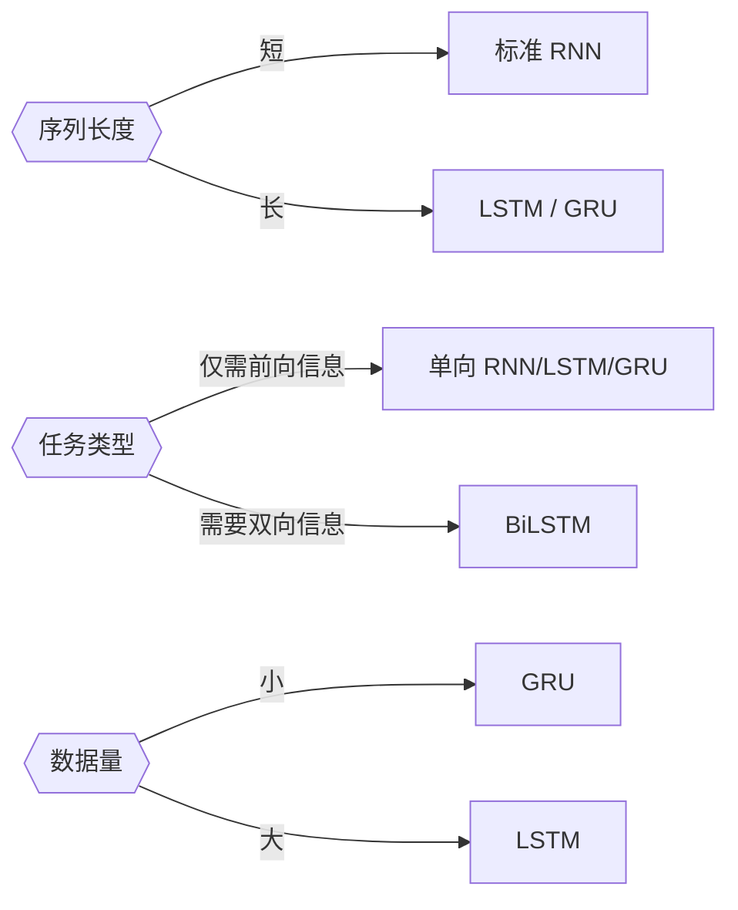
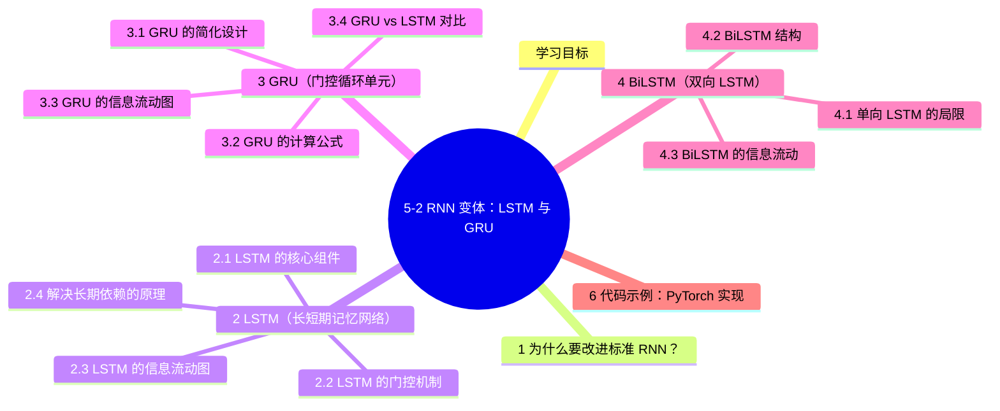

# 5-2 RNN 变体：LSTM 与 GRU

## 学习目标

- 理解 LSTM（长短期记忆网络）的设计思想与门控机制
- 掌握 LSTM 三个门（输入门、遗忘门、输出门）的作用与细胞状态更新
- 理解 GRU（门控循环单元）与 LSTM 的区别与联系
- 了解 BiLSTM（双向 LSTM）的结构与优势
- 能够对比不同 RNN 变体的特点与适用场景

---

## 1 为什么要改进标准 RNN？

标准 RNN 存在一个根本性问题：**梯度消失**（详见 5-1 章）。

- 信息在时间步间传递时，需要经过多次链式求导
- 激活函数的导数小于 1，连乘导致梯度指数级衰减
- 模型难以记住长期依赖——早期的重要信息会在传播中逐渐丢失

打个比方：标准 RNN 就像一个考生，把书本上所有知识不加区分地硬塞进脑子。考试时，早期背的知识早已被近期内容覆盖，很难提取出来。

**LSTM 和 GRU 的核心思想**：不是让所有信息都同等传递，而是让网络学会**判断什么该记住、什么该遗忘**。这就像人类记忆——重要的知识重点记忆，不重要的过段时间就忘了。

---

## 2 LSTM（长短期记忆网络）

### 2.1 LSTM 的核心组件

LSTM 由 Sepp Hochreiter 和 Jürgen Schmidhuber 于 1997 年提出。它引入了一套**门控机制**来控制信息流动。

LSTM 的核心组件包括：

| 组件 | 符号 | 作用 |
|---|---|---|
| **细胞状态**（Cell State） | $c^{(t)}$ | 贯穿整个时间序列的信息通道，类似"长期记忆" |
| **隐藏状态**（Hidden State） | $h^{(t)}$ | 当前时刻的输出，类似"短期记忆" |
| **遗忘门**（Forget Gate） | $f^{(t)}$ | 决定上一时刻的细胞状态保留多少 |
| **输入门**（Input Gate） | $i^{(t)}$ | 决定当前时刻的新信息写入多少 |
| **输出门**（Output Gate） | $o^{(t)}$ | 决定当前隐藏状态输出多少信息 |

### 2.2 LSTM 的门控机制



#### 遗忘门（Forget Gate）

遗忘门决定**从上一时刻的细胞状态中丢弃什么信息**：

$$f^{(t)} = \sigma(W_f \cdot [h^{(t-1)}, x^{(t)}] + b_f)$$

- $\sigma$ 为 Sigmoid 激活函数，输出范围 $(0, 1)$
- $f^{(t)}$ 的每个元素表示对应信息被保留的比例
- 接近 0 → 遗忘；接近 1 → 保留

#### 输入门（Input Gate）

输入门决定**当前时刻有多少新信息写入细胞状态**：

$$i^{(t)} = \sigma(W_i \cdot [h^{(t-1)}, x^{(t)}] + b_i)$$

$$\tilde{c}^{(t)} = \tanh(W_c \cdot [h^{(t-1)}, x^{(t)}] + b_c)$$

- $i^{(t)}$：输入门，控制新信息的写入量
- $\tilde{c}^{(t)}$：候选细胞状态，由 $\tanh$ 激活，生成新信息的候选向量

#### 细胞状态更新

这是 LSTM 最关键的一步，结合遗忘门和输入门来更新细胞状态：

$$c^{(t)} = f^{(t)} \odot c^{(t-1)} + i^{(t)} \odot \tilde{c}^{(t)}$$

- $f^{(t)} \odot c^{(t-1)}$：选择保留上一时刻多少细胞状态信息（遗忘）
- $i^{(t)} \odot \tilde{c}^{(t)}$：选择写入多少当前时刻的新信息
- $\odot$ 表示逐元素乘法（Hadamard Product）

#### 输出门（Output Gate）

输出门决定**当前隐藏状态输出多少信息**：

$$o^{(t)} = \sigma(W_o \cdot [h^{(t-1)}, x^{(t)}] + b_o)$$

$$h^{(t)} = o^{(t)} \odot \tanh(c^{(t)})$$

- $\tanh(c^{(t)})$：将细胞状态压缩到 $(-1, 1)$ 范围
- $o^{(t)}$：选择输出多少细胞状态信息

### 2.3 LSTM 的信息流动图





### 2.4 解决长期依赖的原理

LSTM 如何解决梯度消失问题？关键在于**细胞状态 $c^{(t)}$ 的更新方式**：

$$c^{(t)} = f^{(t)} \odot c^{(t-1)} + i^{(t)} \odot \tilde{c}^{(t)}$$

与标准 RNN 的线性链式更新不同，LSTM 的细胞状态更新是**加法操作**：

- **标准 RNN**（梯度消失）：
  - $h^{(t)} = W \cdot h^{(t-1)}$
  - $\frac{\partial h^{(t)}}{\partial h^{(t-1)}} = W$（矩阵连乘 → 指数级衰减/爆炸）

- **LSTM**（缓解梯度消失）：
  - $c^{(t)} = f^{(t)} \odot c^{(t-1)} + \text{new info}$
  - 梯度可以在细胞状态通道中"高速公路"传播，避免连续乘法

加法操作的梯度为 1（在不考虑门控时），因此即使经过很多时间步，梯度也能有效传播，不易消失。

---

## 3 GRU（门控循环单元）

### 3.1 GRU 的简化设计

GRU（Gated Recurrent Unit，门控循环单元）由 Kyunghyun Cho 等人于 2014 年提出，可以视为 LSTM 的**简化版本**。

主要简化：

| LSTM | GRU | 说明 |
|---|---|---|
| 三个门（遗忘门、输入门、输出门） | 两个门（重置门、更新门） | 减少参数量 |
| 两个状态（$c^{(t)}$, $h^{(t)}$） | 一个状态（$h^{(t)}$） | 隐藏状态即细胞状态 |
| 输入门 + 遗忘门独立 | 更新门 = 遗忘门 + (1 - 遗忘门) | 互补关系 |

### 3.2 GRU 的计算公式

#### 重置门（Reset Gate）

$$r^{(t)} = \sigma(W_r \cdot [h^{(t-1)}, x^{(t)}] + b_r)$$

- 决定**有多少上一时刻的信息被忽略**
- $r^{(t)}$ 接近 0 时，网络倾向于忽略过去的隐藏状态

#### 更新门（Update Gate）

$$z^{(t)} = \sigma(W_z \cdot [h^{(t-1)}, x^{(t)}] + b_z)$$

- 决定**有多少上一时刻的信息被传递到当前时刻**
- 类似 LSTM 的遗忘门 + 输入门的组合效果

#### 候选隐藏状态

$$\tilde{h}^{(t)} = \tanh(W \cdot [r^{(t)} \odot h^{(t-1)}, x^{(t)}] + b)$$

- 使用重置门控制对过去信息的依赖程度

#### 隐藏状态更新

$$h^{(t)} = (1 - z^{(t)}) \odot h^{(t-1)} + z^{(t)} \odot \tilde{h}^{(t)}$$

- $z^{(t)}$ 越大 → 更多使用当前新信息
- $1 - z^{(t)}$ 越大 → 更多保留过去信息

### 3.3 GRU 的信息流动图



### 3.4 GRU vs LSTM 对比

| 特性 | GRU | LSTM |
|---|---|---|
| **参数量** | 较少（3个权重矩阵） | 较多（4个权重矩阵） |
| **门数量** | 2（更新门、重置门） | 3（输入门、遗忘门、输出门） |
| **状态数量** | 1（隐藏状态） | 2（细胞状态、隐藏状态） |
| **长期依赖** | 较好，但略弱于 LSTM | 优秀 |
| **训练速度** | 收敛快，适合小数据集 | 较慢，适合大数据集 |
| **表达能力** | 略弱 | 更强 |

**经验法则**：
- 小数据集 → GRU（参数少，不易过拟合）
- 大数据集 → LSTM（表达能力强，效果更好）
- 两者性能通常相近，GRU 训练更快

---

## 4 BiLSTM（双向 LSTM）

### 4.1 单向 LSTM 的局限

单向 LSTM 只考虑**过去的信息**（前向传播）。在序列标注等任务中，当前时刻的输出可能需要同时参考**未来信息**。

例如在命名实体识别中：

```
句 子：马克访问了北京公司
标 签：O  O  O  B-LOC I-LOC I-LOC
                     ↑
              "北京" 只有看完后面才能确定是地名
```

### 4.2 BiLSTM 结构

BiLSTM（Bidirectional LSTM，双向 LSTM）由两个独立的 LSTM 组成：

| 方向 | 隐藏状态 | 说明 |
|---|---|---|
| **前向**（Forward） | $\overrightarrow{h}^{(t)}$ | 从左到右读取序列 |
| **后向**（Backward） | $\overleftarrow{h}^{(t)}$ | 从右到左读取序列 |

最终隐藏状态通常有两种组合方式：

```python
# 方式1：拼接
h_combined = concatenate(forward_h, backward_h)

# 方式2：求和/平均
h_combined = forward_h + backward_h  # 或 average
```

### 4.3 BiLSTM 的信息流动





每个时间步的输出都同时包含了该位置"前前后后"的上下文信息。

---

## 5 各变体对比总结

### 5.1 架构复杂度



### 5.2 性能与应用场景

| 变体 | 适用场景 | 优势 | 劣势 |
|---|---|---|---|
| **标准 RNN** | 简单短期序列 | 计算量小 | 严重梯度消失，无法捕获长期依赖 |
| **LSTM** | 文本、语音、长时间序列 | 强大的长期依赖建模能力 | 参数量大，训练较慢 |
| **GRU** | 中等规模序列 | 参数少，收敛快，效果接近 LSTM | 表达能力略弱于 LSTM |
| **BiLSTM** | 序列标注、词性标注、NER | 捕获前后双向上下文 | 计算量加倍（双倍隐藏状态） |

### 5.3 变体选择指南



---

## 6 代码示例：PyTorch 实现

```python
import torch
import torch.nn as nn

# 标准 RNN
rnn = nn.RNN(input_size=256, hidden_size=128, num_layers=1)

# LSTM
lstm = nn.LSTM(input_size=256, hidden_size=128, num_layers=1)

# Bidirectional LSTM
bi_lstm = nn.LSTM(
    input_size=256,
    hidden_size=128,
    num_layers=1,
    bidirectional=True
)

# 前向传播示例
x = torch.randn(10, 32, 256)  # (序列长度, batch, 特征维度)

# LSTM 输出
output, (h_n, c_n) = lstm(x)
# output: (10, 32, 128) - 每个时间步的隐藏状态
# h_n: (1, 32, 128) - 最后一个时间步的隐藏状态

# Bidirectional LSTM
output_bi, (h_n_bi, c_n_bi) = bi_lstm(x)
# output_bi: (10, 32, 256) - 双向隐藏状态拼接
# h_n_bi: (2, 32, 128) - 前向和后向的最终隐藏状态
```

---

## 小结

| 变体 | 核心改进 | 适用场景 |
|---|---|---|
| **标准 RNN** | 引入循环连接处理序列 | 简单任务，不推荐（梯度消失严重） |
| **LSTM** | 引入细胞状态 + 三个门控 | 长期依赖任务（语音、文本） |
| **GRU** | 简化版 LSTM，两个门控 | 中等复杂度，小数据量 |
| **BiLSTM** | 双向读取序列 | 序列标注（NER、词性标注） |

LSTM 和 GRU 通过门控机制让网络**自适应地**决定记住什么、遗忘什么，有效解决了标准 RNN 的梯度消失问题，成为序列建模的主流选择。

---

## 本章小结

- **标准RNN的局限**：存在梯度消失问题，信息在时间步间传递时链式求导导致梯度指数级衰减，难以捕获长期依赖
- **LSTM的创新**：通过细胞状态（信息高速公路）和三个门控机制（遗忘门、输入门、输出门）实现信息的自适应取舍，有效缓解梯度消失
- **GRU的简化**：将LSTM简化为两个门控（更新门、重置门），参数量更少、训练更快，在中小数据集上效果与LSTM相近
- **BiLSTM的优势**：双向读取序列，同时捕获前向和后向上下文，显著提升序列标注、NER等任务的效果
- **选择策略**：根据序列长度（短序列用RNN，长序列用LSTM/GRU）、数据规模（小数据用GRU，大数据用LSTM）、任务类型（需要双向信息用BiLSTM）来选择合适的模型

---


## 知识图谱



## 参考资料

1. Sepp Hochreiter & Jürgen Schmidhuber, "Long Short-Term Memory", Neural Computation 1997
2. Kyunghyun Cho et al., "Learning Phrase Representations using RNN Encoder-Decoder", EMNLP 2014
/dl2017/html/lesson5-week1.html

