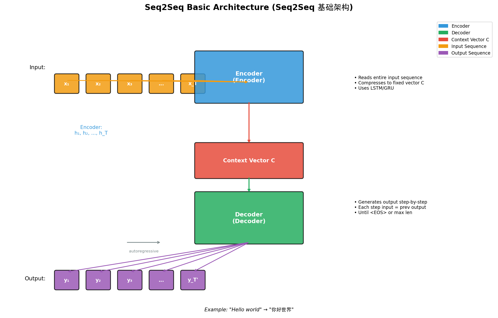
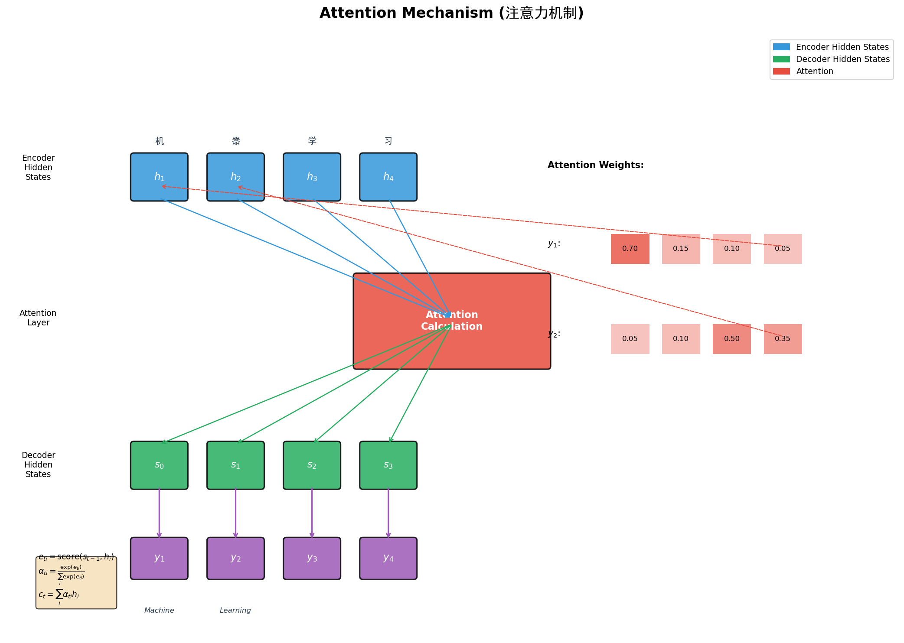
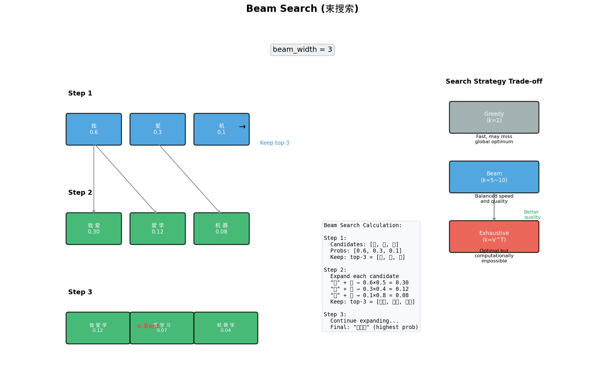

# 5-3 序列到序列模型（Seq2Seq）

## 学习目标

- 理解 Seq2Seq（序列到序列）模型的基本架构
- 掌握编码器（Encoder）和解码器（Decoder）的工作原理
- 理解注意力机制（Attention）的提出背景与核心思想
- 通过图示理解机器翻译中注意力机制的作用过程
- 了解 Beam Search 搜索策略的基本原理
- 认识 Seq2Seq 在文本生成、机器翻译等任务中的应用

---

## 1 Seq2Seq 概述

### 1.1 什么是序列到序列？

在许多实际任务中，输入和输出都是变长的序列，这类问题被称为**序列到序列（Sequence to Sequence，Seq2Seq）**问题：

| 任务 | 输入序列 | 输出序列 |
|---|---|---|
| 机器翻译 | "Hello world" | "你好世界" |
| 文本摘要 | 一篇长文章 | 简短摘要 |
| 问答系统 | 用户问题 | 回答文本 |
| 语音识别 | 音频特征序列 | 识别的文字 |
| 图像描述 | 图像特征 | "一只猫在沙发上" |

Seq2Seq 模型的核心目标是：将一个任意长度的输入序列 $X = (x_1, x_2, ..., x_T)$ 转换为另一个任意长度的输出序列 $Y = (y_1, y_2, ..., y_{T'})$。

### 1.2 Seq2Seq 的基本框架



Seq2Seq 模型通常由**编码器（Encoder）**和**解码器（Decoder）**两部分组成：

```
输入序列:  x₁   x₂   x₃   ...  x_T
           │    │    │        │
           ▼    ▼    ▼        ▼
        ┌─────────────────────────────┐
        │         Encoder             │
        │   (编码输入序列为向量)        │
        └─────────────────────────────┘
                    │
                    ▼
            中间语义向量 C
                    │
                    ▼
        ┌─────────────────────────────┐
        │         Decoder            │
        │   (解码向量为输出序列)        │
        └─────────────────────────────┘
           │    │    │        │
           ▼    ▼    ▼        ▼
        y₁   y₂   y₃   ...  y_{T'}
```

#### 编码器（Encoder）

- 读取整个输入序列
- 将序列信息压缩到一个**固定长度的向量**（称为"上下文向量"或"语义向量"）
- 常用 RNN（LSTM/GRU）作为编码器

#### 解码器（Decoder）

- 基于编码器输出的语义向量
- **逐个时间步**生成输出序列
- 每个时间步的输入是上一时刻的输出（自回归）
- 常用 RNN（LSTM/GRU）作为解码器

---

## 2 编码器-解码器详解

### 2.1 编码器工作原理

假设我们使用 LSTM 作为编码器，处理输入序列 $X = (x_1, x_2, ..., x_T)$：

```
输入: x₁ ──→ LSTM → h₁
           ↑
      h₀ (初始)
           │
x₂ ──→ LSTM → h₂
           ↑
      h₁
           │
x₃ ──→ LSTM → h₃
           ↑
      h₂
           ...
```

编码器会输出最后一个时间步的隐藏状态 $h_T$，这个向量包含了整个输入序列的信息。

### 2.2 解码器工作原理

解码器接收编码器的最终隐藏状态作为初始状态，然后**逐个生成输出**：

```
语义向量 C（来自编码器）
     │
     ├──→ h₀' （解码器初始隐藏状态）
     │
     ▼
  y₁ （第一个输出）
     │
     ├──→ 作为下一时刻输入
     ▼
  y₂ （第二个输出）
     │
     └──→ ...
```

解码过程的核心是**自回归（Autoregression）**机制：
- 每个时间步的输入 = 上一时间步的输出
- 直到输出结束标记（如 `<EOS>`）或达到最大长度

### 2.3 应用示例：机器翻译

以 "Hello world → 你好世界" 为例：

```
编码器（处理英文）:
  "Hello"  →  LSTM  →  h₁
      "world" → LSTM → h₂ (最终隐藏状态)

语义向量 C = h₂
     │
     ▼

解码器（生成中文）:
  C → h₀
      ↓
  第一个输出: "你" → 解码器
               ↓
  "你" → h₁
              ↓
  第二个输出: "好" → 解码器
                ↓
  "好" → h₂
               ↓
  第三个输出: "世" → 解码器
                ↓
  第四个输出: "界" → 解码器
                ↓
  结束标记: <EOS>
```

---

## 3 注意力机制（Attention）

### 3.1 原始 Seq2Seq 的瓶颈

原始 Seq2Seq 模型存在一个严重问题：**语义向量成为信息瓶颈**。

- 无论输入序列多长，都被压缩成固定向量 $C$
- 所有输出都依赖这同一个向量
- 当输入很长时，信息的压缩和提取都会丢失细节

用个比喻：就像要求一个人把整本《战争与和平》读完后，用一句话总结全部内容——不可避免会丢失大量细节。

### 3.2 注意力机制的灵感

人在翻译一段话时，不会总是从头看到尾再决定每个词。比如翻译 "I love you" 为 "我 爱 你"：

- 翻译 "我" 时，可能主要参考 "I"
- 翻译 "爱" 时，可能主要参考 "love"
- 翻译 "你" 时，可能主要参考 "you"

**注意力机制的核心思想**：在生成每个输出时，让模型能够"关注"输入的不同部分，而不是整个输入的单一压缩向量。

### 3.3 注意力机制的计算过程

假设编码器输出 $h_1, h_2, ..., h_T$（每个时间步的隐藏状态），解码器在生成第 $t$ 个输出时：

#### Step 1：计算注意力分数

$$e^{(t)} = \text{score}(s^{(t-1)}, h_1, h_2, ..., h_T)$$

常用的评分函数有：

- **Dot-product**（点积）：$e_t = s^{(t-1)} \cdot h_t$
- **MLP**（多层感知机）：$e_t = v^\top \tanh(W s^{(t-1)} + U h_t)$

#### Step 2：计算注意力权重

$$a^{(t)} = \text{softmax}(e^{(t)})$$

- $a^{(t)}_i$ 表示输入第 $i$ 个词对当前输出的重要程度
- 所有权重求和为 1

#### Step 3：加权求和上下文向量

$$c^{(t)} = \sum_{i=1}^{T} a^{(t)}_i \cdot h_i$$

- $c^{(t)}$ 是当前时刻的"上下文向量"
- 包含了与当前输出最相关的输入信息

#### Step 4：生成输出

上下文向量 $c^{(t)}$ 与解码器当前状态 $s^{(t-1)}$ 结合，生成当前输出：

```python
# 伪代码示例
s_t = decoder_lstm(y_{t-1}, s_{t-1})  # 解码器更新
e_ti = score(s_t, h_i)                # 计算注意力分数
a_t = softmax(e_t)                    # 归一化为概率
c_t = sum(a_ti * h_i)                # 加权上下文向量
# 通常将 c_t 与 s_t 拼接或通过其他方式结合
output = output_layer(concat(s_t, c_t))
```

### 3.4 注意力机制在翻译中的应用图示



以中译英为例（输入："机器 学习" → 输出："Machine Learning"）：

```
生成 "Machine" 时:
  输入: [机, 器, 学, 习]
  注意力权重: [0.7, 0.2, 0.05, 0.05]
  重点关注: "机" (权重 0.7)
         │
         ▼
  上下文向量: 0.7*h_机 + 0.2*h_器 + ...

生成 "Learning" 时:
  输入: [机, 器, 学, 习]
  注意力权重: [0.05, 0.1, 0.5, 0.35]
  重点关注: "学" (权重 0.5) 和 "习" (权重 0.35)
         │
         ▼
  上下文向量: 0.05*h_机 + 0.1*h_器 + 0.5*h_学 + 0.35*h_习
```

通过注意力权重矩阵，可以清楚地看到每个输出与输入之间的对应关系。

### 3.5 带注意力的 Seq2Seq 架构

```
                    编码器（Encoder）
  输入: x₁   x₂   x₃   x₄
         │    │    │    │
         ▼    ▼    ▼    ▼
    ┌─────────────────────┐
    │ h₁   h₂   h₃   h₄   │ ← 各时间步隐藏状态
    └─────────────────────┘
              │
              │  h₁, h₂, h₃, h₄
              │
              ▼
    ┌─────────────────────┐
    │    注意力层          │ ← 当前输出与所有输入做注意力
    │  计算 a₁, a₂, a₃, a₄ │
    └──────────┬──────────┘
               │
               ▼
         上下文向量 cₜ
               │
               ▼
    ┌─────────────────────┐
    │      解码器          │ ← 结合上下文向量生成输出
    │      (Decoder)       │
    └─────────────────────┘
         │
         ▼
  输出: y₁   y₂   y₃   y₄
```

注意力机制的引入，让模型能够：
- 在生成不同输出时，动态关注输入的不同部分
- 有效缓解长序列的信息压缩问题
- 大幅提升机器翻译等任务的质量

---

## 4 Beam Search 搜索策略

### 4.1 贪心搜索的问题

在解码时，最朴素的方法是**贪心搜索（Greedy Search）**：每个时间步都选择概率最高的词作为输出。

但这种策略有问题：

```
假设词表: ["我", "爱", "机器", "学习", "深度", "好", "很"]
输出概率分布:

t=1: [0.6, 0.3, 0.05, 0.03, ...] → 选 "我" ✓
t=2: [0.5, 0.4, 0.05, ...] → 选 "我" ✗ (但实际 "爱" 才是最优)
t=3: [0.4, 0.5, ...] → 选 "爱" ✓
...
```

贪心搜索可能陷入**局部最优**：每步最优不等于全局最优。

### 4.2 暴力穷举的问题

如果要找到全局最优，可以穷举所有可能的序列：

- 词表大小 $V$，输出长度 $T$
- 搜索空间 = $V^T$（指数级爆炸）

例如：$V=10000, T=10$ → 搜索空间 = $10^{40}$，不可行。

### 4.3 Beam Search 原理

Beam Search（束搜索）是一种**折中方案**：在搜索的每一步，保留概率最高的 $k$ 个候选序列（$k$ 称为 beam width）。

```
beam_width = 3

t=1: 候选 ["我", "爱", "机"] → 概率 [0.6, 0.3, 0.1]
         │
         ▼
t=2: 每个候选扩展所有可能，取 top-3
     ["我 爱": 0.6*0.5=0.30,
      "我 机": 0.6*0.1=0.06,
      "爱 学": 0.3*0.4=0.12,
      ...] → 取 top-3: ["我 爱", "爱 学", "机 器"]
         │
         ▼
t=3: 继续扩展，取 top-3
     ...
```

**Beam Search 的特点**：
- $k=1$ 时退化为贪心搜索
- $k$ 越大搜索效果越好，但计算量也越大
- 通常 $k \in [5, 10]$ 时效果较好

### 4.4 Beam Search 图示



```
假设 beam_width = 3

Step 1:                    Step 2:                   Step 3:
 [我] 0.6                   [我 爱] 0.30              [我 爱 学] 0.12
 [爱] 0.3                   [我 机] 0.06              [我 爱 深] 0.09
 [机] 0.1                   [爱 学] 0.12              [爱 学 习] 0.07
                             [爱 机] 0.05              [机 器 学] 0.04
                             [机 器] 0.08

保留 top-3:                扩展 → 排序 → 保留 top-3   扩展 → 排序 → 保留 top-3
["我", "爱", "机"]         ["我 爱", "爱 学", "机 器"] ["我 爱 学", "爱 学 习", "机 器 学"]
```

---

## 5 Seq2Seq 的应用场景

### 5.1 机器翻译

最早且最经典的应用。Google 在 2016 年将 GNMT（Google Neural Machine Translation）部署上线，显著提升了翻译质量。

```
输入（英文）: The weather is nice today
输出（中文）: 今天天气很好
```

### 5.2 文本摘要

将长文本压缩为短摘要：

```
输入（长文本）: [一篇文章的完整内容...]
输出（摘要）: [几个句子的摘要...]
```

### 5.3 问答系统

```
输入（问题）: 谁发明了 LSTM？
输出（回答）: Sepp Hochreiter 和 Jürgen Schmidhuber 于 1997 年提出
```

### 5.4 语音识别

```
输入（音频特征）: [MFCC 或 filter bank 序列...]
输出（文本）: 今天天气很好
```

### 5.5 图像描述（Image Captioning）

结合 CNN 和 Seq2Seq，将图像转换为文本描述：

```
输入（图像特征，通过 CNN 提取）→ Seq2Seq 解码器 → 输出: "一只猫坐在沙发上"
```

---

## 6 代码示例：PyTorch 实现

```python
import torch
import torch.nn as nn

class Encoder(nn.Module):
    def __init__(self, input_dim, embed_dim, hidden_dim):
        super().__init__()
        self.embedding = nn.Embedding(input_dim, embed_dim)
        self.rnn = nn.LSTM(embed_dim, hidden_dim, bidirectional=True)
        self.fc = nn.Linear(hidden_dim * 2, hidden_dim)

    def forward(self, src):
        # src: (seq_len, batch)
        embedded = self.embedding(src)
        outputs, (hidden, cell) = self.rnn(embedded)
        # outputs: (seq_len, batch, hidden*2)
        # hidden: (2, batch, hidden)
        hidden = torch.tanh(
            self.fc(torch.cat((hidden[-2], hidden[-1]), dim=1))
        )
        return hidden, cell

class Decoder(nn.Module):
    def __init__(self, output_dim, embed_dim, hidden_dim):
        super().__init__()
        self.embedding = nn.Embedding(output_dim, embed_dim)
        self.rnn = nn.LSTM(embed_dim + hidden_dim, hidden_dim)
        self.fc = nn.Linear(hidden_dim + hidden_dim + embed_dim, output_dim)

    def forward(self, input, hidden, context):
        # input: (batch,)
        # hidden: (1, batch, hidden)
        # context: (batch, hidden)
        input = input.unsqueeze(0)  # (1, batch)
        embedded = self.embedding(input)  # (1, batch, embed)

        # 注意力计算（简化版）
        energy = torch.tanh(
            self.attn(torch.cat((embedded, context.unsqueeze(0)), dim=2))
        )
        # ... 注意力权重计算 ...

        output, (hidden, cell) = self.rnn(
            torch.cat((embedded, context.unsqueeze(0)), dim=2),
            (hidden, cell)
        )
        prediction = self.fc(torch.cat((output, context.unsqueeze(0)), dim=2))
        return prediction, hidden, cell

class Seq2Seq(nn.Module):
    def __init__(self, encoder, decoder):
        super().__init__()
        self.encoder = encoder
        self.decoder = decoder

    def forward(self, src, trg, teacher_forcing_ratio=0.5):
        # src: (seq_len, batch), trg: (seq_len, batch)
        batch_size = trg.shape[1]
        trg_len = trg.shape[0]
        output_dim = self.decoder.fc.out_features

        outputs = torch.zeros(trg_len, batch_size, output_dim)

        hidden, cell = self.encoder(src)
        context = hidden  # 编码器最终状态作为初始上下文

        input = trg[0]  # <bos> token
        for t in range(1, trg_len):
            output, hidden, cell = self.decoder(input, hidden, context)
            outputs[t] = output

            teacher_force = random.random() < teacher_forcing_ratio
            top1 = output.argmax(1)

            input = trg[t] if teacher_force else top1

        return outputs
```

---

## 本章小结

**一表速览**：

| 概念 | 说明 |
|---|---|
| **Seq2Seq** | 编码器-解码器架构，处理变长序列到变长序列的转换 |
| **编码器** | 将输入序列压缩为固定向量 |
| **解码器** | 自回归生成输出序列 |
| **注意力机制** | 解决信息瓶颈，让模型动态关注输入的不同部分 |
| **Beam Search** | 平衡搜索质量和效率，找到近似最优解 |

Seq2Seq 是现代 NLP 序列生成任务的基础架构；注意力机制的引入让它突破固定向量的信息瓶颈，并直接演化为 Transformer（见 [6-2 Transformer 架构](../PART6-Transformer与预训练/6-2-Transformer架构.md)）。

- **Seq2Seq核心架构**：由编码器和解码器组成，编码器将输入序列压缩为固定向量，解码器自回归生成输出序列，实现任意长度序列的转换
- **注意力机制的本质**：通过计算注意力分数、Softmax归一化和加权求和，让模型在生成每个输出时动态关注输入的不同部分，有效解决信息瓶颈问题
- **注意力评分函数**：常见有点积注意力（Dot-product）和MLP注意力两种，后者通过可学习参数适应更复杂的语义匹配
- **Beam Search的平衡**：在贪心搜索和暴力穷举之间取得平衡，通过保留top-k候选序列，在可接受的计算量下获得更高质量的输出
- **广泛的应用场景**：Seq2Seq是机器翻译、文本摘要、问答系统、语音识别、图像描述等任务的基础框架，注意力机制是其性能提升的关键

---


## 知识图谱

```mermaid
mindmap
  root((5-3 序列到序列模型（Seq2Seq）))
    学习目标
    1 Seq2Seq 概述
      1.1 什么是序列到序列？
      1.2 Seq2Seq 的基本框架
    2 编码器-解码器详解
      2.1 编码器工作原理
      2.2 解码器工作原理
      2.3 应用示例：机器翻译
    3 注意力机制（Attention）
      3.1 原始 Seq2Seq 的瓶颈
      3.2 注意力机制的灵感
      3.3 注意力机制的计算过程
      3.4 注意力机制在翻译中的应用图示
    4 Beam Search 搜索策略
      4.1 贪心搜索的问题
      4.2 暴力穷举的问题
      4.3 Beam Search 原理
      4.4 Beam Search 图示
    5 Seq2Seq 的应用场景
      5.1 机器翻译
      5.2 文本摘要
      5.3 问答系统
      5.4 语音识别
    6 代码示例：PyTorch 实现
```



## 参考资料

1. Sutskever et al., "Sequence to Sequence Learning with Neural Networks", NIPS 2014
2. Bahdanau et al., "Neural Machine Translation by Jointly Learning to Align and Translate", ICLR 2015
3. Cho et al., "Learning Phrase Representations using RNN Encoder-Decoder", EMNLP 2014
4. Vaswani et al., "Attention is All You Need", NeurIPS 2017

