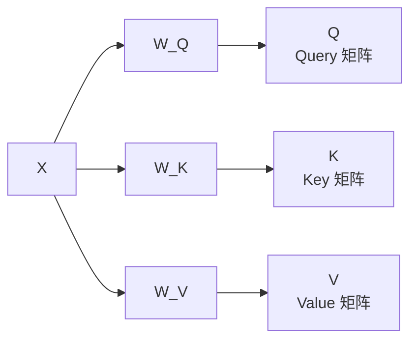
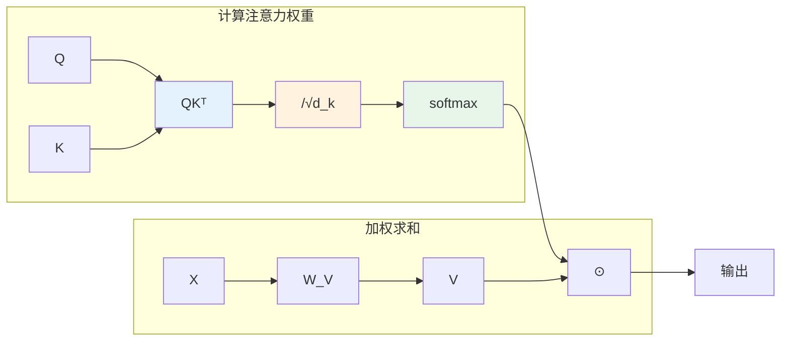
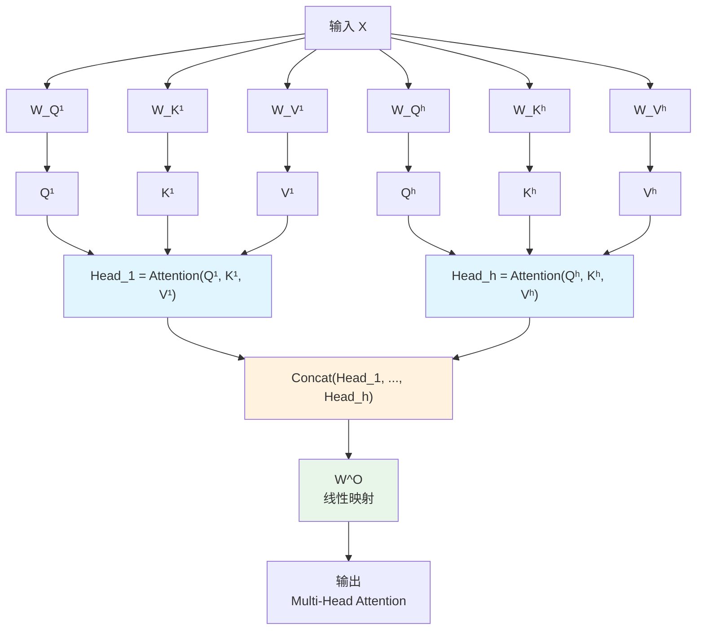
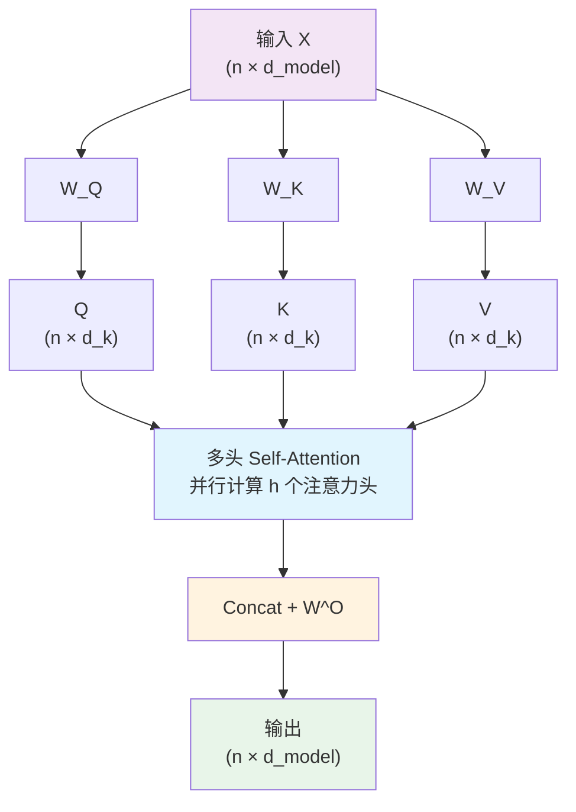
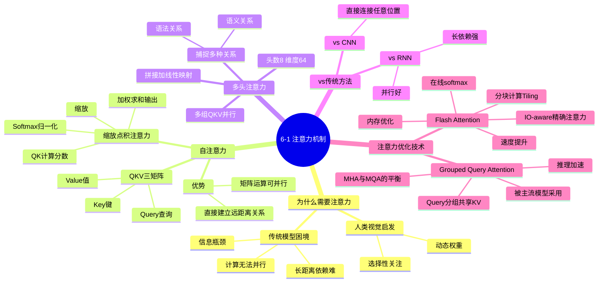

# 第6-1章 注意力机制

## 学习目标

- 理解注意力机制解决的问题——为什么不能"平等对待"所有信息
- 掌握自注意力（Self-Attention）的核心思想与计算流程
- 理解 Query、Key、Value 三个矩阵的含义与作用
- 掌握缩放点积注意力的公式与意义
- 理解多头注意力（Multi-Head Attention）的设计思路
- 能够用图示说明注意力分数的计算过程

---

## 1. 注意力机制解决的问题

### 1.1 传统模型的困境：平等对待所有输入

在早期处理序列数据的模型（如 RNN）中，无论输入序列有多长，每个时间步的隐藏状态都会被**同等重要地**传递给下一步。想象一下读一本很长的书，每翻一页，你都必须记住之前每一页的每一个细节——这显然不现实。人类读书时会自然地"集中注意力"在关键信息上，而忽略那些次要的内容。

传统的序列模型面临类似的困境：
- **信息瓶颈**：所有历史信息被压缩进一个固定大小的隐藏状态，越早期的信息越容易被"稀释"
- **长距离依赖问题**：相关词之间距离越远，RNN 越难建立联系（梯度消失/爆炸）
- **计算无法并行**：必须按顺序一步步计算，后面的计算必须等前面的完成

### 1.2 注意力机制的核心思想

注意力机制（Attention Mechanism）的灵感来自人类的视觉注意力——当我们观察一个场景时，不会一次性处理整个画面，而是有选择性地关注某些重点区域。

**核心思想**：对于输出的每个位置，允许它"关注"（加权聚合）输入序列中所有位置的 信息，权重由当前上下文动态计算。

```
┌─────────────────────────────────────────────────────────┐
│  注意力机制的基本公式                                      │
│                                                          │
│  Attention(Q, K, V) = softmax( QKᵀ / √d_k ) · V          │
└─────────────────────────────────────────────────────────┘
```

这意味着：
- **Query（查询）**：当前要生成的内容"在找什么"
- **Key（键）**：每个输入位置的"索引标签"，用来和 Query 匹配
- **Value（值）**：每个输入位置的实际内容，根据注意力分数加权求和输出

---

## 2. 自注意力（Self-Attention）详解

### 2.1 从词嵌入到 Q、K、V

假设输入是一个长度为 $n$ 的句子，每个词被编码为一个 $d_{\text{model}}$ 维向量。输入矩阵记为 $X \in \mathbb{R}^{n \times d_{\text{model}}}$。

自注意力的第一步，是将 $X$ 通过三个独立的线性变换，生成 Q、K、V 三个矩阵：



其中 $W_Q, W_K, W_V \in \mathbb{R}^{d_{\text{model}} \times d_k}$ 是可学习的参数矩阵（通常 $d_k = d_{\text{model}} / h$，其中 $h$ 是头数）。

**为什么要用三个不同的变换？**  
三个矩阵的权重不同，允许模型从不同角度"看待"同一个输入，从而学习到更丰富的关系。

### 2.2 缩放点积注意力（Scaled Dot-Product Attention）

得到 Q、K、V 之后，注意力分数通过以下步骤计算：

```
Step 1: 计算点积分数
        Score = Q · Kᵀ          [n × d_k] × [d_k × n] → [n × n]
        每一行 i 表示：位置 i 对所有位置的"相关性得分"

Step 2: 缩放（防止点积过大导致 softmax 梯度消失）
        Scaled = Score / √d_k

Step 3: Softmax 归一化（得到注意力权重）
        Attention_Weights = softmax(Scaled, axis=K)
        每一行是一个概率分布，和为 1

Step 4: 加权求和
        Output = Attention_Weights · V    [n × n] × [n × d_k] → [n × d_k]
```

用一张图表示完整的计算流程：



**为什么要除以 $\sqrt{d_k}$？**  
当 $d_k$ 较大时，点积的值容易变得很大，导致 softmax 函数进入饱和区（输出接近 one-hot，梯度接近零）。缩放因子 $\sqrt{d_k}$ 让点积的方差保持稳定，保证训练的梯度大小合理。

### 2.3 注意力计算过程的直观理解

以句子"The cat sat on the mat because it is hungry"为例。

假设我们要计算"it"这个词的输出向量：

```
Step 1: "it"的 Query 向量与所有词的 Key 向量做点积
        → 得到"it"对每个词的注意力分数

Step 2: Softmax 归一化后，大部分权重集中在"cat"上
        （因为"it"指代的是"cat"）

Step 3: 用这些权重对所有词的 Value 向量加权求和
        → 得到一个融合了"cat"语义的"it"新表示
```

这就是注意力机制的核心能力：**自动建立词与词之间的语义关联，无论它们在句子中相距多远。**

---

## 3. 多头注意力（Multi-Head Attention）

### 3.1 为什么需要多头？

单一组的 Q、K、V 只能捕捉一种类型的关系（如语法主语-谓语关系）。但实际文本中存在**多种不同类型的依赖关系**：

- 谁在执行动作（主语）
- 动作的对象是什么（宾语）
- 动作发生的时间/地点（状语）
- 词汇间的同义/反义关系

**解决方案**：并行运行多组自注意力，每组称为一个"头"（Head），每组独立学习不同的注意力模式，最后将结果拼接起来。

### 3.2 多头注意力的计算流程



数学表达：
```
MultiHead(Q, K, V) = Concat(head_1, ..., head_h) · W^O

其中 head_i = Attention(QW_Q^i, KW_K^i, VW_V^i)
```

### 3.3 多头注意力的实际效果

```
多头注意力的直观示意（简化版）

Head 1（专注语法关系）：
  "The" ──0.9──→ 关注 ──→ "cat"   [主语关系]
  "cat" ──0.8──→ 关注 ──→ "sat"   [主谓关系]

Head 2（专注语义关联）：
  "hungry" ──0.7──→ 关注 ──→ "cat"   [属性关系]
  "mat" ──0.6──→ 关注 ──→ "on"     [介词关系]
```

在原始 Transformer 论文中，使用 $h=8$ 个头，每个头的维度 $d_k = d_{\text{model}}/h = 64$（$d_{\text{model}} = 512$）。

---

## 4. 注意力机制的矩阵运算图示

完整的 Multi-Head Attention 可以用以下矩阵运算表示：

```
输入: X ∈ ℝ^(n × d_model)

Q = XW_Q,  K = XW_K,  V = XW_V

MultiHead(Q,K,V) = Concat(Head_1,...,Head_h) · W^O

其中 Head_i = Attention(QW_Q^i, KW_K^i, VW_V^i)
           = softmax(QW_Q^i · (KW_K^i)ᵀ / √d_k) · VW_V^i
```



---

## 5. 注意力机制 vs 传统方法

| 维度 | RNN/LSTM | CNN | 注意力机制 |
|------|----------|-----|-----------|
| **长距离依赖** | 弱（路径长，梯度衰减） | 中等（靠深层堆叠） | **强**（直接连接任意位置） |
| **并行计算** | 差（时序依赖） | 好 | **好**（矩阵运算） |
| **可解释性** | 低 | 低 | **高**（权重可视化） |
| **参数量** | 中等 | 少 | 多（但效率高） |

---

## 6. 注意力优化技术

随着大语言模型参数规模的爆发式增长，标准注意力机制的计算和内存开销成为严重瓶颈。标准 MHA 的计算复杂度为 $O(N^2)$（$N$ 为序列长度），内存复杂度同样为 $O(N^2)$，在处理长序列时面临巨大挑战。针对这一问题，研究者提出了多种注意力优化技术，本节介绍其中最具影响力的两种。

### 6.1 Flash Attention

#### 6.1.1 问题背景：标准注意力的效率瓶颈

标准注意力机制在计算过程中需要两次完整的 $N \times N$ 矩阵存储：

1. **S = QK^T**：计算并存储完整的注意力分数矩阵（$N \times N$）
2. **P = softmax(S)**：计算并存储注意力概率矩阵（$N \times N$）

对于序列长度 $N=4096$、隐藏维度 $d=64$ 的场景，单层注意力就需要存储约 $4096 \times 4096 \times 4\text{ bytes} \approx 64\text{MB}$ 的中间结果。多层堆叠后，内存占用急剧增长，成为训练长序列模型的主要限制。

此外，标准实现需要将完整的 Q、K、V 矩阵不断在 GPU HBM（高带宽内存）和算力单元之间搬运，内存访问开销远超实际计算开销。

#### 6.1.2 Flash Attention 的核心思想：IO-aware 精确注意力

Flash Attention 由 Tri Dao 等人于 2022 年提出，其核心思想是**将注意力计算重新组织为块级操作（tiling），通过分块计算避免显式存储完整的注意力矩阵**，从而将内存复杂度从 $O(N^2)$ 降至 $O(N)$。

```
┌─────────────────────────────────────────────────────────────┐
│  Flash Attention 核心思想对比                                 │
├─────────────────────────────────────────────────────────────┤
│  标准实现:                                                    │
│    S = QKᵀ  → 存储完整矩阵 S (N×N)                            │
│    P = softmax(S)  → 存储完整矩阵 P (N×N)                      │
│    O = PV                                                       │
│  内存复杂度: O(N²)                                            │
│                                                              │
│  Flash Attention:                                            │
│    分块计算 Q、K、V 的小块                                    │
│    在线计算 softmax，逐块更新输出                              │
│    仅需 O(N) 中间内存                                          │
└─────────────────────────────────────────────────────────────┘
```

Flash Attention 利用 GPU 的高速 SRAM 存储中间计算结果，通过精心设计的分块策略（tiling）和循环融合（loop fusion），将数据保留在高速缓存中，减少对 HBM 的访问次数。

#### 6.1.3 Flash Attention 的关键技术

Flash Attention 采用**分块注意力计算**和**在线 softmax 技巧**：

**分块计算（Tiling）**：将 Q、K、V 矩阵划分为若干小块（block），每次只将一小块调入 SRAM 进行计算，而非将整个矩阵一次性加载。

**在线 softmax（Online Softmax）**：传统 softmax 需要预先知道所有输入才能计算。Flash Attention 通过数值稳定的在线算法，将 softmax 分解为归一化因子和局部值的组合，允许逐块累积计算结果。

**反向传播兼容**：Flash Attention 在前向传播时不存储完整的注意力矩阵，而是存储反向传播所需的额外信息（如归一化因子），从而实现精确注意力而非近似注意力。

#### 6.1.4 性能提升

Flash Attention 带来的性能提升显著：

| 指标 | 标准实现 | Flash Attention | 提升 |
|------|----------|-----------------|------|
| **训练速度** | 基准 | 2-4x | ~2-4倍 |
| **内存占用** | O(N²) | O(N) | ~√N 倍 |
| **精度** | 精确 | 精确 | 无损 |

在长序列场景下，内存节省尤为明显。Flash Attention 使训练序列长度从 2048 扩展到 32768 成为可能，极大提升了模型的上下文理解能力。

#### 6.1.5 版本演进

Flash Attention 已发展至第三代：

- **Flash Attention-1**（2022）：首次实现 IO-aware 的精确注意力算法
- **Flash Attention-2**（2023）：进一步优化了 GPU 利用率和并行度，性能再提升约 2 倍
- **Flash Attention-3**（2024）：针对 NVIDIA H100 GPU 的新硬件特性进行优化，支持 FP8 低精度计算，理论吞吐量再提升 1.5-2 倍

#### 6.1.6 工业应用

Flash Attention 已被主流大模型广泛采用：

- **LLaMA 系列**：Meta 的 LLaMA 2/3 全系列使用 Flash Attention
- **Mistral 系列**：Mistral AI 的 Mistral 7B、Mixtral 8x7B 使用 Flash Attention
- **Qwen 系列**：阿里云的通义千问 Qwen2 全系列使用 Flash Attention
- **GPT-4**：据报道 OpenAI 的 GPT-4 也采用了类似优化技术

---

### 6.2 Grouped Query Attention (GQA)

#### 6.2.1 问题背景：MHA 与 MQA 的困境

标准 Multi-Head Attention（MHA）中，每个注意力头（head）都有独立的 Query、Key、Value 权重矩阵。当模型规模增大时（如 70B、405B 参数的模型），头数 $h$ 也相应增加，导致：

**Key-Value 缓存瓶颈（KV Cache）**：在自回归生成（autoregressive generation）时，每个解码步骤都需要重新计算所有 Key 和 Value 向量与当前 Query 的注意力。为加速推理，通常会将历史的 K、V 缓存起来。然而 K、V 缓存的内存占用与头数 $h$ 成正比——$h$ 越大，缓存越大，成为推理吞吐量的重要限制。

**推理延迟问题**：大模型推理时，内存带宽成为主要瓶颈。加载巨大的 KV 缓存需要大量内存访问，导致推理速度受限。

#### 6.2.2 MQA：极端简化

Multi-Query Attention（MQA）是最直接的解决方案——将所有 Query 头共享同一套 K、V。这意味着：

```
MQA 配置:
  - 多个 Query 头 (如 8 个)
  - 1 套共享的 Key 头
  - 1 套共享的 Value 头
```

MQA 将 KV 缓存压缩为原来的 $1/h$，大幅减少内存占用和带宽压力。但 MQA 也有代价：多个 Query 竞争同一套 Key、Value，限制了模型表达不同注意力模式的能力，可能导致质量下降。

#### 6.2.3 GQA：平衡之选

Grouped Query Attention（GQA）由 Google 研究者于 2023 年提出，是 MHA 和 MQA 的折中方案。

**核心思想**：将 Query 头分成若干组（group），每组共享一套 Key 和 Value。

```
GQA 配置 (示例):
  - 8 组 Query (每组可以包含多个 Query 头)
  - 8 套独立的 Key (每组一套)
  - 8 套独立的 Value (每组一套)
  
  即: 32 个 Query 头 → 分成 8 组 → 每组共享 1 套 K,V
```

数学表达：
```python
# 假设有 h 个 Query 头，g 组 (g < h)
# 每组有 h/g 个 Query 头共享一套 K,V

for g in range(num_groups):
    # 该组内所有 Query 头共享同一套 K、V
    for q_idx in group[g]:
        Attention(Q[q_idx], K[g], V[g])
```

#### 6.2.4 GQA 的性能收益

| 指标 | MHA | MQA | GQA (h=32, g=8) |
|------|-----|-----|-----------------|
| **KV 缓存大小** | O(h) | O(1) | O(g) = O(h/4) |
| **推理内存占用** | 高 | 最低 | 中等（约 1/g） |
| **注意力表达力** | 强 | 弱 | 中等 |
| **推理加速** | 1x | 3-6x | **2-3x** |

GQA 在大幅降低内存占用的同时，通过保持多组独立的 K、V，保留了模型表达多种注意力模式的能力。相比 MQA，GQA 的模型质量更接近 MHA，但内存节省依然显著。

#### 6.2.5 工业应用

GQA 已被新一代大模型广泛采用：

- **LLaMA 3**：Meta 的 LLaMA 3 70B/405B 采用 GQA（8 组）
- **Qwen 2**：阿里云的 Qwen2 系列全量采用 GQA
- **Mistral Mistral**：Mistral 的 Mistral 7B v0.3 采用 GQA
- **Google Gemini**：Google 的 Gemini 模型也采用了 GQA 变体

---

### 6.3 注意力机制对比

综合以上分析，以下是标准 MHA、MQA、GQA 和 Flash Attention 的系统性对比：

| 类型 | 计算复杂度 | 内存复杂度 | KV 缓存 | 表达能力 | 适用场景 |
|------|-----------|-----------|---------|----------|----------|
| **标准 MHA** | $O(N^2 \cdot h)$ | $O(N^2 \cdot h)$ | O(h·N) | 强 | 小型模型、研究场景 |
| **MQA** | $O(N^2 \cdot h)$ | $O(N^2)$ | O(N) | 弱 | 追求极致推理速度 |
| **GQA** | $O(N^2 \cdot h)$ | $O(N^2 \cdot g)$ | O(g·N) | 中等 | **主流大模型（70B+）** |
| **Flash Attention** | 近似 $O(N^2)$ | **O(N)** | - | 精确 | **训练场景、长序列** |

```
注意力优化技术总结

┌─────────────────────────────────────────────────────────────┐
│                                                             │
│   训练优化 ──────────► Flash Attention                       │
│   (加速训练、降低训练内存)      IO-aware 精确算法            │
│                              速度 2-4x，内存 O(N²)→O(N)     │
│                                                             │
│   推理优化 ──────────► GQA (Grouped Query Attention)         │
│   (加速推理、降低KV缓存)      MHA 与 MQA 的平衡方案         │
│                              推理速度 2-3x，精度损失小       │
│                                                             │
│   两者可叠加使用 ──► LLaMA 3、Qwen2 等最新大模型标配         │
│                                                             │
└─────────────────────────────────────────────────────────────┘
```

值得注意的是，Flash Attention 和 GQA 解决的问题不同，前者优化训练效率和长序列处理能力，后者优化推理时的内存占用和吞吐量。两者并不冲突，现代大模型（如 LLaMA 3、Qwen2）通常同时采用这两种技术，以获得最佳的综合性能。

---

## 7. 补充阅读：本章延伸内容

### 7.1 计算机视觉中的注意力模块

第6-1章介绍的是 Transformer 中的自注意力机制。在计算机视觉（CV）领域，还有许多**即插即用的注意力模块**可以嵌入到 CNN 架构中，以极低的计算开销提升模型性能：

| 模块 | 类型 | 特点 |
|------|------|------|
| **SE-Net** | 通道注意力 | 通过全局池化学习通道权重 |
| **CBAM** | 通道+空间 | 依次推断通道和空间注意力 |
| **ECA** | 高效通道注意力 | 一维卷积实现局部跨通道交互 |
| **SimAM** | 无参注意力 | 无需额外参数的三维权重 |

详细内容请参阅：**第6-5章《注意力机制在计算机视觉中的应用》**（补充阅读）

---

## 本章小结

1. **注意力机制**通过动态计算输入序列中各位置之间的相关性，让模型能够"选择性关注"重要信息。
2. **自注意力**使用 Q、K、V 三个矩阵来表达"查询-键-值"关系，计算过程可高度并行化。
3. **缩放因子** $\sqrt{d_k}$ 防止点积过大导致 softmax 梯度消失，是训练稳定性的关键。
4. **多头注意力**通过多组并行的自注意力，让模型同时捕捉多种类型的关系。
5. 注意力机制解决了传统 RNN 的长距离依赖问题，且计算可完全并行，是现代大语言模型的核心基础。

---

## 知识点思维导图



---

## 参考资料

- Vaswani, A., et al. (2017). *Attention Is All You Need*. NeurIPS.  
  <https://arxiv.org/abs/1706.03762>
- Jay Alammar. *The Illustrated Transformer*.  
  <http://jalammar.github.io/illustrated-transformer/>
- 张俊林. (2019). 放弃幻想，全面拥抱 Transformer：自然语言处理三大特征抽取器比较.  
  <https://zhuanlan.zhihu.com/p/54743941>
- Lilian Weng. (2018). Attention? Attention!. *Lilian Weng's Blog*.  
  <https://lilianweng.github.io/posts/2018-06-24-attention/>