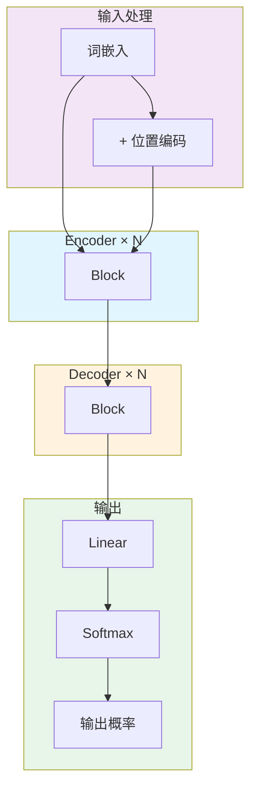
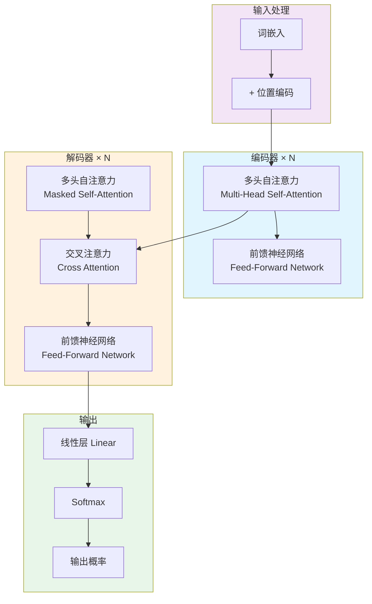
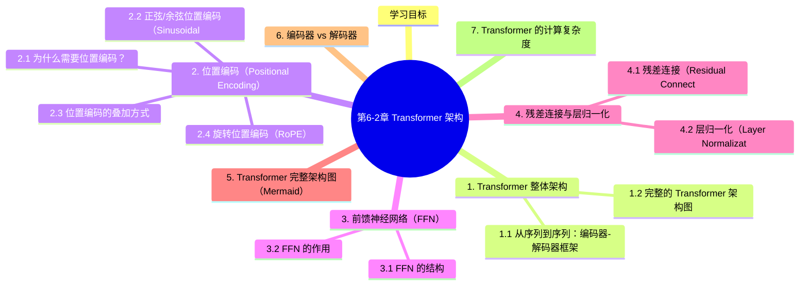

# 第6-2章 Transformer 架构

## 学习目标

- 理解 Transformer 的整体架构——编码器-解码器设计
- 理解位置编码（Positional Encoding）的作用与实现
- 掌握前馈神经网络（FFN）、残差连接和层归一化的原理
- 能够阅读并理解 Transformer 架构图
- 了解 RoPE 等位置编码的改进方案

---

## 1. Transformer 整体架构

### 1.1 从序列到序列：编码器-解码器框架

Transformer 最初是为机器翻译任务设计的，其核心是**编码器-解码器（Encoder-Decoder）** 架构：


- **编码器**负责将输入序列编码为一个连续的向量表示（上下文向量）
- **解码器**负责基于编码器的输出，逐步生成目标序列（自回归生成）

### 1.2 完整的 Transformer 架构图



标准的 Transformer 编码器由 $N=6$ 个相同的层堆叠而成，每层包含两个子层：

1. **多头自注意力层**（Multi-Head Self-Attention）
2. **前馈神经网络层**（Feed-Forward Network）

每个子层都使用了**残差连接**和**层归一化**：

```
Output = LayerNorm(x + Sublayer(x))
```

解码器在编码器的基础上多了一个**交叉注意力层**（Cross Attention），它使用编码器的输出作为 K 和 V，解码器自己的输入作为 Q。

---

## 2. 位置编码（Positional Encoding）

### 2.1 为什么需要位置编码？

注意力机制本质上是**置换不变**的——如果把输入序列的词打乱顺序，注意力分数不会改变。这意味着原始的 Self-Attention **不包含任何位置信息**。

但语言中词的顺序至关重要（"猫追狗"和"狗追猫"意思完全不同），所以必须人为引入位置信息。

### 2.2 正弦/余弦位置编码（Sinusoidal PE）

原始 Transformer 使用正弦和余弦函数来编码位置：

$$PE_{(pos, 2i)} = \sin\left(\frac{pos}{10000^{2i/d_{\text{model}}}}\right)$$

$$PE_{(pos, 2i+1)} = \cos\left(\frac{pos}{10000^{2i/d_{\text{model}}}}\right)$$

其中：
- $pos$ 是词的位置（0, 1, 2, ...）
- $i$ 是维度索引（0 ~ $d_{\text{model}}-1$）
- $d_{\text{model}}$ 是词嵌入的维度

**为什么用正弦/余弦？**  
这种编码方式有一个优雅的特性：任意两个位置 $pos$ 和 $pos+k$ 之间的关系，可以通过位置向量的线性变换表示（利用三角恒等式）。这使得模型能够学习相对位置的依赖关系。

### 2.3 位置编码的叠加方式

位置编码与词嵌入直接相加（不是拼接），让每个词向量"携带"位置信息：

```
最终输入 = 词嵌入 + 位置编码
```

### 2.4 旋转位置编码（RoPE）

现代大语言模型（如 LLaMA、GLM）更多使用**旋转位置编码（Rotary Position Embedding, RoPE）**，其核心思想是将位置信息**旋转**到 Query 和 Key 向量中，而不是简单相加。

```
RoPE 的核心形式（二维情况下）：
Q' = R(θ, m) · Q
K' = R(θ, m) · K

其中 R(θ, m) 是一个随位置 m 旋转的角度矩阵
```

**RoPE 的优势**：
- 可以在推理时处理任意长度的上下文（无需微调即可扩展位置）
- 更好地建模长距离依赖

---

## 3. 前馈神经网络（FFN）

### 3.1 FFN 的结构

每个 Transformer 层的第二个子层是一个两层全连接网络：

```
FFN(x) = max(0, xW_1 + b_1) · W_2 + b_2
```

典型配置：
- 隐藏层维度是输入维度的 **4 倍**（$d_{\text{ff}} = 4 \times d_{\text{model}}$）
- 中间层使用 **ReLU** 激活函数
- 在 LLaMA 等模型中，FFN 被替换为 **SwiGLU** 等更高效的变体

### 3.2 FFN 的作用

注意力层负责**聚合**序列中不同位置的信息，而 FFN 负责对每个位置独立做**非线性变换**，增强模型的表达能力。

可以理解为：
- 注意力层 → 建模"词与词之间的关系"
- FFN 层 → 对每个词的语义做"深化处理"

---

## 4. 残差连接与层归一化

### 4.1 残差连接（Residual Connection）

```
输出 = x + Sublayer(x)
```

残差连接的核心作用是**缓解深层网络的梯度消失问题**，让信息可以直接从浅层"短路"传到深层。

这使得训练几十上百层的 Transformer 成为可能。

### 4.2 层归一化（Layer Normalization）

```
LayerNorm(x) = γ · (x - μ) / σ + β
```

- $\mu$ 和 $\sigma$ 是 $x$ 在特征维度上的均值和标准差
- $\gamma$ 和 $\beta$ 是可学习的缩放和偏移参数

层归一化在每个样本内部做归一化（与 BatchNorm 不同），这对于序列模型尤为重要——不同长度的序列不能共享 BatchNorm 的统计量。

**位置**：在 Transformer 中，LayerNorm 出现在：
- 每个子层的输出（即 `LayerNorm(x + Sublayer(x))`）
- 解码器的最后输出

---

## 5. Transformer 完整架构图（Mermaid）



---

## 6. 编码器 vs 解码器

| 特性 | 编码器 | 解码器 |
|------|--------|--------|
| **自注意力** | 双向（能看到全部位置） | 单向/掩码（只能看到当前位置及之前） |
| **额外结构** | 无 | 多一个交叉注意力层 |
| **典型应用** | BERT（理解任务） | GPT（生成任务）、翻译 |
| **输出** | 每个位置的表示向量 | 下一个词的预测概率 |

**双向 vs 单向**：  
- 编码器的注意力是"双向"的，每个词可以看到序列中的所有其他词
- 解码器使用"掩码"机制，确保生成第 $t$ 个词时只能看到位置 $1 \sim t-1$ 的已知词（不能"作弊"看到未来）

---

## 7. Transformer 的计算复杂度

对于一个序列长度为 $n$、词嵌入维度为 $d$ 的输入：

| 操作 | 时间复杂度 | 空间复杂度 |
|------|-----------|-----------|
| 注意力 | $O(n^2 \cdot d)$ | $O(n^2)$ 存储注意力权重 |
| FFN | $O(n \cdot d^2)$ | $O(n \cdot d)$ |

**$n^2$ 的注意力复杂度是 Transformer 扩展到超长序列的主要瓶颈**，这也是后来 FlashAttention、Linear Attention 等优化技术的出发点。

---

## 本章小结

1. **Transformer** 采用编码器-解码器架构，完全基于注意力机制，抛弃了 RNN 的循环结构。
2. **位置编码**通过正弦/余弦函数（原始）或旋转（RoPE）方式，将位置信息注入词嵌入。
3. **残差连接 + 层归一化**是训练深层 Transformer 的关键，使信息流动更顺畅。
4. **编码器**适合理解任务（BERT），**解码器**（配合交叉注意力）适合生成任务。
5. 注意力机制的 $O(n^2)$ 复杂度是当前大模型长上下文扩展的主要瓶颈。

---


## 知识图谱



## 参考资料

- Vaswani, A., et al. (2017). *Attention Is All You Need*. NeurIPS.  
  <https://arxiv.org/abs/1706.03762>
- Su, J., et al. (2022). *RoFormer: Enhanced Transformer with Rotary Position Embedding*.  
  <https://arxiv.org/abs/2104.09864>
- Kitaev, N., et al. (2020). *Reformer: The Efficient Transformer*. ICLR.  
  <https://arxiv.org/abs/2001.04451>