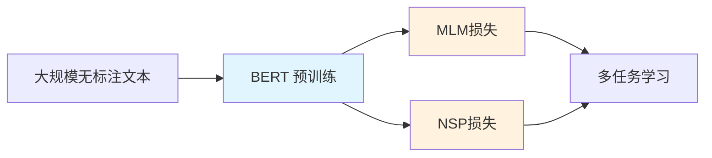
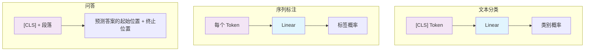
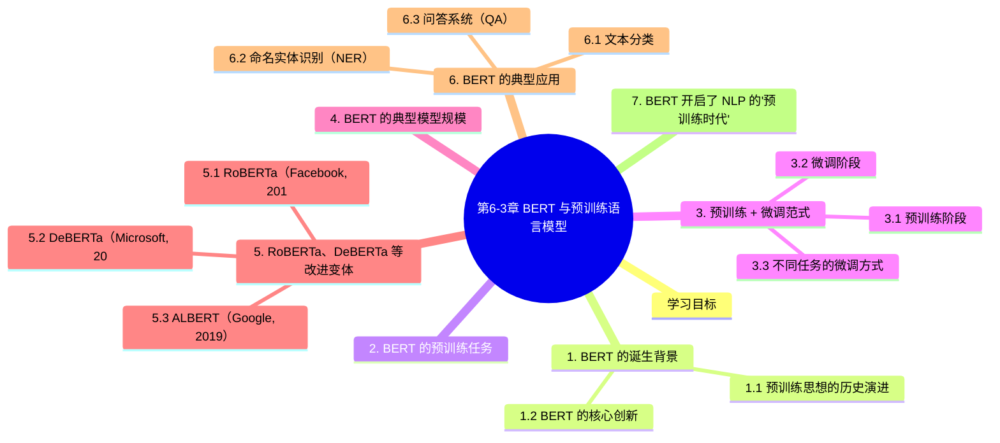

# 第6-3章 BERT 与预训练语言模型

## 学习目标

- 理解 BERT 的核心创新：双向编码器 + 掩码语言模型
- 掌握预训练 + 微调（Pre-train + Fine-tune）范式
- 理解 NSP（下一句预测）任务的设计初衷与争议
- 了解 RoBERTa、DeBERTa 等典型改进变体
- 掌握 BERT 的典型应用场景：文本分类、命名实体识别、问答系统

---

## 1. BERT 的诞生背景

### 1.1 预训练思想的历史演进

在 BERT 出现之前，NLP 任务的传统做法是**从零开始训练**——每个任务都需要大量标注数据，且模型从头学起。

> **扩展阅读**：Word2Vec（2013）是词向量表示的里程碑工作，首次展示了"预训练词向量"的可行性。但其词向量是**静态的、上下文无关的**——"bank"在"river bank"和"bank account"中向量完全相同。
>
> 详细内容请参阅：**第6-6章《词向量与预训练技术》**（补充阅读）

Word2Vec（2013）首次展示了"预训练词向量"的可行性：通过在大规模无标注文本上做无监督学习，得到好的词表示，再用于下游任务。

但 Word2Vec 的词向量是静态的、上下文无关的——"bank"在"river bank"和"bank account"中向量完全相同。

ELMo（2018）迈出了重要一步：使用双向 LSTM 生成**上下文相关的词嵌入**，但依然使用 RNN 作为特征抽取器，且下游任务只能使用固定的预训练表示（没有微调）。

GPT（2018）证明了**基于 Transformer 解码器的预训练 + 微调范式**效果显著，但 GPT 使用的是单向（从左到右）语言模型，无法充分捕获双向上下文信息。

### 1.2 BERT 的核心创新

2018年，谷歌发布 **BERT（Bidirectional Encoder Representations from Transformers）**，刷新了 11 项 NLP 任务的 SOTA 纪录。

BERT 的核心创新：

1. **双向编码器**：使用 Transformer **编码器**而非解码器，允许每个词同时看到左侧和右侧的上下文
2. **掩码语言模型（MLM）**：随机遮盖输入中的部分词，让模型根据上下文预测被遮盖的词——这让双向编码成为可能
3. **预训练 + 微调范式**：在大规模无标注数据上预训练通用语言能力，再在具体任务的少量标注数据上微调

---

## 2. BERT 的预训练任务

### 2.1 掩码语言模型（Masked Language Model, MLM）

MLM 是 BERT 的核心创新。它从输入序列中随机遮盖约 15% 的词元（Token），然后让模型基于双向上下文预测这些被遮盖的词。

```
输入句子: "The man went to the [MASK] to buy a [MASK]."

被遮盖的词可能是: "store", "groceries"  (模型需要预测 [MASK] 位置的词)
```

**为什么不能简单地用双向 LSTM？**  
传统的双向 LSTM 在计算某个位置的隐藏状态时，左侧上下文和右侧上下文的表示会相互"泄漏"——当前词的表示包含了自身的 Embedding，这会让模型"偷看到"答案。

MLM 通过遮盖词元本身（用 [MASK] Token 替代）完美解决了这个问题。

**遮盖策略的细节**：
- 80% 的情况：用 [MASK] 替代（如 "great" → "[MASK]"）
- 10% 的情况：替换成随机词（如 "great" → "apple"）
- 10% 的情况：保持不变（如 "great" 保持为 "great"）

第三种策略（保持不变）的目的是缓解预训练与微调阶段的不一致——因为微调时不会出现 [MASK] Token。

### 2.2 下一句预测（Next Sentence Prediction, NSP）

NSP 是 BERT 的第二个预训练任务，旨在让模型理解句子之间的关系。

```
句子A: "The man went to the store."
句子B: "He bought a gallon of milk."

标签: IsNext（句子B紧跟在句子A后面）

---

句子A: "The man went to the store."
句子B: "The penguin is a flightless bird."

标签: NotNext（句子B不是A的下一句）
```

**NSP 的初衷**：很多 NLP 任务需要理解句子间关系（如问答、推理），NSP 预训练让模型学会判断句子间的语义连贯性。

**后来被 RoBERTa 证明 NSP 效果有限**，在很多场景下移除 NSP 反而略微提升效果（因为强迫模型同时学习词级语义和句子级关系可能产生冲突）。

---

## 3. 预训练 + 微调范式

### 3.1 预训练阶段



在预训练阶段，BERT 在 BooksCorpus（8亿词）和英语维基百科（25亿词）上训练，总计约 33 亿词。

- 预训练的 batch size：256 sequences（约 256K tokens per batch）
- 训练步数：1,000,000 步
- 学习率：1e-4，带 warmup
- 训练时长：约 4 天（在 16 个 TPU 上）

### 3.2 微调阶段


微调时，整个模型（预训练 BERT + 新增的任务头）一起训练，所有参数都会更新。

**与传统 fine-tuning 的区别**：

| 传统方法 | BERT 的 Pre-train + Fine-tune |
|----------|-------------------------------|
| 预训练的表示是固定的（只替换顶层） | 所有层都可微调 |
| 任务专属的特征工程 | 任务无关的通用表示 |
| 每个任务独立训练 | 同一预训练模型，微调不同任务 |

### 3.3 不同任务的微调方式



---

## 4. BERT 的典型模型规模

| 模型 | 层数 | 隐藏维度 | 注意力头数 | 参数量 |
|------|------|----------|-----------|--------|
| **BERT-Base** | 12 | 768 | 12 | 1.1 亿 |
| **BERT-Large** | 24 | 1024 | 16 | 3.4 亿 |
| BERT-Tiny | 2 | 128 | 2 | 440 万 |
| ALBERT-Base | 12 | 768 | 12 | 1200 万（参数共享） |

BERT-Large 在发布时刷新了 GLUE 基准的 SOTA（从 72.8 提升到 80.5）。

---

## 5. RoBERTa、DeBERTa 等改进变体

### 5.1 RoBERTa（Facebook, 2019）

RoBERTa 对 BERT 做了系统性改进，效果全面超越 BERT：

1. **更大的数据和更长的训练**：使用 160GB 文本（而非 BERT 的 16GB）
2. **移除 NSP 任务**：实验证明 NSP 对性能无正面贡献
3. **动态遮盖策略**：每次输入一个序列时动态决定遮盖位置（而非预先生成一份遮盖表）
4. **更长的序列长度和更大的 batch size**
5. **字节级 BPE（Byte-Level BPE）** 编码

### 5.2 DeBERTa（Microsoft, 2020）

DeBERTa（Decoding-enhanced BERT with Disentangled Attention）的核心改进：

1. **解耦注意力（Disentangled Attention）**：内容和位置分别编码，注意力分别计算后组合——避免原始 BERT 中内容信息和位置信息混淆的问题
2. **增强的掩码解码器（EMD）**：在解码器层引入相对位置信息
3. **虚拟对抗训练（VAT）**：进一步提升模型的泛化能力

DeBERTa v3 在 SuperGLUE 基准上首次超越人类基线。

### 5.3 ALBERT（Google, 2019）

ALBERT 的核心目标是**减小参数量**，同时尽量不损失性能：

1. **跨层参数共享**：所有层共享同一个 Transformer 块的参数
2. **词嵌入分解**：将大的词表嵌入矩阵分解为两个小矩阵
3. **SOP（句子顺序预测）替代 NSP**：用更难的句子顺序预测替代下一句预测

---

## 6. BERT 的典型应用

### 6.1 文本分类

将 [CLS] Token 的输出向量传入一个分类头（通常是一层 Linear），微调后可用于情感分类、主题分类等任务。

```
输入: "This movie is amazing!"
[CLS] Token ──→ Linear(768 → 2) ──→ [正面: 0.92, 负面: 0.08]
```

### 6.2 命名实体识别（NER）

对输入序列的每个 Token，预测其所属的实体类型（B-PER, I-PER, B-ORG, I-ORG, B-LOC, I-LOC, O 等）。

```
输入: "Jim bought 300 shares of Acme Corp. in 2020."
输出:  [PER] [O]    [O]    [O]   [ORG] [O]  [O]  [O]  [O]
```

### 6.3 问答系统（QA）

在 SQuAD 等阅读理解数据集中，给定一段上下文和一个问题，让模型预测答案在上下文中的起始和结束位置。

```
上下文: "The Eiffel Tower is a wrought-iron lattice tower in Paris."
问题: "Where is the Eiffel Tower located?"
预测: 起始位置 → 结束位置  → 答案: "in Paris"
```

---

## 7. BERT 开启了 NLP 的"预训练时代"

```
2018年:  BERT发布 ──→ 刷新11项SOTA，NLP进入预训练时代

2019年:  RoBERTa, ALBERT, XLNet, Ernie, DistilBERT ...

2020年:  DeBERTa, ELECTRA, ALUM ...

至今:    大量垂直领域预训练模型（BioBERT, SciBERT, LawBERT等）
```

BERT 的成功证明了两点：
1. **大数据 + 大模型 + 自监督学习**是一条可行的通用语言理解路线
2. **Transformer 编码器**是比 RNN 更强的特征抽取器

---

## 本章小结

1. **BERT** 使用双向 Transformer 编码器 + 掩码语言模型（MLM），首次实现了真正的双向上下文建模。
2. **预训练 + 微调范式**使得同一个预训练模型可以通过简单微调适应多种下游任务，大幅降低了 NLP 应用的门槛。
3. **MLM** 随机遮盖 15% 的词，让模型同时利用左右上下文预测被遮盖的词。
4. **RoBERTa、DeBERTa** 等变体通过更大的数据、更合理的训练策略和更精细的注意力设计持续改进性能。
5. BERT 开创了"预训练时代"，深刻影响了后续 GPT 系列和大语言模型的发展方向。

---


## 知识图谱



## 参考资料

- Devlin, J., et al. (2019). *BERT: Pre-training of Deep Bidirectional Transformers for Language Understanding*. NAACL.  
  <https://arxiv.org/abs/1810.04805>
- Liu, Y., et al. (2019). *RoBERTa: A Robustly Optimized BERT Pretraining Approach*.  
  <https://arxiv.org/abs/1907.11692>
- He, P., et al. (2021). *DeBERTa: Decoding-enhanced BERT with Disentangled Attention*. ICLR.  
  <https://arxiv.org/abs/2006.03654>
- Lan, Z., et al. (2020). *ALBERT: A Lite BERT for Self-supervised Learning of Language Representations*. ICLR.  
  <https://arxiv.org/abs/1909.11942>
