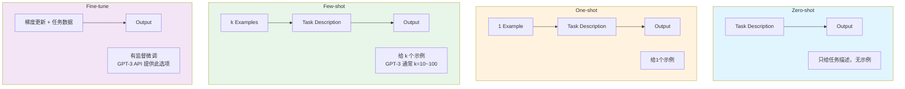
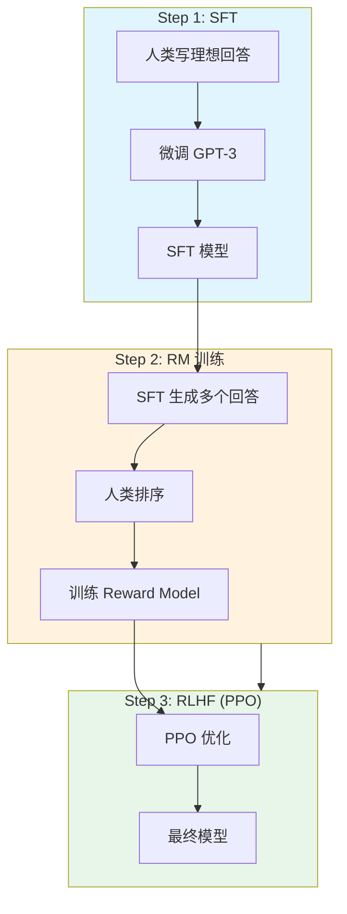
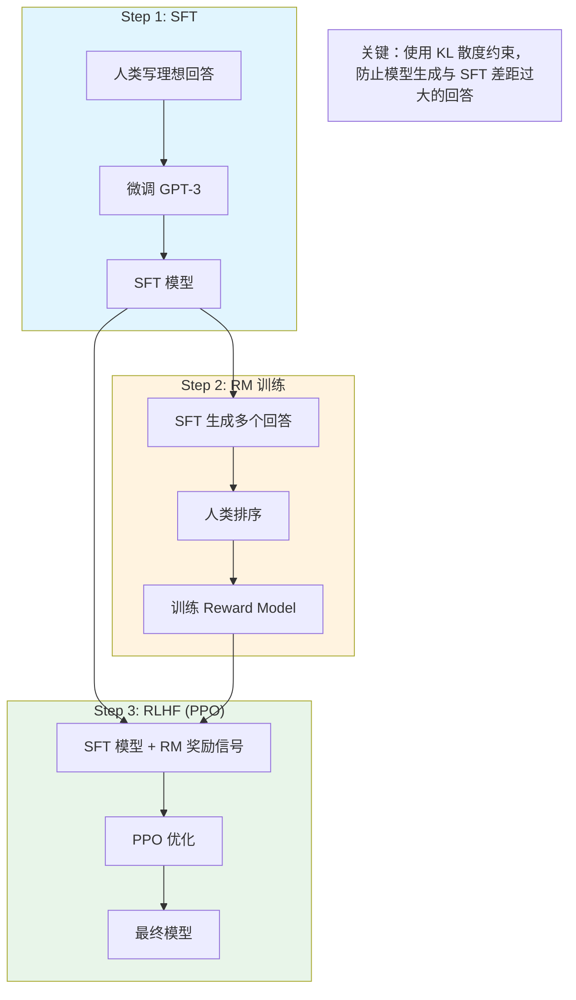
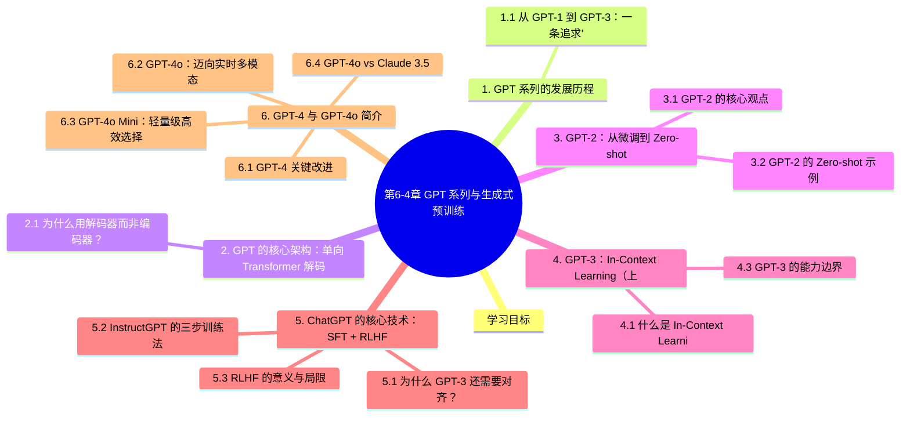

# 第6-4章 GPT 系列与生成式预训练

## 学习目标

- 了解 GPT-1、GPT-2、GPT-3、GPT-4、GPT-4o 的演进路线与核心设计哲学
- 理解"下一个 Token 预测"（Next Token Prediction）的训练目标
- 掌握零样本（Zero-shot）与少样本（Few-shot）学习的概念
- 理解 ChatGPT 的核心技术：SFT + RLHF
- 了解 InstructGPT、GPT-4、GPT-4o 的关键改进
- 掌握 GPT-4o 与 Claude 3.5 Sonnet 的技术特点与性能差异

---

## 1. GPT 系列的发展历程

### 1.1 从 GPT-1 到 GPT-3：一条追求"更大"的路线

OpenAI 从 2018 年起，持续沿着**大规模语言模型**的路线演进 GPT 系列：

| 模型 | 发布年份 | 参数量 | 预训练数据量 | 上下文窗口 | 核心创新 |
|------|----------|--------|------------|------------|---------|
| **GPT-1** | 2018 | 1.17 亿 | ~5GB | 512 tokens | 首个"预训练 + 微调"范式 |
| **GPT-2** | 2019 | 15 亿 | ~40GB（WebText） | 1K tokens | 展示 Zero-shot 能力 |
| **GPT-3** | 2020 | **1750 亿** | ~600GB | 2K tokens | 提出 In-Context Learning |
| **ChatGPT** | 2022.11 | ~1750 亿 | 同 GPT-3 | 4K tokens | SFT + RLHF 对齐 |
| **GPT-4** | 2023.03 | 未公开（估算万亿级） | 未公开 | **128K tokens** | 多模态 + 显著提升推理能力 |
| **GPT-4 Turbo** | 2023.11 | 未公开 | 未公开 | 128K tokens | DALL·E 3、内置 TTS 语音合成 |
| **GPT-4o** | 2024.05 | 未公开 | 未公开 | 128K tokens | 实时语音/多模态、成本降低 50% |
| **GPT-4o Mini** | 2024.07 | 未公开 | 未公开 | 128K tokens | 轻量级、API 价格显著降低 |

**一条清晰的演进逻辑**：
> 更大的模型 + 更多的数据 + 更多的计算 → 更强的通用能力

OpenAI 赌对了这条 scaling 路线，后续几乎所有大语言模型都沿用了类似的思路。

---

## 2. GPT 的核心架构：单向 Transformer 解码器

### 2.1 为什么用解码器而非编码器？

BERT 使用的是 **Transformer 编码器**（双向注意力），而 GPT 使用的是 **Transformer 解码器**（单向/掩码注意力）。

**解码器的特点**：
- 只能看到当前位置**之前**的 Token（通过 causal mask 实现）
- 天然适合**自回归生成**任务（从左到右逐词生成）

```
GPT 的注意力掩码（简化示例）：

输入: "The cat sat on the mat"
位置:   0   1   2   3   4   5

位置 0 ("The")  → 只能看自己
位置 2 ("cat")  → 只能看 "The", "cat"  ← 注意这里"cat"也用掩码遮住了
位置 3 ("sat")  → 只能看 "The", "cat", "sat"
...
位置 5 ("mat")  → 只能看 "The", "cat", "sat", "on", "the", "mat"
```

**为什么单向架构适合语言建模？**  
语言在本质上是**有序的**——说话是一字一字说出来的，预测"下一个词"本身就是一个自回归的过程。用解码器训练，正好对应了这个生成过程。

### 2.2 下一个 Token 预测（Next Token Prediction）

GPT 的训练目标是标准的**语言建模**目标——给定前文，预测下一个词：

```
Loss = -Σ log P(x_t | x_{<t}; θ)

对序列中每个位置，计算模型对该位置真实词的概率的对数的负值，然后求和最小化。
```

**"下一个 Token 预测"是 BERT 的 MLM 目标的一种自回归形式**，两者的区别：

| 训练目标 | BERT (MLM) | GPT (NTP) |
|----------|-----------|----------|
| 注意力方向 | 双向（看左右） | 单向（只看左） |
| 训练方式 | 随机遮盖部分词预测 | 因果掩码，无法看到未来 |
| 适用场景 | 理解任务 | 生成任务 |
| 计算量 | 每次只预测 ~15% 词 | 每个位置都要预测 |

---

## 3. GPT-2：从微调到 Zero-shot

### 3.1 GPT-2 的核心观点

GPT-2 在论文《Language Models are Unsupervised Multitask Learners》（2019）中提出了一个重要观点：

> **强大的语言模型可以在不进行任何梯度更新的情况下，仅通过文本提示（Prompt）来完成多种任务。**

这被称为 **Zero-shot Learning**——模型不针对任何具体任务做训练，但在特定 Prompt 下可以泛化到该任务。

### 3.2 GPT-2 的 Zero-shot 示例

```
任务：翻译（English → French）

Prompt:
translate to french, english: hug → french:

模型输出（Zero-shot）:  "hug → french: aimer"
                        （实际正确答案是 "hug → french: serrer" 或 "hug → french: enlacer"）
```

```
任务：阅读理解

Prompt:
In physics, the equipartition theorem states that at thermal equilibrium, 
energy is equally divided among its various forms. For example, the average 
kinetic energy per degree of freedom in translational motion is (1/2)kT. 
The question: What is the average kinetic energy per degree of freedom 
in translational motion?

Answer:

模型输出: "(1/2)kT"
```

GPT-2 展示的 Zero-shot 能力虽然有限，但证明了**语言模型本身具有多任务泛化能力**，这为后续 GPT-3 的提出奠定了基础。

---

## 4. GPT-3：In-Context Learning（上下文学习）

### 4.1 什么是 In-Context Learning？

GPT-3 提出了 **In-Context Learning**（上下文学习，也称 Few-shot Learning within Context）——不给任何梯度更新，仅通过在 Prompt 中提供少量示例，模型就能学会执行新任务。

```
GPT-3 论文中的翻译任务示例（Few-shot）：

Prompt:
translate English to French: 
sea otter → loutre de mer
plush girafe → girafe peluche
feeder → 【等待模型补全】
```

```
Zero-shot（无示例）:
Prompt:
translate English to French: cheese →

Few-shot（给3个示例后）:
Prompt:
translate English to French:
cheese → 
cheese → 【模型补全】
```

### 4.2 Zero-shot vs Few-shot vs Fine-tuning



### 4.3 GPT-3 的能力边界

GPT-3（1750 亿参数）在很多任务上接近甚至超越 SOTA：
- **代码生成**：显著优于之前的专用代码模型
- **数学推理**（三位数加减法）：接近 100% 准确率
- **问答、推理**：多数任务上达到中等人类水平

但 GPT-3 也有明显局限：
- 缺乏对复杂推理链（Chain-of-Thought）的稳定能力
- 对精确事实的recall 能力有限（幻觉问题）
- 无法主动自我纠错或验证答案

---

## 5. ChatGPT 的核心技术：SFT + RLHF

### 5.1 为什么 GPT-3 还需要对齐？

GPT-3 虽然有强大的生成能力，但它的输出**不符合人类期望**：
- 可能输出有害内容、偏见言论
- 风格不够友好，不像一个"助手"
- 不会follow指令，回答不够精准

这是因为 GPT 预训练的目标是"预测下一个词"，这和"做一个有用且无害的助手"有本质区别。

**对齐（Alignment）**：让模型的输出符合人类意图和价值观。

### 5.2 InstructGPT 的三步训练法

ChatGPT 的技术基础来自 InstructGPT（2022），采用三步训练：





### 5.3 RLHF 的意义与局限

**RLHF 的意义**：
- 首次将"人类偏好"引入大模型的训练
- 模型学会了"助人、诚实、无害"（HHH: Helpful, Honest, Harmless）
- 极大提升了模型的可控性和可用性

**RLHF 的局限**：
- 依赖高质量的人类偏好标注（成本高，速度慢）
- Reward Model 是对人类偏好的近似，可能被"hack"
- 存在"谄媚"问题——模型可能学会讨好人类而非说出真实答案

---

## 6. GPT-4 与 GPT-4o 简介

### 6.1 GPT-4 关键改进

GPT-4 在 2023 年 3 月发布，相比 GPT-3 主要改进：

1. **多模态能力**：支持图像输入，可以理解图片内容并回答相关问题
2. **复杂推理能力显著提升**：在多项专业考试（律师考试、医学考试）中达到人类 top 10% 水平
3. **更长的上下文窗口**：从 GPT-3 的 4K tokens 扩展到 **128K tokens**
4. **可控性提升**：通过 System Prompt 实现更稳定的行为控制

### 6.2 GPT-4o：迈向实时多模态

GPT-4o（"o"代表"omni"）于 2024 年 5 月发布，**定位为 GPT-4 的增强版**，性能与 GPT-4 Turbo 持平，但成本降低 50%。

**核心特性**：

| 特性 | 说明 |
|------|------|
| **实时语音交互** | 支持语音打断、插嘴、情感识别，响应延迟接近人类对话 |
| **原生多模态** | 文本、图像、音频统一处理，无需分离的模型 |
| **速度提升** | API 响应速度是 GPT-4 Turbo 的 2 倍 |
| **成本降低** | API 价格比 GPT-4 Turbo 低 50% |

### 6.3 GPT-4o Mini：轻量级高效选择

GPT-4o Mini 于 2024 年 7 月发布，是 GPT-4o 系列的轻量级版本：

| 特性 | 说明 |
|------|------|
| **API 价格** | 显著低于 GPT-4o，适合高并发场景 |
| **上下文窗口** | 128K tokens |
| **多模态能力** | 支持文本和图像输入 |
| **适用场景** | 聊天机器人、数据提取、文本分类等 |

### 6.4 GPT-4o vs Claude 3.5 Sonnet 对比

GPT-4o 与 Anthropic 的 Claude 3.5 Sonnet 代表了当前两大顶级 AI 模型，以下是详细对比：

| 维度 | **GPT-4o** | **Claude 3.5 Sonnet** |
|------|-----------|----------------------|
| **发布公司** | OpenAI | Anthropic |
| **发布时间** | 2024.05 | 2024.06 |
| **上下文窗口** | 128K tokens | 200K tokens |
| **多模态能力** | 原生多模态（文本+图像+音频） | 文本+图像（2024.06新增） |
| **编码能力** | 强 | **更强**（SWE-bench: 49% vs 34%） |
| **API 定价** | 中等（GPT-4o 比 Turbo 低 50%） | 相对更低（Pro 订阅更划算） |
| **实时语音** | ✅ 支持，接近人类对话 | ❌ 不支持 |
| **视觉理解** | ✅ 强 | ✅ 强（略优） |
| **长上下文** | 128K | 200K |
| **推理速度** | 快（比 Turbo 快 2 倍） | 快（Artifacts 响应快） |
| **代码生成** | 优秀 | **优秀（SWE-bench 领先）** |
| **复杂任务** | 强 | 强 |
| **工具使用（Function Calling）** | ✅ 稳定 | ✅ 稳定 |

**关键差异总结**：

- **编码场景**：Claude 3.5 Sonnet 在 SWE-bench（软件工程基准）上得分 49%，显著高于 GPT-4o 的 34%，适合代码生成和复杂软件任务。
- **实时交互**：GPT-4o 支持实时语音对话，Claude 3.5 Sonnet 不具备此能力。
- **上下文长度**：Claude 3.5 Sonnet 支持 200K tokens，优于 GPT-4o 的 128K。
- **性价比**：Claude 3.5 Sonnet 的 API 定价相对更低，在同等预算下可能获得更好的性能。

### 6.5 GPT-4 系列的技术报告透露的信息

OpenAI 没有公开 GPT-4 的具体架构细节（参数量等），但技术报告中提到：

- 使用了**基于人类反馈的强化学习（RLHF）**进行微调
- 使用了**预测缩放（Predictable Scaling）**技术，在训练过程中预测模型的损失和能力，从而更高效地分配训练资源
- 模型安全性通过**多模态特征工程**和**对抗性测试**得到提升

---

## 7. GPT 系列 vs BERT 系列：对比总结

| 维度 | GPT 系列（自回归） | BERT 系列（双向编码） |
|------|-----------------|-------------------|
| **架构** | Transformer 解码器 | Transformer 编码器 |
| **注意力** | 单向（只看左侧上文） | 双向（看左右全文） |
| **训练目标** | 下一个 Token 预测 | 掩码语言模型（MLM） |
| **典型任务** | 文本生成、对话、代码 | 理解任务：分类、NER、QA |
| **上下文利用** | 只能用前文 | 可用双向上下文 |
| **生成能力** | 强 | 弱（需配合解码策略） |
| **理解能力** | 依赖 Prompt 工程 | 强，任务自适应性好 |

**两者的融合**：
- **Encoder-Decoder 架构**（如 T5、UL2）：编码器用双向，解码器用单向
- **Prefix LM**（如 UniLM）：让部分层双向，部分层单向
- **GLM**（清华大学）：一种融合 MLM 和 NTP 的混合目标

---

## 本章小结

1. **GPT 系列**采用 Transformer 解码器 + 下一个 Token 预测，专注生成式任务。
2. **GPT-1** 确立了"预训练 + 微调"范式；**GPT-2** 展示了 Zero-shot 多任务泛化能力；**GPT-3** 发明了 In-Context Learning（上下文学习）。
3. **In-Context Learning** 允许模型在只给 Prompt 示例的情况下学习新任务，无需梯度更新。
4. **ChatGPT/InstructGPT** 使用 SFT + RM + RLHF 三步，将"人类偏好"引入训练目标，使模型更安全、更有帮助。
5. **GPT-4** 在复杂推理、多模态理解和可控性方面有质的飞跃，上下文窗口扩展到 128K tokens。
6. **GPT-4o**（2024.05）支持实时语音交互和原生多模态，成本比 GPT-4 Turbo 低 50%；**GPT-4o Mini**（2024.07）是轻量级版本，API 价格更低。
7. **Claude 3.5 Sonnet** 在编码能力（SWE-bench 49% vs GPT-4o 34%）和上下文长度（200K vs 128K）上有优势；GPT-4o 在实时语音交互方面领先。
8. GPT 和 BERT 代表了两种不同的预训练范式，各有优势，也催生了大量融合架构的研究。

---


## 知识图谱



## 参考资料

- Radford, A., et al. (2018). *Improving Language Understanding by Generative Pre-Training* (GPT-1).  
  <https://s3-us-west-2.amazonaws.com/openai-assets/research-covers/language-unsupervised/language_understanding_paper.pdf>
- Radford, A., et al. (2019). *Language Models are Unsupervised Multitask Learners* (GPT-2).  
  <https://d4mucfpksywv.cloudfront.net/better-language-models/language_models_are_unsupervised_multitask_learners.pdf>
- Brown, T., et al. (2020). *Language Models are Few-Shot Learners* (GPT-3). NeurIPS.  
  <https://arxiv.org/abs/2005.14165>
- Ouyang, L., et al. (2022). *Training language models to follow instructions with human feedback* (InstructGPT). NeurIPS.  
  <https://arxiv.org/abs/2203.02155>
- OpenAI. (2023). *GPT-4 Technical Report*.  
  <https://arxiv.org/abs/2303.08774>
