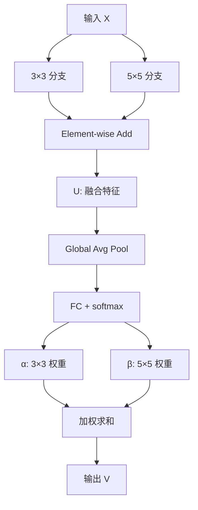
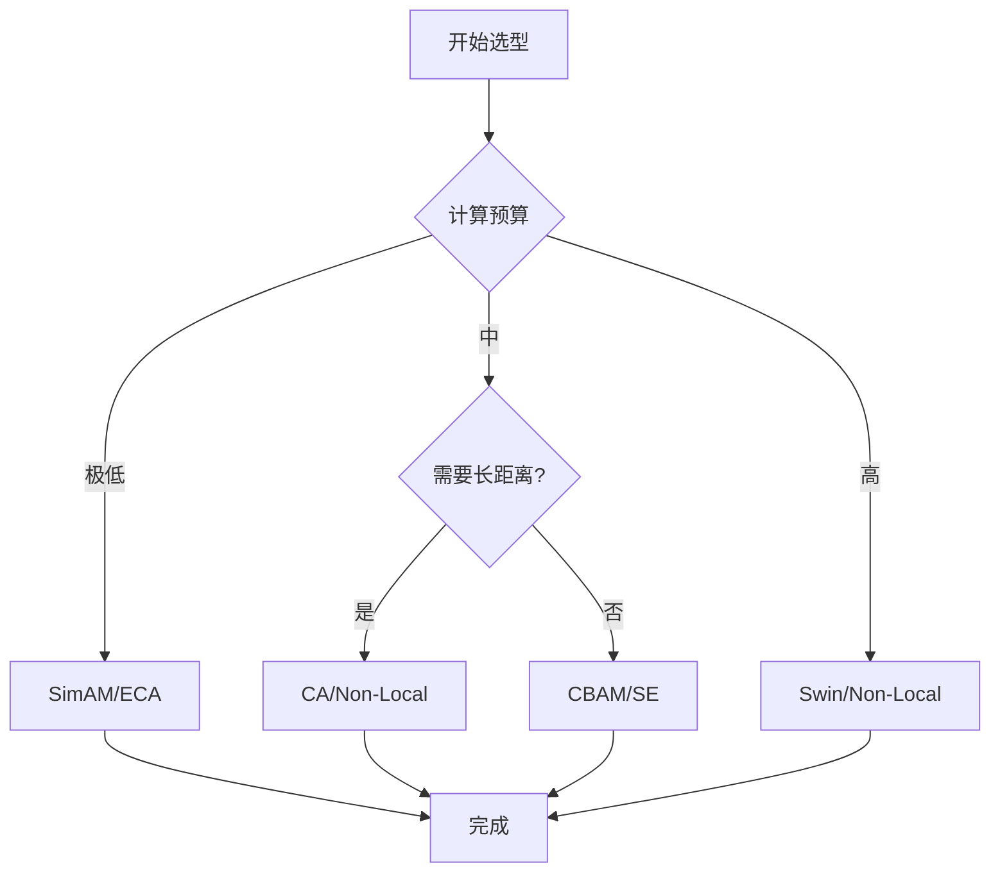
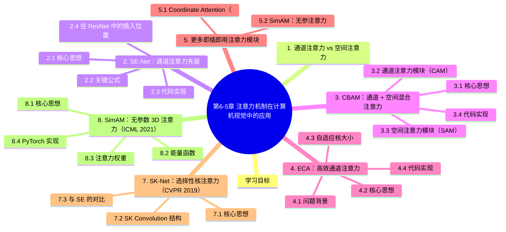

# 第6-5章 注意力机制在计算机视觉中的应用

> **补充阅读章节** — 本章介绍计算机视觉领域中常用的即插即用注意力模块，包括SE-Net、CBAM、ECA等。这些模块可无缝集成到任意CNN架构中，以极低的计算开销提升模型性能。
>
> 前置知识：建议先阅读第6-1章《注意力机制》理解注意力机制的基本原理。

---

## 学习目标

- 理解通道注意力（Channel Attention）与空间注意力（Spatial Attention）的区别
- 掌握 SE-Net、CBAM、ECA 等即插即用模块的核心设计思想
- 了解各类注意力模块在 CNN 中的典型插入位置
- 能够根据任务需求选择合适的注意力模块

---

## 1. 通道注意力 vs 空间注意力

在计算机视觉中，注意力机制主要分为两大类：

| 类型 | 关注点 | 代表模块 | 作用 |
|------|--------|----------|------|
| **通道注意力** | 通道的重要程度 | SE-Net、ECA | 对不同通道加权，强化有用特征、抑制无关特征 |
| **空间注意力** | 空间位置的重要程度 | SAM、CBAM | 让模型更关注关键空间区域 |
| **混合注意力** | 通道+空间同时考虑 | CBAM、Coordinate Attention | 综合通道和空间信息 |

```
┌─────────────────────────────────────────────────────────────┐
│                    注意力机制分类图                           │
├─────────────────────────────────────────────────────────────┤
│                                                             │
│   注意力机制                                                │
│   ├── 通道注意力 ──→ SE-Net、ECA                          │
│   ├── 空间注意力 ──→ SAM、Spatial Attention                │
│   └── 混合注意力 ──→ CBAM、Coordinate Attention            │
│                                                             │
└─────────────────────────────────────────────────────────────┘
```

---

## 2. SE-Net：通道注意力先驱

### 2.1 核心思想

SE-Net（Squeeze-and-Excitation Networks）由华为诺亚方舟实验室提出，发表于 CVPR 2018。其核心思想是**通过学习的方式自动获取每个特征通道的重要程度**，然后根据这个重要程度对特征图进行加权。

```
SE模块工作流程：

输入特征图 F (H × W × C)
    │
    ▼
┌─────────────────────┐
│  Squeeze (压缩)     │  →  Global Average Pooling
│  将空间信息压缩为    │  →  H×W×C → 1×1×C
│  通道描述符         │
└─────────────────────┘
    │
    ▼
┌─────────────────────┐
│  Excitation (激励)   │  →  两层全连接 + Sigmoid
│  学习通道间非线性关系│  →  生成通道权重 s ∈ [0,1]^C
└─────────────────────┘
    │
    ▼
┌─────────────────────┐
│  Scale (重标定)      │  →  权重与原特征图逐通道相乘
│  特征重标定          │  →  F' = s · F
└─────────────────────┘
    │
    ▼
输出特征图 F' (H × W × C)
```

### 2.2 关键公式

**Squeeze 操作（全局平均池化）：**
$$z_c = \frac{1}{H \times W} \sum_{i=1}^{H} \sum_{j=1}^{W} x_c(i,j)$$

**Excitation 操作（通道权重学习）：**
$$s = \sigma(W_2 \cdot \delta(W_1 \cdot z))$$

其中：
- $z$ 为 Squeeze 输出的全局描述符
- $W_1 \in \mathbb{R}^{C/r \times C}$ 为降维矩阵（$r$ 为压缩比，通常取 16）
- $W_2 \in \mathbb{R}^{C \times C/r}$ 为升维矩阵
- $\delta$ 为 ReLU 激活函数
- $\sigma$ 为 Sigmoid 函数，输出权重值 $s \in [0,1]^C$

### 2.3 代码实现

```python
class SELayer(nn.Module):
    def __init__(self, channel, reduction=16):
        super(SELayer, self).__init__()
        self.avg_pool = nn.AdaptiveAvgPool2d(1)
        self.fc = nn.Sequential(
            nn.Linear(channel, channel // reduction, bias=False),  # 降维
            nn.ReLU(inplace=True),
            nn.Linear(channel // reduction, channel, bias=False),   # 升维
            nn.Sigmoid()
        )

    def forward(self, x):
        b, c, _, _ = x.size()
        # Squeeze: 全局平均池化
        y = self.avg_pool(x).view(b, c)
        # Excitation: 全连接层 + Sigmoid
        y = self.fc(y).view(b, c, 1, 1)
        # Scale: 通道权重相乘
        return x * y.expand_as(x)
```

### 2.4 在 ResNet 中的插入位置

```
┌─────────────────────────────────────────────────────────────┐
│              SE 模块在 ResNet 中的插入位置                    │
├─────────────────────────────────────────────────────────────┤
│                                                             │
│   输入 x                                                    │
│       │                                                    │
│       ▼                                                    │
│   conv1 (3×3) ──────────────────────────────────────┐    │
│       │                                                 │    │
│       ▼                                                 │    │
│   bn1 + relu ──────────────────────────────────────┐  │    │
│       │                                               │  │    │
│       ▼                                               │  │    │
│   conv2 (3×3) ──────────────────────────────────┐  │  │    │
│       │                                             │  │  │    │
│       ▼                                             │  │  │    │
│   bn2 + relu                                        │  │  │    │
│       │                                             │  │  │    │
│       ▼                                             │  │  │    │
│   SE Layer ◄──────── 在这里插入！                    │  │  │    │
│       │                                             │  │  │    │
│       ▼                                             │  │  │    │
│   conv3 (3×3) ──────────────────────────────────┘  │  │    │
│       │                                               │  │    │
│       ▼                                               │  │    │
│   bn3                                                │  │    │
│       │                                               │  │    │
│       ▼                                               │  │    │
│   x + (shortcut)  ◄──────── 残差连接                 │  │    │
│       │                                               │  │    │
│       ▼                                               │  │    │
│   relu ─────────────────────────────────────────────┘  │    │
│       │                                                    │
│       ▼                                                    │
│   输出                                                     │
│                                                             │
└─────────────────────────────────────────────────────────────┘
```

---

## 3. CBAM：通道 + 空间混合注意力

### 3.1 核心思想

CBAM（Convolutional Block Attention Module）由 Woo 等人于 2018 年提出，是一种结合了**通道注意力**和**空间注意力**的轻量级模块。

```
CBAM 整体结构：

输入特征图 F (H × W × C)
    │
    ▼
┌─────────────────────────────┐
│  Channel Attention Module    │  →  Mc(F) ∈ R^{C×1×1}
│  (通道注意力)               │
└─────────────────────────────┘
    │  F' = Mc(F) ⊗ F
    ▼
┌─────────────────────────────┐
│  Spatial Attention Module    │  →  Ms(F') ∈ R^{1×H×W}
│  (空间注意力)               │
└─────────────────────────────┘
    │  F'' = Ms(F') ⊗ F'
    ▼
输出特征图 F''
```

### 3.2 通道注意力模块（CAM）

通道注意力借鉴了 SE-Net 的思想，但做了改进：**同时使用全局平均池化和全局最大池化**。

```
通道注意力计算流程：

输入特征图 F
    │
    ├──→ AvgPool (H×W×C → 1×1×C) ──→ MLP ──→ 加和
    │                                            │
    └──→ MaxPool (H×W×C → 1×1×C) ──→ MLP ──→ 加和
                                                      │
                                                      ▼
                                                  Sigmoid
                                                      │
                                                      ▼
                                              Mc(F) ∈ R^{C×1×1}
```

**数学表达：**
$$M_c(F) = \sigma(MLP(AvgPool(F)) + MLP(MaxPool(F)))$$

### 3.3 空间注意力模块（SAM）

空间注意力关注"哪里"是最重要的区域。

```
空间注意力计算流程：

输入特征图 F' (来自通道注意力模块)
    │
    ├──→ AvgPool (沿通道方向) → F'_{avg} ∈ R^{1×H×W}
    │
    ├──→ MaxPool (沿通道方向) → F'_{max} ∈ R^{1×H×W}
    │
    ▼
Concat ([F'_{avg}, F'_{max}]) ∈ R^{2×H×W}
    │
    ▼
Conv (7×7 卷积) → 降维为 1 通道
    │
    ▼
Sigmoid → Ms(F') ∈ R^{1×H×W}
```

**数学表达：**
$$M_s(F') = \sigma(f^{7×7}([AvgPool(F'); MaxPool(F')]))$$

### 3.4 代码实现

```python
class ChannelAttention(nn.Module):
    def __init__(self, in_channels, reduction_ratio=16):
        super().__init__()
        self.avg_pool = nn.AdaptiveAvgPool2d(1)
        self.max_pool = nn.AdaptiveMaxPool2d(1)
        self.mlp = nn.Sequential(
            nn.Linear(in_channels, in_channels // reduction_ratio, bias=False),
            nn.ReLU(),
            nn.Linear(in_channels // reduction_ratio, in_channels, bias=False)
        )

    def forward(self, x):
        avg_out = self.mlp(self.avg_pool(x).squeeze(-1).squeeze(-1))
        max_out = self.mlp(self.max_pool(x).squeeze(-1).squeeze(-1))
        out = torch.sigmoid(avg_out + max_out).unsqueeze(-1).unsqueeze(-1)
        return x * out

class SpatialAttention(nn.Module):
    def __init__(self, kernel_size=7):
        super().__init__()
        self.conv = nn.Conv2d(2, 1, kernel_size, padding=kernel_size//2, bias=False)

    def forward(self, x):
        avg_out = torch.mean(x, dim=1, keepdim=True)
        max_out, _ = torch.max(x, dim=1, keepdim=True)
        out = torch.cat([avg_out, max_out], dim=1)
        out = torch.sigmoid(self.conv(out))
        return x * out

class CBAM(nn.Module):
    def __init__(self, in_channels, reduction_ratio=16):
        super().__init__()
        self.channel_att = ChannelAttention(in_channels, reduction_ratio)
        self.spatial_att = SpatialAttention()

    def forward(self, x):
        x = self.channel_att(x)
        x = self.spatial_att(x)
        return x
```

---

## 4. ECA：高效通道注意力

### 4.1 问题背景

SE-Net 的全连接层降维操作会带来一定的信息损失。ECA-Net 提出了一个关键改进：**不降维的局部跨通道交互策略**。

### 4.2 核心思想

ECA 使用**一维卷积**来实现通道间的局部交互，避免了降维操作：

```
┌─────────────────────────────────────────────────────────────┐
│                    ECA vs SE 对比                           │
├─────────────────────────────────────────────────────────────┤
│                                                             │
│   SE-Net:                                                   │
│   输入 C 通道 ──→ 降维 C/r ──→ 升维 C ──→ 输出 C 通道      │
│                 (有信息损失)                                │
│                                                             │
│   ECA-Net:                                                  │
│   输入 C 通道 ──→ 1D 卷积 (k×1) ──→ 输出 C 通道           │
│                 (无信息损失)                                │
│                                                             │
│   其中 k 为局部跨通道交互的覆盖范围                           │
│                                                             │
└─────────────────────────────────────────────────────────────┘
```

### 4.3 自适应核大小

ECA 根据通道数自适应确定卷积核大小：

$$k = | \frac{\log_2(C)}{\gamma} + \frac{b}{\gamma} |_{odd}$$

默认 $\gamma = 2$，$b = 1$。

例如：
- ResNet-50（C=2048）→ k=3
- ResNet-101（C=2048）→ k=3

### 4.4 代码实现

```python
class ECALayer(nn.Module):
    def __init__(self, channel, gamma=2, b=1):
        super().__init__()
        t = int(abs((math.log2(channel) + b) / gamma))
        k = t if t % 2 else t + 1  # 确保 k 为奇数
        self.avg_pool = nn.AdaptiveAvgPool2d(1)
        self.conv = nn.Conv1d(1, 1, kernel_size=k, padding=(k-1)//2, bias=False)
        self.sigmoid = nn.Sigmoid()

    def forward(self, x):
        y = self.avg_pool(x)                     # 全局平均池化
        y = y.squeeze(-1).transpose(-1, -2)      # 维度调整
        y = self.conv(y)                         # 1D 卷积
        y = y.transpose(-1, -2).unsqueeze(-1)   # 恢复维度
        y = self.sigmoid(y)
        return x * y.expand_as(x)
```

### 4.5 性能对比

| 模块 | 参数量 | Top-1 准确率 (ImageNet) |
|------|--------|--------------------------|
| 基准 ResNet-50 | 25.0M | 75.3% |
| + SE (r=16) | 28.1M | 76.7% |
| + ECA | 25.1M | **77.4%** |

ECA 在几乎不增加参数量的情况下，性能提升超过 SE！

---

## 5. 更多即插即用注意力模块

### 5.1 Coordinate Attention（坐标注意力）

将通道注意力分解为两个一维特征图，分别沿 H 和 W 方向编码位置信息。

```python
class CoordAtt(nn.Module):
    def __init__(self, inp, oup, reduction=32):
        super().__init__()
        self.pool_h = nn.AdaptiveAvgPool2d((None, 1))
        self.pool_w = nn.AdaptiveAvgPool2d((1, None))
        mip = max(8, inp // reduction)
        self.conv1 = nn.Conv2d(inp, mip, 1)
        self.bn1 = nn.BatchNorm2d(mip)
        self.act = nn.ReLU()
        self.conv_h = nn.Conv2d(mip, oup, 1)
        self.conv_w = nn.Conv2d(mip, oup, 1)

    def forward(self, x):
        identity = x
        n, c, h, w = x.size()
        x_h = self.pool_h(x)
        x_w = self.pool_w(x).permute(0, 1, 3, 2)
        y = torch.cat([x_h, x_w], dim=2)
        y = self.conv1(y)
        y = self.bn1(y)
        y = self.act(y)
        x_h, x_w = torch.split(y, [h, w], dim=2)
        x_w = x_w.permute(0, 1, 3, 2)
        a_h = self.conv_h(x_h).sigmoid()
        a_w = self.conv_w(x_w).sigmoid()
        return identity * a_w * a_h
```

### 5.2 SimAM：无参注意力

SimAM 提出一种基于神经科学启发的高效注意力模块，**无需额外参数**：

```python
class SimAM(nn.Module):
    def __init__(self, e_lambda=1e-4):
        super().__init__()
        self.activaton = nn.Sigmoid()
        self.e_lambda = e_lambda

    def forward(self, x):
        b, c, h, w = x.size()
        n = w * h - 1
        x_minus_mu = (x - x.mean(dim=[2,3], keepdim=True)).pow(2)
        y = x_minus_mu / (4 * (x_minus_mu.sum(dim=[2,3], keepdim=True) / n + self.e_lambda)) + 0.5
        return x * self.activaton(y)
```

---

## 6. 注意力模块对比总结

| 模块 | 注意力类型 | 额外参数 | 计算开销 | 效果提升 |
|------|------------|----------|----------|----------|
| **SE-Net** | 通道 | 少 | 低 | +1~2% |
| **CBAM** | 通道+空间 | 中 | 中 | +2~3% |
| **ECA** | 通道 | 极少 | 极低 | +1~2% |
| **CoordAtt** | 通道+空间 | 少 | 低 | +1~2% |
| **SimAM** | 3D权重 | **无** | 极低 | +1~2% |

```
┌─────────────────────────────────────────────────────────────┐
│              即插即用注意力模块选择指南                        │
├─────────────────────────────────────────────────────────────┤
│                                                             │
│   轻量化优先 ──→ SimAM（无参）或 ECA（极低开销）           │
│                                                             │
│   效果优先 ──→ CBAM（通道+空间混合）                       │
│                                                             │
│   平衡之选 ──→ SE-Net（通道注意力）                        │
│                                                             │
│   移动端 ──→ ECA 或 Coordinate Attention                   │
│                                                             │
└─────────────────────────────────────────────────────────────┘
```

---

## 7. SK-Net：选择性核注意力（CVPR 2019）

### 7.1 核心思想

**让网络自适应选择不同尺度的卷积核**。每个神经元根据输入动态选择合适的感受野大小。

### 7.2 SK Convolution 结构



**实现**：

```python
class SKConv(nn.Module):
    def __init__(self, in_c, out_c, stride=1, M=2, r=16, L=32):
        super().__init__()
        d = max(in_c // r, L)
        self.M = M  # 分支数
        self.split_convs = nn.ModuleList([
            nn.Sequential(
                nn.Conv2d(in_c, out_c, 3, stride, 1, groups=32, bias=False),
                nn.BatchNorm2d(out_c),
                nn.ReLU(inplace=True)
            ) for _ in range(M)
        ])
        # 5×5 卷积可由 3×3 + dilation=2 替代
        self.fuse = nn.Sequential(
            nn.Conv2d(out_c * M, out_c, 1, bias=False),
            nn.BatchNorm2d(out_c),
        )
        self.gap = nn.AdaptiveAvgPool2d(1)
        self.fc = nn.Sequential(
            nn.Conv2d(out_c, d, 1, bias=False),
            nn.BatchNorm2d(d),
            nn.ReLU(inplace=True),
            nn.Conv2d(d, out_c * M, 1, bias=False),
        )
    
    def forward(self, x):
        # 1. 多尺度分裂
        feats = [conv(x) for conv in self.split_convs]
        # 2. 融合
        feats_sum = sum(feats)
        feats_fuse = self.fuse(torch.cat(feats, dim=1))
        # 3. 选择
        attn = self.fc(self.gap(feats_sum))
        attn = attn.view(-1, self.M, attn.size(1) // self.M, 1, 1)
        attn = F.softmax(attn, dim=1)
        # 4. 加权
        out = sum(feat * a for feat, a in zip(feats, attn.chunk(self.M, dim=1)))
        return out
```

### 7.3 与 SE 的对比

| 维度 | SE | SK |
|------|-----|-----|
| 注意力维度 | 通道 | 通道 + 尺度 |
| 多尺度 | 不支持 | 支持 |
| 参数 | 较少 | 略多 |
| 性能 | +1.0% | +0.8% (但更灵活) |

**关键优势**：每个神经元自适应选择感受野，更接近视觉皮层的工作方式。

---

## 8. SimAM：无参数 3D 注意力（ICML 2021）

### 8.1 核心思想

**零参数** + 同时考虑通道和空间的注意力。基于神经科学能量函数推导。

### 8.2 能量函数

每个神经元 $t$ 与其他神经元的关系用能量函数描述：

$$
e_t = \frac{1}{M-1} \sum_{i=1}^{M-1} (-1 - w_t x_i + b_t)^2 + (1 - w_t t + b_t)^2 + \lambda w_t^2
$$

最小化 → 找出每个神经元的重要性。

### 8.3 注意力权重

$$
\text{attention} = \text{Sigmoid}\left(\frac{1}{E}\right)
$$

$$
E = \frac{4(\hat{\sigma}^2 + \lambda)}{(t - \hat{\mu})^2 + 4\hat{\sigma}^2 + 2\lambda}
$$

### 8.4 PyTorch 实现

```python
class SimAM(nn.Module):
    def __init__(self, lambda_=1e-4):
        super().__init__()
        self.lambda_ = lambda_
    
    def forward(self, x):
        b, c, h, w = x.size()
        n = w * h - 1
        
        # 计算 (x - μ)²
        x_mean = x.mean(dim=[2, 3], keepdim=True)
        x_minus_mu_sq = (x - x_mean) ** 2
        
        # 1 / (4 * (σ² + λ)) + 0.5
        d = (x_minus_mu_sq.sum(dim=[2, 3], keepdim=True) / n) + self.lambda_
        d = 1.0 / (4 * d) + 0.5
        
        return x * torch.sigmoid(d)
```

### 8.5 性能

- **零参数**！
- ImageNet Top-1 +0.8%（与 CBAM 相当）
- 推理时**几乎无开销**

**优势**：是当前最轻量级的注意力模块之一。

---

## 9. 注意力模块综合对比与选型

### 9.1 全景对比表

| 模块 | 年份 | 通道 | 空间 | 长距离 | 参数 | 增益 | 推荐场景 |
|------|------|------|------|--------|------|------|----------|
| **SE** | 2018 | ✅ | ❌ | ❌ | 中 | +1.0% | 通用首选 |
| **CBAM** | 2018 | ✅ | ✅ | ❌ | 中 | +1.4% | 通用 |
| **ECA** | 2020 | ✅ | ❌ | ❌ | 极低 | +0.9% | 极致轻量 |
| **CA** | 2021 | ✅ | ✅ | ✅ | 低 | +1.2% | 移动端 + 分割 |
| **SK** | 2019 | ✅ | 部分 | ❌ | 中 | +0.8% | 多尺度任务 |
| **SimAM** | 2021 | ✅ | ✅ | 部分 | **0** | +0.8% | 极致轻量 |
| **Non-Local** | 2018 | ✅ | ✅ | ✅ | 高 | +1.7% | 像素级任务 |
| **Swin Attn** | 2021 | ✅ | ✅ | ✅ | 高 | - | 大模型 |

### 9.2 选型决策树



### 9.3 实战建议

1. **先用 SE/ECA 做基线**（简单稳妥）
2. **小目标/分割**：升级到 CA（捕获长距离依赖）
3. **极致轻量**：用 SimAM（零参数）
4. **像素级任务**：考虑 Non-Local 或 Swin
5. **不要堆叠**：1-2 个注意力模块足矣
6. **可视化验证**：用 Grad-CAM 确认学到"关注重点"

---

## 10. 在 YOLOv5 中的实际应用

以 SimAM 为例，展示如何集成到 YOLOv5 的 Bottleneck 中：

```python
class Bottleneck_SimAM(nn.Module):
    def __init__(self, c1, c2, shortcut=True, g=1, e=0.5):
        super().__init__()
        c_ = int(c2 * e)
        self.cv1 = Conv(c1, c_, 1, 1)
        self.cv2 = Conv(c_, c2, 3, 1, g=g)
        self.add = shortcut and c1 == c2
        self.attention = SimAM()

    def forward(self, x):
        return x + self.attention(self.cv2(self.cv1(x))) if self.add else self.cv2(self.cv1(x))
```

---

## 本章小结

1. **通道注意力**（SE、ECA）通过学习通道权重来强化有用特征、抑制无关特征
2. **空间注意力**（SAM）让模型更关注关键空间区域
3. **混合注意力**（CBAM）综合通道和空间信息，效果通常更好
4. 这些模块都是**即插即用**的，可以无缝集成到任意 CNN 架构中
5. 选择建议：**效果优先选 CBAM**，**轻量化优先选 ECA 或 SimAM**

---


## 知识图谱



## 参考资料

- Hu, J., et al. (2018). *Squeeze-and-Excitation Networks*. CVPR.
  <https://arxiv.org/abs/1709.01507>
- Woo, S., et al. (2018). *CBAM: Convolutional Block Attention Module*. ECCV.
  <https://arxiv.org/abs/1807.06521>
- Wang, Q., et al. (2020). *ECA-Net: Efficient Channel Attention for Deep CNNs*. CVPR.
  <https://arxiv.org/abs/1910.03151>
- Hou, Q., et al. (2021). *Coordinate Attention for Efficient Mobile Network Design*. CVPR.
  <https://arxiv.org/abs/2103.02907>
