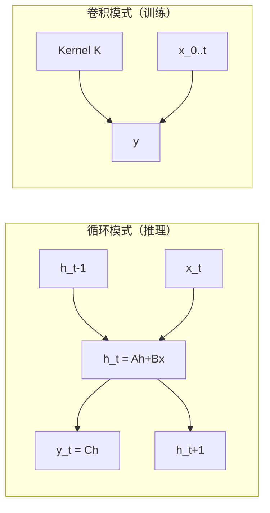
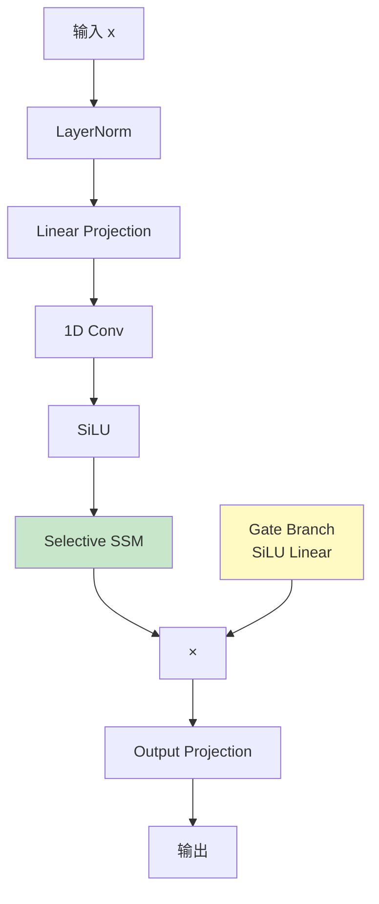
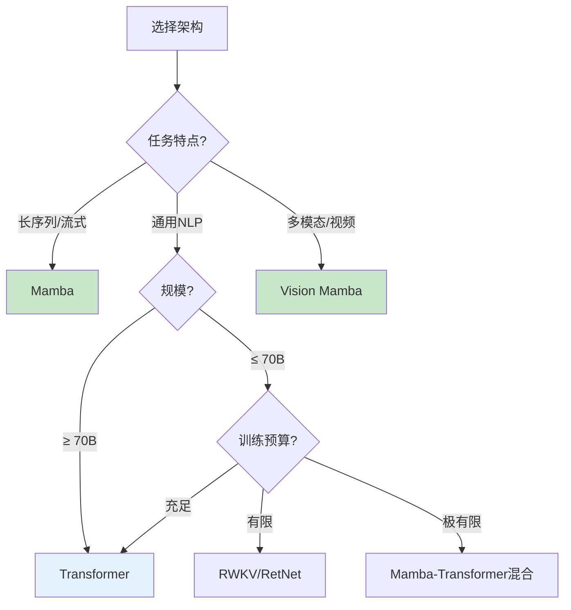
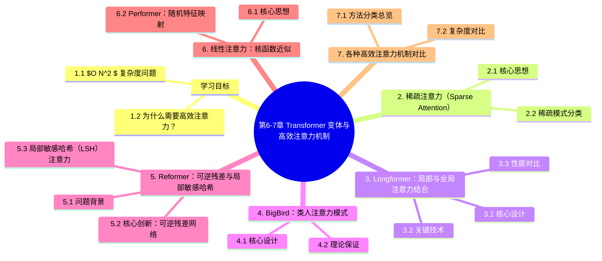

# 第6-7章 Transformer 变体与高效注意力机制

> **补充阅读章节** — 本章介绍为了解决标准 Transformer 计算复杂度问题而提出的各种变体和优化方法。这些技术使得处理超长序列成为可能，是现代大模型的重要基础。
>
> 前置知识：建议先阅读第6-1章《注意力机制》和第6-2章《Transformer架构》

---

## 学习目标

- 理解标准 Transformer 的 $O(N^2)$ 复杂度问题及其根源
- 掌握稀疏注意力（Sparse Attention）的设计思想
- 了解 Longformer、BigBird、Reformer 等典型高效 Transformer 变体
- 理解线性注意力的核函数近似方法
- 了解各种高效注意力机制的适用场景

---

## 1. 标准 Transformer 的效率瓶颈

### 1.1 $O(N^2)$ 复杂度问题

标准 Transformer 的自注意力机制存在一个根本性问题：**计算复杂度和内存复杂度都是序列长度的平方 $O(N^2)$**。

```
┌─────────────────────────────────────────────────────────────┐
│              标准注意力的计算代价                              │
├─────────────────────────────────────────────────────────────┤
│                                                             │
│   对于长度为 N 的序列：                                        │
│                                                             │
│   QK^T 矩阵乘法：N × d_k × N = O(N²·d_k)                  │
│   Softmax 操作：O(N²)                                       │
│   加权求和 PV：N × N × d_v = O(N²·d_v)                    │
│                                                             │
│   内存存储注意力权重：N × N = O(N²)                          │
│                                                             │
│   当 N = 4096 时，仅单层注意力就需要约 64MB 中间存储          │
│   当 N = 32768 时，内存需求将超过 1GB                      │
│                                                             │
└─────────────────────────────────────────────────────────────┘
```

### 1.2 为什么需要高效注意力？

| 场景 | 标准 Transformer | 高效变体需求 |
|------|-----------------|--------------|
| **短序列**（N < 512） | ✅ 无需优化 | - |
| **中等序列**（512 < N < 4096） | ⚠️ 边缘受限 | 考虑局部注意力 |
| **长序列**（4096 < N < 32768） | ❌ 内存爆炸 | 必须优化 |
| **超长序列**（N > 32768） | ❌ 无法处理 | 线性近似必需 |

---

## 2. 稀疏注意力（Sparse Attention）

### 2.1 核心思想

稀疏注意力的核心洞察是：**并非所有的注意力权重都同等重要**。通过只计算部分位置对的注意力，可以将复杂度从 $O(N^2)$ 降低到 $O(N\sqrt{N})$ 或 $O(N\log N)$。

```
┌─────────────────────────────────────────────────────────────┐
│              稀疏注意力 vs 密集注意力                         │
├─────────────────────────────────────────────────────────────┤
│                                                             │
│   密集注意力（所有位置对）：                                    │
│   ┌───────────────────────────────┐                         │
│   │ ● ● ● ● ● ● ● ● ● ● ● │                         │
│   │ ● ● ● ● ● ● ● ● ● ● ● │                         │
│   │ ● ● ● ● ● ● ● ● ● ● ● │  O(N²)                  │
│   │ ● ● ● ● ● ● ● ● ● ● ● │                         │
│   │ ● ● ● ● ● ● ● ● ● ● ● │                         │
│   └───────────────────────────────┘                         │
│                                                             │
│   稀疏注意力（局部窗口 + 跳跃连接）：                          │
│   ┌───────────────────────────────┐                         │
│   │ ● ● ● ●                   │                         │
│   │   ● ● ● ● ●               │                         │
│   │       ● ● ● ● ● ●         │  O(N·k)                │
│   │           ● ● ● ● ● ● ●     │                         │
│   │               ● ● ● ● ● ● ● ●                       │
│   └───────────────────────────────┘                         │
│                                                             │
└─────────────────────────────────────────────────────────────┘
```

### 2.2 稀疏模式分类

稀疏注意力主要分为以下几类模式：

```
┌─────────────────────────────────────────────────────────────┐
│                    稀疏注意力模式分类                         │
├─────────────────────────────────────────────────────────────┤
│                                                             │
│   稀疏注意力                                                │
│   ├── 局部窗口（Local Window）                               │
│   │     只计算当前位置周围窗口内的注意力                      │
│   │     复杂度：O(N·w)，w 为窗口大小                       │
│   │                                                       │
│   ├── 跳跃连接（Skip Connection）                             │
│   │     允许注意力跳跃到之前的位置                         │
│   │     建模层级结构                                       │
│   │                                                       │
│   ├── 膨胀窗口（Dilated Window）                            │
│   │     类似 NLP 中的膨胀卷积，扩大感受野                  │
│   │     窗口内元素间有间隙                                 │
│   │                                                       │
│   ├── 全局注意力（Global Attention）                        │
│   │     某些特殊位置（如 [CLS]）与所有位置交互              │
│   │     用于汇聚全局信息                                    │
│   │                                                       │
│   └── 随机注意力（Random Attention）                         │
│         随机选择部分位置进行注意力计算                       │
│         帮助信息传播                                        │
│                                                             │
└─────────────────────────────────────────────────────────────┘
```

---

## 3. Longformer：局部与全局注意力结合

### 3.1 核心设计

Longformer（2020）由 AllenNLP 提出，专门用于处理长文档。其核心创新是**局部窗口注意力 + 全局注意力**的组合：

```
┌─────────────────────────────────────────────────────────────┐
│                    Longformer 注意力模式                     │
├─────────────────────────────────────────────────────────────┤
│                                                             │
│   输入序列： [CLS] The man went to the store ... [SEP]    │
│                                                             │
│   [CLS] ← 全局注意力 → 与所有位置交互                       │
│                                                             │
│   The   ← 局部窗口(w=3) → 关注附近词                       │
│   man   ← 局部窗口(3) → 关注附近词                         │
│   went   ← 局部窗口(3) → 关注附近词                         │
│   ...                                                      │
│                                                             │
│   [SEP] ← 全局注意力 → 与所有位置交互                       │
│                                                             │
│   ┌─────────────────────────────────────────────────────┐   │
│   │  Complexity: O(N·w + N) ≈ O(N) for fixed w      │   │
│   └─────────────────────────────────────────────────────┘   │
│                                                             │
└─────────────────────────────────────────────────────────────┘
```

### 3.2 关键技术

- **滑动窗口注意力（Sliding Window Attention）**：每个位置只关注周围 $w$ 个位置，复杂度 $O(N \cdot w)$
- **膨胀窗口（Dilated Window）**：在窗口内引入间隔，进一步扩大感受野
- **全局注意力（Global Attention）**：特殊 token（如 [CLS]、[SEP]）与所有位置交互
- **注意力模式配置**：不同层可以使用不同的窗口大小

### 3.3 性能对比

| 模型 | 序列长度 | 注意力复杂度 | 适用场景 |
|------|----------|--------------|----------|
| BERT | 512 | $O(N^2)$ | 短文本 |
| Longformer | 4096+ | $O(N)$ | 长文档 |
| BERT-base | 512 | $O(N^2)$ | 标准任务 |

---

## 4. BigBird：类人注意力模式

### 4.1 核心设计

BigBird（2020）由 Google 提出，灵感来自人脑处理长文档的注意力模式。其核心是三种注意力模式的组合：

```
┌─────────────────────────────────────────────────────────────┐
│                    BigBird 三种注意力                        │
├─────────────────────────────────────────────────────────────┤
│                                                             │
│   1. 局部窗口注意力（w 个邻居）                              │
│      ┌─────────────────────────────┐                        │
│      │ ● ● ●                     │                        │
│      │   ● ● ● ●                 │                        │
│      │       ● ● ● ● ●           │  建模局部结构           │
│      └─────────────────────────────┘                        │
│                                                             │
│   2. 随机注意力（r 个随机位置）                              │
│      ┌─────────────────────────────┐                        │
│      │ ●       ●                 │                        │
│      │           ●       ●       │  信息传播               │
│      │   ●               ●       │                        │
│      └─────────────────────────────┘                        │
│                                                             │
│   3. 全局注意力（g 个全局 token）                            │
│      ┌─────────────────────────────┐                        │
│      │ ★ ★ ★ ★ ★                │                        │
│      │   ● ● ● ● ● ● ● ● ● ★    │  信息汇聚             │
│      │ ★ ★ ★ ★ ★                │                        │
│      └─────────────────────────────┘                        │
│                                                             │
│   ★ = 全局 token（如 [CLS]）                              │
│   ● = 局部/随机 token                                      │
│                                                             │
└─────────────────────────────────────────────────────────────┘
```

### 4.2 理论保证

BigBird 的重要贡献是证明了：**带有随机注意力的稀疏注意力可以近似完全注意力**，这为稀疏方法提供了理论依据。

---

## 5. Reformer：可逆残差与局部敏感哈希

### 5.1 问题背景

Reformer（2020）针对 Transformer 的两个效率问题：

1. **内存问题**：$L$ 层模型需要存储 $L$ 份激活值用于反向传播
2. **计算问题**：$O(N^2)$ 的注意力计算

### 5.2 核心创新：可逆残差网络

```
┌─────────────────────────────────────────────────────────────┐
│              标准残差 vs 可逆残差                             │
├─────────────────────────────────────────────────────────────┤
│                                                             │
│   标准残差（需要保存每层激活）：                               │
│   y = x + F(x)                                             │
│   每层都需要存储 x，用于反向传播                               │
│   → L 层 = L 份存储                                        │
│                                                             │
│   可逆残差（自己就能恢复前一层的激活）：                       │
│   y1 = x + F(x)                                            │
│   y2 = y1 + G(y1)                                          │
│   x = y1 - F(x)  ← 可以从 y1 恢复 x                       │
│   → 只需保存最后一层激活                                     │
│                                                             │
└─────────────────────────────────────────────────────────────┘
```

### 5.3 局部敏感哈希（LSH）注意力

Reformer 的另一个核心创新是使用 LSH 将注意力计算从 $O(N^2)$ 降到 $O(N \log N)$：

```
┌─────────────────────────────────────────────────────────────┐
│              局部敏感哈希注意力                               │
├─────────────────────────────────────────────────────────────┤
│                                                             │
│   问题：计算 softmax(QK^T) 时，需要对所有位置做归一化          │
│                                                             │
│   解决：用 LSH 将相似的 Q 和 K 哈希到相同桶中                 │
│                                                             │
│   Step 1: Q 和 K 同时投影到低维空间                         │
│   Step 2: 用 LSH 将位置分配到不同的桶                        │
│   Step 3: 只在相同桶内的位置之间计算注意力                   │
│                                                             │
│   ┌─────────────────────────────────────────────────────┐   │
│   │  Bucket 0: [pos2, pos5, pos9]                    │   │
│   │  Bucket 1: [pos1, pos3]                          │   │
│   │  Bucket 2: [pos0, pos4, pos6, pos7, pos8]       │   │
│   │                                                      │   │
│   │  只在同一桶内的位置对之间计算注意力                   │   │
│   └─────────────────────────────────────────────────────┘   │
│                                                             │
│   复杂度：从 O(N²) 降到 O(N log N)                         │
│                                                             │
└─────────────────────────────────────────────────────────────┘
```

---

## 6. 线性注意力：核函数近似

### 6.1 核心思想

标准注意力的核心运算是：

$$\text{Attention}(Q, K, V) = \text{softmax}(QK^T) \cdot V$$

线性注意力的目标是**跳过 $QK^T$ 的 $N \times N$ 矩阵计算**，通过核函数近似：

$$\text{Attention}(Q, K, V) \approx \phi(Q) \cdot (\phi(K)^T \cdot V)$$

```
┌─────────────────────────────────────────────────────────────┐
│              标准注意力 vs 线性注意力                          │
├─────────────────────────────────────────────────────────────┤
│                                                             │
│   标准注意力：                                               │
│   QK^T ∈ R^{N×N}  ← O(N²)                                │
│   ↓ softmax                                                │
│   (N×N) · V → O(N²)                                       │
│                                                             │
│   线性注意力：                                              │
│   φ(Q) ∈ R^{d×N}  ← O(Nd)                                │
│   φ(K)^T · V ∈ R^{d×N}  ← O(Nd)                          │
│   φ(Q) · (result) → O(Nd)                                 │
│                                                             │
│   总体复杂度：O(Nd)  ← 与 N 线性相关！                      │
│                                                             │
└─────────────────────────────────────────────────────────────┘
```

### 6.2 Performer：随机特征映射

Performer（2020）使用 **随机特征映射**来近似 softmax：

```
┌─────────────────────────────────────────────────────────────┐
│              Performer 的核函数近似                           │
├─────────────────────────────────────────────────────────────┤
│                                                             │
│   标准 softmax 注意力：                                      │
│   S = exp(QK^T / √d)                                      │
│                                                             │
│   Performer 近似：                                          │
│   φ(x) = exp(⟨x, w⟩)  where w ~ N(0, I_d)              │
│                                                             │
│   性质：E[φ(Q)φ(K)^T] = exp(⟨Q,K⟩/2)  ← 期望正确        │
│                                                             │
│   优点：                                                    │
│   • O(Nd) 复杂度，支持超长序列                              │
│   • 可逆近似，无额外内存                                    │
│   • 支持逆向操作                                           │
│                                                             │
└─────────────────────────────────────────────────────────────┘
```

---

## 7. 各种高效注意力机制对比

### 7.1 方法分类总览

```
┌─────────────────────────────────────────────────────────────┐
│              高效注意力方法分类                                │
├─────────────────────────────────────────────────────────────┤
│                                                             │
│   高效 Transformer                                          │
│   │                                                         │
│   ├── 稀疏注意力（Sparse Attention）                        │
│   │   ├── Longformer：滑动窗口 + 全局                       │
│   │   ├── BigBird：局部 + 随机 + 全局                      │
│   │   └── Sparse Transformer：可学习的稀疏模式               │
│   │                                                         │
│   ├── 线性注意力（Linear Attention）                        │
│   │   ├── Performer：随机特征映射                           │
│   │   ├── Linformer：低秩近似                              │
│   │   └── CosFormer：余弦相似度核                         │
│   │                                                         │
│   ├── 状态空间模型（State Space Model）                     │
│   │   ├── S4：结构化状态空间序列                           │
│   │   └── Mamba：选择性状态空间                           │
│   │                                                         │
│   └── 混合方法                                             │
│       └── Longformer + BigBird 组合                         │
│                                                             │
└─────────────────────────────────────────────────────────────┘
```

### 7.2 复杂度对比

| 方法 | 空间复杂度 | 时间复杂度 | 精确度 | 典型长度 |
|------|-----------|-----------|--------|----------|
| 标准 Transformer | $O(N^2)$ | $O(N^2)$ | ✅ 精确 | 512 |
| Longformer | $O(Nw)$ | $O(Nw)$ | ✅ 精确 | 4096+ |
| BigBird | $O(Nw + Nr + Ng)$ | $O(Nw + Nr + Ng)$ | ✅ 近似 | 4096+ |
| Reformer | $O(N \log N)$ | $O(N \log N)$ | ✅ 近似 | 4096+ |
| Performer | $O(Nd)$ | $O(Nd)$ | ⚠️ 近似 | 8192+ |
| Linformer | $O(N)$ | $O(N)$ | ⚠️ 低秩 | 4096+ |

> 注：$w$ = 窗口大小，$r$ = 随机连接数，$g$ = 全局token数，$d$ = 特征维度

---

## 8. 应用场景与选型指南

### 8.1 如何选择合适的高效注意力？

```
┌─────────────────────────────────────────────────────────────┐
│              高效注意力选型指南                               │
├─────────────────────────────────────────────────────────────┤
│                                                             │
│   场景1：长文档问答（4096+ tokens）                          │
│   → 推荐：Longformer、BigBird                              │
│   → 理由：精确注意力，局部+全局结合                         │
│                                                             │
│   场景2：超长序列生成（32768+ tokens）                      │
│   → 推荐：Performer、Mamba                                  │
│   → 理由：线性复杂度，适合自回归生成                         │
│                                                             │
│   场景3：高效训练，精度优先                                  │
│   → 推荐：Reformer（LSH）                                  │
│   → 理由：保持精确度的同时减少计算                          │
│                                                             │
│   场景4：研究/实验，需要可解释性                            │
│   → 推荐：Longformer                                        │
│   → 理由：稀疏模式可解释，注意力可视化                       │
│                                                             │
└─────────────────────────────────────────────────────────────┘
```

### 8.2 与 Flash Attention 的关系

| 优化目标 | 技术方案 | 代表方法 |
|----------|---------|---------|
| **减少内存** | 分块计算，线性质内存 | Flash Attention |
| **减少计算** | 稀疏近似 | Longformer, BigBird |
| **两者兼得** | 稀疏 + 优化实现 | Longformer + Flash |

> 注意：Flash Attention 和稀疏注意力**并不冲突**，可以叠加使用（如 LLaMA、Mistral 已在使用 GQA + Flash Attention）。

---

## 9. Mamba 与选择性状态空间模型（SSM）

2023 年底以来，**Mamba**（State Space Model 的代表）成为最有可能挑战 Transformer 统治地位的架构。它的核心思想是：**不用注意力，用状态空间**——线性复杂度、超长序列、更小显存。

### 9.1 为什么需要新架构？

| Transformer 局限 | 后果 |
|------------------|------|
| $O(N^2)$ 注意力 | 序列长度翻倍，计算量 ×4 |
| KV Cache 线性增长 | 100K 上下文 + 7B 模型 = 50GB+ 显存 |
| 推理 $O(1)$ 缓存已是负担 | Streaming、长文档吃力 |
| 注意力 O(N²) 内存 | 训练百万 token 序列几乎不可能 |

### 9.2 状态空间模型（SSM）基础

**核心思想**：用一个**隐藏状态** $h(t)$ 描述系统，通过**线性 ODE** 演化。

$$
h'(t) = A h(t) + B x(t) \\
y(t) = C h(t)
$$

**离散化**（现代 SSM 的标准做法）：

$$
h_t = \bar{A} h_{t-1} + \bar{B} x_t \\
y_t = C h_t
$$

其中 $\bar{A}, \bar{B}$ 是**离散化**的矩阵（如用零阶保持）。

**两种计算模式**：



**特点**：
- 循环模式：$O(1)$ 内存，$O(L)$ 推理（适合长序列）
- 卷积模式：可并行训练，$O(L)$ 内存

### 9.3 Mamba 的核心创新：选择性 SSM

**问题**：传统 SSM 的 $A, B, C$ 是**时不变的**（time-invariant），对文本等离散信息建模能力弱。

**Mamba 的解法**：让 $B, C, \Delta$ **变成输入的函数**——这就是"选择性"（selective）。

$$
B_t = W_B x_t, \quad C_t = W_C x_t, \quad \Delta_t = \text{softplus}(W_\Delta x_t)
$$

```mermaid
    X[x_t] --> B[B_t = W_B x_t]
    X --> C[C_t = W_C x_t]
    X --> D[$\Delta_t = softplus(W_\Delta x_t)$]
    
    B --> Scan[Selective Scan]
    C --> Scan
    D --> Scan
    
    A[A 固定对角矩阵] --> Scan
    
    Scan --> Y[y_t]
    
    style Scan fill:#c8e6c9
    style B fill:#fff9c4
    style C fill:#fff9c4
    style D fill:#fff9c4
```

**关键挑战**：$B_t, C_t$ 时变 → 不能用卷积模式 → 需要新的并行算法

**Mamba 的硬件感知算法**：
- 用 **parallel scan**（类似前缀和）代替循环
- 显式控制**SRAM vs HBM** 数据流
- 避免 GPU 显存频繁读写

### 9.4 Mamba Block 架构



**和 Transformer 块对比**：

| 维度 | Transformer 块 | Mamba 块 |
|------|---------------|----------|
| 核心运算 | Self-Attention | Selective SSM |
| 复杂度 | $O(L^2)$ | $O(L)$ |
| 状态大小 | $O(L)$（KV Cache） | **$O(1)$**（固定 hidden state） |
| 推理并行 | 完全并行 | 训练并行，推理循环 |
| 长序列 | 16K-1M 极限 | **百万级** |

### 9.5 Mamba-2 与 SSD 理论

**Mamba-2**（2024, ICML 2024）证明了：

> **Transformer = 特殊形式的 SSM**（Structured State Space Duality, SSD 理论）

**核心公式**：

$$
\text{Attention} = \text{SSM} \quad \text{（在特定参数化下）}
$$

**实际意义**：
- Mamba-2 用 Tensor Core 加速（**8× 训练加速**）
- 比 Mamba-1 更简单的实现
- 保留了"线性、$O(1)$ 状态"优势

### 9.6 性能对比

| 任务 | Transformer (1.3B) | Mamba (1.3B) | Mamba-2 (1.3B) |
|------|--------------------|---------------|-----------------|
| **Pile 困惑度** | 6.13 | **5.93** | 5.85 |
| **吞吐量 (8K ctx)** | 1× | **5×** | 8× |
| **长序列 (1M)** | OOM | **$O(1)$ 内存** | $O(1)$ 内存 |
| **推理延迟 (16K)** | 高 | 低 | **极低** |

### 9.7 混合架构：Jamba、Zamba

**事实**：纯 Mamba 在**精确检索**任务上弱于 Transformer。

**解决**：**混合架构**——大部分 Mamba + 少量 Attention 层。

| 模型 | 架构 | 表现 |
|------|------|------|
| **Jamba-1.5 Large** (AI21) | 52B 总参 / 12B 活跃，Transformer-Mamba 7:1 | 接近 Llama-70B，效率高 3× |
| **Zamba** (Zyphra) | 7B，Transformer-Mamba 混合 | 7B SOTA |
| **Falcon Mamba 7B** (TII) | 纯 Mamba-2 | 与 Llama-3-8B 相当，1.6× 推理速度 |
| **Codestral Mamba** (Mistral) | 纯 Mamba-2 7B，代码模型 | 与 Transformer 同级 |

**经验法则**：
- **记忆/检索密集**（QA、事实回忆）：多 Attention
- **长上下文、流式**（文档、视频、DNA）：多 Mamba
- **通用 LLM**：**7:1 混合比例** 是经验最优

### 9.8 Mamba 的 5 大局限

| 局限 | 原因 | 解法 |
|------|------|------|
| **精确检索差** | 压缩状态丢失 KV 关联 | 加 Attention 层 |
| **复制任务差** | 同上 | 同上 |
| **大模型 (70B+) 未验证** | 训练数据少 | 等待 / 混合架构 |
| **生态不成熟** | CUDA kernel 不如 Transformer 优化 | FlashMamba、Causal-Conv1d |
| **预训练 Recipe 不成熟** | 需学习率、初始化特殊处理 | 持续研究中 |

### 9.9 代码示例：Mamba Block

```python
import torch
import torch.nn as nn
from mamba_ssm import Mamba  # pip install mamba-ssm

class MambaBlock(nn.Module):
    def __init__(self, d_model, d_state=16, d_conv=4, expand=2):
        super().__init__()
        self.norm = nn.RMSNorm(d_model)
        self.mixer = Mamba(
            d_model=d_model,
            d_state=d_state,    # 状态维度（越大记忆越强）
            d_conv=d_conv,      # 局部卷积核
            expand=expand,      # 扩展因子
        )
    
    def forward(self, x):
        # 残差 + RMSNorm + Mamba
        return x + self.mixer(self.norm(x))

# 简单语言模型
class MambaLM(nn.Module):
    def __init__(self, vocab_size, d_model=768, n_layers=24):
        super().__init__()
        self.embed = nn.Embedding(vocab_size, d_model)
        self.layers = nn.ModuleList([
            MambaBlock(d_model) for _ in range(n_layers)
        ])
        self.norm = nn.RMSNorm(d_model)
        self.lm_head = nn.Linear(d_model, vocab_size, bias=False)
    
    def forward(self, x):
        x = self.embed(x)
        for layer in self.layers:
            x = layer(x)
        return self.lm_head(self.norm(x))

# 训练
model = MambaLM(vocab_size=50257, d_model=768, n_layers=24).cuda()
print(f"参数量: {sum(p.numel() for p in model.parameters())/1e6:.1f}M")
```

### 9.10 何时选 Mamba vs Transformer

| 场景 | 推荐 |
|------|------|
| **超长上下文** (>100K) | Mamba / SSM |
| **Streaming、实时** | Mamba |
| **多模态、视频** | Mamba / Mamba-2 |
| **DNA / 蛋白质** | Mamba（已统治） |
| **通用大模型 (≤ 70B)** | Transformer 或 Mamba-Transformer 混合 |
| **精确检索 (RAG)** | Transformer 主，Mamba 辅助 |
| **大厂生产 (>100B)** | 现阶段仍 Transformer |

---

## 10. 其他主流 Transformer 变体速览

### 10.1 RWKV（Receptance Weighted Key Value）

**架构**：线性 RNN + 时序并行训练

**特点**：
- 训练并行（TimeMix）
- 推理 $O(1)$ 内存
- 完全可微，可作为 Transformer 替代
- 已有 **Eagle 7B** 等开源模型

### 10.2 RetNet（Microsoft, 2023）

**架构**：Retention + 显式衰减

**核心公式**：

$$
\text{Retention}(x)_n = (Q x_n)^T \cdot \frac{\sum_{i=1}^{n} \gamma^{n-i} (K x_i) \odot (V x_i)}{Z_n}
$$

**特点**：
- 训练并行 + 推理 $O(1)$
- 比 Transformer 显存低
- 在 7B 量级上能匹配 Transformer

### 10.3 Hyena（Standford, 2023）

**架构**：用**长卷积**替代注意力

**特点**：
- 用 FFT 实现快速长卷积
- 性能匹配 Transformer
- 长序列任务（DNA、音频）优势明显

### 10.4 混合专家（MoE）回顾

**已在 6-9 中详述**，补充新趋势：

| 模型 | MoE 配置 |
|------|----------|
| Mixtral 8x7B | 8 专家，2 激活 |
| DeepSeek-V3 | 256 专家，8 激活，**1/18 激活率** |
| Qwen3-235B | 多个 MoE 变体 |
| Grok-1 | 8 专家，2 激活 |
| Llama-4 Maverick | 128 专家 |

**2024-2025 关键趋势**：**细粒度 MoE**（DeepSeek-V3 风格）成为主流。

### 10.5 架构选择决策树



---

## Mixture of Depths（MoD，2024）

**动机**：并非所有 token 都需要"同等深度"的计算。简单 token（如标点、常用词）只需 1-2 层即可，复杂 token（如推理步骤、关键实体）才需要全部层。MoD 让模型**动态决定每个 token 走多少层**。

**核心机制**：

$$\text{MoD}(x) = \begin{cases} x + F_i(x) & \text{if } r_i < k \\ x & \text{otherwise} \end{cases}$$

其中 $r_i$ 是路由分数（由 router 网络计算），$k$ 是 top-k 比率。

**实现细节**：
1. **每层有独立 router**：决定哪些 token 进入这一层的 FFN
2. **Top-k 选择**：每层只处理 50% token（k=0.5）
3. **Skip 位置处理**：未选中的 token 直接绕过该层
4. **动态计算图**：需用 PyTorch 2.0+ 的 `torch.compile` 或自定义 CUDA kernel

**效果**（基于 1.5B 模型训练 1T tokens）：

| 指标 | Baseline | MoD-50% | 改进 |
|------|----------|---------|------|
| FLOPs / token | 1.0× | 0.5× | -50% |
| 训练速度 | 1.0× | 1.4× | +40% |
| 困惑度 | 等同 | 等同 | 0 |
| 下游任务 | 等同 | 等同 | 0 |

**与 MoE 的对比**：

| 维度 | MoE | MoD |
|------|-----|-----|
| 路由维度 | 横向（专家） | 纵向（深度） |
| 节省什么 | 参数 | FLOPs |
| 显存 | 增加（多专家） | 减少（少计算） |
| 适用 | 训练时扩展 | 推理时加速 |

**局限**：
- 动态计算图难以优化，推理时需要 careful batching
- Top-k 选择可能破坏因果性（需 causal mask 修正）
- 训练稳定性比 MoE 更差（需 auxiliary loss）

**参考资料**：
- Raposo, D., et al. (2024). *Mixture-of-Depths: Dynamically allocating compute in transformer-based language models*. arXiv:2404.02258.

---

## 本章小结

1. **标准 Transformer 的 $O(N^2)$ 复杂度**限制了其处理长序列的能力
2. **稀疏注意力**通过只计算部分位置对的注意力，将复杂度降到 $O(N\sqrt{N})$ 或更低
3. **Longformer** 结合滑动窗口和全局注意力，可在 4096+ 序列上高效运行
4. **BigBird** 证明了稀疏注意力可以接近完全注意力的效果
5. **Reformer** 通过可逆残差和 LSH 哈希优化内存和计算
6. **线性注意力**通过核函数近似实现 $O(N)$ 复杂度，支持超长序列
7. 现代大模型通常**组合多种优化**（如 GQA + Flash Attention）
8. **Mamba / SSM** 是 2023-2025 最有希望的 Transformer 替代品，**$O(1)$ 状态、线性复杂度、超长上下文**，Mamba-2 还证明了与 Transformer 的理论等价性（SSD 理论）
9. **混合架构**（Jamba、Zamba 7:1）是当前工业界最稳妥的选择
10. **RWKV / RetNet / Hyena** 提供了 Transformer + Mamba 之间的中间选项
11. **架构选型决策树**：超长序列选 Mamba，通用 NLP 选 Transformer，小规模/特殊任务可考虑 RWKV/RetNet

---


## 知识图谱



## 参考资料

### 经典高效注意力
- Beltagy, I., et al. (2020). *Longformer: The Long-Document Transformer*. arXiv. <https://arxiv.org/abs/2004.05150>
- Zaheer, M., et al. (2020). *Big Bird: Transformers for Longer Sequences*. NeurIPS. <https://arxiv.org/abs/2007.14062>
- Kitaev, N., et al. (2020). *Reformer: The Efficient Transformer*. ICLR. <https://arxiv.org/abs/2001.04451>
- Choromanski, K., et al. (2020). *Rethinking Attention with Performers*. ICLR. <https://arxiv.org/abs/2009.14794>
- Tay, Y., et al. (2022). *Efficient Transformers: A Survey*. ACM Computing Surveys. <https://arxiv.org/abs/2009.06732>

### 状态空间模型与 Mamba（2023-2025）
- Gu, A., and Dao, T. (2023). [Mamba: Linear-Time Sequence Modeling with Selective State Spaces](https://arxiv.org/abs/2312.00752). *arXiv*. **Mamba 原始**
- Dao, T., and Gu, A. (2024). [Transformers are SSMs: Generalized Models and Efficient Algorithms Through Structured State Space Duality](https://arxiv.org/abs/2405.21060). *ICML 2024*. **Mamba-2 + SSD 理论**
- Gu, A., et al. (2022). [Efficiently Modeling Long Sequences with Structured State Spaces](https://arxiv.org/abs/2111.00396). *NeurIPS 2022*. **S4 原始**
- Mehta, H., et al. (2023). [Long Range Language Modeling via Gated State Spaces](https://arxiv.org/abs/2206.06429). **H3**
- Smith, J., et al. (2022). [S4D: Modern Spectrally-Parameterized State Space Models](https://arxiv.org/abs/2206.11893). **S4D**
- Peng, B., et al. (2023). [RWKV: Reinventing RNNs for the Transformer Era](https://arxiv.org/abs/2305.13048). *arXiv*.
- Sun, Y., et al. (2023). [Retentive Network: A Successor to Transformer for Large Language Models](https://arxiv.org/abs/2307.08621). *arXiv*. **RetNet**
- Poli, M., et al. (2023). [Hyena Hierarchy: Towards Larger Convolutional Language Models](https://arxiv.org/abs/2302.10866). *arXiv*.
- Lieber, O., et al. (2024). [Jamba: A Hybrid Transformer-Mamba Language Model](https://arxiv.org/abs/2403.19887). *AI21*. **Jamba 混合架构**
- De, S., et al. (2024). [Falcon Mamba: The First Competitive Attention-free 7B Language Model](https://arxiv.org/abs/2410.05358). *TII*. **首个开源 7B 纯 Mamba**

### 资源
- Mamba GitHub: <https://github.com/state-spaces/mamba>
- Mamba-2 GitHub: <https://github.com/state-spaces/mamba>
- Hugging Face Mamba Models: <https://huggingface.co/state-spaces>
- Ali, A. (2024). [The Hidden Attention of Mamba Models](https://arxiv.org/abs/2403.01590). **Mamba 等价于 Attention 的理论证明**
