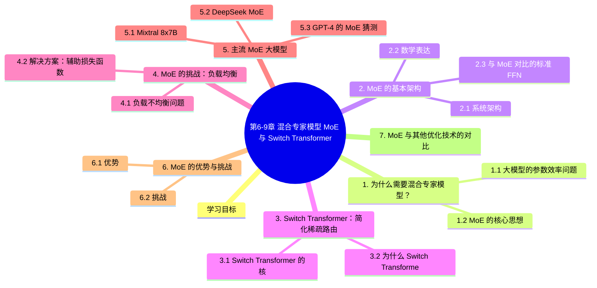

# 第6-9章 混合专家模型 MoE 与 Switch Transformer

> **补充阅读章节** — 本章介绍混合专家模型（Mixture of Experts, MoE）的基本原理，以及 Switch Transformer 如何利用稀疏激活技术实现万亿参数规模。这些技术是现代大模型（GPT-4、Mixtral、DeepSeek 等）的核心架构。
>
> 前置知识：建议先阅读第6-4章《GPT系列与生成式预训练》

---

## 学习目标

- 理解混合专家模型（MoE）的基本架构和工作原理
- 掌握门控网络（Gating Network）和 Top-K 路由机制
- 了解 Switch Transformer 的稀疏门控设计
- 理解 MoE 的负载均衡（Load Balancing）问题
- 了解主流 MoE 大模型（Mixtral、DeepSeek、Grok-1）

---

## 1. 为什么需要混合专家模型？

### 1.1 大模型的参数效率问题

传统 Transformer 模型的参数量增加会导致**计算量同比例增加**：

```
┌─────────────────────────────────────────────────────────────┐
│              传统 Transformer 的参数扩展问题                     │
├─────────────────────────────────────────────────────────────┤
│                                                             │
│   模型参数量增加 → 计算量同比例增加                          │
│                                                             │
│   BERT-Large (340M)     → 计算量 × 1                      │
│   GPT-3 (175B)          → 计算量 × 500,000+               │
│                                                             │
│   问题：                                                    │
│   • 训练 175B 模型需要巨大的算力                           │
│   • 推理成本极高，难以部署                                 │
│   • "小而精"的模型更难训练                                 │
│                                                             │
│   期望：                                                    │
│   • 参数量增加，但计算量不变或仅轻微增加                   │
│   • 稀疏激活：每次只激活部分参数                           │
│                                                             │
└─────────────────────────────────────────────────────────────┘
```

### 1.2 MoE 的核心思想

混合专家模型（Mixture of Experts）的核心洞察是：**不同的输入样本可能需要不同的模型参数来处理**。

```
┌─────────────────────────────────────────────────────────────┐
│              MoE 的核心思想                                    │
├─────────────────────────────────────────────────────────────┤
│                                                             │
│   传统模型（稠密）：                                         │
│   ┌─────────────────────────────────────┐                │
│   │     单一模型处理所有输入            │                │
│   │     所有参数都参与计算              │                │
│   └─────────────────────────────────────┘                │
│                                                             │
│   MoE 模型（稀疏）：                                        │
│   ┌─────────────────────────────────────┐                │
│   │  多个"专家"（子模型）             │                │
│   │         ↓                         │                │
│   │  门控网络选择 → 只激活 1-2 个专家 │                │
│   │         ↓                         │                │
│   │  加权组合输出                      │                │
│   └─────────────────────────────────────┘                │
│                                                             │
│   结果：                                                    │
│   • 参数量可以非常大（万亿级）                             │
│   • 但每次计算只激活少量专家                               │
│   • 计算量接近小模型，但能力接近大模型                     │
│                                                             │
└─────────────────────────────────────────────────────────────┘
```

---

## 2. MoE 的基本架构

### 2.1 系统架构

```
┌─────────────────────────────────────────────────────────────┐
│              MoE 系统架构                                      │
├─────────────────────────────────────────────────────────────┤
│                                                             │
│   输入 Token: x                                              │
│        │                                                    │
│        ▼                                                    │
│   ┌─────────────────────────────────────────────────┐      │
│   │            门控网络 (Gating Network)             │      │
│   │                                              │      │
│   │   x → W_g → softmax(W_g · x) → 专家权重     │      │
│   │                                              │      │
│   │   输出：各专家的激活权重 [0.1, 0.6, 0.2, 0.1]│     │
│   └─────────────────────────────────────────────────┘      │
│        │                                                    │
│        ├──→ Expert 1 (专家1)                              │
│        ├──→ Expert 2 (专家2) ← 被选中（权重0.6）        │
│        ├──→ Expert 3 (专家3)                              │
│        └──→ Expert 4 (专家4)                              │
│                                                             │
│        │                                                    │
│        ▼                                                    │
│   输出 = Σ (专家输出 × 对应权重)                          │
│                                                             │
└─────────────────────────────────────────────────────────────┘
```

### 2.2 数学表达

```
┌─────────────────────────────────────────────────────────────┐
│              MoE 的数学公式                                   │
├─────────────────────────────────────────────────────────────┤
│                                                             │
│   给定输入 x，门控网络计算：                                │
│                                                             │
│   g(x) = softmax(W_g · x) ∈ R^E                         │
│                                                             │
│   其中 E 是专家数量，g_i(x) 是 x 对专家 i 的激活权重       │
│                                                             │
│   Top-K 路由（稀疏激活）：                                  │
│   只选择权重最大的 K 个专家：                              │
│                                                             │
│   TopK(g(x), k) = {i | g_i(x) 在前 k 个}                │
│                                                             │
│   最终输出：                                               │
│   y = Σ_{i ∈ TopK(g(x), k)} g_i(x) · E_i(x)            │
│                                                             │
│   其中 E_i(x) 是专家 i 对输入 x 的输出                     │
│                                                             │
└─────────────────────────────────────────────────────────────┘
```

### 2.3 与 MoE 对比的标准 FFN

```
┌─────────────────────────────────────────────────────────────┐
│              标准 FFN vs MoE FFN                             │
├─────────────────────────────────────────────────────────────┤
│                                                             │
│   标准 Transformer FFN（每个 Token 激活所有参数）：           │
│                                                             │
│   FFN(x) = W_2 · ReLU(W_1 · x)                          │
│                                                             │
│   ┌─────────────────────────────────────┐                │
│   │  W_1 ∈ R^{d_model × d_ff}                          │  │
│   │  W_2 ∈ R^{d_ff × d_model}                          │  │
│   │  所有参数都参与每个 Token 的计算                      │  │
│   └─────────────────────────────────────┘                │
│                                                             │
│   MoE FFN（每个 Token 只激活部分参数）：                   │
│                                                             │
│   MoE(x) = Σ_{i=1}^{E} g_i(x) · FFN_i(x)              │
│                                                             │
│   ┌─────────────────────────────────────┐                │
│   │  E 个独立的 FFN_i(x)（"专家"）                     │  │
│   │  门控网络 g(x) 决定激活哪些专家                     │  │
│   │  通常 K << E（如 K=2, E=8）                       │  │
│   └─────────────────────────────────────┘                │
│                                                             │
└─────────────────────────────────────────────────────────────┘
```

---

## 3. Switch Transformer：简化稀疏路由

### 3.1 Switch Transformer 的核心创新

Switch Transformer（Google, 2021）是首个达到万亿参数规模的 MoE 模型。其核心创新是**极度简化的稀疏路由**：

```
┌─────────────────────────────────────────────────────────────┐
│              Switch Transformer 的稀疏路由                       │
├─────────────────────────────────────────────────────────────┤
│                                                             │
│   传统 MoE 路由：                                          │
│   • 每个 Token 选择 Top-K 专家（如 K=2）                   │
│   • 需要从多个专家聚合输出                                  │
│                                                             │
│   Switch Transformer（Top-1 路由）：                         │
│   • 每个 Token 只选择 1 个专家（最简单的选择）            │
│   • 减少了路由计算和通信开销                               │
│   • 实验证明 Top-1 路由效果更好                           │
│                                                             │
│   ┌─────────────────────────────────────────────────────┐   │
│   │                                                      │   │
│   │   Token "hello"                                    │   │
│   │         │                                           │   │
│   │         ▼                                           │   │
│   │   ┌───────────────────────────────────────────┐   │   │
│   │   │  Gating: W_g · "hello"                   │   │   │
│   │   │  Softmax → [0.05, 0.85, 0.03, 0.07]   │   │   │
│   │   └───────────────────────────────────────────┘   │   │
│   │         │                                           │   │
│   │    max → Expert 2 被选中（85%）                  │   │
│   │         │                                           │   │
│   │         ▼                                           │   │
│   │   ┌───────────────────────────────────────────┐   │   │
│   │   │  Output = Expert_2("hello")               │   │   │
│   │   └───────────────────────────────────────────┘   │   │
│   │                                                      │   │
│   └─────────────────────────────────────────────────────┘   │
│                                                             │
└─────────────────────────────────────────────────────────────┘
```

### 3.2 为什么 Switch Transformer 有效？

| 设计选择 | 原因 | 效果 |
|----------|------|------|
| **Top-1 路由** | 减少路由计算和跨专家通信 | 效率大幅提升 |
| **简化稀疏性** | 模型容量增加，计算量几乎不变 | 万亿参数可行 |
| **专家并行** | 不同专家可在不同设备 | 分布式训练支持 |

---

## 4. MoE 的挑战：负载均衡

### 4.1 负载不均衡问题

MoE 训练面临的关键问题是**负载不均衡**：

```
┌─────────────────────────────────────────────────────────────┐
│              负载不均衡问题                                   │
├─────────────────────────────────────────────────────────────┤
│                                                             │
│   问题描述：                                                │
│   • 门控网络可能总是选择同一两个专家                       │
│   • 导致部分专家"被冷落"，学习不足                        │
│   • 部分专家过载，通信成为瓶颈                             │
│                                                             │
│   示例：                                                    │
│   ┌─────────────────────────────────────┐                │
│   │  Expert 1: 被选 95% 的 Token  ← 过载               │
│   │  Expert 2: 被选 3%  的 Token                    │
│   │  Expert 3: 被选 1%  的 Token  ← 几乎未学习       │
│   │  Expert 4: 被选 1%  的 Token  ← 几乎未学习       │
│   └─────────────────────────────────────┘                │
│                                                             │
└─────────────────────────────────────────────────────────────┘
```

### 4.2 解决方案：辅助损失函数

```
┌─────────────────────────────────────────────────────────────┐
│              负载均衡损失                                       │
├─────────────────────────────────────────────────────────────┤
│                                                             │
│   1. 专家利用率损失：                                        │
│   L_aux = α · Σ_{i} f_i · P_i                          │
│                                                             │
│   其中：                                                    │
│   • f_i = 被分配给专家 i 的 Token 比例                     │
│   • P_i = 门控网络对专家 i 的平均概率                       │
│   • α = 超参数                                            │
│                                                             │
│   2. 路由崩溃预防：                                        │
│   • 添加噪声到门控分数                                     │
│   • 使用 expert capacity limit（专家容量限制）             │
│   • 定期重新归一化路由权重                                 │
│                                                             │
│   3. Expert Capacity：                                     │
│   每个专家有最大处理 Token 数上限                           │
│   ┌──────────────────────────────────────────────┐         │
│   │  Token 1 ──→ Expert 1 (capacity=3)          │         │
│   │  Token 2 ──→ Expert 1 (capacity=3)          │         │
│   │  Token 3 ──→ Expert 1 ⚠️ 容量已满              │         │
│   │  Token 3 ──→ Expert 2 (overflow)            │         │
│   └──────────────────────────────────────────────┘         │
│                                                             │
└─────────────────────────────────────────────────────────────┘
```

---

## 5. 主流 MoE 大模型

### 5.1 Mixtral 8x7B

Mixtral（Mistral AI, 2023）是开源 MoE 模型的代表：

```
┌─────────────────────────────────────────────────────────────┐
│              Mixtral 8x7B 架构                               │
├─────────────────────────────────────────────────────────────┤
│                                                             │
│   基础架构：                                                │
│   • 每个 Token 激活 2 个专家（共 8 个专家）                │
│   • 专家是独立的 FFN 层                                    │
│   • 路由器是简单的线性层 + softmax                         │
│                                                             │
│   性能对比：                                               │
│   ┌────────────────────────────────────────────────────┐   │
│   │  模型              参数量    计算量(FLOPs)  vs GPT-3 │   │
│   ├────────────────────────────────────────────────────┤   │
│   │  GPT-3            175B      100%                   │   │
│   │  LLaMA 2 70B     70B       40%                  │   │
│   │  Mixtral 8x7B    46B       12%                  │   │
│   └────────────────────────────────────────────────────┘   │
│                                                             │
│   结论：                                                    │
│   • Mixtral 参数量只有 LLaMA 2 70B 的 2/3             │
│   • 计算量只有 GPT-3 的 12%                             │
│   • 但性能接近 GPT-3.5                                    │
│                                                             │
└─────────────────────────────────────────────────────────────┘
```

### 5.2 DeepSeek MoE

```
┌─────────────────────────────────────────────────────────────┐
│              DeepSeek 系列 MoE 架构                            │
├─────────────────────────────────────────────────────────────┤
│                                                             │
│   DeepSeek-V2:                                             │
│   • 稀疏 MoE + 完整 Transformer 骨干                     │
│   • 163B 总参数，21B 激活参数                             │
│   • 128 个专家，Top-K = 6                                 │
│                                                             │
│   DeepSeek-V3:                                            │
│   • 236B 总参数，仅 21B 激活                              │
│   • 专家内并行 + 专家间并行                               │
│   • 训练效率极高                                          │
│                                                             │
│   创新点：                                                  │
│   • 无辅助损失的负载均衡                                   │
│   • 节点受限路由（减少通信）                               │
│   • FP8 混合精度训练                                      │
│                                                             │
└─────────────────────────────────────────────────────────────┘
```

### 5.3 GPT-4 的 MoE 猜测

虽然 OpenAI 未公开细节，但多方证据表明 GPT-4 是 MoE 架构：

| 特征 | 猜测 | 依据 |
|------|------|------|
| 参数量 | ~1.8T（16专家 × ~110B） | MoE 架构合理 |
| 激活参数 | ~220B（Top-2 路由） | 训练/推理成本推算 |
| 专家结构 | 编码器/解码器分离 | 输出质量分析 |

---

## 6. MoE 的优势与挑战

### 6.1 优势

```
┌─────────────────────────────────────────────────────────────┐
│              MoE 的核心优势                                   │
├─────────────────────────────────────────────────────────────┤
│                                                             │
│   1. 参数效率高                                             │
│      • 参数量可扩展到万亿级                                │
│      • 每次计算只激活少量专家                              │
│                                                             │
│   2. 专家专业化                                            │
│      • 不同专家可学习不同类型的知识                         │
│      • 如"代码专家"、"数学专家"、"文学专家"               │
│                                                             │
│   3. 可解释性                                              │
│      • 可分析每个 Token 被路由到哪些专家                   │
│      • 便于分析模型行为                                    │
│                                                             │
│   4. 分布式训练友好                                        │
│      • 专家可分布在不同设备                                │
│      • 减少通信量                                          │
│                                                             │
└─────────────────────────────────────────────────────────────┘
```

### 6.2 挑战

```
┌─────────────────────────────────────────────────────────────┐
│              MoE 的核心挑战                                   │
├─────────────────────────────────────────────────────────────┤
│                                                             │
│   1. 负载均衡                                              │
│      • 门控可能总是选择相同专家                           │
│      • 需要辅助损失函数干预                                │
│                                                             │
│   2. 通信开销                                              │
│      • 分布式训练时需跨设备通信                           │
│      • All-to-All 通信成本高                              │
│                                                             │
│   3. 推理部署复杂                                          │
│      • 需要平衡专家数量和计算资源                          │
│      • 动态路由增加推理延迟                                │
│                                                             │
│   4. 训练稳定性                                            │
│      • 稀疏激活可能导致梯度不稳定                          │
│      • 需要精心设计学习率调度                               │
│                                                             │
└─────────────────────────────────────────────────────────────┘
```

---

## 7. MoE 与其他优化技术的对比

```
┌─────────────────────────────────────────────────────────────┐
│              大模型优化技术对比                               │
├─────────────────────────────────────────────────────────────┤
│                                                             │
│   ┌────────────────┬──────────────┬───────────────────┐  │
│   │     技术        │   优化目标   │    代表模型         │  │
│   ├────────────────┼──────────────┼───────────────────┤  │
│   │  密集 Transformer │ 质量优先  │ BERT, GPT        │  │
│   ├────────────────┼──────────────┼───────────────────┤  │
│   │  知识蒸馏     │  小型化     │ DistilBERT       │  │
│   ├────────────────┼──────────────┼───────────────────┤  │
│   │  剪枝         │  稀疏化     │ SparseGPT         │  │
│   ├────────────────┼──────────────┼───────────────────┤  │
│   │  量化          │  低精度     │ GPTQ, AWQ        │  │
│   ├────────────────┼──────────────┼───────────────────┤  │
│   │  MoE          │  大模型+高效率│ Switch, Mixtral  │  │
│   ├────────────────┼──────────────┼───────────────────┤  │
│   │  GQA/MQA     │  推理优化   │ LLaMA 3, Qwen2  │  │
│   └────────────────┴──────────────┴───────────────────┘  │
│                                                             │
│   现代大模型通常组合使用多种技术：                          │
│   MoE + Flash Attention + GQA + 量化                    │
│                                                             │
└─────────────────────────────────────────────────────────────┘
```

---

## 本章小结

1. **MoE 的核心思想**是将大模型分解为多个"专家"，通过门控网络动态选择激活哪些专家
2. **稀疏激活**使得参数量可以扩展到万亿级，但计算量保持合理
3. **Switch Transformer** 的 Top-1 稀疏路由简化了设计，提高了效率
4. **负载均衡**是 MoE 训练的关键挑战，需要辅助损失函数或容量限制
5. **Mixtral、DeepSeek** 等开源 MoE 模型证明了该架构的实用性
6. **GPT-4** 可能采用 MoE 架构，这是其能达到万亿参数但计算量可控的原因
7. 现代大模型通常**组合多种优化技术**（MoE + Flash Attention + GQA）

---


## 知识图谱



## 参考资料

- Shazeer, N., et al. (2017). *Outrageously Large Neural Networks: The Sparsely-Gated Mixture-of-Experts Layer*. ICLR.
  <https://arxiv.org/abs/1701.06538>
- Lepikhin, D., et al. (2021). *GShard: Scaling Giant Models with Conditional Computation and Automatic Sharding*. ICLR.
  <https://arxiv.org/abs/2006.16668>
- Fedus, W., et al. (2022). *Switch Transformers: Scaling to Trillion Parameter Models with Simple and Efficient Sparsity*. JMLR.
  <https://arxiv.org/abs/2101.03961>
- Jiang, A., et al. (2024). *Mixtral of Experts*. arXiv.
  <https://arxiv.org/abs/2401.04088>
- DeepSeek-AI. (2024). *DeepSeek-V2: A Strong, Economical, and Efficient Mixture-of-Experts Language Model*. arXiv.
  <https://arxiv.org/abs/2405.04434>
- DeepSeek-AI. (2024). *DeepSeek-V3: A Strong, Economical, and Efficient Mixture-of-Experts Language Model*. arXiv.
  <https://arxiv.org/abs/2412.19477>
