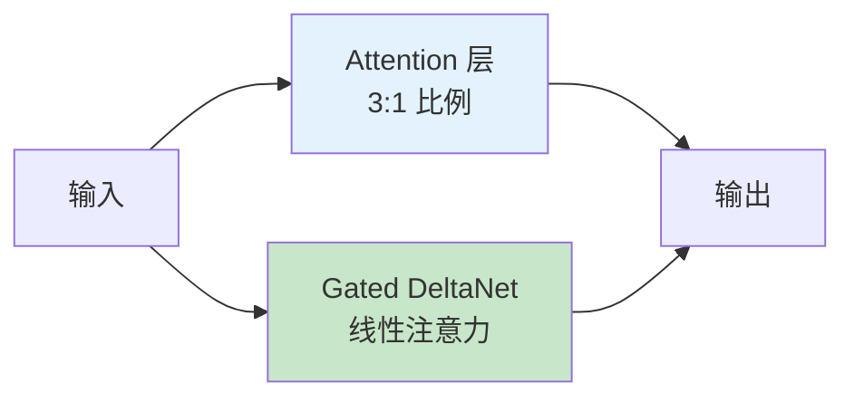
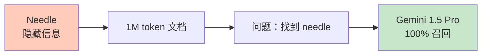
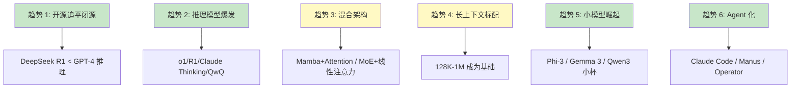
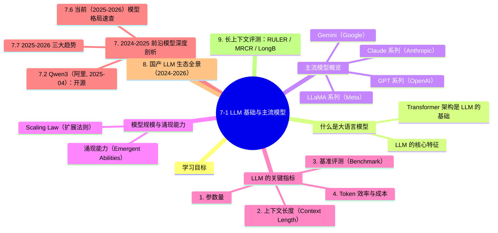

# 7-1 LLM 基础与主流模型

## 学习目标

- 理解什么是大语言模型（LLM）及其核心特征
- 了解当前主流 LLM 的基本情况（GPT、LLaMA、Claude 等）
- 理解模型规模与"涌现能力"的关系
- 掌握评估 LLM 的关键指标

---

## 什么是大语言模型

大语言模型（Large Language Model，LLM）是一类参数规模庞大的深度学习模型，专门用于处理和生成自然语言文本。与传统 NLP 模型相比，LLM 的核心特点是**规模大、能力强、通用性强**。

### LLM 的核心特征

| 特征 | 说明 |
|------|------|
| 大规模参数 | 参数量从数十亿到数千亿不等 |
| 涌现能力 | 规模突破临界点后出现前所未有的能力 |
| 通用性 | 一个模型可处理多种任务，无需针对每项任务单独训练 |
| 多模态理解 | 最新模型支持图像、音频等多模态输入 |
| 长上下文 | 支持数千到数十万 token 的上下文窗口 |

### Transformer 架构是 LLM 的基础

几乎所有现代 LLM 都基于 **Transformer 架构**（由 Google 在 2017 年提出）。Transformer 的核心是**自注意力机制（Self-Attention）**，它让模型能够在生成每个 token 时动态地"关注"输入序列中最相关的部分，从而捕捉长距离依赖关系。

```
输入文本 → Tokenize → Embedding → Transformer Encoder/Decoder → Output
```

---

## 主流模型概览

### GPT 系列（OpenAI）

**GPT-4**（2023 年发布）是 OpenAI 的旗舰模型，拥有超过 1 万亿参数，支持多模态输入（文本+图像），在复杂推理、代码生成、专业考试等任务上表现卓越。2024 年发布的 **GPT-4o** 在保持高性能的同时大幅降低了延迟和成本，支持实时语音对话。

| 版本 | 参数量（估算） | 上下文长度 | 特点 |
|------|---------------|------------|------|
| GPT-3.5 | ~1750 亿 | 16K | 性价比高，应用最广 |
| GPT-4 | ~1.8 万亿（推测） | 128K | 复杂推理、多模态 |
| GPT-4o | 同上级别 | 128K | 实时多模态，低成本 |

### Claude 系列（Anthropic）

Anthropic 的 Claude 模型以**安全性**和**有用性**著称，擅长长文本理解、写作和代码生成。Claude 3（2024 年初发布）包括三个版本：

- **Claude 3 Opus**：最强大，适合复杂任务
- **Claude 3 Sonnet**：性价比均衡
- **Claude 3 Haiku**：轻量快速

| 版本 | 上下文长度 | 优势领域 |
|------|------------|----------|
| Claude 3 Opus | 200K | 深度推理、长文档分析 |
| Claude 3 Sonnet | 200K | 平衡性能与成本 |
| Claude 3 Haiku | 200K | 快速响应、实时交互 |

### LLaMA 系列（Meta）

LLaMA（Large Language Model Meta AI）是 Meta 开源的大语言模型系列，对学术研究和商业应用影响巨大。

- **LLaMA 2**（2023 年）：7B、13B、70B 参数版本完全开源可商用
- **LLaMA 3**（2024 年）：升级至 8B 和 70B，训练数据量大幅增加
- **LLaMA 3.1**：新增 405B 参数版本，上下文 128K

LLaMA 的开源特性使其成为微调和部署的首选基础模型，催生了大量开源微调变体（如 Alpaca、Vicuna、Mistral 等）。

### Gemini（Google）

Google 的 Gemini 是原生多模态模型，支持同时理解和生成文本、图像、音频、视频。最新版本包括：

- **Gemini 1.5 Flash**：高效能，适合大规模应用
- **Gemini 1.5 Pro**：长上下文达 100 万 token，支持超长文档处理
- **Gemini 2.0**：引入 Agent 能力，支持工具调用

### 国内主流模型

| 模型 | 开发商 | 特点 |
|------|--------|------|
| **通义千问**（Qwen） | 阿里云 | 开源能力强，中文优化出色，Qwen2.5 系列性能优秀 |
| **DeepSeek** | 深度求索 | 专注于开源大模型，DeepSeek-V3 性能对标 GPT-4o，成本低 |
| **Yi** | 零一万物 | 开源大模型，中英双语优化 |
| **GLM** | 智谱华章 | 国内最早的大模型之一，ChatGLM 系列应用广泛 |
| **Baichuan** | 百川智能 | 商业应用导向 |

### 其他值得关注的模型

| 模型 | 开发方 | 说明 |
|------|--------|------|
| **Mistral** | Mistral AI（法国） | 小型模型性能优秀，开源 Mixtral 8x7B |
| **Command R+** | Cohere | 企业 RAG 场景优化 |
| **Grok** | xAI（马斯克） | 实时信息获取能力强 |

---

## 模型规模与涌现能力

### Scaling Law（扩展法则）

研究表明，模型的性能与三个因素高度相关：**参数量（N）、训练数据量（D）、算力消耗（C）**。这就是著名的 **Kaplan 等人提出的 Scaling Law**。

> 核心结论：在固定数据集上训练时，模型性能随参数量、数据量、算力的增加而可预测地提升。

### 涌现能力（Emergent Abilities）

当模型规模突破某个临界点时，会突然出现一些小模型不具备的能力，这种现象称为**涌现**。典型例子包括：

| 能力 | 说明 | 出现规模 |
|------|------|----------|
| 思维链（Chain-of-Thought） | 能够逐步推理，而非直接给出答案 | ~100B 参数以上 |
| 上下文学习（ICL） | 给几个示例就能适应新任务，无需梯度更新 | ~10B 以上 |
| 指令遵循 | 理解并执行复杂指令 | ~60B 以上 |
| 代码生成 | 编写功能性程序 | ~GPT-3.5 级别 |
| 多人协作 | 模拟多角色对话解决复杂问题 | 更大规模 |

涌现能力是非连续性的——小模型完全没有，大模型突然就会，无法从规模平滑预测。

---

## LLM 的关键指标

### 1. 参数量

参数量直接决定了模型的容量和能力上限，也是估算训练成本的关键指标。常见单位：

- **B（Billion，十亿）**：如 7B = 70 亿参数
- **T（Trillion，万亿）**：如 GPT-4 推测约 1.8T

### 2. 上下文长度（Context Length）

上下文长度指模型一次能处理的最大 token 数量。主流 LLM 的上下文：

| 上下文长度 | 对应文字量（估算） |
|------------|------------------|
| 8K | 约 5000～6000 中文汉字 |
| 32K | 约 2 万字 |
| 128K | 约 8 万字（一本中篇小说） |
| 1M | 约 60 万字（一部长篇小说） |

### 3. 基准评测（Benchmark）

常用评测基准：

| 基准 | 考察内容 |
|------|----------|
| MMLU | 57 个学科的知识问答 |
| HumanEval | Python 代码生成 |
| MATH | 数学解题 |
| GSM8K | 小学数学应用题 |
| BBH | 挑战性任务（23 项子任务） |
| MT-Bench | 多轮对话能力 |

### 4. Token 效率与成本

不同模型的推理成本差异巨大，直接影响商业应用的可行性。

---

## 主流模型对比总结

### 基础参数对比

| 模型 | 开发商 | 参数量 | 上下文 | 开源 | 多模态 |
|------|------|------|------|------|------|
| GPT-4o | OpenAI | 推测 1.8T | 128K | ❌ | ✅ |
| GPT-4o Mini | OpenAI | 较小 | 128K | ❌ | ✅ |
| Claude 3.5 Sonnet | Anthropic | 未公开 | 200K | ❌ | ✅ |
| LLaMA 3.1 405B | Meta | 405B | 128K | ✅ | ❌ |
| LLaMA 3.1 70B | Meta | 70B | 128K | ✅ | ❌ |
| Gemini 1.5 Pro | Google | 未公开 | 1M | ❌ | ✅ |
| Gemini 2.0 Flash | Google | 未公开 | 1M | ❌ | ✅ |
| Mistral Large 2 | Mistral AI | 123B | 128K | ❌ | ❌ |
| Qwen2.5 72B | 阿里 | 72B | 128K | ✅ | 部分 |
| DeepSeek-V3 | 深度求索 | 236B（激活 21B） | 64K | ✅ | ❌ |

### Benchmark 性能对比

> 数据来源：各模型官方技术报告及 LMSYS、OpenLLMleaderboard 等权威榜单（2024-2025 年数据）

| 模型 | MMLU | GSM8K | HumanEval | MATH | 特点 |
|------|------|------|------|------|------|
| **GPT-4o** | ~88% | ~76% | ~90% | ~76% | 实时多模态，推理速度提升 2 倍 |
| **GPT-4o Mini** | ~77% | ~70% | ~80% | ~60% | 高性价比，轻量级应用首选 |
| **Claude 3.5 Sonnet** | ~85% | ~78% | ~92% | ~78% | 代码能力强，长文本理解优秀 |
| **Gemini 1.5 Pro** | ~85.9% | ~90%+ | ~84% | ~75% | 百万 token 上下文，支持超长文档 |
| **Gemini 2.0 Flash** | ~87% | ~93% | ~87% | ~78% | Agent 能力，工具调用，实时推理 |
| **LLaMA 3.1 405B** | ~87.3% | ~95% | ~89% | ~73% | 开源领袖，复杂推理能力强 |
| **LLaMA 3.1 70B** | ~82% | ~93% | ~86% | ~68% | 开源主流，部署灵活 |
| **Mistral Large 2** | ~88% | ~95% | ~88% | ~74% | 欧洲最强开源，推理效率高 |
| **Qwen2.5 72B** | ~86% | ~90% | ~85% | ~70% | 中文优化好，开源生态丰富 |
| **DeepSeek-V3** | ~87.5% | ~94% | ~90% | ~75% | 训练成本低，性能对标 GPT-4o |

**Benchmark 说明：**
- **MMLU**：57 个学科的知识问答（选择题），衡量通用知识水平
- **GSM8K**：8K 道小学数学应用题，衡量基础数学推理能力
- **HumanEval**：164 道 Python 编程题，衡量代码生成能力
- **MATH**：12K 道竞赛数学题，衡量复杂数学推理能力

### 模型发布 Timeline

| 时间 | 模型 | 开发商 | 重要里程碑 |
|------|------|--------|------------|
| 2020.06 | GPT-3 | OpenAI | 1750 亿参数，掀开 LLM 时代序幕 |
| 2022.11 | ChatGPT | OpenAI | 对话式 AI 破圈，2 个月用户破亿 |
| 2023.03 | GPT-4 | OpenAI | 多模态理解，复杂推理能力大幅提升 |
| 2023.07 | LLaMA 2 | Meta | 开源可商用，7B/13B/70B |
| 2023.12 | Claude 2.1 | Anthropic | 200K 上下文，长文档处理 |
| 2024.02 | Gemini 1.5 Pro | Google | 百万 token 上下文，颠覆性突破 |
| 2024.05 | GPT-4o | OpenAI | 实时多模态，延迟降低 50% |
| 2024.06 | LLaMA 3.1 | Meta | 405B 开源，参数规模最大开源模型 |
| 2024.06 | Claude 3.5 Sonnet | Anthropic | 代码能力登顶，HumanEval 最高 |
| 2024.07 | Mistral Large 2 | Mistral AI | 欧洲最强开源，数学推理领先 |
| 2024.09 | Qwen2.5 | 阿里 | 中文开源领袖，72B 性能优异 |
| 2024.12 | Gemini 2.0 Flash | Google | Agent 原生，工具调用能力 |
| 2024.12 | DeepSeek-V3 | 深度求索 | 训练成本仅 600 万美元，性能对标 GPT-4o |
| 2025.01 | GPT-4o Mini | OpenAI | 高性价比，轻量应用首选 |

### 主流模型技术特点对比

| 模型 | 核心优势 | 最佳使用场景 | 主要局限 |
|------|------|------|------|
| **GPT-4o** | 实时多模态，平衡性能与成本 | 对话、代码、多模态任务 | 闭源，API 成本较高 |
| **GPT-4o Mini** | 高性价比，低延迟 | 轻量应用、实时交互、边缘部署 | 复杂推理略弱于大杯模型 |
| **Claude 3.5 Sonnet** | 安全性高，长文本理解，代码能力 | 长文档分析、创意写作、安全敏感场景 | 闭源，API 响应速度中等 |
| **Gemini 1.5 Pro** | 超长上下文，多模态原生 | 超长文档处理、视频理解、多模态分析 | 成本较高，数学推理中等 |
| **Gemini 2.0 Flash** | Agent 能力，工具调用，实时推理 | AI Agent、工作流自动化、实时应用 | 多模态能力略弱于 1.5 Pro |
| **LLaMA 3.1 405B** | 开源最大，复杂推理强 | 企业自部署、研究、复杂推理任务 | 推理成本高，硬件要求大 |
| **Mistral Large 2** | 欧洲血统，高效推理 | 欧洲合规部署、翻译、代码任务 | 上下文较短，上下文需扩展 |
| **Qwen2.5 72B** | 中文优化，开源生态 | 中文应用、企业部署、研究微调 | 多模态能力有限 |
| **DeepSeek-V3** | 训练成本低，性能强 | 高性能低成本应用、研究、代码任务 | 品牌认知度相对较低 |

---

## 7. 2024-2025 前沿模型深度剖析

主流 LLM 领域 2024-2025 经历了**质变**——开源追赶闭源、推理模型爆发、小模型能力追上超大模型、长上下文成为标配。下面深入剖析 5 个最具代表性的前沿模型家族。

### 7.1 LLaMA 3.1（Meta, 2024-07）：开源前沿的标杆

**地位**：首个**对标 GPT-4 级别**的开源模型。

**核心规格**：

| 配置 | 405B | 70B | 8B |
|------|------|-----|-----|
| 参数量 | 405B | 70B | 8B |
| 层数 | 126 | 80 | 32 |
| 模型维度 | 16,384 | 8,192 | 4,096 |
| 注意力头 | 128 | 64 | 32 |
| FFN 维度 | 53,248 | 28,672 | 14,336 |
| 上下文 | 128K (RoPE θ=500K) | 同 | 同 |
| 训练 token | 15.6T | 15.6T | 15.6T |

**关键技术**：
- **GQA（Grouped-Query Attention）**：128 个 Q 头共享 8 个 KV 头，KV Cache 缩减 16×
- **RoPE 位置编码扩展**：θ=500K 支持 128K 上下文
- **SFT + DPO 后训练**：25M 合成数据 SFT + DPO
- **iRoPE（interleaved RoPE）**：长上下文无明显退化

**意义**：
- 商业友好的许可证（但有"不能用于改进竞品"的限制条款）
- 16K H100 训练 54 天——首次让中等规模团队能复现前沿训练
- 衍生出 LLaMA 3.2（轻量 1B/3B）、3.3（小幅升级）、**4 (Maverick/Scout, 2025-2026)**

### 7.2 Qwen3（阿里, 2025-04）：开源最强之一

**地位**：开源 SOTA 多面手——中文最强、英文对标前沿、长上下文领先。

**完整家族**：

| 规模 | 类型 | 用途 |
|------|------|------|
| Qwen3-0.6B / 1.7B / 4B / 8B / 14B / 32B | Dense | 边缘 → 主力 |
| Qwen3-30B-A3B | MoE (30B 总/3B 激活) | 效率标杆 |
| Qwen3-235B-A22B | MoE (235B 总/22B 激活) | 开源旗舰 |
| **Qwen3-Next-80B-A3B** | **Gated DeltaNet + Attention 混合** | 长上下文极效 |

**核心创新**：
- **统一思考/非思考模式**（Hybrid Reasoning）：同一模型支持 `/think`（长推理）和 `/no_think`（快速），通过 prompt 切换
- **思考预算控制**：可指定最多生成 38K token 思考
- **119 种语言**（从 Qwen2.5 的 29 种大幅扩展）
- **训练数据 36T token**——历史最高
- **Apache 2.0 许可证**——最宽松之一

**Qwen3-Next 的 Gated DeltaNet 架构**（2025-09）：



**为什么是 Gated DeltaNet**：
- 传统 Attention 处理长上下文慢
- 纯 Mamba 精确检索弱
- **Gated DeltaNet = 线性注意力的改进**（Mamba-2 演化而来）
- 3:1 Attention:Gated DeltaNet 比例——32K+ 上下文时**吞吐量 10×+**

**多 token 预测（MTP）**：训练时预测未来多个 token，**推理时用作 speculative decoding 草稿器**——免费加速。

### 7.3 DeepSeek-V3 / R1（深度求索, 2024-12 / 2025-01）：训练效率之王

**V3（基础模型）**：
- 236B 总参 / 21B 激活（MoE）
- 训练成本：**约 $5.5M USD**（同等性能闭源模型的 1/10）
- 关键：**FP8 混合精度 + 256 专家的细粒度 MoE**
- Multi-head Latent Attention（MLA）：KV Cache 压缩 10×

**R1（推理模型）**：
- 已在 7-2 中详述 GRPO 训练
- AIME 2024：15.6% → 71.0%（R1-Zero）
- 开源全部权重 + 训练数据
- **2025 年开源大模型的"奇点"**

**R1 蒸馏系列**（用 R1 蒸馏小模型）：

| 模型 | 蒸馏源 | 性能 |
|------|--------|------|
| DeepSeek-R1-Distill-Qwen-1.5B | R1 推理数据 | AIME 28.9% |
| DeepSeek-R1-Distill-Qwen-7B | R1 推理数据 | AIME 55.5% |
| DeepSeek-R1-Distill-Llama-8B | R1 推理数据 | AIME 50.4% |
| DeepSeek-R1-Distill-Qwen-32B | R1 推理数据 | AIME 72.6% |
| DeepSeek-R1-Distill-Llama-70B | R1 推理数据 | AIME 86.7% |

> **关键发现**：1.5B 小模型经过 R1 蒸馏，AIME 能达到 28.9%——**比许多专有模型强**，证明推理能力**可以压缩到小模型**。

### 7.4 Phi-3 / Phi-3.5（Microsoft, 2024-04 / 2024-08）：小模型奇迹

**核心思想**："**Textbooks Are All You Need**"——用**高质量小数据**打败**低质量大数据**。

| 模型 | 参数量 | 训练数据 | 性能 | 关键能力 |
|------|--------|----------|------|----------|
| **Phi-3-mini** | 3.8B | 3.3T 高质量 | >Mixtral 8x7B | 手机可跑（iPhone 14 ≥ 12 tok/s） |
| **Phi-3-small** | 7B | 4.8T | 接近 Llama-3-8B | GQA + blocksparse |
| **Phi-3-medium** | 14B | 4.8T | 接近 Llama-3-70B | SOTA 14B |
| **Phi-3.5-MoE** | 16×3.8B = 42B（6.6B 激活） | 5T | 匹配 Gemini-1.5-Flash | MoE 效率 |
| **Phi-3-Vision** | 4.2B | 多模态 | 多模态 SOTA 小模型 | 高分辨率图像 |

**关键技术**：
- **数据是核心**——3.3T 经过严格过滤的 web + LLM 生成的合成数据
- **Llama-2 兼容块结构**（Phi-3-mini 沿用）——便于微调
- **LongRoPE**（动态位置编码）——支持 128K 上下文
- **MuP（Maximal Update Parametrization）**——超参数可迁移
- **iPhone 14 A16 芯片**：>12 tokens/sec @ 4-bit，**完全离线**

**意义**：证明**SLM（Small Language Model）**是真实生产路径——边缘部署、本地推理、成本敏感场景。

### 7.5 Gemini 1.5 / 2.0（Google, 2024-2025）：超长上下文 + 原生多模态

**核心规格**：

| 模型 | 上下文 | 多模态 | 特点 |
|------|--------|--------|------|
| Gemini 1.5 Pro | **1M**（实测 10M） | 文本/视频/音频 | **近 100% NIAH 检索** |
| Gemini 1.5 Flash | 1M-2M | 同上 | 速度优化版 |
| Gemini 2.0 Flash | 1M+ | + 图像生成 | **原生 Agent 能力** |
| Gemini 2.0 Flash Thinking | 1M+ | 同上 | o1-style 推理 |

**关键技术**：
- **稀疏 MoE 架构**——单 token 计算成本低
- **多模态原生**——文本/视频/音频共享底层
- **Needle-in-a-haystack**：



| 上下文长度 | NIAH 召回（1 needle） | NIAH 召回（100 needles） |
|------------|---------------------|-------------------------|
| 128K | 100% | 70% |
| 530K | 100% | — |
| 1M | 99.7% | >60% |
| 10M | 99.2% | — |

**杀手锏应用**：
- **完整代码库 in context**（百万行 Python 项目）
- **1 小时视频问答**（电影级内容）
- **In-context Learning 罕见语言**：给 Gemini 一份 Kalamang 语（全球 200 人使用）的语法书，**翻译能力达到人类水平**——**无需专门训练**

### 7.6 当前（2025-2026）模型格局速查

| 类别 | 代表 | 优势 | 局限 |
|------|------|------|------|
| **闭源旗舰** | GPT-4.5/5、Claude 4.7/4.8、Gemini 2.5 | 最强综合能力 | 贵、不可定制 |
| **开源旗舰** | LLaMA 3.1-405B、DeepSeek-V3 | 一次性可商用 | 推理成本高 |
| **开源推理** | DeepSeek-R1、Qwen3-Thinking、QwQ | 数学/代码 SOTA | 长输出慢 |
| **高效开源** | Qwen3-Next-80B-A3B、Llama 4 Maverick | MoE + 混合架构 | 部署复杂 |
| **小模型** | Phi-3.5-mini、Qwen3-4B、Gemma 3-4B | 边缘可跑 | 复杂任务弱 |
| **多模态** | GPT-4o、Claude 3.5 Sonnet、Gemini 2.0 | 视频/音频/图像 | 闭源为主 |
| **长上下文** | Gemini 1.5、Qwen3-1M | 100K-1M+ | 准确率随长度下降 |

### 7.7 2025-2026 三大趋势



**未来 1-2 年值得关注的演进**：
- **思考 + 非思考无缝切换**（Qwen3 风格成为标准）
- **稀疏 MoE + 混合注意力**成为大模型默认
- **测试时计算与训练时计算的权衡**——RL with Verifiable Rewards
- **多模态 Agent 普及**——Claude Computer Use、OpenAI Operator、Manus

---

> **延伸阅读**：本节偏「能力强弱」的纵向对比。想横向看清**国内外的厂商格局**（谁开源、走什么技术路线），见 [7-6 大模型厂商全景](./7-6-大模型厂商全景.md)；想知道**同样的能力谁更便宜**，见 [7-7 模型智力与价格性价比](./7-7-模型智力与价格性价比.md)。

## 8. 国产 LLM 生态全景（2024-2026）

除 Qwen 和 DeepSeek 外，中国 LLM 生态在 2024-2026 年呈多元化发展，每个厂商都有差异化定位。

| 厂商 | 旗舰模型 | 核心特点 | 开源情况 |
|------|---------|---------|---------|
| **智谱 AI** | GLM-4 / GLM-4.5 | 清华系、长上下文（128K→1M） | 全栈开源 + 商业 API |
| **阿里** | Qwen3 系列 | 含 Qwen3-VL / Qwen3-Coder / Qwen3-Omni | 全面开源（Apache 2.0） |
| **腾讯** | Hunyuan | 多模态强、视频生成 | 部分开源 |
| **字节跳动** | Doubao / Seed-1.5 | 极致性价比、Tool Use 强 | 闭源为主 |
| **阶跃星辰** | Step-3 | 超大 MoE（300B+）、数学推理 | 闭源 + API |
| **月之暗面** | Kimi K2 | 长上下文（200K+）、搜索增强 | 闭源 |
| **零一万物** | Yi 系列 | 中英双语、中文理解 | 早期开源 |
| **深度求索** | DeepSeek-V3 / R1 | MLA + MoE、强化学习推理 | 全面开源（MIT） |

**选型建议**：
- **通用对话 / API 服务**：Qwen3、GLM-4.5、Hunyuan（中文理解强）
- **代码 / Agent 场景**：Qwen3-Coder、DeepSeek-V3
- **多模态 / 视觉理解**：Qwen3-VL、InternVL 2.5
- **数学 / 推理**：DeepSeek-R1、Step-3
- **极致长上下文**：Kimi K2（200K+）、GLM-4.5（1M）
- **低成本 / 高并发**：Doubao（字节）、Hunyuan Turbo

**生态对比（2026 年 6 月）**：

| 指标 | Qwen3 | GLM-4.5 | DeepSeek-V3 | GPT-5 | Claude 4.7 |
|------|-------|---------|-------------|-------|------------|
| 参数量 | 235B (MoE) | 355B (MoE) | 671B (MoE) | 未公开 | 未公开 |
| 上下文 | 128K | 1M | 128K | 256K | 200K |
| 中文 MMLU | 88.5 | 89.0 | 87.2 | 85.0 | 83.5 |
| SWE-Bench | 65.0 | 58.5 | 62.0 | 70.5 | 72.0 |
| 开源 | ✅ | ✅ | ✅ | ❌ | ❌ |
| 价格（$/1M tokens） | 0.3 | 0.6 | 0.27 | 5.0 | 18.0 |

## 9. 长上下文评测：RULER / MRCR / LongBench

长上下文是 2024-2026 主流模型的标配（128K-1M），但"上下文窗口"≠"有效上下文"。新一代评测基准关注**真实长程依赖**。

**RULER**（Hsieh et al. 2024）：
- 13 个任务，包含 NIAH 变体（多种 needle 类型）、多跳推理、聚合
- 发现：声称 100K 上下文的模型，实际有效上下文往往只有 20-50K
- Llama-3.1-8B 在 32K+ 急剧退化；Qwen2 在 64K 仍稳定

**MRCR**（Google, 2025）：
- Multi-Round Co-Reference Resolution
- 测试模型在多轮对话中追踪指代的能力
- Gemini 2.5、Claude 4.5 在 100K+ 表现稳定

**LongBench / LongBench-v2**：
- 中文长上下文基准
- 包含代码理解、文档问答、多文档摘要
- 中文 LLM（Qwen、GLM、Kimi）在此基准上显著领先 GPT-4

**实战启示**：
- 不要相信"声称的上下文窗口"——必须实测有效长度
- 关键信息应放在**上下文前 25%**（"lost in the middle" 现象）
- 超过 100K 上下文建议用 GraphRAG / RAG 替代

---

## 本章小结

1. **LLM 基于 Transformer 架构**，通过大规模参数和海量数据训练获得通用语言能力
2. **主流模型格局**：OpenAI GPT 系列领跑，Anthropic Claude 安全可靠，Meta LLaMA 开源生态繁荣，国内 Qwen、DeepSeek 快速崛起
3. **涌现能力**是非线性突破的标志，规模是能力的重要基础但不是唯一因素
4. **选择模型需要综合考虑**：性能需求、部署成本、开源偏好、多模态要求等
5. **LLaMA 3.1 405B** 证明开源可追平闭源，GQA + RoPE θ=500K 是 405B 级训练的关键技术
6. **Qwen3 系列** 已成为开源 SOTA 多面手，Qwen3-Next 的 Gated DeltaNet 混合架构是 2025 长上下文效率标杆
7. **DeepSeek-V3/R1** 是训练效率之王，**5M 美元训出对标 GPT-4 的模型**，**GRPO + 纯 RL** 证明推理能力可以"涌现"
8. **Phi-3 / 小模型** 证明"数据质量 > 数据数量"，3.8B 模型手机可跑
9. **Gemini 1.5/2.0** 是长上下文 + 多模态的标杆，**1M-10M 上下文 + 100% NIAH 召回**
10. **2025-2026 三大趋势**：开源追平闭源、推理模型爆发、混合架构主导

---


## 知识图谱



## 参考资料

1. Brown et al. "Language Models are Few-Shot Learners" (GPT-3, NeurIPS 2020)
2. Touvron et al. "Llama 2: Open Foundation and Fine-Tuned Chat Models" (Meta, 2023)
3. Kaplan et al. "Scaling Laws for Neural Language Models" (arXiv:2001.08361)
4. Wei et al. "Emergent Abilities of Large Language Models" (arXiv:2206.07682)
5. OpenAI "GPT-4 Technical Report" (2023)
6. Anthropic "Claude Model Card" (2024)
7. Google "Gemini: A Family of Highly Capable Multimodal Models" (2023)