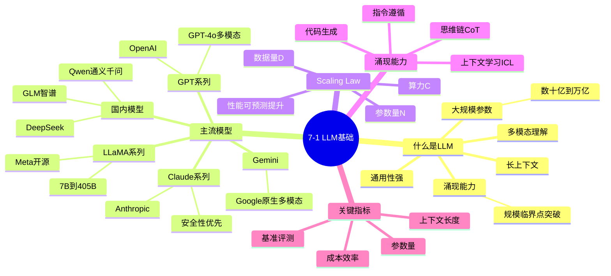

# 7-1 LLM 基础与主流模型

## 学习目标

- 理解什么是大语言模型（LLM）及其核心特征
- 了解当前主流 LLM 的基本情况（GPT、LLaMA、Claude 等）
- 理解模型规模与"涌现能力"的关系
- 掌握评估 LLM 的关键指标

---

## 什么是大语言模型

大语言模型（Large Language Model，LLM）是一类参数规模庞大的深度学习模型，专门用于处理和生成自然语言文本。与传统 NLP 模型相比，LLM 的核心特点是**规模大、能力强、通用性强**。

### LLM 的核心特征

| 特征 | 说明 |
|------|------|
| 大规模参数 | 参数量从数十亿到数千亿不等 |
| 涌现能力 | 规模突破临界点后出现前所未有的能力 |
| 通用性 | 一个模型可处理多种任务，无需针对每项任务单独训练 |
| 多模态理解 | 最新模型支持图像、音频等多模态输入 |
| 长上下文 | 支持数千到数十万 token 的上下文窗口 |

### Transformer 架构是 LLM 的基础

几乎所有现代 LLM 都基于 **Transformer 架构**（由 Google 在 2017 年提出）。Transformer 的核心是**自注意力机制（Self-Attention）**，它让模型能够在生成每个 token 时动态地"关注"输入序列中最相关的部分，从而捕捉长距离依赖关系。

```
输入文本 → Tokenize → Embedding → Transformer Encoder/Decoder → Output
```

---

## 主流模型概览

### GPT 系列（OpenAI）

**GPT-4**（2023 年发布）是 OpenAI 的旗舰模型，拥有超过 1 万亿参数，支持多模态输入（文本+图像），在复杂推理、代码生成、专业考试等任务上表现卓越。2024 年发布的 **GPT-4o** 在保持高性能的同时大幅降低了延迟和成本，支持实时语音对话。

| 版本 | 参数量（估算） | 上下文长度 | 特点 |
|------|---------------|------------|------|
| GPT-3.5 | ~1750 亿 | 16K | 性价比高，应用最广 |
| GPT-4 | ~1.8 万亿（推测） | 128K | 复杂推理、多模态 |
| GPT-4o | 同上级别 | 128K | 实时多模态，低成本 |

### Claude 系列（Anthropic）

Anthropic 的 Claude 模型以**安全性**和**有用性**著称，擅长长文本理解、写作和代码生成。Claude 3（2024 年初发布）包括三个版本：

- **Claude 3 Opus**：最强大，适合复杂任务
- **Claude 3 Sonnet**：性价比均衡
- **Claude 3 Haiku**：轻量快速

| 版本 | 上下文长度 | 优势领域 |
|------|------------|----------|
| Claude 3 Opus | 200K | 深度推理、长文档分析 |
| Claude 3 Sonnet | 200K | 平衡性能与成本 |
| Claude 3 Haiku | 200K | 快速响应、实时交互 |

### LLaMA 系列（Meta）

LLaMA（Large Language Model Meta AI）是 Meta 开源的大语言模型系列，对学术研究和商业应用影响巨大。

- **LLaMA 2**（2023 年）：7B、13B、70B 参数版本完全开源可商用
- **LLaMA 3**（2024 年）：升级至 8B 和 70B，训练数据量大幅增加
- **LLaMA 3.1**：新增 405B 参数版本，上下文 128K

LLaMA 的开源特性使其成为微调和部署的首选基础模型，催生了大量开源微调变体（如 Alpaca、Vicuna、Mistral 等）。

### Gemini（Google）

Google 的 Gemini 是原生多模态模型，支持同时理解和生成文本、图像、音频、视频。最新版本包括：

- **Gemini 1.5 Flash**：高效能，适合大规模应用
- **Gemini 1.5 Pro**：长上下文达 100 万 token，支持超长文档处理
- **Gemini 2.0**：引入 Agent 能力，支持工具调用

### 国内主流模型

| 模型 | 开发商 | 特点 |
|------|--------|------|
| **通义千问**（Qwen） | 阿里云 | 开源能力强，中文优化出色，Qwen2.5 系列性能优秀 |
| **DeepSeek** | 深度求索 | 专注于开源大模型，DeepSeek-V3 性能对标 GPT-4o，成本低 |
| **Yi** | 零一万物 | 开源大模型，中英双语优化 |
| **GLM** | 智谱华章 | 国内最早的大模型之一，ChatGLM 系列应用广泛 |
| **Baichuan** | 百川智能 | 商业应用导向 |

### 其他值得关注的模型

| 模型 | 开发方 | 说明 |
|------|--------|------|
| **Mistral** | Mistral AI（法国） | 小型模型性能优秀，开源 Mixtral 8x7B |
| **Command R+** | Cohere | 企业 RAG 场景优化 |
| **Grok** | xAI（马斯克） | 实时信息获取能力强 |

---

## 模型规模与涌现能力

### Scaling Law（扩展法则）

研究表明，模型的性能与三个因素高度相关：**参数量（N）、训练数据量（D）、算力消耗（C）**。这就是著名的 **Kaplan 等人提出的 Scaling Law**。

> 核心结论：在固定数据集上训练时，模型性能随参数量、数据量、算力的增加而可预测地提升。

### 涌现能力（Emergent Abilities）

当模型规模突破某个临界点时，会突然出现一些小模型不具备的能力，这种现象称为**涌现**。典型例子包括：

| 能力 | 说明 | 出现规模 |
|------|------|----------|
| 思维链（Chain-of-Thought） | 能够逐步推理，而非直接给出答案 | ~100B 参数以上 |
| 上下文学习（ICL） | 给几个示例就能适应新任务，无需梯度更新 | ~10B 以上 |
| 指令遵循 | 理解并执行复杂指令 | ~60B 以上 |
| 代码生成 | 编写功能性程序 | ~GPT-3.5 级别 |
| 多人协作 | 模拟多角色对话解决复杂问题 | 更大规模 |

涌现能力是非连续性的——小模型完全没有，大模型突然就会，无法从规模平滑预测。

---

## LLM 的关键指标

### 1. 参数量

参数量直接决定了模型的容量和能力上限，也是估算训练成本的关键指标。常见单位：

- **B（Billion，十亿）**：如 7B = 70 亿参数
- **T（Trillion，万亿）**：如 GPT-4 推测约 1.8T

### 2. 上下文长度（Context Length）

上下文长度指模型一次能处理的最大 token 数量。主流 LLM 的上下文：

| 上下文长度 | 对应文字量（估算） |
|------------|------------------|
| 8K | 约 5000～6000 中文汉字 |
| 32K | 约 2 万字 |
| 128K | 约 8 万字（一本中篇小说） |
| 1M | 约 60 万字（一部长篇小说） |

### 3. 基准评测（Benchmark）

常用评测基准：

| 基准 | 考察内容 |
|------|----------|
| MMLU | 57 个学科的知识问答 |
| HumanEval | Python 代码生成 |
| MATH | 数学解题 |
| GSM8K | 小学数学应用题 |
| BBH | 挑战性任务（23 项子任务） |
| MT-Bench | 多轮对话能力 |

### 4. Token 效率与成本

不同模型的推理成本差异巨大，直接影响商业应用的可行性。

---

## 主流模型对比总结

### 基础参数对比

|| 模型 | 开发商 | 参数量 | 上下文 | 开源 | 多模态 |
|------|--------|--------|--------|--------|------|--------|
| GPT-4o | OpenAI | 推测 1.8T | 128K | ❌ | ✅ |
| GPT-4o Mini | OpenAI | 较小 | 128K | ❌ | ✅ |
| Claude 3.5 Sonnet | Anthropic | 未公开 | 200K | ❌ | ✅ |
| LLaMA 3.1 405B | Meta | 405B | 128K | ✅ | ❌ |
| LLaMA 3.1 70B | Meta | 70B | 128K | ✅ | ❌ |
| Gemini 1.5 Pro | Google | 未公开 | 1M | ❌ | ✅ |
| Gemini 2.0 Flash | Google | 未公开 | 1M | ❌ | ✅ |
| Mistral Large 2 | Mistral AI | 123B | 128K | ❌ | ❌ |
| Qwen2.5 72B | 阿里 | 72B | 128K | ✅ | 部分 |
| DeepSeek-V3 | 深度求索 | 236B（激活 21B） | 64K | ✅ | ❌ |

### Benchmark 性能对比

> 数据来源：各模型官方技术报告及 LMSYS、OpenLLMleaderboard 等权威榜单（2024-2025 年数据）

|| 模型 | MMLU | GSM8K | HumanEval | MATH | 特点 |
|------|------|------|-------|-----------|------|------|
| **GPT-4o** | ~88% | ~76% | ~90% | ~76% | 实时多模态，推理速度提升 2 倍 |
| **GPT-4o Mini** | ~77% | ~70% | ~80% | ~60% | 高性价比，轻量级应用首选 |
| **Claude 3.5 Sonnet** | ~85% | ~78% | ~92% | ~78% | 代码能力强，长文本理解优秀 |
| **Gemini 1.5 Pro** | ~85.9% | ~90%+ | ~84% | ~75% | 百万 token 上下文，支持超长文档 |
| **Gemini 2.0 Flash** | ~87% | ~93% | ~87% | ~78% | Agent 能力，工具调用，实时推理 |
| **LLaMA 3.1 405B** | ~87.3% | ~95% | ~89% | ~73% | 开源领袖，复杂推理能力强 |
| **LLaMA 3.1 70B** | ~82% | ~93% | ~86% | ~68% | 开源主流，部署灵活 |
| **Mistral Large 2** | ~88% | ~95% | ~88% | ~74% | 欧洲最强开源，推理效率高 |
| **Qwen2.5 72B** | ~86% | ~90% | ~85% | ~70% | 中文优化好，开源生态丰富 |
| **DeepSeek-V3** | ~87.5% | ~94% | ~90% | ~75% | 训练成本低，性能对标 GPT-4o |

**Benchmark 说明：**
- **MMLU**：57 个学科的知识问答（选择题），衡量通用知识水平
- **GSM8K**：8K 道小学数学应用题，衡量基础数学推理能力
- **HumanEval**：164 道 Python 编程题，衡量代码生成能力
- **MATH**：12K 道竞赛数学题，衡量复杂数学推理能力

### 模型发布 Timeline

|| 时间 | 模型 | 开发商 | 重要里程碑 |
|------|------|--------|------------|
| 2020.06 | GPT-3 | OpenAI | 1750 亿参数，掀开 LLM 时代序幕 |
| 2022.11 | ChatGPT | OpenAI | 对话式 AI 破圈，2 个月用户破亿 |
| 2023.03 | GPT-4 | OpenAI | 多模态理解，复杂推理能力大幅提升 |
| 2023.07 | LLaMA 2 | Meta | 开源可商用，7B/13B/70B |
| 2023.12 | Claude 2.1 | Anthropic | 200K 上下文，长文档处理 |
| 2024.02 | Gemini 1.5 Pro | Google | 百万 token 上下文，颠覆性突破 |
| 2024.05 | GPT-4o | OpenAI | 实时多模态，延迟降低 50% |
| 2024.06 | LLaMA 3.1 | Meta | 405B 开源，参数规模最大开源模型 |
| 2024.06 | Claude 3.5 Sonnet | Anthropic | 代码能力登顶，HumanEval 最高 |
| 2024.07 | Mistral Large 2 | Mistral AI | 欧洲最强开源，数学推理领先 |
| 2024.09 | Qwen2.5 | 阿里 | 中文开源领袖，72B 性能优异 |
| 2024.12 | Gemini 2.0 Flash | Google | Agent 原生，工具调用能力 |
| 2024.12 | DeepSeek-V3 | 深度求索 | 训练成本仅 600 万美元，性能对标 GPT-4o |
| 2025.01 | GPT-4o Mini | OpenAI | 高性价比，轻量应用首选 |

### 主流模型技术特点对比

|| 模型 | 核心优势 | 最佳使用场景 | 主要局限 |
|------|--------|------------|------------|----------|
| **GPT-4o** | 实时多模态，平衡性能与成本 | 对话、代码、多模态任务 | 闭源，API 成本较高 |
| **GPT-4o Mini** | 高性价比，低延迟 | 轻量应用、实时交互、边缘部署 | 复杂推理略弱于大杯模型 |
| **Claude 3.5 Sonnet** | 安全性高，长文本理解，代码能力 | 长文档分析、创意写作、安全敏感场景 | 闭源，API 响应速度中等 |
| **Gemini 1.5 Pro** | 超长上下文，多模态原生 | 超长文档处理、视频理解、多模态分析 | 成本较高，数学推理中等 |
| **Gemini 2.0 Flash** | Agent 能力，工具调用，实时推理 | AI Agent、工作流自动化、实时应用 | 多模态能力略弱于 1.5 Pro |
| **LLaMA 3.1 405B** | 开源最大，复杂推理强 | 企业自部署、研究、复杂推理任务 | 推理成本高，硬件要求大 |
| **Mistral Large 2** | 欧洲血统，高效推理 | 欧洲合规部署、翻译、代码任务 | 上下文较短，上下文需扩展 |
| **Qwen2.5 72B** | 中文优化，开源生态 | 中文应用、企业部署、研究微调 | 多模态能力有限 |
| **DeepSeek-V3** | 训练成本低，性能强 | 高性能低成本应用、研究、代码任务 | 品牌认知度相对较低 |

---

## 本章小结

1. **LLM 基于 Transformer 架构**，通过大规模参数和海量数据训练获得通用语言能力
2. **主流模型格局**：OpenAI GPT 系列领跑，Anthropic Claude 安全可靠，Meta LLaMA 开源生态繁荣，国内 Qwen、DeepSeek 快速崛起
3. **涌现能力**是非线性突破的标志，规模是能力的重要基础但不是唯一因素
4. **选择模型需要综合考虑**：性能需求、部署成本、开源偏好、多模态要求等

---

## 知识点思维导图



---

## 参考资料

1. Brown et al. "Language Models are Few-Shot Learners" (GPT-3, NeurIPS 2020)
2. Touvron et al. "Llama 2: Open Foundation and Fine-Tuned Chat Models" (Meta, 2023)
3. Kaplan et al. "Scaling Laws for Neural Language Models" (arXiv:2001.08361)
4. Wei et al. "Emergent Abilities of Large Language Models" (arXiv:2206.07682)
5. OpenAI "GPT-4 Technical Report" (2023)
6. Anthropic "Claude Model Card" (2024)
7. Google "Gemini: A Family of Highly Capable Multimodal Models" (2023)