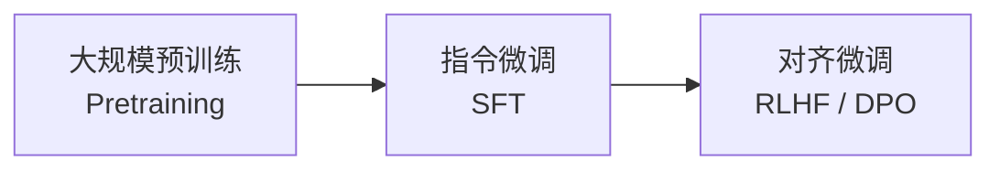
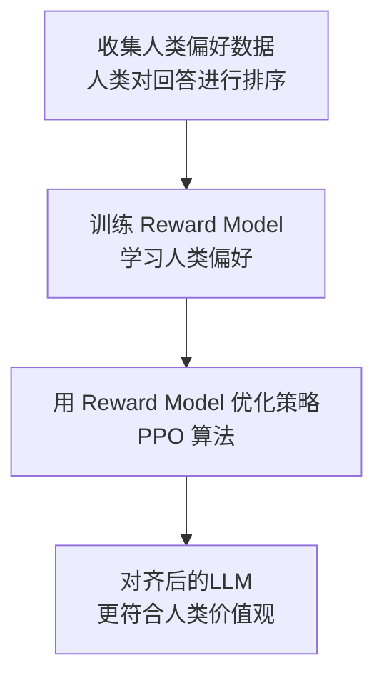
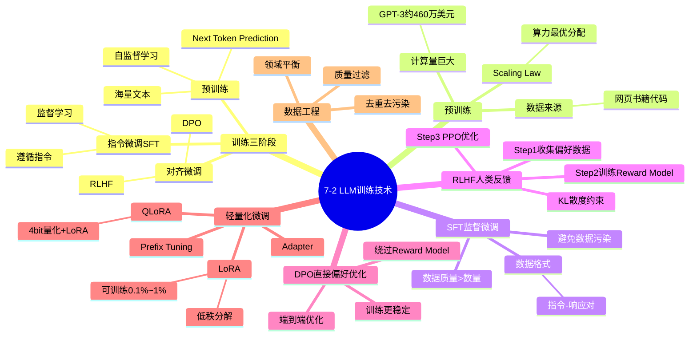

# 7-2 LLM 训练技术

## 学习目标

- 理解 LLM 训练的三个核心阶段：预训练 → SFT → RLHF
- 掌握 RLHF 的原理，包括 Reward Model 和 PPO 算法
- 了解 DPO 等新型对齐技术
- 理解数据质量对训练的重要性
- 了解训练的成本与算力门槛

---

## LLM 训练的三个阶段

大语言模型的训练通常分为三个核心阶段，每个阶段的目标和方法各不相同。



| 阶段 | 目标 | 数据来源 | 训练方式 |
|------|------|----------|----------|
| **预训练（Pretraining）** | 学习语言建模能力，世界知识 | 互联网大规模语料 | 自回归语言建模（Next Token Prediction） |
| **指令微调（SFT）** | 学会遵循指令 | 人工标注的指令数据 | 监督学习（Supervised Fine-tuning） |
| **对齐微调（RLHF/DPO）** | 与人类偏好对齐，避免有害输出 | 人类反馈数据 | 强化学习 / 直接偏好优化 |

---

## 1. 预训练（Pretraining）

### 目标

通过海量文本数据，让模型学会"根据前文预测下一个词"——这是语言模型的本质任务。在此过程中，模型自动学习语法、常识、世界知识甚至简单推理能力。

### 数据来源

预训练数据来源极其多样，需要大规模清洗：

| 数据类型 | 占比（典型） | 说明 |
|----------|------------|------|
| 网页文本（WebText/CommonCrawl） | 60～80% | 海量但噪声大，需要严格过滤 |
| 书籍（Books） | 5～15% | 质量高，连贯性好 |
| 学术论文（ArXiv） | 2～5% | 专业性强，适合长文本 |
| 代码（GitHub） | 5～15% | 学习编程能力 |
| 对话数据（Reddit/StackExchange） | 1～5% | 学习交互式表达 |

### 训练目标：Next Token Prediction

模型被训练为对序列 $x_1, x_2, ..., x_T$ 最大化似然：

$$
\mathcal{L}_{\text{pretrain}} = \sum_{t=1}^{T} \log P(x_t \mid x_{<t}; \theta)
$$

即在已知前文的情况下，预测下一个 token。

### 算力需求

预训练是 LLM 训练中成本最高的阶段。以 GPT-3（1750 亿参数）为例：

- **训练算力**：约 3.14 × 10²³ FLOPs（相当于 A100 训练 3646 天）
- **电费消耗**：估计超过 1000 万美元
- **数据量**：约 3000 亿 token

> 著名的 **Scaling Law** 指出：模型的最终性能主要取决于三个因素的幂律关系——**参数量（N）、数据集大小（D）、计算量（C）**。三者中任意一个的提升都能带来性能提升，且存在可预测的规律。

---

## 2. 指令微调（SFT，Supervised Fine-Tuning）

### 目标

让模型学会"按照人类的指令行事"，从"续写文本"转向"任务执行"。

### 数据格式

SFT 使用指令-响应对（Instruction-Response pairs）：

```
【指令】请解释什么是量子纠缠
【响应】量子纠缠是量子力学中的一种现象，指两个或多个粒子之间存在一种特殊的量子态...
```

### 数据来源

| 来源 | 说明 |
|------|------|
| 人工标注 | 雇佣标注员编写高质量指令-响应对 |
| 开源数据集 | 如 FLAN、Alpaca、ShareGPT 等 |
| 模型生成 | 用强模型（如 GPT-4）生成合成数据（Self-Instruct） |

### 关键问题：数据质量

SFT 阶段的数据质量比数量更重要。研究表明：

- 高质量但小规模的数据集（数万条）往往优于低质量的大规模数据集
- 标注者需要具备专业背景，标注质量差异直接影响模型能力
- 数据去污染（避免测试集泄露）是关键步骤

---

## 3. RLHF（人类反馈强化学习）

### 为什么需要 RLHF？

SFT 训练出的模型虽然能遵循指令，但可能存在以下问题：
- **有害输出**：生成歧视、暴力、虚假信息
- **不遵循有益目标**：模型可能学会"取悦"而非"帮助"
- **缺乏对复杂价值观的对齐**：无法区分"有帮助但有风险"的边界

RLHF 的核心思想是：**不只教模型"怎么做"，还通过人类反馈告诉它"做到多好"**。

### RLHF 三步流程



#### Step 1：收集人类偏好数据

- 给定一个指令，模型生成多个候选回答
- 人类标注员对这些回答进行**排序**（如：A > B > C）
- 数据格式：`(prompt, chosen_response, rejected_response)`

#### Step 2：训练 Reward Model（奖励模型）

用排序数据训练一个打分模型 $r_\theta(x, y)$，它能预测"人类对这个回答有多满意"。

训练目标是最小化排序损失：

$$
\mathcal{L}_R = -\mathbb{E}_{(x, y_w, y_l) \sim D} \left[ \log \sigma(r(x, y_w) - r(x, y_l)) \right]
$$

其中 $y_w$ 是被选中的回答，$y_l$ 是被拒绝的回答。

#### Step 3：PPO（近端策略优化）微调

用训练好的 Reward Model 作为奖励信号，通过强化学习算法优化 LLM。

**PPO 算法核心思想**：在奖励最大化的同时，约束策略更新的幅度，防止模型"崩溃"（即模型为了追求高分而走向极端）。

RLHF 损失函数：

$$
\mathcal{L}_{\text{RLHF}} = -\mathbb{E}_{x \sim D, y \sim \pi_\theta} \left[ r(x, y) - \beta \log \frac{\pi_\theta(y|x)}{\pi_{\text{ref}}(y|x)} \right]
$$

其中：
- $r(x, y)$：Reward Model 的打分
- $\beta$：KL 散度惩罚系数，控制与原始模型的偏离程度
- $\pi_\theta$：当前策略（正在训练的模型）
- $\pi_{\text{ref}}$：参考模型（原始 SFT 模型）

---

## 4. DPO（直接偏好优化）

### RLHF 的痛点

RLHF 虽然效果好，但存在显著问题：
- 训练不稳定（需要同时训练 reward model + PPO）
- 计算成本高（两次反向传播 + PPO 采样）
- 超参数敏感

### DPO 的核心思想

**DPO（Direct Preference Optimization）** 绕过了 reward model，直接用偏好数据优化策略。

DPO 的损失函数：

$$
\mathcal{L}_{\text{DPO}} = -\mathbb{E}_{(x, y_w, y_l) \sim D} \left[ \log \sigma \left( \beta \log \frac{\pi_\theta(y_w|x)}{\pi_{\text{ref}}(y_w|x)} - \beta \log \frac{\pi_\theta(y_l|x)}{\pi_{\text{ref}}(y_l|x)} \right) \right]
$$

简化理解：**DPO 让模型在每个 prompt 下，给偏好回答更高的生成概率，同时压低不偏好回答的概率**。

### DPO vs RLHF

| 对比项 | RLHF | DPO |
|--------|------|-----|
| 训练流程 | Reward Model + PPO 两阶段 | 直接端到端优化 |
| 稳定性 | 相对不稳定 | 更稳定 |
| 计算成本 | 高（多阶段） | 低（单阶段） |
| 效果 | 成熟稳健 | 在简单场景接近 RLHF，复杂场景仍略逊 |

---

## 其他训练技术

### Prefix Tuning / Prompt Tuning

在模型输入前添加可学习的前缀向量，不改变模型主体参数。

```
可学习的前缀：[P1][P2][P3]...
原始输入：[USER] 请解释量子纠缠
```

适合低资源场景，模型参数量大幅减少。

### LoRA（Low-Rank Adaptation）

在预训练模型旁边添加低秩矩阵，冻结原模型参数，只训练新增矩阵。

```
原始权重：W ∈ ℝ^{d×d}
LoRA 更新：W' = W + BA，其中 B∈ℝ^{d×r}, A∈ℝ^{r×d}, r << d
```

- 训练参数量大幅减少（约为原模型的 0.1%～1%）
- 可多个 LoRA 权重适配不同任务（类似"模型插拔"）
- QLoRA：在 4-bit 量化的模型上使用 LoRA，兼顾效率与性能

### 模型量化（Quantization）

将模型权重从高精度（FP32/FP16）转换为低精度（INT8/INT4），大幅降低显存和推理成本。

| 方法 | 说明 | 精度损失 |
|------|------|----------|
| INT8 | 8位整数 | 较小 |
| INT4 | 4位整数 | 适中 |
| GPTQ | 渐进式量化 | 较低 |
| AWQ | activation-aware | 较低 |

---

## 数据质量与数据工程

### 质量的重要性

在 LLM 训练中，"数据质量 > 数据数量"是业界共识。

| 维度 | 影响 |
|------|------|
| **去重** | 避免重复内容导致的过拟合 |
| **去污染** | 防止测试集数据泄露导致基准虚高 |
| **质量过滤** | 过滤低质量网页内容（广告、模板、噪音） |
| **安全性过滤** | 过滤有害内容（暴力、色情） |
| **领域平衡** | 避免某一领域过度主导 |

### 数据处理流程

```
原始数据 → 质量过滤 → 去重 → 去污染 → 安全过滤 → 数据混合 → 训练
```

### Scaling Law 与数据量

研究表明，在固定参数规模下，模型性能随训练 token 数量的增加而可预测地提升：
- Chinchilla 定律：对于计算量 C，最优的参数规模 N 和数据规模 D 约为 $N \approx D \approx C^{1/3}$
- 结论：不应只增大模型规模，还需同比增大训练数据量

---

## 训练代价与算力需求

### 典型模型训练成本

| 模型 | 参数规模 | 训练算力（FLOPs） | 估算成本 |
|------|---------|-----------------|---------|
| GPT-3 | 175B | 3.14×10²³ | ~$460万～$1200万 |
| LLaMA 2 70B | 70B | 1.4×10²³ | ~$300万 |
| GPT-4 | ~1.8T（推测） | ~2×10²⁵（推测） | 数亿美元 |
| DeepSeek-V3 | 236B（激活21B） | 1.28×10²⁴ | 大幅低于同等性能闭源模型 |

### 推理成本 vs 训练成本

- **训练成本**：一次性投入，但周期相对固定
- **推理成本**：持续性开销，直接影响商业化可行性
- 通过量化、蒸馏、LoRA 等技术可大幅降低推理成本

---

## 本章小结

1. **预训练**是基础，通过海量数据学习语言建模能力，成本最高
2. **SFT** 让模型学会遵循指令，是从"续写"到"任务执行"的关键转折
3. **RLHF** 通过人类反馈让模型对齐人类价值观，是安全性的关键保障
4. **DPO** 提供了 RLHF 的简化替代方案，训练更稳定
5. **LoRA/QLoRA** 等轻量化微调技术大幅降低了定制化训练的成本
6. **数据质量**贯穿所有阶段，高质量数据是模型能力的上限

---

## 知识点思维导图



---

## 参考资料

1. Ouyang et al. "Training language models to follow instructions with human feedback" (InstructGPT, NeurIPS 2022)
2. Rafailov et al. "Direct Preference Optimization: Your Language Model is Secretly a Reward Model" (NeurIPS 2023)
3. Hu et al. "LoRA: Low-Rank Adaptation of Large Language Models" (ICLR 2022)
4. Dettmers et al. "QLoRA: Efficient Finetuning of Quantized LLMs" (NeurIPS 2023)
5. Hoffmann et al. "Training Compute-Optimal Large Language Models" (Chinchilla paper, NeurIPS 2022)
6. Touvron et al. "Llama 2: Open Foundation and Fine-Tuned Chat Models" (Meta, 2023)