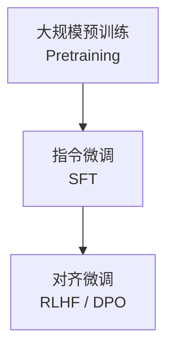
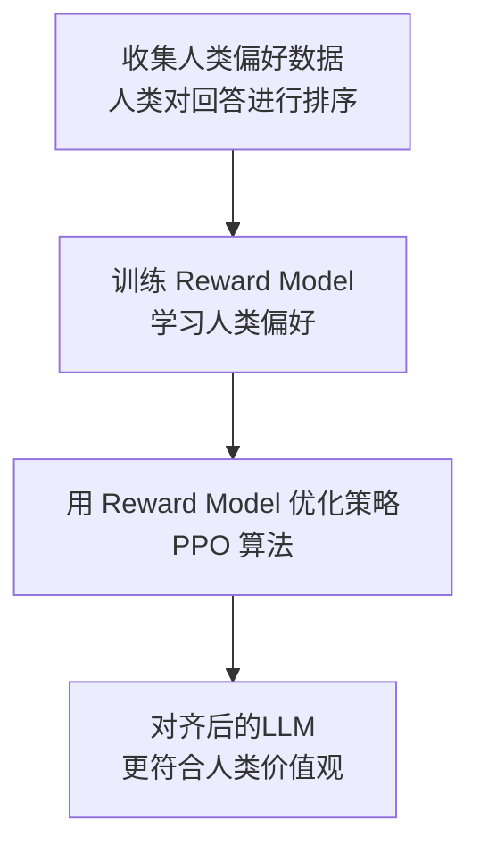
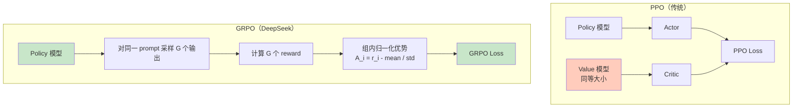
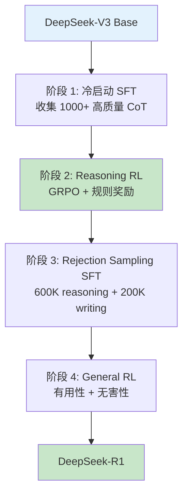
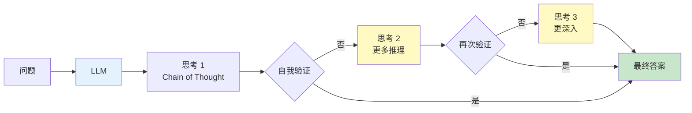
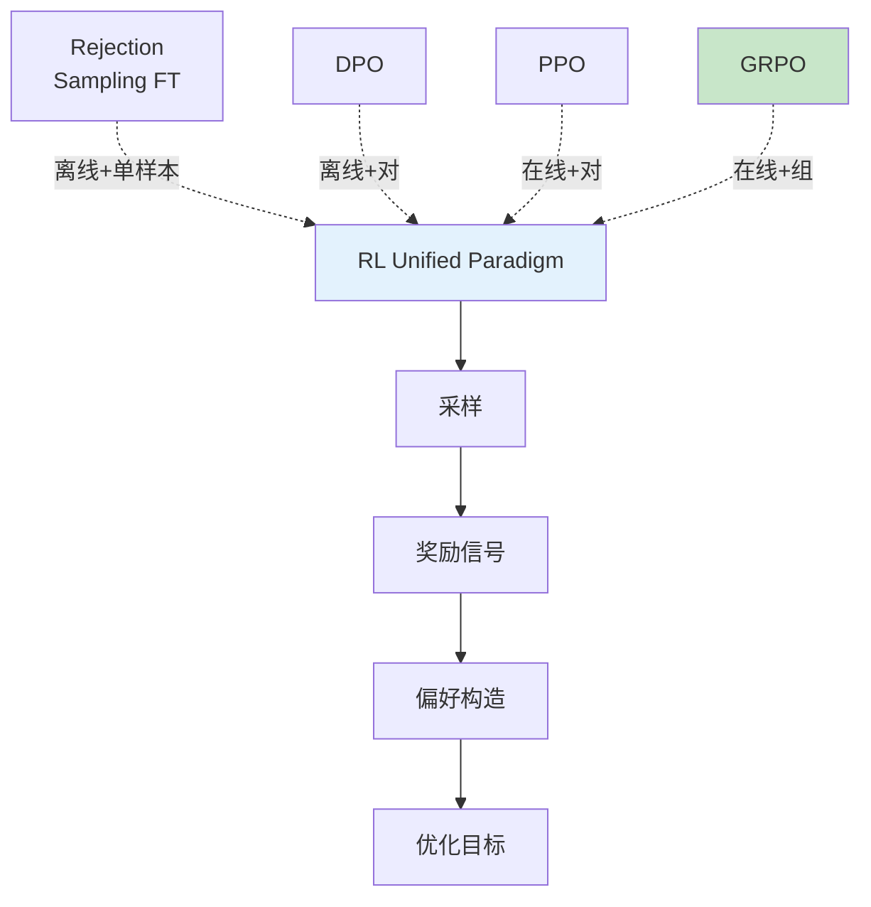
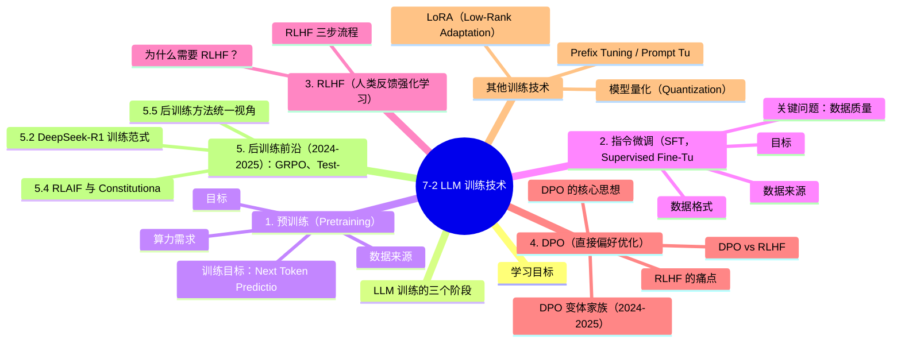

# 7-2 LLM 训练技术

## 学习目标

- 理解 LLM 训练的三个核心阶段：预训练 → SFT → RLHF
- 掌握 RLHF 的原理，包括 Reward Model 和 PPO 算法
- 了解 DPO 等新型对齐技术
- 理解数据质量对训练的重要性
- 了解训练的成本与算力门槛

---

## LLM 训练的三个阶段

大语言模型的训练通常分为三个核心阶段，每个阶段的目标和方法各不相同。



| 阶段 | 目标 | 数据来源 | 训练方式 |
|------|------|----------|----------|
| **预训练（Pretraining）** | 学习语言建模能力，世界知识 | 互联网大规模语料 | 自回归语言建模（Next Token Prediction） |
| **指令微调（SFT）** | 学会遵循指令 | 人工标注的指令数据 | 监督学习（Supervised Fine-tuning） |
| **对齐微调（RLHF/DPO）** | 与人类偏好对齐，避免有害输出 | 人类反馈数据 | 强化学习 / 直接偏好优化 |

---

## 1. 预训练（Pretraining）

### 目标

通过海量文本数据，让模型学会"根据前文预测下一个词"——这是语言模型的本质任务。在此过程中，模型自动学习语法、常识、世界知识甚至简单推理能力。

### 数据来源

预训练数据来源极其多样，需要大规模清洗：

| 数据类型 | 占比（典型） | 说明 |
|----------|------------|------|
| 网页文本（WebText/CommonCrawl） | 60～80% | 海量但噪声大，需要严格过滤 |
| 书籍（Books） | 5～15% | 质量高，连贯性好 |
| 学术论文（ArXiv） | 2～5% | 专业性强，适合长文本 |
| 代码（GitHub） | 5～15% | 学习编程能力 |
| 对话数据（Reddit/StackExchange） | 1～5% | 学习交互式表达 |

### 训练目标：Next Token Prediction

模型被训练为对序列 $x_1, x_2, ..., x_T$ 最大化似然：

$$
\mathcal{L}_{\text{pretrain}} = \sum_{t=1}^{T} \log P(x_t \mid x_{<t}; \theta)
$$

即在已知前文的情况下，预测下一个 token。

### 算力需求

预训练是 LLM 训练中成本最高的阶段。以 GPT-3（1750 亿参数）为例：

- **训练算力**：约 3.14 × 10²³ FLOPs（相当于 A100 训练 3646 天）
- **电费消耗**：估计超过 1000 万美元
- **数据量**：约 3000 亿 token

> 著名的 **Scaling Law** 指出：模型的最终性能主要取决于三个因素的幂律关系——**参数量（N）、数据集大小（D）、计算量（C）**。三者中任意一个的提升都能带来性能提升，且存在可预测的规律。

---

## 2. 指令微调（SFT，Supervised Fine-Tuning）

### 目标

让模型学会"按照人类的指令行事"，从"续写文本"转向"任务执行"。

### 数据格式

SFT 使用指令-响应对（Instruction-Response pairs）：

```
【指令】请解释什么是量子纠缠
【响应】量子纠缠是量子力学中的一种现象，指两个或多个粒子之间存在一种特殊的量子态...
```

### 数据来源

| 来源 | 说明 |
|------|------|
| 人工标注 | 雇佣标注员编写高质量指令-响应对 |
| 开源数据集 | 如 FLAN、Alpaca、ShareGPT 等 |
| 模型生成 | 用强模型（如 GPT-4）生成合成数据（Self-Instruct） |

### 关键问题：数据质量

SFT 阶段的数据质量比数量更重要。研究表明：

- 高质量但小规模的数据集（数万条）往往优于低质量的大规模数据集
- 标注者需要具备专业背景，标注质量差异直接影响模型能力
- 数据去污染（避免测试集泄露）是关键步骤

---

## 3. RLHF（人类反馈强化学习）

### 为什么需要 RLHF？

SFT 训练出的模型虽然能遵循指令，但可能存在以下问题：
- **有害输出**：生成歧视、暴力、虚假信息
- **不遵循有益目标**：模型可能学会"取悦"而非"帮助"
- **缺乏对复杂价值观的对齐**：无法区分"有帮助但有风险"的边界

RLHF 的核心思想是：**不只教模型"怎么做"，还通过人类反馈告诉它"做到多好"**。

### RLHF 三步流程



#### Step 1：收集人类偏好数据

- 给定一个指令，模型生成多个候选回答
- 人类标注员对这些回答进行**排序**（如：A > B > C）
- 数据格式：`(prompt, chosen_response, rejected_response)`

#### Step 2：训练 Reward Model（奖励模型）

用排序数据训练一个打分模型 $r_\theta(x, y)$，它能预测"人类对这个回答有多满意"。

训练目标是最小化排序损失：

$$
\mathcal{L}_R = -\mathbb{E}_{(x, y_w, y_l) \sim D} \left[ \log \sigma(r(x, y_w) - r(x, y_l)) \right]
$$

其中 $y_w$ 是被选中的回答，$y_l$ 是被拒绝的回答。

#### Step 3：PPO（近端策略优化）微调

用训练好的 Reward Model 作为奖励信号，通过强化学习算法优化 LLM。

**PPO 算法核心思想**：在奖励最大化的同时，约束策略更新的幅度，防止模型"崩溃"（即模型为了追求高分而走向极端）。

RLHF 损失函数：

$$
\mathcal{L}_{\text{RLHF}} = -\mathbb{E}_{x \sim D, y \sim \pi_\theta} \left[ r(x, y) - \beta \log \frac{\pi_\theta(y|x)}{\pi_{\text{ref}}(y|x)} \right]
$$

其中：
- $r(x, y)$：Reward Model 的打分
- $\beta$：KL 散度惩罚系数，控制与原始模型的偏离程度
- $\pi_\theta$：当前策略（正在训练的模型）
- $\pi_{\text{ref}}$：参考模型（原始 SFT 模型）

---

## 4. DPO（直接偏好优化）

### RLHF 的痛点

RLHF 虽然效果好，但存在显著问题：
- 训练不稳定（需要同时训练 reward model + PPO）
- 计算成本高（两次反向传播 + PPO 采样）
- 超参数敏感

### DPO 的核心思想

**DPO（Direct Preference Optimization）** 绕过了 reward model，直接用偏好数据优化策略。

DPO 的损失函数：

$$
\mathcal{L}_{\text{DPO}} = -\mathbb{E}_{(x, y_w, y_l) \sim D} \left[ \log \sigma \left( \beta \log \frac{\pi_\theta(y_w|x)}{\pi_{\text{ref}}(y_w|x)} - \beta \log \frac{\pi_\theta(y_l|x)}{\pi_{\text{ref}}(y_l|x)} \right) \right]
$$

简化理解：**DPO 让模型在每个 prompt 下，给偏好回答更高的生成概率，同时压低不偏好回答的概率**。

### DPO vs RLHF

| 对比项 | RLHF | DPO |
|--------|------|-----|
| 训练流程 | Reward Model + PPO 两阶段 | 直接端到端优化 |
| 稳定性 | 相对不稳定 | 更稳定 |
| 计算成本 | 高（多阶段） | 低（单阶段） |
| 效果 | 成熟稳健 | 在简单场景接近 RLHF，复杂场景仍略逊 |

### DPO 变体家族（2024-2025）

DPO 开启了"免 RLHF"的对齐范式，后续工作从不同角度改进：去除参考模型、降低显存、引入认知偏差。已成为 Qwen3、Llama 3.3、DeepSeek 的对齐标配。

**ORPO（Odds Ratio Preference Optimization, 2024）**

将 SFT 与偏好优化合并为单一目标，无需参考模型：

$$\mathcal{L}_{\text{ORPO}} = \mathcal{L}_{\text{SFT}} + \lambda \cdot \log\sigma(\log\frac{P_\theta(y_w|x)}{1 - P_\theta(y_w|x)} - \log\frac{P_\theta(y_l|x)}{1 - P_\theta(y_l|x)})$$

其中 $y_w / y_l$ 是 chosen/rejected。优势：单阶段训练、显存减半、效果与 DPO+RLHF 相当。

**SimPO（Simple Preference Optimization, 2024）**

去掉参考模型，用长度归一化的隐式奖励：

$$\mathcal{L}_{\text{SimPO}} = -\log\sigma(\beta \cdot \frac{|y_w| \log P_\theta(y_w|x)}{|y_w|} - \beta \cdot \frac{|y_l| \log P_\theta(y_l|x)}{|y_l|} - \gamma)$$

优势：无参考模型、不依赖隐式 $\pi_{\text{ref}}$、长度归一化避免 DPO 的"长度偏见"。

**KTO（Kahneman-Tversky Optimization, 2024）**

借鉴行为经济学的"前景理论"，不需要成对偏好数据，只需要每条样本标注"好/坏"：

$$\mathcal{L}_{\text{KTO}} = \lambda_y \cdot (1 - \sigma(\beta \cdot r_\theta(x, y) - z_0)) + \lambda_{ny} \cdot \sigma(\beta \cdot r_\theta(x, y) - z_0)$$

其中 $r_\theta$ 是隐式奖励、$z_0$ 是参考点。优势：可用未配对的单条反馈数据（更易收集）、对噪声更鲁棒。Mistral 已采用。

| 变体 | 参考模型 | 偏好数据 | 主要优势 | 代表使用方 |
|------|---------|---------|---------|-----------|
| **DPO** | 必需 | 配对 (chosen, rejected) | 简单稳定 | 大量开源模型 |
| **ORPO** | 不需要 | 配对 | 单阶段、显存省一半 | Qwen3 系列 |
| **SimPO** | 不需要 | 配对 | 无长度偏见、推理时一致 | Llama 3.3 |
| **KTO** | 不需要 | 单条 (好/坏) | 数据易得、鲁棒 | Mistral 系列 |

### 4.5 Finetune 方法大全：8 种 PEFT 详解

> **核心问题**：全参微调对 7B+ 模型显存要求 120GB+。如何用 24-80GB 显卡做"有效"的微调？**PEFT（Parameter-Efficient Fine-Tuning）** 是答案。

#### 4.5.1 8 种主流 PEFT 方法对比

| 方法 | 训练参数 | 显存 (7B) | 速度 | 效果 | 适合 |
|------|----------|-----------|------|------|------|
| **Full Fine-tune** | 100% | ~120 GB | 慢 | ⭐⭐⭐⭐⭐ SOTA | 4×A100+ |
| **LoRA** | 0.1-5% | ~24 GB | 快 | ⭐⭐⭐⭐ | 标准选择 |
| **QLoRA** | 0.1-5% (4-bit) | ~6 GB | 快 | ⭐⭐⭐⭐ | 24GB 显卡 |
| **Adapter** | 1-5% | ~30 GB | 中 | ⭐⭐⭐ | 历史方案 |
| **Prefix Tuning** | 0.1% | ~20 GB | 中 | ⭐⭐⭐ | 文本生成 |
| **Prompt Tuning** | 0.001% | ~16 GB | 快 | ⭐⭐ | Few-shot |
| **P-Tuning v2** | 0.1-1% | ~20 GB | 中 | ⭐⭐⭐⭐ | 多任务 |
| **BitFit (bias only)** | 0.05% | ~14 GB | 极快 | ⭐⭐ | 极小显存 |

#### 4.5.2 LoRA 原理

**核心**：在原权重旁加一个低秩分解矩阵：

$$
W_{\text{new}} = W + \Delta W = W + B \cdot A
$$

其中 $A \in \mathbb{R}^{r \times d}$, $B \in \mathbb{R}^{d \times r}$, $r \ll d$（rank 通常 8-64）。

```python
from peft import LoraConfig, get_peft_model, TaskType

config = LoraConfig(
    r=16,                     # rank
    lora_alpha=32,            # 缩放因子
    target_modules=["q_proj", "k_proj", "v_proj", "o_proj"],
    lora_dropout=0.05,
    bias="none",
    task_type=TaskType.CAUSAL_LM,
)
model = get_peft_model(base_model, config)
model.print_trainable_parameters()
# trainable: 4,194,304 || all: 6,742,609,920 || trainable%: 0.062%
```

**LoRA 关键超参**：
- **rank (r)**：8 / 16 / 32 / 64（越大越接近全参）
- **alpha**：通常 2r（缩放因子）
- **target_modules**：选 q_proj / v_proj（最小）；q,k,v,o_proj（推荐）；所有 Linear（最全）
- **dropout**：0.05-0.1

#### 4.5.3 QLoRA：低显存微调（⭐ 24GB 显卡首选）

**核心**：4-bit 量化 + LoRA

```python
from transformers import BitsAndBytesConfig, AutoModelForCausalLM
from peft import prepare_model_for_kbit_training, LoraConfig, get_peft_model

# 1. 4-bit 量化加载
bnb_config = BitsAndBytesConfig(
    load_in_4bit=True,
    bnb_4bit_quant_type="nf4",          # NormalFloat 4-bit
    bnb_4bit_compute_dtype=torch.bfloat16,  # 计算用 BF16
    bnb_4bit_use_double_quant=True,     # 双重量化
)

model = AutoModelForCausalLM.from_pretrained(
    "meta-llama/Llama-2-7b-hf",
    quantization_config=bnb_config,
    device_map="auto",
)
model = prepare_model_for_kbit_training(model)

# 2. 加 LoRA
lora_config = LoraConfig(
    r=16, lora_alpha=32,
    target_modules=["q_proj", "v_proj"],
    lora_dropout=0.05, bias="none", task_type="CAUSAL_LM"
)
model = get_peft_model(model, lora_config)

# 3. 训练：7B 模型只需 6GB 显存（vs 全量 120GB）
```

**QLoRA 关键技巧**：
- **NF4 量化**（比 FP4 更适合正态分布权重）
- **双重量化**（省更多内存）
- **Paged Optimizer**（防止显存峰值 OOM）

#### 4.5.4 LoRA 变体

| 变体 | 改进 | 来源 |
|------|------|------|
| **QLoRA** | 4-bit 量化 + LoRA | Dettmers 2023 |
| **LoRA+** | 不同层用不同 LR | Hayou 2024 |
| **AdaLoRA** | 自适应 rank 分配 | Zhang 2023 |
| **DoRA** | 分解方向 + 幅度 | Liu 2024 |
| **rsLoRA** | rank-stabilized | Kalajdzievski 2023 |
| **LongLoRA** | 扩展上下文 | Chen 2024 |
| **LoRA-FA** | 冻结 A 只训 B | Zhang 2023 |
| **PiSSA** | 主奇异值初始化 | Meng 2024 |

#### 4.5.5 Adapter 与 Prefix Tuning

**Adapter**（Houlsby 2019）：在 Transformer 层插入小型瓶颈网络

```python
class Adapter(nn.Module):
    def __init__(self, d_model, bottleneck=64):
        super().__init__()
        self.down = nn.Linear(d_model, bottleneck)
        self.up = nn.Linear(bottleneck, d_model)
        self.act = nn.GELU()
    
    def forward(self, x):
        return x + self.up(self.act(self.down(x)))
```

**Prefix Tuning**（Li 2021）：在每个 attention 层前加可学习 prefix

```python
# Prefix 是 [B, prefix_len, d_model] 的可学习向量
prefix = nn.Parameter(torch.randn(batch_size, 10, d_model))
# 加到 K, V 上
K_with_prefix = torch.cat([prefix, K], dim=1)
```

#### 4.5.6 Prompt Tuning vs P-Tuning v2

| 方法 | 改什么 | 参数量 | 效果 |
|------|--------|--------|------|
| **Prompt Tuning** | 只在 input 加 soft prompt | 极小 (0.001%) | 仅大模型有效 |
| **P-Tuning v2** | 每层都加 soft prompt | 小 (0.1-1%) | ⭐ 多任务优 |

#### 4.5.7 BitFit：只调 Bias

> 神奇发现：**只训练 bias 参数（占总参数 0.05%）就能在小样本任务上达到全参 95% 的效果**。

```python
def bitfit_params(model):
    """只返回 bias 参数"""
    params = []
    for name, param in model.named_parameters():
        if 'bias' in name:
            params.append(param)
    return params

optimizer = torch.optim.AdamW(bitfit_params(model), lr=1e-3)
```

#### 4.5.8 选型决策表

| 显存 | 模型 | 推荐方法 |
|------|------|----------|
| 8 GB | ≤3B | BitFit / Prompt Tuning |
| 12 GB | 7B | QLoRA r=8 |
| 16 GB | 7B | QLoRA r=16 / LoRA r=8 |
| 24 GB | 7B-13B | QLoRA r=32 / LoRA r=16 |
| 40 GB | 13B-30B | LoRA r=32 |
| 80 GB | 70B | LoRA r=64 / 全参 |
| 4×80 GB | 70B+ | 全参微调 |

#### 4.5.9 8 种方法工业实践对比

```python
# 实战速查：选哪个？

# 1. 闭集分类 + 24GB → QLoRA
model = load_4bit_model("Llama-2-7b")
model = add_lora(model, r=16)

# 2. 多任务学习 + 80GB → Prefix Tuning
model = load_model("Llama-2-7b")
model = add_prefix_tuning(model, prefix_len=10)

# 3. Few-shot + 8GB → Prompt Tuning
model = load_model("Llama-2-7b")
model = add_soft_prompt(model, n_tokens=20)

# 4. 完全多任务 + 12GB → P-Tuning v2
model = load_model("Llama-2-7b")
model = add_p_tuning_v2(model)

# 5. 极小显存 + 8GB → BitFit
optimizer = AdamW(bitfit_params(model), lr=1e-3)

# 6. 最大效果 + 4×80GB → Full Fine-tune
optimizer = AdamW(model.parameters(), lr=3e-4)
```

#### 4.5.10 PEFT 选型 5 大金句

> **金句 1**：**QLoRA + 24GB 显卡 = 7B 模型微调的"工业民主化"**。
> 
> **金句 2**：**LoRA r=16 + alpha=32 是 sweet spot**，r=8 够用，r=64 才接近全参。
> 
> **金句 3**：**target_modules 选 q,k,v,o_proj 比只选 q,v 略好**（+0.3%），全 Linear 最全。
> 
> **金句 4**：**PEFT 不是免费的午餐**——效果通常比全参低 1-3%，但**显存省 90% + 时间省 70%**。
> 
> **金句 5**：**组合使用**：QLoRA + DoRA + rsLoRA 是 2024-2025 最强组合。

---

> **参数高效微调**：LoRA / QLoRA / Adapter / Prefix-Tuning 等 7 种 PEFT 方法的对比与显存选型，见 [10-9 训练实战技巧大全](../PART10-训练优化与部署/10-9-训练实战技巧大全.md) §4。

## 其他训练技术

### Prefix Tuning / Prompt Tuning

在模型输入前添加可学习的前缀向量，不改变模型主体参数。

```
可学习的前缀：[P1][P2][P3]...
原始输入：[USER] 请解释量子纠缠
```

适合低资源场景，模型参数量大幅减少。

### LoRA（Low-Rank Adaptation）

在预训练模型旁边添加低秩矩阵，冻结原模型参数，只训练新增矩阵。

```
原始权重：W ∈ ℝ^{d×d}
LoRA 更新：W' = W + BA，其中 B∈ℝ^{d×r}, A∈ℝ^{r×d}, r << d
```

- 训练参数量大幅减少（约为原模型的 0.1%～1%）
- 可多个 LoRA 权重适配不同任务（类似"模型插拔"）
- QLoRA：在 4-bit 量化的模型上使用 LoRA，兼顾效率与性能

### 模型量化（Quantization）

将模型权重从高精度（FP32/FP16）转换为低精度（INT8/INT4），大幅降低显存和推理成本。

| 方法 | 说明 | 精度损失 |
|------|------|----------|
| INT8 | 8位整数 | 较小 |
| INT4 | 4位整数 | 适中 |
| GPTQ | 渐进式量化 | 较低 |
| AWQ | activation-aware | 较低 |

---

## 5. 后训练前沿（2024-2025）：GRPO、Test-Time Compute、RLAIF

在 SFT → RLHF → DPO 之后，2024-2025 年又涌现出一批新方法。本节讲解当下工业界最热的 4 个方向。

### 5.1 GRPO：Group Relative Policy Optimization

**提出**：DeepSeek-AI，2024 年（arXiv:2402.03300，DeepSeekMath 论文首次提出，DeepSeek-R1 把它推上巅峰）

**核心动机**：传统 PPO 需要**额外的价值模型（critic）**——它和 policy 模型一样大，显存占用翻倍、训练成本高。GRPO 砍掉了 critic，改用**组内相对评分**估计 baseline。

#### PPO vs GRPO 对比



#### GRPO 算法核心公式

**采样阶段**：对每个 prompt $q$，从旧策略 $\pi_{\theta_{old}}$ 采样 G 个输出 $\{o_1, ..., o_G\}$，用奖励函数 $r_\phi$ 评分。

**优势估计（无 critic）**：
$$
A_i = \frac{r_i - \text{mean}(\{r_1, ..., r_G\})}{\text{std}(\{r_1, ..., r_G\})}
$$

**目标函数**（KL 散度直接进 loss，不进 reward）：
$$
\mathcal{J}_{\text{GRPO}}(\theta) = \frac{1}{G} \sum_{i=1}^{G} \frac{1}{|o_i|} \sum_{t=1}^{|o_i|} \left\{
\min\left[\frac{\pi_\theta(o_{i,t}|\cdot)}{\pi_{\theta_{old}}(o_{i,t}|\cdot)} A_i, \text{clip}(\cdot) A_i\right]
- \beta \mathbb{D}_{KL}(\pi_\theta \| \pi_{\text{ref}})
\right\}
$$

**关键创新**：
1. **无 value 模型**——显存减半，训练成本降低
2. **组内归一化**——天然消除 reward 尺度问题
3. **KL 在 loss 里**——而非 reward 里，更稳定的训练

#### GRPO 的关键效果

| 模型 | 任务 | PPO | GRPO | 提升 |
|------|------|-----|------|------|
| **DeepSeekMath-7B** | GSM8K | 82.9% | 88.2% | +5.3% |
| **DeepSeekMath-7B** | MATH | 46.8% | 51.7% | +4.9% |
| **DeepSeek-R1-Zero** | AIME 2024 | 15.6% | 71.0% | **+55.4%** |
| **DeepSeek-R1-Zero** | AIME 2024 (投票) | — | 86.7% | 匹配 OpenAI o1 |

> 📌 **2024-2025 现象**：GRPO 已被 Qwen、Llama 3.3、DeepSeek 全系列采用，是当前开源推理模型的标准训练算法。

#### 奖励函数的多样性

GRPO 不依赖**单独的奖励模型**——任何可计算函数都可作为 reward：

| 奖励类型 | 适用 | 示例 |
|----------|------|------|
| **规则奖励（Rule-based）** | 数学、代码 | 答案正确性、单元测试通过 |
| **格式奖励** | 所有任务 | 是否包含 `<answer>` 标签 |
| **长度奖励** | 短回答 | 输出长度惩罚 |
| **语言一致性奖励** | 多语种 | 目标语言占比 |
| **奖励模型（Outcome RM）** | 通用 | 偏好模型打分 |

#### 简化代码示例

```python
# GRPO 训练循环（伪代码）
def grpo_step(policy, ref_policy, prompts, reward_fn, G=8):
    for prompt in prompts:
        # 1. 采样 G 个输出
        outputs = [policy.generate(prompt) for _ in range(G)]
        
        # 2. 计算奖励
        rewards = [reward_fn(prompt, out) for out in outputs]
        
        # 3. 组内归一化（关键创新：替代 critic）
        mean_r, std_r = rewards.mean(), rewards.std() + 1e-8
        advantages = [(r - mean_r) / std_r for r in rewards]
        
        # 4. 计算 GRPO loss
        loss = 0
        for out, adv in zip(outputs, advantages):
            ratio = policy.log_prob(out) - old_log_prob(out)  # π_θ / π_old
            surr1 = ratio * adv
            surr2 = clip(ratio, 1 - eps, 1 + eps) * adv
            kl = kl_divergence(policy, ref_policy, out)  # KL 进 loss
            loss += -torch.min(surr1, surr2) + beta * kl
        loss /= G
        
        # 5. 反向传播
        loss.backward()
        optimizer.step()
```

---

### 5.2 DeepSeek-R1 训练范式

**发布**：2025 年 1 月（arXiv:2501.12948）

**核心突破**：用**纯强化学习**（无 SFT 冷启动）激发模型的推理能力——R1-Zero 在 AIME 2024 从 15.6% 跳到 71.0%，**证明推理能力可以"涌现"**，不需要监督数据。

#### 4 阶段训练流水线



#### R1 引入的关键机制

| 机制 | 作用 |
|------|------|
| **语言一致性奖励** | 防止 R1-Zero 早期出现的"中英混杂"问题 |
| **拒绝采样（Rejection Sampling）** | 阶段 3 用 SFT 模型的输出过滤高质量样本 |
| **多阶段 RL 切换** | Reasoning RL → General RL 切换优化目标 |
| **蒸馏** | 把 R1 的能力蒸馏到 1.5B-70B 小模型 |

#### R1 的 7 大涌现行为

论文报告 R1-Zero 在 RL 训练中自然涌现的推理能力：

1. **自验证（Self-Verification）**：模型自动回查自己的答案
2. **反思（Reflection）**：用"等等，让我再想想"重写推理路径
3. **多解探索**：尝试多种解法后选最优
4. **回溯（Backtracking）**：发现错误时主动回头
5. **延长思考时间**：在难题上花更多 tokens
6. **抽象思维**：把问题泛化到更高层
7. **工具使用隐含倾向**：在数学/代码任务中倾向"用计算验证"

> 💡 **范式转移**：从"监督学习"转向"探索-利用"——模型不再只是模仿人类，而是**自己发现推理模式**。

---

### 5.3 Test-Time Compute Scaling（o1 范式）

**提出**：OpenAI o1（2024 年 9 月），DeepSeek R1（2025 年 1 月）将其开源

**核心思想**：**训练成本固定，推理时让模型"多想"**——通过更长的 CoT 思考，模型可以在数学、代码、科学任务上大幅提升。



#### 与传统 Scaling Law 的对比

| 范式 | 投入 | 收益 |
|------|------|------|
| **训练时 Scaling** | 增加参数量 N、训练 token D、计算量 C | 提升通用能力 |
| **Test-Time Scaling**（新） | 增加单次推理的 token 数 + 采样数 | 提升特定难题表现 |

#### 关键数字

| 模型 | 训练范式 | AIME 2024 | GPQA Diamond |
|------|----------|-----------|--------------|
| GPT-4o | 标准 | 13.4% | 50.6% |
| OpenAI o1 | Test-Time Compute | **83.3%** | **78.0%** |
| DeepSeek-R1 | Test-Time Compute + RL | 79.8% | 71.5% |

#### 实现 Test-Time Compute 的 4 种方法

| 方法 | 计算开销 | 性能提升 | 适用 |
|------|----------|----------|------|
| **Best-of-N 采样** | 推理 N× | 中 | 通用 |
| **Self-Consistency** | 推理 N× | 中-高 | 推理题 |
| **Process Reward Model** | 推理 N× + RM | 高 | 数学、代码 |
| **MCTS + Value Model** | 推理 50-200× | 最高 | 搜索问题 |

#### Process Reward Model（PRM）

不只评估"答案对不对"，还评估**"思考过程的每一步对不对"**：

```python
# PRM 简化示例
def prm_score(steps, answer):
    """对每个推理步骤打分"""
    step_rewards = []
    for i, step in enumerate(steps):
        # 用过程奖励模型评估当前步骤
        r = prm_model(step, previous_steps=steps[:i])
        step_rewards.append(r)
    return step_rewards

# Best-of-N + PRM
def best_of_n_with_prm(prompt, N=16):
    candidates = [generate_with_cot(prompt) for _ in range(N)]
    scored = []
    for cand in candidates:
        steps = parse_steps(cand)
        answer = extract_answer(cand)
        step_r = prm_score(steps, answer)
        # 关键：综合最终答案正确性 + 过程得分
        final_r = (1 - 0.7) * step_r.mean() + 0.7 * answer_correct(answer)
        scored.append((final_r, cand))
    return max(scored)[1]
```

> ⚠️ **DeepSeek R1 的发现**：他们实验了 PRM 和 MCTS，**最终没用**——因为 PRM 难以训练、MCTS 在开放式推理中效果有限。R1 仅用 GRPO + 规则奖励就达到了 o1 水平。

---

### 5.4 RLAIF 与 Constitutional AI

**提出**：Anthropic，2022 年（Constitutional AI），2023-2024 年扩展为 RLAIF

**核心思想**：用 **AI 反馈**（而非人类反馈）做 RLHF——大幅降低标注成本。


#### 宪法（Constitution）示例

```text
1. 请选择最无害、最有帮助的回复
2. 避免: 歧视、暴力、色情、政治倾向
3. 鼓励: 事实性、礼貌、建设性
4. 如果回复有害，请修改
```

#### RLAIF vs RLHF 对比

| 维度 | RLHF | RLAIF |
|------|------|-------|
| 反馈源 | 人类标注员 | AI 模型（按宪法） |
| 成本 | 高（每条偏好 $0.5-$5） | 低（接近 0） |
| 一致性 | 因人而异 | 高度一致 |
| 可扩展性 | 慢 | 极快 |
| 适用 | 早期模型 | 大规模对齐（Claude 2/3/4） |

#### 主流模型采用情况

| 模型 | 对齐方法 |
|------|----------|
| GPT-4 / GPT-4o | RLHF + RLAIF |
| Claude 2/3/4 | **Constitutional AI (RLAIF)** |
| Gemini | RLHF + RLAIF |
| Llama 3 | RLHF + DPO |
| **DeepSeek-R1** | **GRPO + 规则奖励** |
| Qwen3 | **GRPO** |

---

### 5.5 后训练方法统一视角

DeepSeekMath 论文给出了一个**统一范式**理解 RFT/PPO/GRPO/DPO：



| 方法 | 采样 | 偏好构造 | 优化目标 |
|------|------|----------|----------|
| **RFT** | 离线 | 单样本正确/错误 | 拒绝采样 SFT |
| **DPO** | 离线 | (chosen, rejected) 对 | 二元偏好损失 |
| **PPO** | 在线 | 单条 reward | clip surrogate + KL |
| **GRPO** | 在线 | 组内 G 条 | clip surrogate + KL（无 critic） |

**关键洞察**：
- 在线 > 离线（能探索新解）
- 群体 > 单条（更稳定的优势估计）
- GRPO 是当前**效率-性能最优解**

---

## 数据质量与数据工程

### 质量的重要性

在 LLM 训练中，"数据质量 > 数据数量"是业界共识。

| 维度 | 影响 |
|------|------|
| **去重** | 避免重复内容导致的过拟合 |
| **去污染** | 防止测试集数据泄露导致基准虚高 |
| **质量过滤** | 过滤低质量网页内容（广告、模板、噪音） |
| **安全性过滤** | 过滤有害内容（暴力、色情） |
| **领域平衡** | 避免某一领域过度主导 |

### 数据处理流程

```
原始数据 → 质量过滤 → 去重 → 去污染 → 安全过滤 → 数据混合 → 训练
```

### Scaling Law 与数据量

研究表明，在固定参数规模下，模型性能随训练 token 数量的增加而可预测地提升：
- Chinchilla 定律：对于计算量 C，最优的参数规模 N 和数据规模 D 约为 $N \approx D \approx C^{1/3}$
- 结论：不应只增大模型规模，还需同比增大训练数据量

---

## 训练代价与算力需求

### 典型模型训练成本

| 模型 | 参数规模 | 训练算力（FLOPs） | 估算成本 |
|------|---------|-----------------|---------|
| GPT-3 | 175B | 3.14×10²³ | ~$460万～$1200万 |
| LLaMA 2 70B | 70B | 1.4×10²³ | ~$300万 |
| GPT-4 | ~1.8T（推测） | ~2×10²⁵（推测） | 数亿美元 |
| DeepSeek-V3 | 236B（激活21B） | 1.28×10²⁴ | 大幅低于同等性能闭源模型 |

### 推理成本 vs 训练成本

- **训练成本**：一次性投入，但周期相对固定
- **推理成本**：持续性开销，直接影响商业化可行性
- 通过量化、蒸馏、LoRA 等技术可大幅降低推理成本

---

## 本章小结

1. **预训练**是基础，通过海量数据学习语言建模能力，成本最高
2. **SFT** 让模型学会遵循指令，是从"续写"到"任务执行"的关键转折
3. **RLHF** 通过人类反馈让模型对齐人类价值观，是安全性的关键保障
4. **DPO** 提供了 RLHF 的简化替代方案，训练更稳定
5. **LoRA/QLoRA** 等轻量化微调技术大幅降低了定制化训练的成本
6. **数据质量**贯穿所有阶段，高质量数据是模型能力的上限
7. **GRPO** 是 2024-2025 推理模型的事实标准算法，砍掉 critic、组内归一化，DeepSeek R1 / Qwen3 全部采用
8. **DeepSeek R1** 4 阶段流水线（SFT → Reasoning RL → RS-SFT → General RL）证明了纯 RL 也能激发推理能力
9. **Test-Time Compute Scaling**（o1 范式）通过推理时多思考、Best-of-N、PRM，让模型在难题上"多花算力"
10. **RLAIF/Constitutional AI** 用 AI 反馈替代人类反馈，大幅降低对齐成本，Claude 3/4 的核心技术

---


## 知识图谱



## 参考资料

### 经典论文
1. Ouyang et al. "Training language models to follow instructions with human feedback" (InstructGPT, NeurIPS 2022)
2. Rafailov et al. "Direct Preference Optimization: Your Language Model is Secretly a Reward Model" (NeurIPS 2023)
3. Hu et al. "LoRA: Low-Rank Adaptation of Large Language Models" (ICLR 2022)
4. Dettmers et al. "QLoRA: Efficient Finetuning of Quantized LLMs" (NeurIPS 2023)
5. Hoffmann et al. "Training Compute-Optimal Large Language Models" (Chinchilla paper, NeurIPS 2022)
6. Touvron et al. "Llama 2: Open Foundation and Fine-Tuned Chat Models" (Meta, 2023)

### 2024-2025 后训练前沿
7. Shao et al. (2024). [DeepSeekMath: Pushing the Limits of Mathematical Reasoning in Open Language Models](https://arxiv.org/abs/2402.03300). *arXiv*. **GRPO 首次提出**
8. DeepSeek-AI (2025). [DeepSeek-R1: Incentivizing Reasoning Capability in LLMs via Reinforcement Learning](https://arxiv.org/abs/2501.12948). *arXiv*.
9. OpenAI (2024). [Learning to Reason with LLMs: o1](https://openai.com/index/learning-to-reason-with-llms/). *OpenAI Blog*. **Test-Time Compute 范式**
10. Bai et al. (2022). [Constitutional AI: Harmlessness from AI Feedback](https://arxiv.org/abs/2212.08073). *Anthropic*. **RLAIF/CAI 起源**
11. Lee et al. (2023). [RLAIF: Scaling Reinforcement Learning from Human Feedback with AI Feedback](https://arxiv.org/abs/2309.00267). *arXiv*.
12. Lightman et al. (2023). [Let's Verify Step by Step: Process Reward Models](https://arxiv.org/abs/2305.20050). *OpenAI*. **PRM**
13. Snell et al. (2024). [Scaling LLM Test-Time Compute Optimally Can be More Effective than Scaling Model Parameters](https://arxiv.org/abs/2408.03314). *arXiv*.