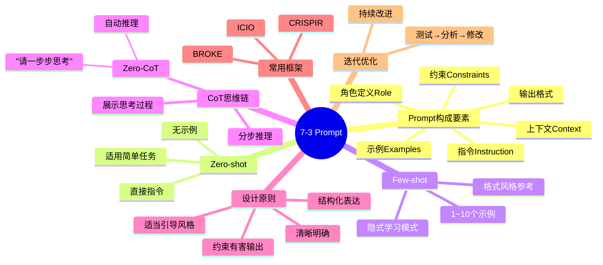

# 7-3 Prompt Engineering

## 学习目标

- 理解 Prompt 的基本构成要素
- 掌握 Zero-shot、Few-shot、CoT 等核心技巧
- 学会设计结构化输出（JSON、Markdown）
- 理解 Prompt 设计的原则与常见陷阱

---

## 什么是 Prompt Engineering

Prompt Engineering（提示词工程）是指**如何有效地与大型语言模型（LLM）沟通**，通过设计、优化输入文本来获得更准确、更有用的输出。

由于当前的 LLM 仍高度依赖 Prompt 的质量，相同的模型、不同的 Prompt 可能产生截然不同的结果。**"会问"比"会答"更重要。**

---

## Prompt 的基本构成

一个完整的 Prompt 通常包含以下几个部分：

```
【角色定义】你是一位资深的数据分析师
【任务描述】请分析以下销售数据并总结趋势
【背景信息】
- 数据来源：2024年Q1电商销售记录
- 数据量：10万条订单
【输出要求】用表格呈现，并给出三句话总结
【约束】不得编造任何数据
```

| 组成要素 | 说明 | 是否必需 |
|----------|------|----------|
| **角色定义（Role）** | 让模型扮演特定身份 | 建议添加 |
| **指令（Instruction）** | 明确告诉模型做什么 | ✅ 必需 |
| **上下文（Context）** | 提供必要的背景信息 | 建议添加 |
| **示例（Examples）** | 通过 Few-shot 提供参考 | 可选 |
| **输出格式（Output Format）** | 指定输出的结构 | 建议添加 |
| **约束（Constraints）** | 限制模型的输出范围 | 可选 |

---

## Zero-shot Prompt

### 定义

Zero-shot 指的是**不给模型任何示例，直接通过指令要求模型执行任务**。

```
【示例】
输入：请将以下中文翻译成英文：我今天很高兴
输出：I am very happy today.
```

### 适用场景

- 简单明确的任务（翻译、摘要、分类等）
- 模型在预训练中已经充分学习的任务
- 不需要特定格式或复杂推理的场景

### Zero-shot 的局限性

模型完全依赖预训练知识，没有"练习"机会，可能在以下情况失效：
- 任务需要特定领域知识（如医疗、法律）
- 任务格式不常见
- 需要遵循特定偏好或风格

---

## Few-shot Prompt（In-Context Learning）

### 定义

Few-shot 指在 Prompt 中提供**几个示例（通常 1～10 个）**，让模型从示例中学习任务模式，而无需更新模型参数。

```
【示例】
输入：
翻译成英文：
1. 你好 → Hello
2. 谢谢 → Thank you
3. 我爱中国 →
输出：I love China
```

模型通过示例推断出"中文→英文"的翻译模式，而不是显式地学习它。

### 为什么 Few-shot 有效？

- 示例提供了**任务格式的隐式说明**
- 示例包含了**期望输出的风格和约束**
- 模型能从多个示例中**抽象出通用规律**

### 示例数量如何选择

| 场景 | 推荐示例数 |
|------|----------|
| 简单任务（格式固定） | 1～3 个 |
| 中等复杂任务 | 3～5 个 |
| 复杂任务或需要多种情况覆盖 | 5～10 个 |

### Few-shot 的注意事项

- 示例应该**覆盖典型场景**，避免只给单一类型示例
- 示例顺序可以**影响模型理解**：先简单后复杂通常更好
- 不要给**矛盾或错误的示例**，模型会学习这些模式

---

## Chain-of-Thought（思维链，CoT）

### 定义

Chain-of-Thought（CoT）是一种让模型**分步推理**的技术，通过在 Prompt 中加入"思考过程"引导模型给出更准确的答案。

### 核心思想

与其直接要求模型给出答案，不如让它先"想一想"——展示推理步骤。

```
【普通 Prompt】
问：小明有10个苹果，给了小红3个，又买了5个，现在有多少个？
答：10 - 3 + 5 = 12

【CoT Prompt】
问：小明有10个苹果，给了小红3个，现在剩下7个。
      又买了5个，所以7 + 5 = 12。
答：12
```

### 何时使用 CoT

| 适合 CoT | 不适合 CoT |
|----------|-----------|
| 数学推理（10+2=12） | 简单的事实问答（北京人口多少？） |
| 逻辑推理 | 情感分析（这句话是正面还是负面？） |
| 代码调试 | 翻译（不需要推理步骤） |
| 多步骤问题 | 格式转换 |

### Zero-CoT（自动推理）

Zero-CoT 是指**不提供示例，而是引导模型自己生成推理过程**：

```
请逐步思考：某工厂每天生产200个零件，......
（让模型自发产生思维链）
```

通过在 Prompt 末尾加上一句"请一步步思考"或"Let's think step by step"，就能显著提升模型的推理能力。

---

## Prompt 设计原则与技巧

### 原则 1：清晰明确

| ❌ 不好的表达 | ✅ 好的表达 |
|-------------|------------|
| "解释一下AI" | "用两句话解释什么是大语言模型，面向零基础读者" |
| "分析数据" | "分析以下CSV数据，统计每个月的销售额和同比增长率" |
| "写一篇文章" | "以数据分析师的身份，写一篇关于2024年Q1电商趋势的分析报告，约800字" |

### 原则 2：结构化表达

使用 Markdown 格式、编号、标题等让 Prompt 结构清晰：

```
## 角色
你是一位资深产品经理

## 任务
为以下功能点撰写需求文档：
1. 用户登录
2. 商品搜索

## 要求
- 每个功能点包含：背景、目的、功能描述、验收标准
- 输出格式为Markdown
```

### 原则 3：适当引导输出风格

```
【正式风格】
请用严谨、客观的语言撰写这篇科技评测报告，避免使用"太棒了""惊艳"等夸张词汇。

【简洁风格】
请用最简短的语言总结以下内容，不超过50字。

【口语化风格】
用朋友聊天的语气解释什么是区块链，让对方能听懂。
```

### 原则 4：约束有害输出

```
【约束示例】
- 不得生成任何涉及政治敏感话题的内容
- 如果不确定答案，请直接说"我不确定"，不要编造
- 拒绝回答任何涉及人身攻击的问题
```

### 常见陷阱

| 陷阱 | 说明 | 解决方案 |
|------|------|----------|
| **歧义表达** | 同一个词有多个含义，模型理解偏差 | 用更具体的描述替代模糊词汇 |
| **过于复杂** | 一次性要求太多，模型忽略部分内容 | 分步骤提问，或明确优先级 |
| **隐含假设** | 假设模型知道背景，但实际不知道 | 明确提供必要的上下文信息 |
| **引导性过强** | 限制条件太多导致输出受限 | 在约束和灵活性之间找到平衡 |

---

## 结构化输出

### JSON 格式

适用于需要程序解析的场景：

```
【Prompt】
请将以下产品信息提取为JSON格式：
产品名称：智能手表；价格：1999元；功能：心率监测、GPS导航

【输出】
{
  "product_name": "智能手表",
  "price": 1999,
  "currency": "CNY",
  "features": ["心率监测", "GPS导航"]
}
```

### Markdown 格式

适用于报告、文章等需要可读性的场景：

```
【Prompt】
请用Markdown格式总结以下内容，包含标题、要点和表格。

【输出】
## 销售报告摘要

### 整体情况
- 本月销售额：1000万
- 同比增长：15%

### 各类目表现
| 类目 | 销售额 | 占比 |
|------|--------|------|
| 电子产品 | 600万 | 60% |
| 服装 | 400万 | 40% |
```

### 列表格式

适用于枚举类任务：

```
请列举5个提高代码性能的方法，每条不超过20字。
```

---

## Prompt 迭代优化实践

Prompt 设计是一个**持续优化**的过程，常见步骤：

1. **初始设计**：基于经验和最佳实践写出第一个版本
2. **测试**：用典型用例测试，观察输出质量
3. **分析问题**：找出输出不符合预期的地方
4. **针对性修改**：调整表述、增加示例、加强约束
5. **再次测试**：验证修改效果
6. **重复迭代**：直到达到满意效果

### 常见调整方向

| 问题表现 | 调整策略 |
|----------|----------|
| 输出太长 | 加约束"不超过100字" |
| 输出太短 | 加引导"请详细说明" |
| 格式混乱 | 明确输出格式要求，给示例 |
| 答非所问 | 明确任务边界，增加上下文 |
| 创意不足 | 调整角色定义，给出更多创意空间 |
| 过于死板 | 减少约束，增加灵活性 |

---

## 常用 Prompt 框架

### 框架 1：ICIO

- **Instruction**：指令（做什么）
- **Context**：上下文（背景信息）
- **Input Data**：输入数据（需要处理的内容）
- **Output Indicator**：输出指示（期望的格式/风格）

### 框架 2：CRISPIR

- **Clarify**：澄清（明确目标）
- **Role**：角色（赋予身份）
- **Instructions**：指令（具体步骤）
- **Style**：风格（输出风格）
- **Preferences**：偏好（特殊要求）
- **Input**：输入（数据内容）
- **Result/Response**：结果（输出格式）

### 框架 3：BROKE

- **Background**：背景
- **Role**：角色
- **Objectives**：目标
- **Key Result**：关键结果
- **Evolve**：演化（持续优化）

---

## 本章小结

1. **Prompt 是与 LLM 沟通的桥梁**，质量直接影响输出效果
2. **Zero-shot** 适合简单任务，**Few-shot** 适合需要格式或风格学习的场景
3. **CoT（思维链）** 显著提升推理类任务的表现，Zero-CoT 是零成本提升推理能力的技巧
4. **清晰明确 > 模糊笼统**，结构化表达优于自然堆砌
5. **Prompt 需要迭代优化**，没有一劳永逸的最佳 Prompt
6. **选择合适的框架**（ICIO、CRISPIR、BROKE）能提高 Prompt 设计的效率

---

## 知识点思维导图



---

## 参考资料

1. Brown et al. "Language Models are Few-Shot Learners" (GPT-3, NeurIPS 2020)
2. Wei et al. "Chain-of-Thought Prompting Elicits Reasoning in Large Language Models" (NeurIPS 2022)
3. Kojima et al. "Large Language Models are Zero-Shot Reasoners" (NeurIPS 2022)
4. Liu et al. "Prompt Engineering for LLM-based Services" (arXiv:2023)
5. OpenAI "Prompt Engineering Guide" (官方文档)