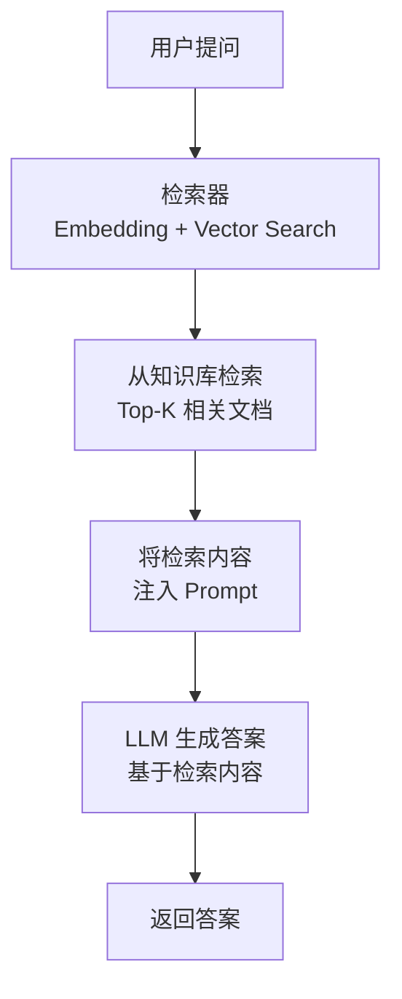
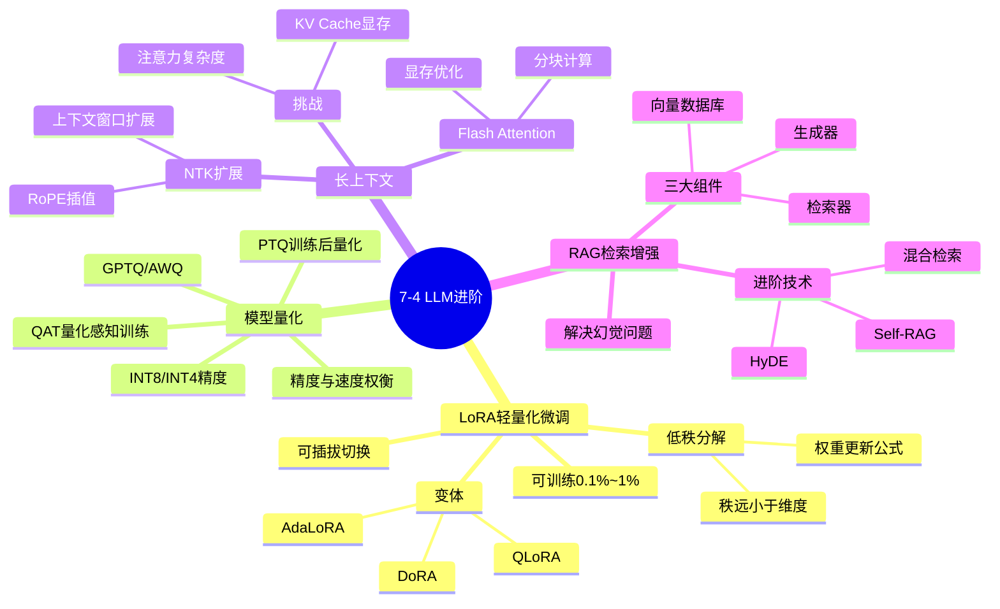

# 7-4 LLM 进阶技术

## 学习目标

- 理解 LoRA 的原理、优势与变体（QLoRA）
- 了解其他轻量化微调方法（Adapter、Prefix Tuning）
- 掌握模型量化的基本概念与方法
- 了解长上下文建模的技术（Flash Attention、NTK）
- 理解 RAG（检索增强生成）的基本原理与应用场景

---

## 1. LoRA（Low-Rank Adaptation）

### 背景问题

微调大模型（如 7B、70B 参数）需要大量 GPU 显存和训练时间。以 LLaMA 2 70B 为例，全参数微调需要约 80GB 显存（A100 80G 需多卡），普通研究者几乎无法承担。

### 核心思想

LoRA 的灵感来自**低秩矩阵近似**：大模型的权重矩阵虽然巨大，但在微调过程中实际更新的方向（梯度）往往可以用低秩矩阵很好地近似。

LoRA 不直接更新原始权重 $W$，而是在 $W$ 旁边**并行添加两个小矩阵** $A$ 和 $B$：

$$
W' = W + \Delta W = W + BA
$$

其中：
- $W \in \mathbb{R}^{d \times d}$：原始权重，训练时**冻结**
- $A \in \mathbb{R}^{d \times r}$：**随机初始化**
- $B \in \mathbb{R}^{r \times d}$：**训练过程中学习**
- $r \ll d$：秩（rank），通常取 4、8、16、32、64 等

### 参数规模对比

以 LLaMA 2 70B 为例：

| 方法 | 可训练参数量 | 显存需求（训练） |
|------|-------------|----------------|
| 全参数微调 | 70B（全部） | ~320GB（多卡） |
| LoRA（r=8） | ~100M～1B | ~24GB（单卡） |
| LoRA（r=64） | ~800M～2B | ~48GB（单卡） |

### LoRA 的优势

1. **参数效率高**：训练参数量仅为全量的 0.1%～1%
2. **显存友好**：可在消费级 GPU（如 RTX 3090）上训练 70B 模型
3. **可插拔**：不同任务训练不同的 LoRA 权重，可随时切换（类似"模型插件"）
4. **推理零额外成本**：可合并权重到原模型，推理时无延迟损失

### LoRA 权重合并

训练完成后，可将 $BA$ 合并回原始权重：

```python
# 原始推理
output = input @ (W + BA)

# 合并后推理（无额外计算）
W_merged = W + BA
output = input @ W_merged
```

### LoRA 变体

| 变体 | 改进点 |
|------|--------|
| **QLoRA** | 在 4-bit 量化的基础模型上应用 LoRA，更省显存 |
| **AdaLoRA** | 自适应调整不同层的 rank，优化参数分配 |
| **LoRA+** | 调整 A、B 的学习率配比，提升训练稳定性 |
| **DoRA** | 分解权重更新为 magnitude + direction，理论上更好 |

---

## 2. QLoRA：量化 + LoRA

### QLoRA 核心流程

QLoRA 由 Tim Dettmers 等人于 2023 年提出，核心思想是**将量化与 LoRA 结合**，在大幅降低显存需求的同时保持微调效果。

```
Step 1：模型量化
   70B FP16 模型 → 70B INT4 模型（从 140GB → ~35GB）

Step 2：NF4 量化
   使用 NormalFloat 4-bit（NF4）数据类型，保证数值分布均匀

Step 3：LoRA 微调
   在量化后的模型上应用 LoRA，只需额外 ~10GB 显存

Step 4：权重合并
   将 LoRA 权重合并回量化模型，恢复为可推理状态
```

### 量化基础概念

量化将高精度浮点数映射为低位整数表示：

| 数据类型 | 每参数位数 | 70B 模型大小 | 精度损失 |
|----------|-----------|-------------|---------|
| FP32 | 32bit | ~280GB | 无 |
| FP16/BF16 | 16bit | ~140GB | 极小 |
| INT8 | 8bit | ~70GB | 较小 |
| INT4 | 4bit | ~35GB | 适中 |
| **NF4** | 4bit | ~35GB | 量化特殊设计，损失更小 |

### QLoRA 的效果

- **LLaMA 2 70B**：在单张 A100（80GB）上即可完成微调
- **性能**：在多个基准上接近全参数微调，但成本大幅降低
- **代表性工具**：GPTQ、AWQ、llama.cpp、vLLM 等

---

## 3. 其他轻量化微调方法

### Adapter

Adapter 在 Transformer 层的**前馈网络（FFN）**之后添加小型瓶颈层：

```
原始：输入 → LayerNorm → Attention → FFN → 输出
添加Adapter后：输入 → LayerNorm → Attention → Adapter → FFN → 输出
```

- 参数量约为原始模型的 1%～2%
- 多个 Adapter 可并存，服务不同任务

### Prefix Tuning

在每个 Transformer 层的输入前添加**可学习的前缀 token**：

```
[P1][P2]...[Pr] [原始输入 tokens]
 ↑ 这些前缀是可学习的，其余参数冻结
```

适合文本生成任务，如摘要、翻译。

### Prompt Tuning

仅学习输入 embedding 层的前缀，更轻量（参数量最少）。

| 方法 | 可训练参数占比 | 适用场景 |
|------|---------------|----------|
| LoRA | 0.1%～1% | 通用，推荐首选 |
| Adapter | 1%～3% | 需要多任务切换 |
| Prefix Tuning | < 0.1% | 极低资源场景 |
| Prompt Tuning | < 0.01% | 最轻量，效果有限 |

---

## 4. 模型量化方法

### 量化方法分类

| 方法 | 说明 | 适用场景 |
|------|------|----------|
| **PTQ（Post-Training Quantization）** | 训练后量化，简单高效 | 推理部署 |
| **QAT（Quantization-Aware Training）** | 训练时模拟量化效果 | 需要更好精度 |
| **GPTQ** | 渐进式量化，逐层优化 | 4-bit 量化 |
| **AWQ** | Activation-aware Weight quantization | 4-bit 量化，精度更好 |
| **GGML/llama.cpp** | 量化 + 高效推理框架 | 本地部署 |

### 量化粒度

- **Per-tensor**：整个张量用同一量化参数
- **Per-channel**：每个通道（卷积核）独立量化
- **Per-group**：按组（通常 128 个元素）独立量化

### 精度 vs 推理速度权衡

```
FP16 → INT8：速度 ~2x，精度基本不变
FP16 → INT4：速度 ~4x，精度下降约 1%～5%（取决于模型和任务）
```

对于 4-bit 量化，通常需要配合 **LoRA 微调**来恢复精度。

---

## 5. 长上下文建模

### 挑战

LLM 处理长序列时面临两个核心挑战：

1. **注意力计算的二次方复杂度**：Self-Attention 的计算量是 $O(n^2)$，序列长度翻倍，计算量翻四倍
2. **显存占用线性增长**：KV Cache 与序列长度线性相关

### Flash Attention

**Flash Attention** 是 2022 年提出的高效注意力算法，核心思想是**不使用完整矩阵存储，而是分块计算并融化（融化 softmax）**，从而将计算复杂度从 $O(n^2)$ 降低，同时大幅减少显存占用。

```
原始 Attention：
Q @ K^T → Softmax → @ V
问题：需要计算并存储完整的 n×n 注意力矩阵，显存 O(n^2)

Flash Attention：
将 Q、K、V 分块，逐步融化计算
不需要存储完整矩阵，显存 O(n)
同时利用 GPU 的层级内存层次结构，提升计算效率
```

**效果**：
- 显存减少：**一半以上**
- 计算速度提升：**2～4 倍**
- 无精度损失（数值稳定）

###  NTK（Neural Tangent Kernel）扩展

NTK 扩展是一类用于**扩展模型上下文窗口**的技术，典型代表：

- **NTK-aware Scaled RoPE**：通过插值方法扩展 RoPE 的位置编码范围
- **YaRN**：Yet Another Range extension method
- **LongRoPE**：更激进的上下文扩展

这些技术允许模型在微调后处理**4K → 128K**甚至更长的上下文。

### 长上下文的典型应用场景

| 场景 | 所需上下文 |
|------|-----------|
| 论文阅读与摘要 | 8K～32K |
| 代码库理解 | 32K～128K |
| 小说撰写 | 64K+ |
| 长文档问答 | 128K+ |
| Agent 记忆 | 200K+ |

---

## 6. RAG（检索增强生成）

### 什么是 RAG

RAG（Retrieval-Augmented Generation）是一种**将外部知识检索与大模型生成相结合**的技术架构。

**核心问题**：LLM 的知识有截止日期，且可能"幻觉"（编造不存在的信息）。

**RAG 的解决思路**：在生成回答之前，先从外部知识库中检索相关信息，让模型基于真实资料生成答案。

### RAG 工作流程



### RAG 系统三大核心组件

| 组件 | 说明 | 常见技术 |
|------|------|----------|
| **检索器（Retriever）** | 将文本转为向量，在向量数据库中搜索相似内容 | BM25、dense retrieval、混合检索 |
| **向量数据库** | 存储文档的向量表示，支持高效相似度搜索 | Milvus、Pinecone、Chroma、FAISS |
| **生成器（Generator）** | 基于检索内容生成答案 | GPT-4、Claude、通义千问等 |

### RAG 的典型应用场景

| 场景 | 说明 |
|------|------|
| **企业知识库问答** | 让模型基于企业内部文档回答问题 |
| **产品客服** | 基于产品手册和 FAQ 回答客户问题 |
| **学术研究助手** | 基于论文库回答专业问题，并附带引用 |
| **代码助手** | 基于代码仓库回答"这个函数是干什么的" |

### RAG 进阶技术

| 技术 | 说明 |
|------|------|
| **Self-RAG** | 模型自行判断是否需要检索，避免不必要检索 |
| **Rewrite-Retrieve-Read** | 先改写问题再检索，提高召回率 |
| **HyDE** | 用假设答案引导检索方向 |
| **混合检索** | 结合关键词检索（BM25）和向量检索 |
| **Rerank** | 检索后重新排序，过滤低相关内容 |

---

## 本章小结

1. **LoRA** 通过低秩分解大幅减少可训练参数，是当前最主流的轻量化微调方法
2. **QLoRA** 结合量化与 LoRA，使得在单卡上微调大模型成为可能
3. **Adapter、Prefix Tuning** 等提供了不同的轻量化微调思路
4. **模型量化**（INT8/INT4）大幅降低推理成本，GPTQ/AWQ 是主流方法
5. **Flash Attention** 是长上下文建模的基础，大幅降低计算和显存开销
6. **RAG** 通过检索外部知识解决 LLM 幻觉和知识过时问题，是企业落地的标配架构

---

## 知识点思维导图



---

## 参考资料

1. Hu et al. "LoRA: Low-Rank Adaptation of Large Language Models" (ICLR 2022)
2. Dettmers et al. "QLoRA: Efficient Finetuning of Quantized LLMs" (NeurIPS 2023)
3. Dao et al. "FlashAttention: Fast and Memory-Efficient Exact Attention with IO-Awareness" (NeurIPS 2022)
4. Lewis et al. "Retrieval-Augmented Generation for Knowledge-Intensive NLP Tasks" (NeurIPS 2020)
5. Frantar et al. "GPTQ: Accurate Post-Training Quantization for Generative Pre-trained Transformers" (AAAI 2023)
6. Lin et al. "AWQ: Activation-Aware Weight Quantization for LLM Pruning and Distillation" (MLSYS 2024)