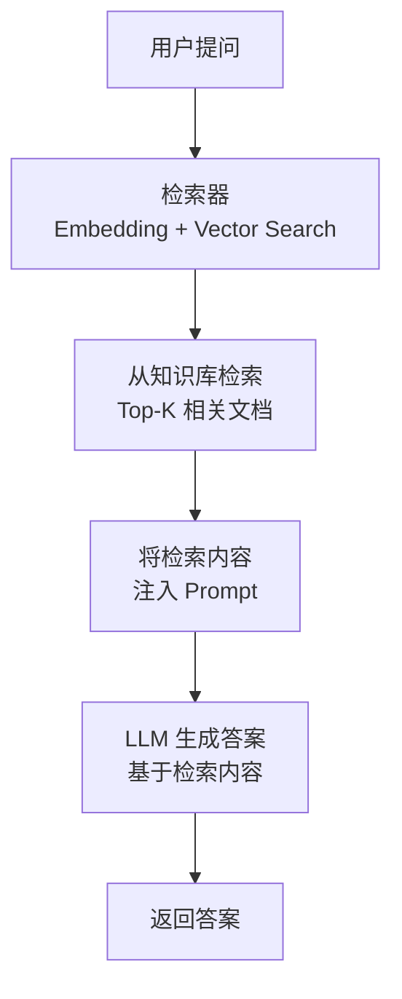
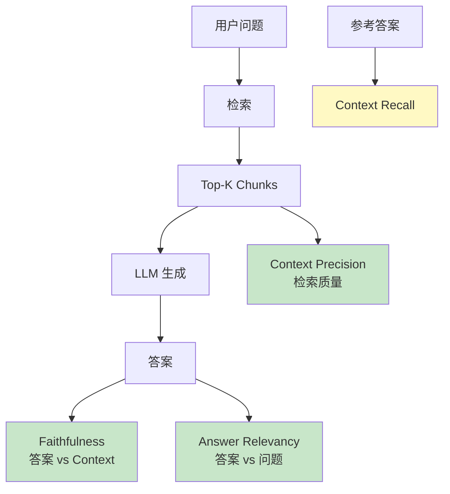
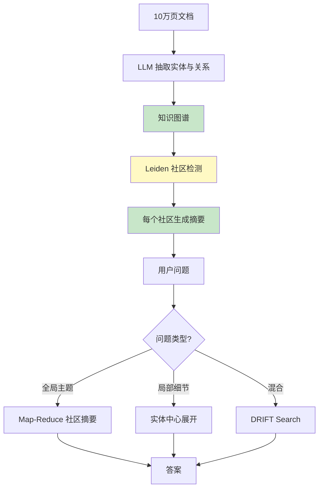
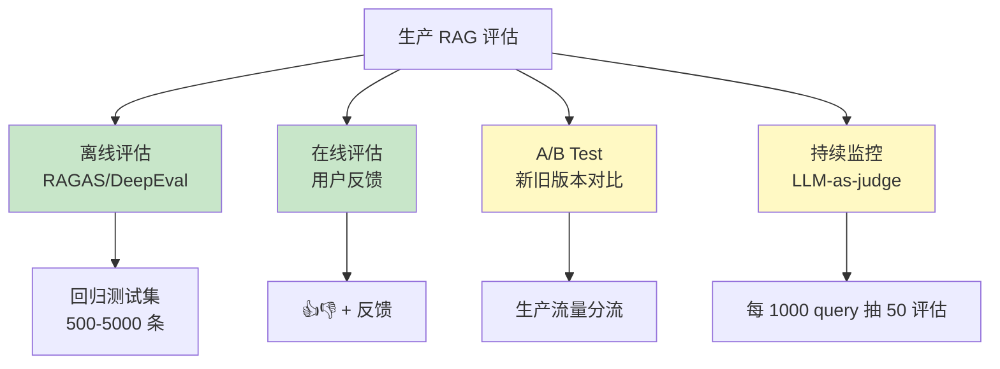
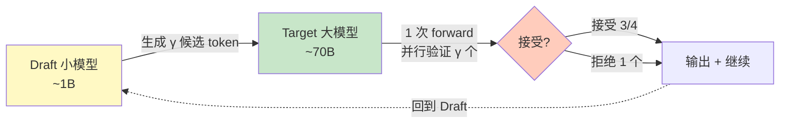
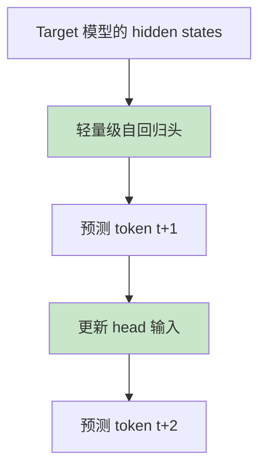
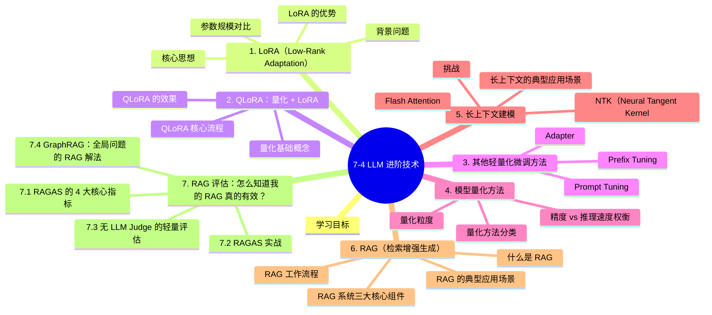

# 7-4 LLM 进阶技术

## 学习目标

- 理解 LoRA 的原理、优势与变体（QLoRA）
- 了解其他轻量化微调方法（Adapter、Prefix Tuning）
- 掌握模型量化的基本概念与方法
- 了解长上下文建模的技术（Flash Attention、NTK）
- 理解 RAG（检索增强生成）的基本原理与应用场景

---

## 1. LoRA（Low-Rank Adaptation）

### 背景问题

微调大模型（如 7B、70B 参数）需要大量 GPU 显存和训练时间。以 LLaMA 2 70B 为例，全参数微调需要约 80GB 显存（A100 80G 需多卡），普通研究者几乎无法承担。

### 核心思想

LoRA 的灵感来自**低秩矩阵近似**：大模型的权重矩阵虽然巨大，但在微调过程中实际更新的方向（梯度）往往可以用低秩矩阵很好地近似。

LoRA 不直接更新原始权重 $W$，而是在 $W$ 旁边**并行添加两个小矩阵** $A$ 和 $B$：

$$
W' = W + \Delta W = W + BA
$$

其中：
- $W \in \mathbb{R}^{d \times d}$：原始权重，训练时**冻结**
- $A \in \mathbb{R}^{d \times r}$：**随机初始化**
- $B \in \mathbb{R}^{r \times d}$：**训练过程中学习**
- $r \ll d$：秩（rank），通常取 4、8、16、32、64 等

### 参数规模对比

以 LLaMA 2 70B 为例：

| 方法 | 可训练参数量 | 显存需求（训练） |
|------|-------------|----------------|
| 全参数微调 | 70B（全部） | ~320GB（多卡） |
| LoRA（r=8） | ~100M～1B | ~24GB（单卡） |
| LoRA（r=64） | ~800M～2B | ~48GB（单卡） |

### LoRA 的优势

1. **参数效率高**：训练参数量仅为全量的 0.1%～1%
2. **显存友好**：可在消费级 GPU（如 RTX 3090）上训练 70B 模型
3. **可插拔**：不同任务训练不同的 LoRA 权重，可随时切换（类似"模型插件"）
4. **推理零额外成本**：可合并权重到原模型，推理时无延迟损失

### LoRA 权重合并

训练完成后，可将 $BA$ 合并回原始权重：

```python
# 原始推理
output = input @ (W + BA)

# 合并后推理（无额外计算）
W_merged = W + BA
output = input @ W_merged
```

### LoRA 变体

| 变体 | 改进点 |
|------|--------|
| **QLoRA** | 在 4-bit 量化的基础模型上应用 LoRA，更省显存 |
| **AdaLoRA** | 自适应调整不同层的 rank，优化参数分配 |
| **LoRA+** | 调整 A、B 的学习率配比，提升训练稳定性 |
| **DoRA** | 分解权重更新为 magnitude + direction，理论上更好 |

---

## 2. QLoRA：量化 + LoRA

### QLoRA 核心流程

QLoRA 由 Tim Dettmers 等人于 2023 年提出，核心思想是**将量化与 LoRA 结合**，在大幅降低显存需求的同时保持微调效果。

```
Step 1：模型量化
   70B FP16 模型 → 70B INT4 模型（从 140GB → ~35GB）

Step 2：NF4 量化
   使用 NormalFloat 4-bit（NF4）数据类型，保证数值分布均匀

Step 3：LoRA 微调
   在量化后的模型上应用 LoRA，只需额外 ~10GB 显存

Step 4：权重合并
   将 LoRA 权重合并回量化模型，恢复为可推理状态
```

### 量化基础概念

量化将高精度浮点数映射为低位整数表示：

| 数据类型 | 每参数位数 | 70B 模型大小 | 精度损失 |
|----------|-----------|-------------|---------|
| FP32 | 32bit | ~280GB | 无 |
| FP16/BF16 | 16bit | ~140GB | 极小 |
| INT8 | 8bit | ~70GB | 较小 |
| INT4 | 4bit | ~35GB | 适中 |
| **NF4** | 4bit | ~35GB | 量化特殊设计，损失更小 |

### QLoRA 的效果

- **LLaMA 2 70B**：在单张 A100（80GB）上即可完成微调
- **性能**：在多个基准上接近全参数微调，但成本大幅降低
- **代表性工具**：GPTQ、AWQ、llama.cpp、vLLM 等

---

## 3. 其他轻量化微调方法

### Adapter

Adapter 在 Transformer 层的**前馈网络（FFN）**之后添加小型瓶颈层：

```
原始：输入 → LayerNorm → Attention → FFN → 输出
添加Adapter后：输入 → LayerNorm → Attention → Adapter → FFN → 输出
```

- 参数量约为原始模型的 1%～2%
- 多个 Adapter 可并存，服务不同任务

### Prefix Tuning

在每个 Transformer 层的输入前添加**可学习的前缀 token**：

```
[P1][P2]...[Pr] [原始输入 tokens]
 ↑ 这些前缀是可学习的，其余参数冻结
```

适合文本生成任务，如摘要、翻译。

### Prompt Tuning

仅学习输入 embedding 层的前缀，更轻量（参数量最少）。

| 方法 | 可训练参数占比 | 适用场景 |
|------|---------------|----------|
| LoRA | 0.1%～1% | 通用，推荐首选 |
| Adapter | 1%～3% | 需要多任务切换 |
| Prefix Tuning | < 0.1% | 极低资源场景 |
| Prompt Tuning | < 0.01% | 最轻量，效果有限 |

---

## 4. 模型量化方法

### 量化方法分类

| 方法 | 说明 | 适用场景 |
|------|------|----------|
| **PTQ（Post-Training Quantization）** | 训练后量化，简单高效 | 推理部署 |
| **QAT（Quantization-Aware Training）** | 训练时模拟量化效果 | 需要更好精度 |
| **GPTQ** | 渐进式量化，逐层优化 | 4-bit 量化 |
| **AWQ** | Activation-aware Weight quantization | 4-bit 量化，精度更好 |
| **GGML/llama.cpp** | 量化 + 高效推理框架 | 本地部署 |

### 量化粒度

- **Per-tensor**：整个张量用同一量化参数
- **Per-channel**：每个通道（卷积核）独立量化
- **Per-group**：按组（通常 128 个元素）独立量化

### 精度 vs 推理速度权衡

```
FP16 → INT8：速度 ~2x，精度基本不变
FP16 → INT4：速度 ~4x，精度下降约 1%～5%（取决于模型和任务）
```

对于 4-bit 量化，通常需要配合 **LoRA 微调**来恢复精度。

---

## 5. 长上下文建模

### 挑战

LLM 处理长序列时面临两个核心挑战：

1. **注意力计算的二次方复杂度**：Self-Attention 的计算量是 $O(n^2)$，序列长度翻倍，计算量翻四倍
2. **显存占用线性增长**：KV Cache 与序列长度线性相关

### Flash Attention

**Flash Attention** 是 2022 年提出的高效注意力算法，核心思想是**不使用完整矩阵存储，而是分块计算并融化（融化 softmax）**，从而将计算复杂度从 $O(n^2)$ 降低，同时大幅减少显存占用。

```
原始 Attention：
Q @ K^T → Softmax → @ V
问题：需要计算并存储完整的 n×n 注意力矩阵，显存 O(n^2)

Flash Attention：
将 Q、K、V 分块，逐步融化计算
不需要存储完整矩阵，显存 O(n)
同时利用 GPU 的层级内存层次结构，提升计算效率
```

**效果**：
- 显存减少：**一半以上**
- 计算速度提升：**2～4 倍**
- 无精度损失（数值稳定）

###  NTK（Neural Tangent Kernel）扩展

NTK 扩展是一类用于**扩展模型上下文窗口**的技术，典型代表：

- **NTK-aware Scaled RoPE**：通过插值方法扩展 RoPE 的位置编码范围
- **YaRN**：Yet Another Range extension method
- **LongRoPE**：更激进的上下文扩展

这些技术允许模型在微调后处理**4K → 128K**甚至更长的上下文。

### 长上下文的典型应用场景

| 场景 | 所需上下文 |
|------|-----------|
| 论文阅读与摘要 | 8K～32K |
| 代码库理解 | 32K～128K |
| 小说撰写 | 64K+ |
| 长文档问答 | 128K+ |
| Agent 记忆 | 200K+ |

---

## 6. RAG（检索增强生成）

### 什么是 RAG

RAG（Retrieval-Augmented Generation）是一种**将外部知识检索与大模型生成相结合**的技术架构。

**核心问题**：LLM 的知识有截止日期，且可能"幻觉"（编造不存在的信息）。

**RAG 的解决思路**：在生成回答之前，先从外部知识库中检索相关信息，让模型基于真实资料生成答案。

### RAG 工作流程



### RAG 系统三大核心组件

| 组件 | 说明 | 常见技术 |
|------|------|----------|
| **检索器（Retriever）** | 将文本转为向量，在向量数据库中搜索相似内容 | BM25、dense retrieval、混合检索 |
| **向量数据库** | 存储文档的向量表示，支持高效相似度搜索 | Milvus、Pinecone、Chroma、FAISS |
| **生成器（Generator）** | 基于检索内容生成答案 | GPT-4、Claude、通义千问等 |

### RAG 的典型应用场景

| 场景 | 说明 |
|------|------|
| **企业知识库问答** | 让模型基于企业内部文档回答问题 |
| **产品客服** | 基于产品手册和 FAQ 回答客户问题 |
| **学术研究助手** | 基于论文库回答专业问题，并附带引用 |
| **代码助手** | 基于代码仓库回答"这个函数是干什么的" |

### RAG 进阶技术

| 技术 | 说明 |
|------|------|
| **Self-RAG** | 模型自行判断是否需要检索，避免不必要检索 |
| **Rewrite-Retrieve-Read** | 先改写问题再检索，提高召回率 |
| **HyDE** | 用假设答案引导检索方向 |
| **混合检索** | 结合关键词检索（BM25）和向量检索 |
| **Rerank** | 检索后重新排序，过滤低相关内容 |

---

## 7. RAG 评估：怎么知道我的 RAG 真的有效？

> 生产 AI 工程师被问得最多的问题：**"我的 RAG 系统到底好不好？"**

**传统评估的两大困境**：
1. **没有标准答案**：开放域问答常常"答案合理但与参考答案不同"
2. **人工评估贵**：1000 个 query 标注 = 数千元成本

**RAGAS**（Retrieval-Augmented Generation Assessment, 2023）解决了这个问题——**LLM-as-judge**，无需人工标注。

### 7.1 RAGAS 的 4 大核心指标

| 指标 | 含义 | 计算方式 |
|------|------|----------|
| **Faithfulness（忠实度）** | 答案中的每个事实是否被 context 支持 | LLM 把答案拆成原子声明，逐个判断"能否从 context 推出" |
| **Context Precision（上下文精确率）** | 检索到的 chunk 有多少是真正相关的 | 排名加权——越靠前的相关 chunk 得分越高 |
| **Context Recall（上下文召回率）** | 答案所需的全部信息是否都检索到了 | 需要 ground truth（参考答案） |
| **Answer Relevancy（答案相关性）** | 答案与问题的相关程度 | 反向工程：从答案生成 N 个假设问题，与原问题做 embedding 相似度 |



### 7.2 RAGAS 实战

```python
# pip install ragas
from ragas import evaluate
from ragas.metrics import (
    faithfulness,
    context_precision,
    context_recall,
    answer_relevancy,
)
from datasets import Dataset

# 准备测试集
test_data = {
    "question": ["什么是 Mamba 架构？", "vLLM 的核心创新是什么？"],
    "answer": ["Mamba 是选择性状态空间模型...", "vLLM 用 PagedAttention..."],
    "contexts": [
        ["Mamba 通过 input-dependent 参数实现内容推理..."],
        ["PagedAttention 把 KV Cache 分页管理..."]
    ],
    "ground_truth": [
        "Mamba 是 Albert Gu 提出的状态空间模型...",
        "vLLM 引入 PagedAttention..."
    ]
}
dataset = Dataset.from_dict(test_data)

# 一行评估
result = evaluate(
    dataset,
    metrics=[faithfulness, context_precision, context_recall, answer_relevancy],
    llm=evaluator_llm,  # 用 GPT-4 或 Claude 作 judge
)
print(result)
# {'faithfulness': 0.92, 'context_precision': 0.85,
#  'context_recall': 0.78, 'answer_relevancy': 0.88}
```

### 7.3 无 LLM Judge 的轻量评估

如果**不想每次评估都调用 GPT-4**（每次 1000 个 query 评估可能要 $30+），可使用：

| 工具 | 用途 | 优势 |
|------|------|------|
| **Vectara HHEM-2.1-Open** | Faithfulness | 70M 参数，毫秒级，免费 |
| **RAGAS + 规则评估** | 简单场景 | 0 成本 |
| **DeepEval** | 综合 | 开源 + 多种 metric |
| **LangSmith Evaluators** | LangChain 用户 | 集成 trace |
| **Phoenix (Arize)** | 可观测性 + eval | 完整链路追踪 |

```python
# 用本地小模型做 faithfulness 评估
from ragas.metrics import Faithfulness

# 自定义 evaluator（用本地 HuggingFace 模型）
local_llm = HuggingFacePipeline.from_model_id(
    model_id="Qwen/Qwen2.5-7B-Instruct",
    task="text-generation"
)

metric = Faithfulness(llm=local_llm)
score = metric.score({"response": answer, "context": context})
```

### 7.4 GraphRAG：全局问题的 RAG 解法

**问题**：传统向量 RAG 在**"全局问题"**上表现差——

> "这份 10 万页的公司年报，主要讨论了哪些主题？"
> "这个代码库里最常被引用的模块是哪些？"

**这类问题需要"全局理解"**，而向量 RAG 只能检索局部段落。

**GraphRAG**（Microsoft, 2024）通过**实体知识图谱 + Leiden 社区检测**解决：



#### GraphRAG 4 种查询模式

| 模式 | 适用问题 | 原理 |
|------|----------|------|
| **Global Search** | "主要主题是什么？" | Map-Reduce 遍历社区摘要 |
| **Local Search** | "X 公司和 Y 公司关系？" | 实体为中心，向外展开 N 跳 |
| **DRIFT Search** | 混合 | Local + Community 上下文 |
| **Basic Search** | 简单 | 向量检索（fallback） |

#### 实战

```bash
# pip install graphrag
# 初始化项目
mkdir -p ./ragtest && cd ./ragtest
graphrag init --root ./ragtest

# 1. 把文档放到 ./ragtest/input/
cp my_documents/*.txt ./ragtest/input/

# 2. 配置 LLM（settings.yaml）
# default_llm:
#   api_key: ${GRAPHRAG_API_KEY}
#   model: gpt-4o-mini

# 3. 索引（耗时但只做一次）
graphrag index --root ./ragtest

# 4. 查询
graphrag query --root ./ragtest \
    --method global \
    --query "这份文档的主要主题是什么？"
```

#### LazyGraphRAG（2024.11）

**问题**：GraphRAG 索引阶段**极其昂贵**——LLM 要对每个 chunk 做实体抽取、关系抽取、社区摘要。

**LazyGraphRAG**（Microsoft, 2024）把昂贵的 LLM 调用**推迟到查询时**，索引成本**降低 700×**：

| 维度 | GraphRAG | LazyGraphRAG |
|------|----------|--------------|
| 索引成本 | 高（每个 chunk 都要 LLM） | 极低（仅 NLP 预处理） |
| 查询成本 | 低 | 中（按需 LLM） |
| 适用 | 频繁查询、大语料 | 偶发查询、小语料 |
| 全局问题能力 | 强 | 强（结果相似） |

### 7.5 生产 RAG 评估最佳实践



| 实践 | 关键点 |
|------|--------|
| **黄金测试集** | 至少 500 条真实 query + 人工标注，**每月更新** |
| **单元测试式** | 每次改 retriever/embedding 必跑 RAGAS |
| **A/B Test** | 新旧版本同时上线 5% 流量，对比真实用户反馈 |
| **生产监控** | 每天采样 100-1000 条用 LLM-judge 评估 |
| **多维度评估** | Faithfulness + Context Precision + Answer Relevancy 同时看 |
| **失败案例复盘** | 每月人工 review 50 条低分 case，找根因 |

### 7.6 RAG vs Long Context：何时选哪个

2024-2025 长上下文模型（Gemini 1.5 / Qwen3 1M）兴起后，"RAG 会被取代吗？"成为热门话题。

**答案**：**不会**。RAG 和 Long Context 是**互补**关系。

| 维度 | RAG | Long Context |
|------|-----|--------------|
| **成本** | 低（按需检索） | 高（百万 token 都要算） |
| **准确性** | 取决于检索质量 | 模型自身能力 |
| **隐私性** | 可控制检索范围 | 全部进上下文 |
| **更新速度** | 改索引即可 | 需要重新处理 |
| **可扩展性** | O(N) chunks 友好 | 受限于上下文窗口 |
| **全局问题** | ❌ 弱（GraphRAG 补救） | ✅ 强 |
| **精确检索** | ✅ 强 | ⚠️ "lost in the middle" |

**实战选择**：
- **< 100K tokens** + 频繁变化 → RAG
- **> 1M tokens** + 全局问题 → Long Context
- **大知识库 + 全局 + 局部** → **GraphRAG + Long Context 混合**
- **成本敏感** → RAG（永远更便宜）

### 7.7 RAG 评估的 5 大常见坑

1. **过度依赖 Faithfulness** → 答案可能"忠实但答非所问"
2. **Context Recall 必须有 GT** → 但生产中 GT 难获得，可用**问题-答案对**近似
3. **LLM Judge 自身有偏** → 用**多个 Judge 取平均**，或用**专门训练的 eval 模型**（HHEM）
4. **评估集太"干净"** → 真实 query 多噪声，**收集真实用户 query**
5. **指标停滞不优化** → 指标只是诊断，**根因分析**（retrieval? reranking? prompt?）才有用

---

## 8. Speculative Decoding：无损推理加速

**已在 10-4 中讲过 Speculative Decoding 的部署侧应用**，这里从算法原理角度深入。

### 8.1 核心思想



**关键性质**：**严格等价**于大模型自回归——接受的 token 概率分布**完全相同**，**没有质量损失**。

### 8.2 数学原理

**步骤 1**：Draft 模型生成 $\gamma$ 个候选 token $x_1, ..., x_\gamma$（快速、小模型）。

**步骤 2**：Target 模型**一次 forward** 计算这 $\gamma$ 个 token 的条件概率 $p_1, ..., p_\gamma$。

**步骤 3**：逐个 token 计算接受概率：

$$
\alpha_i = \min\left(1, \frac{p_i(x_i)}{q_i(x_i)}\right)
$$

其中 $q_i$ 是 draft 模型的概率。**以 $\alpha_i$ 概率接受** $x_i$。

**步骤 4**：第一个被拒绝的位置 $k$，从 $p_k$ 中**重新采样**一个新 token，然后跳回 Draft 模型继续。

### 8.3 现代变体

| 方法 | Draft 模型 | 加速比 | 优势 |
|------|------------|--------|------|
| **Standard SD** (2023) | 独立小模型 | 2-3× | 简单 |
| **EAGLE-2** (2024) | 训练一个 autoregressive 头 | 3-4× | SOTA 草稿质量 |
| **Medusa** (2024) | Target 模型上的多个 MLP 头 | 2-3× | 零额外参数 |
| **Self-Speculative** | Target 模型自己的前 N 层 | 1.5-2× | 无独立模型 |
| **PLD / SAM** (2024) | 检索式（n-gram 匹配） | 1.5-2× | 训练免费 |
| **MTP (Qwen3-Next)** | 多 token 预测模块 | 2-3× | 训练期集成 |

### 8.4 EAGLE-2 工作原理



**核心创新**：草稿头用 target 模型的**隐藏状态**（不是 token embedding）作输入，预测**下一个 token + 下一个 hidden state**——质量大幅提升。

### 8.5 vLLM 中启用 Speculative Decoding

```bash
# 安装
pip install vllm

# 启动：使用 EAGLE 草稿模型
vllm serve meta-llama/Llama-3.1-70B-Instruct \
    --speculative-model yuhuili/EAGLE-LLaMA3.1-Instruct-70B \
    --num-speculative-tokens 5 \
    --gpu-memory-utilization 0.9
```

**生产收益**：

| 场景 | 加速比 | 何时用 |
|------|--------|--------|
| **长输出**（>500 token） | 2-3× | 代码生成、写作 |
| **短输出**（<50 token） | 1.0-1.3× | 分类、抽取 |
| **高并发** | 2-4× | 多个用户同时请求 |
| **低并发** | 1.5-2× | 单请求场景 |

---

## 9. Flash Attention 3 与 KV Cache 压缩

### 9.1 Flash Attention 3（Hopper 优化）

Flash Attention 系列是当前生产级 LLM 推理/训练的事实标准。FA3 专门针对 NVIDIA **Hopper 架构（H100/H200）**优化：

| 版本 | 架构 | 关键技术 | 相对速度 |
|------|------|---------|---------|
| FA-1 (2022) | Ampere | Tiling + 重计算 | 2-4× vs PyTorch |
| FA-2 (2023) | Ampere/Ada | Work partitioning | 4-8× |
| **FA-3 (2024)** | **Hopper** | **WGMMA + 异步 + FP8** | **1.5-2× vs FA-2** |

**FA-3 的三大优化**：
1. **WGMMA 指令**：利用 Hopper 的 WGMMA（Warpgroup Matrix-Multiply-Accumulate）做更高效的张量核心调用
2. **异步流水线**：把 softmax 和 matmul 重叠执行，隐藏 HBM 延迟
3. **FP8 精度**：对 QK^T 和 SV 使用 FP8 矩阵，吞吐量翻倍

**实战部署**：
```python
# HuggingFace transformers 自动使用 FA-3 (在 H100 上)
from transformers import AutoModelForCausalLM
model = AutoModelForCausalLM.from_pretrained(
    "Qwen/Qwen3-235B-A22B",
    attn_implementation="flash_attention_3",  # 在 H100 上自动启用
    torch_dtype=torch.bfloat16,
)
```

### 9.2 KV Cache 压缩：突破长上下文推理瓶颈

KV Cache 占用与序列长度线性增长，是长上下文推理的主要瓶颈。例如 Qwen3-32B 处理 128K 上下文，KV Cache 需要 ~16GB。

**主流压缩技术**：

| 方法 | 压缩率 | 核心思想 | 代表工作 |
|------|-------|---------|---------|
| **Multi-Query Attention (MQA)** | 16-32× | 所有头共享 1 个 K/V | PaLM, Falcon |
| **Grouped-Query Attention (GQA)** | 4-8× | 头分组共享 K/V | Llama 2/3, Qwen3 |
| **KV Quantization** | 2-8× | 2/3/4-bit 量化 KV | KVQuant, KIVI |
| **Sliding Window** | 与窗口大小成反比 | 只保留最近 N 个 token | Mistral (4096) |
| **PagedAttention** | 显存利用率 90%+ | 分页管理 + 共享 | vLLM |
| **Cross-Layer KV Sharing** | 与层数成正比 | 跨层共享 KV | CLA, LayerKV |
| **Token Importance Eviction** | 4-8× | 动态淘汰不重要 token | StreamingLLM, H2O |

**Qwen3 的方案**：
- 32B 模型使用 **GQA-8**（32 个 Q 头，4 个 KV 组）
- 配合 **PagedAttention (vLLM)** 和 **INT8 KV 量化**
- 在 128K 上下文上单 H100 可服务 ~20 并发请求

**KV Cache 量化对比**（基于 Llama-3-70B）：

| 量化精度 | 显存节省 | 质量损失 | 适用场景 |
|---------|---------|---------|---------|
| FP16 (基线) | 0% | 0% | 训练 / 高质量推理 |
| INT8 | 50% | <1% | 通用生产 |
| INT4 | 75% | 1-3% | 长上下文 |
| INT2 | 87.5% | 3-8% | 仅在 attention 量化时 |
| 1-bit | 93.75% | 显著 | 实验性 |

**实战工具**：
- `vllm` 0.4+ 支持 KV INT8/FP8 量化
- `sglang` 支持 RadixAttention + 量化 KV
- `transformers` 4.45+ 内置 GQA-aware attention

### 9.3 Long-Context 推理的工程实践

针对 100K+ 上下文的生产级部署：

1. **分块预填充（Chunked Prefill）**：把长 prompt 切分为多块，逐步灌入 KV Cache
2. **Prefix Caching**：跨请求共享相同前缀的 KV（如 system prompt）
3. **Speculative Decoding**：用小模型 draft、大模型 verify，加速 2-3×
4. **Continuous Batching**：动态调度，提升 23× 吞吐量（vLLM）
5. **Disaggregated Inference**：预填充和 decode 分离到不同 GPU

---

## 本章小结

1. **LoRA** 通过低秩分解大幅减少可训练参数，是当前最主流的轻量化微调方法
2. **QLoRA** 结合量化与 LoRA，使得在单卡上微调大模型成为可能
3. **Adapter、Prefix Tuning** 等提供了不同的轻量化微调思路
4. **模型量化**（INT8/INT4）大幅降低推理成本，GPTQ/AWQ 是主流方法
5. **Flash Attention** 是长上下文建模的基础，大幅降低计算和显存开销
6. **RAG** 通过检索外部知识解决 LLM 幻觉和知识过时问题，是企业落地的标配架构
7. **RAGAS 评估**是 RAG 系统的"CT 扫描"——4 大指标（Faithfulness/Context Precision/Context Recall/Answer Relevancy）必须同时看
8. **GraphRAG** 解决"全局问题"——通过 LLM 抽取的实体图谱 + Leiden 社区检测，是 RAG 的重要补充
9. **Speculative Decoding** 用小模型猜 + 大模型并行验证，**严格无损**加速 2-3×
10. **生产 RAG 评估**需要"黄金测试集 + A/B 测试 + LLM-Judge 监控"三件套

---


## 知识图谱



## 参考资料

1. Hu et al. "LoRA: Low-Rank Adaptation of Large Language Models" (ICLR 2022)
2. Dettmers et al. "QLoRA: Efficient Finetuning of Quantized LLMs" (NeurIPS 2023)
3. Dao et al. "FlashAttention: Fast and Memory-Efficient Exact Attention with IO-Awareness" (NeurIPS 2022)
4. Lewis et al. "Retrieval-Augmented Generation for Knowledge-Intensive NLP Tasks" (NeurIPS 2020)
5. Frantar et al. "GPTQ: Accurate Post-Training Quantization for Generative Pre-trained Transformers" (AAAI 2023)
6. Lin et al. "AWQ: Activation-Aware Weight Quantization for LLM Pruning and Distillation" (MLSYS 2024)