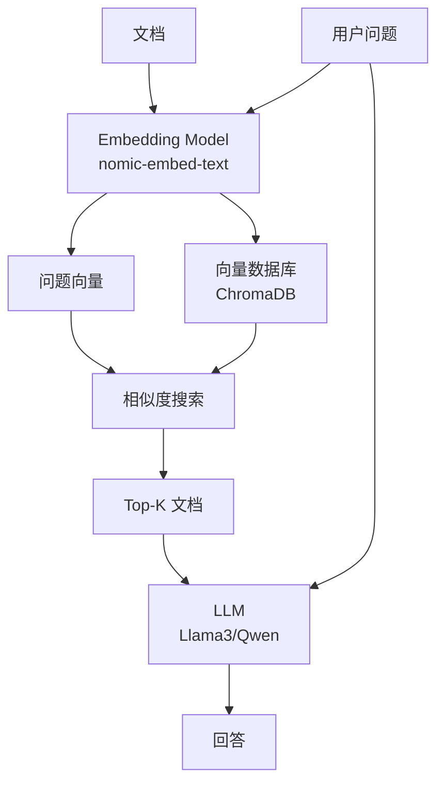
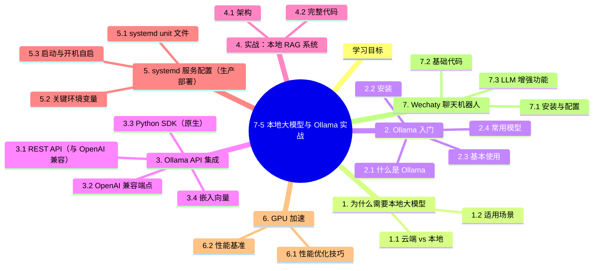

# 7-5 本地大模型与 Ollama 实战

## 学习目标

- 理解本地部署大语言模型（LLM）的核心价值
- 掌握 Ollama 工具的安装、配置与基本使用
- 能够使用 Ollama 部署主流开源 LLM（Llama、Qwen、DeepSeek 等）
- 了解如何与本地 LLM 集成（Python API、HTTP API）
- 掌握 Wechaty 聊天机器人框架与 LLM 结合
- 了解 Cursor 规则与 AI 编程协作

---

## 1. 为什么需要本地大模型

云端 LLM（GPT-4、Claude）虽然强大，但在很多场景下**本地部署**更合适：

### 1.1 云端 vs 本地

| 维度 | 云端 LLM (GPT-4/Claude) | 本地 LLM (Ollama+开源模型) |
|------|------------------------|--------------------------|
| **性能** | 最强 | 接近但略弱 |
| **数据隐私** | 数据上云 | 完全本地 |
| **成本** | 按 token 计费，长期贵 | 一次部署，反复使用 |
| **网络依赖** | 必须联网 | 可离线 |
| **定制** | 困难 | 可微调 |
| **速度** | 网络延迟 | 本地推理快 |

### 1.2 适用场景

| 场景 | 推荐 |
|------|------|
| 个人学习/研究 | 本地 |
| 企业敏感数据 | 本地 |
| 大规模生产（>千万次/天） | 云端 API |
| 实时性要求高 | 本地 |
| 需要 GPT-4 级别能力 | 云端 |
| 资源有限 | 云端 |

---

## 2. Ollama 入门

### 2.1 什么是 Ollama

Ollama 是一个**本地大模型运行工具**，让用户用一行命令下载、运行、管理开源 LLM。

**核心优势**：
- 一键安装、运行模型
- 内置 REST API（与 OpenAI API 兼容）
- 自动管理模型权重、依赖
- 跨平台（macOS、Linux、Windows）

### 2.2 安装

```bash
# macOS / Linux 一键安装
curl -fsSL https://ollama.com/install.sh | sh

# 验证
ollama --version
```

### 2.3 基本使用

```bash
# 1. 下载并运行模型（自动下载）
ollama run llama3
# 等价于：ollama pull llama3 && ollama run llama3

# 2. 列出本地模型
ollama list

# 3. 显示模型信息
ollama show llama3

# 4. 删除模型
ollama rm llama3

# 5. 复制模型（基于已有模型自定义）
ollama cp llama3 my-llama

# 6. 启动服务（默认监听 11434 端口）
ollama serve
```

### 2.4 常用模型

| 模型 | 参数量 | 内存需求 | 适合场景 |
|------|--------|----------|----------|
| **Llama 3** | 8B | 8GB | 通用对话 |
| **Llama 3 70B** | 70B | 64GB+ | 高质量生成 |
| **Qwen 2.5** | 7B/14B/72B | 8GB-72GB | 中文场景 |
| **DeepSeek Coder** | 6.7B/33B | - | 代码生成 |
| **Mistral** | 7B | 8GB | 轻量级 |
| **Gemma 2** | 9B/27B | 10GB+ | Google 系 |
| **Phi-3** | 3.8B | 4GB | 极致轻量 |
| **Qwen-VL** | 7B | 16GB | 视觉-语言多模态 |
| **CodeLlama** | 7B/13B/34B | - | 代码专用 |

```bash
# 中文场景推荐
ollama run qwen2.5:7b

# 代码生成
ollama run deepseek-coder:6.7b

# 视觉多模态
ollama run llava:13b
```

### 2.5 自定义模型（Modelfile）

通过 Modelfile 自定义模型行为（类似 Dockerfile）：

```dockerfile
# Modelfile
FROM llama3

# 设置参数
PARAMETER temperature 0.7
PARAMETER top_p 0.9
PARAMETER top_k 40
PARAMETER num_ctx 4096

# 设置系统提示词
SYSTEM """
你是一位专业的 Python 工程师，专注于数据科学和机器学习。
回答时使用简洁的代码示例。
"""

# 设置模板（可选）
TEMPLATE """[INST] {{ .System }} {{ .Prompt }} [/INST]"""
```

```bash
# 创建自定义模型
ollama create my-python-expert -f ./Modelfile

# 运行
ollama run my-python-expert
```

---

## 3. Ollama API 集成

### 3.1 REST API（与 OpenAI 兼容）

Ollama 提供与 OpenAI 兼容的 API，便于迁移：

```bash
# 列出本地模型
curl http://localhost:11434/api/tags

# 生成文本
curl http://localhost:11434/api/generate -d '{
  "model": "llama3",
  "prompt": "为什么天空是蓝色的？",
  "stream": false
}'

# 聊天模式
curl http://localhost:11434/api/chat -d '{
  "model": "llama3",
  "messages": [
    {"role": "user", "content": "你好，介绍一下你自己"}
  ],
  "stream": false
}'
```

### 3.2 OpenAI 兼容端点

Ollama 同时提供与 OpenAI API 完全兼容的端点：

```python
from openai import OpenAI

# 把 base_url 指向 Ollama
client = OpenAI(
    base_url='http://localhost:11434/v1',
    api_key='ollama'  # 任意字符串，Ollama 不验证
)

# 用法与 OpenAI 一样
response = client.chat.completions.create(
    model="llama3",
    messages=[
        {"role": "system", "content": "你是一个 Python 专家"},
        {"role": "user", "content": "如何优化 PyTorch 训练速度？"}
    ]
)
print(response.choices[0].message.content)
```

**优势**：所有用 OpenAI SDK 的代码可以**零修改**切到 Ollama 本地。

### 3.3 Python SDK（原生）

```python
import ollama

# 同步调用
response = ollama.chat(
    model='llama3',
    messages=[
        {'role': 'user', 'content': '解释量子计算'}
    ]
)
print(response['message']['content'])

# 流式调用
stream = ollama.chat(
    model='llama3',
    messages=[{'role': 'user', 'content': '写一首诗'}],
    stream=True
)
for chunk in stream:
    print(chunk['message']['content'], end='', flush=True)
```

### 3.4 嵌入向量

```python
# 单个文本
response = ollama.embeddings(
    model='nomic-embed-text',
    prompt='这是要嵌入的文本'
)
embedding = response['embedding']  # 768 维向量

# 批量
texts = ['文本1', '文本2', '文本3']
embeddings = [ollama.embeddings(model='nomic-embed-text', prompt=t)['embedding'] for t in texts]
```

---

## 4. 实战：本地 RAG 系统

**RAG（Retrieval-Augmented Generation）** 是结合本地 LLM 与向量数据库的典型应用。

### 4.1 架构



### 4.2 完整代码

```python
import ollama
import chromadb

# 1. 准备知识库
documents = [
    "Ollama 是一个本地大模型运行工具",
    "Llama 3 是 Meta 开源的大语言模型",
    "RAG 是检索增强生成，结合检索和生成",
    "向量数据库用于存储文本嵌入",
]

# 2. 嵌入并存储
client = chromadb.PersistentClient(path="./chroma_db")
collection = client.get_or_create_collection("knowledge_base")

for i, doc in enumerate(documents):
    emb = ollama.embeddings(model='nomic-embed-text', prompt=doc)['embedding']
    collection.add(ids=[str(i)], embeddings=[emb], documents=[doc])

# 3. 检索
def retrieve(query, top_k=2):
    q_emb = ollama.embeddings(model='nomic-embed-text', prompt=query)['embedding']
    results = collection.query(query_embeddings=[q_emb], n_results=top_k)
    return results['documents'][0]

# 4. 生成回答
def rag_query(question):
    context = "\n".join(retrieve(question))
    prompt = f"""基于以下上下文回答问题。如果上下文不包含答案，请说"我不知道"。

上下文：
{context}

问题：{question}
回答："""
    response = ollama.chat(
        model='qwen2.5',
        messages=[{'role': 'user', 'content': prompt}]
    )
    return response['message']['content']

# 5. 测试
print(rag_query("什么是 RAG？"))
print(rag_query("Python 怎么学？"))  # 应该回答"我不知道"
```

---

## 5. systemd 服务配置（生产部署）

### 5.1 systemd unit 文件

```ini
# /etc/systemd/system/ollama.service
[Unit]
Description=Ollama Service
After=network-online.target

[Service]
ExecStart=/usr/local/bin/ollama serve
User=ollama
Group=ollama
Restart=always
RestartSec=3
Environment="HOME=/usr/share/ollama"
Environment="OLLAMA_HOST=0.0.0.0:11434"
Environment="OLLAMA_MODELS=/data/ollama/models"
Environment="OLLAMA_NUM_PARALLEL=4"
Environment="OLLAMA_MAX_LOADED_MODELS=2"

[Install]
WantedBy=default.target
```

### 5.2 关键环境变量

| 变量 | 说明 |
|------|------|
| `OLLAMA_HOST` | 监听地址（默认 127.0.0.1:11434） |
| `OLLAMA_MODELS` | 模型存储路径 |
| `OLLAMA_NUM_PARALLEL` | 并行处理请求数 |
| `OLLAMA_MAX_LOADED_MODELS` | 同时加载的最大模型数 |
| `OLLAMA_KEEP_ALIVE` | 模型在内存中保留时间（默认 5min） |
| `OLLAMA_DEBUG` | 启用调试日志 |

### 5.3 启动与开机自启

```bash
# 重载 systemd
sudo systemctl daemon-reload

# 启动
sudo systemctl start ollama

# 开机自启
sudo systemctl enable ollama

# 查看状态
sudo systemctl status ollama

# 查看日志
sudo journalctl -u ollama -f
```

---

## 6. GPU 加速

Ollama 自动检测 GPU 并使用：

```bash
# 查看 GPU 使用情况
nvidia-smi

# 列出 Ollama 加载的模型
ollama ps
```

**支持的 GPU**：
- NVIDIA (CUDA)
- AMD (ROCm)
- Apple Silicon (Metal)

**多 GPU** 自动负载均衡。

### 6.1 性能优化技巧

```bash
# 1. 量化版本（更小更快）
ollama run qwen2.5:7b-instruct-q4_0  # 4-bit 量化

# 2. 预热（避免冷启动）
ollama run qwen2.5:7b "warm up" > /dev/null 2>&1

# 3. 保持加载（避免反复 load）
# 设置 OLLAMA_KEEP_ALIVE=24h

# 4. 调整 num_parallel
# 根据显存大小调整
```

### 6.2 性能基准

| 模型 | 量化 | GPU | Token/s | 内存 |
|------|------|-----|---------|------|
| Qwen2.5-7B | Q4_0 | RTX 4090 | ~80 | 5.5GB |
| Qwen2.5-7B | Q8_0 | RTX 4090 | ~60 | 8GB |
| Llama3-8B | Q4_0 | RTX 4090 | ~75 | 5GB |
| Llama3-70B | Q4_0 | A100 80GB | ~30 | 40GB |

---

## 7. Wechaty 聊天机器人

**Wechaty** 是 Node.js 聊天机器人框架，可与微信/企业微信/其他 IM 集成。

### 7.1 安装与配置

```bash
# Node.js 项目
npm init -y
npm install wechaty
npm install wechaty-puppet-wechat  # 微信个人号（需 token）
# 或
npm install wechaty-puppet-wechat4u  # 免费但不稳定
```

### 7.2 基础代码

```javascript
// bot.js
const { WechatyBuilder } = require('wechaty');
const axios = require('axios');

const bot = WechatyBuilder.build({
  name: 'my-llm-bot',
  puppet: 'wechaty-puppet-wechat4u',
});

bot.on('message', async (msg) => {
  // 忽略自己发的消息
  if (msg.self()) return;
  
  const text = msg.text();
  console.log(`收到: ${text}`);
  
  try {
    // 调用本地 LLM
    const response = await axios.post('http://localhost:11434/api/chat', {
      model: 'qwen2.5:7b',
      messages: [{ role: 'user', content: text }],
      stream: false,
    });
    const reply = response.data.message.content;
    await msg.say(reply);
  } catch (e) {
    console.error(e);
    await msg.say('抱歉，我出错了。');
  }
});

bot.start().then(() => console.log('机器人启动成功'));
```

### 7.3 LLM 增强功能

```javascript
// 加入上下文记忆（多轮对话）
const conversationStore = new Map();

bot.on('message', async (msg) => {
  if (msg.self()) return;
  
  const fromId = msg.from()?.id;
  let messages = conversationStore.get(fromId) || [];
  
  // 添加用户消息
  messages.push({ role: 'user', content: msg.text() });
  
  // 只保留最近 10 轮
  if (messages.length > 20) {
    messages = messages.slice(-20);
  }
  
  // 调用 LLM
  const response = await axios.post('http://localhost:11434/api/chat', {
    model: 'qwen2.5:7b',
    messages,
  });
  
  const reply = response.data.message.content;
  messages.push({ role: 'assistant', content: reply });
  conversationStore.set(fromId, messages);
  
  await msg.say(reply);
});
```

---

## 8. Cursor 规则与 AI 编程

**Cursor** 是 AI 驱动的代码编辑器，基于 Composer / Agent 模式实现多文件编辑与项目级代码理解。

### 8.1 Cursor 的核心能力

- **Tab 补全**：智能多行补全
- **Cmd+K**：内联编辑
- **Cmd+L**：AI 对话
- **Composer**：多文件编辑
- **Agent 模式**：自动执行任务

### 8.2 Cursor 规则

通过 `.cursorrules` 文件定义项目级 AI 行为：

```markdown
# .cursorrules

## 项目背景
这是一个基于 PyTorch 的图像分类项目，使用 CIFAR-10 数据集。

## 代码规范
- 使用 Python 3.10+
- 函数必须有 docstring
- 优先使用 torch.nn.functional 而非 nn.Module
- 不要使用 print 调试，使用 logging
- 提交前必须运行 pytest

## 架构原则
- 模型定义在 src/models/
- 数据加载在 src/data/
- 训练循环在 src/trainer.py
- 配置文件在 configs/

## AI 协作偏好
- 修改前先解释思路
- 不要修改已正确工作的代码
- 优先使用标准库
- 给出简洁的解决方案
```

### 8.3 与 Ollama 集成

Cursor 可以配置使用 Ollama 本地 LLM：

```
Settings → Models → Add Custom Model
URL: http://localhost:11434
Model: qwen2.5:7b
```

**优势**：代码不上云，全部本地处理。

---

## 9. 文本风格调整：去 AI 味

LLM 生成的文本常带有"AI 味"（机械、模板化、过度礼貌）。常见的去 AI 味方法：

### 9.1 AI 味的典型特征

- "首先...其次...最后..." 过度结构化
- 大量"非常重要"、"至关重要"等套话
- 排比句、对仗句频繁
- 缺少个人化语气词（"我觉得"、"可能"）
- 礼貌距离感过强

### 9.2 去 AI 味提示词

```markdown
# Prompt 模板
请修改以下文本，让它读起来像真人写的：

要求：
1. 减少"首先/其次/最后"等机械过渡
2. 避免排比和对仗
3. 加入一些口语化表达（"其实"、"差不多"、"可能"）
4. 适度使用第一人称
5. 减少感叹号和过度强调

原文：
[原文]

修改后：
```

### 9.3 后处理检测

```python
# 用 perplexity 检测 AI 文本
from transformers import GPT2LMHeadModel, GPT2Tokenizer
import torch

model = GPT2LMHeadModel.from_pretrained('gpt2')
tokenizer = GPT2Tokenizer.from_pretrained('gpt2')

def perplexity(text):
    inputs = tokenizer(text, return_tensors='pt', truncation=True, max_length=512)
    with torch.no_grad():
        outputs = model(**inputs, labels=inputs['input_ids'])
    return torch.exp(outputs.loss).item()

# AI 文本通常 perplexity 较低（< 30）
# 人类文本通常 perplexity 较高（> 50）
print(perplexity(your_text))
```

---

## 10. 高级应用

### 10.1 Function Calling（本地）

```python
import ollama

# 定义函数
def get_weather(city):
    # 实际调用天气 API
    return f"{city} 晴天，25°C"

# 工具定义
tools = [{
    "type": "function",
    "function": {
        "name": "get_weather",
        "description": "获取指定城市的天气",
        "parameters": {
            "type": "object",
            "properties": {
                "city": {"type": "string", "description": "城市名称"}
            },
            "required": ["city"]
        }
    }
}]

response = ollama.chat(
    model='qwen2.5:7b',
    messages=[{'role': 'user', 'content': '北京今天天气怎么样？'}],
    tools=tools
)

# 处理工具调用
if response['message'].get('tool_calls'):
    for call in response['message']['tool_calls']:
        if call['function']['name'] == 'get_weather':
            args = call['function']['arguments']
            result = get_weather(**args)
            print(f"工具结果: {result}")
```

### 10.2 多模态（Vision）

```bash
# 拉取视觉模型
ollama pull llava:13b
```

```python
import ollama
import base64

# 编码图像
with open('image.jpg', 'rb') as f:
    img_b64 = base64.b64encode(f.read()).decode('utf-8')

response = ollama.chat(
    model='llava:13b',
    messages=[{
        'role': 'user',
        'content': '描述这张图片',
        'images': [img_b64]
    }]
)
print(response['message']['content'])
```

### 10.3 本地 Agent

```python
import ollama
import subprocess

# 简单 Agent：让 LLM 调用本地工具
def local_agent(task):
    tools_prompt = """你可以调用以下工具：
1. shell(command) - 执行 shell 命令
2. python(code) - 执行 Python 代码
3. file_read(path) - 读取文件
4. file_write(path, content) - 写入文件

按格式输出：TOOL: <name>(<args>)
否则直接回答。"""

    response = ollama.chat(
        model='qwen2.5:7b',
        messages=[
            {'role': 'system', 'content': tools_prompt},
            {'role': 'user', 'content': task}
        ]
    )
    
    reply = response['message']['content']
    
    # 解析并执行工具调用
    if 'TOOL: shell(' in reply:
        cmd = reply.split('shell(')[1].split(')')[0]
        result = subprocess.run(cmd, shell=True, capture_output=True, text=True)
        return result.stdout
    
    return reply
```

---

## 11. 安全与最佳实践

### 11.1 模型安全

```bash
# 1. 只下载可信来源的模型
ollama pull llama3  # Meta 官方，正版

# 2. 警惕社区模型（可能含恶意代码）
# 下载前查看模型卡和社区反馈

# 3. 限制模型输出（避免泄露）
# 设置 max_tokens
# 用 system prompt 限定话题
```

### 11.2 网络安全

```bash
# 1. 不要将 Ollama 暴露到公网
# OLLAMA_HOST=127.0.0.1:11434

# 2. 如需远程访问，加反向代理 + 认证
# 用 Nginx + Basic Auth

# 3. 防火墙规则
sudo ufw deny 11434
```

### 11.3 性能与资源

```bash
# 1. 监控 GPU/CPU
watch -n 1 nvidia-smi

# 2. 限制并发数
export OLLAMA_NUM_PARALLEL=2

# 3. 定期清理
ollama rm old-model
```

---

## 12. 适用场景总结

| 场景 | 推荐方案 |
|------|----------|
| **个人 AI 助手** | Ollama + Qwen2.5 7B |
| **企业内知识库 RAG** | Ollama + Llama3 70B + ChromaDB |
| **代码生成** | DeepSeek-Coder / CodeLlama |
| **多模态问答** | LLaVA / Qwen-VL |
| **WeChat 机器人** | Wechaty + Ollama |
| **AI 编程 (Cursor)** | Cursor + Ollama |
| **离线隐私场景** | Ollama 本地 |
| **大规模生产** | 云端 API |

---

## 本章小结

1. **本地 LLM** 在隐私、成本、可控性方面有独特价值，是云端 API 的有效补充
2. **Ollama** 是当前最便捷的本地 LLM 运行工具，一键部署，跨平台，OpenAI 兼容 API
3. **模型选择** 应基于任务：通用 Qwen2.5/Llama3，代码 DeepSeek-Coder，视觉 LLaVA
4. **Modelfile** 可定制模型行为，system prompt 调整人设
5. **OpenAI 兼容 API** 让迁移成本接近零
6. **本地 RAG** 是企业级知识库的标准方案（Ollama + Embedding + 向量库）
7. **Wechaty + Ollama** 可快速搭建智能聊天机器人
8. **Cursor 规则** 定义 AI 编程协作的项目级行为
9. **去 AI 味** 通过改写 + perplexity 检测提升文本自然度
10. **Function Calling** 和 **多模态** 已成 LLM 标准能力，Ollama 全面支持

---


## 知识图谱



## 参考资料

1. Ollama 官方文档：https://github.com/ollama/ollama
2. Ollama 模型库：https://ollama.com/library
3. Llama 3 (Meta)：https://llama.meta.com
4. Qwen 2.5 (Alibaba)：https://qwenlm.github.io
5. DeepSeek Coder：https://deepseekcoder.github.io
6. ChromaDB：https://www.trychroma.com
7. Wechaty：https://wechaty.js.org
8. Cursor：https://www.cursor.com

