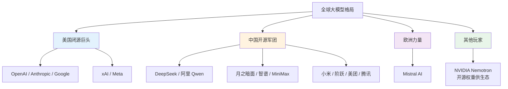
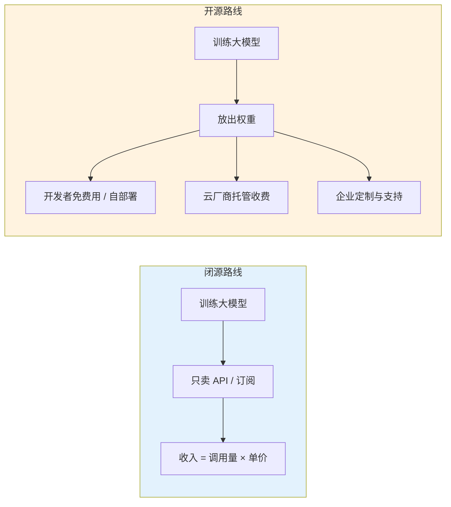
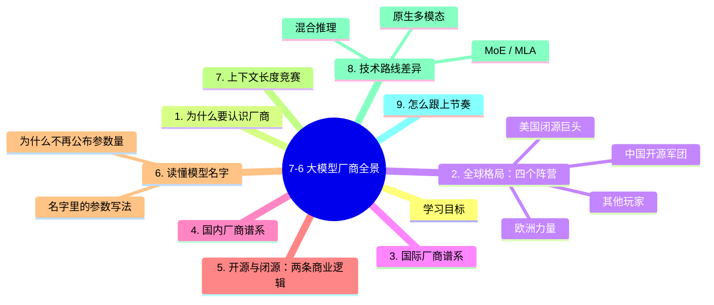

# 7-6 国内外大模型厂商全景

## 学习目标

- 建立一张"谁在做大模型"的全局地图，知道主流厂商的模型家族
- 理解开源与闭源两条商业路线的根本差异
- 学会读懂模型名字里的信息（尺寸、版本、变体）
- 明白为什么"参数量"不再是唯一的比较标准

---
## 1. 为什么要认识厂商

很多人学完 Transformer、学完 Prompt，真正上手时仍会卡在一个很实际的问题上：

> **"我这个任务，到底该用哪个模型？"**

这不是一个纯粹的学术问题。模型的能力、价格、上下文长度、是否开源、数据是否会被用来训练，**每一项都直接影响你能不能做成这个项目**。同一个任务，选错模型可能意味着成本差 50 倍，或者干脆因为合规问题不能上线。

所以这一章不讲算法，讲**产业地图**——谁在做、做了什么、走的是哪条路。

## 2. 全球格局：四个阵营

两个阵营最本质的区别不是"技术谁更强"，而是**商业模式**：

| 阵营 | 代表 | 核心策略 | 结果 |
|------|------|---------|------|
| 美国闭源 | OpenAI、Anthropic、Google | 模型权重不公开，靠 API 和订阅赚钱 | 顶级能力 + 高价格 |
| 中国开源 | DeepSeek、Qwen、Kimi、GLM | 权重公开可下载，靠生态和云服务变现 | 中高档能力 + 极低价格 |

这个差异会贯穿本章和后面两章——**它是理解当前大模型市场所有"反直觉现象"的钥匙**。

---

## 3. 国际厂商谱系

| 厂商 | 代表模型家族 | 开源？ | 主打方向 |
|------|------------|--------|---------|
| **OpenAI** | GPT-6 系列（Astra / Sol / Terra / Luna） | 闭源 | 通用能力天花板、Agent 生态 |
| **Anthropic** | Claude 5.x（Opus / Sonnet / Haiku / Fable） | 闭源 | 长文本、代码、安全性 |
| **Google** | Gemini 4 / 3.x（Argon / Flash / Flash Lite） | 闭源 | 原生多模态、超长上下文 |
| **xAI** | Grok 4.x | 闭源 | 实时信息、推理 |
| **Meta** | Muse 系列（含 Contributor 低价档） | 混合 | 开源生态 + 低价换数据授权 |
| **Mistral AI** | Mistral Large 4 | 部分开源 | 欧洲合规、轻量高效 |
| **NVIDIA** | Nemotron 3.x（Ultra / Super） | 开源权重 | 给生态供给可商用模型 |

三个观察：

1. **命名即定位**：同一个家族按"档位"分层。`Opus > Sonnet > Haiku`、`Astra > Sol > Terra > Luna`、`Pro > Flash > Flash Lite`——**越靠前的越聪明也越贵**。
2. **Meta 的 Contributor 档很特殊**：用极低价格换你授权数据训练模型——便宜是有代价的（后面 7-8 会讲）。
3. **NVIDIA 不做终端产品**：Nemotron 开源是为了卖卡和卖生态，所以定价极低。

---
## 4. 国内厂商谱系

国内的特点是：**开源是主流选择**。头部厂商几乎都把权重放出来，原因有三——换取开发者生态、证明技术实力、绕开单纯的价格战。

| 厂商 | 代表模型 | 开源？ | 特色 |
|------|---------|--------|------|
| **DeepSeek 深度求索** | DeepSeek V4 / V4.1（Pro / Flash） | ✅ 开源 | MoE + MLA 架构，极致性价比 |
| **阿里 Qwen** | Qwen 3.6 / 3.7 / 3.8（Max / Plus / Flash / 27B） | ✅ 开源 | 尺寸最全，端侧到云端全覆盖 |
| **月之暗面 Kimi** | Kimi K2.5 / K2.6 / K2.7 Code / K3 / K3.1 Pro | ✅ 开源 | 超长上下文、代码能力强 |
| **智谱 GLM** | GLM-5 / 5.1 / 5.2 / 5.3（含 FlashX） | ✅ 开源 | 中文理解、Agent 工具调用 |
| **MiniMax** | M2.5 / M2.7 / M3 / M3.1 Flash | ✅ 开源 | 多模态原生、语音见长 |
| **小米 MiMo** | MiMo V2.5 / V2.6（Pro / Flash） | ✅ 开源 | 端侧协同、极致低价 |
| **阶跃星辰 Step** | Step 3.5 Flash / 3.7 Flash / 5 Preview | ✅ 开源 | 多模态、性价比激进 |
| **蚂蚁 Ling** | Ling 3.1 Flash | ✅ 开源 | 轻量高效 |
| **美团 LongCat** | LongCat 2.0 / 2.5 | ✅ 开源 | 长上下文 |
| **腾讯混元** | 混元 Hy3 / Hy4 | 部分开源 | 中文场景、企业集成 |
| **字节豆包** | 豆包系列 | 闭源 | 应用生态、C 端流量 |

一个很值得注意的事实：**上表 11 家里有 9 家开源**。这让"开源"在国内不是边缘选择，而是默认策略。

---
## 5. 开源与闭源：两条商业逻辑

这不是"免费 vs 收费"的区别，而是**在哪一层赚钱**的区别。

| 维度 | 闭源 | 开源 |
|------|------|------|
| 权重 | 不公开 | 公开可下载 |
| 能否私有化部署 | ❌ 通常不行 | ✅ 可以 |
| 数据是否出内网 | ❌ 要出 | ✅ 可以不出 |
| 单价 | 高 | 低（甚至免费） |
| 能否改结构 / 微调 | 只能调 API 参数 | ✅ 可以任意改 |
| 能力上限 | 通常最高 | 略低一档 |
| 责任归属 | 厂商兜底 | 自己兜底 |

**三个实用结论**：

1. **合规敏感场景只能选开源**。金融、医疗、政企的内网数据不能出网，闭源 API 直接出局——这一条常常比"聪明 5 分"重要得多。
2. **量大且任务固定时开源更省**。当你的月调用费超过自建推理成本（一张卡 + 运维），开源自部署就开始划算。
3. **追顶级能力只能选闭源**。目前能力最前列仍被闭源把持（见 7-7 的分数表），开源最强档通常差 5-15 分。

---
## 6. 读懂模型名字：参数量与命名规则

参数量曾经是唯一的比较标准（越大越强），现在已经不是。但名字里仍藏着有用信息。

### 6.1 名字里的参数写法

| 写法 | 含义 | 例子 |
|------|------|------|
| `122B` | 总参数 1220 亿 | Ornith 1.5 122B |
| `27B` | 总参数 270 亿 | Qwen 3.8 27B |
| `550B-A55B` | **MoE**：总参数 5500 亿，每次只激活 550 亿 | Nemotron 3 Ultra |
| `A55B` | Active 参数（激活参数） | 同上 |

`550B-A55B` 这种写法是关键：MoE（混合专家）模型**总参数很大但每次只算一小部分**，所以推理成本接近 A55B，而知识容量接近 550B。这就是"大而不贵"的秘诀。

### 6.2 为什么多数厂商不再公布参数量

三个原因：

1. **参数量不再等于能力**。数据质量、训练配方、后训练（RLHF/RL）的影响常常大于参数规模。GPT-6 系列、Claude 5.x、Gemini 4 都未公开参数量。
2. **变成竞争劣势**。公布"我有 2 万亿参数"等于告诉对手自己的成本结构。
3. **MoE 让"参数量"失去可比性**。同样写 500B，激活 50B 和激活 500B 完全是两个东西。

> **实践建议**：不要用参数量横向比较不同厂商的模型。**用实测分数和真实任务表现**，才是有意义的对比（这正是 7-7 要做的事）。

---
## 7. 上下文长度：另一条竞赛线

除了"聪明程度"，还有一个直接影响可用性的指标：**一次能塞进多少内容**。

| 量级 | 大致能装什么 |
|------|-------------|
| 32K | 一篇长论文 |
| 200K-262K | 一本中篇小说 / 一个中型代码库 |
| 500K | 半个大型项目 |
| 1M | 约 70-80 万汉字，一整套技术文档 |

目前的格局是：**1M 已经成为主流旗舰的标配**（GPT-6、Claude 5.x、Gemini 4、Kimi K3、Qwen 3.8、GLM-5.3、DeepSeek V4 都是 1M），部分老型号仍停在 200K-400K。

但要注意两个坑：

1. **"支持 1M" ≠ "1M 内都记得住"**。业界常说"长上下文里中段信息容易丢"（lost in the middle），实际有效窗口往往明显小于标称值。
2. **上下文越长越贵**。价格按 token 算，塞满 1M 上下文的一次调用，成本可能是短对话的上百倍。长上下文要配合"检索"用，而不是无脑全塞。

---
## 8. 技术路线：几家真正不同的地方

表面看大家都在做 Transformer，但关键设计已经分化：

| 路线 | 代表 | 解决什么问题 |
|------|------|-------------|
| **MoE 混合专家** | DeepSeek、Qwen、MiMo、Nemotron | 用大容量换低推理成本 |
| **MLA 多头潜在注意力** | DeepSeek | 压缩 KV Cache，长上下文省显存 |
| **原生多模态** | Gemini、MiniMax、Step | 图文音视频统一建模，而非外挂 |
| **混合推理（思考/非思考双模式）** | Qwen、GLM、DeepSeek | 简单问题不"想"，难题才"想"，省 token |
| **超长上下文优化** | Kimi、LongCat、Gemini | 把 1M 窗口做到可用 |

其中"**混合推理**"最值得普通使用者关注：它意味着同一个模型可以选择"快速作答"或"深度思考"，**成本可以差好几倍**。

---
## 9. 怎么跟上节奏

这个领域版本号变得极快（Kimi K2.5 → K3.1 只用了几个月）。建议用三个来源组合：

| 来源类型 | 用途 | 例子 |
|---------|------|------|
| **聚合平台的模型列表** | 一次看到多家模型的价格 / 分数 / 上下文 | Command Code、OpenRouter |
| **官方发布博客** | 拿到第一手的能力说明与限制 | 各厂商官网 |
| **第三方评测榜单** | 交叉验证，避免只看官方宣传 | LMArena、各领域榜单 |

> **重要提醒**：任何模型清单都是**时效快照**。本章和后面两章引用的数据取自 **2026 年 10 月**的公开聚合页面，半年后价格和版本几乎必然变化——**方法比数字更重要**。

---

## 本章小结

1. **四个阵营**：美国闭源（追求能力上限）、中国开源（追求性价比与生态）、欧洲（合规与轻量）、NVIDIA（供生态）。
2. **开源在国内是主流选择**，不是边缘方案；合规敏感场景往往只能选开源。
3. **读懂模型名**：`Opus > Sonnet > Haiku`、`Pro > Flash > Lite` 是档位；`550B-A55B` 表示 MoE 的总参数 / 激活参数。
4. **参数量已经不是唯一标准**，多数厂商不再公布；横向比较应该看实测分数与真实任务表现。
5. **上下文 1M 已成旗舰标配**，但"支持 1M"不等于"1M 内都记得住"，且越长越贵。
6. **技术路线已分化**：MoE、MLA、原生多模态、混合推理、超长上下文各有代表性玩家。

---

## 知识图谱

## 参考资料

1. Command Code 模型清单（聚合平台，含各家模型的价格与评分）：<https://commandcode.ai/zh/models>
2. OpenRouter 模型索引：<https://openrouter.ai/models>
3. LMArena（原 Chatbot Arena）人类偏好榜：<https://lmarena.ai>
4. DeepSeek 官方技术报告（MoE + MLA 架构）：<https://github.com/deepseek-ai>
5. Qwen 官方模型库：<https://github.com/QwenLM>
6. Mistral AI 模型文档：<https://docs.mistral.ai>
