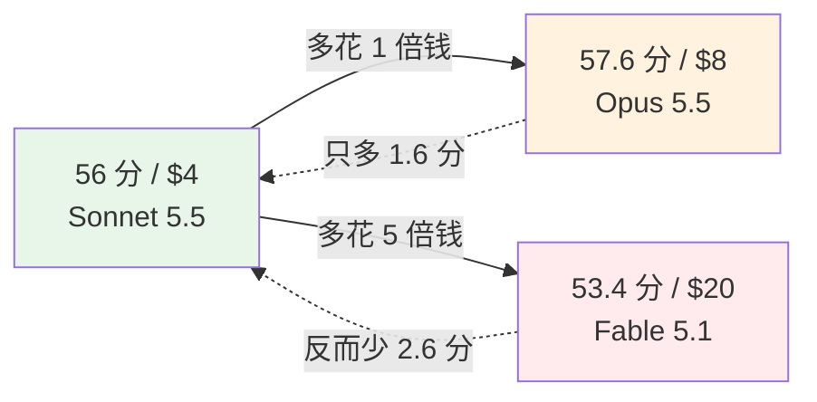
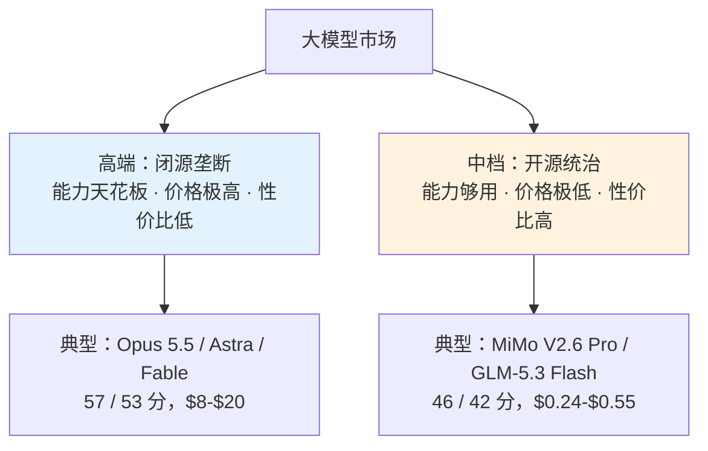
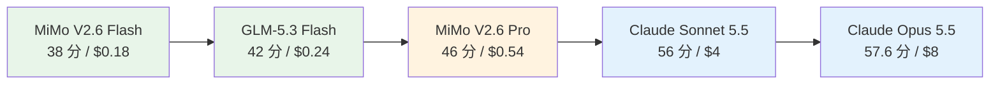
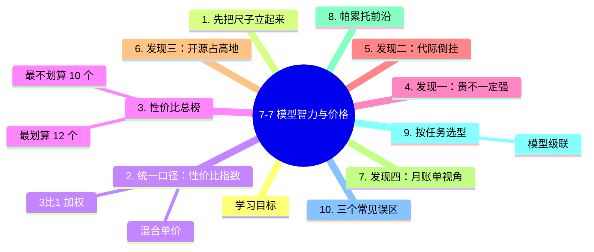

# 7-7 模型智力与价格：性价比的真相

## 学习目标

- 学会用一个统一口径比较"不同厂商、不同价位"的模型
- 看懂四个反直觉现象：贵不一定强、同价不同命、代际倒挂、高端溢价
- 能用一张表决定"我的任务该花多少钱"
- 避开模型选型中最常见的三个坑

---

## 1. 先把尺子立起来

比较模型最难的地方是：**没有一个公认的刻度**。厂商宣传各说各话，跑分榜单口径不一。

一种可行的做法是看**第三方聚合平台**：它们把几十上百个模型放在同一套评测和同一张价目表里，至少保证了"同一把尺子量所有人"。本章的数据就取自这类平台（Command Code）在 **2026 年 10 月**的公开快照。

必须说明三个局限，否则后面的结论会被误用：

| 局限 | 说明 |
|------|------|
| **分数是综合的** | 一个"智力分"混合了推理、代码、写作、指令遵循，不代表你的具体任务 |
| **价格是标价** | 没算缓存折扣、峰谷价、批量折扣，实际成本可能更低 |
| **是快照** | 半年后版本和价格几乎必然变化——**方法比数字重要** |

> 所以本章的真正目的不是让你背下"谁第一"，而是让你掌握**怎么算这笔账**。

---
## 2. 一个统一口径：性价比指数

模型的价目表有两列价格：**输入价**和**输出价**（单位：美元 / 百万 token）。输出通常比输入贵 3-5 倍，因为生成比读取更耗算力。

为了把两列合成一个数，用一个常见近似——**混合单价**：

$$
P_{\text{混合}} = \frac{3 \times P_{\text{输入}} + 1 \times P_{\text{输出}}}{4}
$$

> 为什么是 3:1？因为真实对话里，输入（历史对话、代码上下文、检索到的资料）通常远多于输出。3:1 是一个偏保守的常用比例。

然后定义**性价比指数**：

$$
\text{性价比} = \frac{\text{智力分}}{P_{\text{混合}}}
$$

含义直白：**每花 1 美元买到多少分**。数值越高越划算。

下面所有结论都是用这两个公式算出来的，你可以自己拿计算器验证。

---
## 3. 性价比总榜（2026-10 快照）

### 3.1 最划算的 12 个

| 模型 | 智力分 | 输入/输出 ($) | 混合单价 | 性价比 | 开源 |
|------|-------|--------------|---------|-------|------|
| Claude Haiku 5.5 | 43.4 | 0.10 / 0.50 | $0.200 | **217** | ❌ |
| MiMo V2.6 Flash | 37.9 | 0.14 / 0.28 | $0.175 | **216** | ✅ |
| GPT-6 Luna | 38.1 | 0.10 / 0.50 | $0.200 | **191** | ❌ |
| GLM-5.3 Flash | 41.8 | 0.15 / 0.50 | $0.238 | **176** | ✅ |
| MiniMax M3.1 Flash | 42.7 | 0.15 / 0.60 | $0.263 | **163** | ✅ |
| DeepSeek V4.1 Flash | 39.5 | 0.15 / 0.60 | $0.263 | **151** | ✅ |
| DeepSeek V4 Flash | 34.0 | 0.15 / 0.60 | $0.263 | **130** | ✅ |
| Step 3.5 Flash | 17.0 | 0.09 / 0.30 | $0.143 | 119 | ✅ |
| 腾讯混元 Hy3 | 25.3 | 0.14 / 0.58 | $0.250 | 101 | 部分 |
| Nemotron 3.5 Super VL | 26.5 | 0.20 / 0.50 | $0.275 | 96 | ✅ |
| Ling 3.1 Flash | 41.1 | 0.30 / 0.90 | $0.450 | 91 | ✅ |
| **MiMo V2.6 Pro** | **46.3** | 0.435 / 0.87 | $0.544 | 85 | ✅ |

> **注意最后一行**：MiMo V2.6 Pro 排在性价比榜末位（85），但它的**智力分 46.3 是这一整个梯队里最高的**。这就是本章第一个反直觉现象——"性价比榜"和"能力榜"是两个榜。

### 3.2 最不划算的 10 个

| 模型 | 智力分 | 输入/输出 ($) | 混合单价 | 性价比 |
|------|-------|--------------|---------|-------|
| Muse Wonder | 52.4 | 4 / 20 | $8.00 | 6.5 |
| Claude Opus 5 | 50.8 | 5 / 25 | $10.00 | 5.1 |
| Claude Sonnet 4.6 | 30.1 | 3 / 15 | $6.00 | 5.0 |
| Claude Opus 4.8 | 41.8 | 5 / 25 | $10.00 | 4.2 |
| GPT-5.6 Sol | 47.0 | 5 / 30 | $11.25 | 4.2 |
| Claude Opus 4.7 | 40.7 | 5 / 25 | $10.00 | 4.1 |
| GPT-5.5 | 38.4 | 5 / 30 | $11.25 | 3.4 |
| Claude Fable 5.1 | 53.4 | 10 / 50 | $20.00 | 2.7 |
| GPT-6 Astra | 52.7 | 10 / 50 | $20.00 | 2.6 |
| Claude Fable 5 | 49.6 | 10 / 50 | $20.00 | 2.5 |

榜首和榜尾差了 **87 倍**（217 ÷ 2.5）。

---
> **买法选择**：算清楚单价之后，下一步是决定「按量付费还是买订阅」，以及订阅的配额窗口怎么换算成可用次数，见 [7-8 API 按量与订阅制](./7-8-API按量与订阅制.md)。

## 4. 发现一：最聪明的，不一定是贵的

把"分数前五"和"价格前五"放在一起看，会看到明显的错位：

| 模型 | 智力分 | 混合单价 | 排名（分） | 排名（价） |
|------|-------|---------|-----------|-----------|
| Claude Opus 5.5 | **57.6** | $8.00 | 第 1 | 偏贵 |
| Claude Sonnet 5.5 | 56.0 | **$4.00** | 第 2 | 中档 |
| Claude Fable 5.1 | 53.4 | $20.00 | 第 3 | **最贵** |
| GPT-6 Astra | 52.7 | $20.00 | 第 4 | **最贵** |
| Gemini 4 Argon | 52.6 | **$4.00** | 第 5 | 中档 |

两个结论：

1. **Sonnet 5.5 是高端里最划算的**：只比第一名低 1.6 分，价格却是它的一半。
2. **Fable 5.1 / Astra 是"为最后 3 分付 5 倍钱"**：53.4 分、$20 一档，性价比指数只有 2.7——比 Sonnet 5.5 低 5 倍。

> **一句话**：能力曲线在顶端是**平缓的**，价格曲线在顶端是**陡峭的**。多花的钱买到的分数越来越少。

---
## 5. 发现二：代际倒挂——买新不买旧

这是本次数据里**最实用的发现**：同一家厂商的新一代模型，常常**更聪明，而且更便宜**。

| 厂商 | 旧代 | 新代 | 分数变化 | 价格变化 |
|------|------|------|---------|---------|
| Anthropic | Haiku 4.5：15.4 分，$1/$5 | Haiku 5.5：**43.4 分**，$0.10/$0.50 | **×2.8** | **÷10** |
| Anthropic | Sonnet 4.6：30.1 分，$3/$15 | Sonnet 5.5：**56.0 分**，$2/$10 | **×1.9** | ÷1.5 |
| Anthropic | Opus 4.7：40.7 分，$5/$25 | Opus 5.5：**57.6 分**，$4/$20 | ×1.4 | ÷1.25 |
| OpenAI | GPT-5.5：38.4 分，$5/$30 | GPT-6 Luna：38.1 分，$0.10/$0.50 | 持平 | **÷50** |
| 阿里 | Qwen 3.7 Max：29.5 分，$2.5/$7.5 | Qwen 3.8 Max：**45.4 分**，$2/$6 | ×1.5 | 略降 |

**怎么理解这件事？**

- 训练效率在快速提升（更好的数据配比、更成熟的训练配方），**"同样的钱买到更多智能"**是行业主旋律。
- 厂商用新一代打旧一代，价格战集中在**新代的下沉档位**。
- 旧型号不会消失，但会变成"高价低能"的陷阱——它们往往还挂着原来的高价。

> **实操建议**：选型时**优先看最新一代**。看到一个陌生的"便宜但很笨"的模型名，先查一下它是哪一年发布的——很可能是清库存的老型号。

---
## 6. 发现三：开源占据了性价比高地

回到 3.1 节的榜单，数一下开源/闭源比例：

| 位置 | 开源 | 闭源 |
|------|------|------|
| 性价比前 12 名 | **10 个** | 2 个（Claude Haiku 5.5、GPT-6 Luna） |
| 能力前 5 名 | 0 个 | **5 个** |

这个结构非常清晰：

**为什么会这样？**

1. **开源不需要回收研发成本**。权重一放出去，谁都能托管，价格被竞争压到接近"电费+显卡折旧"。
2. **开源厂商用"接近顶级"的能力换生态**。差 10 分不影响 90% 的应用，但价格差 10-40 倍是真金白银。
3. **闭源要养整个研发体系**。顶级的训练成本必须由高端定价来覆盖。

> **关键判断**：如果你的任务**不需要最后那 10 分**（大多数业务场景真的不需要），开源模型能省下 80-95% 的成本。这就是为什么国内厂商几乎全部押注开源。

---
## 7. 发现四：换成"月账单"更直观

抽象的"每百万 token 单价"很难有体感。换算成一个具体场景：

> **假设**：每天 100 次对话，每次输入 1 万 token、输出 2 千 token。  
> **则**：单次成本 = $0.01 \times P_{in} + 0.002 \times P_{out}$，月用量 = 3000 次。

| 模型 | 单次成本 | 月账单 |
|------|---------|--------|
| MiMo V2.6 Flash | $0.0020 | **$5.9** |
| Claude Haiku 5.5 | $0.0020 | $6.0 |
| GLM-5.3 Flash | $0.0025 | $7.5 |
| DeepSeek V4.1 Flash | $0.0027 | $8.1 |
| MiMo V2.6 Pro | $0.0061 | $18.3 |
| Claude Sonnet 5.5 | $0.0400 | $120 |
| Kimi K3 | $0.0600 | $180 |
| Claude Opus 5.5 | $0.0800 | $240 |
| GPT-6 Astra | $0.2000 | **$600** |
| Claude Fable 5.1 | $0.2000 | **$600** |

**第一行和最后一行差 100 倍**——同样的工作量，一个月 6 美元 vs 600 美元。

这就是为什么"先选对档位"比"调 prompt"重要得多：**选错模型，省下来的钱够你请一个实习生**。

> 注意：这里还没算 **prompt 缓存**（命中缓存的输入可以便宜 90%）和**峰谷价**（部分厂商夜间打折）。真实成本通常比这张表更低。

---
## 8. 帕累托前沿：没有"又强又便宜"的免费午餐

把所有模型画在一张"价格 × 分数"的图上，真正值得选的只有**前沿上的少数几个**：比它便宜的都没它强，比它强的都没它便宜。

这五个点构成一条阶梯，每一步都问同一个问题：

| 从 → 到 | 多花 | 多买到的分 | 值不值 |
|---------|------|-----------|--------|
| MiMo Flash → GLM-5.3 Flash | +33% | +4.1 分 | ✅ 很值 |
| GLM-5.3 Flash → MiMo Pro | +2.2 倍 | +4.5 分 | ✅ 值（难度任务） |
| MiMo Pro → Sonnet 5.5 | +7.4 倍 | +9.7 分 | ⚠️ 看场景 |
| Sonnet 5.5 → Opus 5.5 | +1 倍 | +1.6 分 | ❌ 只为极致 |

**不在前沿上的模型**（比如 Fable 5.1：比 Sonnet 5.5 贵 5 倍还少 2.6 分）没有选择的理由。

---
## 9. 按任务选型：别用牛刀杀鸡

| 任务类型 | 推荐档位 | 理由 |
|---------|---------|------|
| 分类 / 抽取 / 格式化 | **最便宜档** | 任务简单，便宜模型完全够 |
| 日常问答 / 写作润色 | **中低档** | 需要一定理解力，但不需要推理深度 |
| 代码补全 / 单文件修改 | **中档** | 对准确性敏感，值得多花一点 |
| 复杂重构 / 多文件调试 | **中高档** | 要跨文件推理，便宜模型容易跑偏 |
| 长链路 Agent | **中高档 + 混合推理** | 一步错步步错，省这点钱不值 |
| 科学推理 / 竞赛题 | **顶级** | 这是唯一值得为最后几分付溢价的地方 |

> **一个实用的做法**：把任务分成三层——大量简单的用便宜模型，少量困难的上中档，极少数必须顶级的才用旗舰。这叫**模型级联（model cascade）**，能砍掉一大半成本。

---

## 10. 三个常见误区

**误区一：越贵越好。** 数据显示最贵档（$20 混合）里既有 53.4 分也有 49.6 分，而 $4 档有 56.0 分。价格和能力的相关性在高端相当弱。

**误区二：分数高就适合我。** 综合分高不代表你的任务强。做中文客服，中文语料扎实的中档国产模型往往打得过顶级英文模型；做代码，Code 专用版的性价比通常优于通用旗舰。

**误区三：只看 token 单价，不看用量结构。** 如果你的场景输入极长（比如整库代码分析），**输入价**才是主要成本；如果输出极长（长篇生成），**输出价**决定一切。要按自己的 token 结构算账。

---

## 本章小结

1. **统一口径**：混合单价 = (3×输入价 + 输出价)/4；性价比指数 = 智力分 ÷ 混合单价。
2. **贵不一定强**：能力曲线顶端平缓、价格曲线顶端陡峭；Sonnet 5.5 只比 Opus 5.5 低 1.6 分，价格却只有一半。
3. **代际倒挂**：同一厂商新一代常常更聪明且更便宜（Haiku 4.5→5.5：分数 ×2.8，价格 ÷10）。**优先选最新一代**。
4. **开源占据性价比高地**：性价比前 12 名里 10 个开源；能力前 5 名全是闭源。
5. **月账单视角**：同样工作量，最便宜档约 $6/月，最贵档约 $600/月，差 100 倍。
6. **帕累托前沿**只有 4-5 个最优选择，其余都是"又贵又没必要"。
7. **按任务分级**（模型级联）比纠结单一模型更省钱。

---

## 知识图谱

## 参考资料

1. Command Code 模型清单（含 95 个模型的评分与价格快照）：<https://commandcode.ai/zh/models>
2. OpenRouter 模型与价格索引：<https://openrouter.ai/models>
3. LMArena 人类偏好评测：<https://lmarena.ai>
