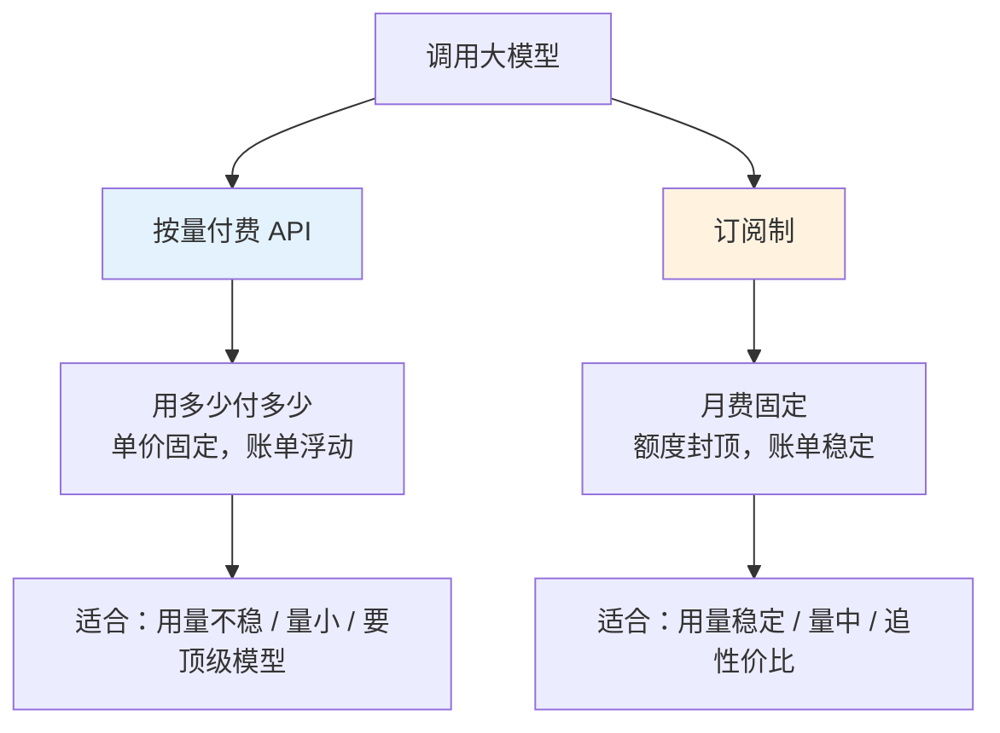
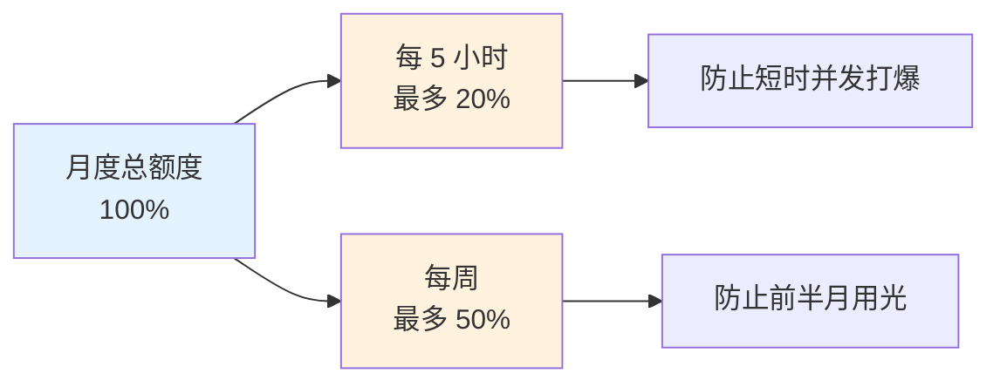
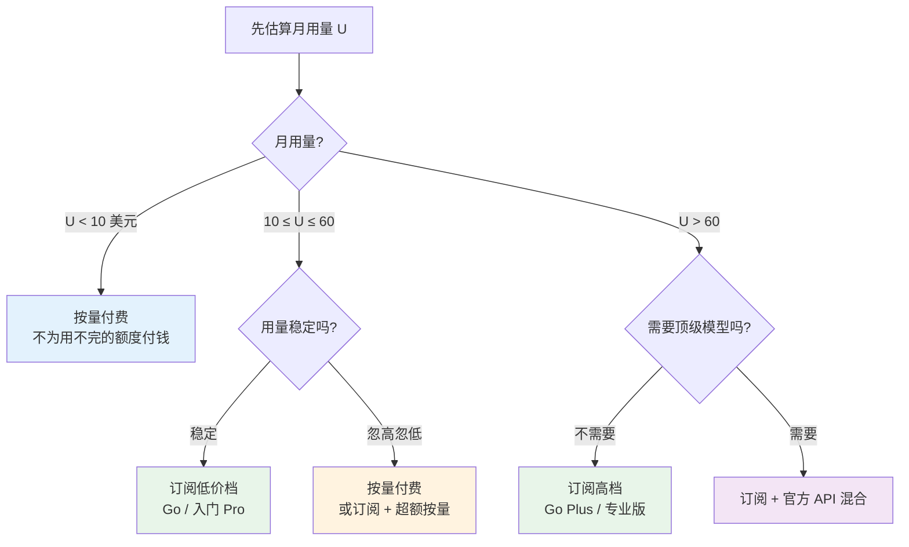
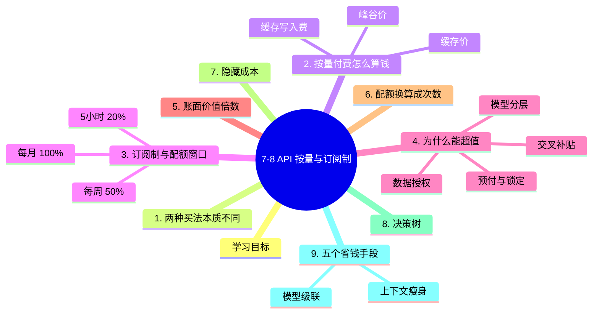

# 7-8 大模型怎么买：API 按量与订阅制

## 学习目标

- 分清两种计费方式：按量付费与订阅制
- 理解"配额窗口"是什么，为什么会设计出 5 小时 / 周 / 月三层限制
- 学会计算订阅的"账面价值倍数"，判断到底值不值
- 能根据自己的用量模式，选对买法
- 掌握几个真正能省钱的工程手段

---

## 1. 两种买法，本质不同

调用大模型有两条路，它们不是"贵 vs 便宜"的关系，而是**风险由谁承担**的区别。

| 维度 | 按量付费 | 订阅制 |
|------|---------|--------|
| 计费单位 | token | 月费 + 额度 |
| 账单可预测性 | 低（用量涨账单就涨） | 高（封顶） |
| 单价 | 标价 | 通常明显低于标价 |
| 模型选择 | 平台有什么用什么 | 受白名单限制 |
| 用超了怎么办 | 继续扣费 | 降速 / 限流 / 需加钱 |
| 典型代表 | OpenCode Zen、各厂商官方 API | OpenCode Go、各家 Pro 订阅 |

---
## 2. 按量付费：钱是怎么流走的

按量付费的公式极其简单：

$$
\text{费用} = \frac{\text{输入 tokens}}{10^6} \times P_{in} + \frac{\text{输出 tokens}}{10^6} \times P_{out}
$$

但账单里还藏着三个容易忽略的杠杆：

### 2.1 缓存价（最容易省钱的一项）

同一个长 prompt 反复调用时，平台可以把"前缀"缓存起来，**命中缓存的部分只收原价的 10% 左右**。

| 模型 | 输入价 | 缓存读取价 | 折扣 |
|------|-------|-----------|------|
| Claude Opus 5.5 | $4.00 | $0.20 | **5%** |
| Claude Sonnet 5.5 | $2.00 | $0.10 | 5% |
| Gemini 4 Argon | $2.00 | $0.10 | 5% |
| DeepSeek V4.1 Flash | $0.15 | $0.003 | **2%** |

> 对 Agent、RAG、客服这类"每轮都带同一份长背景"的场景，**缓存能把成本砍掉 80-95%**。这是最被低估的省钱手段。

### 2.2 峰谷价（部分厂商有）

有些模型按时段定价。例如 DeepSeek V4 系列在部分时段是标价的约一半（夜间折扣）。批处理任务挪到低谷时段跑，成本直接减半。

### 2.3 缓存写入费

有的平台对"建立缓存"额外收费（缓存写入价）。长 prompt 只调用一两次时，写缓存的费用可能超过省下的钱——**缓存适合"同一前缀调用很多次"**的场景。

---
> **先算单价**：如果还没判断过各模型的价格差异，先看 [7-7 模型智力与价格性价比](./7-7-模型智力与价格性价比.md)——那里用统一口径算了每个模型每美元能买到多少智力。

## 3. 订阅制：月费 + 三层配额窗口

订阅制看着简单（一个月多少钱），实际规则比按量复杂得多。以 OpenCode Go 为例：

| 档位 | 月费 | 定位 |
|------|------|------|
| Go | **$10** | 低门槛、够用就好 |
| Go Plus | **$40** | 额度更高、限流更少 |

它不是"随便用"，而是**三层滚动窗口**：

这个 20% / 50% / 100% 的设计非常聪明：

- **20% per 5h**：理论上最快 25 小时能烧完一个月额度——所以它主要防"脚本狂刷"，不限制正常人也用不完。
- **50% per week**：把用量摊平，避免"月初猛用、月底没得用"。
- **100% per month**：真正的天花板。

> **理解要点**：订阅制卖的不是"无限量"，而是**"稳定的、有节奏的额度"**。如果你的用法是"偶尔集中爆发"，订阅反而会让你卡在窗口上。

---

## 4. 为什么订阅能"超值"：三个机制

$10 的订阅给出 $80 的额度，看起来厂商在亏钱。其实有三个机制在支撑：

| 机制 | 说明 | 谁受益 |
|------|------|--------|
| **交叉补贴** | 大多数用户用不满额度，补贴少数重度用户 | 轻度用户得实惠 |
| **模型分层** | 便宜模型给高额度、贵模型给低额度，成本可控 | 厂商控风险 |
| **预付现金流 + 锁定** | 先收钱、后服务，且提高你的迁移成本 | 厂商拿现金 |
| **数据授权换低价** | Contributor 档用低价换你的数据训练权 | 厂商得数据 |

第四项值得单独说。有些低价档明确写着"你的输入输出可能被用于训练未来模型"——**它不是慈善，是买卖**。如果你处理的是客户数据、商业代码，这类档位应当直接排除。

---

## 5. 实测：账面价值倍数

定义一个直观指标：

$$
\text{价值倍数} = \frac{\text{月度可用额度（按标价）}}{\text{月费}}
$$

倍数大于 1 意味着"买券比直接买便宜"。下表是 OpenCode Go 在 2026 年 10 月的公开数据：

| 模型 | Go 额度 | 倍数 | Plus 额度 | 倍数 |
|------|--------|------|----------|------|
| **DeepSeek V4.1 Flash** | $80 | **8.0×** | $160 | **4.0×** |
| Kimi K2.7 Code | $60 | 6.0× | $180 | 4.5× |
| MiniMax M3 | $60 | 6.0× | $180 | 4.5× |
| Qwen3.7 Plus | $60 | 6.0× | $180 | 4.5× |
| GLM-5.3-Flash | $60 | 6.0× | $180 | 4.5× |
| MiMo-V2.6-Flash | $60 | 6.0× | $120 | 3.0× |
| Muse Spark 1.3 Contributor | $60 | 6.0× | $120 | 3.0× |
| MiniMax M3.1 Flash | $20 | 2.0× | $80 | 2.0× |
| Kimi K3.1 Pro | $15 | 1.5× | $60 | 1.5× |
| Claude Haiku 5.5 | $15 | 1.5× | $60 | 1.5× |
| GPT-6 Luna | $15 | 1.5× | $60 | 1.5× |

---

**这张表读出三个结论：**

1. **便宜模型给高倍数，贵模型给低倍数**。DeepSeek Flash 有 8 倍，Claude Haiku 只有 1.5 倍。因为前者的真实成本低，厂商给得起。
2. **$10 档比 $40 档更"值"**。Go 的倍数（6-8×）普遍高于 Go Plus（3-4.5×）。这是典型的价格歧视设计——低价档做获客，高价档卖"额度上限"。
3. **倍数高 ≠ 你用得上**。$80 的 DeepSeek 额度，你要真的能消耗掉才有意义。轻度用户（每月只有几美元用量）**买订阅就是用不完的浪费**。

> **判断公式**：先估算自己的月用量 $U$。若 $U \gg$ 月费，订阅划算；若 $U \approx$ 月费，两者差不多；若 $U \ll$ 月费，直接按量付费。

---

## 6. 配额换算成"能用几次"

额度是美元，但开发者关心的是"一天能调多少次"。同一笔额度，不同模型的可用次数差异巨大：

| 模型（Go 档） | 5 小时可用请求数 | 说明 |
|--------------|----------------|------|
| DeepSeek V4.1 Flash | **34,670** | 单价极低，额度耐用 |
| MiMo-V2.6-Flash | 30,100 | 同上 |
| GLM-5.3-Flash | 6,320 | 中等 |
| Qwen3.7 Plus | 4,300 | 中等 |
| GPT-6 Luna | 4,230 | 中等 |
| Claude Haiku 5.5 | 3,850 | 中等 |
| MiniMax M3 | 3,200 | 中等 |
| Kimi K2.7 Code | 1,350 | 偏少（单价高） |

**DeepSeek 与 Kimi 相差 25 倍**——但注意，这里的"次数"是按各模型典型请求长度估算的，不是绝对承诺。它的真正含义是：

> **同一份月费，用低成本模型能干 25 倍于高成本模型的活。**

这也是为什么订阅平台要"策展式"地给出模型清单：它们知道你会用便宜的跑量、用贵的攻坚。

---

## 7. 订阅的隐藏成本

便宜的订阅从来不只有"月费"这一项成本：

| 隐藏成本 | 具体表现 | 影响 |
|---------|---------|------|
| **模型白名单** | 订阅通常不含最顶级模型（或额度极小） | 攻坚任务仍要额外买 API |
| **配额窗口** | 集中爆发会被限流 | 上线日 / 大促前可能卡住 |
| **数据授权** | Contributor 档用数据换低价 | 敏感场景不可用 |
| **地区限制** | 部分档位限定区域 | 跨境团队要额外处理 |
| **降级不透明** | 高峰期可能被路由到更小模型 | 输出质量不稳定 |
| **锁定效应** | 接口、缓存、日志都在平台上 | 迁移成本随时间上升 |

> **一条硬规矩**：涉及客户数据、未公开代码、合规审计的场景，**先确认数据是否用于训练**，再谈价格。

---

## 8. 决策树：我该买哪种

三个补充判断：

1. **团队多人共享 → 订阅更划算**。按人头的订阅通常比"每人一个 API key 按量"便宜，且额度可集中使用。
2. **有合规要求 → 开源自部署**。这一条常常直接否决所有订阅和公有云 API。
3. **要跑批处理 → 按量 + 峰谷价**。离线任务对延迟不敏感，是峰谷折扣的最大受益者。

---

## 9. 五个真正能省钱的工程手段

价格是标价，成本是工程。同样用量，做法不同，账单能差一个数量级。

| 手段 | 做法 | 典型节省 |
|------|------|---------|
| **1. Prompt 缓存** | 把固定背景（系统提示、文档、代码库）放在最前面并复用 | 60-95% |
| **2. 模型级联** | 简单任务路由到便宜模型，只把难任务交给贵模型 | 50-80% |
| **3. 上下文瘦身** | 只放必要内容；用检索代替"全塞" | 40-80% |
| **4. 输出约束** | 要求简短、结构化输出，减少输出 token | 20-50% |
| **5. 混合推理开关** | 简单问题不开"深度思考" | 30-70% |

一个容易忽略的事实：**输出 token 的单价通常是输入的 3-5 倍**。所以"让它少说废话"比"让它少读资料"更省钱——这跟直觉相反。

---

## 本章小结

1. **两种买法**：按量付费（用多少付多少，账单浮动）vs 订阅制（月费固定，额度封顶）。本质是**风险由谁承担**。
2. **按量付费的三个杠杆**：缓存价（可低至 2-5%）、峰谷价（夜间折扣）、缓存写入费（调用次数少时反而不划算）。
3. **订阅是月费 + 三层窗口**：5 小时 20%、每周 50%、每月 100%。它卖的是"有节奏的稳定额度"，不是无限量。
4. **订阅能超值的四个机制**：交叉补贴、模型分层、预付现金流、数据授权换低价。
5. **价值倍数**：Go 档可达 6-8 倍，Plus 档降到 3-4.5 倍；但**倍数高不等于你用得上**。
6. **隐藏成本**：白名单、窗口限流、数据授权、地区限制、降级不透明、锁定效应。
7. **省钱靠工程**：缓存、模型级联、上下文瘦身、输出约束、混合推理开关。

---

## 知识图谱

## 参考资料

1. OpenCode Go 订阅页（含配额窗口与各模型月度额度）：<https://opencode.ai/go>
2. OpenCode 文档 - Go 用量限制：<https://opencode.ai/v2/docs/console/go/>
3. Command Code 定价与限制说明：<https://commandcode.ai/zh/pricing>
