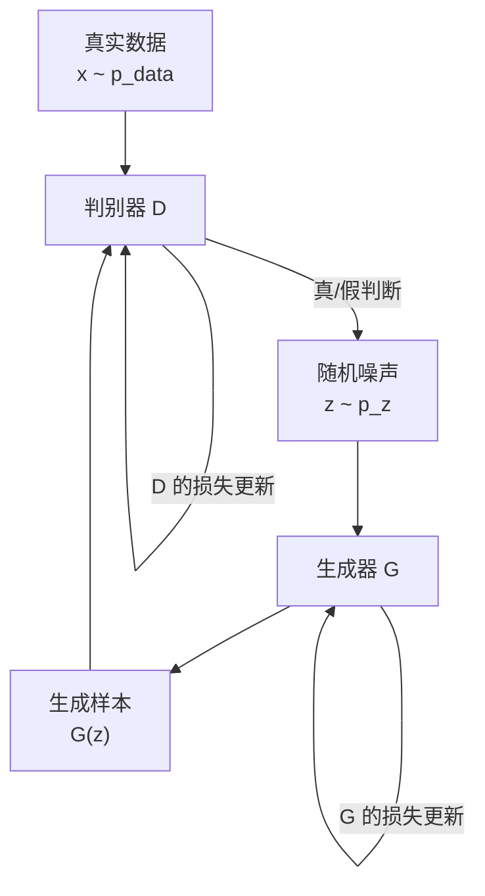
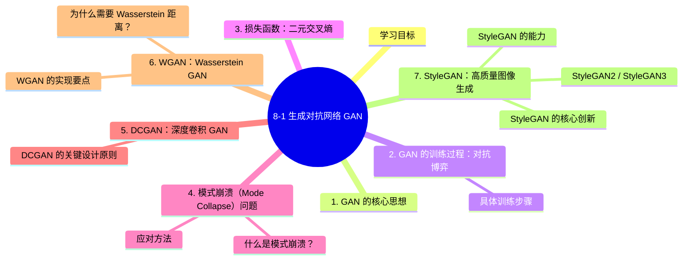

# 8-1 生成对抗网络 GAN

## 学习目标

- 理解 GAN 的核心思想：生成器与判别器的对抗博弈
- 掌握 GAN 的训练过程与损失函数
- 了解模式崩溃（Mode Collapse）问题及其应对方法
- 认识 DCGAN、WGAN、StyleGAN 等典型架构
- 了解 GAN 的主要应用场景

---

## 1. GAN 的核心思想

**GAN（Generative Adversarial Network，生成对抗网络）** 由 Ian Goodfellow 等人在 2014 年提出，是一种用于生成新数据的深度学习模型。其核心思想源自博弈论中的"对抗"概念——让两个网络相互竞争、相互对抗，从而共同提升。

GAN 包含两个核心组件：

| 组件 | 角色 | 目标 |
|------|------|------|
| **生成器（Generator, G）** | "造假者" | 生成尽可能逼真的假样本，让判别器误以为是真的 |
| **判别器（Discriminator, D）** | "鉴定师" | 准确区分真实样本与生成样本 |

两者形成对抗关系：生成器越想"骗过"判别器，判别器就必须变得越敏锐；反之，判别器越强，生成器也必须变得更强。这种对抗过程驱动整个系统不断进化。

---

## 2. GAN 的训练过程：对抗博弈

以下流程图描述了 GAN 的对抗训练过程：

### 具体训练步骤

**第 1 步：训练判别器 D**
- 从真实数据中采样一批样本 `x`
- 从随机噪声中采样 `z`，通过生成器得到假样本 `G(z)`
- 将真实样本和假样本混合，送给判别器进行二分类
- 更新判别器参数，使其能够正确区分真假样本

**第 2 步：训练生成器 G**
- 从随机噪声 `z` 中采样，通过生成器得到假样本 `G(z)`
- 将假样本送给判别器，希望判别器将其判定为"真实"
- 更新生成器参数，使生成的样本越来越"逼真"

**第 3 步：重复交替训练**，直到生成器和判别器达到平衡。

---

## 3. 损失函数：二元交叉熵

GAN 的目标函数本质上是双人零和博弈：

$$
min_G max_D V(D, G) = E_{x~p_data(x)}[log D(x)] + E_{z~p_z(z)}[log(1 - D(G(z)))]
$$

- **判别器 D 的目标**：最大化这个式子——即让 `D(x)` 接近 1（真实样本），`D(G(z))` 接近 0（假样本）
- **生成器 G 的目标**：最小化这个式子——即让 `D(G(z))` 接近 1（让判别器以为是真的）

实际训练中，生成器的损失函数通常改为：

$$
L_G = -E_{z~p_z(z)}[log D(G(z))]
$$

这样可以让梯度更加稳定。

---

## 4. 模式崩溃（Mode Collapse）问题

### 什么是模式崩溃？

Mode Collapse 是 GAN 训练中最常见的问题之一。指的是生成器"偷懒"——不去学习整个数据分布，而是只生成某一种或少数几种"安全"的样本，从而骗过判别器。

举例：如果训练数据中包含多种数字字体，理想情况下生成器应该生成各种数字。但发生模式崩溃时，生成器可能只学会生成数字"7"，因为它发现生成"7"最容易骗过判别器。

### 应对方法

| 方法 | 说明 |
|------|------|
| **WGAN / WGAN-GP** | 使用 Wasserstein 距离替代原始 JS 散度，缓解训练不稳定 |
| **特征匹配（Feature Matching）** | 要求生成样本在特征空间与真实样本接近 |
| **小批量判别（Mini-batch Discrimination）** | 让判别器一次看一批样本，检测生成样本的多样性 |
| **渐进式生成（Progressive GAN）** | 从低分辨率开始，逐步增加分辨率 |

---

## 5. DCGAN：深度卷积 GAN

**DCGAN（Deep Convolutional GAN）** 是 GAN 的经典改进，使用卷积神经网络（CNN）替代全连接层，大幅提升了生成图像的质量。

### DCGAN 的关键设计原则

1. **用转置卷积（Transposed Convolution）替代池化层**，实现上采样
2. **移除全连接层**，使用全局平均池化（GAP）
3. **在生成器和判别器中使用 Batch Normalization**（但输出层和输入层除外）
4. **激活函数**：生成器使用 ReLU，输出层使用 Tanh；判别器使用 LeakyReLU

DCGAN 的贡献在于证明了深度卷积网络可以稳定训练生成图像，为后续更复杂的 GAN 架构奠定了基础。

---

## 6. WGAN：Wasserstein GAN

**WGAN（Wasserstein GAN）** 由 Martin Arjovsky 等人在 2017 年提出，核心改进是使用 **Wasserstein 距离**（也叫 Earth-Mover 距离）替代原始 GAN 的 JS 散度。

### 为什么需要 Wasserstein 距离？

原始 GAN 的 JS 散度在两个分布完全不重叠时，梯度为 0（梯度消失），导致训练困难。Wasserstein 距离则可以衡量任意两个分布之间的距离，即使它们不重叠。

### WGAN 的实现要点

- 判别器不再输出"真/假"的概率，而是输出一个实数（称为 critic）
- 判别器的输出不再经过 Sigmoid 激活
- 使用 **权重裁剪（Weight Clipping）** 或 **梯度惩罚（Gradient Penalty）** 来满足 1-Lipschitz 约束
- WGAN-GP（带梯度惩罚的 WGAN）是目前最常用的稳定训练版本

WGAN 的优势：**训练更稳定，模式崩溃现象更少，有度量训练进度的指标（Wasserstein 距离）**。

---

## 7. StyleGAN：高质量图像生成

**StyleGAN** 由 NVIDIA 于 2018 年提出，是一种专注于生成高分辨率、风格可控图像的 GAN 架构。StyleGAN 最初用于人脸生成，后续被广泛应用于各种图像合成任务。

### StyleGAN 的核心创新

1. **风格映射网络（Mapping Network）**：将随机噪声 `z` 映射到一个中间潜空间 `W`，使不同特征可以独立控制
2. **自适应实例归一化（AdaIN）**：在每个卷积层中注入风格信息，实现对图像不同尺度特征的控制
3. **渐进式增长（Progressive Growth）**：从低分辨率逐步训练到高分辨率（StyleGAN2 改为跳层连接）

### StyleGAN 的能力

- 可以独立控制面部特征的粗细、中等、细节层次
- 可以混合两张图像的风格和内容
- 支持 latent space 插值，生成平滑过渡的图像序列

### StyleGAN2 / StyleGAN3

- **StyleGAN2**：移除了 Progressive Growth，改用跳层连接，图像质量进一步提升
- **StyleGAN3**：解决了Aliasing 问题，图像细节更加自然平滑

---

## 8. GAN 的应用场景

| 应用领域 | 具体示例 |
|----------|----------|
| **图像生成** | 人脸生成、风景画生成、艺术风格迁移 |
| **图像修复（Inpainting）** | 补全缺失的图像区域 |
| **超分辨率（Super Resolution）** | SRGAN、ESRGAN 将低分辨率图像放大并补充细节 |
| **图像到图像翻译** | CycleGAN 实现无配对的风格转换（如马→斑马） |
| **数据增强** | 生成稀有类别的样本，扩充训练数据集 |
| **视频生成** | 短片生成、视频预测 |
| **药物发现** | 生成新分子结构 |
| **游戏内容生成** | 生成纹理、角色模型 |

---

## 9. 其他经典 GAN 变体速览

| 模型 | 年份 | 核心贡献 |
|------|------|----------|
| **CGAN** | 2014 | 条件GAN，支持类别标签等条件信息 |
| **InfoGAN** | 2016 | 可解释的潜空间分解 |
| **LSGAN** | 2017 | 最小二乘损失替代交叉熵 |
| **PGGAN** | 2017 | 渐进式生成高分辨率图像 |
| **BigGAN** | 2018 | 大规模高保真图像生成 |
| **StyleGAN** | 2018 | 风格可控的高质量生成 |
| **StyleGAN2** | 2020 | 改进架构，消除伪影 |
| **StyleGAN-XL / StyleGAN3** | 2021-2022 | 超大规模与平滑变换 |

---

## 本章小结
- **GAN 的核心**是通过生成器和判别器的对抗博弈，让生成器学会模拟真实数据分布
- **DCGAN** 证明了卷积架构可以稳定训练 GAN
- **WGAN** 通过 Wasserstein 距离解决了训练不稳定和模式崩溃问题
- **StyleGAN** 实现了风格可控的高质量图像生成
- GAN 在图像生成、修复、翻译、数据增强等领域有广泛应用
- 训练 GAN 的常见问题包括模式崩溃、训练不稳定，需要通过架构改进和正则化手段缓解

## 知识图谱

## 参考资料

1. Goodfellow, I., et al. "Generative Adversarial Networks." *NeurIPS*, 2014.
2. Radford, A., et al. "Unsupervised Representation Learning with Deep Convolutional Generative Adversarial Networks." *ICLR*, 2016.
3. Arjovsky, M., et al. "Wasserstein GAN." *ICML*, 2017.
4. Gulrajani, I., et al. "Improved Training of Wasserstein GANs." *NeurIPS*, 2017.
5. Karras, T., et al. "A Style-Based Architecture for Generative Adversarial Networks." *CVPR*, 2019.
6. Karras, T., et al. "Analyzing and Improving the Image Quality of StyleGAN." *CVPR*, 2020.
7. Goodfellow, I. "GANs are Dead? Long Live the GANs!" (blog), 2024 — 讨论 GAN 与扩散模型的演进关系.
