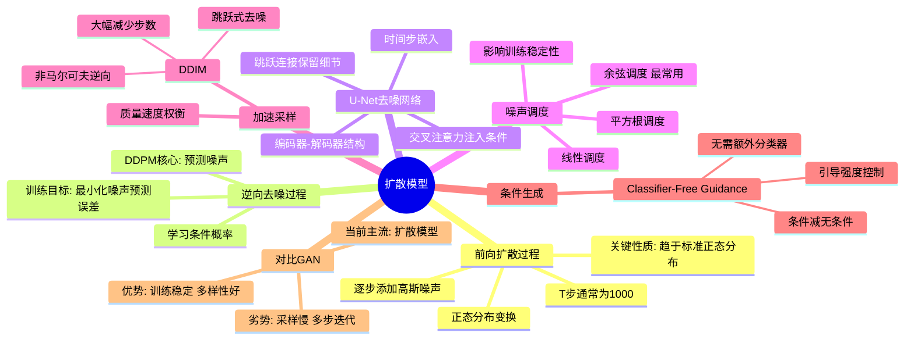

# 8-2 扩散模型 Diffusion

## 学习目标

- 理解扩散模型的基本思想：前向扩散与逆向去噪
- 掌握 DDPM 的核心算法与训练目标
- 了解 U-Net 在扩散模型中的关键作用
- 理解噪声调度（Noise Schedule）的设计思路
- 了解 Classifier-Free Guidance 和 DDIM 加速采样
- 对比扩散模型与 GAN 的优缺点

---

## 1. 扩散模型的基本思想

**扩散模型（Diffusion Model）** 是一类基于概率论的生成模型，其核心思想极为优雅：**学习从混乱到有序的逆过程**。

扩散模型的工作分为两个过程：

1. **前向扩散过程（Forward Process）**：向真实数据逐步添加噪声，直到变成纯噪声
2. **逆向去噪过程（Reverse Process）**：学习从噪声逐步恢复出真实数据

这个过程就像物理中的扩散现象：
- 前向过程：墨水滴入清水 → 逐渐扩散 → 完全混合（纯噪声）
- 逆向过程：知道混合后的状态 → 推断墨水最初的位置（生成数据）

---

## 2. 前向扩散过程（添加噪声）

前向过程是**已知的、不需要学习的**。给定原始图像 `x₀`，在 `T` 步内逐步添加高斯噪声：

```
q(x_t | x_{t-1}) = N(x_t; √(1-β_t)·x_{t-1}, β_t·I)
```

其中：
- `β_t` 是第 `t` 步的噪声方差（前向调度）
- `T` 通常取 1000 左右

通过重参数化技巧，可以直接由 `x₀` 得到任意时刻 `t` 的噪声图像：

```
x_t = √(ᾱ_t) · x₀ + √(1 - ᾱ_t) · ε,  ε ~ N(0, I)
```

其中 `ᾱ_t = ∏_{i=1}^t α_i`，`α_t = 1 - β_t`

**关键性质**：无论 `T` 有多大，最终 `x_T` 接近标准正态分布 `N(0, I)`。

---

## 3. 逆向去噪过程（DDPM）

逆向过程是**需要学习的**。我们希望学习一个模型 `p_θ(x_{t-1} | x_t)` 来逐步从噪声图像恢复出真实图像。

**DDPM（Denoising Diffusion Probabilistic Models）** 提出的核心洞察是：

> 不直接预测 `p_θ(x_{t-1} | x_t)`，而是让它**预测添加的噪声 ε_θ(x_t, t)**

训练目标（简化版）：
```
L = E_{t, x₀, ε}[ || ε - ε_θ( √(ᾱ_t)·x₀ + √(1-ᾱ_t)·ε, t ) ||² ]
```

也就是说，给定加噪后的图像 `x_t` 和时间步 `t`，让模型预测噪声 `ε`。

### 逐步去噪的可视化

```
纯噪声 x_T
  ↓ [逆向去噪: 预测噪声 ε, 去除部分噪声]
x_{T-1}
  ↓ [逆向去噪]
x_{T-2}
  ↓ ...
  ↓
x₁
  ↓ [最后一步去噪]
x₀（生成图像）
```

每一步去噪都利用神经网络估计当前图像中含有的噪声，然后将其减去，逐步恢复出清晰的图像。

---

## 4. U-Net 在扩散模型中的应用

DDPM 中的去噪网络通常采用 **U-Net 架构**，原因是：

### 为什么用 U-Net？

| 特性 | 优势 |
|------|------|
| **编码器-解码器结构** | 编码器提取高层语义，解码器逐步恢复空间细节 |
| **跳跃连接（Skip Connections）** | 将低层细节信息直接传递给解码器，保留局部特征 |
| **多尺度特征融合** | 能同时处理粗粒度（全局结构）和细粒度（局部纹理） |

### 在扩散模型中的改进

- **加入时间步嵌入（Time Embedding）**：将 `t` 转换为向量，加入每个残差块，让网络知道当前处于去噪的哪个阶段
- **加入条件信息（如文本）**：通过交叉注意力机制注入文本描述等条件信息
- **更大的通道数和更深的层数**：处理高分辨率图像

主流的开源扩散模型（如 Stable Diffusion 中的 U-Net）都是基于这一设计。

---

## 5. 噪声调度（Noise Schedule）

噪声调度决定了前向过程中噪声增加的节奏，对生成质量影响显著。

### 常见的调度策略

**线性调度（Linear）**：
```python
β_t = β_start + (β_end - β_start) * t/T
```

**余弦调度（Cosine）**：
```python
ᾱ_t = cos( (t/T + 0.008) / 1.008 * π/2 )²
```
余弦调度是目前最常用的方式，因为它在训练早期保留更多原始信息，晚期才加速添加噪声，训练更稳定。

**平方根调度（Square Root）**：
```python
β_t = β_start + (β_end - β_start) * √(t/T)
```

### 调度对生成的影响

- **噪声添加太快**：模型没有足够信息学习有用的表示
- **噪声添加太慢**：训练效率低，去噪路径过长
- **好的调度**：在训练效率和生成质量之间取得平衡

---

## 6. Classifier-Free Guidance（无分类器引导）

Classifier-Free Guidance（CFG）是扩散模型中一项重要技术，用于提升生成图像与条件（如文本提示）的对齐程度。

### 背景

如果想用类别标签或文本描述来引导生成，最直接的方法是训练一个分类器 `p(y|x_t)`，然后在去噪过程中加入其梯度。但这类分类器需要额外训练，且不易扩展到文本。

### CFG 的核心思想

**不依赖独立分类器**，而是联合训练一个**条件模型**（有条件输入）和一个**无条件模型**（无条件输入），然后通过两者的差值来实现引导：

```
ε̃_θ(x_t, c) = (1 + w) · ε_θ(x_t, c) - w · ε_θ(x_t, ∅)
```

- `ε_θ(x_t, c)`：条件下去噪（看到文本 `c`）
- `ε_θ(x_t, ∅)`：无条件下去噪（看不到文本）
- `w`：引导强度，通常取 7-10

**直观理解**：`w` 越大，生成图像越"听话"，越严格遵循条件；但过大会导致图像质量下降和多样性减少。

### CFG 的优势

- 不需要额外的分类器模型
- 可以应用于任意条件（文本、图像、类别等）
- 实现简单，效果显著

---

## 7. DDIM 加速采样

标准 DDPM 的一个主要缺点是：**去噪需要 T 步（通常 1000 步），非常慢**。

**DDIM（Denoising Diffusion Implicit Models）** 提出了一个关键洞察：DDPM 的前向过程是马尔可夫的，但逆向过程不必是！

### DDIM 的核心改进

1. **非马尔可夫逆向过程**：允许跳跃式去噪，将 T 步采样减少到 20-50 步
2. **保持训练目标不变**：DDIM 和 DDPM 训练过程完全相同，只是采样过程不同
3. **隐式生成模型**：DDIM 可以看作一种隐式生成模型，可以在任意两步之间插值

### 质量与速度的权衡

| 采样步数 | 质量 | 速度 |
|----------|------|------|
| 1000 步 | 最高 | 最慢 |
| 50-100 步 | 略低 | 10-20x 加速 |
| 20-30 步 | 明显下降 | 30-50x 加速 |

DDIM 使得在消费级 GPU 上生成一张图像从几分钟缩短到几秒钟，大大推动了扩散模型的实用化。

---

## 8. 扩散模型 vs GAN：优缺点对比

| 维度 | 扩散模型 | GAN |
|------|----------|-----|
| **训练稳定性** | ✅ 稳定，基于重参数化和简化的损失函数 | ❌ 不稳定，容易模式崩溃 |
| **生成多样性** | ✅ 多样性好，覆盖全分布 | ❌ 容易模式崩溃，生成多样性差 |
| **生成质量** | ✅ 高（现代扩散模型已超越 GAN） | ✅ 高（但训练困难） |
| **采样速度** | ❌ 慢（需要多步迭代） | ✅ 快（单次前向传播） |
| **可解释性** | ✅ 潜空间相对平滑 | ❌ 潜空间不明确 |
| **条件控制** | ✅ CFG 简单有效 | ❌ 需要条件判别器或架构改进 |
| **计算资源** | ❌ 训练和采样都较贵 | ✅ 单次生成成本较低 |

**总结**：
- GAN 适合对**速度敏感**、对单次生成质量要求极高的场景
- 扩散模型适合对**多样性和可控性**要求更高的场景，已成为当前 AIGC 的主流范式

---

## 9. 扩散模型的发展历程

| 模型 | 年份 | 关键贡献 |
|------|------|----------|
| **DDPM** | 2020 | 奠基性工作，建立完整理论与算法框架 |
| **ADM（Improved DDPM）** | 2021 | 改进噪声调度，引入分类器引导 |
| **DDIM** | 2021 | 加速采样，跳跃式去噪 |
| **GLIDE** | 2021 | 文本到图像扩散模型 |
| **Stable Diffusion** | 2022 | 开源的文本到图像模型，降低了使用门槛 |
| **DALL-E 2 / Imagen** | 2022 | 高质量文本到图像生成 |
| **SDXL / Playground v2.5** | 2023 | 更高分辨率、更好细节 |
| **Sora（视频扩散）** | 2024 | 视频生成的里程碑 |

---

## 10. 本章小结

- **扩散模型**通过前向加噪和逆向去噪两个过程实现数据生成
- **DDPM** 训练模型预测噪声，通过逐步去噪生成图像
- **U-Net** 是去噪网络的标准架构，配合时间步嵌入实现任意时刻的去噪
- **噪声调度**影响训练稳定性和生成质量，余弦调度是常用选择
- **Classifier-Free Guidance** 无需额外分类器即可实现条件生成
- **DDIM** 通过非马尔可夫逆向过程大幅加速采样
- 与 GAN 相比，扩散模型训练更稳定、生成多样性更好，但采样速度较慢

---

## 知识点思维导图



---

## 参考资料

1. Ho, J., et al. "Denoising Diffusion Probabilistic Models." *NeurIPS*, 2020.
2. Sohl-Dickstein, J., et al. "Deep Unsupervised Learning using Nonequilibrium Thermodynamics." *ICML*, 2015.
3. Song, J., et al. "Denoising Diffusion Implicit Models." *ICLR*, 2021.
4. Ho, J., and Salimans, T. "Classifier-Free Diffusion Guidance." *NeurIPS Workshop*, 2021.
5. Nichol, A., and Dhariwal, P. "Improved Denoising Diffusion Probabilistic Models." *ICML*, 2021.
6. Rombach, R., et al. "High-Resolution Image Synthesis with Latent Diffusion Models." *CVPR*, 2022.
7. Cao, H., et al. "A Survey on Diffusion Models in NLP." arXiv, 2023 — 扩散模型在NLP任务中的综述.