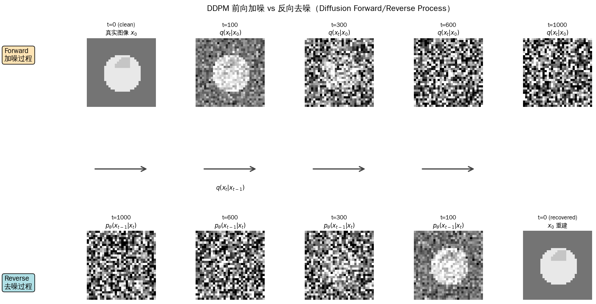
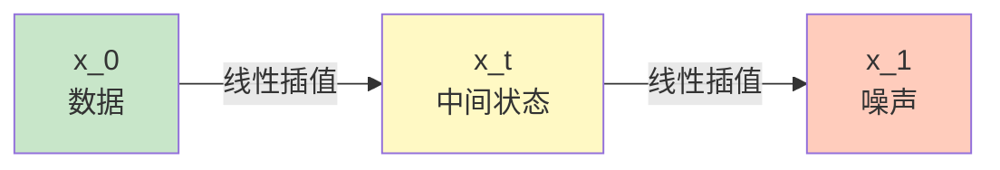
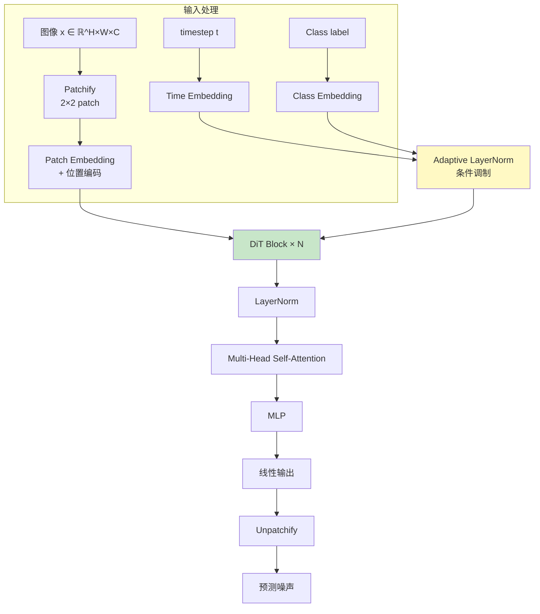
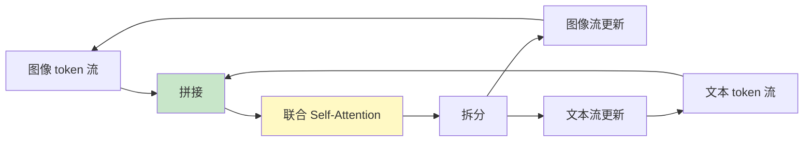
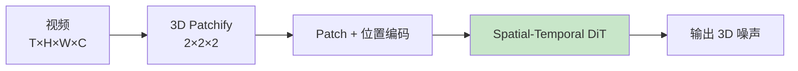
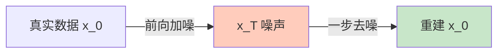
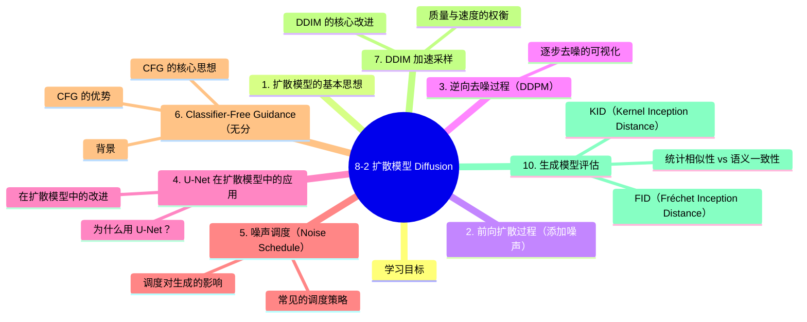

# 8-2 扩散模型 Diffusion

## 学习目标

- 理解扩散模型的基本思想：前向扩散与逆向去噪
- 掌握 DDPM 的核心算法与训练目标
- 了解 U-Net 在扩散模型中的关键作用
- 理解噪声调度（Noise Schedule）的设计思路
- 了解 Classifier-Free Guidance 和 DDIM 加速采样
- 对比扩散模型与 GAN 的优缺点

---

## 1. 扩散模型的基本思想

**扩散模型（Diffusion Model）** 是一类基于概率论的生成模型，其核心思想极为优雅：**学习从混乱到有序的逆过程**。

扩散模型的工作分为两个过程：

1. **前向扩散过程（Forward Process）**：向真实数据逐步添加噪声，直到变成纯噪声
2. **逆向去噪过程（Reverse Process）**：学习从噪声逐步恢复出真实数据

这个过程就像物理中的扩散现象：
- 前向过程：墨水滴入清水 → 逐渐扩散 → 完全混合（纯噪声）
- 逆向过程：知道混合后的状态 → 推断墨水最初的位置（生成数据）

---

## 2. 前向扩散过程（添加噪声）

前向过程是**已知的、不需要学习的**。给定原始图像 `x₀`，在 `T` 步内逐步添加高斯噪声：

```
q(x_t | x_{t-1}) = N(x_t; √(1-β_t)·x_{t-1}, β_t·I)
```

其中：
- `β_t` 是第 `t` 步的噪声方差（前向调度）
- `T` 通常取 1000 左右

通过重参数化技巧，可以直接由 `x₀` 得到任意时刻 `t` 的噪声图像：

```
x_t = √(ᾱ_t) · x₀ + √(1 - ᾱ_t) · ε,  ε ~ N(0, I)
```

其中 `ᾱ_t = ∏_{i=1}^t α_i`，`α_t = 1 - β_t`

**关键性质**：无论 `T` 有多大，最终 `x_T` 接近标准正态分布 `N(0, I)`。

下图展示了 DDPM 的前向加噪过程（上排：$t=0 \to 1000$，逐步加噪至纯噪声）和反向去噪过程（下排：$t=1000 \to 0$，逐步恢复出真实图像）：



---

## 3. 逆向去噪过程（DDPM）

逆向过程是**需要学习的**。我们希望学习一个模型 `p_θ(x_{t-1} | x_t)` 来逐步从噪声图像恢复出真实图像。

**DDPM（Denoising Diffusion Probabilistic Models）** 提出的核心洞察是：

> 不直接预测 `p_θ(x_{t-1} | x_t)`，而是让它**预测添加的噪声 ε_θ(x_t, t)**

训练目标（简化版）：
```
L = E_{t, x₀, ε}[ || ε - ε_θ( √(ᾱ_t)·x₀ + √(1-ᾱ_t)·ε, t ) ||² ]
```

也就是说，给定加噪后的图像 `x_t` 和时间步 `t`，让模型预测噪声 `ε`。

### 逐步去噪的可视化

```
纯噪声 x_T
  ↓ [逆向去噪: 预测噪声 ε, 去除部分噪声]
x_{T-1}
  ↓ [逆向去噪]
x_{T-2}
  ↓ ...
  ↓
x₁
  ↓ [最后一步去噪]
x₀（生成图像）
```

每一步去噪都利用神经网络估计当前图像中含有的噪声，然后将其减去，逐步恢复出清晰的图像。

---

## 4. U-Net 在扩散模型中的应用

DDPM 中的去噪网络通常采用 **U-Net 架构**，原因是：

### 为什么用 U-Net？

| 特性 | 优势 |
|------|------|
| **编码器-解码器结构** | 编码器提取高层语义，解码器逐步恢复空间细节 |
| **跳跃连接（Skip Connections）** | 将低层细节信息直接传递给解码器，保留局部特征 |
| **多尺度特征融合** | 能同时处理粗粒度（全局结构）和细粒度（局部纹理） |

### 在扩散模型中的改进

- **加入时间步嵌入（Time Embedding）**：将 `t` 转换为向量，加入每个残差块，让网络知道当前处于去噪的哪个阶段
- **加入条件信息（如文本）**：通过交叉注意力机制注入文本描述等条件信息
- **更大的通道数和更深的层数**：处理高分辨率图像

主流的开源扩散模型（如 Stable Diffusion 中的 U-Net）都是基于这一设计。

---

## 5. 噪声调度（Noise Schedule）

噪声调度决定了前向过程中噪声增加的节奏，对生成质量影响显著。

### 常见的调度策略

**线性调度（Linear）**：
```python
β_t = β_start + (β_end - β_start) * t/T
```

**余弦调度（Cosine）**：
```python
ᾱ_t = cos( (t/T + 0.008) / 1.008 * π/2 )²
```
余弦调度是目前最常用的方式，因为它在训练早期保留更多原始信息，晚期才加速添加噪声，训练更稳定。

**平方根调度（Square Root）**：
```python
β_t = β_start + (β_end - β_start) * √(t/T)
```

### 调度对生成的影响

- **噪声添加太快**：模型没有足够信息学习有用的表示
- **噪声添加太慢**：训练效率低，去噪路径过长
- **好的调度**：在训练效率和生成质量之间取得平衡

---

## 6. Classifier-Free Guidance（无分类器引导）

Classifier-Free Guidance（CFG）是扩散模型中一项重要技术，用于提升生成图像与条件（如文本提示）的对齐程度。

### 背景

如果想用类别标签或文本描述来引导生成，最直接的方法是训练一个分类器 `p(y|x_t)`，然后在去噪过程中加入其梯度。但这类分类器需要额外训练，且不易扩展到文本。

### CFG 的核心思想

**不依赖独立分类器**，而是联合训练一个**条件模型**（有条件输入）和一个**无条件模型**（无条件输入），然后通过两者的差值来实现引导：

```
ε̃_θ(x_t, c) = (1 + w) · ε_θ(x_t, c) - w · ε_θ(x_t, ∅)
```

- `ε_θ(x_t, c)`：条件下去噪（看到文本 `c`）
- `ε_θ(x_t, ∅)`：无条件下去噪（看不到文本）
- `w`：引导强度，通常取 7-10

**直观理解**：`w` 越大，生成图像越"听话"，越严格遵循条件；但过大会导致图像质量下降和多样性减少。

### CFG 的优势

- 不需要额外的分类器模型
- 可以应用于任意条件（文本、图像、类别等）
- 实现简单，效果显著

---

## 7. DDIM 加速采样

标准 DDPM 的一个主要缺点是：**去噪需要 T 步（通常 1000 步），非常慢**。

**DDIM（Denoising Diffusion Implicit Models）** 提出了一个关键洞察：DDPM 的前向过程是马尔可夫的，但逆向过程不必是！

### DDIM 的核心改进

1. **非马尔可夫逆向过程**：允许跳跃式去噪，将 T 步采样减少到 20-50 步
2. **保持训练目标不变**：DDIM 和 DDPM 训练过程完全相同，只是采样过程不同
3. **隐式生成模型**：DDIM 可以看作一种隐式生成模型，可以在任意两步之间插值

### 质量与速度的权衡

| 采样步数 | 质量 | 速度 |
|----------|------|------|
| 1000 步 | 最高 | 最慢 |
| 50-100 步 | 略低 | 10-20x 加速 |
| 20-30 步 | 明显下降 | 30-50x 加速 |

DDIM 使得在消费级 GPU 上生成一张图像从几分钟缩短到几秒钟，大大推动了扩散模型的实用化。

---

## 8. 扩散模型 vs GAN：优缺点对比

| 维度 | 扩散模型 | GAN |
|------|----------|-----|
| **训练稳定性** | ✅ 稳定，基于重参数化和简化的损失函数 | ❌ 不稳定，容易模式崩溃 |
| **生成多样性** | ✅ 多样性好，覆盖全分布 | ❌ 容易模式崩溃，生成多样性差 |
| **生成质量** | ✅ 高（现代扩散模型已超越 GAN） | ✅ 高（但训练困难） |
| **采样速度** | ❌ 慢（需要多步迭代） | ✅ 快（单次前向传播） |
| **可解释性** | ✅ 潜空间相对平滑 | ❌ 潜空间不明确 |
| **条件控制** | ✅ CFG 简单有效 | ❌ 需要条件判别器或架构改进 |
| **计算资源** | ❌ 训练和采样都较贵 | ✅ 单次生成成本较低 |

**总结**：
- GAN 适合对**速度敏感**、对单次生成质量要求极高的场景
- 扩散模型适合对**多样性和可控性**要求更高的场景，已成为当前 AIGC 的主流范式

---

## 9. 扩散模型的发展历程

| 模型 | 年份 | 关键贡献 |
|------|------|----------|
| **DDPM** | 2020 | 奠基性工作，建立完整理论与算法框架 |
| **ADM（Improved DDPM）** | 2021 | 改进噪声调度，引入分类器引导 |
| **DDIM** | 2021 | 加速采样，跳跃式去噪 |
| **GLIDE** | 2021 | 文本到图像扩散模型 |
| **Stable Diffusion** | 2022 | 开源的文本到图像模型，降低了使用门槛 |
| **DALL-E 2 / Imagen** | 2022 | 高质量文本到图像生成 |
| **SDXL / Playground v2.5** | 2023 | 更高分辨率、更好细节 |
| **Sora（视频扩散）** | 2024 | 视频生成的里程碑 |
| **SD3（Flow Matching + MMDiT）** | 2024 | 推理流匹配 + 多模态 DiT，文本渲染大幅提升 |
| **Flux / HunyuanDiT** | 2024-2025 | 开源 DiT 模型，多语言支持 |

---

## 10. 生成模型评估指标：FID 与 KID

评估生成图像质量是生成式 AI 的核心挑战。与分类任务不同，生成模型没有唯一"正确答案"。

### 10.1 FID（Fréchet Inception Distance）

**FID** 是生成模型评估的**黄金标准**。它衡量生成图像分布与真实图像分布之间的距离：

1. 用预训练的 Inception-v3 网络提取真实图像和生成图像的特征
2. 假设特征服从高斯分布，计算两个高斯分布之间的 Fréchet 距离

$$
FID = ||\mu_r - \mu_g||^2 + Tr(\Sigma_r + \Sigma_g - 2\sqrt{\Sigma_r \Sigma_g})
$$

其中 $\mu$ 和 $\Sigma$ 分别是真实图像（r）和生成图像（g）特征的均值和协方差矩阵。

**解读**：
- FID 越低越好
- FID = 0 表示两个分布完全相同（理论最优）
- 当前 SOTA 文生图模型的 FID 在 5-15 之间

### 10.2 KID（Kernel Inception Distance）

**KID** 是 FID 的改进版，**不需要假设特征服从高斯分布**，通过核函数直接估计最大均值差异（MMD）。

**优势**：
- 对样本量不敏感（FID 在小样本时偏差大）
- 无偏估计：期望值等于真实距离
- 更适合评估小批量生成样本

### 10.3 实践代码

```python
from torchmetrics.image.fid import FrechetInceptionDistance
from torchmetrics.image.kid import KernelInceptionDistance

fid = FrechetInceptionDistance(feature=2048)
kid = KernelInceptionDistance(subset_size=50)

# 更新真实图像统计
fid.update(real_images, real=True)
kid.update(real_images, real=True)

# 更新生成图像统计
fid.update(fake_images, real=False)
kid.update(fake_images, real=False)

print(f"FID: {fid.compute():.2f}")
print(f"KID: {kid.compute()[0]:.4f}")  # 返回 (mean, std)
```

> **注意**：FID/KID 只衡量**统计相似性**，不衡量语义一致性。一张"正确风格但内容错误"的图像可能获得很好的 FID，因此人类评估（如用户偏好研究）仍然不可替代。

---

## 11. Flow Matching（流动匹配）：SD3 的核心技术

**提出**：Lipman et al. (2023)，Esser et al. 把 Rectified Flow 推到 SD3（arXiv:2403.03206）

**核心动机**：传统 DDPM 的扩散过程是**随机微分方程（SDE）**——路径弯曲、采样需要 20-50 步。Flow Matching 把过程变成**普通微分方程（ODE）**——直线路径，可用少步数（4-8 步）生成。

### 11.1 从 Score Matching 到 Flow Matching

| 范式 | 数学形式 | 代表 | 路径 |
|------|----------|------|------|
| **Score Matching** | 估计 $\nabla_x \log p_t(x_t)$ | DDPM, Score-SDE | 弯曲 |
| **Flow Matching** | 估计**速度场** $v(x_t, t) = \dot{x}_t$ | SD3, Flux | 直线（Rectified Flow） |

**核心洞察**：从数据 $x_0$ 到噪声 $x_1$ 的任意**确定性**插值都可以定义概率路径。Rectified Flow 选择最直的那种——线性插值：

$$
x_t = (1 - t) \cdot x_0 + t \cdot \varepsilon, \quad t \in [0, 1]
$$

### 11.2 Flow Matching 损失

模型 $v_\theta(x_t, t)$ 预测**瞬时速度**（即 $x_t$ 沿时间的变化率）：

$$
\mathcal{L}_{\text{FM}}(\theta) = \mathbb{E}_{t, x_0, \varepsilon} \left\| v_\theta(x_t, t) - \underbrace{(\varepsilon - x_0)}_{\text{目标速度}} \right\|^2
$$

**对比 DDPM**：
- DDPM 预测**噪声** $\varepsilon$
- Flow Matching 预测**速度** $v = \varepsilon - x_0$
- 两者目标**等价**（数学上），但 FM 训练更稳定、采样更高效

### 11.3 为什么 SD3 用 Rectified Flow

| 优势 | 说明 |
|------|------|
| **少步数采样** | 直线 ODE 路径，1-4 步即可生成 |
| **训练稳定** | 速度场是定义良好的向量场 |
| **理论清晰** | 确定性 ODE，无随机性 |
| **可扩展** | 与 ODE solver（Euler、Heun、Dopri5）解耦 |



**采样（ODE 求解）**：
```python
def sample_flow_matching(model, num_steps=4, ...):
    dt = 1.0 / num_steps
    x = torch.randn_like(shape)  # 起始噪声
    for t in torch.linspace(0, 1, num_steps + 1)[:-1]:
        v = model(x, t)  # 预测速度
        x = x + v * dt   # Euler 步（直线路径）
    return x
```

### 11.4 Stable Diffusion 3 的重加权 RF

SD3 论文的关键工程创新——**重加权噪声调度**：训练时给轨迹中段更多权重（这些位置学起来更难）。

```python
# SD3 的重加权 Rectified Flow
def get_logSNR(t, sampling_schedule):
    """计算时间 t 的对数信噪比"""
    return -torch.log(sampling_schedule(t) / (1 - sampling_schedule(t)))

def training_weights(t, sampling_schedule):
    """给中段（中等到困难）更多权重"""
    log_snr = get_logSNR(t, sampling_schedule)
    return torch.sigmoid(log_snr) ** 2 + 1  # 简单 sigmoid 形式
```

**效果**：在 60 种扩散轨迹对比中，SD3 的 RF 变体**始终优于 LDM、EDM、ADM**。

### 11.5 Flow Matching vs DDPM：完整对比

| 维度 | DDPM | Flow Matching |
|------|------|---------------|
| **数学** | SDE 离散化 | ODE 求解 |
| **目标** | 预测噪声 $\varepsilon$ | 预测速度 $v$ |
| **路径** | 弯曲（可学习调度） | 直线（可学习调度） |
| **采样步数** | 20-50 步 | **1-8 步** |
| **训练稳定性** | 中 | 高 |
| **实现复杂度** | 中 | 低 |
| **代表** | SD 1.5/2, SDXL | **SD3, Flux, Stable Diffusion XL Turbo** |

---

## 12. DiT 与 MMDiT：Diffusion Transformer 时代

**提出**：Peebles & Xie (2023, DiT) → Esser et al. (2024, MMDiT/SD3) → Peebles (2024, Sora 公开承认是 DiT)

**核心变革**：扩散模型的**骨干网络**从 U-Net 换成 **Transformer**——更好的扩展性、更强的多模态融合。

### 11.1 DiT（Diffusion Transformer）架构



**关键设计**：
- **Patchify**：把图像切成 2×2 或 4×4 patch，类比 ViT
- **Adaptive LayerNorm (AdaLN)**：用 timestep 和 class label **调制** LayerNorm 的 scale/shift
- **零初始化**：DiT 最后一个 AdaLN 初始化为 0，训练初期输出为零，整个模型等价于恒等映射

### 11.2 MMDiT（Multimodal DiT）— SD3 的创新

**问题**：DiT 把文本当作"另一种 token"，但文本和图像的语义结构**完全不同**——简单 concat 效果不好。

**MMDiT 解法**：**两组独立权重** + **双向 attention**

```python
class MMDiTBlock(nn.Module):
    def __init__(self, dim, num_heads):
        # 两组独立的 Q/K/V 投影
        self.img_qkv = nn.Linear(dim, 3 * dim)
        self.txt_qkv = nn.Linear(dim, 3 * dim)
        # 共享输出投影
        self.img_proj = nn.Linear(dim, dim)
        self.txt_proj = nn.Linear(dim, dim)
        # 两组独立的 MLP
        self.img_mlp = nn.Sequential(nn.Linear(dim, 4*dim), nn.GELU(), nn.Linear(4*dim, dim))
        self.txt_mlp = nn.Sequential(nn.Linear(dim, 4*dim), nn.GELU(), nn.Linear(4*dim, dim))
    
    def forward(self, img_tokens, txt_tokens):
        # 1. 分别投影
        img_q, img_k, img_v = self.img_qkv(img_tokens).chunk(3, dim=-1)
        txt_q, txt_k, txt_v = self.txt_qkv(txt_tokens).chunk(3, dim=-1)
        
        # 2. 关键：拼接做联合 attention
        joint_k = torch.cat([img_k, txt_k], dim=1)
        joint_v = torch.cat([img_v, txt_v], dim=1)
        
        img_out = F.scaled_dot_product_attention(img_q, joint_k, joint_v)
        txt_out = F.scaled_dot_product_attention(txt_q, joint_k, joint_v)
        
        # 3. 分别 MLP
        img_out = self.img_mlp(img_out) + img_out
        txt_out = self.txt_mlp(txt_out) + txt_out
        return img_out, txt_out
```

**信息流**：



**关键洞察**：在 attention 阶段，**文本 token 看到图像 token**、**图像 token 也看到文本 token**——双向信息流让文本理解和图像生成同步提升。

### 11.3 DiT 系列在 2024 的爆发

| 模型 | 时间 | 参数量 | 创新点 |
|------|------|--------|--------|
| **DiT (Peebles)** | 2023.03 | 0.6B-3B | 首个 DiT，证明 Transformer 能做扩散 |
| **SD3 (Esser)** | 2024.03 | 0.45B-8B | **MMDiT + RF** |
| **Flux.1** | 2024.08 | 12B | MMDiT + Flow Matching + 1024 tok/s |
| **HunyuanDiT** | 2024.09 | 1.5B | 中文原生支持 |
| **Sora (OpenAI)** | 2024.02/12 | 据传扩散 Transformer | 时空 patch + DiT |
| **Wan2.1 (阿里)** | 2025.02 | 1.3B-14B | 开源视频 DiT |

### 11.4 训练 DiT 的 3 个工程要点

1. **Patch Size 选择**：2×2 用于高分辨率（SD3），4×4 用于低分辨率（DiT 原论文），8×8 用于 Latent Diffusion
2. **AdaLN-Zero**：最后一个 AdaLN 初始化为 0 + 残差连接为 0，训练前期输出恒等，**比标准初始化收敛快 2-3×**
3. **位置编码**：使用 2D RoPE（旋转位置编码），方便从 256×256 扩展到 1024×1024

### 11.5 视频 DiT：从图像到时空

Sora、Wan2.1 等视频模型把 DiT 扩展到 3D patch：



**关键工程**：
- **时空 patch**：把 1s 视频切成 24 帧 × 256×256 patch
- **空间/时间 attention 分离**：空间 attention 关注一帧内，时间 attention 关注跨帧
- **RoPE 扩展到 3D**：时序位置编码

---

## 13. Consistency Models（一致性模型）

**提出**：Yang et al. (OpenAI, 2023, ICML 2023)

**核心目标**：**一步生成**（1-step generation）——传统扩散模型需要 20-50 步，CM 试图压缩到 1-4 步。

### 13.1 核心思想



**关键约束**：从同一起点 $x_T$ 出发的任意轨迹上的点，都应该能**一步映射回 $x_0$**——保证输出一致。

### 13.2 训练目标

**Self-consistency 损失**：

$$
\mathcal{L} = \mathbb{E}_{t, n, x_0, x_t} \left\| f_\theta(x_t, t) - f_{\theta^-}(x_{t-\Delta t}, t - \Delta t) \right\|^2
$$

其中 $f_{\theta^-}$ 是 EMA 版本的参数。

**两种训练模式**：
1. **Consistency Training (CT)**：无需预训练，从头训练
2. **Consistency Distillation (CD)**：从预训练扩散模型蒸馏（如 Stable Diffusion）

### 13.3 LCM（Latent Consistency Models）

**提出**：Simian Luo et al. (2023, arXiv:2310.04378)

把 Consistency Model 应用到 **Latent Diffusion**（Stable Diffusion 的训练方式）：

```python
# LCM 推理（1-4 步）
def lcm_sample(model, num_inference_steps=4, ...):
    # 1. 把 50 步 DDIM 调度器压缩到 4 步
    scheduler.set_timesteps(num_inference_steps)
    
    x = torch.randn(latent_shape)
    for t in scheduler.timesteps:
        # 2. 一致性模型预测
        noise_pred = model(x, t).sample
        # 3. CFG（classifier-free guidance）
        noise_pred = noise_pred_uncond + guidance_scale * (noise_pred - noise_pred_uncond)
        # 4. 一步更新
        x = scheduler.step(noise_pred, t, x).prev_sample
    # 5. VAE decode
    return vae.decode(x / 0.18215).sample
```

**性能对比**：

| 模型 | 步数 | 1024×1024 单图时间 | 质量（FID） |
|------|------|-------------------|-----------|
| SDXL | 50 步 | 6.5s | 6.0 |
| SDXL-Turbo | **1 步** | 0.5s | 7.0 |
| **LCM-LoRA** | **4 步** | 0.6s | 6.5 |
| **SDXL-Lightning** | 1-4 步 | 0.4-0.8s | 6.8 |

### 12.4 Diffusion 模型的 4 大加速方向

| 方向 | 代表 | 步数 | 质量损失 |
|------|------|------|----------|
| **Distillation** | Progressive Distillation, SDXL-Lightning | 1-4 | 极小 |
| **Consistency Model** | CM, LCM, LCM-LoRA | 1-4 | 小 |
| **Adversarial** | SDXL-Turbo, Adversarial Diffusion Distillation | 1-4 | 中-小 |
| **Solver 优化** | DPM-Solver, EDM, Rectified Flow | 4-8 | 小 |

---

## 14. 实战：用 SD3 / Flux 风格 API 生成

```python
# Diffusers 库 + Flow Matching (Flux.1)
from diffusers import FluxPipeline
import torch

pipe = FluxPipeline.from_pretrained(
    "black-forest-labs/FLUX.1-schnell",
    torch_dtype=torch.bfloat16
).to("cuda")

# Flow Matching + 4 步 Euler 采样
image = pipe(
    prompt="a cat holding a sign that says hello world",
    num_inference_steps=4,  # ← Flux schnell 只要 4 步
    guidance_scale=0.0,     # schnell 是蒸馏版本，无需 CFG
    height=1024,
    width=1024,
).images[0]
```

```python
# 训练自己的 DiT 风格模型（简化版）
from diffusers import DiTPipeline, DiTTransformer2DModel
import torch

# 加载预训练 DiT-XL/2
pipe = DiTPipeline.from_pretrained("facebook/DiT-XL-2-256", torch_dtype=torch.float16)
pipe = pipe.to("cuda")

# 类条件生成（ImageNet 1000 类）
class_ids = torch.tensor([207, 360, 387])  # 金毛、斑马、柠檬
images = pipe(class_labels=class_ids, num_inference_steps=50).images
```

---

## 本章小结
- **扩散模型**通过前向加噪和逆向去噪两个过程实现数据生成
- **DDPM** 训练模型预测噪声，通过逐步去噪生成图像
- **U-Net** 是去噪网络的标准架构，配合时间步嵌入实现任意时刻的去噪
- **噪声调度**影响训练稳定性和生成质量，余弦调度是常用选择
- **Classifier-Free Guidance** 无需额外分类器即可实现条件生成
- **DDIM** 通过非马尔可夫逆向过程大幅加速采样
- 与 GAN 相比，扩散模型训练更稳定、生成多样性更好，但采样速度较慢
- **Flow Matching / Rectified Flow**：SD3、Flux 的核心，直线 ODE 路径，**4 步即可生成**
- **DiT（Diffusion Transformer）**：用 Transformer 替代 U-Net，更好的扩展性，SD3 / Sora / Flux 都基于此
- **MMDiT**：SD3 的关键创新，文本和图像用独立权重 + 联合 attention，**文本渲染能力大幅提升**
- **Consistency Models / LCM**：1-4 步生成，**实时应用**的关键技术
- 加速蒸馏流派（SDXL-Turbo、SDXL-Lightning、LCM-LoRA）让 SD 模型**实时生成**成为可能
- **FID / KID**：生成模型的核心评估指标。FID 衡量特征分布距离（越低越好），KID 是其无偏改进版，更适合小样本评估


## 知识图谱



## 参考资料

### 经典论文
1. Ho, J., et al. "Denoising Diffusion Probabilistic Models." *NeurIPS*, 2020.
2. Sohl-Dickstein, J., et al. "Deep Unsupervised Learning using Nonequilibrium Thermodynamics." *ICML*, 2015.
3. Song, J., et al. "Denoising Diffusion Implicit Models." *ICLR*, 2021.
4. Ho, J., and Salimans, T. "Classifier-Free Diffusion Guidance." *NeurIPS Workshop*, 2021.
5. Nichol, A., and Dhariwal, P. "Improved Denoising Diffusion Probabilistic Models." *ICML*, 2021.
6. Rombach, R., et al. "High-Resolution Image Synthesis with Latent Diffusion Models." *CVPR*, 2022.

### 2024-2025 架构演进
7. Peebles, W., and Xie, S. (2023). [Scalable Diffusion Models with Transformers](https://arxiv.org/abs/2212.09748). *ICCV 2023*. **DiT 原始论文**
8. Esser, P., et al. (2024). [Scaling Rectified Flow Transformers for High-Resolution Image Synthesis](https://arxiv.org/abs/2403.03206). *Stability AI*. **SD3 + MMDiT + Rectified Flow**
9. Lipman, Y., et al. (2023). [Flow Matching for Generative Modeling](https://arxiv.org/abs/2210.02747). *ICLR 2023*. **Flow Matching 理论**
10. Liu, X., et al. (2022). [Flow Straight and Fast: Learning to Generate and Transfer Data with Rectified Flow](https://arxiv.org/abs/2209.03003). *ICLR Workshop*. **Rectified Flow 起源**
11. Black Forest Labs. (2024). [FLUX.1: Flow Matching Architecture](https://blackforestlabs.ai/announcements/flux-1/).
12. Yang, S., et al. (2023). [Consistency Models](https://arxiv.org/abs/2303.07969). *ICML 2023*. **CM 原始**
13. Luo, S., et al. (2023). [LCM-LoRA: A Universal Stable-Diffusion Acceleration Module](https://arxiv.org/abs/2311.05556). *arXiv*.
14. Sauer, A., et al. (2024). [Adversarial Diffusion Distillation](https://arxiv.org/abs/2311.17042). *NVIDIA*. **SDXL-Turbo 核心技术**
15. Lin, S., et al. (2024). [SDXL-Lightning: Progressive Adversarial Diffusion Distillation](https://arxiv.org/abs/2402.13929). *ByteDance*.
